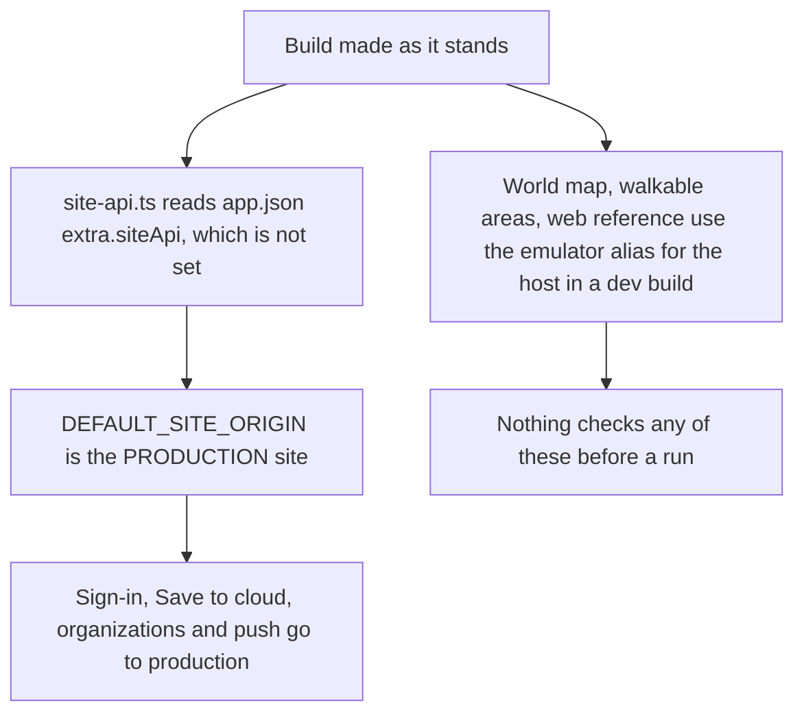
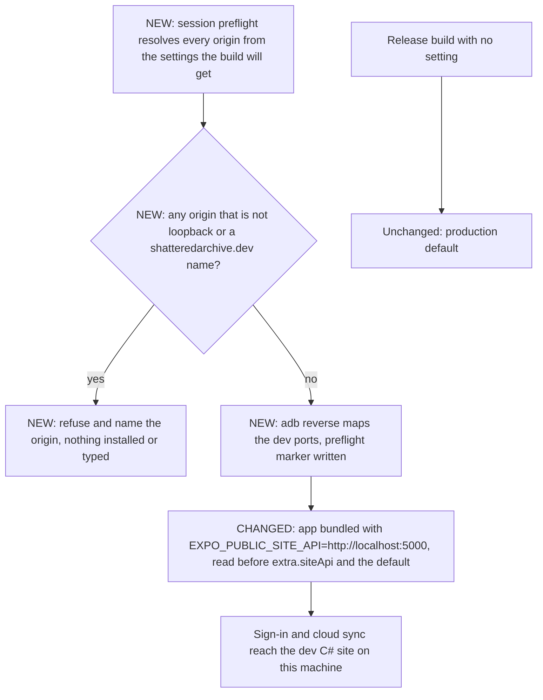
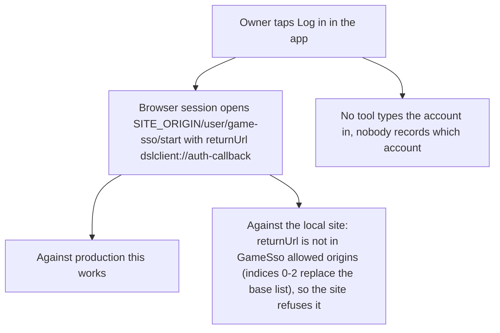
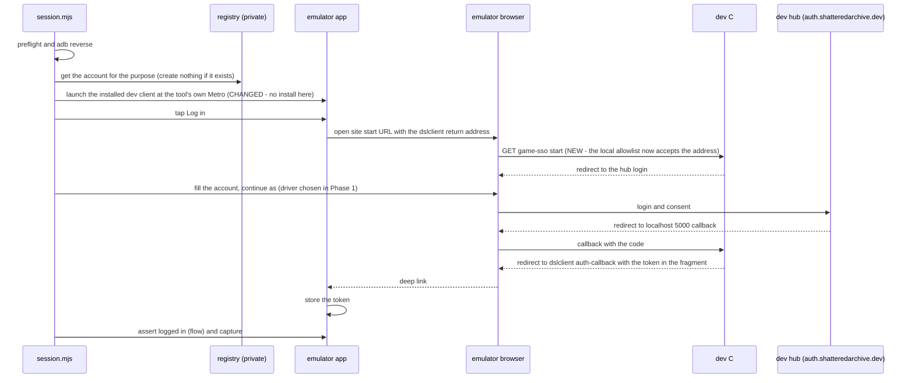
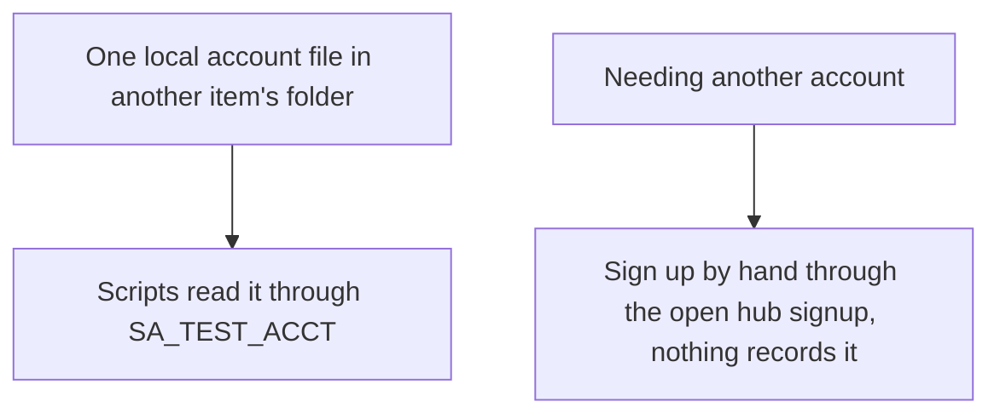
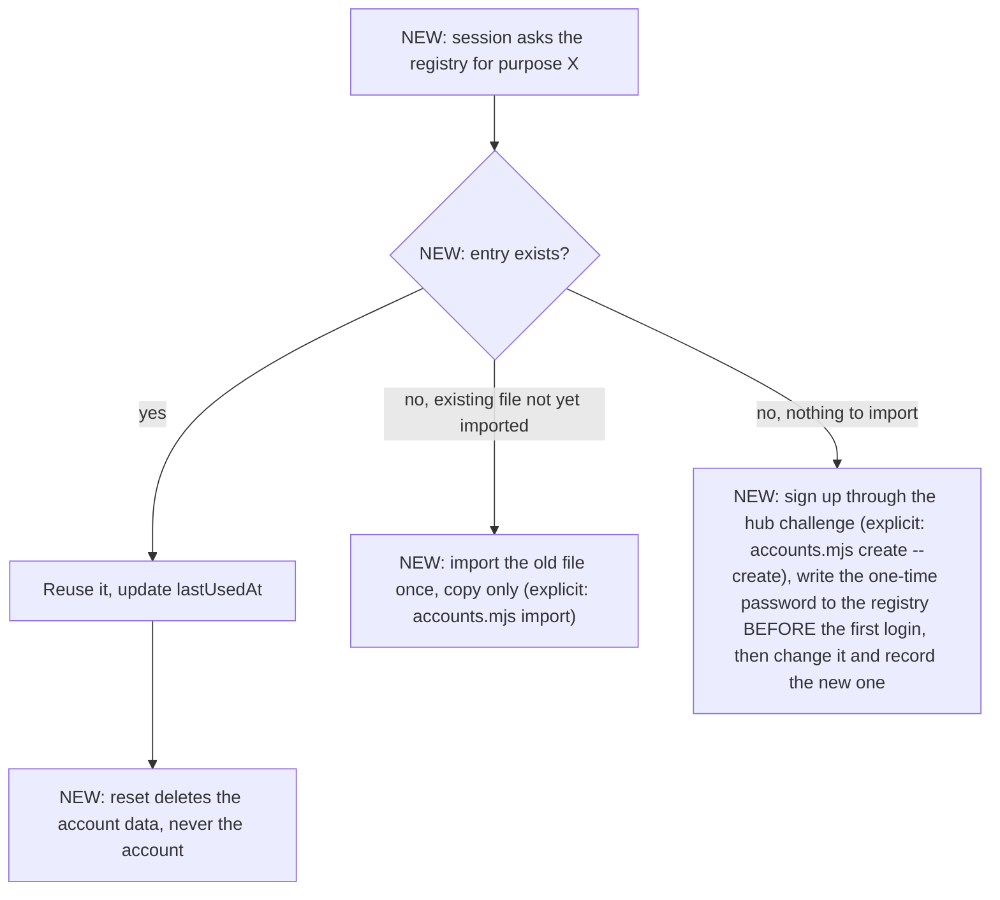
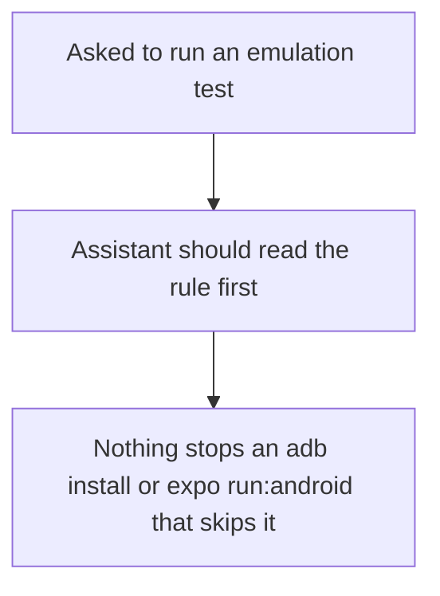
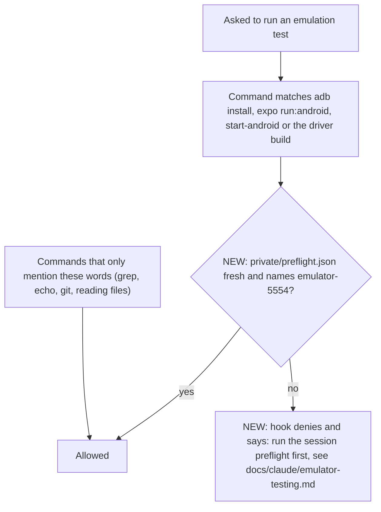

# Tech plan: Mobile emulator test harness - dev-stack routing, the real auth flow and one reusable test account

Item: item.md · Scope: scope.md · Planned against: ShatteredArchive performance/Allocation-hunt @ 9191edc, Shattered-AI performance/Allocation-hunt @ e793480, DSL main @ abb9840c, shatteredarchive-mobile optimization/Performance-and-Diagnostics @ 09b5d85 · Date: 2026-11-20
Standards: docs/standards/javascript.md (new section "Shattered-AI tools/mobile-test and the .claude/hooks guards", written with this plan), docs/standards/typescript.md (section "shatteredarchive-mobile") · Data classification: Restricted at run time (a test account's password and the sign-in token); nothing of it appears in this plan
Edge-case catalog: test-environments.md, local-only-features.md, persisted-settings-and-defaults.md, work-item-folders.md, cloud-synced-user-content.md, game-data-privacy.md · Classifiers added (user-approved 2026-11-20): TESTENV-01 (new file test-environments.md, index row added)

## Goal

When the assistant is asked to run emulation tests of the mobile app, one command sequence puts the app on `emulator-5554` pointed at this machine's dev stack (never production), signs it in through the real hub login and consent flow with the single registered test account for the purpose, lets the test run, and cleans up; and a hook stops an install or build of the app that skipped the preflight. Testable: (1) the preflight refuses every production origin, including look-alike hosts, before anything is installed or typed; (2) a recorded run signs in on the emulator through the real flow against the dev hub and the dev C# site, and the dev site's log shows the sign-in and no request reached production; (3) running the sequence twice creates no second account (the registry still holds one entry for the purpose); (4) `expo run:android` without a fresh preflight is blocked by the hook and allowed with one.

## Decisions taken by this plan (veto any in chat before Phase 1)

| # | Decision | Why |
|---|---|---|
| S1 | Extend the existing driver `Shattered-AI/tools/mobile-test` (Maestro, emulator boot, install, screenshots, app-id guard); do not create a second tool. New modules go in its `lib/`, one entry point `session.mjs` at its root. | The driver exists (`lib/emulator.mjs`, `lib/maestro.mjs`), with its own tests and a documented guard (`doc/mobile-testing.md:17-26`). Owner decision on layout: follow what it does (JavaScript standards section). |
| S2 | Routing is by port mapping: `adb -s emulator-5554 reverse` for the dev ports so `localhost` on the device is this machine, and the app is bundled with `EXPO_PUBLIC_SITE_API=http://localhost:5000`. No LAN address in any file. | Scope decision 3 (A). The dev site's own callback and hub redirect are already `http://localhost:5000/...` (`DSL/Server/docker-compose.yml:64,89`). |
| S3 | The app reads its shared site address from `EXPO_PUBLIC_SITE_API` first, then `app.json` `extra.siteApi`, then production (release and unset). | The other address settings are `EXPO_PUBLIC_*` plain reads (`features/world-map/api.ts:13`); `app.json` is committed, so the dev address must not live there. A release build never sets it, so the production default stays. |
| S4 | The registry is `tools/mobile-test/private/accounts.json` (git-ignored, proved by a test), one entry per purpose. The existing account file in the Copilot item's folder is imported once, copied and not moved, and left in place. | Scope decision 1 (A). WORKITEM-01: moving it would dangle the references to it; copying leaves them valid. |
| S5 | The sign-in driver (the browser on the emulator filled over its debugging connection, or the Maestro flow) is chosen by the Phase 1 spike. Default if both work: the debugging connection, because the password stays in process memory. | Scope unknown 4 and 5; decided by evidence, recorded in an amendment. |
| S6 | The guardrail is a PreToolUse hook `.claude/hooks/emulator-guard.js` that denies `adb ... install`, `expo run:android`, `start-android` and the driver's build/install calls unless `tools/mobile-test/private/preflight.json` is fresh and names `emulator-5554`. | Scope decision 2 (B), with the false-block risk accepted (unknown 10). |
| S7 | Metro: if the owner started it, the tool leaves it alone and never starts a second; otherwise the tool may start the one it needs, only inside a planned phase run with `/implement-plan`, with the dev settings, writes its process id to `private/metro.json` and stops only that process. A Metro it did not start is never trusted for the dev settings: the run stops and says so. | Owner's answer 2026-11-20. Fail closed (JavaScript standards, "Errors"). |
| S8 | Resetting an account deletes the account's own data (it never deletes the account): the cloud collections are replaced by empty lists and the app's stored data on the emulator is cleared. It runs only after a preflight of the same run. | Scope item: reset instead of re-creating. Cloud content is whole-collection PUT (`features/auth/cloud-sync.ts:198-266`). |

## Out of scope

- Production changes of any kind: no production compose, hub, account or site is touched; the production compose already carries `dslclient://auth-callback` (`DSL/Server/docker-compose-prod.yml:70`) and is not edited.
- The physical phone (no install, no sign-in) and iOS.
- Building the autopilot features (`2026-09-12_autoleveling-mobile-port`); this plan gives their live checks a safe way to run.
- Changing the other address settings of the app (world map, walkable areas, web reference screen); the preflight prints them but does not change them.
- Deleting or merging accounts on any hub.
- A new test runner or replacing Maestro.

## Workflows (before and after)

Before diagrams are drawn from the code read for this plan (anchors given). None of the diagrams has been rendered: box 8.6.

### W1 — Which servers an emulator build talks to        changed by: Phases 2, 3, 6
Before (`dsl-client/features/auth/site-api.ts:14,30` the site address; `app.json` has no `extra`; `features/world-map/api.ts:13-14`, `features/walkable-areas/api.ts:3-5`, `app/(tabs)/reference.tsx:7-9` the others)

After

### W2 — Signing in on the emulator through the real flow        changed by: Phases 4, 5, 6
Before (`features/auth/game-sso.ts:33,54,58` start URL and return address; `DSL/Server/docker-compose.yml:80,87-89` the local allowlist without the app's address)

After

### W3 — Where a test account comes from        changed by: Phase 5
Before (`.ai-plans/active/2026-11-05_copilot-ai-training-sibling-to-autopilot/test-account.local.json`, `Shattered-AI/tools/browser-test/lib/sa-login.mjs:21-22` reads the file named by `SA_TEST_ACCT`)

After

### W4 — Reaching for the harness when asked to run emulation tests        changed by: Phase 8
Before (`CLAUDE.md` section and `docs/claude/emulator-testing.md`, written 2026-11-20: a rule the assistant must remember)

After

## Standards applied

- **JavaScript** (`docs/standards/javascript.md`, section "Shattered-AI tools/mobile-test and the .claude/hooks guards"): ES modules in `lib/` with a `<module>.test.mjs` beside each, `node --test` through the package script, everything that touches `adb`, the network, the clock or the file system injected; fail closed and say why; passwords in a git-ignored private JSON file read inside the script, never in a command line, log, fixture or capture; hooks are CommonJS with a pure `verdict` and a self-test.
- **TypeScript** (`docs/standards/typescript.md`, section "shatteredarchive-mobile"): kebab-case modules, tests in `__tests__/*-test.ts(x)`, no new `any`, no values in warnings (the `site-api.ts` change).
- **Data classification** (`docs/standards/data-classification.md`): the plan, tests, docs and fixtures carry no account name, password, token or LAN address; fixtures use placeholders and the reserved `example.test` names.

## Edit map

Lines are as of the planned commits (above). New files have no line. Paths: `AI` = `C:/Projects/Shattered-AI`, `MOB` = `C:/Projects/shatteredarchive-mobile/dsl-client`, `DSL` = `C:/Projects/DSL/Server`, `SA` = `C:/Projects/ShatteredArchive`.

| File | Line(s) | Anchor | Change | Phase |
|---|---|---|---|---|
| `SA/docs/standards/javascript.md` | end | section "Shattered-AI tools/mobile-test and the .claude/hooks guards" | the decisions of this plan (written with the plan) | - |
| `AI/tools/mobile-test/lib/origins.mjs`, `origins.test.mjs` | new | - | classify a URL or host as dev, production or unknown (look-alikes, userinfo, case, trailing dot, ports, IPv6 loopback, the emulator host alias) | 2 |
| `AI/tools/mobile-test/lib/preflight.mjs`, `preflight.test.mjs` | new | - | the checks of W1 and the marker `private/preflight.json` (injected adb, fetch, clock) | 2 |
| `AI/tools/mobile-test/.gitignore` | 1-3 | `node_modules/`, `output/tests/*` | add `private/` | 2 |
| `AI/tools/mobile-test/lib/emulator.mjs` | 5-6, 9, 32, 76, 131-133 | `MOBILE_REPO`, `isEmulatorRunning`, `ensureEmulatorBooted`, `installAndLaunch`, `buildAndInstall` (`spawn("node", [START_ANDROID_SCRIPT]`) | require the serial `emulator-5554` in every call, pass an `env` to the build, refuse without a fresh preflight | 2, 6 |
| `MOB/features/auth/site-api.ts`, `__tests__/site-api-test.ts` | 14-35 | `DEFAULT_SITE_ORIGIN`, `configuredSiteApi`, `SITE_ORIGIN`, `siteApiBase` | read `EXPO_PUBLIC_SITE_API` first (S3); tests | 3 |
| `DSL/docker-compose.yml` | 80, 87-89 | `GameSso__AllowedReturnOrigins__0..2`, `GameSso__CallbackRedirectUri` | add `GameSso__AllowedReturnOrigins__3: "dslclient://auth-callback"` with a comment (local compose only) | 4 |
| `AI/tools/mobile-test/lib/registry.mjs`, `hub.mjs` and tests | new | - | the registry (reuse, import once, atomic write, lock) and the hub client (signup challenge, login, password change) | 5 |
| `AI/tools/mobile-test/lib/routing.mjs`, `metro.mjs`, `signin.mjs`, `reset.mjs` and tests; `session.mjs` | new | - | adb reverse set and verify, Metro start and stop of its own process, the sign-in driver of S5, reset (S8), the command-line entry | 6, 7 |
| `AI/tools/mobile-test/flows/assert-logged-in.yaml`, new `flows/tap-login.yaml` | 1-8 | `tapOn: "More"` ... `assertVisible: "Log out"` | reuse; add the flow that taps Log in | 6 |
| `AI/tools/mobile-test/package.json` | 7-9 | `"test": "node --test lib/*.test.mjs"` | scripts for the session commands | 2, 6 |
| `SA/.claude/hooks/emulator-guard.js`, `emulator-guard.selftest.js` | new | - | the guard (S6) with its self-test | 8 |
| `SA/.claude/settings.json` | 41-60 | the `Bash|PowerShell` matcher with `no-cd-guard.js`, `qdigest-guard.js`, `jest-guard.js` | add the guard to that list | 8 |
| `SA/docs/claude/emulator-testing.md`, `SA/CLAUDE.md` | whole; "Emulator and device tests" section | - | the final usage pattern, the Metro rule, the registry path in place of the old file path (WORKITEM-01) | 5, 8 |
| `AI/doc/mobile-testing.md`, `AI/doc/tooling.md` | whole; if it lists tools | - | the session commands, routing, accounts; tooling list only if it names `tools/mobile-test` | 2, 6, 8 |
| `MOB/docs/development.md`, `MOB/docs/features/autopilot.md`, `MOB/CLAUDE.md` | emulator section; settings table; pointer | - | the dev address setting and the pointer to the rule | 3, 8 |
| `MOB/features/auth/.ai-context`, `.annotated`; `AI/tools/mobile-test/.annotated` | - | - | updated where a folder changes | per phase |
| `memory/feedback-emulator-tests-dev-stack-real-auth.md` | - | - | the Metro rule and the final entry point | 8 |
| `SA/apps/auth-server/src/routes/`, `SA/docs/auth-server.md:83-130`, `DSL/appsettings.json:15`, `DSL/docker-compose-prod.yml:70` | - | signup, login; base allowlist; production compose | read only | - |

## Edge cases

| Id | Classifier | Condition | Required behaviour | Covered by |
|---|---|---|---|---|
| E1 | LOCAL-01 | The origin comes from a file that ships in a build (`app.json`) or from a missing setting | the dev address is only ever an `EXPO_PUBLIC_*` process setting; a build with none keeps the production default for releases; a release export contains no `localhost:5000` from this change | P3 site-api tests, P3 `expo export` search |
| E2 | LOCAL-02 | A local-only addition to a config shared with production | the allowed-origin line goes in `DSL/Server/docker-compose.yml` only; `docker-compose-prod.yml` and `appsettings.json` are unchanged (the diff is checked) | P4 diff check |
| E3 | LOCAL-05 | A LAN address or personal hostname is needed | none is: routing is `localhost` through `adb reverse`; a search of the changed files for private IPv4 literals finds none | P6, P8 scan |
| E4 | TESTENV-01 | An origin that looks dev but is not (`shatteredarchive.com.example.test`, `shatteredarchive.dev.evil.test`, `http://localhost@shatteredarchive.com`, upper case, trailing dot, a port, `[::1]`, `127.0.0.1`, the emulator alias `10.0.2.2`) | only loopback, the emulator host alias and hosts whose last two labels are `shatteredarchive.dev` pass; userinfo and look-alikes are refused; unparsable input is refused | P2 `origins.test.mjs` |
| E5 | - | The target device is not `emulator-5554`, more than one device is attached, or none is | the run stops naming the attached devices; every `adb` call carries `-s emulator-5554`; the physical phone is never addressed | P2 `preflight.test.mjs` (argument vectors), P6 real run |
| E6 | - | The dev C# site or the hub is down, or the site does not accept the app's return address | the preflight fails with which one and the probe used (the site's `game-sso/start` answers a redirect, not a refusal); nothing is installed | P2 test with fakes, P4 real probe |
| E7 | - | The preflight marker is missing, stale, names another device or other origins | the guard hook and the session refuse; a marker older than the configured age is stale | P2 tests, P8 hook self-test |
| E8 | SETTINGS-04 | The registry is written by import, signup, password change and reuse | one normaliser reads and writes it for every route; a wrong shape, a duplicate purpose or a missing field reads as an error that stops the run, not as "no accounts" | P5 `registry.test.mjs` |
| E9 | SETTINGS-05 | The one-time import of the existing account file | one-shot and non-destructive: the old file is copied, never changed or moved; importing twice leaves one entry; an unreadable old file stops the run | P5 tests |
| E10 | - | A second account for a purpose that has one | refused; creating requires the entry to be absent and an explicit `--create` for the purpose; the count of entries is asserted after every run | P5 tests, P8 two-run proof |
| E11 | - | The signup returns the password once and the run dies before it is saved, or the forced password change fails midway | the one-time password is written to the registry before the first login; the new password is written before the change request and marked pending, then confirmed; a pending entry is recovered on the next run | P5 tests (kill after each step) |
| E12 | - | Two sessions or two runs touch the registry together | an atomic write (temp file then rename) under a lock; the second waits or fails with the reason; a stale lock is reported, not removed silently | P5 tests |
| E13 | - | The account password reaches a log, an output line, an argument vector, a flow file or a thrown error | never; a test runs every module with a known password and asserts it is absent from all output, errors and spawned argument lists | P5, P6 tests |
| E14 | - | The hub's signup challenge is throttled or answered wrongly | no account is created, the registry is unchanged, the reason is reported; the answers come from the local questions file of the dev hub, never from a committed copy | P5 tests with fakes, P5 real check (read only) |
| E15 | - | Sign-in outcomes: success, the user backs out, the hub shows an error, wrong password, no consent screen, no deep link back | each is a distinct result with the step that failed; success is only declared after the logged-in flow passes; a failure leaves the emulator state as it is | P6 tests, P6 real run |
| E16 | - | A Metro already listens on 8081, or the port is taken | a Metro the tool did not start is never trusted: the run stops and says so; the tool starts one only when none runs, and records and later stops only its own process id | P6 `metro.test.mjs` with fakes |
| E17 | - | `adb reverse` rules are missing, stale or conflict | set idempotently and verified by listing; removed at the end of a run; a conflicting rule stops the run | P6 `routing.test.mjs` |
| E18 | CLOUDSYNC-02 | Reset replaces whole collections | the replacement is empty lists and runs only against the dev site after the same run's preflight; refusing otherwise; a test proves a reset aimed at a production origin never sends | P7 `reset.test.mjs` |
| E19 | - | The token stays on the emulator after a run | reset clears the app's data on `emulator-5554` (`pm clear`), so the next run starts signed out; the run says which it did | P7 tests, P7 real run |
| E20 | - | The hook blocks a legitimate command or lets a real one through | commands that only mention the words (grep, echo, git, cat, a heredoc body) pass; chained and wrapped forms (`bash -c`, `cmd /c`, PowerShell, `&&`) are caught; a table of 30 or more commands is the self-test | P8 self-test |
| E21 | - | Windows paths and shells | child processes get `C:/...` paths, never `/c/...` (documented learning in `doc/mobile-testing.md:103-106`); the tool runs from Git Bash, PowerShell and the assistant's shells | P2, P6 tests (path helper) |
| E22 | PRIVNAME-01 | Captures and logs of the login screens | no capture of a screen showing the account name or a typed field; captures are opened and looked at; `adb logcat` excerpts in results are scrubbed | P6, P8 review of captures |
| E23 | WORKITEM-01 | The docs name the old account file path inside an item folder that will move | `docs/claude/emulator-testing.md`, `CLAUDE.md` and the memory entry name the registry, not the old path; a search finds no remaining reference except the import note | P5, P8 search |
| E24 | WORKITEM-02 | A phase is closed with a step never run on the emulator | every emulator step that was not run stays unticked with `deferred:` and an owner; nothing is ticked for work not run | all phases, P8 |

| E25 | TESTENV-01 | The emulator's own resolver sends a dev name to a real remote host (measured in Phase 1) | before any credential is typed the preflight proves the browser maps the dev names to this machine (the command-line file exists with the mapping and its public-key pin equals the current edge certificate's), and refuses otherwise; the app's origins are loopback, so only the browser needs the mapping | P2 `preflight.test.mjs` (fake file and certificate), P6 real run |
| E26 | - | The emulator image is not debuggable, or the lock screen is up, or the browser holds stale tabs | the run stops when `ro.debuggable` is not 1 (the browser would ignore the file); the tool unlocks before starting a browser and refuses to continue if it cannot; it opens its own tab, never drives one it did not open, and closes it | P2 and P6 tests with fakes, P6 real run |
| E27 | - | A browser flag file from an earlier run is left on the emulator | `down` removes the file, the port mappings and its tab; the preflight reports a file it did not write and stops | P6, P7 tests |

Classifiers applied: TESTENV-01 (E4, E25), LOCAL-01 (E1), LOCAL-02 (E2), LOCAL-05 (E3), SETTINGS-04 (E8), SETTINGS-05 (E9), CLOUDSYNC-02 (E18), PRIVNAME-01 (E22), WORKITEM-01 (E23), WORKITEM-02 (E24).

Classifiers not applicable: LOCAL-03 (no workspace project is added to the ShatteredArchive image manifests; `tools/mobile-test` is its own package in another repo), LOCAL-04 (no second local-only feature behind a build guard), SETTINGS-01/02/03/06/07 (the registry holds no defaults, no "same as default" and no seeded lists), CLOUDSYNC-01 and 03 (no record kinds are added or keyed to server ids), the rest of the catalog (ansi, logtail, autoapproval, expo-native-upgrade, pointer, mapid, eventbus, theming, runloops, command templates) does not match; `expo-native-upgrade` would apply if Phase 1 shows the app needs a network security config plugin, which becomes an amendment.

Classifier added on 2026-11-20 after the owner approved the draft: **TESTENV-01** (a client under test defaults to production when its environment settings are missing) in `docs/standards/edge-cases/test-environments.md`, listed in the catalog index; it is the origin check of E4 and the preflight of Phase 2.

## Verification toolbox

| Purpose | Command |
|---|---|
| Driver tests | `pnpm --dir C:/Projects/Shattered-AI/tools/mobile-test test` (`node --test lib/*.test.mjs`); the package has no typecheck or lint script (none is added) |
| Hook self-test | `node C:/Projects/ShatteredArchive/.claude/hooks/emulator-guard.selftest.js` (exit 1 on a wrong verdict) |
| Mobile tests | `pnpm --dir C:/Projects/shatteredarchive-mobile/dsl-client test --runInBand <pattern>` (pass the flag without `--`, which makes jest read it as a pattern); whole package the same without a pattern; filter with `2>&1 | grep -E "Tests:|Test Suites:|FAIL|✕"` |
| Mobile typecheck, lint, bundle | `pnpm --dir C:/Projects/shatteredarchive-mobile/dsl-client exec tsc --noEmit` (baseline 0 errors, recorded 2026-11-20) · `pnpm --dir ... lint` · `pnpm exec expo export --platform android --output-dir <a folder outside the repo>` |
| Compose check and redeploy | `docker compose -f C:/Projects/DSL/Server/docker-compose.yml config` to validate; the redeploy command is confirmed from `Server/deploy-local.ps1` in Phase 4 before it is run (the local stack is the assistant's to redeploy, production is not) |
| Dev site probe | `curl -s -o /dev/null -w "%{http_code} %{redirect_url}" "http://localhost:5000/user/game-sso/start?returnUrl=dslclient%3A%2F%2Fauth-callback"` (expect a redirect to the hub, not a refusal) |
| Emulator | `C:/Android/platform-tools/adb.exe -s emulator-5554 ...` with `MSYS_NO_PATHCONV=1` for `/sdcard` paths; screenshots by `screencap` then `adb pull` (never a shell redirect); the AVD is `Pixel8` |
| Doc impact | `node C:/Projects/ShatteredArchive/scripts/check-doc-impact.mjs --files <the phase's ShatteredArchive files>`; the other repos have no such script, so their docs are the Edit-map rows |
| Private names and addresses | `pnpm check:private-names` in ShatteredArchive; a search of changed files for `[0-9]+\.[0-9]+\.[0-9]+\.[0-9]+` other than `127.0.0.1`, `10.0.2.2` |

## Phases

### [x] Phase 1 — Spike: prove the emulator's network path and how to drive its browser
Goal:        The facts that decide the design are measured on `emulator-5554` and recorded: whether the hub's name resolves and its certificate loads there, what `adb reverse` reaches, how the browser can be driven, and whether the app's debug build can reach `http://localhost:5000`.
Depends on:  nothing
Workflow:    W2

Work
- [x] 1.1 Boot `emulator-5554` with the driver's `ensureEmulatorBooted` (AVD `Pixel8`; the owner approved booting it on 2026-11-20); record `adb devices` showing only the emulator for this run and that the physical phone is not addressed.
- [x] 1.2 (done: the names resolve to a public address, not this machine; see test-results.md and A1) Name resolution: inside the emulator, resolve `auth.shatteredarchive.dev` and the other dev names (`adb shell` lookup); record the address it returns. Record whether it is this machine (through the host's hosts file), the emulator itself, or nothing.
- [x] 1.3 (done: reverse for 5000, 80, 443 works and the app reached the local site) Port mapping: `adb reverse` for 5000, 80 and 443 (S2); from the emulator's browser or shell request `http://localhost:5000/` and the hub's login page; record the status of each and which names need which port.
- [x] 1.4 (amended: see A1; no authority was installed, a public-key pin passed to the browser is enough) Certificate: open the hub login page in the emulator's browser; if it shows a certificate error, install the mkcert authority (`mkcert -CAROOT`, the file pushed and installed as a user certificate) and retry; record whether the browser trusts it and whether the app's own HTTPS calls would (a debug build trusts only system authorities unless configured): if a network security setting is needed, record it as an amendment (an `expo-native-upgrade` classifier applies then).
- [x] 1.5 (done: the debugging connection works; chosen in A2) Browser driving: record whether the browser's debugging socket is reachable (`adb forward` to its local abstract socket, then a JSON listing over HTTP) and whether the existing Playwright code (`lib/sa-login.mjs` selectors) can attach and fill the hub's login and consent pages, or whether only Maestro text input works; record how each keeps the password out of command lines; choose S5 and write it as an amendment.
- [x] 1.6 (done: settings reach the bundle through the Metro process; see A3 for what the unfixed app did) The app's reach: install the current debug build (no sign-in), start the app with a Metro carrying `EXPO_PUBLIC_SITE_API=http://localhost:5000`, and record whether the app's own request to the dev site over the mapped port works (cleartext to localhost) and whether `start-android.js`'s `expo run:android` (`scripts/start-android.js:160-163`, which inherits the environment) passes the setting through. Stop only the Metro started here.
- [x] 1.7 Tests: None - this phase measures and changes no code; its output is `test-results.md` and the amendments.
- [x] 1.8 UI check: capture of the hub login page on the emulator with the fields empty and of the app's Settings screen signed out, `phase-01_hub-login.png`, `phase-01_signed-out.png` (open each, no account shown).
- [x] 1.9 Docs and indexes: the findings go into `docs/claude/emulator-testing.md` "Known state" (replace the suspicion with the measured facts); end-user doc: no user-visible effect (developer tooling).

Sign-off
- [x] 1.S Exit gate verified and recorded in test-results.md (2026-11-20): every measurement above recorded with its command and result · the decisions it forces written as amendments · nothing committed or changed in any app or server · the After diagram of W2 still holds or is amended

State on exit: the design is decided from evidence; no code exists yet.

### [x] Phase 2 — Origins check, preflight and the private folder
Goal:        A tested library decides whether every origin and the target device are safe, writes a preflight marker, and the private folder is ignored by git.
Depends on:  Phase 1
Workflow:    W1

Work
- [x] 2.1 `AI/tools/mobile-test/lib/origins.mjs` (new): `classifyOrigin(url)` returning `dev`, `loopback`, `emulator-alias`, `production` or `unknown` per E4; `resolveOrigins(env, appDefaults)` listing the origin of every setting the build will receive (site and sign-in, autopilot catalog, world map, walkable areas, web reference) with its source.
- [x] 2.2 (amended: see A6, A7) `AI/tools/mobile-test/lib/preflight.mjs` (new): `runPreflight({ adb, fetchFn, now, env })` checks the single device `emulator-5554` (E5), the resolved origins (E4), that the dev site and hub answer and that the dev site's sign-in start accepts the app's return address (E6), prints the origins (never a credential), and writes `private/preflight.json` (device, origins, time) (E7); any doubt fails closed with the reason.
- [x] 2.3 (amended: see A7) `AI/tools/mobile-test/.gitignore:1-3`: add `private/`; `lib/emulator.mjs:9,32,76,131`: every `adb` call takes the serial and refuses any other (E5, E21 path helper).
- [x] 2.4 Tests: `origins.test.mjs` (the E4 table: each look-alike, userinfo, case, port, IPv6, alias, junk input, an empty setting resolves to the production default and is refused as TESTENV-01 describes) · `preflight.test.mjs` (fake adb: two devices, none, wrong serial, the physical phone only; fake fetch: site down, hub down, return address refused, redirect accepted; marker written with device and origins, not written on failure, stale after the age limit; the argument vectors of every adb call carry `-s emulator-5554`; output holds no credential) · a test that `git check-ignore` reports `private/accounts.json` as ignored.
- [x] 2.5 Docs and indexes: `AI/tools/mobile-test/.annotated` (new entries), `AI/doc/mobile-testing.md` (section "Preflight and origins"); no end-user doc (developer tooling).

Sign-off
- [x] 2.S Exit gate verified and recorded in test-results.md (2026-11-20): `pnpm --dir C:/Projects/Shattered-AI/tools/mobile-test test` all pass · coverage of the new modules reviewed (every branch above) · the After diagram of W1 (the preflight half) matches

State on exit: the preflight exists and is tested with fakes; nothing calls it yet and no app change exists.

### [x] Phase 3 — The app's site address can be set for a test build
Goal:        A build bundled with `EXPO_PUBLIC_SITE_API` uses that address for sign-in and cloud sync, and a build without it behaves exactly as before.
Depends on:  nothing
Workflow:    W1

Work
- [x] 3.1 `MOB/features/auth/site-api.ts:14-35` (`DEFAULT_SITE_ORIGIN`, `configuredSiteApi`, `SITE_ORIGIN`, `siteApiBase`): read `process.env.EXPO_PUBLIC_SITE_API` (the plain form the bundler replaces) before `extra.siteApi` and the default; trim and drop trailing slashes; a blank value is ignored (S3).
- [x] 3.2 Tests: new `MOB/features/auth/__tests__/site-api-test.ts`: the setting wins over `extra.siteApi` and the default; a blank or whitespace setting falls through; trailing slashes trimmed; with none set the answer is the production origin (E1); `configuredSiteApi` still reports only what is configured (the autopilot client relies on it).
- [x] 3.3 Bundle proof (E1): `expo export --platform android` with no setting, then a search of the bundle for `localhost:5000`: nothing added by this change; with `EXPO_PUBLIC_SITE_API` set the address is present. Record both.
- [x] 3.4 Docs and indexes: `MOB/features/auth/.ai-context` and `.annotated` (the order of the three sources and why `app.json` is not used for a dev address), `MOB/docs/features/autopilot.md` (settings table gains the setting), `MOB/docs/development.md` (section "Pointing a test build at the dev stack").

Sign-off
- [x] 3.S Exit gate verified and recorded in test-results.md (2026-11-20): mobile jest all pass (baseline 85 suites, 1184 tests at the end of the autopilot item's Phase 2, re-recorded at the start) · `tsc` 0 errors · lint · `expo export` exit 0 · coverage of `site-api.ts` · doc-impact (mobile docs by the Edit-map rows) · the After diagram of W1 (the app half) matches

State on exit: a test build can be pointed at the dev site; nothing sets the variable yet and releases are unchanged.

### [x] Phase 4 — The local dev site accepts the app's return address
Goal:        The local C# site no longer refuses `dslclient://auth-callback`, and the production compose and base settings are untouched.
Depends on:  Phase 1
Workflow:    W2

Work
- [x] 4.1 (amended: see A8) `DSL/docker-compose.yml:87-89` (after `GameSso__AllowedReturnOrigins__2`): add `GameSso__AllowedReturnOrigins__3: "dslclient://auth-callback"` with a comment saying indices 0-2 replace the base list and this one restores the app's address for the local stack only (E2). `docker-compose-prod.yml` and `appsettings.json` are not edited.
- [x] 4.2 (amended: see A8) Redeploy the local C# container with the repo's own local deploy command (read from `Server/deploy-local.ps1` first); the production compose is not run.
- [x] 4.3 API check (E6): `GET http://localhost:5000/user/game-sso/start?returnUrl=dslclient%3A%2F%2Fauth-callback` answers a redirect to the hub's authorize page (no "returnUrl is missing or not a registered game-client origin"); record status and the redirect's host only. A return address that is not allowed (a made-up scheme) still answers the refusal, so the list was not opened wider than intended.
- [x] 4.4 Tests: None - compose configuration; the API check and `docker compose config` are the verification. The diff of the two other files is empty (E2).
- [x] 4.5 Docs and indexes: `DSL/docker-compose.yml` comment; `SA/docs/claude/emulator-testing.md` "Known state" (the allowlist item resolved); no `.ai-context` for the compose folder.

Sign-off
- [x] 4.S Exit gate verified and recorded in test-results.md (2026-11-20): `docker compose config` valid · the local stack healthy after redeploy (the site answers `GET /` and an existing page) · API check done · diff of production files empty · the After diagram of W2 (the allowlist step) matches

State on exit: the dev site accepts the app's sign-in; no app or tool change depends on it yet.

### [x] Phase 5 — The account registry and the hub client
Goal:        One account per purpose is kept in a private registry, imported once from the existing file, reused on every run, and a new one can be made through the hub's own signup only when none exists.
Depends on:  Phase 2
Workflow:    W3

Work
- [x] 5.1 (amended: see A9) `AI/tools/mobile-test/lib/registry.mjs` (new): load, normalise and write `private/accounts.json` through one function each (E8); `getAccount(purpose)`, `importExisting(path)` (E9), `createAccount(purpose, hub)` allowed only when the purpose has no entry (E10); atomic write with a lock and the pending states of E11 and E12; entries hold purpose, hub, username, password, accountId, createdAt, lastUsedAt, source.
- [x] 5.2 `AI/tools/mobile-test/lib/hub.mjs` (new): the dev hub's HTTP client for `GET /api/auth/challenge`, `POST /api/auth/signup`, `POST /api/auth/login` and the password change, answering the challenge from the dev hub's local questions file named by the registry's setting (E14); refuses any hub origin that is not dev (E4); fetch injected.
- [x] 5.3 Tests: `registry.test.mjs` (wrong shape, duplicate purpose and missing field stop the run; import copies and leaves the source byte-identical; importing twice leaves one entry; a second account for a purpose is refused; the kill-after-each-step cases of E11; two writers under the lock; a stale lock is reported) · `hub.test.mjs` (fake fetch: challenge answered, throttled, wrong answer creates nothing, signup password recorded before login, forced change recorded pending then confirmed; a production hub URL is refused) · a leak test per module with a known password (E13).
- [x] 5.4 Real check (read only against the dev stack): import the existing account into the registry for the purpose `mobile-emulator`; log in to the dev hub over HTTP with it and read `me`; confirm the registry holds exactly one entry and the old file is unchanged (hash before and after); no signup is performed.
- [x] 5.5 Docs and indexes: `AI/tools/mobile-test/.annotated`, `AI/doc/mobile-testing.md` ("Accounts"), `SA/docs/claude/emulator-testing.md` rule 3 now names the registry and not the old file path (E23); memory entry updated.

Sign-off
- [x] 5.S Exit gate verified and recorded in test-results.md (2026-11-20): driver tests all pass · coverage of `registry.mjs` and `hub.mjs` reviewed · real check done · the After diagram of W3 matches

State on exit: the registry works and holds the one existing account; no emulator step uses it yet.

### [x] Phase 6 — Routing and the real sign-in on the emulator
Goal:        One command sequence puts a dev-settings build on `emulator-5554`, maps the ports, and signs in through the real hub flow with the registered account, proved by the logged-in flow and the dev site's log.
Depends on:  Phases 1, 2, 3, 4, 5
Workflow:    W1, W2

Work
- [x] 6.1 `AI/tools/mobile-test/lib/routing.mjs` (new): `adb reverse` for the ports Phase 1 found necessary, verified by listing, idempotent, removed on `down` (E17).
- [x] 6.2 (amended: see A10) `AI/tools/mobile-test/lib/metro.mjs` (new): detect a Metro on 8081; start one with the dev settings only when none runs and only when the caller states it is inside an `/implement-plan` phase (S7), write `private/metro.json`, stop only that process; a foreign Metro stops the run (E16). `lib/emulator.mjs:131-133` `buildAndInstall` passes the environment through to `start-android.js` (checked in Phase 1.6).
- [x] 6.3 `AI/tools/mobile-test/lib/signin.mjs` (new): the driver chosen in Phase 1 (S5) for the hub login and consent pages, typing the password through a channel that never reaches a command line or log (E13); a distinct result for each outcome of E15; success only after `flows/assert-logged-in.yaml` passes. New `flows/tap-login.yaml` taps Log in in the app (app id guard unchanged).
- [x] 6.4 (amended: see A10) `AI/tools/mobile-test/session.mjs` (new): `preflight`, `up` (preflight, routing, Metro, install, launch), `signin`, `status`, `down`; each refuses without a fresh marker where it must; no `adb` call without the serial.
- [x] 6.5 Tests: `routing.test.mjs`, `metro.test.mjs`, `signin.test.mjs` with fakes: every result of E15, a foreign Metro, a stale reverse rule, no credential in any argument vector, output or error (E13), serial on every call (E5).
- [x] 6.6 Real run (emulator): `session up`, `session signin` with the registry account; the logged-in flow passes; the dev site's log shows the start and callback requests and no request to a production host was made by the run (the preflight listing plus the log); capture `phase-06_logged-in.png` of the Settings screen after sign-in, opened and checked for any account name (E22).
- [x] 6.7 Docs and indexes: `AI/doc/mobile-testing.md` (the session commands), `AI/tools/mobile-test/.annotated`, `SA/docs/claude/emulator-testing.md` "The usage pattern" now describes the real commands.

Sign-off
- [x] 6.S Exit gate verified and recorded in test-results.md (2026-11-20): driver tests all pass · coverage reviewed · real run done and recorded · scan for private addresses in changed files finds none (E3) · the After diagrams of W1 and W2 match the run

State on exit: a signed-in dev-stack emulator session works from the command line; reset and the hook do not exist yet.

### [x] Phase 7 — Reset and cleanup
Goal:        A run can end with the account's data and the emulator's stored state cleared, so the same account is reused forever.
Depends on:  Phase 6
Workflow:    W3

Work
- [x] 7.1 (amended: see A11) `AI/tools/mobile-test/lib/reset.mjs` (new): after the preflight of the same run, replace the account's cloud collections with empty lists on the dev site (the collections the app saves: scripts, plugin configs, library writings, the autopilot records, global scripts), clear the app's data on `emulator-5554` (E19), remove the port mappings, stop only its own Metro; any production origin refuses without sending (E18).
- [x] 7.2 `session.mjs`: `reset` and `down --reset`.
- [x] 7.3 Tests: `reset.test.mjs` with fakes: the exact requests sent (empty lists, dev origin, the account's token), none sent for a production origin or without a fresh preflight, the clear command carries the serial, a failure midway reports what is left and leaves the registry intact.
- [x] 7.4 (amended: see A11, the seed went through the site API) Real run: save something from the app (Save to cloud with one script), run `reset`, Load from cloud shows nothing, the registry still holds one entry, the app starts signed out; record counts, not content.
- [x] 7.5 Docs and indexes: `AI/doc/mobile-testing.md` ("Reset"), `AI/tools/mobile-test/.annotated`.

Sign-off
- [x] 7.S Exit gate verified and recorded in test-results.md (2026-11-20): driver tests all pass · coverage reviewed · real run done · no new account created by the run

State on exit: the full lifecycle (up, sign in, test, reset, down) works.

### [x] Phase 8 — The guard, the usage pattern, and close-out
Goal:        The hook blocks an unchecked install or build, the rule and docs describe the working pattern, and a full run proves everything together.
Depends on:  Phases 1-7
Workflow:    W4

Work
- [x] 8.1 (amended: see A12) `SA/.claude/hooks/emulator-guard.js` (new): exports `verdict(command, now, readMarker)`; denies commands that run `adb ... install`, `expo run:android`, `start-android` or the driver's build and install calls unless `private/preflight.json` is fresh and names `emulator-5554` (S6, E7, E20); passes commands that only mention the words; fails open only when its own input is unparsable, like the other guards.
- [x] 8.2 `SA/.claude/settings.json:41-60`: add the guard after `jest-guard.js` in the `Bash|PowerShell` list.
- [x] 8.3 Tests: `emulator-guard.selftest.js` with 30 or more commands: blocked (bare, chained, `bash -c`, `cmd /c`, PowerShell, with and without a stale or foreign-device marker), allowed (grep, echo, `git commit -m` text, reading the doc, the session's own commands, the same install with a fresh marker); a case that the hook's reason names `docs/claude/emulator-testing.md`.
- [x] 8.4 Final pattern: `SA/docs/claude/emulator-testing.md` rewritten from interim to final (the commands, the Metro rule of S7, the registry, reset, the known false-block recovery), `SA/CLAUDE.md` section updated, `MOB/CLAUDE.md` and `MOB/docs/development.md` pointers, the memory entry updated (E23).
- [x] 8.5 Two-run proof: run `session up`, sign in, `reset`, `down`, then the same again; the registry holds one entry after both and no account was created; `expo run:android` typed without a preflight is blocked, and with one is allowed.
- [x] 8.6 (closed by the owner's sign-off on 2026-11-20 without a separately recorded preview render; originally deferred: needs the editor's diagram preview, which only the owner can open here; a static check of the eight blocks against the skill's rules passed after two fixes, see test-results.md Phase 8) Render check: open the four workflow diagrams of this plan in the editor preview and confirm each renders (they were written without a renderer).
- [x] 8.7 Full checks: driver tests, hook self-test, mobile jest, `tsc`, lint, `expo export`; `pnpm check:private-names`; a search of every changed file for private IPv4 literals, passwords and tokens; `node scripts/check-doc-impact.mjs` for the ShatteredArchive files.
- [x] 8.8 Docs and indexes: `AI/doc/mobile-testing.md` final, `AI/doc/tooling.md` only if it lists the tool, every `.annotated` and `.ai-context` of the touched folders; the classifier TESTENV-01 is in the catalog index (added with this plan).

Sign-off
- [x] 8.S Exit gate verified and recorded in test-results.md (2026-11-20; 8.6 deferred to the owner): all checks of 8.7 green · the two-run proof recorded · doc-impact 0 unresolved · the After diagrams of W1 to W4 match the built behaviour

State on exit: ready for the owner's sign-off and `/pr-review`; the autopilot item's live checks can use the pattern.

## Risks and rollback

- **R1. The emulator cannot trust the hub's certificate or resolve its name** (scope unknowns 2 and 3). Phase 1 measures it; the fallback designs are an amendment: the authority installed on the emulator, or a different sign-in route. No later phase starts before Phase 1 is signed off.
- **R2. The hook blocks a legitimate command** (scope unknown 10). The self-test table and the recovery text in the hook's reason limit it; the hook is one line in `settings.json` and one file, removed to roll back.
- **R3. Passwords through `adb`.** Typing a password via `adb input text` puts it in a process argument list on this machine for a moment. Phase 1.5 picks the driver; if only that route works, the plan records it as an accepted limit with the owner before Phase 6.
- **R4. A Metro that the owner started carries unknown settings.** The tool refuses to use it (E16), which can stall a run; the message says how to proceed.
- **R5. Cross-repo edits.** Phases touch four repos (Shattered-AI, mobile, DSL compose, ShatteredArchive hooks and docs); each phase says which, and the owner commits each repo.
- **Rollback.** Phase 3 is one source file (revert it); Phase 4 is one compose line (remove it and recreate the local container); the driver modules are additive; the hook is removed from `settings.json`; the private folder is deleted by the owner and holds only copies.

## Plan amendments

**A1 (2026-11-20, Phase 1 finding, significant, the plan's own risk R1 materialised; approved by the owner's standing instruction to point the emulator at the dev servers and by the measured evidence):** the emulator does not see this machine's hosts file: the dev names resolve to a public address (test-results.md, Phase 1). Original plan: S2 relied on `adb reverse` alone, with the hub's name assumed to resolve to this machine and its certificate to need a trusted authority (boxes 1.2, 1.4; scope unknowns 2 and 3). Found: (a) a bind-mounted hosts file is not used by the resolver; (b) the browser can be given the mapping and the certificate itself: Chrome 113 on this debuggable image reads `/data/local/tmp/chrome-command-line`, so `--host-resolver-rules="MAP *.shatteredarchive.dev 127.0.0.1"` plus `--ignore-certificate-errors-spki-list=<hash of the edge certificate's public key>` makes the hub page load from this machine with no authority installed (hash computed at run time from the edge certificate file). Change: S2 now reads: routing is `adb reverse` for 80, 443, 5000 (and 8081 for Metro) plus the browser flag file written by the tool, which only works on a debuggable emulator image (E26) and not on a real phone; the app's own origins stay `localhost`. Phase 6 gains the file's writing, its pin, the unlock and the force-stop of the browser; Phase 2's preflight gains E25 and E26; `down` removes the file (E27). Wider impact: nothing in the app or the compose depends on the name resolving in the emulator; a real phone is out of scope (it cannot use this mechanism).
**A2 (2026-11-20, Phase 1 finding, S5 decided):** the sign-in driver is the browser's debugging connection with Playwright (`connectOverCDP` through `adb forward` to `chrome_devtools_remote`), not Maestro text input: the password stays in the tool's memory and goes over the socket, never on a command line or in a flow file (R3 resolved). The Custom Tab of the app appears as a page in the tab list; the tool selects it by its address and does not touch other tabs (E26). `flows/tap-login.yaml` (Maestro) is still used for the tap in the app.
**A3 (2026-11-20, Phase 1 finding, minor, wider impact on ordering):** with the app as it stands, Log in goes to the production site (the hub authorize URL carried the production callback address), and one unauthenticated request reached production during the spike before any credential existed. Phase 3 (the setting) and Phase 2 (the preflight) therefore must exist before any sign-in tap in later phases; Phase 6 may not tap Log in until the preflight marker is fresh and the bundle was made with `EXPO_PUBLIC_SITE_API` (checked in the bundle served by Metro, as done in Phase 1, item 6). The hub name is shared with production (production's own sign-in redirects to it), so which hub a browser reaches is decided only by name resolution: the preflight must verify the mapping (E25) before a password is typed.
**A4 (2026-11-20, Phase 1, minor):** the emulator holds state between runs: the browser flag file and the `adb reverse` rules persist until removed; this is why `down` and the preflight check them (E27), and why `docs/claude/emulator-testing.md` says what the emulator's browser now does with `*.shatteredarchive.dev` names (they go to this machine).
**A5 (2026-11-20, Phase 1, minor):** the cold-booted emulator is locked and the browser's activities do not resolve until it is unlocked with the emulator's PIN (from the owner's notes, `android-emulator-capture-recipe`); the tool unlocks first and stops if it cannot (E26).
**A6 (2026-11-20, Phase 2, minor, E5 clarified):** E5 and box 2.4 read "more than one device is attached ... the run stops". Taken literally the tool could never run, because the owner's physical phone is attached in normal use (it was throughout Phase 1). Built: the preflight requires `emulator-5554` to be attached in state `device` (not offline, not unauthorized, booted, debuggable); any other device may be attached and is listed by kind only (a wireless phone's address is never printed), because every device command is pinned to `-s emulator-5554` and tested as such. None attached, the phone only, or another emulator only all stop the run. Wider impact: none; the guard in Phase 8 reads the same marker.
**A7 (2026-11-20, Phase 2, minor, Edit map):** two helper modules not in the Edit map were added: `lib/adb.mjs` (the serial-pinned adb entry point and the `C:/` path helper, which box 2.3 asked for as "every adb call takes the serial and refuses any other") and `lib/devfetch.mjs` (the dev-only HTTP client the preflight needs, which Phase 5's hub client reuses; it also refuses non-dev hosts before connecting and trusts only the local mkcert authority). `lib/emulator.mjs` gained an optional `serial` and injectable runners on `isEmulatorRunning` and `ensureEmulatorBooted` (no serial = the old behaviour, so the Shattered Story driver is unchanged). Origins list: the app has five origins, not the three the plan named: site and sign-in, autopilot catalog, world map, walkable areas and the reference tab; the last two have no override and default to the emulator alias in a debug build.
**A8 (2026-11-20, Phase 4, minor, Edit map):** the compose file is `DSL/Server/docker-compose.yml` (the plan wrote `DSL/docker-compose.yml`; the lines are 87-89 there, the new line follows them). The redeploy was `Server/deploy-local.ps1 -SkipBuild -NoVerify`: only the container's environment changed, so the existing build output was reused and no source from the working tree's other uncommitted DSL files was newly built in; the script's own verify step (the agent-discovery checker) was skipped because nothing it checks changed, and the plan's own health probes (`/robots.txt`, `/api/world-map/index`) were run instead.
**A9 (2026-11-20, Phase 5, minor, W3 After diagram corrected):** the plan's After diagram let "the session asks the registry for purpose X" fall through to an import or a signup when the entry is absent. Built instead: a missing entry is an error that says what to do, and importing (`accounts.mjs import <file> <purpose>`) and signing up (`accounts.mjs create <purpose> --create`) are separate, explicit commands, so a test run can never make an account by accident (E10). The diagram above is corrected to say so; the original wording of the two branches was "import the old file once, copy only" and "sign up through the hub challenge ...". Added modules not in the Edit map: `lib/accounts-cli.mjs` with the root `accounts.mjs` (the way to run the real check of box 5.4 and the commands above) and `lib/fake-hub.mjs` (a stateful test double of the hub's contract; change it with `apps/auth-server/src/routes/auth.ts` and `account.ts`). Known unrecoverable instant, documented in `doc/mobile-testing.md`: a run killed between the hub's signup answer and the first registry write leaves a hub account with no record; E11 as worded ("written before the first login") holds for every step after the answer.
**A10 (2026-11-20, Phase 6, minor, W2 After corrected):** (a) `session up` launches the already-installed dev client at the tool's own Metro and does not build or install: a dev client needs the native build only once, the dev settings reach it through Metro's environment (measured in Phase 1), and `buildAndInstall` (`lib/emulator.mjs:131`) starts its own Metro through `start-android.js`, which would break the Metro rule (S7); `up` stops with the instruction when the package is missing. The W2 After line "install and launch the dev-settings build" is corrected accordingly (original wording kept here). (b) A development bundle does not inline `EXPO_PUBLIC_*` where site-api.ts reads it; it defines them in a prelude on `process.env`. The first real `up` failed closed on my inline-only pattern; the check now accepts the prelude and the exported inline form for the dev origin only (box 6.2, E16). (c) Modules and files added beyond the Edit map: `lib/session-core.mjs` (the commands with injected collaborators; `session.mjs` is the thin entry the plan named), `lib/fake-device.mjs` (test double), `lib/fixtures/dev-edge.pem` (the public dev edge certificate, no private key, for the pin test); `lib/maestro.mjs` gained a `device` pin on `runFlow` and a `serial` on `captureScreenshot` (no device given: unchanged for the Shattered Story driver). (d) The emulator's lock PIN is read from `private/emulator.json` (git-ignored), filled once from the owner's notes. (e) The emulator-side PIN is typed with `adb shell input text`, so it appears on an adb command line; it is a screen-lock PIN of a throwaway emulator, not an account credential (E13 concerns the account password, which never does).
**A11 (2026-11-20, Phase 7, minor, three edge cases found live):** (a) Reset method: the site's UserContentController already has `DELETE` for the four collections (it saves `[]`, the plan's "empty lists") and the library has item-level `my-writings` endpoints, so `lib/reset.mjs` uses those; the token comes from the site's own game-sso hand-off over HTTP with the hub's approve call, in memory only, because the app's own token sits in the Keystore and cannot be read. (b) Box 7.4 asked to "save something from the app (Save to cloud with one script)"; the throwaway record was saved through the site's API with the account's token instead (the app had no script to save and creating one in the UI was not worth the risk of touching the user's data paths), and the app's Load dialog was read before and after the reset ("1 script from the cloud" then "Nothing is saved to this account yet"); this is the part of 7.4 not run as written. (c) New edge rows from the live run, each covered by a test: **E28** the emulator image's adb is not root after a cold boot, so ports 80 and 443 cannot be mapped (`ensureRoot`, `routing.test.mjs`, `session-core.test.mjs`) · **E29** the app's launch fails about half the time because its 14 MB development bundle arrives cut short over the emulator's network while Metro serves it complete (measured plain and gzip from this machine; a cold boot of the emulator did not cure it): `up` waits for the Home screen and relaunches up to five times, a screen that never settles times out per launch (`session-core.test.mjs`) · **E30** the Maestro flows must not depend on where the previous one left the app: no tap on "Home" (Android's own Home button has that label) and Settings is swiped to the top first (real run; the flow files). (d) Also fixed from the live run: a tab closing between two polls was reported as a Playwright error after a successful sign-in (`signin.test.mjs`); `signin` on an already signed-in app answers `already-logged-in`. (e) `down --reset` runs the cleanup even when the reset fails and then exits 1.
**A12 (2026-11-20, Phase 8, minor):** the guard goes beyond the plan's list in four ways, each covered by the self-test: it also blocks `pnpm start:android`, `android:build` and `android:deploy` (the app's own scripts that run start-android), gradle `install*` tasks and the old driver scripts (`smoke-test.mjs`, `verify-smoke.mjs`, `verify-firebase-e2e.mjs`); an `adb install` that does not pin `-s emulator-5554` is blocked even with a fresh marker (rule 1: never the physical phone); heredoc bodies are text, not commands, unless fed to a shell (a commit message that names an install must pass); and the hook reads the marker itself without recomputing origins (the session's `checkMarker` is the stricter twin). The final rule doc also states the launch flakiness (A11). Box 8.6 (visual render of the diagrams) is not run: see test-results.md.
**A13 (2026-11-20, from the PR review, minor):** the certificate fixture named in A10 (`lib/fixtures/dev-edge.pem`) was a real mkcert certificate and carried the machine's account and host name; it is replaced by `lib/fixtures/neutral-test-cert.pem` (synthetic, openssl, no key kept) with an independently computed pin, and a test (TESTENV-02, added to the catalog with the owner's approval) checks every certificate fixture. The mobile test `site-api-test.ts` now uses the plain `process.env.EXPO_PUBLIC_SITE_API` form (the package lints a dynamic key). `test-results.md` gained the review corrections and the Final state block.

## Progress log

- 2026-11-20: Signed off by the user on 2026-11-20. Box 8.6 (render of the workflow diagrams) is closed by that sign-off, with no separate preview render recorded; the static check of the diagrams passed. State set to completed; the folder moved to .ai-plans-completed/.

- 2026-11-20: Phase 8 done except box 8.6: `.claude/hooks/emulator-guard.js` with a 66-command self-test, wired in `settings.json`; the rule doc, `CLAUDE.md`, the mobile pointers, the memory and the tool docs are final; the two-run proof passed (hook blocked, allowed with a fresh marker, blocked again after down; one registry entry throughout; no account created); all full checks green. Box 8.6 (render the four workflow diagrams in the editor preview) is left to the owner: a static check passed after fixing two second-colon messages in W2. Deviation A12.

- 2026-11-20: Phase 7 done: `lib/reset.mjs`, `session.mjs reset` and `down --reset`; 208 driver tests green. Real run: seed, reset (cloud emptied, app data cleared, registry unchanged), the app starts signed out, the real sign-in works again, `down --reset` leaves the emulator clean. Live findings recorded in A11 (adb root, launch flakiness of about half, Maestro flow pitfalls, a tab-close race). Part of 7.4 not run as written (the seed went through the API).

- 2026-11-20: Phase 6 done: `lib/routing.mjs`, `metro.mjs`, `signin.mjs`, `session-core.mjs`, `session.mjs`, `flows/tap-login.yaml`; 185 driver tests green. Real run on emulator-5554: preflight, up (own Metro, dev settings, bundle checked), signin through the real hub flow with the registered account (logged in, confirmed by the app's own flow), down (emulator and port 8081 clean, registry still one entry). Two of my own slips caught by the checks and recorded: the bundle-pattern (A10) and the lost backslash in the serial check. Deviation A10.

- 2026-11-20: Phase 5 done: `lib/hub.mjs`, `lib/registry.mjs`, `lib/accounts-cli.mjs` (+ `accounts.mjs`) with 134 driver tests green; the existing account imported once for purpose `mobile-emulator` and verified by a real login to the dev hub (old file unchanged, one entry, no signup). Deviation A9 (explicit import/create commands, W3 After corrected).

- 2026-11-20: Phase 4 done: `GameSso__AllowedReturnOrigins__3: "dslclient://auth-callback"` added to the local compose only; redeployed with the repo's script; the app's return address now answers 302 to the hub (it answered 400 before), a made-up scheme and the production origin still answer 400; the two protected files show no diff. Deviation A8 (path, deploy flags).

- 2026-11-20: Phase 3 done: `site-api.ts` reads `EXPO_PUBLIC_SITE_API` first (blank ignored, slashes trimmed); 7 new tests, whole mobile suite 86 suites / 1192 tests green, `tsc` 0 errors, `expo export` clean, bundle proof (0 occurrences of the dev address without the setting, 1 with it). The mobile baseline was not re-run before the edit (recorded in test-results.md). No deviation.

- 2026-11-20: Phase 2 done: `lib/origins.mjs`, `lib/preflight.mjs`, `lib/adb.mjs`, `lib/devfetch.mjs` with 95 driver tests green, `private/` git-ignored, docs and index written. Deviations: A6 (a second attached device is allowed), A7 (two helper modules, serial-aware `emulator.mjs`). Phase 1 housekeeping: memory entry updated, doc-impact clean.

- 2026-11-20: item moved from proposed/ to active/; implementation started.
- 2026-11-20: Phase 1 done (spike on `emulator-5554`). The emulator resolves the dev names to a public address, not this machine (amendment A1); a browser flag file maps them and pins the edge certificate with no authority installed; the browser's debugging connection works with Playwright (A2). Mistake owned: tapping Log in before Phase 3 sent one unauthenticated request to the production site (A3); nothing was typed. The Metro started for the spike was stopped by its own process id.

- 2026-11-20: Planned from `scope.md`. The owner decided the registry location (Shattered-AI tool's private folder), a hook as the guardrail, `adb reverse` routing, the standards for `tools/mobile-test`, fail-closed errors, passwords in a git-ignored private JSON, and the Metro rule (the assistant may start it inside a planned `/implement-plan` phase when the owner has not). The owner approved the classifier TESTENV-01 (written to the catalog).

## Plan sign-off

- [x] Every phase above is ticked (work, sign-off and heading boxes)
- [x] `node scripts/check-doc-impact.mjs <item folder>` reports nothing unresolved for this item's files (2026-11-20; the 62 docs it lists belong to other uncommitted work in the tree, none names a file of this item)
- [x] The After diagrams are in the developer doc (`AI/doc/mobile-testing.md` and `SA/docs/claude/emulator-testing.md`) and match the built behaviour
- [x] Owner sign-off recorded: Signed off by the user on 2026-11-20
