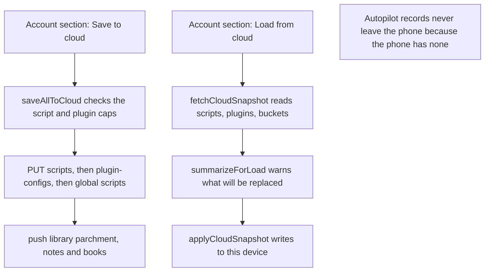
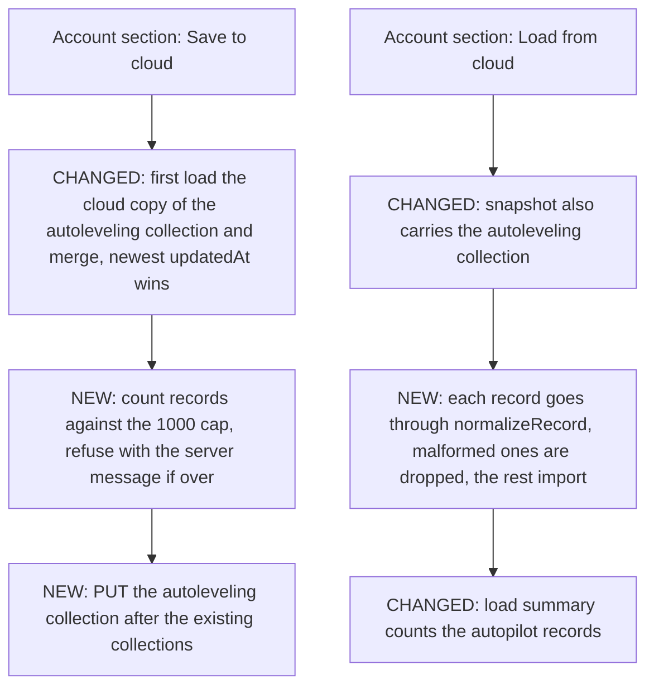
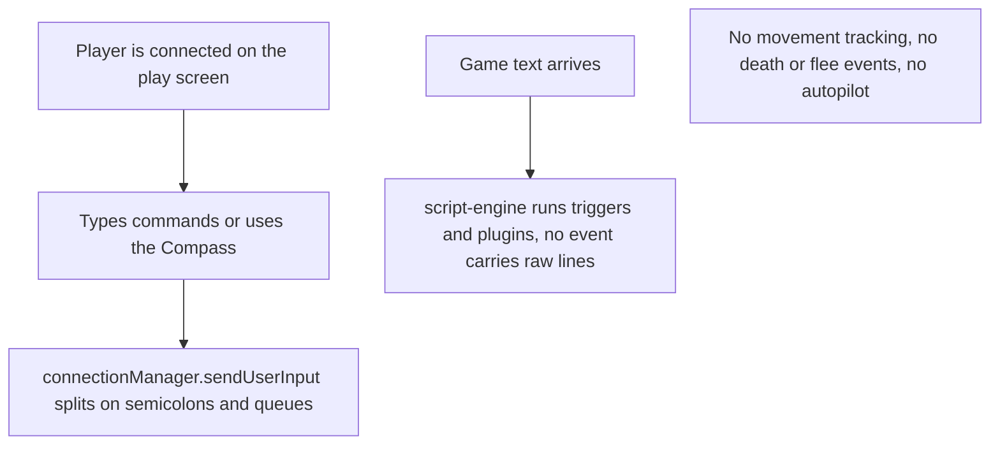
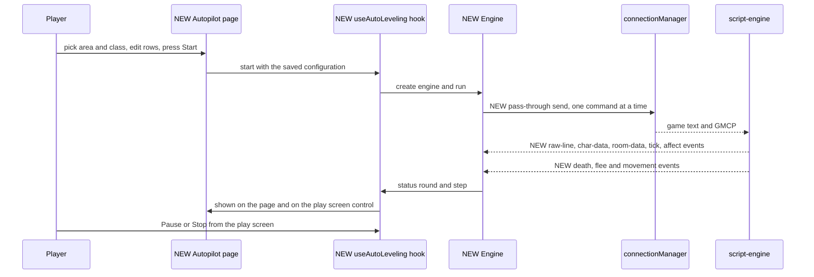
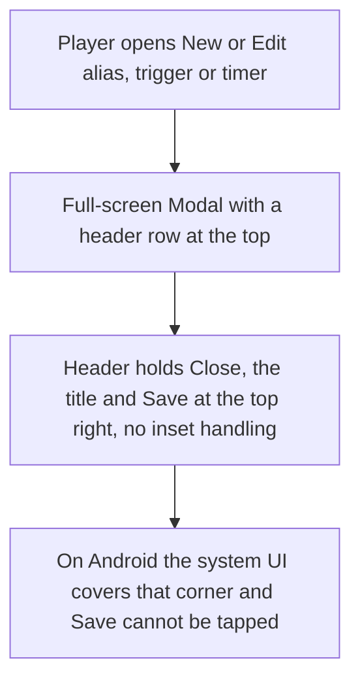
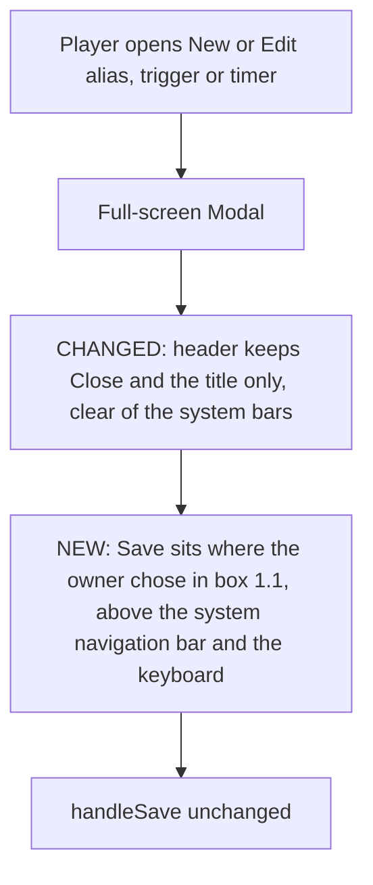
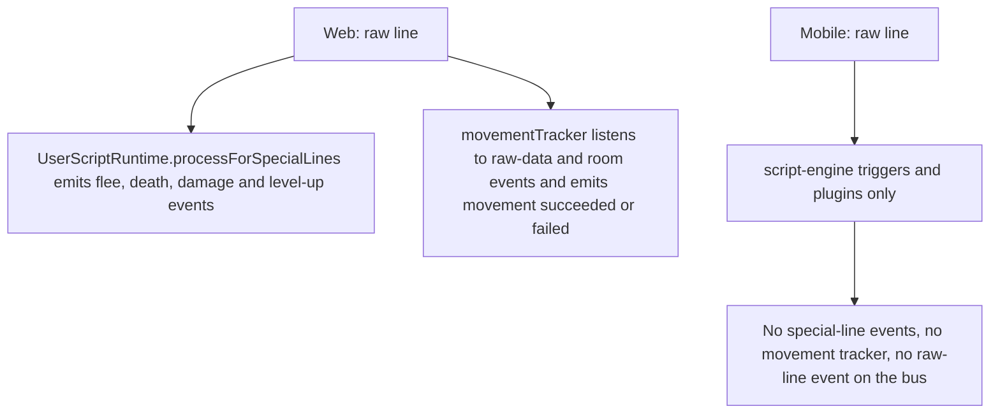
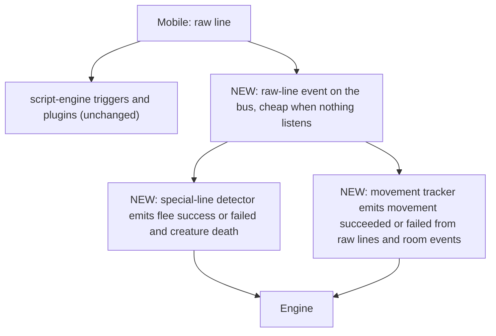
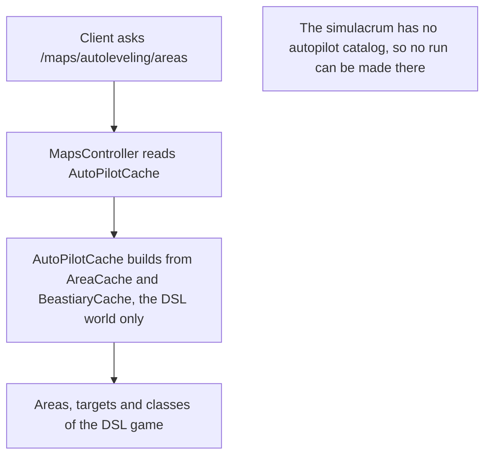
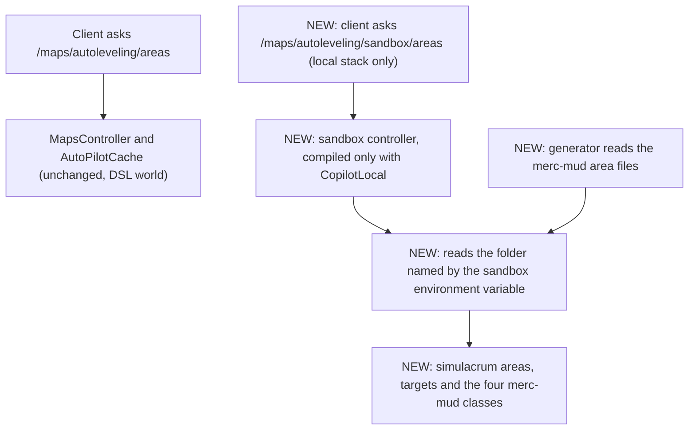

# Tech plan: Port auto-leveling (autopilot) to the mobile client, and move the script editor's Save button

Item: item.md · Scope: scope.md · Planned against: performance/Allocation-hunt @ 9191edc (ShatteredArchive) and optimization/Performance-and-Diagnostics @ 09b5d85 (shatteredarchive-mobile) · Date: 2026-11-20
Standards: docs/standards/typescript.md (section "shatteredarchive-mobile"), docs/standards/data-classification.md · Data classification: Personal (per-account preferences synced to the cloud; no personal values appear in this plan)
Edge-case catalog: cloud-synced-user-content.md, served-fallback-data.md, shared-event-bus.md, persisted-settings-and-defaults.md, automation-run-loops.md, command-templates.md, game-data-privacy.md · Classifiers added (user-approved 2026-11-20): INSET-01 (new file mobile-screen-insets.md), PORT-01 (new file web-to-app-port.md); both are rows below. None declined
Original plan: `legacy-plan.md` (the 2026-09-12 text, kept unchanged). Phases 7-11 of `.ai-plans/active/2026-11-13_editable-autopilot-targets-synced/tech-plan.md` were this port's earlier phases; the owner moved them here on 2026-11-20 (scope.md, decision 1) and they are rewritten below against the code as it is today.

## Goal

(1) In the mobile editor for aliases, triggers and timers, Save can be tapped on every Android device. (2) A player can open the phone app, pick an area and a class from the same served catalog as the web wizard, edit targets, buffs and fight rows, start, pause and stop an autopilot run on a live connection, and the saved configuration moves between web and phone with the existing Save to cloud and Load from cloud buttons. The run behaves like the web engine as of the last phase of `.ai-plans/active/2026-11-18_autopilot-live-test-findings` (gates, serial re-arm queue with capped retry, pause on timeout, lap wait, remembered values, class timing defaults). Android first; no native module, so the same code serves iOS, whose build verification is deferred.

Done when: the Save button is reachable on a recorded Android capture; a recorded Android run completes a move, engage, fight and loot cycle; the configuration survives an app restart; an edit made on web reaches the phone and a phone edit reaches the web; mobile `jest` is green and `tsc` shows no error beyond the recorded baseline.

## Decisions taken by this plan (veto any in chat before Phase 1)

| # | Decision | Why |
|---|---|---|
| D1 | The content API goes through the web-server proxy (`/maps/autoleveling/*`), not straight to C#. | Same snapshot fallback and `X-Maps-Source` header as web (FALLBACK-01); the carried-over choice from Phase 7 of the active plan. `walkable-areas/api.ts:3-4,41` calls C# directly and is the pattern NOT to copy. |
| D2 | Record kinds, ids and normalisation are the web's, taken as they are at Phase 3 (all kinds the web `SYNCED_RECORD_KINDS` lists, the `pref` records included). Mobile starts at version 1 and carries no migration. | One account, two clients: `cloud-sync.ts:28-37` says the wire shapes are the web client's. CLOUDSYNC-01. |
| D3 | The engine sends through `connectionManager` with a new pass-through method that skips `preprocessCommand`'s `;` split and the script-engine intercept, and goes through the existing `OutboundQueue`. | `sendUserInput` (`connection-manager.ts:295`) splits on `;` and offers each line to aliases and triggers; the engine sends one command at a time and must not be rewritten by a user alias. CMDTPL-01: a stored command holding `;` is refused, as on web. |
| D4 | The configuration is a full-screen page `app/autopilot.tsx` (single scrollable form), opened from a control in `PlayContainer`; not a copy of the six-step desktop wizard. | The old plan, Step 4; mobile CLAUDE.md puts full-screen pages in `app/`. |
| D5 | The engine's other inputs are produced inside the app: special-line events (death, flee), a movement tracker, a raw-line subscription. | They are web-only today (scope.md, affected areas); the old plans did not list them. |
| D6 | The Save button leaves the header and becomes a bar fixed at the bottom of the editor, above the navigation bar and the keyboard (owner's answer, 2026-11-20). | The item says only "moved elsewhere"; INSET-01. |
| D7 | End-user documentation is the in-app help text on the configuration page plus `docs/features/autopilot.md` in the mobile repo; developer documentation is the same file's engine and storage sections plus `docs/reference/mobile.md`. | The location the owner approved in the active plan (its Phase 10 and 8); mobile has no separate user guide. |

## Out of scope

- iOS build and run verification (no Mac in this environment); the plan states code parity only.
- Any C# or web-server change; any change to the web engine or wizard (the web plans own them).
- Copilot's need-help signal for a timeout pause (the app has no Copilot; the signal stays unhandled).
- Background-service behaviour beyond what `features/connection` already provides.
- A pixel copy of the desktop wizard.
- Moving other screens' headers: only the script editor's Save is in this item (Phase 1 records which sibling screens were checked).

## Workflows (before and after)

Before diagrams are drawn from the mobile code read for this plan (anchors given). The mobile phases are not built yet; every After step is NEW or CHANGED. None of the diagrams has been rendered: box 8.7.

### W1 — Save to cloud and Load from cloud        changed by: Phase 3
Before (`features/auth/cloud-sync.ts:198-266` save, `:268` fetch, `:289` summarise, `:312` apply)

After

### W2 — Running autopilot on the phone        changed by: Phases 4, 5, 6, 7
Before (`PlayContainer.tsx` has the Compass and HUD only, no autopilot control; the game text reaches triggers through `script-engine.ts:138-145`)

After

### W3 — Saving an alias, trigger or timer        changed by: Phase 1
Before (`components/scripts/ScriptEditorModal.tsx:175-189` the modal and header, `:128` `handleSave`, `:320-333` header styles)

After

### W4 — Where the engine's inputs come from        changed by: Phase 4
Before (web: `userScriptRuntime.ts:689` `processForSpecialLines`, `features/movement/movementTracker.ts`; mobile: `script-engine.ts:138-145`)

After

### W5 — Which world the autopilot catalog comes from        changed by: Phases 7a, 7b (added by A1)
Before (`DSL/Server/Server.Web.Public/Controllers/MapsController.cs:183-216`, `Server.Dsl/Cache/AutoPilotCache.cs:25-52`)

After

## Standards applied

- **TypeScript** (`docs/standards/typescript.md`, section "shatteredarchive-mobile"): kebab-case modules in `dsl-client/features/<area>/`, tests in `__tests__/*-test.ts(x)`; no new `any` in production code; storage reads and writes fail safe with `try`/`catch` and a fixed `console.warn` that carries no values; every subscription returns its unsubscribe and an effect removes it; no work after unmount (async and state, decided 2026-11-06).
- **Data classification** (`docs/standards/data-classification.md`, DRAFT): fixtures use placeholder room lines, keywords and a placeholder cloud blob; no character, account or game-text values in the plan, tests or docs.
- **Mobile repo rules** (`shatteredarchive-mobile/CLAUDE.md`): full-screen pages in `app/`; `expo install` for React Native packages (none expected); Android edits only through config plugins (none expected); `docs/implementation-plan/implementation-plan.md` is the resume list and is updated by Phase 8.
- No SCSS: the mobile app styles with `StyleSheet`; the theme is always dark (`CLAUDE.md`, "Theming").

## Edit map

Lines are as of 09b5d85 (mobile) and 9191edc (web, read only). New files have no line. Mobile paths are under `C:/Projects/shatteredarchive-mobile/dsl-client/`.

| File | Line(s) | Anchor | Change | Phase |
|---|---|---|---|---|
| `components/scripts/ScriptEditorModal.tsx` | 175-189, 320-333 | `<Modal visible ... pageSheet`, the `header` row, `saveBtn` styles | move Save out of the header (box 1.1 decides where) and keep the header clear of the system bars; `handleSave` (`:128`) unchanged | 1 |
| `components/scripts/__tests__/ScriptEditorModal-test.tsx` | new | - | the first tests of the modal (there are none: `UserScriptsSection-test.tsx:67` stubs it) | 1 |
| `features/autoleveling/autoleveling-content-types.ts`, `-content-api.ts`, `-content-storage.ts` | new | - | DTOs, fetch through the proxy, AsyncStorage cache with a soft TTL; cache key versioned from the start | 2 |
| `features/autoleveling/autoleveling-user-data.ts` | new | - | same record shapes and ids as web, one AsyncStorage key per record, `normalizeRecord`, override helpers | 3 |
| `features/auth/cloud-sync.ts` | 58-59, 198, 268, 289, 312 | `MAX_SCRIPTS`, `saveAllToCloud`, `fetchCloudSnapshot`, `summarizeForLoad`, `applyCloudSnapshot` | add the autoleveling collection to save (merge first), snapshot, summary and apply; the 1000-record check | 3 |
| `components/AccountSection.tsx` | existing | - | summary text includes the autopilot record count | 3 |
| `features/connection/connection-manager.ts`, `features/connection/outbound-queue.ts` | 295, 17; class at the top of the queue | `sendUserInput`, `preprocessCommand` import, `OutboundQueue` | a pass-through send for programmatic callers through the same queue and pacing (D3) | 4 |
| `features/scripts/script-engine.ts` | 138-145, 209 | `processTriggers(rawLine, EVENT_RAW_DATA)`, `pluginHost.routeEvent`, `processGmcpEvent` | emit a raw-line event on the bus; the special-line detector runs from the same place | 4 |
| `features/autoleveling/special-lines.ts`, `features/movement/*` | new | - | flee and death detector; ported `classifyMovement` and `movementTracker` (web `features/movement/`, 83 and 228 lines) | 4 |
| `features/autoleveling/autoleveling-types.ts`, `-defaults.ts`, `-actions.ts`, `-alignment.ts`, `-command-text.ts`, `-enemy-condition.ts`, `-buff-catalog.ts`, `-cast-outcome.ts`, `-lag.ts`, `-step-prefs.ts`, `-class-defaults.ts`, `-classes.ts`, `-wizard-config.ts` | new | - | pure modules ported from web `features/autoleveling/` with their tests | 5 |
| `features/autoleveling/autoleveling-engine.ts` | new | - | the engine, from web `autoleveling-engine.ts` (2987 lines) as of the port; the `DispatchEvent`/`ListenEvent` sites (web `:1094-1204`, `:1306`, `:1310`, `:1909`, `:1931`, writes to the terminal at `:988`, `:1332`, `:2769`) become `eventBus` and `connectionManager` calls | 6 |
| `features/autoleveling/useAutoLeveling.ts`, `components/autoleveling/*`, `app/autopilot.tsx` | new | - | hook, configuration page, route (D4) | 7 |
| `components/PlayContainer.tsx` | 6, 261, 268-280 | `import Compass`, `showCompass`, `hudPanel`, `gamePanel` | control for open, start, pause, stop and status, in portrait and landscape | 7 |
| `features/hud/vitals-store.ts` | 11-27 | `applyPatch` | read only: the engine reads `isFighting` from `game:char-data` itself (web `autoleveling-engine.ts:1104-1133`), so the store is not changed | - |
| `features/*/.ai-context` and `.annotated` | - | `autoleveling`, `movement`, `connection`, `scripts`, `auth`, `components/autoleveling` | updated in the phase that changes the folder | per phase |
| `docs/features/autopilot.md`, `docs/reference/mobile.md`, `docs/reference/game-client.md`, `docs/implementation-plan/implementation-plan.md` | `game-client.md:128,164` | the `Autoleveling` row and the `useAutoLeveling` row | new feature doc; module and storage-key rows; porting-status row; the resume list | 2-8 |
| `C:/Projects/ShatteredArchive/docs/game/autopilot.md` | - | the web doc | pointer to the mobile doc only if the doc-impact check names it | 8 |
| `C:/Projects/ShatteredArchive/.ai-plans/active/2026-11-13_editable-autopilot-targets-synced/tech-plan.md` | Phases 7-11, W8, Edit-map rows 287-290, edge-case rows E12 and E18, sign-off boxes | - | amendment A13 there removes the mobile phases (done with this plan, see Progress log) | - |

## Edge cases

| Id | Classifier | Condition | Required behaviour | Covered by |
|---|---|---|---|---|
| E1 | INSET-01 | Save button on a phone with a status-bar overlay, a display cutout, gesture or three-button navigation, the keyboard open, landscape, a small screen | the control is fully on screen and tappable in each case; the editor still scrolls | P1 component test (insets mocked) and the Android capture |
| E2 | - | A sibling screen has the same top-right control | checked and listed in Phase 1; changed only if it fails the same way and the owner agrees | P1 |
| E3 | FALLBACK-01 | The proxy serves its offline snapshot | not applicable under A2: the app reads the C# site, which has no snapshot; an unreachable server gives the saved copy or `empty`, never a substitute | P2 test (`empty` and `cache` sources) |
| E4 | - | No network and no cache | the configuration page opens with an empty state and a retry; no throw | P2 test, P7 test |
| E5 | - | AsyncStorage read or write fails | defaults are used; never throws into the UI; one fixed warning | P2, P3 tests |
| E6 | CLOUDSYNC-01 | Kinds the app exports versus what the server accepts | the exported kind list equals the web `SYNCED_RECORD_KINDS`; a test compares them by name | P3 test, P8 live round trip |
| E7 | CLOUDSYNC-02 | The phone saves without having loaded | Save loads the cloud copy, merges (newest `updatedAt` wins), then uploads | P3 test |
| E8 | CLOUDSYNC-03 | The server renames or drops an area target the user edited | the override is kept, not applied, listed as unmatched, reapplies when the key returns | P3 test, P7 test |
| E9 | SETTINGS-01 | Saved configuration was built from defaults | only differences from the default are stored | P3 test |
| E10 | SETTINGS-02 | "Same as default" | strict compare after the same key normalisation as web, no coercion | P3 test |
| E11 | SETTINGS-04 | Records arrive by editor, cloud load, or a script import | every route goes through `normalizeRecord` | P3 test |
| E12 | SETTINGS-06 | A list the user emptied | stays empty; pre-fill only seeds a never-set list; seeded rows are not stored until edited | P7 test |
| E13 | SETTINGS-07 | Code that rebuilds a row from named fields (a mode switch, reset) | copies the row; a test adds a field to the type and the rebuild keeps it | P5, P7 tests |
| E14 | SETTINGS-03 | A running copy merged with stored settings | not applicable: the page re-reads the saved set when it opens (see "not applicable") | - |
| E15 | CLOUDSYNC-02, - | Account near the 1000-record cap | counted before upload; the server's own message is shown; nothing partial is saved | P3 test |
| E16 | - | A cloud record of a known kind with missing or mistyped fields | dropped by `normalizeRecord`; other records still import | P3 test |
| E17 | EVENTBUS-01 | The engine subscribes to `game:char-data` and `game:tick` that `vitals-store` and the HUD also use | verified: mobile `eventBus` keeps a Set per name (`event-bus.ts:5-12`) and `clearAll` is only called by tests; a test proves the engine's subscription does not displace `vitals-store`'s, and that stop and unmount remove only the engine's | P6 test |
| E18 | CMDTPL-01 | A stored command holds `{name}`, `<potion>` or `;` | one expander for every send; an unresolved placeholder is refused; a `;` is refused before it reaches the pass-through send | P5, P6 tests |
| E19 | RUNLOOP-01 | The outer backstop against the movement timeout | derived from the tracker's timeout plus queued lag; never shorter | P4, P6 tests |
| E20 | RUNLOOP-02 | The lap wait and other long waits | Stop and Pause interrupt them | P6 test |
| E21 | RUNLOOP-03 | A failed buff or a dropped affect | capped retry, spaced by lag, one in flight | P6 test |
| E22 | PRIVNAME-01 | Fixtures and docs | placeholder room lines, keywords and ids; no character or account name, no game text; `pnpm check:private-names` in the ShatteredArchive repo covers its side | P2, P3 fixtures, P8 |
| E23 | - | Double tap on Start, or Start while a run exists | one engine instance; the second call is ignored and the status stays right | P7 test |
| E24 | - | The page is closed or the screen unmounts during a run | the run continues (the connection manager outlives screens); reopening shows the live status; the hook's own subscriptions are removed on unmount | P7 test |
| E25 | - | The connection drops or the app is backgrounded and killed | the run stops cleanly on a disconnect event; a restart never resumes by itself | P6, P8 |
| E26 | - | Portrait and landscape control layout | control reachable and not overlapping the Compass in either | P7 capture |
| E27 | - | The raw-line event on the hot path | with no engine listening, the emit does no work beyond a map lookup; the timing diagnostics (`features/diagnostics/timing-diagnostics`) show no new allocation per line in the existing allocation sweep | P4 test and measurement |
| E28 | - | A phase adds a native module or a `Platform.OS` fork | none; checked by a search over the new files | P8 |
| E30 | PORT-01 | Every event the ported engine listens to and every module it imports from outside its own folder | a table of each with its web and app producer is in `docs/features/autopilot.md`; each app-side producer has a test from a sample line; the device run shows a real event reach the engine | P4 tests, P6, P8 |
| E31 | - | The app is pointed at another server or world (the DSL game, the simulacrum, a LAN address) | the saved catalog is keyed by world and origin, so one never shows the other's data; the address is a bundle-time setting and never in a committed file (LOCAL-05 reasoning: a LAN address is Personal) | P2 test (two servers, two worlds) |
| E29 | - | The web engine changes while the port is under way (its Phase 16 is open) | the port records the web commit it was taken from; a later web change is a new item, not a silent drift | P5, P6 |

Classifiers applied: INSET-01 (E1), PORT-01 (E30).

Classifiers not applicable: SETTINGS-03 (E14), SETTINGS-05 (nothing stored is rewritten, mobile starts at version 1), CLOUDSYNC-01 to 03 are applied above; the rest of the catalog (ansi, logtail, autoapproval, local-only, expo-native-upgrade, pointer, mapid, theming for web CSS) does not match this work; `expo-native-upgrade` is not applicable because the Expo upgrade is finished (`.ai-plans-completed/2026-11-01_mobile-expo-sdk-upgrade`) and no native module is added.

Classifiers added on 2026-11-20 after the owner approved both drafts: **INSET-01** (a header or footer action at a screen edge is covered by the system bars) in `docs/standards/edge-cases/mobile-screen-insets.md`, and **PORT-01** (a port misses events the web produces in other modules) in `docs/standards/edge-cases/web-to-app-port.md`; both are in the catalog index.

## Verification toolbox

Mobile repo `C:/Projects/shatteredarchive-mobile`, its own pnpm workspace (pnpm 12.9.1 through Corepack).

| Purpose | Command |
|---|---|
| Mobile tests | `pnpm --dir dsl-client test -- <pattern>` (the `test` script is `jest`; a hook denies a bare jest without `--runInBand` or `--maxWorkers` 1-4, so the pattern runs add `--runInBand`); whole package: the same without a pattern. Filter output with `2>&1 | grep -E "Tests:|Test Suites:|FAIL|✕"` |
| Coverage of new code | `pnpm --dir dsl-client test -- --runInBand --coverage --collectCoverageFrom="features/autoleveling/**" --collectCoverageFrom="features/movement/**"` |
| Typecheck | `pnpm --dir dsl-client exec tsc --noEmit`; the old plan records a baseline of 7 errors, not re-run: box 2.1 records the real count and every later phase compares against it |
| Lint | `pnpm --dir dsl-client lint` (`expo lint`) |
| Bundle check | `pnpm --dir dsl-client exec expo export --platform android --output-dir <a folder outside the repo>` (one-shot, no server; proven in Phase 2, exit 0) |
| Android run | `pnpm start` from the repo root (checks the emulator, then `expo run:android`); the owner approves starting the emulator, target `emulator-5554` only; Metro and any physical phone stay the owner's |
| Captures | emulator screenshots with `adb` (recipe in the owner's notes: never PowerShell `>` for PNGs); progress shots `phase-NN_<name>.png` (git-ignored), final `showcase_NN_<name>.png` in this folder's `screenshots/showcase/` |
| Content API | `curl` against the running web-server: `/api/web/maps/autoleveling/areas`, `/areas/<slug>`, `/classes`; the header `X-Maps-Source` reads `upstream` on the local stack |
| Cloud round trip | a signed-in local test account only (the owner provides it, as for the web plan's Phase 6b); no real account or character names in captures |
| Web side | `pnpm --filter game-client test`, `pnpm typecheck` in `C:/Projects/ShatteredArchive` only if a web file changes (none planned) |
| Doc impact | `node scripts/check-doc-impact.mjs --files <the phase's changed files>` and, at the end, `node scripts/check-doc-impact.mjs <item folder>` in the ShatteredArchive repo; the mobile repo has no such script, so its docs are checked by the Edit-map rows above |

## Phases

### [ ] Phase 1 — The script editor's Save button is reachable
Goal:        Save in the alias, trigger and timer editor can be tapped on Android in every layout the plan lists, and the modal has its first tests.
Depends on:  nothing
Workflow:    W3

Work
- [x] 1.1 Where Save goes: the owner chose a bar fixed at the bottom of the editor, above the navigation bar and the keyboard (2026-11-20, D6).
- [x] 1.2 `components/scripts/ScriptEditorModal.tsx:181-189,320-333` (the `header` row and `saveBtn` styles): the header keeps Close and the title and is clear of the status bar and display cutout; Save is the fixed bottom bar of 1.1, inside the safe area; `handleSave` (`:128`) and its error line (`:166`) are unchanged.
- [ ] 1.3 Other screens: check the headers of `GlobalScriptsModal.tsx` (its `Done` button, `:71-80`), `ConnectModal.tsx:91` and the other modals with a top-right action for the same fault, and record each as fine or as a follow-up in `test-results.md`; change one only with the owner's word.
- [x] 1.4 Tests: new `components/scripts/__tests__/ScriptEditorModal-test.tsx` with insets mocked to a tall status bar and a cutout: Save is rendered inside the safe area and not in the header row; pressing it calls the save path once and a disabled state while saving; a save failure shows the error line; Close still works; the title is shown (E1).
- [ ] 1.5 deferred: waits for the emulator build that Phase 8 also needs (A1, the owner approved running the emulator on 2026-11-20). UI check: emulator, a new alias and an edit of a trigger, portrait and landscape, keyboard open and closed, three-button and gesture navigation if the emulator image allows; Save tapped and the script saved. Captures `phase-01_editor-portrait.png`, `phase-01_editor-keyboard.png`, `phase-01_editor-landscape.png`. The owner approves starting the emulator.
- [x] 1.6 Docs and indexes: `components/scripts/.annotated` updated (the Save bar and why it must not return to the header); `docs/reference/mobile.md` does not name the editor header (checked: a search for ScriptEditorModal in `docs/` finds no header text); end-user doc: no new behaviour to explain (the button moved), recorded as "no user-visible effect beyond the fix".

Sign-off
- [ ] 1.S Exit gate verified and recorded in test-results.md: mobile jest all pass · `tsc` equals the baseline · lint · bundle check · UI check done · the After diagram of W3 matches the built behaviour

State on exit: the editor is usable on Android; nothing of the port exists yet.

### [x] Phase 2 — Baseline, content API, cache and types
Goal:        The app can fetch and cache areas, area detail and the class catalog from the same served data as web, and the baseline numbers every later phase compares with are recorded.
Depends on:  nothing
Workflow:    none

Work
- [x] 2.1 Recorded in `test-results.md` (Baseline, 2026-11-20):  the `tsc` error count now, the full jest result (suites and tests), the lint result, and the working bundle-check command (toolbox).
- [x] 2.2 (amended: see A2) New `features/autoleveling/autoleveling-content-types.ts` (the web DTOs from `autoleveling-content-types.ts`, copied as types and not redesigned), `autoleveling-content-api.ts` (`/maps/autoleveling/areas`, `/areas/<slug>`, `/classes` through the proxy, D1; base URL from the app's existing server configuration, the dev and production values noted), `autoleveling-content-storage.ts` (AsyncStorage JSON, soft TTL, network then cache, versioned key from the start). The decision is written to the Progress log with the dev base-URL implication.
- [x] 2.3 (amended: see A2) Tests: `__tests__/autoleveling-content-test.ts` and `autoleveling-content-types-test.ts`: index, detail and classes parse into the DTOs; cache round trip without a network call; stale cache refreshed; network failure with a cache falls back; no network and no cache gives the empty state with a retry (E4); an offline-source response is not stored as fresh (E3); storage throwing falls back with one fixed warning (E5); fixtures hold placeholders only (E22).
- [x] 2.4 (amended: see A2) API check: the three real endpoints on the local C# service (`curl` then the real client over real HTTP, see test-results.md); the jest fixtures are placeholder bodies.
- [x] 2.5 Docs and indexes: `features/autoleveling/.ai-context` and `.annotated` (new), `docs/reference/mobile.md` (feature module section and storage-key row), `docs/features/autopilot.md` (new, "Content" section).

Sign-off
- [x] 2.S Exit gate verified and recorded in test-results.md (2026-11-20): mobile jest all pass · `tsc` no new errors against 2.1 · lint · bundle check · coverage of the new modules · API check done · doc-impact 0 unresolved

State on exit: data layer only; no screen.

### [ ] Phase 3 — Record store and cloud sync
Goal:        The app stores the same autopilot records as web and Saves and Loads them to the account, so a web edit reaches the phone and back, before any engine exists.
Depends on:  Phase 2; the owner's sign-off of the web half of the active plan (its Plan sign-off)
Workflow:    W1

Work
- [ ] 3.1 New `features/autoleveling/autoleveling-user-data.ts`: the web record shapes and ids (copied from `apps/game-client/src/features/autoleveling/autoleveling-user-data.ts`, `autoleveling-target-overrides.ts`, `autoleveling-types.ts` as they are now), AsyncStorage one key per record, the same `normalizeRecord`, override and `applyTargetOverrides` functions, `SYNCED_RECORD_KINDS` equal to web's including the `pref` records. Fresh version 1, no migration (D2). Record the web commit it was copied from.
- [ ] 3.2 `features/auth/cloud-sync.ts:198-266,268,289,312`: `saveAllToCloud` first loads and merges the cloud copy of the collection (newest `updatedAt` wins), counts against the 1000-record cap with the server's message, then PUTs it after the existing collections; `fetchCloudSnapshot`, `summarizeForLoad` and `applyCloudSnapshot` carry it; malformed records are dropped on import. A constant beside `MAX_SCRIPTS` (`:58`) names the cap.
- [ ] 3.3 `components/AccountSection.tsx`: the Save and Load summary text includes the autopilot record count.
- [ ] 3.4 Tests: store round trips; the override, normalisation, "same as default", reset and unmatched-edit cases of the web suite (E8-E11, E16); cloud-sync tests with a mocked `fetch`: Save merges the cloud copy first (E7), the cap refuses with the message (E15), Load imports and ignores malformed records, a 401 is handled like the existing collections; a test compares the exported kind names with the web list (E6); storage failure falls back (E5).
- [ ] 3.5 API check: jest against a recorded cloud blob (placeholders only in the committed fixture, taken from a local test-account round trip); the live check is box 8.3.
- [ ] 3.6 UI check: the account section's Save and Load messages; captured with the device run in box 8.4 (deferred: needs the emulator run).
- [ ] 3.7 Docs and indexes: `features/autoleveling/.ai-context`, `features/auth/.ai-context` or `.annotated`, `docs/reference/mobile.md` (storage keys), `docs/features/autopilot.md` ("Storage and sync" section).

Sign-off
- [ ] 3.S Exit gate verified and recorded in test-results.md: mobile jest all pass · `tsc` no new errors · lint · bundle check · coverage · API fixture check · the After diagram of W1 matches · doc-impact 0 unresolved

State on exit: sync-compatible data layer, no engine, no screen.

### [ ] Phase 4 — The engine's inputs on the phone
Goal:        The app produces what the engine listens to: a raw-line event, flee and death events, movement success and failure, and a pass-through send, with nothing listening yet.
Depends on:  Phase 2
Workflow:    W4

Work
- [ ] 4.1 `features/scripts/script-engine.ts:138-145`: emit the raw line on the event bus under the same name the web uses, `shatteredarchive:raw-data`, from the place triggers and plugins already run; with no listener the emit adds no per-line allocation (E27).
- [ ] 4.2 New `features/autoleveling/special-lines.ts`: the flee success, flee failed and creature-death detection that the web does in `UserScriptRuntime.processForSpecialLines` (`userScriptRuntime.ts:689`), emitting `event:flee:success`, `event:flee:failed` and `event:creature-death` with the same payload shape (`{ text }`); the line patterns are read from the web method and copied as data, with the web commit recorded.
- [ ] 4.3 New `features/movement/classify-movement.ts` and `movement-tracker.ts`, ported from `apps/game-client/src/features/movement/classifyMovement.ts` and `movementTracker.ts` (83 and 228 lines) onto the mobile event bus, emitting `shatteredarchive:movement-succeeded` and `shatteredarchive:movement-failed`; exports the timeout constant the engine's backstop uses (E19).
- [ ] 4.4 `features/connection/connection-manager.ts:295` (beside `sendUserInput`): a pass-through send for programmatic callers that enqueues one line on the same `OutboundQueue` without `preprocessCommand` and without the script intercept (D3); a line containing `;` is refused.
- [ ] 4.5 The web engine also uses the damage-line pattern (`DAMAGE_LINE_PATTERN`, `combat-compression.plugin.ts:667`); port it as a constant with its source noted, or record in the Progress log that the mobile engine does not need it and why.
- [ ] 4.6 Tests: `__tests__/special-lines-test.ts` (each of the three events from sample lines in the web tests' placeholders, a non-matching line, no event for a partial preview); movement tracker and classifier tests ported from `movementTracker.test.ts`, `movementTracker.roomCache.test.ts`, `classifyMovement.test.ts`; `connection-manager` send tests (queued through the same queue, no split, no intercept, `;` refused, refused when not connected); a test that the raw-line emit with no listener does not allocate per line, and the existing allocation sweep still passes (E27).
- [ ] 4.7 Docs and indexes: `features/autoleveling/.ai-context`, `features/movement/.ai-context` (new), `features/connection/.ai-context`, `features/scripts/.ai-context`, `docs/features/autopilot.md` ("Engine inputs" section, the producers listed per platform).

Sign-off
- [ ] 4.S Exit gate verified and recorded in test-results.md: mobile jest all pass · `tsc` no new errors · lint · bundle check · coverage · doc-impact 0 unresolved · the After diagram of W4 matches

State on exit: the inputs exist and are tested; nothing consumes them, and no user-visible change.

### [ ] Phase 5 — The engine's pure modules
Goal:        Every engine module that has no timers and no I/O runs on the phone with the web's tests.
Depends on:  Phase 3
Workflow:    W2

Work
- [ ] 5.1 Check that the web engine is not mid-change: the active plan's Phase 16 (pause on timeout) state is read and written in the Progress log; if it is still open, the port takes the engine as it is and records the web commit (E29).
- [ ] 5.2 New in `features/autoleveling/`, each ported from the file of the same name in `apps/game-client/src/features/autoleveling/`: `autoleveling-types.ts`, `-defaults.ts`, `-actions.ts`, `-alignment.ts`, `-command-text.ts` (the one expander and the unresolved-placeholder check), `-enemy-condition.ts`, `-buff-catalog.ts`, `-cast-outcome.ts`, `-lag.ts`, `-step-prefs.ts`, `-class-defaults.ts`, `-classes.ts`, `-wizard-config.ts` (`draftToConfig`).
- [ ] 5.3 Tests: the matching web test files adapted to jest-expo (`autoleveling-command-text.test.ts`, `-enemy-condition.test.ts`, `-cast-outcome.test.ts`, `-lag.test.ts`, `-step-prefs.test.ts`, `-class-defaults.test.ts`, `-classes.test.ts`, `-actions.test.ts`, `-wizard-config.test.ts`); an unresolved placeholder and a `;` are refused (E18); the SETTINGS-07 test adds a field to a row type and the rebuild keeps it (E13).
- [ ] 5.4 Docs and indexes: `features/autoleveling/.ai-context` and `.annotated`, `docs/features/autopilot.md` ("Rules" section).

Sign-off
- [ ] 5.S Exit gate verified and recorded in test-results.md: mobile jest all pass · `tsc` no new errors · lint · bundle check · coverage of the new modules · doc-impact 0 unresolved

State on exit: modules and tests exist; no engine loop.

### [ ] Phase 6 — The engine core
Goal:        The web autopilot engine, as of the recorded web commit, runs on the phone's event bus, input producers and send path.
Depends on:  Phases 4, 5
Workflow:    W2

Work
- [ ] 6.1 New `features/autoleveling/autoleveling-engine.ts` ported from the web engine (2987 lines): the `ListenEvent` subscriptions (web `:1094-1204`) become `eventBus.on` with unsubscribes collected in one place; the `DispatchEvent('shatteredarchive:send-command'` sites (web `:1306`, `:1310`, `:1909`, `:1931`) call the pass-through send of 4.4; the three terminal writes (web `:988`, `:1332`, `:2769`) go to the app's output stream (`connectionManager`'s output emit) as notices; the engine reads `isFighting` from `game:char-data` itself (`vitals-store` unchanged). Behaviour is the web's: round order, movement wait, engage outcome, flee pause, rest cycle, vitals and once gates, the serial re-arm queue with capped retry, pause on timeout, the lap wait, remembered values, the timing floor.
- [ ] 6.2 The engine stops on a disconnect event and never resumes by itself (E25); Stop and Pause interrupt every long wait (E20); one re-arm in flight with spaced retries (E21); the backstop is never shorter than the movement timeout plus queued lag (E19).
- [ ] 6.3 Tests: the web engine suites adapted to jest-expo: `autoleveling-engine.test.ts` and the five files `.gates`, `.rearm`, `.pause`, `.lapwait`, `.lag`, changing only the event and send mocks; plus: binding the engine does not displace `vitals-store`'s subscription and stopping removes only the engine's (E17); stop and unmount leave no timer or listener; a disconnect stops the run (E25).
- [ ] 6.4 Docs and indexes: `features/autoleveling/.ai-context` and `.annotated`, `docs/features/autopilot.md` ("Engine" section with the web commit it follows and what differs).

Sign-off
- [ ] 6.S Exit gate verified and recorded in test-results.md: mobile jest all pass (the adapted web suites included) · `tsc` no new errors · lint · bundle check · coverage reviewed · doc-impact 0 unresolved · the After diagram of W2 matches the engine as built

State on exit: the engine is present and tested but reachable from no screen.

### [ ] Phase 7 — Configuration page and play-screen control
Goal:        A player configures and runs autopilot on the phone, with editable targets, the full class list and pre-filled abilities.
Depends on:  Phase 6
Workflow:    W2

Work
- [ ] 7.1 New `features/autoleveling/useAutoLeveling.ts` mirroring the web hook's shape: start, pause, resume, stop, status, saved configuration through Phase 3's store; one engine instance (E23); the run survives the screen unmounting (E24).
- [ ] 7.2 New `components/autoleveling/` and `app/autopilot.tsx` (D4): one scrollable form: area picker, targets with edit, hide, reset and the unmatched list, class picker from the full catalog, buff and fight rows pre-filled from `autoleveling-class-defaults`, rest and weight, and short in-app help text for Targets and Combat (D7). Pre-fill seeds only a never-set list (E12). A root page in `app/` registered the way `app/area-import.tsx` is (mobile CLAUDE.md: new full-screen pages go in `app/`; the `NO_TAB_BAR_ITEM` rule is for tab screens and does not apply).
- [ ] 7.3 `components/PlayContainer.tsx:6,261,268-280`: a control to open the page and to start, pause and stop, with round and step status, in portrait and landscape without overlapping the Compass (E26).
- [ ] 7.4 Tests: component tests for the editor states and validation, the pre-fill and the saved-set-wins rule, the unmatched list (E8, E12); hook lifecycle: start, pause, resume, stop, double start, unmount mid-run (E23, E24).
- [ ] 7.5 UI check: emulator captures in portrait and landscape: the page, an edited target, the pre-filled combat section, the play-screen control; `phase-07_*.png` (git-ignored). The owner approves starting the emulator.
- [ ] 7.6 Docs and indexes: `.ai-context` and `.annotated` of every touched folder, `docs/features/autopilot.md` ("Screens"), `docs/reference/mobile.md` (screens and storage keys); the in-app help text is the end-user documentation (D7).

Sign-off
- [ ] 7.S Exit gate verified and recorded in test-results.md: mobile jest all pass · `tsc` no new errors · lint · bundle check · captures taken · doc-impact 0 unresolved · the After diagram of W2 matches

State on exit: autopilot is usable end to end on the phone, not yet verified on a live game run.

### [ ] Phase 7a — Simulacrum training content served by the C# app (local-only, beside the DSL world)
Goal:        The C# app serves the same autopilot catalog shapes (`areas`, `areas/{slug}`, `classes`) for the simulacrum world as for the DSL world, from a local-only controller, and the DSL world's answers are unchanged.
Depends on:  Phase 7b (it serves what 7b generates)
Workflow:    W5

Work
- [x] 7a.1 Owner decisions recorded 2026-11-20: D8 local-only sandbox routes (not a world parameter on the production routes); D9 the generator is a `Server.Jobs` job in the DSL repo (so 7b.1 is a C# job with xunit tests, not a Node script).
- [ ] 7a.2 New local-only controller under `C:/Projects/DSL/Server/Server.Web.Public/Controllers/Copilot/` (the folder the csproj removes unless `CopilotLocal=true`, as `SandboxWorldMapController.cs` does), serving `GET /maps/autoleveling/sandbox/areas`, `/areas/{slug}` and `/classes` with the existing DTOs (`Server.Dsl/Models/Autopilot.cs`: `AutoPilotAreaSummary`, `AutoPilotArea`, `AutoPilotTarget`, the class DTO of `AutoPilotClassCache`), read from a folder named by a new environment variable beside `SANDBOX_WORLD_MAP_DIR` (compose: `DSL/Server/docker-compose.yml:35`, local compose only). With the variable unset or the folder missing the answers are empty lists, never an error. The production controller `MapsController.cs:183-216` and `AutoPilotCache` are not changed.
- [x] 7a.3 (dropped by A2: the app reads the C# site directly, so the web-server needs no sandbox routes) ~~The web-server proxy gets the same three routes for the local stack only (`apps/web-server/src/index.ts:461-524` is the pattern), with the offline snapshot behaviour of the DSL routes kept out: the sandbox world has no bundled snapshot (FALLBACK-01: an upstream failure is an error the app shows, not a silent substitute).~~
- [ ] 7a.4 Tests: xunit tests for the controller (a fixture folder gives the three shapes; missing folder gives empty lists; an unknown slug is 404; the DSL route is unaffected); a web-server handler test per route; `verify-prod-output.mjs` still passes (no sandbox autopilot name in a production build or compose).
- [ ] 7a.5 API check: after `Server/deploy-local.ps1`, `curl` the three sandbox routes and the three DSL routes through the web-server; the DSL bodies equal the ones recorded before the change.
- [ ] 7a.6 Docs and indexes: `docs/game/autopilot.md` (a "Worlds" section), `docs/shattered-maps/worlds.md` pointer, the DSL `.ai-context` of the touched folders.

Sign-off
- [ ] 7a.S Exit gate verified and recorded in test-results.md: DSL `dotnet build -c Release` and `dotnet test` · web-server tests · `verify-prod-output.mjs` · API check · doc-impact 0 unresolved · the After diagram of W5 matches

State on exit: the simulacrum catalog route exists and serves whatever folder it is given; the DSL world is untouched.

### [ ] Phase 7b — Training paths and monsters from the real merc-mud area files
Goal:        A script turns the real merc-mud area files into autopilot areas (route, start room, targets with their levels and keywords) and a class list, so a run on the simulacrum uses real rooms and real mobs.
Depends on:  nothing
Workflow:    W5

Work
- [ ] 7b.1 New generator in the DSL repo, a `Server.Jobs` job as the other generators are (e.g. `--tales-guide`; decided in D9) that reads `C:/Projects/merc-mud/2.4/area/*.are` (the `#ROOMS`, `#MOBILES` and `#RESETS` sections and each area's level range) and writes the folder 7a serves: per area a slug, name, `levelRange`, `startRoom` (the room line a `look` shows), `dirs` (a walk that visits the rooms holding the area's mobs and returns), and `recommendedTargets` (each mob's room-scan line as `lookName`, a keyword that makes `kill` hit it as `engageName`, and its level).
- [ ] 7b.2 The generator chooses the training areas by their real level ranges so that every character level in 7c has at least one area (D10 lists the proposal); a mob whose keyword is ambiguous in its room is given the shortest unique keyword, and the generator refuses (names the room) a route it cannot make deterministic.
- [ ] 7b.3 The class list: the four merc-mud classes (mage, cleric, thief, warrior; `merc-mud/2.4/src/const.c:290-332`) with the abilities each really has by level, in the shape `AutoPilotClassCache` produces, so the wizard's pre-fill uses real simulacrum spells and skills.
- [ ] 7b.4 Tests: generator tests against a small fixture area file (room, mob and reset parsing, the route is closed and deterministic, an ambiguous keyword is shortened, an unreadable file names itself) and a test that the committed output equals a fresh run (ADMIN-01 style drift check).
- [ ] 7b.5 Real check: run the generator on the real area files and walk each generated route on the running simulacrum with a throwaway character, confirming every step moves and every target is found (recorded).
- [ ] 7b.6 Docs and indexes: the DSL docs for the generator, `docs/game/autopilot.md` ("Worlds").

Sign-off
- [ ] 7b.S Exit gate verified and recorded in test-results.md: generator tests · `dotnet build` if C# · the real walk · doc-impact 0 unresolved

State on exit: a folder of simulacrum areas and classes exists and is reproducible from the area files.

### [ ] Phase 7c — Test characters on the simulacrum at different level ranges
Goal:        Eight throwaway characters exist on the simulacrum, two per class (a low and a high level each), at levels that between them exercise auto attacks, spells and skills on the training paths, and can be recreated by a script.
Depends on:  Phase 7b
Workflow:    none

Work
- [x] 7c.1 Owner decision D10 recorded 2026-11-20: eight characters, two per class (mage, cleric, thief, warrior), a low level (about 8) and a high level (about 35) each; the exact levels are fixed in 7b.2 from the real area level ranges.
- [ ] 7c.2 A script (in `C:/Projects/merc-mud/scripts/`, beside `gmcp-compose-check`) creates each character over the real connection on loopback (name, class, race, then the immortal `advance` and a skills and spells practice to the planned level) and writes nothing outside the player directory; running it twice does not duplicate. Character names are placeholders in the committed script and plan.
- [ ] 7c.3 Each character's saved state is checked: level, class, the spells and skills the class has at that level (`practice` or `slist` output), enough hit points, mana and movement to run a path.
- [ ] 7c.4 A cleanup path removes the characters (the owner's rule: throwaway characters are deleted afterwards); not run without the owner's word.
- [ ] 7c.5 Docs and indexes: the merc-mud `scripts/.annotated`, `docs/game/autopilot.md` ("Test characters").

Sign-off
- [ ] 7c.S Exit gate verified and recorded in test-results.md: the script's own checks · the per-character state check · doc-impact 0 unresolved

State on exit: the characters exist and are usable for Phase 8.

### [ ] Phase 8 — Verification on a device against the simulacrum, round trip with web, close-out
Goal:        A recorded Android run completes a cycle, the configuration survives a restart, a web edit reaches the phone and back, and every document is current.
Depends on:  Phases 1-7 and 7a-7c (A1)
Workflow:    W1, W2, W3, W4, W5

Work
- [ ] 8.1 The owner approved running the Android emulator for this item on 2026-11-20 (A1): start `emulator-5554` only; Metro and any physical phone stay the owner's. No code change unless the run shows a defect, which is fixed in this phase with a regression test.
- [ ] 8.2 (amended: see A1) The live run is on the simulacrum, not the DSL game: the emulator app connects to the local merc-mud (host address of the emulator's own loopback alias, port 4000), the autopilot content comes from the sandbox routes of Phase 7a, and each character of Phase 7c runs a training path of Phase 7b with the app: Start, a full move, identify, engage, fight and loot cycle with the class's own auto attacks, spells and skills visible in the terminal; Pause, Resume and Stop each once; kill and relaunch the app and confirm the configuration is still there (not a screen remount). Record each character, path, the terminal excerpts (placeholders for names) and the outcome in `test-results.md`. This run is what the owner signs off on.
- [ ] 8.3 API check with a local test account: edit a target on web and Save; Load on the phone shows the edit; change another on the phone and Save; Load on web shows both.
- [ ] 8.4 UI check: showcase captures `showcase_01_mobile-save-button.png`, `showcase_02_mobile-config.png`, `showcase_03_mobile-targets-edit.png`, `showcase_04_mobile-roundtrip.png`, plus the account-section messages of 3.6, taken with the final-state flow and copied to `screenshots/showcase/`.
- [ ] 8.5 Full checks: the whole mobile jest, `tsc` against the 2.1 baseline, lint, bundle check; a search over every new file for native-module imports and `Platform.OS` forks (E28); `pnpm check:private-names` in the ShatteredArchive repo.
- [ ] 8.6 Docs and indexes: `docs/reference/game-client.md` (porting status row, `:128,164`), `docs/features/autopilot.md` final, `docs/reference/mobile.md`, `docs/implementation-plan/implementation-plan.md`, every `.ai-context` and `.annotated` refreshed; the web doc `docs/game/autopilot.md` gets a pointer if the doc-impact check names it.
- [ ] 8.7 Render check: open the five workflow diagrams of this plan in the editor preview (and, once copied, in the mobile doc) and confirm each renders.
- [ ] 8.8 State iOS plainly in `docs/features/autopilot.md` and `test-results.md`: code parity confirmed, build not verified, and why.

Sign-off
- [ ] 8.S Exit gate verified and recorded in test-results.md: all checks green for shatteredarchive-mobile and, where touched, ShatteredArchive · a recorded device run · doc-impact 0 unresolved · the After diagrams match the built behaviour

State on exit: ready for the owner's sign-off and `/pr-review`.

## Risks and rollback

- **R1. The web engine moves while this is built.** Its Phase 16 is open and `.ai-plans/active/2026-11-18_autopilot-live-test-findings` may add more. Mitigation: box 5.1 and E29 record the commit the port follows; a later web change is a new item.
- **R2. Event producers missing on mobile** (scope, risk 8). Phase 4 builds them; if a producer cannot be matched to the web's patterns the engine's flee and death handling stays untested on a device until 8.2.
- **R3. Hot path.** The raw-line event runs per game line on the JS thread. E27 and the allocation sweep guard it; rollback is to remove the emit and the listeners.
- **R4. Shared record contract.** A web change to a record kind after Phase 3 breaks the phone's sync silently. E6 compares kind names; the web Phase 22 contract note in `docs/game/autopilot.md` is the reference.
- **R5. No device for the Save fix beyond the emulator.** The emulator may not show the exact overlay the owner sees; Phase 1's capture is on the emulator image available, and the owner confirms on their phone.
- **R6. Two plans touched the same port.** The active plan is amended (A13 there) so Phases 7-11 no longer exist in two places.
- **Rollback.** Every phase after 1 is additive: the autoleveling folders, the route and the PlayContainer control are removed by deleting them; the cloud-sync change is the one edit to existing logic (Phase 3) and is reverted as one commit. Phase 1 reverts alone.

## Plan amendments

**A1 (2026-11-20, owner request while Phase 1 was being built, significant, approved by the owner in the request):** the sign-off for this item is a real autopilot run against the simulacrum, so three phases are added and Phase 8 changes. The owner's words: run the actual emulator for the simulacrum; develop an actual script that can be served from the C# app the way the DSL expects, so the two worlds co-habitate; write the training path from the actual area files and mobs; create a few characters at different level ranges who exercise different skills, spells and auto attacks on those paths; and execute autopilot for real against the simulacrum to sign off.
Original plan: Phase 8's live run was against "the game" with the content API pointed at the DSL catalog; no phase created content or characters; the repos touched were the mobile app (and the web side read only).
What changed: (a) **Phase 7a** (DSL C# repo, new): a local-only controller that serves the simulacrum catalog under `/maps/autoleveling/sandbox/*` from a folder, modelled on the existing local-only `SandboxWorldMapController`, so the production endpoints and the DSL world are untouched; the web-server proxy gets the same routes on the local stack. (b) **Phase 7b** (DSL repo and merc-mud area files, new): a generator that reads `merc-mud/2.4/area/*.are` and writes the areas, routes, targets (real mobs with levels and keywords) and the four merc-mud classes. (c) **Phase 7c** (merc-mud repo, new): a script that creates the throwaway characters. (d) **Phase 8** depends on them and its live run is on the simulacrum (box 8.2 amended); the owner's permission to run the emulator is recorded (box 8.1). (e) New workflow W5. Repos now touched: shatteredarchive-mobile, DSL, merc-mud, ShatteredArchive (web-server route and docs). Out of scope was "any C# change"; that line is superseded for Phases 7a and 7b only.
Wider impact: the DSL local compose gains one environment variable; the sandbox routes must not exist in a production build (`verify-prod-output.mjs`, LOCAL-02); the classes differ per world (4 here, 48 on the DSL), so the app's class picker must follow the catalog it was given and not assume the DSL list; merc-mud has no beastiary, so target keywords come from the area files' own mobile keyword lists. Decisions still needed from the owner are D8 (how the simulacrum catalog is served), D9 (generator form) and D10 (the characters and areas); they are asked before Phase 7a starts.

**A2 (2026-11-20, owner answer while Phase 2 was built, significant, approved by the owner):** the content API reads the C# site directly, not through the web-server proxy (supersedes decision D1). Original plan: D1 and box 2.2 call `/maps/autoleveling/*` through the web-server proxy for its snapshot fallback; box 7a.3 gives the proxy sandbox routes. Found: the app has no address for the proxy and reads the C# site for the world map and the walkable areas (`features/world-map/api.ts:14`, `features/walkable-areas/api.ts:3-5`); the C# site serves the same routes (`MapsController.cs:183-216`). The owner's requirement, given when asked: the content "needs to work for the full local LAN": the local stack is reachable over the computer's LAN address from a real phone and from the emulator. Change: (a) the base is a bundle-time setting `EXPO_PUBLIC_AUTOPILOT_API` (the computer's LAN address for a phone, the same value for the emulator, default the emulator's host alias in a dev build and the real site in a release); the world is `EXPO_PUBLIC_AUTOPILOT_WORLD` (`sandbox` for the simulacrum); neither is in a committed file. (b) The local C# container publishes port 5000 on the computer's interfaces (`DSL/Server/docker-compose.yml:12`), so the LAN address works if the computer's firewall allows it (a check for Phase 8). (c) The proxy's offline snapshot is not used (E3 not applicable); the app's own saved copy covers a failed call. (d) Phase 7a.3 (web-server sandbox routes) is dropped; the sandbox controller stays in the C# app (7a.2) and is read directly. Wider impact: the sandbox routes must answer on the LAN-reachable port 5000 of the local stack only; E31 added.

**A3 (2026-11-20, owner remark, minor):** the owner pointed out that the autopilot address, the web reference screen and the maps are all the same destination today, and may be split later, so they should be separate settings with one shared default. Original (A2): the catalog address was `EXPO_PUBLIC_AUTOPILOT_API` alone, with the emulator alias or the real site as default. Change: the catalog follows the app's shared site address (`extra.siteApi` of `app.json`, read by `features/auth/site-api.ts`, now exporting `configuredSiteApi`) unless `EXPO_PUBLIC_AUTOPILOT_API` splits it off; order: the catalog's own setting, the shared address, the dev or release default. The maps (`EXPO_PUBLIC_WORLD_MAP_API`), the walkable areas and the web reference screen are not changed here: their defaults are hard-coded separately (`world-map/api.ts:13-14`, `walkable-areas/api.ts:3-5`, `app/(tabs)/reference.tsx:7-9`), so setting the shared address once covers the catalog, cloud sync, sign-in and push but NOT those three; whether to give them the same fallback is the owner's call. Wider impact: none on tests beyond one new case; `docs/features/autopilot.md` and the folder index updated.

## Progress log

- 2026-11-20: Scoped (`scope.md`) and planned. The owner chose to take the port out of the active plan `2026-11-13_editable-autopilot-targets-synced` and keep it here; the owner added the Save button item the same day. Research found that the web engine needs a movement tracker, special-line events and a raw-line event that the app does not have (Phase 4). The owner approved the classifiers INSET-01 and PORT-01 (written to the catalog) and chose a fixed bottom bar for Save. The unticked-box state of this plan is the whole of the work.
- 2026-11-20: item moved from proposed/ to active/; implementation started (Phase 1 first).
- 2026-11-20: Baseline recorded in test-results.md (mobile `tsc` 0 errors, 82 suites and 1137 tests green; the old plan's "7 errors" was out of date). Phase 1 built: Save is now a bottom bar inside a safe-area container, 10 new tests, whole suite 83 suites and 1147 tests green; boxes 1.1, 1.2 and 1.4 ticked; the emulator capture (1.5) and docs (1.6) are open.
- 2026-11-20: Phase 2 done. Catalog client, AsyncStorage cache and ported DTOs in `features/autoleveling/`; 37 new tests (whole package 85 suites, 1184 tests green), `tsc` 0 errors, bundle check exit 0, the three real routes and the real client checked over HTTP. The owner's answer on the base address made the app read the C# site directly with bundle-time settings for the origin and the world (A2, supersedes D1; Phase 7a.3 dropped). My first run of the tests found that a saved copy was never served back (parsed with the wrong shape); fixed.
- 2026-11-20: Owner request (A1): the sign-off is a real run against the simulacrum. Phases 7a (C# sandbox catalog), 7b (generator from the merc-mud area files) and 7c (test characters) added; Phase 8 amended; permission to run the emulator recorded. Owner decisions the same day: D8 local-only sandbox routes, D9 a Server.Jobs job, D10 eight characters, two per class.

## Plan sign-off

- [ ] Every phase above is ticked (work, sign-off and heading boxes)
- [ ] `node scripts/check-doc-impact.mjs <item folder>` reports 0 unresolved
- [ ] The After diagrams are in the developer doc (`docs/features/autopilot.md` in the mobile repo) and match the built behaviour
- [ ] Owner sign-off recorded: Signed off by the user on <yyyy-mm-dd>
