# Tech plan: Copilot - a local-only AI training companion beside Autopilot that learns to navigate the MUD

Item: item.md · Scope: scope.md · Planned against: performance/Allocation-hunt @ a565d53 · Date: 2026-11-06
Standards: docs/standards/typescript.md, javascript.md, csharp.md (new), scss.md (new), data-classification.md  ·  Data classification: personal (the plan itself holds codenames and placeholders only, so this document is Internal)
Edge-case catalog: theming-dark-mode.md, persisted-settings-and-defaults.md, expo-native-upgrade.md, local-only-features.md, log-tailing.md, auto-approval-policy.md, game-data-privacy.md, ansi-color-handling.md, world-map-identity.md  ·  Classifiers added (user-approved): LOCAL-01, LOCAL-02, LOCAL-03, LOGTAIL-01 (extended in Phase 8), LOGTAIL-02, LOGTAIL-03, AUTOAPPR-01, PRIVNAME-01, ANSI-01, MAPID-01 (the draft prefix LOCALONLY became LOCAL: the catalog format allows 8 letters)

## Goal

A local-only Copilot exists in the dev docker stack and in no production artifact. While the owner plays, the game-client shows suggested commands that the owner approves, corrects with a short "why", or rejects, or that a per-sphere confidence rule runs automatically. The suggestions come from a local thin processor and local models that tail the game-server logs. Every correction and every case the local agent cannot understand becomes a record that a Claude Code teaching session turns into a written artifact (an expert or MCP fix, a persona proposal, a map correction, a skill or prompt change). Real characters that are played are registered under codenames with their verbatim `whoisic` description. Room observations build a baseline memory, the baseline feeds a neutral world-map file and the reworked Shattered-Maps app, the map exports to MUD Builder for the simulacrum sandbox, and the audited map is served by the C# APIs to the C# page, the web client and the mobile client.

Testable in one sentence per outcome: (1) a production build of every service contains no Copilot code, route, vhost or data, proved by scripts and tests; (2) an unclassified or low-confidence suggestion is never run without the owner; (3) the owner can correct a suggestion with a why note and the correction appears in a scrubbed audit bundle; (4) the same map file renders identically in the C# page, the web client and the mobile client.

### Shape (one view)

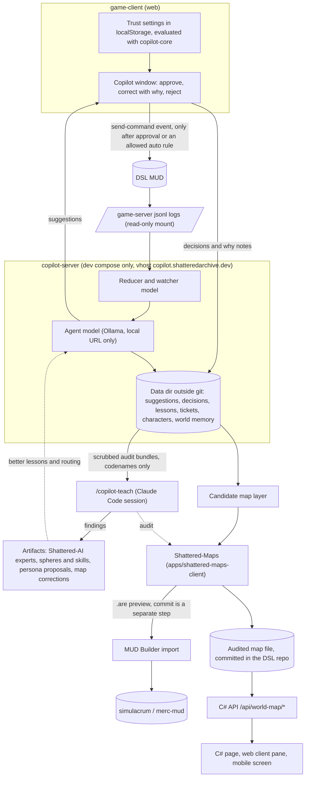

### Decisions taken by this plan (the scope left them open; veto any in chat before Phase 1)

| # | Decision | Why |
|---|---|---|
| P1 | "Shattered-Maps" is DslMapper renamed (no repo of that name exists). It is moved by copy into `apps/shattered-maps-client`; `C:\Projects\DslMapper` is left untouched. | Only DslMapper matches the description; copying keeps its history where it is. |
| P2 | Four new workspace packages: `services/copilot-core`, `apps/copilot-server`, `services/shattered-maps-core`, `apps/shattered-maps-client`. | Pure logic in `services/*` (precedent `scrum-poker-core`) is unit-testable and shared by client, server and maps. |
| P3 | The trust rules live in the client (localStorage) and are evaluated in the client with copilot-core's policy; the server only suggests and records. | Only the client can send commands to the MUD, so only the client can enforce approval. |
| P4 | Effective confidence = min(model's own rating, Wilson lower bound of the owner's past approval rate for that (sphere, action kind) bucket); fewer than 20 decisions in the bucket means "ask". Map movement along an already confirmed edge uses the edge's evidence confidence instead of a model rating. | A local model's self-rating is not trustworthy (scope risk 10); earned approval history is. |
| P5 | Fixture rule defaults: seen in at least 5 visits across at least 3 distinct play days with presence ratio at least 0.8; demoted after 3 consecutive visits without it, and the previous baseline is kept as "was". All four numbers are config. | Gives "consistently seen is likely a fixture" a testable form. |
| P6 | One SVG-string renderer in `shattered-maps-core`; each surface is a thin host (React component, C# page, WebView). | One map, three surfaces, no per-surface drawing code. Decision 32 of the scope. |
| P7 | The mobile map screen hosts that SVG in `react-native-webview` (already a dependency), so no new native module. | Avoids EXPO-01/03 churn. |
| P8 | The audited map layer is public and committed in the DSL repo (`Server.Web.Public/wwwroot/data/world-map/`); the candidate layer (unaudited, walked or imported) is served only by a `CopilotLocal` build. | The map is Copilot's output and ships; the training mechanism does not. |
| P9 | Claude runs only as a Claude Code session (`/copilot-teach` skill). No API call or key exists in any product code. | Scope decision 8. |
| P10 | Real-character codenames are `<Constellation>-<M or F>` from a fixed list; the test roster uses mineral names, so the two sets cannot collide. | Keeps the registry distinct from the 601-row test matrix. |
| P11 | End-user documentation for the production-bound map surfaces is `docs/shattered-maps/user-guide.md` (public, ShatteredArchive). Copilot's end-user guide is `C:\Projects\DSL\docs\copilot\user-guide.md` (your answer). | No other end-user location exists for the map. |
| P12 | The Copilot data directory is a host bind mount `C:/Projects/DSL/GameLogs/ShatteredArchive/Docker/copilot-server`, and Phase 7 checks it is git-ignored (adds a rule to the DSL repo's .gitignore if not; you commit it). | Keeps registry names and evidence out of every repo. |

## Out of scope

- Any production deployment of Copilot, and any change to a production compose file other than a guard test that reads it.
- Training or fine-tuning model weights; running a real model (every real-model or GPU run is the owner's; phases that need one stop at an owner step).
- A mobile version of Copilot itself (the mobile client gets the world map only).
- Merging Copilot into Autopilot or changing Autopilot's step-list behaviour (only the two event hooks of Decision 7).
- Editing merc-mud directly. Everything reaches it through MUD Builder; a feature that would need server-side merc-mud code is filed with `/propose-work`, never built here.
- Replicating the whole 601-pair test matrix: this plan consumes the existing private roster/matrix for name lookup and builds no new characters.
- Sizing, scheduling and anything that depends on the live game's policy on automated play (scope unknown 37 stays the owner's).

## Standards applied

- **TypeScript/TSX** (`docs/standards/typescript.md`): co-located tests; modules under `features/<area>/` in camelCase; `Record<string, unknown>` for dynamic payloads, no new `any`; storage fails safe with a single fixed-message `console.warn`; abort-and-unsubscribe for all async (decided 2026-11-06); hand-written validators and local guards for every new HTTP surface (decided 2026-11-06).
- **SCSS** (`docs/standards/scss.md`, new): `styles/<Component>.module.scss`, per-file palette, `color-scheme: dark`, prettier only.
- **C#** (`docs/standards/csharp.md`, new): thin controller, logic in a static class under `Server.Dsl/AgentApi`, `BadRequest(new { error })`, xunit per feature, local-only code gated by the `CopilotLocal` MSBuild property and proved on the Release output.
- **JavaScript/MJS** (`docs/standards/javascript.md`, extended): archive-mcp ES modules, `node:test`, `pnpm lint:experts`.
- **Data classification** (`docs/standards/data-classification.md`): committed files carry codenames and placeholders only; character names live only in the Copilot data directory and the private DSL roster.

## Workflow diagrams

Every workflow that is a sequence, or that crosses a system boundary, has a diagram here. Each phase below names the diagrams it must land in its documentation (the `Diagrams:` line); the diagram is part of the phase's documentation and the exit gate fails if the named doc lacks it. The shape diagram near the top shows the whole system, and D20 is the end-to-end sequence. These blocks were written without a renderer available; the first phase that writes a doc renders it in the IDE preview and fixes any syntax error.

### D1 — Local-only gates
Used by: Phases 1, 7, 25. Lands in: `docs/copilot/README.md`.

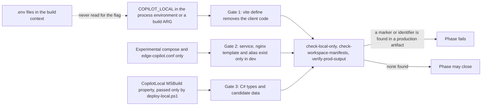

### D2 — Character selection, registration and whoisic capture
Used by: Phases 2, 4, 9. Lands in: `docs/copilot/characters.md`.

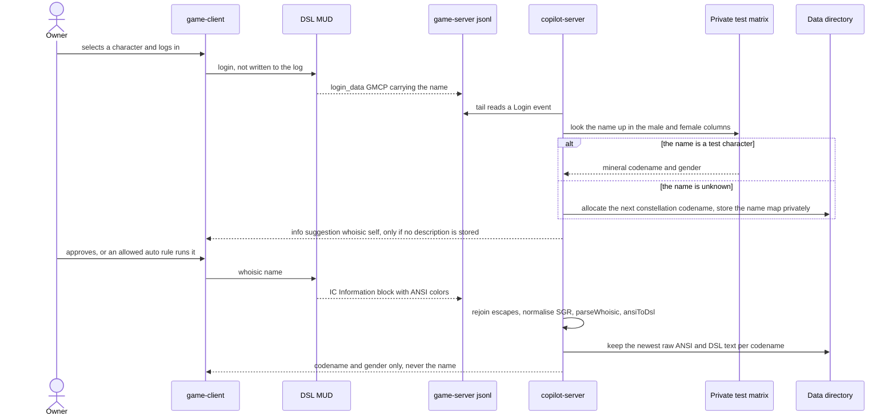

### D3 — Log tailing and reduction
Used by: Phases 3, 8. Lands in: `docs/copilot/log-pipeline.md`.

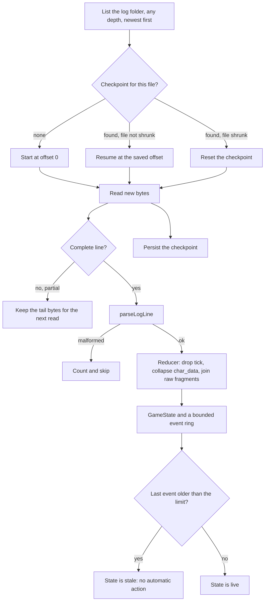

### D4 — Suggestion to decision to command
Used by: Phases 10, 11, 13. Lands in: `docs/copilot/server-api.md`.

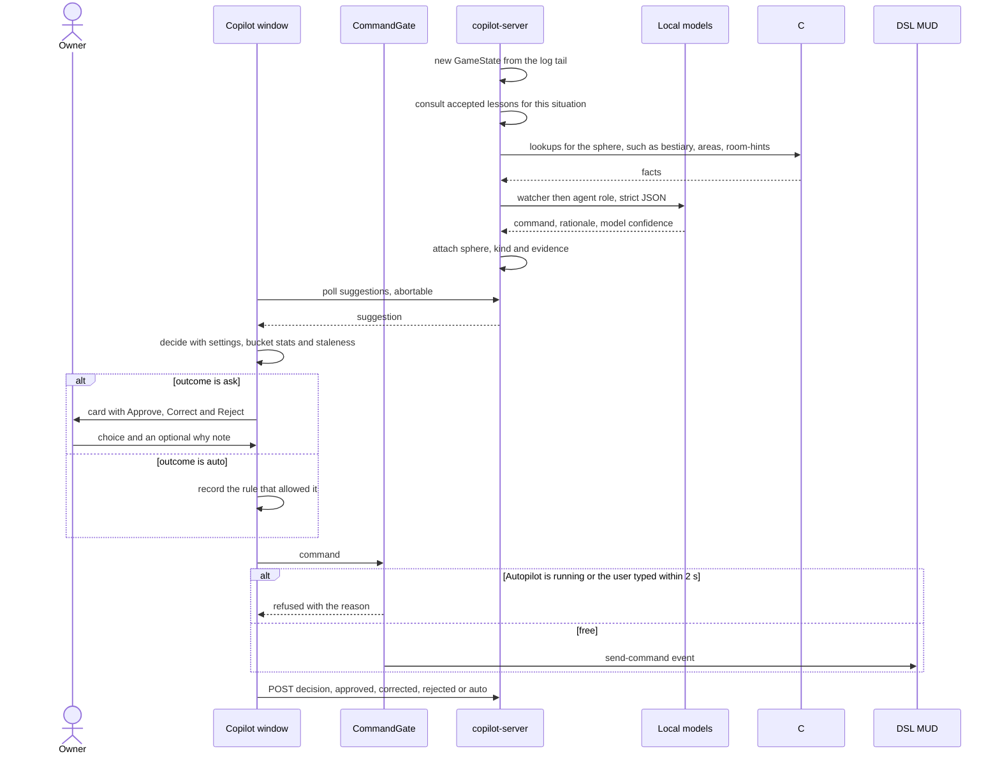

### D5 — Order of the policy checks
Used by: Phases 5, 14. Lands in: `docs/copilot/trust-and-approval.md`.

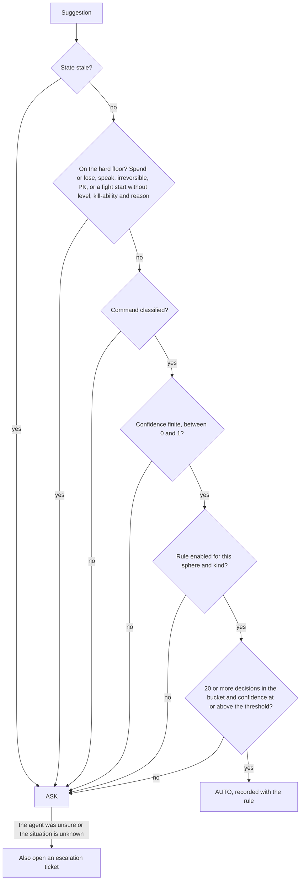

### D6 — Correction, lesson and ticket states
Used by: Phases 6, 10, 15. Lands in: `docs/copilot/teacher-loop.md`.

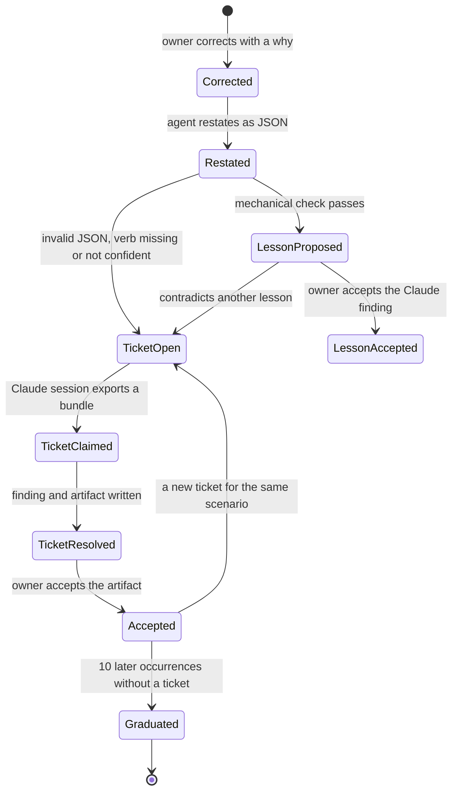

### D7 — Teacher loop
Used by: Phase 15. Lands in: `docs/copilot/teacher-loop.md`.

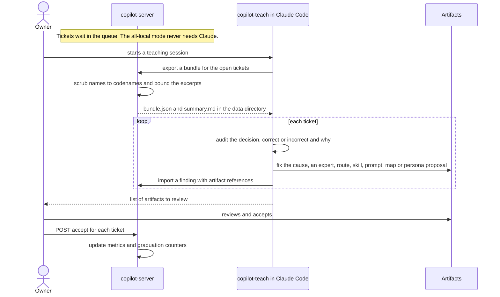

### D8 — Persona proposal
Used by: Phase 16. Lands in: `docs/copilot/persona-feedback.md`.

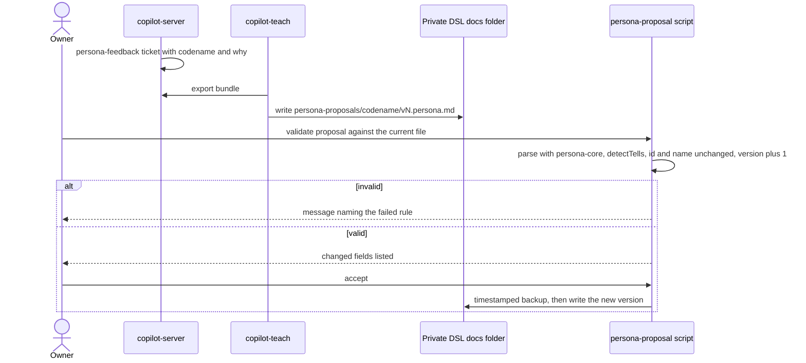

### D9 — Who may send a command
Used by: Phase 11. Lands in: `docs/copilot/client.md`.

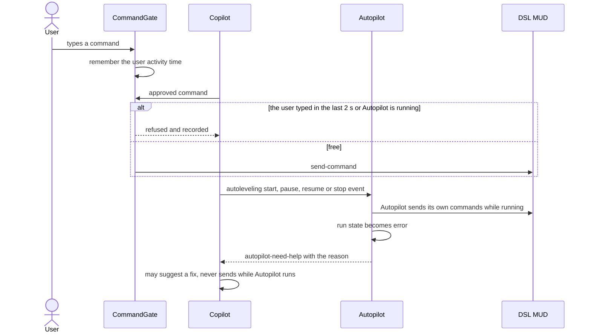

### D10 — Routing by sphere and recovering from a misroute
Used by: Phase 17. Lands in: `doc/copilot-spheres.md` (Shattered-AI).

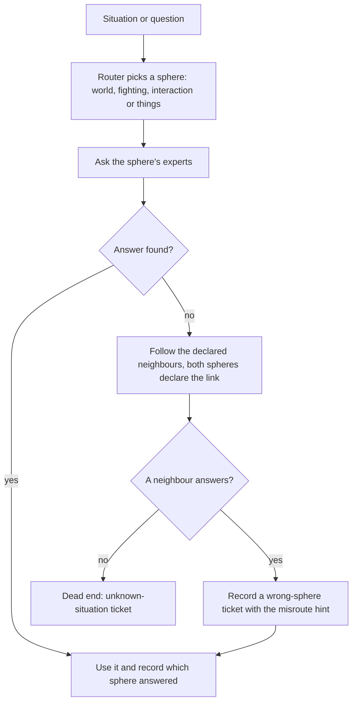

### D11 — Interaction expert call
Used by: Phase 18. Lands in: `.ai-experts/interaction.md` (hand-written section, Shattered-AI).

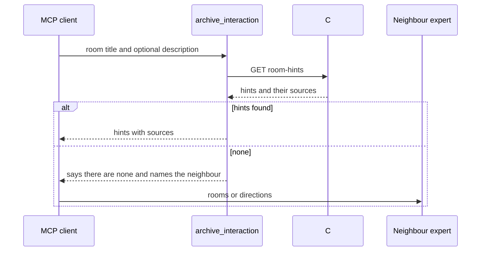

### D12 — Link evidence states
Used by: Phase 19. Lands in: `docs/shattered-maps/schema.md`.

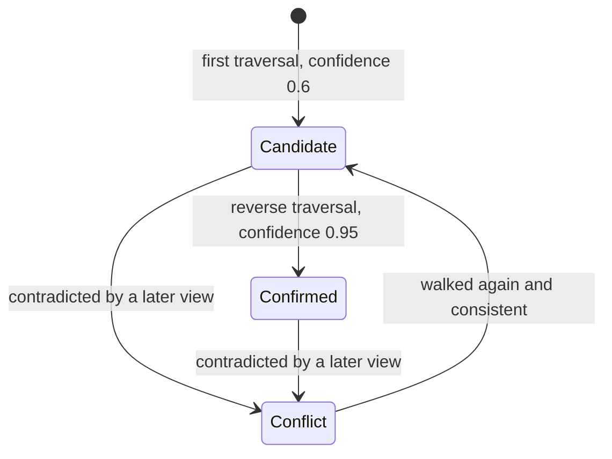

### D13 — Room content baseline states
Used by: Phases 19, 20. Lands in: `docs/shattered-maps/schema.md` and `docs/copilot/world-memory.md`.

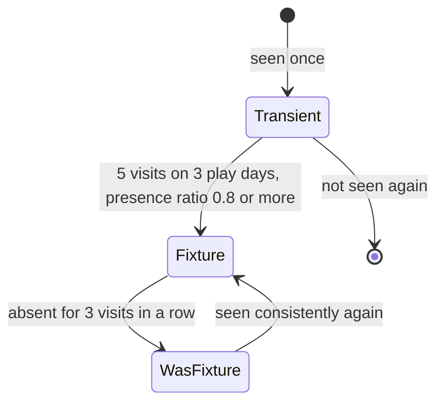

### D14 — World memory ingestion
Used by: Phase 20. Lands in: `docs/copilot/world-memory.md`.

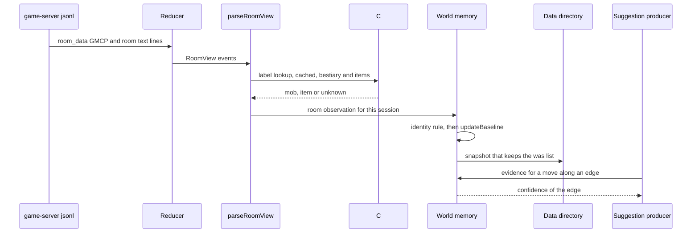

### D15 — Azah import
Used by: Phase 21. Lands in: `docs/shattered-maps/import-azah.md`.

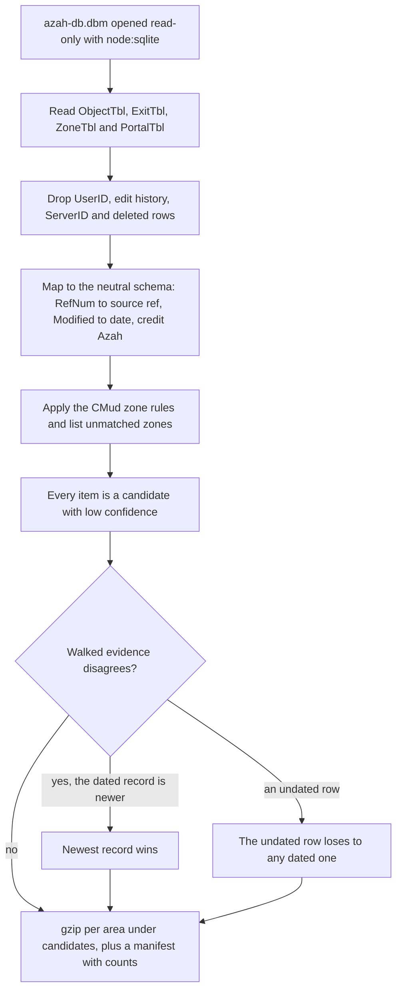

### D16 — Candidate review, audited layer and Builder export
Used by: Phases 23, 24. Lands in: `docs/shattered-maps/builder-export.md`.

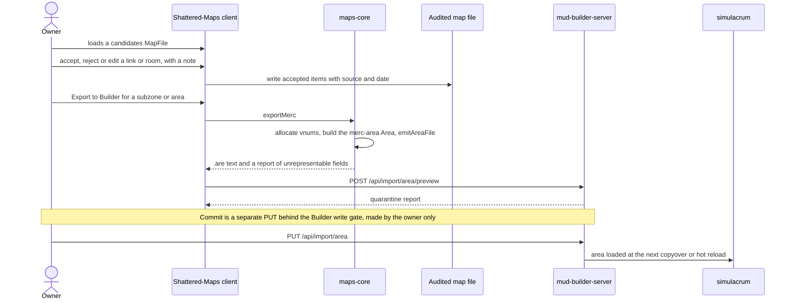

### D17 — C# build shapes and renderer publishing
Used by: Phases 25, 27. Lands in: `docs/shattered-maps/world-map-api.md` and `docs/shattered-maps/surfaces.md`.

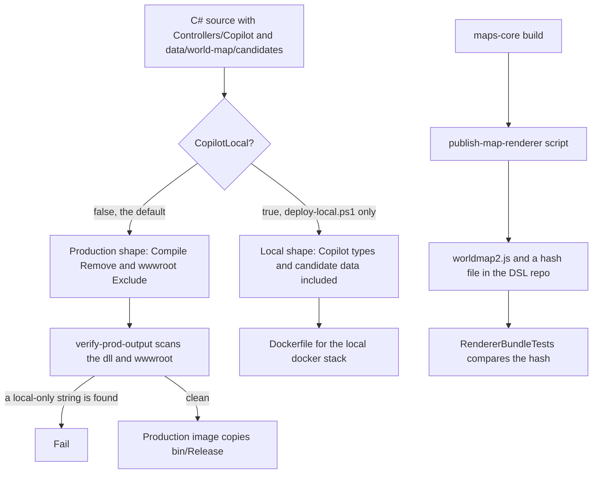

### D18 — Map serving, freshness and caching
Used by: Phases 26, 28. Lands in: `docs/shattered-maps/world-map-api.md` and `docs/shattered-maps/surfaces.md`.

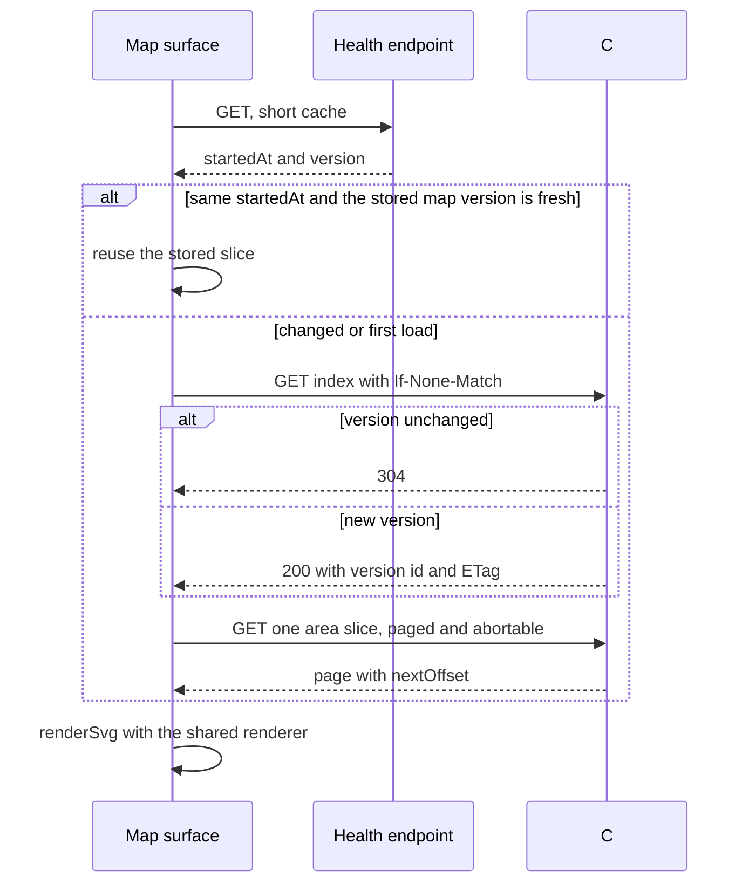

### D19 — Mobile map screen
Used by: Phase 29. Lands in: mobile `docs/features/world-map.md`.

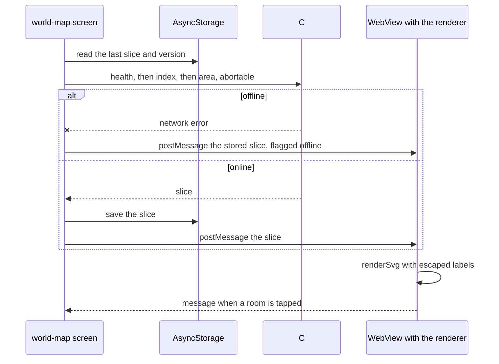

### D20 — End to end
Used by: Phase 31. Lands in: `docs/copilot/README.md`.

```mermaid
sequenceDiagram
  actor Owner
  participant Cl as game-client
  participant MUD as DSL MUD
  participant Srv as copilot-server and local agent
  participant Cld as Claude teacher session
  participant Mp as Shattered-Maps
  participant Bld as MUD Builder
  participant Sim as simulacrum
  participant Api as C# map API
  Owner->>Cl: plays
  Cl->>MUD: commands
  MUD-->>Srv: game logs, tailed
  Srv-->>Cl: suggested commands
  Owner->>Cl: approves or corrects with a why
  Cl->>Srv: decisions and notes
  Srv->>Srv: understand the correction or open a ticket
  Srv->>Srv: world memory builds the candidate map
  Owner->>Cld: starts a teaching session
  Cld->>Srv: scrubbed bundle
  Cld-->>Srv: findings and artifacts
  Cld->>Mp: audited map corrections
  Owner->>Mp: reviews candidates
  Mp->>Bld: export preview
  Owner->>Bld: commits the area
  Bld->>Sim: area loaded
  Mp->>Api: audited map file published with the C# data
  Api-->>Cl: map slices for the web pane
```

## Edit map

Line numbers are as of `a565d53` (ShatteredArchive) and the current checkouts of the sibling repos. "new" means the file does not exist yet.

### ShatteredArchive

| File | Line(s) | Anchor | Change | Phase |
|---|---|---|---|---|
| `apps/game-client/vite.config.ts` | 37-38 | `return {` / `plugins: [react()]` | add `define: { __COPILOT_LOCAL__: JSON.stringify(process.env.COPILOT_LOCAL === 'true') }` read from the process environment only | 1 |
| `apps/game-client/src/copilot-local.d.ts` | new | `declare const __COPILOT_LOCAL__: boolean` | ambient type for the constant | 1 |
| `deploy/game-client.Dockerfile` | 40, 52 | `ARG VITE_ENV` / `ENV VITE_ENV=$VITE_ENV` | add `ARG COPILOT_LOCAL`, `ENV COPILOT_LOCAL=$COPILOT_LOCAL`, `ARG VITE_COPILOT_API`, `ENV VITE_COPILOT_API=$VITE_COPILOT_API` | 1, 11 |
| `deploy/docker-compose.shattered-archive-experimental.yml` | 141 | `VITE_ENV: "development"` (game-client args) | add `COPILOT_LOCAL: "true"` and `VITE_COPILOT_API` | 1, 11 |
| same | 78 | `./nginx/edge-subdomains.conf:/etc/nginx/templates/default.conf.template:ro` | add a second mount of `./nginx/edge-copilot.conf` as a separate template | 7 |
| same | 112 | `- simulacrum.shatteredarchive.dev` (nginx aliases) | add `copilot.shatteredarchive.dev` | 7 |
| same | 181 | `C:/Projects/DSL/GameLogs/ShatteredArchive/Docker/game-server:/repo/apps/game-server/log` | reference only; the new `copilot-server` service mounts the same folder read-only | 7 |
| same | after the `simulacrum-server:` block (380) | `simulacrum-server:` | add the `copilot-server` service (profile `copilot`, env, mounts, network) | 7 |
| `deploy/docker-compose.yml` | 131 | `VITE_ENV: "development"` | NOT edited; the guard script asserts it has no Copilot identifier | 1 |
| `deploy/nginx/edge-copilot.conf` | new | | vhost `copilot.shatteredarchive.dev` -> `copilot-server:66000`; not added to `edge-subdomains.conf` | 7 |
| `deploy/copilot-server.Dockerfile` | new | | copy of `simulacrum-server.Dockerfile` with the copilot paths | 7 |
| `deploy/*.Dockerfile` (13 files) | the `COPY apps/.../package.json` block | `COPY apps/simulacrum-server/package.json` | add manifest COPY lines for each new workspace project | 1, 19, 22 |
| `jest.config.cjs` | 17-30, 32-45 | `LOCAL_CONFIG_PACKAGES` / `LOCAL_CONFIG_IGNORES` | add the four new packages to both lists | 1, 19, 22 |
| `package.json` (root) | 6-11 | `"scripts"` | add `check:local-only` and `check:manifests` | 1 |
| `scripts/check-local-only.mjs` | new | | reads prod compose, prod Dockerfiles, nginx template, and the production-built game-client dist; fails on any Copilot identifier or marker | 1 |
| `scripts/check-workspace-manifests.mjs` | new | | compares `pnpm-lock.yaml` importers with every Dockerfile's manifest COPY lines | 1 |
| `services/copilot-core/**` | new | | contracts, parsers, policy, ledger, scrub, registry core | 1-6 |
| `apps/copilot-server/**` | new | | Express server, tailer, adapters, stores | 7-10, 15, 20 |
| `apps/game-client/src/features/copilot/**` | new | | flag-gated loader, API client, settings, command gate, controller arbitration, Autopilot hooks | 11 |
| `apps/game-client/src/components/CopilotWindow.tsx`, `styles/CopilotWindow.module.scss` | new | | the movable, resizable window; review, correction and settings panels | 12-14 |
| `apps/game-client/src/hooks/useFloatingPanel.ts` | new | | drag + resize + clamp, extracted as the shared shape of the wizard drag and the sandbox resize | 12 |
| `apps/game-client/src/components/MainMenuBar.tsx` | 17, 31, 174-177 | `onOpenAutoLeveling: () => void;` / `Autopilot…` | add `onOpenCopilot?` prop and a "Copilot…" item rendered only when `__COPILOT_LOCAL__` | 12 |
| `apps/game-client/src/pages/MainContainer.tsx` | 170, 183, 213, 282, 294, 356-377 | `isAutoLevelingModalOpen`, `handleOpenAutoLeveling`, `useAutoLeveling(`, `<AutoLevelingWizard` | open-state, handler, lazy `CopilotWindow` behind the constant, pass `auto` run state | 12, 11 |
| `apps/game-client/src/hooks/useAutoLeveling.ts` | 190, 319-368 | `DispatchEvent('shatteredarchive:send-command'` / event listeners | emit `shatteredarchive:autopilot-need-help` when the run state becomes `error`; no change to command sending | 11 |
| `apps/game-client/src/features/autoleveling/autoleveling-engine.ts` | 1247 (also 1376, 1438, 2331) | `this.deps.setRunState({ status: 'error', message })` | read-only reference: every error site goes through `setRunState`, so one observer in `useAutoLeveling` covers them all; not edited | 11 |
| `apps/game-client/src/components/RightSidebar.tsx` | 437 | `export const RightSidebar` | add the world-map pane entry (production feature, not flag-gated) | 28 |
| `apps/game-client/src/components/CommandInput.tsx` | 18, 93, 106 | `inputRef` / `onKeyDown={handleKeyDown}` | not edited; a test proves the input stays usable with the window open | 12 |
| `apps/game-client/src/features/chat/dsl-to-ansi.ts` | 4-24 | `DSL_ANSI_COLORS` | not edited; a game-client test round-trips it against copilot-core's converter | 2 |
| `apps/shattered-maps-client/**` | new | | copy of `DslMapper/game-mapping` | 22-24 |
| `services/shattered-maps-core/**` | new | | schema, identity/confidence, baseline, hierarchy, exporters, SVG renderer | 19, 21, 24 |
| `.claude/skills/copilot-teach/SKILL.md` | new | | Claude teaching-session procedure | 15 |
| `docs/copilot/*.md`, `docs/shattered-maps/*.md` | new | | developer docs and the map user guide | per phase |

### Shattered-AI (`C:\Projects\Shattered-AI`)

| File | Line(s) | Anchor | Change | Phase |
|---|---|---|---|---|
| `tools/archive-mcp/src/experts.mjs` | 10, 40 | `const NOT_EXPERT = new Set(["facts.json", "inventory.json"])` / `export function lintExperts` | add `spheres.json`; lint: every expert names a sphere, neighbours are two-sided | 17 |
| `tools/archive-mcp/experts/spheres.json` | new | | four spheres, their neighbours, misroute guidance | 17 |
| `tools/archive-mcp/experts/*.json` (44 experts) | each | `"id":` | add `"sphere"` (script-assisted, reviewed) | 17 |
| `tools/archive-mcp/experts/interaction.json`, `src/experts/interaction.mjs`, `test/interaction.test.mjs` | new | | the interaction expert | 18 |
| `tools/archive-mcp/src/server.mjs` | 218 | `server.registerTool("archive_rooms", {` | register `archive_interaction` after it | 18 |
| `.ai-experts/interaction.md`, `.ai-experts/README.md`, `doc/tooling.md` | new / table row / regenerated | | written by `scripts/ai-experts.mjs --write` and `scripts/tooling-page.mjs --write` | 17, 18 |

### DSL (`C:\Projects\DSL`, C#)

| File | Line(s) | Anchor | Change | Phase |
|---|---|---|---|---|
| `Server/Server.Web.Public/Server.Web.Public.csproj` | 3-10, 36-41 (glob at 38) | `<PropertyGroup>` / `<CopyItems Include="wwwroot\**\*.*" />` | add `CopilotLocal` default false; `Compile Remove` for `**\Copilot\**` and an `Exclude` of `wwwroot\data\world-map\candidates\**` on line 38 unless true | 25 |
| `Server/scripts/verify-prod-output.mjs` | new (the folder is new) | | scans the Release output built without the property for local-only types and data | 25 |
| `Server/deploy-local.ps1` | 79 | `dotnet build $project -c Release` | append `-p:CopilotLocal=true` (this script only) | 25 |
| `Server/Server.Web.Public/Program.cs` | 248 | `UseResponseCaching` | cache policy for the map and health routes | 26 |
| `Server/Server.Web.Public/Controllers/AgentApiController.cs` | 139-142, 318 | `private void VaryByQuery()` / `[HttpGet("room-hints")]` | reference pattern; not edited | 26 |
| `Server/Server.Web.Public/Controllers/WorldMapController.cs`, `HealthController.cs`, `Controllers/Copilot/CandidatesController.cs` | new | | production map API, restart-time endpoint, local-only candidate layer | 25-26 |
| `Server/Server.Dsl/AgentApi/WorldMapApi.cs` | new | | logic for slicing, paging and versioning the map | 26 |
| `Server/Server.Dsl.Tests/WorldMapApiTests.cs`, `HealthTests.cs` | new | | xunit | 25-26 |
| `Server/Server.Web.Public/Views/Maps/WorldMapV2.cshtml`, `wwwroot/js/maps/worldmap2.js` | new | | the new page beside the beta | 27 |
| `Server/Server.Web.Public/Controllers/MapsController.cs` | 118-125 (user maps 40-110 untouched) | `return RedirectToAction("Directions", "Home", new { is_beta = "true" });` | edited only in Phase 30, after sign-off | 30 |
| `Server/Server.Web.Public/wwwroot/data/world-map/**` | new | | audited map slices (gzip per area) | 21, 24 |
| `.gitignore` | end | | add `GameLogs/` only if `git check-ignore` says it is not ignored | 7 |
| `docs/copilot/user-guide.md` | new | | Copilot end-user guide (codenames only) | 12-15 |

### Shattered-Story, mobile, MUD Builder

| File | Line(s) | Anchor | Change | Phase |
|---|---|---|---|---|
| `C:\Projects\Shattered-Story\scripts\persona-proposal.mjs` (CLI) and `scripts\lib\persona-proposal.mjs` + `scripts\lib\persona-proposal.test.mjs` (logic and `node:test` tests, the layout `test:scripts` runs) | new | | validate and accept persona proposals using the vendored `persona-core` build | 16 |
| `C:\Projects\shatteredarchive-mobile\dsl-client\app\(tabs)\_layout.tsx` | 107-180 | `Tabs.Screen` list | register `world-map` as a focusable tab without a tab-bar item | 29 |
| `dsl-client\app\(tabs)\world-map.tsx`, `dsl-client\features\world-map\*` | new | | WebView host, API client, storage | 29 |
| `apps/mud-builder-server/src/routes/import.ts` | 50-65 | `app.use('/api/import', express.json({ limit: '2mb' }))` / `'/api/import/area/preview'` (55) / `'/api/import/area'` (65) | not edited; Phase 24 calls it | 24 |
| `services/merc-area/src/index.ts` | 1-5 | `emitAreaFile` | not edited; Phase 24 builds an `Area` model and emits it | 24 |

## Edge cases

Rows with a classifier id come from the catalog. `E` rows are plan-specific and stay local to this plan.

| Id | Classifier | Condition | Required behaviour | Covered by |
|---|---|---|---|---|
| L1 | LOCAL-01 | `COPILOT_LOCAL` could be set through a `.env*` file in the game-client build context | The constant is read from `process.env` only; `check:local-only` builds the client with a `.env.production.local` containing the flag and asserts the marker is still absent | Phase 1 (script test), every UI phase (re-run) |
| L2 | LOCAL-02 | nginx template, compose file, csproj copy glob, Dockerfiles are shared with production | Copilot vhost, service and data live only in `edge-copilot.conf`, the experimental compose and the `CopilotLocal` csproj branch; the guard reads the production files | Phase 1, 7, 25 |
| L3 | LOCAL-03 | four new workspace projects | all 13 Dockerfiles gain manifest lines; `check:manifests` and a `docker build` of one client and one server image | Phase 1, 19, 22 |
| T1 | LOGTAIL-01 | tail of `server.log-YYYY-MM-DD.jsonl` inside date folders | listing-based discovery, byte-offset checkpoint, complete-line rule, truncation reset | Phase 8 |
| T2 | LOGTAIL-02 | the SOH gate stops raw and input logging | last-event age, `stale` after the configured limit, stale never auto-approves | Phase 5, 8 |
| A1 | AUTOAPPR-01 | classifier, thresholds, settings blob, floor | default ask; floor first; `NaN`/missing confidence, unknown verb, abbreviation, stale all ask | Phase 5, 14 |
| N1 | PRIVNAME-01 | names in tells, room lines, whoisic headers, speech | scrubber replaces registry names anywhere in text; export folder scanned | Phase 4, 15 |
| C1 | ANSI-01 | whoisic text with `1;30`, `0;37`, wrapped escapes | rejoin, normalise both SGR styles, store raw beside DSL, flag unmapped | Phase 2 |
| M1 | MAPID-01 | contents, repeated titles, hidden exits | fixture rule P5, confidence-ruled merge/split, baseline history kept | Phase 19, 20 |
| S1 | SETTINGS-01 | Copilot settings are saved from `{...defaults, ...saved}` | only values that differ from defaults are stored | Phase 14 |
| S2 | SETTINGS-02 | "same as default" for thresholds, mode lists, rule arrays | strict structural equality (`0.9` vs `"0.9"`, reordered rule list) | Phase 14 |
| S3 | SETTINGS-03 | running window keeps its own copy of settings | reset replaces the live copy with defaults, no reload | Phase 14 |
| S4 | SETTINGS-04 | settings written by the editor, the reset button and the cross-tab `storage` event | one normalizer; a test per route | Phase 14 |
| H1 | TH-01 | suggestion log and ticket list overflow | scrollbars follow `color-scheme: dark` | Phase 12-14 screenshot with overflow |
| H2 | TH-02 | select, checkbox, number/range inputs in settings | native controls follow the theme; screenshot with one of each and an open select | Phase 14 |
| H3 | TH-03 | buttons, inputs, tabs in the window | hover, focus-visible, active, disabled, invalid, loading styled and AA contrast | Phase 12-14 |
| H4 | TH-04 | the why-note textarea | placeholder, selection, caret legible | Phase 13 |
| H5 | TH-05 | the world-map pane follows the HUD theme | live theme switch updates the mounted pane | Phase 28 |
| X1 | EXPO-03 | any new mobile dependency | none planned; if one is needed, publish-age check first and `pnpm config get minimumReleaseAge` unchanged | Phase 29 |
| X2 | EXPO-04 | a screen reached from a menu, not a tab | registered with `tabBarItemStyle: { display: 'none' }`, never `href: null` | Phase 29 |
| E1 | - | Copilot enabled but the server is unreachable | the window shows "offline", suggests nothing, never queues commands | Phase 11 |
| E2 | - | two senders: user typing, Autopilot running, Copilot approving | one controller at a time (user > Autopilot > Copilot); a Copilot command is refused while Autopilot status is `running`, and the refusal is recorded | Phase 11 |
| E3 | - | oversized or hostile request bodies and ids on the server | size caps, unknown fields rejected, id pattern checked before any path use | Phase 7 |
| E4 | - | a non-local `COPILOT_OLLAMA_URL` | server refuses to start; 403 pattern as `room-hints/ai` | Phase 10 |
| E5 | - | model returns invalid or off-contract JSON | treated as "not understood" -> escalation ticket, never a suggestion | Phase 10 |
| E6 | - | two sessions (or characters) contradict a lesson | both kept with their world and scope tags; neither silently overwrites; Claude resolves | Phase 6, 15 |
| E7 | - | `whoisic` for a character with no description or only colour | stored as empty verbatim text with the flag, not guessed | Phase 9 |
| E8 | - | the selected character matches the private matrix by name | resolved to its test codename (`<Mineral>-<M\|F>`), not re-registered | Phase 4, 9 |
| E9 | - | Azah rows with dates later or earlier than walked evidence | newest record wins; undated rows lose to any dated row | Phase 21 |
| E10 | - | map payload size | slices by continent/area, gzip, paged; mobile never loads the whole world | Phase 26 |
| E11 | - | map cache after a redeploy or a correction | `/api/health` restart time as the cheap check; map responses carry a version id and ETag | Phase 25-26 |
| E12 | - | candidate layer requested from a production build | the route does not exist (404) and the type is not in the assembly | Phase 25 |
| E13 | - | Builder export has DSL-only features and unallocated vnums | export reports unrepresentable fields; vnums come from a configured range; nothing is committed without the owner | Phase 24 |
| E14 | - | persona proposal changes identity fields or announces a shift | validator rejects (parse, `detectTells`, id/name unchanged, version +1) | Phase 16 |
| E15 | - | beta map retired while user-created maps exist | `MapsController` user-map actions are kept; only the beta redirect changes | Phase 30 |
| E16 | - | (added in Phase 3) the log folders also hold a plain-text `server-<date>.log` copy beside each `server.log-<date>.jsonl` | the tailer lists and reads only `*.jsonl`; a folder holding both yields events from the jsonl only and zero malformed lines | Phase 8 |

Classifiers not applicable:
- SETTINGS-05 (data-rewriting migration): the settings are new, there is no stored data to migrate; a `schemaVersion` key is stored so a later migration can be written.
- EXPO-01 (regenerating native projects), EXPO-02 (deprecated APIs), EXPO-05 (`defaultProps`), EXPO-06 (in-place update test): no SDK upgrade, no new native module (decision P7), no update test.
- TH-05 for the Copilot window: it uses its own fixed dark palette (scss standard) and reads no theme value, so a live theme switch has nothing to update. It does apply to the map pane (H5).

## Verification toolbox

Standard exit gate = every command below that applies to the packages the phase touched, all green, plus the guards. A failing test anywhere in a touched package is fixed in that phase.

Documentation rule for the phases: developer docs are always named in the phase. A phase whose behaviour no user can see (Phases 1-8, 10-11, 17-21, 25-26) has no end-user document, and the reason recorded for it is "no user-visible effect: internal"; the user-facing documents are updated in the phase that first shows the behaviour (the DSL Copilot guide from Phase 12, the map user guide from Phase 23).

Diagrams rule: every diagram in this plan and in the documents the phases write is a mermaid code block, never ASCII art. Use quoted labels and no `;`. Any workflow that is a sequence, or that crosses a system boundary, is diagrammed: a sequence diagram for who-calls-whom, a flowchart for decisions and pipelines, a state diagram for lifecycles. The section "Workflow diagrams" holds D1-D20; each phase has a `Diagrams:` line naming what must land in its documentation, and a phase with `none` says why. A phase's documentation is not written until its diagrams are in the named file.

| Purpose | Command |
|---|---|
| Install (after any manifest change) | `pnpm install --lockfile-only` then `pnpm install --frozen-lockfile` (from `C:\Projects\ShatteredArchive`) |
| Lint | `pnpm lint` (root; `--max-warnings=300`) |
| Typecheck game-client | `pnpm typecheck` |
| Build a package | `pnpm --filter @shatteredarchive/<name> build` (`copilot-core`, `copilot-server`, `shattered-maps-core`, `shattered-maps-client`, `game-client`) |
| Test a package | `pnpm --filter @shatteredarchive/<name> test` (copilot-core, copilot-server and the maps packages get a local `jest.config.cjs`; game-client: `jest --config ../../jest.config.cjs --runInBand --testPathPatterns apps/game-client`) |
| Coverage of new code | `pnpm --filter @shatteredarchive/<name> test -- --coverage` and read the new files' branch lines; no new branch left unexecuted |
| Local-only guard | `node scripts/check-local-only.mjs` and `node scripts/check-workspace-manifests.mjs` |
| Gates | `node C:/Projects/Shattered-AI/tools/gates/run.mjs --repo C:/Projects/ShatteredArchive --all` |
| C# | `dotnet build C:/Projects/DSL/Server/Server.Web.Public -c Release` (without the property: the production shape) and `dotnet test C:/Projects/DSL/Server/Server.Dsl.Tests`; `node C:/Projects/DSL/Server/scripts/verify-prod-output.mjs` (Phase 25) |
| archive-mcp | `pnpm --dir C:/Projects/Shattered-AI/tools/archive-mcp test` and `pnpm --dir C:/Projects/Shattered-AI/tools/archive-mcp run lint:experts` |
| Shattered-Story | `pnpm --dir C:/Projects/Shattered-Story run test:scripts` (`node --test scripts/lib/*.test.mjs`) and `pnpm --dir C:/Projects/Shattered-Story run lint` |
| Mobile | `pnpm --dir C:/Projects/shatteredarchive-mobile/dsl-client test` and `... lint` |
| API checks | `curl` against `https://copilot.shatteredarchive.dev` (dev stack) or the host port, and `http://localhost:5000` for C#; the owner's running stack, never started or stopped by a phase |
| Screenshots | Playwright through `C:/Projects/Shattered-AI/tools/browser-test` (`saveShowcase` for final shots) against the owner's experimental stack built with `COPILOT_LOCAL=true`. A phase that needs the container recreated asks for the owner's go first. |
| Real model | Owner only. Phases stop at "owner step" and are marked verified-with-fakes until the owner reports the live run. |

## Phases

### [x] Phase 1 — Local-only boundary, packages and contracts
Goal:        The repo can build Copilot packages, the production build provably contains none of it, and the shared contracts exist.
Depends on:  nothing
Changes:
- `apps/game-client/vite.config.ts:37` — `define` for `__COPILOT_LOCAL__` from `process.env` only; `src/copilot-local.d.ts` declares it.
- `deploy/game-client.Dockerfile:40,52` — `ARG`/`ENV COPILOT_LOCAL`; `docker-compose.shattered-archive-experimental.yml:141` sets it; `deploy/docker-compose.yml` does not.
- `services/copilot-core` — package, `jest.config.cjs`, `tsconfig.json`; `src/contracts.ts` with `Sphere`, `Mode`, `ActionKind`, `Suggestion`, `Decision`, `Lesson`, `EscalationTicket`, `Confidence` and the marker constant `COPILOT_BUNDLE_MARKER = 'sa-copilot-local-v1'`.
- 13 `deploy/*.Dockerfile` manifest lines for `services/copilot-core`; `jest.config.cjs:17-45`; `pnpm-lock.yaml` refreshed.
- `scripts/check-local-only.mjs`, `scripts/check-workspace-manifests.mjs`, root `package.json` scripts.
Tests:       `services/copilot-core/src/contracts.test.ts`: marker constant exact value; `Sphere`/`Mode` lists equal the documented sets; a `ActionKind` list contains each floor kind (A1). `scripts/check-local-only.test.mjs` (node:test): fixture compose with a Copilot service in the prod file fails; fixture dist containing the marker fails; clean fixture passes; a `.env.production.local` carrying the flag does not enable it in a real `vite build` of a tiny fixture (L1). `check-workspace-manifests.test.mjs`: a Dockerfile missing a project line fails (L3).
API check:   none
UI check:    none (no UI yet)
Diagrams:    D1 (local-only gates) -> `docs/copilot/README.md`.
Index/docs:  `services/copilot-core/src/.ai-context`; `docs/copilot/README.md` (create: purpose, the local-only boundary, package map).
Exit gate:   build · typecheck · lint · all tests of `copilot-core` and `game-client` · `check:local-only` and `check:manifests` green on the real repo · production `game-client` build (no flag) succeeds and its dist lacks the marker · docs written.
State on exit: contracts and guards exist; no feature code; the production image is unchanged.

### [x] Phase 2 — Colour conversion and `whoisic` parsing
Goal:        A `whoisic` output block becomes a structured record with the verbatim raw ANSI and a DSL `{X` version.
Depends on:  Phase 1
Changes:
- `services/copilot-core/src/color/ansi.ts` — `rejoinSequences`, `normalizeSgr` (maps `1;30`, `0;37`, `1;3x`, `9x`, 256-colour `38;5;n` for the DSL orange/brown/pink/purple codes), `stripAnsi`.
- `.../color/ansiToDsl.ts` — `ansiToDsl(text): { dsl: string; unmapped: string[] }`, its table generated from the same codes as `game-client/.../dsl-to-ansi.ts:4-24` (literal `{` doubled to `{{`, `~` to `{-`).
- `.../characters/whoisic.ts` — `parseWhoisic(lines): { header, fields, description, rawAnsi, dsl, newest: boolean }` using the observed layout ("IC Information for X.", ruled lines, `Eyes:`/`Hair:` columns, `Profession/Age/Sex`, free-text description).
Tests:       `ansi.test.ts`: wrapped escape `ESC[1;31<CRLF>m`, bold-black `1;30`, `0;37`, reset, nested resets, unknown 256-colour kept and flagged (C1). `ansiToDsl.test.ts`: for every entry of the mirrored table, `ansiToDsl(code) === dslKey`, in both SGR styles; literal braces and tildes. `whoisic.test.ts`: a scrubbed fixture block parses; two blocks for one character -> the later timestamp is `newest`; empty description -> empty text plus `hasDescription:false` (E7). `apps/game-client/src/features/chat/dsl-to-ansi.roundtrip.test.ts`: `ansiToDsl(DSL_ANSI_COLORS[k]) === k` for all 20 keys, so the two tables cannot drift.
API check:   none
UI check:    none
Diagrams:    D2 (the whoisic parse step and the stored shapes) -> `docs/copilot/characters.md`.
Index/docs:  `copilot-core/src/color/.annotated`; `docs/copilot/characters.md` (create: the stored shape, the two forms, the fixture rule for descriptions).
Exit gate:   build · typecheck · lint · tests of `copilot-core` and `game-client` · coverage of both converters reviewed · docs.
State on exit: pure converters and parser; nothing calls them yet.

### [x] Phase 3 — Log events and the reducer
Goal:        A jsonl line becomes a typed event and a stream of events becomes a compact, ordered, deduplicated feed.
Depends on:  Phase 1
Changes:
- `copilot-core/src/log/events.ts` — `parseLogLine(line): LogEvent | null` for `game:remote-server:raw` (payload object), `game:remote-server:gmcp` (`login_data`, `room_data`, `char_data`, `tick`), `game:client:input`, `game:server:connection:client-closed`; GMCP bodies are `name { json }` text, parsed defensively.
- `.../log/reducer.ts` — drops `tick`, collapses identical `char_data`, joins raw fragments into lines (payload data is not line-aligned), keeps command echoes, emits `RoomView`, `VitalsChange`, `LineBatch`, `CommandSent`, `Login`.
- `.../log/state.ts` — `GameState` (room, vitals, in-fight, last event time) with `isStale(now, limit)`.
Tests:       `events.test.ts` per event type with a scrubbed real-shape line, malformed JSON, missing `payload`, a 5 MB line (rejected with a count, not a crash). `reducer.test.ts`: fragments split mid-line are rejoined; 1,000 identical `char_data` -> 1 event; ordering by timestamp; `isStale` true after the limit and false after any event (T2). Names in fixtures are placeholders.
API check:   none
UI check:    none
Diagrams:    D3 (tail and reduction flow) -> `docs/copilot/log-pipeline.md`.
Index/docs:  `copilot-core/src/log/.annotated`; `docs/copilot/log-pipeline.md` (create: event shapes, what the reducer drops and why, the SOH note).
Exit gate:   build · lint · `copilot-core` tests · coverage of every reducer branch · docs.
State on exit: pure pipeline, tested on fixtures only.

### [x] Phase 4 — Privacy scrubber and character registry core
Goal:        Text can be scrubbed to codenames, and a selected character resolves to a test codename or a new real-character codename.
Depends on:  Phase 2, 3
Changes:
- `copilot-core/src/privacy/scrub.ts` — `scrub(text, registry): { text, replaced }` (case-insensitive, inside longer words, plus an unknown-name-shaped-token policy that replaces with `<name>`).
- `.../characters/registry.ts` — `CodenameAllocator` over the fixed constellation list (P10), `resolveCharacter(name, matrix, store)` returning `{ codename, kind: 'test'|'real', gender }`, store interface (`get`, `put`, `list`), and the matrix name index (601 rows, `male`/`female`).
- `.../characters/matrix.ts` — `loadMatrix(json)` validating the private matrix shape.
Tests:       `scrub.test.ts`: names in a tell, a room line, a whoisic header, quoted speech, as a substring of a longer word; empty registry; two names where one contains the other (N1). `registry.test.ts`: a name in the matrix resolves to `<Mineral>-M|F` and is not re-registered (E8); an unknown name gets the next free constellation codename, stable across calls; exhausting the list fails loudly rather than reusing; two different names never share a codename. `matrix.test.ts`: malformed rows rejected. All fixtures use invented placeholder names.
API check:   none
UI check:    none
Diagrams:    D2 (name resolution: test matrix, then constellation codename) -> `docs/copilot/characters.md`.
Index/docs:  `copilot-core/src/privacy/.annotated`, `characters/.annotated`; `docs/copilot/characters.md` (update: codename scheme, never write a name outside the data directory).
Exit gate:   build · lint · `copilot-core` tests · coverage · a repo-wide search shows no registry name in committed files (fixtures only) · docs.
State on exit: pure core; no store implementation and no file I/O yet.

### [x] Phase 5 — Action classifier, trust policy and confidence
Goal:        Given a command, a sphere, evidence and settings, the policy answers auto, ask or escalate, and never auto for the floor.
Depends on:  Phase 1, 3
Changes:
- `copilot-core/src/policy/classify.ts` — `classifyCommand(cmd, ctx): ActionKind`; a verb table with MUD prefix resolution (`dro`, `giv`, `gos`) that resolves ambiguity toward the floor; movement set; fight verbs split into continue / start-known / start-unknown / pk by context (a current fight, a known target with level, kill-ability and reason all present).
- `.../policy/confidence.ts` — `wilsonLower(approved, total)`, `effectiveConfidence(model, bucketStats, edgeEvidence)` per P4; non-finite -> `null`.
- `.../policy/decide.ts` — `decide(suggestion, settings, state, now): { outcome: 'auto'|'ask'|'escalate'; reason }`; order: stale -> floor -> unknown class -> missing confidence -> rule enabled for (sphere, kind) -> threshold and sample count. Defaults: every rule off.
- `.../policy/settings.ts` — `TrustSettings` type, `DEFAULT_SETTINGS`, `normalizeSettings(unknown)`, `toStored(settings)` (only differences from defaults), `settingsEqual` (strict structural).
Tests:       `classify.test.ts`: table of 80+ commands including abbreviations of every floor verb (spend/lose, speak, irreversible, PK), directions and their abbreviations, a fight start with and without each of the three readiness facts, an unknown verb (A1). `confidence.test.ts`: Wilson values for known inputs, `NaN`/negative/above-one/`undefined` -> null, below 20 samples -> not eligible. `decide.test.ts`: floor beats an enabled rule and a blob that enables a floor kind; stale -> ask; unknown -> ask; threshold equal passes, just under asks; PK never auto; fight-start-unknown asks; an unreadable settings blob -> defaults. `settings.test.ts`: S1/S2 cases (`0.9` vs `"0.9"`, reordered rules, nested table, `null` vs missing).
API check:   none
UI check:    none
Diagrams:    D5 (order of the policy checks) -> `docs/copilot/trust-and-approval.md`.
Index/docs:  `copilot-core/src/policy/.annotated`; `docs/copilot/trust-and-approval.md` (create: the floor, the order of checks, how confidence is earned, defaults off, the owner's rule on known-target fights).
Exit gate:   build · lint · `copilot-core` tests · every branch of `decide` executed · docs.
State on exit: the policy exists and is the only place that decides auto-approval.

### [x] Phase 6 — Feedback, lessons and escalation ledger
Goal:        Decisions, lessons and tickets can be recorded, queried and de-duplicated, with scope and world tags.
Depends on:  Phase 1
Changes:
- `copilot-core/src/ledger/records.ts` — validators for `Decision`, `Lesson` (scope: shared/class/race/ability-set/character-public; world: dsl/sandbox), `EscalationTicket` (reasons: low-confidence, correction-not-understood, danger, wrong-sphere, persona-feedback, unknown-situation).
- `.../ledger/understanding.ts` — `checkUnderstanding(suggestion, correction, modelJson)`: valid shape, non-empty rule, restatement contains the corrected command's verb, `confident === true`; otherwise `{ ok: false, ticketReason: 'correction-not-understood' }`. Mechanical only (no model judges a model).
- `.../ledger/store.ts` — append-only JSONL store over an injected file-system interface: atomic append, schema version, dedupe by id, `query`, rotation by size.
- `.../ledger/graduation.ts` — scenario key `(sphere, kind, situationKey)`, Claude-needed counter, `graduated` only after an owner acceptance record plus 10 later occurrences without a ticket.
Tests:       `records.test.ts` invalid and oversize input; `understanding.test.ts`: correct restatement passes; missing verb, invalid JSON, `confident:false`, empty rule each produce a ticket; `store.test.ts`: append twice with the same id keeps one; a torn last line is skipped and reported; rotation; fake fs fails on write -> error returned, nothing half-written; `graduation.test.ts`: acceptance without the 10 successes stays open; a ticket in between resets the count; two contradicting lessons with different worlds both survive (E6).
API check:   none
UI check:    none
Diagrams:    D6 (correction, lesson and ticket states, graduation) -> `docs/copilot/teacher-loop.md`.
Index/docs:  `copilot-core/src/ledger/.annotated`; `docs/copilot/teacher-loop.md` (create: records, scopes, graduation rule, who may accept).
Exit gate:   build · lint · `copilot-core` tests · coverage · docs.
State on exit: the data model of the training loop is complete and tested; nothing persists to disk yet.

### [x] Phase 7 — copilot-server skeleton, API and dev-only deployment
Goal:        A local server answers health, settings-snapshot, suggestion, decision and ticket routes behind every guard, and runs only in the dev stack.
Depends on:  Phase 3, 5, 6
Changes:
- `apps/copilot-server` — package, `jest.config.cjs`, `tsconfig.json`, `src/config.ts` (refuses to start unless `COPILOT_ENABLED=true`; listen address; data dir; allowed origin list), `src/app.ts`, `src/validate.ts` (hand-written validators, body cap 64 KB, unknown fields rejected, id pattern), routes `GET /health`, `GET /suggestions`, `POST /decisions`, `GET /tickets`, `POST /tickets`, `GET /characters`, origin guard rejecting non-local `Origin`, no body or text logging.
- `deploy/copilot-server.Dockerfile`, compose service (profile `copilot`, read-only game-server log mount, data dir bind mount, no published port), `deploy/nginx/edge-copilot.conf`, nginx alias, extra template mount.
- 13 Dockerfile manifest lines; `jest.config.cjs`; DSL `.gitignore` check for the data dir (P12).
Tests:       `config.test.ts`: refuses without the flag; refuses a public listen address. `validate.test.ts`: oversize, unknown field, bad id, wrong types (E3). `app.test.ts` (supertest-style on the express app): each route's 200 and 400/403/404 cases, a foreign Origin -> 403, no request body ever reaches the logger (spy). `scripts/check-local-only.test.mjs` extended: `edge-copilot.conf` is not referenced by the prod compose; `copilot-server` appears only in the experimental compose.
API check:   with the owner's go to bring the service up: `curl https://copilot.shatteredarchive.dev/health` -> 200 `{ok:true,version,startedAt}`; `curl -X POST .../decisions` with a bad body -> 400 with `{error}`; with a foreign `Origin` -> 403. The prod stack has no such host (the guard confirms).
UI check:    none
Diagrams:    D1 (the dev-only gates the service sits behind) -> `docs/copilot/server-api.md`; plus a request-path sequence (client, nginx edge, origin guard, validator, handler, store) in the same file.
Index/docs:  `apps/copilot-server/src/.ai-context`; `docs/copilot/server-api.md` (create: routes, guards, env, data dir, how to bring the profile up); `docs/deploy.md` gets one line pointing at it (update).
Exit gate:   build · lint · tests of `copilot-server`, `copilot-core` · `check:local-only` and `check:manifests` · image builds (`docker compose ... build copilot-server`) · API check done · docs.
State on exit: the server runs in the dev stack and does nothing useful yet; production files are unchanged.

### [x] Phase 8 — Log tailer and event pipeline
Goal:        The server follows the game-server logs, feeds the reducer, and exposes the live `GameState` and its staleness.
Depends on:  Phase 3, 7
Changes:
- `apps/copilot-server/src/tail/tailer.ts` — folder listing (newest first, any depth), per-file checkpoint `{path, offset, size}` persisted in the data dir, complete-line rule, truncation reset, back-pressure, stop signal (`AbortSignal`) per the TypeScript async standard.
- `.../tail/pipeline.ts` — tailer -> `parseLogLine` -> reducer -> `GameState` and an in-memory ring of recent events (bounded).
- `.../routes/state.ts` — `GET /state` (room title, vitals, `stale`, last event age; never raw text).
Tests:       `tailer.test.ts` with a temp directory: partial line then remainder (seen once); rename+recreate; restart from checkpoint (no duplicate, no loss); file for the next date inside the previous day's folder (T1); truncation resets; stop signal ends the loop and no timer or read happens after it (async standard); 20k-line file keeps memory bounded. `pipeline.test.ts`: events flow; stale flag flips with a fake clock when the file stops growing (T2). `state.test.ts`: response has no `payload` text.
API check:   with the stack up and a synthetic jsonl appended to the mounted folder in a scratch dir (not the live log): `GET /state` shows the room and `stale:false`; wait past the limit -> `stale:true`.
UI check:    none
Diagrams:    D3 (checkpoint, partial line and staleness paths) -> `docs/copilot/log-pipeline.md`.
Index/docs:  `copilot-server/src/tail/.annotated`; `docs/copilot/log-pipeline.md` (update: tail behaviour, checkpoints, staleness limit).
Exit gate:   build · lint · `copilot-server` tests · coverage of tailer branches · API check · docs.
State on exit: the server knows what is happening in the game; it suggests nothing yet.

### [x] Phase 9 — Character registry service
Goal:        Selecting a character registers it under a codename, and its newest `whoisic` description is kept verbatim.
Depends on:  Phase 2, 4, 8
Changes:
- `apps/copilot-server/src/characters/service.ts` — on a `Login` event: `resolveCharacter` against the private matrix (read-only mount of `C:/Projects/DSL/docs/copilot`), register a new real character when unknown, persist `{ codename, kind, gender, nameHash, firstSeen, lastSeen }` and the private name map in the data dir only.
- `.../characters/whoisicWatcher.ts` — when a `whoisic <name>` echo and its block appear, parse with `parseWhoisic`, keep the newest per codename (raw ANSI + DSL + fields). If a registered character has no description, the pipeline offers an `info`-kind suggestion `whoisic <self>` (never auto-run without the owner's rule).
- `GET /characters` returns codenames, kind, gender and description presence only; `GET /characters/:codename/description` returns the stored description (local only, still no real name).
Tests:       `service.test.ts`: login of a matrix name -> test codename; unknown name -> real codename, second login same codename (E8); two characters never share a codename; a persistence failure leaves the registry unchanged. `whoisicWatcher.test.ts`: a later block replaces an earlier one; an earlier block does not replace a later one; no-description block (E7); a block for a name that is not registered is ignored. `routes.test.ts`: responses contain no real name (N1) — a scan of every response body for the test names.
API check:   with synthetic logs: `GET /characters` lists `Agate-M`-style and constellation codenames, no names; `GET /characters/<codename>/description` returns both forms.
UI check:    none
Diagrams:    D2 (character selection, registration and whoisic capture, the full cross-boundary sequence) -> `docs/copilot/characters.md`.
Index/docs:  `copilot-server/src/characters/.annotated`; `docs/copilot/characters.md` (update: flow, private files, how Claude later builds a persona from logs); DSL `docs/copilot/user-guide.md` (create: what is registered, codenames only).
Exit gate:   build · lint · tests · coverage · API check · a scan proving no real name in committed files · docs.
State on exit: real characters are registered and their descriptions captured; personas are not generated (Phase 16).

### [x] Phase 10 — Model adapters and suggestion producer
Goal:        The server produces suggestions with a sphere, kind, rationale and confidence from the live state, local models only, and files unclear corrections as tickets.
Depends on:  Phase 5, 6, 8, 9
Changes:
- `apps/copilot-server/src/models/ollama.ts` — HTTP client with an injected fetch, request timeout, concurrency 1, `AbortSignal`; refuses a non-local base URL (E4); roles `watcher` and `agent` from config.
- `.../models/fake.ts` — deterministic model for tests and offline runs.
- `.../suggest/router.ts` — routes by sphere using `spheres.json` (read-only mount of Shattered-AI's file; absent -> the built-in four-sphere table), consults accepted lessons first, then MCP-style lookups against the C# `/api/agent/*` endpoints.
- `.../suggest/producer.ts` — builds a `Suggestion` per mode (battle, exploration, questing, leveling); strict JSON contract, one retry, then a `correction-not-understood` or `unknown-situation` ticket (E5); map-movement suggestions take confidence from the map evidence interface (a stub until Phase 20).
- `.../suggest/corrections.ts` — on a corrected decision, asks the agent role to restate (the contract in Phase 6) and stores a lesson or opens a ticket.
Tests:       `ollama.test.ts` with a fake server: timeout, non-JSON, HTTP 500, oversized body, non-local URL refusal. `producer.test.ts` with the fake model: each mode produces the right kinds; invalid JSON twice -> ticket and no suggestion (E5); an accepted lesson changes the suggestion; a wrong-sphere answer records a `wrong-sphere` ticket. `corrections.test.ts`: understood -> lesson (status proposed, world tagged); not understood -> ticket; the lesson is never applied as shared until Claude accepts it (E6). `router.test.ts`: neighbour hint is followed when the first sphere finds nothing.
API check:   with the fake model configured: `GET /suggestions` returns suggestions for a synthetic state; `POST /decisions` with a corrected command and a why creates a lesson; the same with an unparseable restatement creates a ticket.
UI check:    none
Diagrams:    D4 (suggestion production and the correction path) and D6 (what happens to a correction) -> `docs/copilot/server-api.md`, `docs/copilot/models.md`.
Index/docs:  `copilot-server/src/suggest/.annotated`, `models/.annotated`; `docs/copilot/server-api.md` (update); `docs/copilot/models.md` (create: roles, local-only rule, one-model-at-a-time on 16 GB, owner step for a live run).
Exit gate:   build · lint · tests · coverage of every error branch · API check with the fake · docs. **Owner step:** the live model smoke (`COPILOT_OLLAMA_URL` set, a real model loaded) is run by the owner; until reported, this phase is "verified with fakes".
State on exit: suggestions and lessons flow end to end on fakes; the real model is untried.

### [x] Phase 11 — Client plumbing: loader, API client, settings, command gate, Autopilot link
Goal:        Inside a flagged build the client can talk to the server, hold the trust settings, send approved commands through one gate, and exchange events with Autopilot.
Depends on:  Phase 5, 7
Changes:
- `apps/game-client/src/features/copilot/index.ts` — the only entry; loaded with `if (__COPILOT_LOCAL__) { await import('./loader') }` so the production bundle has no reference; exports `COPILOT_BUNDLE_MARKER` use inside the lazy module only.
- `.../copilot/api.ts` — fetch wrapper (base from `VITE_COPILOT_API`), `AbortSignal` on every call, offline state (E1).
- `.../copilot/settings.ts` — localStorage under `copilot.settings.v1`, fail-safe storage, `normalizeSettings`/`toStored` from copilot-core, one write path for editor, reset and the `storage` event (S1-S4).
- `.../copilot/gate.ts` — `CommandGate`: the single place that dispatches `shatteredarchive:send-command` for Copilot; refuses while `autopilotStatus === 'running'` or the user typed in the last 2 s (E2); records refusals.
- `.../copilot/autopilotLink.ts` — Copilot -> Autopilot: dispatches the existing `shatteredarchive:autoleveling-start|pause|resume|stop`; Autopilot -> Copilot: listens for `shatteredarchive:autopilot-need-help`.
- `useAutoLeveling.ts` (the run-state observer near the `:319-368` listeners) emits `shatteredarchive:autopilot-need-help` with `{ reason, message }` when the run state becomes `error`.
- Dockerfile/compose: `VITE_COPILOT_API`.
Tests:       `api.test.ts`: abort on unmount, offline -> `offline` state not an exception (E1). `settings.test.ts`: S1-S4 (editor, reset, storage-event routes), corrupt JSON -> defaults with one warn that carries no values. `gate.test.ts`: refused while Autopilot runs; refused right after user typing; allowed otherwise; refusals recorded (E2). `autopilotLink.test.ts`: each control event dispatched once; need-help received. `useAutoLeveling.needHelp.test.ts`: error state emits one event, a repeat error does not re-emit. A Jest test imports `src/main` with `__COPILOT_LOCAL__ = false` and asserts the lazy module is never required.
API check:   none (the client talks to the Phase 7 server; checked in Phase 13)
UI check:    none
Diagrams:    D9 (who may send a command, Autopilot need-help) -> `docs/copilot/client.md`.
Index/docs:  `features/copilot/.ai-context` and `.annotated`; `hooks/.annotated` (update); `docs/copilot/client.md` (create: events, gate rule, settings key, how the flag works).
Exit gate:   build · typecheck · lint · all `game-client` tests · `check:local-only` with a real production client build · docs.
State on exit: plumbing exists and is unreachable from the UI (no menu entry yet).

### [x] Phase 12 — The Copilot window shell and menu entry
Goal:        A "Copilot…" menu entry opens a movable, resizable window that leaves the chat input usable.
Depends on:  Phase 11
Changes:
- `hooks/useFloatingPanel.ts` — drag by header, resize by corner handle, clamp to the viewport, persist position and size; modelled on `AutoLevelingWizard.tsx:196-205` (drag) and `UserScriptSandboxModal.tsx:1277,2105` (resize handle).
- `components/CopilotWindow.tsx` + `styles/CopilotWindow.module.scss` — `role="dialog"` without `aria-modal`, no backdrop, `pointer-events` only on the window, no focus trap, `position: fixed`, `z-index` 4900 (below the Autopilot wizard's 5000); header with mode picker and an online/offline/stale indicator; empty body for now.
- `MainMenuBar.tsx:17,31,174-177` — optional `onOpenCopilot` and the item `Copilot…`, rendered only when `__COPILOT_LOCAL__`; `MainContainer.tsx:170,183,356-377` — state, handler, lazy render.
Tests:       `useFloatingPanel.test.ts`: drag, clamp at all four edges, resize minimums, persisted geometry restored and clamped when the viewport shrank. `CopilotWindow.test.tsx`: renders offline; has no `aria-modal`; clicking the page behind it still focuses the command input (`CommandInput.tsx:93`) and typing reaches it (the behaviour the owner asked for); closing releases listeners. `MainMenuBar.test.tsx`: the item is absent when the constant is false and present when true.
API check:   none
UI check:    flagged dev build, desktop 1440x900 and a 900x600 viewport: window open over the game, input typed into while the window is open, window dragged and resized, scrollbar-overflow state, focus-visible and disabled states (H1, H3). Screenshots `phase-12_window-open.png`, `phase-12_input-behind.png` (incremental).
Diagrams:    none: the window shell is not a workflow. Its drag, resize and focus behaviour is shown by the Phase 12 screenshots.
Index/docs:  `components/.annotated`, `hooks/.annotated`, `pages/.annotated` (update); `docs/copilot/client.md` (update); DSL `docs/copilot/user-guide.md` (update: opening the window, moving and resizing it).
Exit gate:   build · typecheck · lint · all `game-client` tests · `check:local-only` (production build has no menu item) · screenshots taken · docs.
State on exit: the shell exists; no suggestions are shown.

### [x] Phase 13 — Suggestion review: approve, correct with a why, reject  (amended: see A18)
Goal:        Suggestions appear in the window and the owner can approve, correct (command + short why) or reject (optional why); approved commands go through the gate.
Depends on:  Phase 10, 12
Changes:
- `features/copilot/useSuggestions.ts` — polling with abort, ordering, de-duplication; `components/CopilotReview.tsx` — card with sphere, kind, command, rationale, confidence (effective and model), evidence; buttons Approve, Correct (edits the command, requires a why of 3-280 characters, counts remaining), Reject (why optional); the decision is POSTed, and an approved or corrected command is sent through `CommandGate`.
- A session log list (last 50 decisions) and a tickets-pending count.
Tests:       `useSuggestions.test.ts`: polling stops on unmount, an offline server keeps the last list marked stale. `CopilotReview.test.tsx`: Approve posts `approved` and calls the gate once; Correct without a why is disabled; with a why posts `corrected` with both commands; Reject posts `rejected`; a refused gate shows the reason and does not record `approved` as executed. Placeholder, selection and caret contrast asserted by computed style for the why textarea (H4).
API check:   with the fake model stack: approve, correct (with a why) and reject one suggestion each; `GET /tickets` shows a ticket only for the correction the fake could not restate.
UI check:    three suggestion cards, one in each state, the correction form with the counter, a long-list overflow; screenshots `phase-13_review.png`, `phase-13_correct.png`.
Diagrams:    D4 (the decision half: card, gate, MUD, POST) -> `docs/copilot/client.md`.
Index/docs:  `components/.annotated` (update); `docs/copilot/client.md` (update); DSL `docs/copilot/user-guide.md` (update: approving, correcting and why notes, what a ticket is).
Exit gate:   build · typecheck · lint · all `game-client` tests · screenshots · API check · docs.
State on exit: manual copilot works end to end on fakes; nothing runs automatically.

### [x] Phase 14 — Settings and auto-approval  (amended: see A19)
Goal:        The owner can enable auto-approval per sphere and action kind with a confidence threshold; the floor is shown and cannot be changed.
Depends on:  Phase 5, 13
Changes:
- `components/CopilotSettings.tsx` — modes, per-(sphere, kind) rule rows (enabled, threshold 0.50-0.99, minimum samples read-only 20), the floor listed read-only with the reason, a "stale after N seconds" value, reset to defaults; movement along confirmed edges is the first rule the owner is expected to enable.
- `features/copilot/autoApprove.ts` — runs `decide` for each new suggestion; `auto` outcomes go through the gate and are recorded as `auto` decisions with the rule that allowed them; `escalate` opens a ticket.
- Bucket statistics endpoint use: `GET /stats/buckets` (server, from the ledger) feeds `effectiveConfidence`.
Tests:       `CopilotSettings.test.tsx`: enabling a rule stores only the difference (S1), a reordered rules array is "unchanged" (S2), reset replaces the live copy (S3), the three write routes normalise identically (S4); the floor rows have no inputs; a stored blob that tries to enable a floor kind is dropped on load (A1). `autoApprove.test.ts`: an enabled rule at threshold runs once; a stale state does not run; a floor kind never runs; 19 samples does not run, 20 does; a gate refusal is recorded and not retried in a loop. `server stats.test.ts`: bucket counts from fixture ledger lines.
API check:   `GET /stats/buckets` returns counts per (sphere, kind); with a seeded ledger of 20 approvals the client auto-runs a move and with 19 asks.
UI check:    settings panel with one of each control and an open select (H2), the read-only floor, a reset confirmation; showcase candidates `phase-14_settings.png`.
Diagrams:    D5 and D4 (auto outcome) -> `docs/copilot/trust-and-approval.md`; plus a sequence for the bucket statistics feeding the confidence (client, `GET /stats/buckets`, ledger) in the same file.
Index/docs:  `components/.annotated`; `docs/copilot/trust-and-approval.md` (update); DSL `docs/copilot/user-guide.md` (update: settings, what "earned" confidence means, why the floor exists).
Exit gate:   build · typecheck · lint · all `game-client` and `copilot-server` tests · screenshots · API check · docs.
State on exit: the full manual-plus-auto loop exists on fakes.

### [x] Phase 15 — Teacher loop: audit bundles, findings, graduation, `/copilot-teach`  (amended: see A20)
Goal:        A Claude Code session can read the open tickets as a scrubbed bundle, write findings, and the owner can accept the resulting artifacts so scenarios graduate.
Depends on:  Phase 4, 6, 10
Changes:
- `apps/copilot-server/src/teacher/bundle.ts` — `exportBundle({ticketIds|open})` writes `bundles/<id>/bundle.json` + `summary.md` into the data dir, every text passed through `scrub`, excerpts bounded, codenames only; a CLI `pnpm --filter @shatteredarchive/copilot-server export:bundle`.
- `.../teacher/findings.ts` — `importFinding(file)`: verdict (`local-correct`, `local-wrong`, `data-gap`, `routing-gap`, `persona`), why, artifact references (path + kind), `acceptedBy:null`; `POST /tickets/:id/accept` records the owner's acceptance (the only way a scenario can graduate).
- `.claude/skills/copilot-teach/SKILL.md` — procedure: list open tickets, export, read the bundle, audit each decision (correct / incorrect and why), fix the cause as an artifact (expert or MCP via `create-expert`, sphere/neighbour link, skill or prompt change, persona proposal, map correction), write the finding, never put Personal data in a committed file, tell the owner what to accept. Works offline from Claude: tickets simply wait (the fully local mode).
- `.../teacher/metrics.ts` — per-scenario counts of Claude-needed events and graduation; `GET /metrics/training`.
Tests:       `bundle.test.ts`: a fixture ledger with names in tells and room lines exports with none of them (N1); bounded size; an unknown name-shaped token becomes `<name>`; an empty queue writes nothing. `findings.test.ts`: invalid verdict rejected; an unaccepted finding does not graduate; acceptance plus 10 clean occurrences does. `metrics.test.ts`: numbers match the ledger. A scan test over the whole bundle folder for any registry name.
API check:   export a bundle for the Phase 13 test tickets, import a hand-written finding, accept it: `GET /metrics/training` shows the movement.
UI check:    none (a tickets count already shows in the window; a list view is not part of this plan)
Diagrams:    D7 (teacher loop) and D6 (ticket states) -> `docs/copilot/teacher-loop.md`.
Index/docs:  `copilot-server/src/teacher/.annotated`; `docs/copilot/teacher-loop.md` (update: bundles, findings, acceptance, the skill); `.claude/skills/.ai-context` if it exists; DSL `docs/copilot/user-guide.md` (update: what happens when the local agent does not understand you, and the all-local mode).
Exit gate:   build · lint · tests · coverage · API check · skill file reviewed against `docs/claude/work-item-workflow.md` rules (no commits, scrub rules) · docs.
State on exit: Claude's teaching role is a repeatable procedure with measurable output.

### [x] Phase 16 — Persona feedback path (Shattered-Story personas only)  (amended: see A21)
Goal:        Feedback that applies to a persona becomes a validated, versioned proposal the owner accepts; Shattered-AI debate personas and `persona-core` are never touched.
Depends on:  Phase 6, 15
Changes:
- `C:\Projects\Shattered-Story\scripts\persona-proposal.mjs` — `validate <proposal> --current <file>`: parses with the vendored `persona-core`, runs `detectTells`, requires `id`/`name` unchanged, `version` = current + 1, lists changed fields, rejects announced shifts and named motives; `accept <proposal> --to <file>` writes with a timestamped backup. For a registered real character there is no current file: the proposal is version 1 built by Claude from logs.
- `copilot-server` ticket reason `persona-feedback` (Phase 6) carries `{ codename, field hint, why }`; the teaching skill writes proposals to the private DSL folder `docs/copilot/persona-proposals/<codename>/v<n>.persona.md`.
Tests:       `scripts/lib/persona-proposal.test.mjs` (`node:test`): valid proposal passes; same version, changed id, announced shift, named motive, unparseable file each fail with the right message (E14); accept writes a backup and the new content; accepting twice is refused; the Shattered-AI personas folder is rejected as a target.
API check:   none
UI check:    none
Diagrams:    D8 (persona proposal) -> `docs/copilot/persona-feedback.md`.
Index/docs:  `Shattered-Story/scripts/.annotated`; `docs/copilot/persona-feedback.md` (create, ShatteredArchive: the flow, the invariants it keeps, that real-character personas are proposals built from logs); DSL `docs/copilot/user-guide.md` (update: how to read and accept a persona proposal, what is never changed); Shattered-Story `docs/agent` page is not needed (script, no service).
Exit gate:   Shattered-Story `test:scripts` and lint · `copilot-core` ticket tests · no change under `qwen-cli/src/persona-core` or `Shattered-AI/personas` (checked with `git status`) · docs.
State on exit: persona refinement is a reviewed, versioned proposal path.

### [x] Phase 17 — Sphere map and neighbours (Shattered-AI)  (amended: see A22)
Goal:        Every expert belongs to a sphere, spheres declare two-sided neighbours, and the lint fails when that stops being true.
Depends on:  Phase 10 (reads it), independent otherwise
Changes:
- `tools/archive-mcp/experts/spheres.json` — `world`, `fighting`, `interaction`, `things` with `neighbours`, `misrouteHint` per pair, `experts`; `experts.mjs:10` adds it to `NOT_EXPERT`; `lintExperts` (`:40`) checks: every expert has a known sphere, each neighbour link is declared by both spheres, every sphere lists at least one expert, `confusableWith` targets are in the same or a neighbouring sphere.
- The 44 expert JSON files gain `"sphere"` (mapping from the scope's table; unclear ones listed for the owner, defaulting to the nearest sphere with a `reviewed:false` marker the lint reports as a warning).
- `scripts/ai-experts.mjs --write` and `scripts/tooling-page.mjs --write` regenerate `.ai-experts/*` and `doc/tooling.md`.
Tests:       `test/spheres.test.mjs`: valid file passes; a missing sphere, a one-sided neighbour, an unknown neighbour, an expert in no sphere each fail with the exact message; the real files pass. `test/ai-experts.test.mjs` still green.
API check:   none
UI check:    none
Diagrams:    D10 (sphere routing and misroute recovery) -> `doc/copilot-spheres.md` (Shattered-AI).
Index/docs:  `.ai-experts/README.md` (sphere column), `doc/copilot-spheres.md` (create, Shattered-AI: spheres, how Copilot routes by sphere first, how a misroute is recorded). `tools/archive-mcp` carries no `.ai-context`/`.annotated` files, so none are created; the `.ai-experts` pages are its index.
Exit gate:   `archive-mcp` tests and `lint:experts` green · regenerated pages committed by the owner · docs.
State on exit: the sphere map exists and is enforced; Copilot reads it read-only.

### [x] Phase 18 — Interaction expert (Shattered-AI)  (amended: see A23)
Goal:        "What can I do in this room" has its own expert, backed by the room-hints data, routed to from the interaction sphere.
Depends on:  Phase 17
Changes:
- Via the `create-expert` skill: `experts/interaction.json` (sphere `interaction`, `confusableWith` rooms and directions, two-sided with them), `src/experts/interaction.mjs` calling the C# `/api/agent/room-hints` and the hidden-content data, tool `archive_interaction` registered in `server.mjs`, fact types in `facts.json`.
- Honest-gaps rule: when a room has no hints the answer says so and names the neighbour expert.
Tests:       `test/interaction.test.mjs`: a room with hints returns them with their source; a room with none says so and hands off; routing examples (25+ with the leave-one-out margin the lint requires); the tool listing includes it. `lint:experts` leave-one-out check passes.
API check:   `archive_interaction` through the MCP test client for one known room and one unknown room.
UI check:    none
Diagrams:    D11 (interaction expert call) -> `.ai-experts/interaction.md`; D10 is referenced.
Index/docs:  `.ai-experts/interaction.md` (generated and hand sections), `doc/tooling.md` regenerated; `docs/copilot/README.md` (update: interaction expert exists).
Exit gate:   `archive-mcp` tests and lint · docs.
State on exit: the four spheres each have experts; interaction is no longer a gap.

### [x] Phase 19 — Shattered-Maps core: schema, identity, baseline, hierarchy, export  (amended: see A24)
Goal:        The neutral map file and its rules exist as pure, tested code.
Depends on:  Phase 1
Changes:
- `services/shattered-maps-core` — package, `jest.config.cjs`, Dockerfile manifest lines, jest root lists.
- `src/schema.ts` — `MapFile` v1: continents > areas > subzones (kind: consistent/maze/teleport/loop) > rooms; rooms carry internal id, title, sector, exit slots, optional vnum, `description` (optional), `baseline` (fixtures with counts and first/last seen; `was` list), `sources[]`; links with state `confirmed|candidate|unknown-target|conflict`, confidence, `offPage` flag; area placements are explicit and never derived from room counts.
- `src/identity.ts` — link confidence rule (single traversal 0.6; reverse traversal confirmed 0.95; contradicted -> conflict), id minting (never from the title), `aliasOf` for merges, split with history.
- `src/baseline.ts` — the P5 rule as `updateBaseline(prev, visit, config)`.
- `src/export.ts` — neutral grid/hex JSON; `src/render.ts` — `renderSvg(slice, view): string` (escaped labels), derived from the Mapper's `hexMath.ts`/`octMath.ts`/`svgExport.ts`.
- `src/validate.ts` — strict validator with size caps.
Tests:       `identity.test.ts`: repeated title in two areas stay two rooms; a hidden exit appearing keeps one room (M1); merge then split restores both with history; a conflicting link is flagged. `baseline.test.ts`: one-off sighting stays transient; five visits across three days at 0.8 becomes fixture; three missed visits demote and keep `was`; a visit with a player-like one-off entry does not enter the baseline. `schema.test.ts`: round trip; unknown version rejected; oversize rejected. `render.test.ts`: snapshot of a 6-room slice, label with `<` and `&` escaped, empty slice. `export.test.ts`: grid output stable.
API check:   none
UI check:    none
Diagrams:    D12 (link evidence states) and D13 (content baseline states), plus a small flowchart of room merge and split with the history kept -> `docs/shattered-maps/schema.md`.
Index/docs:  `shattered-maps-core/src/.ai-context`; `docs/shattered-maps/schema.md` (create: levels, kinds, gaps, off-page links, vnum rule, baseline rule).
Exit gate:   build · lint · tests of the new package and `copilot-core` · `check:manifests` · coverage · docs.
State on exit: a complete, tested map model with no producer and no UI.

### [x] Phase 20 — World memory service in copilot-server  (amended: see A25)
Goal:        Room observations from the live state update a per-room baseline and per-link evidence, and movement suggestions use that evidence.
Depends on:  Phase 8, 10, 19
Changes:
- `apps/copilot-server/src/world/parseRoom.ts` — `parseRoomView(events)`: GMCP `room_data` for title, sector, exits; the room text lines after the title for description and contents; contents labelled `mob`/`item` only when the label matches the Archive bestiary or item data fetched from the C# agent API (cached), otherwise `unknown`.
- `.../world/memory.ts` — applies `updateBaseline` and the identity rule per visit and session (a session id is the play day plus the registered codename), persists snapshots to the data dir; `GET /world/rooms/:id`, `GET /world/candidates` (the candidate layer as a `MapFile`).
- Producer hook: a `move` suggestion along a confirmed edge carries that edge's confidence (replacing the Phase 10 stub).
Tests:       `parseRoom.test.ts` with scrubbed real-shape fixtures: plain room, room with unknown contents, dark room, a room whose GMCP and text disagree (text ignored, flagged). `memory.test.ts`: the same fixture visited 5 times on 3 days yields fixtures; a player-like entry seen once stays transient; a fixture absent 3 visits is demoted with `was` kept (M1); two characters' sessions both count; restart loads the same state; a failing disk write leaves memory unchanged. `producer.world.test.ts`: confirmed edge -> high confidence move; candidate edge -> low confidence.
API check:   replay a scratch jsonl of a short walk twice over three simulated days: `GET /world/rooms/<id>` shows fixtures and counts; `GET /world/candidates` returns a valid `MapFile` (validator from Phase 19).
UI check:    none
Diagrams:    D14 (ingestion) and D13 (baseline states) -> `docs/copilot/world-memory.md`.
Index/docs:  `copilot-server/src/world/.annotated`; `docs/copilot/world-memory.md` (create: what is remembered, transient versus fixture, how it resets, the thresholds and where to change them); DSL `docs/copilot/user-guide.md` (update: how the map memory grows and how to trust movement).
Exit gate:   build · lint · tests · coverage · API check · docs.
State on exit: the baseline memory exists locally; nothing publishes it.

### [x] Phase 21 — Azah import and CMud zone rules  (amended: see A26)
Goal:        The community map becomes dated, credited, low-confidence candidates in the neutral schema, with the CMud-zone-to-subzone/area rules written down.
Depends on:  Phase 19
Changes:
- `services/shattered-maps-core/src/import/azah.ts` + a CLI `scripts/import-azah.mjs` — opens `C:/Projects/DslScripts/data/db/azah-db.dbm` read-only with the built-in `node:sqlite` (Node 26.12.1, no native dependency), reads `ObjectTbl`, `ExitTbl`, `ZoneTbl`, `PortalTbl`, drops `UserID`, edit history and `ServerID`, keeps `RefNum` as `sources[].ref`, `Modified` as the date, credits `Azah` per source, marks everything `candidate`/low confidence.
- Zone rules (written in `docs/shattered-maps/import-azah.md` while processing): derived from `ZoneTbl.Parent` depth, zone room counts and names, with the unmatched zones listed rather than guessed; the rules are a pure function with fixtures.
- Output: per-area gzip files under `DSL/Server/Server.Web.Public/wwwroot/data/world-map/candidates/` (the local-only candidate layer, P8) plus a manifest with counts.
- Newest wins: where walked evidence (Phase 20 candidates) and Azah disagree, the later dated record wins; undated rows lose (E9).
Tests:       `azah.test.ts` with a hand-built SQLite fixture created in the test (`node:sqlite` in memory/temp): row mapping, dropped columns absent from output, credit on every source, `Deleted` rows skipped, a room with no description, a zone chain three deep. `zones.test.ts`: the rules on 5-zone trees including a cycle guard and an orphan parent. `merge.test.ts`: E9 cases. The import CLI, run for real against the `.dbm`, must report 24,358 rooms in and the same number out or an explained difference.
API check:   none
UI check:    none
Diagrams:    D15 (Azah import) -> `docs/shattered-maps/import-azah.md`; plus a small flowchart of the CMud zone-to-subzone/area rules in the same file once they are derived.
Index/docs:  `shattered-maps-core/src/import/.annotated`; `docs/shattered-maps/import-azah.md` (create: credit line, the dropped fields, the zone rules, counts, how to re-run); credit text goes in the map manifest and (Phase 28/29) the surfaces.
Exit gate:   build · lint · tests · real run counts recorded in `test-results.md` · docs.
State on exit: candidate map data exists for the whole community map; none is served yet.

### [x] Phase 22 — Move the Mapper into `apps/shattered-maps-client`  (amended: see A27)
Goal:        The Mapper builds, lints and runs from inside the monorepo with no behaviour change, plus tests for its pure code.
Depends on:  Phase 19
Changes:
- Copy `C:\Projects\DslMapper\game-mapping` to `apps/shattered-maps-client` (source, `seed_data`), rename package to `@shatteredarchive/shattered-maps-client`, align React/Vite/TypeScript to the monorepo's versions or keep its own with a recorded reason, scripts `build`, `test`, `lint`, `typecheck`, local `jest.config.cjs` (jsdom), 13 Dockerfile manifest lines, jest root lists, optional compose entry NOT added (it is a dev tool run with Vite).
- Port the pure render code to the `shattered-maps-core` renderer where identical; leave components alone.
Tests:       New tests for `coords.ts`, `hexMath.ts`, `octMath.ts`, `dir.ts`, `ascii.ts`, `svgExport.ts` and `persist.ts` (they have none): known inputs and edge inputs (zero rooms, negative coordinates, unknown direction). Existing behaviour pinned by snapshot of the seed map's SVG.
API check:   none
UI check:    `pnpm --filter @shatteredarchive/shattered-maps-client dev` is the owner's to run; Playwright against it: seed map renders, hex and octagon views, SVG export; screenshots `phase-22_seed-hex.png`, `phase-22_seed-oct.png`.
Diagrams:    none: the phase is a copy with no behaviour change and no new workflow.
Index/docs:  `apps/shattered-maps-client/src/.ai-context`; `docs/shattered-maps/app.md` (create: where it came from, how to run, what is unchanged).
Exit gate:   build · typecheck · lint (the monorepo eslint config applied; fix or record) · tests · `check:manifests` · one `docker build` of an unrelated image to prove the manifests · docs.
State on exit: the Mapper lives in the repo; DslMapper is untouched.

### [x] Phase 23 — Rework onto the neutral model: zoom levels, gaps, off-page links, candidate review  (amended: see A29, A30)
Goal:        The app reads and writes the neutral map file and shows continent, area, subzone and room levels, gaps, off-page links and the baseline.
Depends on:  Phase 19, 20, 22
Changes:
- Replace `types.ts`/`mapStore.tsx`/`persist.ts` data with `MapFile` v1 (importing `DslMapper` seed maps through an adapter, no data loss, unmapped fields reported).
- Zoom navigation (room < subzone < area < continent); unknown exits and conflicts drawn distinctly; off-page link markers; fixture versus transient contents shown in the room panel with counts and `was`.
- Candidate review: load a candidates `MapFile` (from Phase 20 or 21), accept/reject/edit a link or room with a note; accepted items are written to the audited layer file; every change keeps its source and date.
- `styles/*.module.scss` per the SCSS standard where components are touched.
Tests:       adapter test on the seed map (176 rooms in, 176 out); reducer tests for accept/reject/edit; zoom selectors; gap rendering test (an unknown exit renders a distinct element); a component test for the room panel's baseline section; keyboard operability of the zoom control.
API check:   none
UI check:    each zoom level on the seed map and on a 1,000-room candidates slice, a gap, an off-page link, the review panel, overflow scrollbar (H1), controls (H2/H3); `phase-23_*.png`, final set `showcase_01_zoom-levels.png`, `showcase_02_candidate-review.png`.
Diagrams:    D16 (candidate review half) -> `docs/shattered-maps/app.md`; plus a state diagram of a candidate item (candidate, accepted, rejected, edited) in the same file.
Index/docs:  `apps/shattered-maps-client/.annotated` files; `docs/shattered-maps/app.md` (update); `docs/shattered-maps/user-guide.md` (create: the levels, reading gaps and off-page links, reviewing candidates; credit to Azah).
Exit gate:   build · typecheck · lint · tests · screenshots · docs.
State on exit: the maps app is the curation tool of the pipeline; its output is the audited layer file.

### [x] Phase 24 — Builder export  (amended: see A31)
Goal:        A subzone or area of the audited map exports to a Merc `.are` text that MUD Builder's quarantine import accepts.
Depends on:  Phase 19, 23
Changes:
- `services/shattered-maps-core/src/export/merc.ts` — maps rooms/exits/sectors/titles/descriptions to a `services/merc-area` `Area` model and emits with `emitAreaFile`; vnum allocator from a configured range (and the optional room vnum when present); a report of unrepresentable DSL-only data (E13).
- `apps/shattered-maps-client` — "Export to Builder" produces the preview request; the call goes to the Builder's `/api/import/area/preview` (`routes/import.ts:55`); commit (`PUT /api/import/area`, `:65`) is a separate explicit action behind the Builder's own write gate and is never made by a script.
Tests:       `merc.test.ts`: exported text parses back with `parseAreaFile` and round-trips; the vnum range respected and exhaustion reported; DSL-only fields appear in the report; a room with no exits; reserved characters in descriptions. Client test: preview error rendering.
API check:   export a 12-room fixture, POST the text to `http://localhost:61000/api/import/area/preview` on the owner's Builder: `report` has no errors and lists the room count; the PUT is not called.
UI check:    export dialog with the report, `phase-24_export.png`.
Diagrams:    D16 (export half) -> `docs/shattered-maps/builder-export.md`; plus a flowchart of the field mapping (room, exit, sector, vnum, unrepresentable report) in the same file.
Index/docs:  `shattered-maps-core/src/export/.annotated`; `docs/shattered-maps/builder-export.md` (create: mapping table, vnum rule, what is lost, Builder-only rule for merc-mud); `docs/mud-builder/README.md` (update: one pointer); `docs/shattered-maps/user-guide.md` (update: exporting a subzone to the Builder, the report, that commit is a separate step).
Exit gate:   build · typecheck · lint · tests of core, client and `merc-area` · API check · docs.
State on exit: Copilot's audited map can reach the simulacrum sandbox through the Builder; merc-mud itself is untouched.

### [x] Phase 24a — Copilot on/off switch, off by default  (owner request 2026-11-08, see A32)
Goal:        The owner turns Copilot on and off from the UI whenever they want; a fresh browser starts with it off, and while it is off Copilot does nothing in the page.
Depends on:  Phase 11, 12, 13, 14
Changes:
- `features/copilot/enabled.ts` (new): `loadEnabled(storage)` (default `false`; anything but the stored string `"true"` is off, a blocked storage is off), `saveEnabled`, key `copilot.enabled.v1`, and a small subscribe so every part of the page sees a change at once (same-tab through the store, other tabs through the `storage` event, like `settings.ts`).
- `features/copilot/loader.ts`: the runtime is built as now (the gate must keep listening to typing), but `startCopilot` and the window act only while enabled.
- `components/CopilotWindow.tsx`: a switch in the header ("Copilot: Off / On", `role="switch"`, `aria-checked`), the body shows "Copilot is off" and the switch while off, and `useServerStatus`, `useSuggestions`, the tickets count and auto-approval are not started (no request leaves the page); turning it off aborts what is in flight and drops the suggestion cards.
- `components/MainMenuBar.tsx`: the `Copilot…` entry shows the state ("Copilot… (off)") so the owner sees it without opening the window.
- `features/copilot/gate.ts`: refuses while off, with the reason "Copilot is off", recorded like the other refusals.
Tests:       `enabled.test.ts` (default off, stored true, garbage, blocked storage both ways, subscribe, the storage event); `CopilotWindow.test.tsx` (off by default: no fetch is made, the body says it is off; switching on starts the polling; switching off aborts and clears the cards; the switch is keyboard-operable and announces its state); gate test (refused while off); menu test (state in the label).
API check:   none (the browser makes no request while off; the Playwright run records the requests).
UI check:    the window off (default) and on, the switch focus ring, the menu label; `phase-24a_off.png`, `phase-24a_on.png`; H2 for the switch (native control colours) and TH-05 (own fixed dark palette).
Diagrams:    a state diagram of the switch (off, on, and what each starts or stops) in `docs/copilot/` (the window page).
Index/docs:  `features/copilot/.annotated`; the Copilot window page in `docs/copilot/`; the Copilot end-user page (how to turn it on and off, that off is the default).
Exit gate:   build · typecheck · lint · tests · screenshots · docs · production build still has no Copilot code (`check:local-only`).
State on exit: Copilot is off until the owner turns it on, and the switch is one click away in the window and visible in the menu.

### [x] Phase 24b — The switch also pauses the server's learning  (owner decision 2026-11-08, see A33)
Goal:        Turning Copilot off in the UI stops the Copilot server reading the game logs and learning from them; it starts off, and turning it on learns only from what is written from then on.
Depends on:  Phase 24a, 8, 9, 10, 20
Changes:
- `apps/copilot-server/src/tail/tailer.ts`: `setPaused(paused)`; while paused `run` does no pass (it only sleeps); resuming forces a full scan and re-baselines every file at its current end (`baseline(info, false)`), so nothing written while paused is read.
- `apps/copilot-server/src/learning.ts` (new): the switch (`enabled`, starts false, `set`, a metadata-only log line); `bootstrap.ts` wires it to `tailer.setPaused` and starts the tailer paused; `onBatch` also drops a batch that arrives after a pause.
- `apps/copilot-server/src/app.ts`: `GET /control` -> `{ enabled }`, `POST /control` body exactly `{ "enabled": boolean }` (unknown fields and non-booleans are 400); `GET /state` gains `learning`.
- `apps/game-client/src/features/copilot/api.ts`: `setLearning(on)`; `getState` reads the optional `learning`; `loader.ts`: a page that loads with the switch on tells the server; `CopilotWindow.tsx`: the switch tells the server on every flip, and an open window with the switch on re-asserts it when the state says `learning: false`.
Tests:       tailer: paused does nothing, resume skips what was written while paused and learns what comes after, a file created while paused is read from its start after resume, pause and resume repeated, checkpoints saved. app: `/control` get, post on and off, bad bodies, origin guard; `/state` carries `learning`. bootstrap: starts paused and nothing is ingested until `POST /control`; off again stops it. client: `api.setLearning` request and error cases, `getState` with and without `learning`, loader sync on load, window flip calls the server, self-heal.
API check:   against a scratch copilot-server on a scratch data and log folder (never the owner's ledger): `GET /control` is `enabled:false` at start; a line appended to a scratch log is not read; `POST /control {enabled:true}`; a line appended after is read; `POST {enabled:false}`; a line appended is not read; `POST` with a bad body is 400. Then the rebuilt live copilot-server answers `GET /control` (read-only on the owner's data).
UI check:    the window flips the live server's learning and the status follows; `phase-24b_*.png` (off, on) from the real browser run.
Diagrams:    a sequence diagram of the switch (window, loader, server, tailer) in `docs/copilot/client.md` and a state diagram of the tailer (running, paused, resumed at end) in `docs/copilot/log-pipeline.md`.
Index/docs:  `copilot-server/src/.annotated` and `tail/.annotated`; `docs/copilot/server-api.md` (`/control`, `learning`); `docs/copilot/log-pipeline.md`; `docs/copilot/client.md`; DSL `docs/copilot/user-guide.md` (off also stops the server reading the logs; the server starts off; first turn-on after a restart).
Exit gate:   build · typecheck · lint · tests of copilot-server and game-client · API check · screenshots · docs · production build still has no Copilot code.
State on exit: with the switch off nothing of Copilot runs, in the page or on the server; the owner turns it on in the UI. The rebuilt live server starts off, so the owner turns it on once.

### [x] Phase 25 — C#: `CopilotLocal` gate, health endpoint, map data layout  (amended: see A35)
Goal:        The C# project can be built in a local-only shape and a production shape, and the production output provably lacks the local-only layer.
Depends on:  Phase 21
Changes:
- `Server.Web.Public.csproj:3-10,36-41` — `CopilotLocal` property (default false): `Compile Remove="**\Copilot\**"` and an `Exclude` for `wwwroot\data\world-map\candidates\**` in the `CopyWwwroot` item when false; `deploy-local.ps1:79` passes `-p:CopilotLocal=true`.
- `Controllers/HealthController.cs` — `GET /api/health` -> `{ ok, startedAt, version }` with a short cache and `Cache-Control`; `Controllers/Copilot/CandidatesController.cs` — `GET /api/world-map/candidates/...` (exists only when gated in).
- `Server/scripts/verify-prod-output.mjs` — scans `bin/Release/net8.0` (built without the property) for the Copilot namespace in the dll and any file under `candidates`.
Tests:       `HealthTests.cs`: shape, `startedAt` stable across calls. `CandidatesGateTests` is the script: build both shapes, the production output has no `Copilot` type string and no candidates data; the local shape has both (E12, L2).
API check:   local shape deployed by the owner via `Server/deploy-local.ps1`: `curl http://localhost:5000/api/health` -> 200; `curl .../api/world-map/candidates/index` -> 200. Production-shape build run under `dotnet` on a scratch port: the candidates route -> 404.
UI check:    none
Diagrams:    D17 (C# build shapes) and D1 -> `docs/shattered-maps/world-map-api.md`.
Index/docs:  `Server.Dsl/AgentApi/.ai-context` (update); `docs/shattered-maps/world-map-api.md` (create: routes, layers, the gate, how to build each shape).
Exit gate:   `dotnet build -c Release` both shapes · `dotnet test Server.Dsl.Tests` · `verify-prod-output.mjs` · API checks · docs.
State on exit: the gate works; only health and the empty candidates route exist.

### [x] Phase 26 — C#: world-map API (audited layer public, candidates local)  (amended: see A36)
Goal:        The audited map is served in slices with versions, caching and paging; the candidate layer is served only by the local shape.
Depends on:  Phase 23, 25
Changes:
- `Server.Dsl/AgentApi/WorldMapApi.cs` — loads the map manifest and gzip slices, builds `index` (continents, areas, version id, counts), `area/{id}` (rooms, links, baseline summary), `neighbours/{id}`; paging and size caps; errors as `BadRequest(new { error })`.
- `Controllers/WorldMapController.cs` — `GET /api/world-map/index`, `/area/{id}`, `/search?q=` with `VaryByQuery()`, `ETag` from the version id, `Cache-Control: public, max-age=…` longer than health's; `Program.cs:248` caching configured for these routes.
- `wwwroot/data/world-map/` audited slices produced by the Phase 23 tool; `candidates/` stays under the gate.
Tests:       `WorldMapApiTests.cs`: index shape; area slice paged; unknown id 404; oversize `q` 400; the ETag changes when the version changes; a query endpoint varies by query (E11); slice sizes under the cap for the largest area (E10); a corrupt slice returns an error, not a partial map.
API check:   `curl http://localhost:5000/api/world-map/index` -> 200 with `ETag`; repeat with `If-None-Match` -> 304; `/area/<id>?limit=50&offset=0` -> page with `nextOffset`; production-shape: candidates 404.
UI check:    none
Diagrams:    D18 (serving, freshness, caching) -> `docs/shattered-maps/world-map-api.md`.
Index/docs:  `Server.Dsl/AgentApi/.ai-context`; `docs/shattered-maps/world-map-api.md` (update); DSL `docs/agent/` page for the endpoints (create, with `paths`) because that folder's README asks for pages on non-obvious connections.
Exit gate:   `dotnet build` both shapes · `dotnet test` · `verify-prod-output.mjs` · API checks · docs.
State on exit: one map is served by C#; no client renders it yet.

### [x] Phase 27 — C#: new map page beside the beta  (amended: see A37)
Goal:        A new page renders the served map with the shared renderer, next to the unchanged beta.
Depends on:  Phase 26
Changes:
- `Views/Maps/WorldMapV2.cshtml`, `wwwroot/js/maps/worldmap2.js` (generated by `scripts/publish-map-renderer.mjs` in ShatteredArchive from `shattered-maps-core`'s build; the C# repo keeps the output plus a hash file), route `/maps/world-v2` in `MapsController` that does not touch the existing actions.
- Credit line for Azah, legend, zoom controls, loads slices through the API with abort-on-navigate.
Tests:       `RendererBundleTests.cs`: the checked-in bundle hash equals the hash file; a render test is a Playwright check. Script test in ShatteredArchive: `publish-map-renderer.mjs` is deterministic.
API check:   `curl -I http://localhost:5000/maps/world-v2` -> 200.
UI check:    page at 1440x900 and 390x844: continent view, area view, a gap, the credit line, scrollbar and control states; `phase-27_*.png`, `showcase_03_csharp-map.png`.
Diagrams:    D17 (renderer publishing half) -> `docs/shattered-maps/surfaces.md`.
Index/docs:  `Views/.ai-context` if present; `docs/shattered-maps/surfaces.md` (create: the three hosts of one renderer and how the bundle is published); `docs/shattered-maps/user-guide.md` (update).
Exit gate:   `dotnet build`/`test` · script tests · screenshots · docs.
State on exit: two C# map pages exist (beta and v2).

### [x] Phase 28 — Web game-client map pane  (amended: see A38, A39: now a floating window)
Goal:        Players of the web client see the map for their current area in the sidebar, from the C# API, following the HUD theme.
Depends on:  Phase 27
Changes:
- `features/worldmap/` — API client (abort, ETag-aware, health-based freshness check), current-room tracking from `room_data`/the identity events, `components/WorldMapPane.tsx` + `styles/WorldMapPane.module.scss`, entry in `RightSidebar.tsx:437`; uses the shared renderer; credit and legend.
- Not flag-gated (production feature); it reads only the audited layer.
Tests:       `api.test.ts`: 304 reuse, offline state, abort. `WorldMapPane.test.tsx`: renders a fixture slice, highlights the current room, unknown room shows "not mapped yet", label with markup characters is escaped. Theme switch test (H5).
API check:   against the owner's running C# service: the pane's requests are `GET /api/world-map/index` then one area slice; second load sends `If-None-Match`.
UI check:    the pane in two HUD themes and after a live theme switch; `phase-28_*.png`, `showcase_04_web-map-pane.png`.
Diagrams:    D18 (as seen from the web pane), plus a short sequence of current-room tracking (`room_data` -> pane -> highlight) -> `docs/shattered-maps/surfaces.md`.
Index/docs:  `components/.annotated`, `features/worldmap/.ai-context`; `docs/shattered-maps/surfaces.md` (update); `docs/shattered-maps/user-guide.md` (update); `docs/game-client.md` (update: sidebar list).
Exit gate:   build · typecheck · lint · all `game-client` tests · `check:local-only` still green · screenshots · docs.
State on exit: the web client shows the map.

### [x] Phase 29 — Mobile map screen  (amended: see A40)
Goal:        The mobile client shows the same map through a WebView, reached from the existing navigation.
Depends on:  Phase 28
Changes:
- `dsl-client/features/world-map/` (API client, storage of the last slice, bundle loader), `app/(tabs)/world-map.tsx` hosting the renderer in `react-native-webview`, `_layout.tsx:107-180` registers the screen with `tabBarItemStyle: { display: 'none' }` (X2) and a menu/tile entry.
- No new dependency (P7, X1).
Tests:       `world-map-api-test.ts`, `world-map-screen-test.tsx` (WebView mocked; the injected message contains the slice; offline shows the stored slice), `layout-test.tsx`: no `href: null` or `hidden` for navigation-only screens and every tile/menu route maps to a registered screen (X2).
API check:   device or emulator against the owner's C# service: slice loads; airplane mode shows the stored slice.
UI check:    emulator 5554 only (owner's recipe in memory): `phase-29_map.png`, `showcase_05_mobile-map.png`; tap the entry on the device and confirm the screen opens.
Diagrams:    D19 (mobile screen, offline path) -> mobile `docs/features/world-map.md`.
Index/docs:  `dsl-client/features/world-map/.ai-context`; mobile `docs/features/world-map.md` (create); ShatteredArchive `docs/shattered-maps/surfaces.md` (update).
Exit gate:   mobile `test` and `lint` · `expo-doctor` clean · `pnpm config get minimumReleaseAge` unchanged · emulator run recorded · docs.
State on exit: all three surfaces render the one map.

### [x] Phase 29a — Worlds: `dsl` and `sandbox`, separate layers, the world chosen from the connected service  (owner decision 2026-11-11, A41)
Goal:        Every map layer belongs to one world; `dsl` is all that production has; the Simulacrum's map exists only locally and a development client picks the right map by itself.
Depends on:  Phase 25-29
Changes:
- `shattered-maps-core`: a `WorldId` type (`'dsl' | 'sandbox'`) and the layer folder rule (`<layers>/<world>/`), with the validator refusing a layer file whose manifest names another world.
- DSL C#: `WorldMapApi`/controller take an optional `world` (default `dsl`); `sandbox` is served only by the `CopilotLocal` shape (a local-only route and a separate folder, never under `wwwroot`); the production shape rejects any `world` other than `dsl` with 404 and has no sandbox code or path.
- game-client: `features/worldmap` gets the world from the connected host (a pure function of the target host), used only inside `if (__COPILOT_LOCAL__ || __SIMULACRUM_ADMIN_LOCAL__)`; production builds contain no world selection and no `sandbox` string (`check-local-only` proves it).
- copilot-server world memory: the walked layer file is per world; the feed is told the world of the current connection and refuses to store a room view for a world other than the one it was started for.
Tests:       world id and folder rule; manifest world mismatch refused; C# production shape rejects `world=sandbox` and has no sandbox path (extends `verify-prod-output.mjs`); host-to-world function (all four targets of the corpus and an unknown host); the game-client sends no `world` in a production-flag build; world memory refuses a view from the other world.
API check:   local shape: `/api/world-map/index?world=sandbox` answers from the local sandbox folder; production shape on a scratch port: the same request is 404.
UI check:    the map window in a dev build connected to the simulacrum shows the sandbox map and, connected to DSL, the DSL map (`phase-29a_*.png`).
Docs:        `docs/shattered-maps/worlds.md` (create, mermaid), `world-map-api.md`, `surfaces.md`, `docs/copilot/world-memory.md`.
Exit gate:   build · typecheck · lint · tests · coverage · check-local-only · verify-prod-output · API and UI checks · docs.
State on exit: two worlds exist in the code and cannot mix; production is unchanged.

### [x] Phase 29b — Walked evidence from the owner's logs (DSL)  (A41, A42)
Goal:        The 2026 Docker logs are replayed through the real world-memory path into a walked layer of the `dsl` world, with counts that explain every skipped view.
Depends on:  Phase 20, 29a
Changes:
- `apps/copilot-server/src/world/replay.ts` + `replayMain.ts` (run with `tsx`, package script `replay:world`): streams `server.log-*.jsonl` day by day through `Pipeline.ingest` into the world feed and an in-memory-then-flushed `WorldMemory` (private output folder, never the repo); keeps only sessions whose connect target is `dsl-mud.org:4000`; resumable per day; prints per-day and total stats (`WorldStats` plus sessions skipped by target).
- The character is a fixed replay codename (no real names are read or stored).
Tests:       replay of a hand-built jsonl (two sessions to the DSL, one to another host, a restart in the middle): the other-host session adds nothing, the counts add up, a second run changes nothing; a malformed line is counted, not fatal; memory stays bounded on a large generated day.
Real run:    all 372 days; record views, rooms, links, ambiguous, refused and time in `test-results.md`.
Docs:        `docs/copilot/world-memory.md` (replay section, mermaid), `replayMain` usage.
Exit gate:   build · lint · tests · coverage · the real run · docs.
State on exit: a walked layer of the DSL exists in the private folder.

### [x] Phase 29c — Verify Azah against the walked layer; write the lessons  (amended: see A42; verified by tracing, lessons in docs/shattered-maps/verification.md)  (A41)
Goal:        Every Azah room and link that the logs can speak to is marked agree, disagree or unverified, the disagreements are classified, and what the comparison taught is written down.
Depends on:  Phase 21, 29b
Changes:
- `shattered-maps-core/src/verify/` (pure): match walked rooms to Azah rooms (title, description, exit set; several candidates stay ambiguous, never guessed), compare exits and link targets, count verified / disagree / unverified / walked-only per area, classify disagreements (renamed room, moved exit, one-way exit, maze or teleport, duplicate titles, description changed).
- `scripts/verify-azah.mjs`: reads the Azah candidate folder and the walked layer, writes the report (private folder) and a scrubbed summary for the docs.
- `docs/shattered-maps/lessons.md`: what the data showed (match rates, the failure classes with one scrubbed example each, what Copilot should trust, what it must treat as unverified), written for Copilot's first use; each lesson also entered as a proposed lesson for the owner to accept (never accepted by me).
Tests:       matching and classification on hand-built maps (every class, an ambiguous title, an exit one-way); report counts add up (verified + disagree + unverified = Azah rooms).
Real run:    full Azah candidate layer against the Phase 29b layer.
Exit gate:   build · lint · tests · coverage · real run · docs.
State on exit: each Azah item carries an evidence verdict and the lessons exist.

### [x] Phase 29d — Build and test the real DSL map  (amended: see A42)  (A41)
Goal:        The proposed audited map of the DSL (Azah verified by logs) is built, served locally and shown in every surface.
Depends on:  Phase 26, 29c
Changes:
- `shattered-maps-core/src/publish`: a build step that turns the verdicts into the audited file (verified items `confirmed`/audited, unverified items kept as `candidate` links with the Azah credit, disagreements resolved by the Phase 21 date rule and listed in the manifest's notes), then `publishAudited` into a scratch folder.
- Local serve: the local compose mounts that folder read-only as `WORLD_MAP_DIR` (local compose file only); nothing under `wwwroot`.
Tests:       the build on a hand-built verdict set; the slices pass the strict reader; the largest slice is under the cap; every Azah room is in exactly one slice or in the explained-drops list.
API check:   index, area (paged), neighbours, search and room on the local site return the real map.
UI check:    the web map window, the C# map page and the mobile page each show a real area (`phase-29d_*.png`); a multi-floor area shows ghost floors.
Exit gate:   build · tests · API and UI checks · docs.
State on exit: the real map can be reviewed locally; publishing it is the owner's step.

### [x] Phase 29e — The Simulacrum map (local only)  (A41)
Goal:        The Simulacrum's rooms are mapped into the `sandbox` world, apart from the DSL.
Depends on:  Phase 29a, 29b
Changes:
- The three non-DSL sessions in the corpus are replayed into the `sandbox` layer; then (owner allowed) the Simulacrum is started and walked by a script of my own through the relay, with an account made for it, to grow the layer; nothing from the DSL enters it and Azah is never matched against it.
Tests:       the sandbox layer holds only sandbox sessions; the Azah verifier refuses the sandbox world.
Exit gate:   build · tests · the run recorded · docs.
State on exit: the Simulacrum has its own local map.

### [x] Phase 29f — Lessons into Copilot's first use  (A41)
Goal:        What the map work taught is in the places Copilot reads on its first day.
Depends on:  Phase 29c, 29d, 29e
Changes:
- The lessons of Phase 29c become proposed lessons (scope, world `dsl` or `sandbox`) in the ledger format and in `docs/copilot/`; the movement producer trusts a link by its verdict (verified high, candidate low, disagreement none); the world chosen for the map is the world of the connection.
Tests:       producer tests for each verdict; a lesson for the other world is not applied.
Exit gate:   build · tests · coverage · docs.
State on exit: Copilot starts with the lessons, the owner accepts them.

### [x] Phase 30 — Retire the beta map (starts only after the owner signs off Phases 25-29)  (A56; done 2026-11-14 on the owner's instruction "replace the beta map with this new version, and link it under tools")
Goal:        The beta view is removed or redirected to the new page without breaking user-created maps.
Depends on:  Phase 27, 28, 29 and the owner's explicit sign-off
Changes:
- `MapsController.cs:118-125` — the beta redirect (`world-map` action) points to `/maps/world-v2`; user-map actions (create, update, delete) are kept (E15); the 7 MB `Views/Home/Directions.cshtml` beta view is removed only if nothing else links to it (searched).
Tests:       `MapsControllerTests.cs`: user-map CRUD unchanged; the old URL redirects (301) to v2; no remaining reference to the removed view (search test).
API check:   `curl -I` the old URL -> 301 to v2; user-map create/list/delete against a test account.
UI check:    the old URL lands on v2; `phase-30_redirect.png`.
Diagrams:    none: a single redirect that changes no workflow; the old and new URLs are listed in the surfaces doc.
Index/docs:  `docs/shattered-maps/surfaces.md` (update: beta retired, date); `docs/shattered-maps/user-guide.md` (update).
Exit gate:   `dotnet build` both shapes · `dotnet test` · API checks · docs.
State on exit: one world map in the C# site.

### [x] Phase 32 — The full Simulacrum map from the merc-mud area files  (A46; dead exits are no links, see A47)
Goal:        The `sandbox` world holds every room, exit and cross-area link of the Simulacrum, read from the literal `.are` files, and the MUD Builder (which reads the same files) agrees with it.
Depends on:  Phase 29e
Changes:
- `shattered-maps-core/src/import/merc.ts` (pure): `AreaFile[]` (from `@shatteredarchive/merc-area`, already a dependency) to a `MapFile` for the world `sandbox`: one room per vnum (id from the vnum), title, description, sector, doors 0-9 as exits (locks kept as door state), cross-area exits as links (never `offPage` inside the one world), script `warp` lines as directed teleport links, dangling targets counted and listed, the area header name/credits kept. Coordinates from `layoutUnplaced` per area then areas placed side by side by their cross-area links.
- `scripts/import-merc.mjs --area-dir <merc-mud/2.4/area> --out <audited-map.json>`; then `publish-audited.mjs` into the private sandbox folder (never `wwwroot`). The walked layer (Phase 29e) is merged as evidence: a walked link the files also hold gains `confirmed`; a walked room not in the files is listed (a mismatch worth chasing).
- Builder agreement: a check (`scripts/check-against-builder.mjs`, and a test in `mud-builder-server`) that feeds the same `.are` files through the builder's `mapRooms`/`/api/map` aggregation and compares room counts per area, exit counts, cross-area link counts and warps with the import. The builder stays the renderer of these files; any difference is a bug in one of the two.
Tests:       hand-built areas (two areas with a cross-area exit, a one-way exit, a loop, a locked door, a warp script, a dangling exit, vertical exits); the real corpus (54 files) imports with zero errors and the counts equal the builder's.
Real run:    all 54 areas; counts and the walked-layer reconciliation recorded in `test-results.md`; the map is served locally and photographed in the web window (`phase-32_*.png`).
Exit gate:   build · lint · tests · coverage · the real run · docs.
State on exit: the Simulacrum has a complete local map that the builder confirms.

### [x] Phase 33 — Fight safety: look up before fighting, monitor the fight  (A46, A50)
Goal:        Copilot never starts a fight against a monster it has not identified, and follows a fight's course without waiting for a model.
Depends on:  Phase 12 (producer), Phase 32
Changes:
- `copilot-core/src/policy`: a *fight-start* class (kill, k, murder, hit, attack skills and offensive spells aimed at a target, from the command table in `merc-mud/2.4/src/interp.c`). It is never allowed to run on its own (`floor`) unless a **lookup** for that target is on record for this room visit: an `archive_bestiary` / `archive_ask` answer through the MCP, or a `consider` (`con`) of it whose answer was read. A target that cannot be identified is `consider`ed first; the answer (`do_consider`, `act_info.c:2272`) sets the fight/skip decision (the level band wording is parsed, not guessed).
- `copilot-core/src/log/fight.ts` (pure): `FightMonitor` reads the log stream (damage verbs of `fight.c` `dam_message`, condition lines of `show_condition`, own vitals) and keeps rolling rates: damage dealt and taken per round, the opponent's condition step, estimated rounds to win and to lose, a *predicted* state that is valid for a few rounds ahead. It runs on every log pass in the cheap path, so a slow model never sets the pace: the producer is handed the prediction, and a flee/heal threshold decision is computed mechanically (the model proposes, the code disposes).
- Producer and prompt carry the prediction and the lookup record; a suggestion made on a stale fight state is dropped, not shown.
Tests:       a fight-start without a lookup is refused (floor); with a lookup for another target it is still refused; `con` then fight is allowed; an unidentifiable name gets `con`; the monitor on hand-built round sequences (winning, losing, stalemate, healer, flee) and on a 1,000-round generated fight; stale prediction is dropped.
Exit gate:   build · lint · tests (100% on new files) · docs (`docs/copilot/fight-safety.md`, mermaid).
State on exit: Copilot cannot open a fight blind and follows a fight faster than its model.

### [x] Phase 34 — Claude training mode (a setting; Simulacrum only)  (A46, A51)
Goal:        A toggle that lets Claude act as the human trainer for Copilot against the Simulacrum, available only where it is safe.
Depends on:  Phase 29f, Phase 33
Changes:
- Gates, all three required: (1) the dev build only (`__COPILOT_LOCAL__`, plus the local-only flag of the Simulacrum build), (2) the client is connected to the Simulacrum (`isSimulacrumConnection`), (3) the Copilot server's world router reports the world `sandbox` for the connection. Any gate failing turns the mode off and the server refuses `POST /training/*`. Production code has no mention of it (`check-local-only` needle).
- Setting `claudeTraining` in the Copilot settings (default off, per session: it does not survive a reload or a disconnect). While on: a visible banner, the trainer's decisions are stamped `trainer: claude`, `world: sandbox`, kept in their own file apart from the owner's ledger, and never applied to the DSL.
- The surface Claude uses is the real review panel (approve, correct with a why, reject) through Playwright, as the user would.
Tests:       each gate off refuses; the mode switches off when the connection moves to another world; decisions carry the stamp and are stored apart; a lesson from the trainer is not applied to the `dsl` world.
Exit gate:   build · lint · tests · coverage · production-shape proof (no string in the prod bundle) · docs.
State on exit: the mode exists, off by default.

### [x] Phase 35 — The training skill and its method  (A46, A51; the live pilot run is Phase 39)
Goal:        Claude can run a training session by itself, with the merc-mud source as the only authority.
Depends on:  Phase 34
Changes:
- `.claude/skills/copilot-train/SKILL.md`: begin a session (check server and Simulacrum, throwaway character, turn the mode on), let Copilot open interactions, answer each suggestion as the user would (approve, correct with a why that cites the source: `file.c:function`), end the session (mode off, session log). Scenario list: navigating, interacting (doors, shops, healers, objects), fighting for levels (lookup first, `con`, flee, rest), inventory (misc items and equipment: wear, remove, drop, get, sacrifice), buffs and maladictions (affects, cures), healing and stats (hp/mana/move, `score`, `train`/`practice`).
- **Visible, always (owner, 2026-11-11).** The Playwright pilot runs in a headed browser window on the owner's screen (`headless: false`, a visible viewport, no hidden or off-screen window, no second hidden profile), so the owner can watch every screen of a training session; a helper that would launch headless refuses to start. The session also prints what it is doing in a plain log the owner can follow.
- `playwright/train-*.mjs` helpers: connect to the Simulacrum, open the Copilot window, read the current suggestion, approve/correct, record the outcome.
- `docs/copilot/claude-training.md` (what it is, the gates, the rules, mermaid).
Tests:       the helper's parsing and the session-log writer (unit); a dry run against the fake model; the launch options of every `train-*.mjs` helper are headed (a unit test reads them, a headless request is refused).
Exit gate:   lint · tests · docs.
State on exit: a session can start. A live session needs the local model (GPU) and is begun with the owner's go.

### [ ] Phase 36 — Training sessions on the Simulacrum  (A46; deferred: the owner's go and the model, see Phase 39)
Goal:        Copilot's decisions in the seven areas have been exercised against the live Simulacrum, corrected against the merc-mud source, and the lessons are written down.
Depends on:  Phase 35, the owner's go for the model run
Changes:
- Sessions as the skill describes; findings and lessons in the sandbox world only, as proposals for the owner; gaps found become tested fixes.
Exit gate:   the session log, the lessons and the fixes recorded in `test-results.md`.
State on exit: a first body of Simulacrum-only training exists.

### [x] Phase 37 — Fog of war on the map (a game setting, off by default)  (A48, A52)
Built (A52, owner's answers: record always, in this browser, per account and character and world): core `src/fog.ts` (`applyFog`: visible rooms only, an exit to an unseen room becomes the `?` stub, `conflictTo` dropped); game-client `features/worldmap/fog/` (`visits` store in IndexedDB, `identity`, `visitRecorder` bound once in `MainContainer` and recording ONLY when the map session is certain: one room, same exits; `useVisited`); setting `fog` (`off`|`user`|`character`, default off) in `settings.ts`; the window draws the fogged copy, the gear has the three-way choice, a small eye in the header shows while fog is on. Limits found: the site's device tokens are opaque, so with no account id in the token the user level is everything this browser has seen (a real account id is a prerequisite of Phase 44); the window has no room search or "go to", so those parts of the plan text had nothing to hide. Tests and checks: see `test-results.md` "Phase 37". The original plan text follows.
Goal:        A player can see only what they have explored: the map window shows the rooms visited by the account (user level) or by the current character (character level), and everything else is hidden, with the choice one click away in the window without crowding it.
Depends on:  Phase 28 (map window), Phase 32 (so it is proved on a large map)
Changes:
- A visited-rooms record, kept per world (the DSL and the Simulacrum never share one): rooms the player has stood in, by map room id, at two levels: **user** (the signed-in account: every character of it) and **character** (the one being played). A visit is recorded only when the position is certain (a single matching room, never "one of 3 rooms"). Where it lives and whether it is recorded while the setting is off are owner decisions (asked before building; default proposal: this browser's storage, keyed by account and by character, recorded always so switching it on shows past exploration; nothing leaves the machine).
- Setting `fogOfWar`: `off` (default) | `user` | `character`. With it on, the window draws only visited rooms plus the exits that lead out of them as stubs (the unexplored neighbour is not shown or named), the search of the window and its "go to" offer only visited rooms, and the player's own room is always visible. Off changes nothing at all.
- The toggle sits in the map window's existing gear menu (the "Map settings" group) as a small three-way choice, plus an optional unobtrusive eye icon on the window's header only while fog is on; no new dialog and no new top-level menu entry.
- Production feature (the DSL map benefits too), no world named in code beyond the existing registry.
Tests:       record: a visit adds the room once, an ambiguous position adds nothing, the user set is the union over characters, the character set is separate, a damaged store falls back to empty, worlds never mix; setting: parse and default off, persistence; window: fog on hides unvisited rooms and their names in the drawing, in search and in "go to"; the player's room is visible; off shows everything; switching level changes the picture.
UI check:    the window with fog off, on at the character level and on at the user level on the same area (`phase-37_*.png`); the toggle in the gear menu.
Docs:        `docs/shattered-maps/surfaces.md` (the window), `docs/game-client.md` (settings), end-user guide (what fog of war is and how to turn it on), mermaid of the record and the two levels.
Exit gate:   build · typecheck · lint · tests · coverage · UI check · docs.
State on exit: a player who turns fog of war on sees their own exploration.

### [x] Phase 38 — A merc-mud (ROM source) expert, the last one asked  (A49)
Goal:        When no DSL expert can answer a mechanical question for certain, the archive can say how the ORIGINAL ROM 2.4 source does it (damage formulas, spell saves, hit and mana gain, hit/miss, and the like), as a frame of reference for a game that is heavily customised.
Depends on:  none of the Copilot phases; it is an archive-mcp expert (Shattered-AI), made with the `create-expert` skill
Changes:
- **Source = the frozen original only.** The facts come from the first commit of the merc-mud repository that holds the ROM source (`8f36d5a`, `2.4/src/*.c`, read with `git show <commit>:path`), never from the working tree, so none of the owner's later additions (GMCP, state snapshot, area reload, builder hooks, formatting) can leak in. The commit id is written into every fact, and a test proves the extractor reads the commit and not the files on disk. Only mechanics are in scope (formulas, saves, tables like `dam_message` ranges, `consider` bands, regen, THAC0, skill checks); text, areas, content and the owner's own code are not.
- **Distinct and low in the order.** A leaf expert of its own (not part of the DSL experts), with a *fallback* rank: the coordinators and the router offer it only after the DSL experts have answered "unknown" or "not definitive" for a mechanical question, and every answer it gives is labelled as the original ROM behaviour, "likely but not certain for this game" (the DSL is customised). It never overrides a DSL expert's answer.
- Data: facts generated by a script from the frozen commit: per routine (file, function, line range, the code, the mechanic it implements, topic tags), searchable by topic words and function names; the generator is deterministic and its output is checked in with the commit id.
- Wiring: definition, handler, MCP tool, routing examples, orientation text, `.ai-experts/` page and training log, tooling page, per the skill.
Tests:       extractor on a fixture repo with two commits (the later one adds a function and changes a formula: only the first commit's text appears); retrieval of known questions (a damage formula, a save, hit gain); the fallback ordering (a DSL expert that knows answers first; one that does not hands over; the label is present); no fact from a file the owner added; lint-experts passes.
Exit gate:   archive-mcp build · tests · lint-experts · docs.
State on exit: a question the DSL experts cannot settle gets a labelled ROM reference answer.

### [ ] Phase 39 — Deferred live verification (everything closed out without being run)  (A51)
Goal:        Nothing that was skipped in a closed phase is forgotten: each item below is verified for real, started by the owner or with the owner's go, and recorded.
Depends on:  the owner: the Copilot server on, the Simulacrum running, the test account signed in, and (for the model items) the local model on the GPU
Items:
- The training pilot (`.claude/skills/copilot-train/scripts/pilot.mjs`, `lib/ui.mjs`, `lib/simulacrum.mjs`): a first run in a VISIBLE window against the live Simulacrum: sign-in, connection, ROM prompts, the Copilot window, the training switch, reading a card, applying approve, correct and reject; fix what the real pages show.
- A live Claude training session end to end (Phase 36): suggestions, answers with merc-mud references, the trainer's ledger and lessons, the banner, training turning itself off when the connection closes; the live accept path of `POST /training` with a real Simulacrum connection.
- Fight safety (Phase 33) live: Copilot with the real model in the Simulacrum: the `consider` replacement, the held fight, the flee made by code, a suggestion dropped when the fight moved on; and the same in the DSL read-only with the archive lookup (no fight started by the pilot).
- Phase 29f: Copilot against the Simulacrum with the audited map loaded (movement evidence live).
- Phase 32: the MUD Builder's own web page photographed beside the map (needs a sign-in); the Simulacrum map opened by the owner in the window, the C# page and the mobile screen.
- Phase 40: the owner opens the map in their own client on the DSL and on the Simulacrum after the room-cache fix and confirms the window places them (or says which room it does not know); the DSL room placement against the audited map was not reproduced by me (no live DSL walking).
- Phase 40 (A52): the add-room flow with the Copilot walked layer as the history source on the live server (Copilot switched on, real walked rooms: `GET /world/near` answered by the real `WorldMemory`; only the browser-trail source was seen live, the server route by unit, route and bootstrap tests); the DSL world's add flow on the owner's client (a room from the owner's logs that the audited map lacks); how the IndexedDB store behaves with a very large trail (tens of thousands of titles: the read-once design is untested at that size). RUN 2026-11-12 for the VISIT record only (24,400 records restored through the real sync, 10.7 s to write, a reload reads them and draws the fog map in under a second); the trail of titles at that size is still untested.
- Phase 37 (A52) — RUN 2026-11-12 on the Simulacrum world through the local site (`playwright/world-map-load.mjs`, test-results "Phase 39, part 1"): 55 rooms entered in three areas with the window closed cost 10 map requests, each area page once. STILL OPEN: the same on the real DSL site while playing, over an hour: the visit recorder's load on the real DSL site while playing (it runs the map session for every room entered, with the window closed): count the map requests per hour of play and confirm they are cache hits after the first area; fog on the owner's own client with their real characters (the user level is per browser until the site gives an account id).
- Phase 43: the first real run of the three jobs on the owner's logs (one full scan, then a second run that reads only what is new), with the timing before and after.
- Phase 42: the hint tiers with the real local model (COPILOT_HINTS_LOCAL=1, GPU, owner's go); the instant tier through COPILOT_ARCHIVE_URL on the live site; `hint` and `hint:teach` typed in the owner's real client; a first Claude answer to a real `hint:` ticket; improving the C# word list itself (recall 32%) and re-running evaluate.mjs.
- Phase 44 (A53): the backup against the owner's real account and a real DSL world (about 24,000 rooms: time of one Sync now, the restore writes of `addMany` on a slow disk); the table `user_map_visits` is created by the next production start of the site (the owner's deploy), and the sync command on the Android map screen (not built).
- Phase 38: rebuild the archive-mcp container (the owner's go), run `live-check.mjs --local-only`, ask a real ROM mechanics question through `archive_ask` to see the fallback fire; the owner confirms the sphere of merc-rom.
- Phase 28/29d/29e remaining owner checks that were never run by me: the mobile screen on a device, the 29 sphere confirmations (owner), publishing the audited map (owner).
Exit gate:   each item run and recorded in test-results.md with what it showed; a failing item becomes a fix phase.
State on exit: no skipped verification is left open.

- (added 2026-11-14, A56) Map viewers other than the website page: pan/zoom by drag and wheel, clicking a staircase / chip / exit out of the area, and drawing the trace of the selected room are done on the C# page only; the game-client window, the Mapper and the phone page draw the new marks but do not do these yet. The terrain tool has been run on the owner's logs once (33% of the DSL rooms); a second pass after more walking, and checking a few terrain colours against the game, are the owner's. Tangled rooms keep their maze/purple tile, so their terrain is not shown.

### [x] Phase 40 — The map places you, and you can add and classify a room  (A51, A52, owner priority)
Goal:        When the player is in a room the logs know, the map window finds it (DSL and Simulacrum); when it truly is not on the map, the owner can add it from their game history with suggested neighbours, and give it a sub-area (zone), an area, a continent and a world.
Found (2026-11-12): (1) the window said "Walk into a room to see where you are" because the cache of the current room (\`roomDataStore\`) was filled only by HUD widgets (compass, room header); in a layout without them a window opened later knew no room until the next move. FIXED: the app-scope \`movementTracker\` now fills the cache (test \`movementTracker.roomCache.test.ts\`). A live probe on the Simulacrum (a throwaway character) places the player correctly ("You are here"; \`playwright/map-live-probe.mjs\`), so matching itself works there. (2) NOT yet verified: the DSL case. A room the owner's logs know may be missing from the audited map (Azah's), which shows "is not on the map yet": that is what the add flow below is for. Verify with the owner's own client after the fix (deferred to Phase 39 with the owner).
Changes (A52; the owner chose IndexedDB for durable saving, history from the Copilot walked layer else the browser, and a lean id list synced to the C# site later = Phase 44):
- shattered-maps-core `src/mine/layer.ts`: the player's layer as a map file (`emptyLayer`, `addRoomToLayer`, `removeRoomFromLayer`, `searchLayer`, `layerOfArea`, `mergeLayer`, `slugOf`); a continent, area or subzone is an existing id or a new name; a link to a room outside the layer is `offPage`, so the file passes the strict reader.
- game-client `features/worldmap/mine/`: `layerStore` (IndexedDB per world with a memory copy; a damaged file is never shown and a copy is kept under `|unreadable`), `layeredApi` (`withLayer`: the layer merged over the published areas through the same `WorldMapApi`; `sharedWorldMapApi` wraps every client; a layer change makes the window look again), `trail` + `trailRecorder` (titles, exit sets and where each exit led; bound once in `MainContainer`), `history` (source registry; the trail is the fallback), `draft` (the panel logic), `shared` (the page store).
- copilot-server `WorldMemory.near` and `GET /world/near?title=&exits=&world=`; game-client `features/copilot/mapHistory.ts` registers it as a history source (only while the Copilot switch is on).
- `components/AddRoomPanel.tsx` and the window: **Add this room…** in the status bar when the room is not on the map, **Add a room by hand…** in the gear, **Rooms I added** with Remove. The world is shown as text, not chosen (no world picker in production).
Tests / UI:  core `layer.test.ts` (18, 100%); game-client `mine/*.test.ts`, `AddRoomPanel.test.tsx` (20), window tests (+6), `copilot/api|loader|mapHistory` tests; copilot-server `memory.near.test.ts`, the route and bootstrap tests; browser check `playwright/world-map-add-room.mjs` on the Simulacrum world (`phase-40_*.png`). Still open (Phase 39 item 6): the owner opens the map on the DSL and confirms the room they stood in is found or can be added.

### [x] Phase 41 — Copilot help file in the client (a blue (i) on the window)  (A51, owner priority)
Goal:        A player who turns Copilot on understands what it does and what to do next.
Changes:     a help view opened from a blue (i) indicator in the Copilot window (and the map window), covering what Copilot is, the switch, suggestions, approve/correct/reject, settings, what is never automatic, Claude training (Simulacrum only), where its data lives; end-user documentation to match.

### [x] Phase 42 — Hints that are fast, then local, then frontier  (A51, owner priority; frontier tier = a ticket answered by Claude, owner's decision 2026-11-12)
Goal:        The `hints` user script is strengthened and Copilot uses it regularly; answers come from the fastest tier that can answer: instant rules, then the local model, then an escalated frontier answer.
Changes:     review the current hints script (found first: where it lives, how weak it is); a tiered hint engine with the same question and answer shape across tiers; Copilot calls it as part of its decision tree; the training sessions (owner, Copilot, Claude) feed its refinement.
Needs:       the owner's word on where frontier answers come from (the plan so far is local models only: "no hosted APIs"); this is a decision, asked before the third tier is built.

### [x] Phase 43 — The toast and room processors stop rescanning  (A51, owner side quest)
Goal:        The C# toast processor, the Docker (game-server log) toast processor and the room processor store a job version and the last file scanned, and skip files that cannot give anything new.
Changes:     a small state file per job: `jobVersion` (bumped when the scanning logic changes, which reprocesses), the last file completed and per-file size and mtime; a file is skipped when its record matches the job version; the last processed file never advances past "last modified one day ago", so logs still being written are read again; the same for the world-memory room replay.
Tests:       a second run with nothing changed reads nothing; a changed job version reprocesses; a file modified in the last day is re-read; a file grown since is re-read.

### [x] Phase 44 — The player's map data synced to the C# site as a lean id list  (A52, A53, owner request)
Built (A53): the owner decided it is a **user-triggered cloud backup** on the account (private to the owner, only the sync command moves it, web and mobile clients) holding **visited ids plus ids of added rooms**. DSL repo: `Server.Dsl/Maps/MapVisitSync.cs` (pure shape, caps, set union; 34 tests, 100%), table `user_map_visits`, `UserMapVisitsModel`, routes `GET|POST map-visits(/sync)|DELETE` in `UserContentController` (401 for anyone not signed in). Client: `features/worldmap/sync/backup.ts`, `VisitStore.byCharacter/addMany`, `MapBackupSection` in the gear (Sync now, Erase with a confirmation), help and guide text. The mobile screen has no sync command yet (web first). Browser and API check `playwright/world-map-backup.mjs`: 21 of 21 on two browser contexts and one throwaway account (`phase-44_*.png`, `showcase_13`, `showcase_14`).
Goal:        The rooms a player has visited can follow them across browsers: a lean list of ids per account and world is kept on the Shattered Archive C# service, and the browser store (Phases 37 and 40, IndexedDB) is filled from it.
Depends on:  Phase 37 (the visit record), Phase 40; the C# service needs an account-bound store (how the site identifies a signed-in account is checked first).
Changes:     a small account-bound endpoint on the DSL site (read and write a list of room ids per world and per character; paged, size-capped, no titles or descriptions); the client syncs after a connection and when idle; the rooms a player ADDED (they carry titles and are the player's own) stay in the browser unless the owner says otherwise; conflicts merge as a set union. An owner decision first: what the service may store about a player (data classification) and whether a consent switch is needed.
Tests:       C# unit tests for the store and the endpoint; client sync with a fake endpoint; union merge; offline and signed-out cases.

### [x] Phase 45 — Arkane laid out without overlap  (A54, owner request after the zoom-level review)
Goal:        The continent picture of Arkane draws every area box once, without overlap, in the owner's geography; the same method serves every continent.
Changes:     core `layout/continent.ts` (`layoutContinent`: a box per area from its source extent, pinned relations by compass direction, every other area moved with its nearest pinned neighbour and then to the nearest free place, a gap between boxes; an optional size mode that scales boxes by room count), `scripts/layout-continent.mjs` (reads the audited map and a spec file kept in the private data folder, writes new placements, prints the overlap count before and after). The owner's geography (A54): Arkane city in the centre, Verminasia north (north-east of Bloodshackle Fortress), the port (Arkane Coast) west, The Great Tree north-north-east of the port, Bloodshackle Fortress south-south-east of the tree, the Arkania Roadway east together with the Great Forest, Glassrose Mansion, Centaur Village, Mystic Crystal Fields and Amethyst Falls, the Marauders areas south.
Built: `continentLayout.ts` (12 tests, 100%), `layout-continent.mjs` (+ test in `test:guards`), the spec `world-map/layout/arkane.json` (private data), the continent label now grows with the box. Arkane: 642 overlapping pairs before, 0 after; every bearing the owner stated reads back within one compass step (`bearings` check); room-count sizing recommended and published locally (112 x 117 cells against 143 x 143 for extent). Shots: `layout-extent.png`, `layout-rooms.png`, `arkane-overview-rooms.png`, `zoom-after/`.
### [x] Phase 46 — Tangled links, mazes and teleports in the renderer  (A54, owner request)
Goal:        Where linking is complicated the picture stays readable: a link that does not make a clean join is drawn as partial lines (stubs) instead of a long line over other rooms, mazes are marked and drawn with coloured hexes, and an exit that lands far away carries an hourglass.
Changes:     core `render.ts` (link classification: clean join = drawn in full; otherwise stubs, hourglass on a far landing; rooms of a maze subzone drawn as coloured hexes, smaller hex for a teleport landing), `hierarchy.ts` (the subzone kind reaches the slice rooms), a detector that proposes subzone kinds from the share of exits that land on the wrong side (proposals for the owner to confirm), generated renderer script and the three surfaces pick it up.
Built: `classifyLink`, partial lines with a diamond or an hourglass, amber/blue/purple hexagons, `data-tangles`; `kinds.ts` (`proposeKinds`, `applyKinds`) and `mark-kinds.mjs`; `SliceRoom.kind`; legends on the C# page and in the Mapper, the in-app help and the user guide. Core 509 tests (100% on `render.ts`, `kinds.ts`, `hierarchy.ts`, `continentLayout.ts`). The detector proposed 8 subzones across the DSL map; the owner chose all 8 (`world-map/layout/kinds-proposed.json`). C# page: the Great Library draws 50 amber hexes, 256 stubs (161 hourglasses), 116 full lines; Arkane city none; The Siege's Mist as purple hexagons. The Mapper CONTAINER was not rebuilt (needs the owner's go), so the Mapper still shows the old look until it is.
### [x] Phase 47 — The React Native map screen against local data on the emulator  (A54)
Goal:        The mobile world map screen is run on emulator-5554 against the local site: list, an area, the floor choice, the new layout and tangled-link look.
Changes:     none in the app unless the run finds a defect; a debug build rebuilt and installed (the owner's word: reinstall as often as needed), my own Metro on 8083 behind a small flag-adding proxy on 8082 (outside the repository).
Done: uninstalled the release build, rebuilt the debug APK (it lacked a native module the current JS needs), installed it, Metro 8083 behind a flag-adding proxy on 8082, the app's dev host set through run-as; More > World map lists the 391 local areas, an area opens on its busiest floor, and the Great Library draws the new maze look. A stale renderer on the phone (the site caches the script for a day) is fixed in the app with a ten-minute version query (mobile 1,073 tests). Shots: `phase-47_*.png`, `showcase_17`.

### [ ] Phase 31 — Final: full checks, documentation, indexes, showcase
Goal:        Every touched package passes its full checks with coverage, documentation is complete, and the showcase set exists.
Depends on:  Phases 1-30, 32-47
Changes:
- Full run for every touched package with coverage: ShatteredArchive (`copilot-core`, `copilot-server`, `shattered-maps-core`, `shattered-maps-client`, `game-client`, `merc-area`, `mud-builder-*`), Shattered-AI archive-mcp, Shattered-Story scripts, C# tests, mobile tests.
- `check:local-only`, `check:manifests`, `verify-prod-output.mjs`, gates `--all`; a final production-shape build of the game-client, the C# project and a `docker build` per changed Dockerfile.
- Documentation sweep: `docs/copilot/*`, `docs/shattered-maps/*`, DSL `docs/copilot/user-guide.md`, `docs/game-client.md`, `docs/deploy.md`, Shattered-AI `doc/copilot-spheres.md`; every new folder has `.ai-context`/`.annotated`.
- Showcase screenshots `showcase_NN_*.png` for the Copilot window (open with input behind, review, correction, settings) and the map surfaces.
- Scope unknowns carried to the owner as a short list in `test-results.md` (policy standing of automated play, MUD operators, live-model results, which sphere artifacts were accepted).
Tests:       No new tests; the sweep proves the existing ones. Any red test is fixed here.
API check:   one end-to-end pass: synthetic walk -> suggestions -> correction with a why -> ticket -> bundle -> finding -> acceptance -> metrics; world memory -> candidates -> Maps app -> audited slice -> C# API -> three surfaces.
UI check:    final showcase set via `saveShowcase`, copied to `screenshots/showcase/`.
Diagrams:    D20 (end to end) -> `docs/copilot/README.md`; the sweep also checks that every D-number above appears in its named doc.
Index/docs:  all indexes refreshed; item folder ready for `/pr-review`.
Exit gate:   everything above green, no skipped test, screenshots present, documentation present.
State on exit: ready for sign-off; the owner's own testing (including the live model and the real game) comes next.

## Risks and rollback

- **Local-only leakage** is the main risk. Four independent gates (build constant from the environment, compose/nginx separation, `CopilotLocal`, and the guard scripts run in every phase) each have a test. Rollback: remove the four packages, the compose service, `edge-copilot.conf`, the csproj branch; production files were never edited.
- **Model quality.** The local models may suggest poorly; the design never relies on them: defaults are ask, confidence is earned from approvals, and everything unclear becomes a ticket. Phase 10 is verified with fakes until the owner runs a live model (16 GB holds one model at a time).
- **Private data.** Registry names, descriptions and evidence live only in the data directory; exports are scrubbed and tested; a scan of committed files for registry names runs in Phases 4, 9, 15 and 31. Whether the DSL repo is private was not verified (the GitHub CLI is not installed); keep the Copilot docs there to codenames regardless.
- **World memory heuristics** (parsing contents, fixture thresholds) will be wrong at first. They are config, tested on fixtures, and every baseline keeps `was`, so a wrong demotion is reversible. Candidate data is never served by a production build.
- **Cross-repo coordination.** Phases touch ShatteredArchive, Shattered-AI, Shattered-Story, DSL and the mobile repo. Each phase lists the repo; commits are the owner's. Rollback per repo is a revert of that repo's changes; the map file has `schemaVersion` and the API sends a version id.
- **Beta retirement** waits for sign-off (Phase 30). If rejected, only the redirect is reverted.
- **Not verified in this plan:** the `edge-copilot.conf` second template renders under the repo's own nginx entrypoint (checked by `nginx -t` in the running container in Phase 7); the Azah JSON zip is not used (the database is the source); the live game's policy on automated play (scope unknown 37).
- **Unknowns closed here:** 1, 2, 3, 4, 5 (Decision 5 answered by the settings and the floor), 6, 7, 8, 9, 10, 11, 12, 13, 14, 16, 17, 18, 19, 20, 21 (subzone = sub-area, one name), 22, 24 (Mapper UI judged by the zoom/gap/review criteria in Phase 23), 28-36. Carried: 15 (expert completeness is measured by the tickets), 23 (no mechanical Builder-only guard; the export never calls the commit route), 25-27, 37, 38.

## Plan amendments

(`/implement-plan` adds dated entries A1, A2, ... when the code has moved since this plan; the original plan text is kept)

- **A1 (2026-11-06, Phase 1, minor).** Original: "13 `deploy/*.Dockerfile` manifest lines for `services/copilot-core`" (Edit map row and Phase 1 Changes). Found: only 8 Dockerfiles (`auth-client`, `auth-server` x2 stages, `game-server`, `mud-builder-server`, `scrum-poker-server`, `simulacrum-server`, `soulsteel-server`, `web-server`) list `services/*` manifests one by one; the other stages (`game-client`, `mud-builder-client`, `scrum-poker-client`, `soulsteel-client`, `web-client`) `COPY services ./services` in full, which already covers the new project, and `nginx.Dockerfile` has no install. 9 lines were added. The 13 applies to `apps/*` projects (`copilot-server`, `shattered-maps-client`), which every stage lists one by one. Wider impact: `check-workspace-manifests.mjs` checks per install stage against the rule "manifest copied, or an ancestor folder copied in full", which is what the Dockerfiles do; Phases 7, 19 and 22 add lines by the same rule and the guard names any miss.
- **A2 (2026-11-06, Phase 1, minor).** Original: root `package.json` gets `check:local-only` and `check:manifests`. Added a third script `test:guards` (`node --test` over the two guard test files) so the script tests have one documented command; no behaviour change.
- **A3 (2026-11-06, Phase 1, minor).** Original: the Edit map lists `pnpm-lock.yaml` refreshed. Found: `copilot-core` has no dependencies, so it is not a lockfile importer and `pnpm install --lockfile-only` leaves the lockfile unchanged; nothing to commit. It becomes an importer the day it gains a dependency; `check:manifests` does not depend on importers for that reason.
- **A5 (2026-11-06, Phase 2, minor).** Original: `parseWhoisic` returns `{ header, fields, description, rawAnsi, dsl, newest: boolean }`, and the round-trip test covers "all 20 keys". Found: "newest" is relative to another block, so it cannot be a field of one parse; the client table has 19 colour keys (20 counted `{x`). Done instead: `parseWhoisic(lines, at?)` returns `{ name, fields, hasDescription, rawAnsi, dsl, text, unmapped, at? }` and `pickNewestWhoisic(a, b)` decides the newest (tests unchanged in intent). The round trip covers all 19 keys plus `{x`. `name` is the header's real name, documented as never to be stored or logged by the caller. Wider impact: Phase 9's watcher calls `pickNewestWhoisic` and resolves `name` to a codename at once.
- **A6 (2026-11-06, Phase 2, minor).** Original: the client round-trip test needs no wiring. Found: `game-client` could not import `copilot-core`. Added `"@shatteredarchive/copilot-core": "workspace:*"` to game-client `devDependencies`, a path in `tsconfig.jest.client.json` and a `moduleNameMapper` entry in the root `jest.config.cjs` (the pattern of `types-client`/`utils-client`); the lockfile gained the game-client link and `services/copilot-core` as an importer. Phase 11 reuses this wiring (and decides dependencies vs devDependencies for the gated loader). Wider impact: the game-client image build now also builds `copilot-core` (a dependency of `game-client...`); the production dist is unaffected because nothing in `src` imports it outside tests (`check:local-only` re-run on a fresh production build in the next client phase).
- **A7 (2026-11-06, Phase 3, minor).** Original: `parseLogLine(line): LogEvent | null` only; `GameState` with `isStale(now, limit)` true "after the limit and false after any event". Done: `parseLogRecord(line)` added beside `parseLogLine` so the tailer can count `malformed` / `oversize` / `ignored` separately (the plan's "rejected with a count" needs the reason); `connect` is also an event (it resets the unfinished line); `GameState` keeps two clocks, `lastEventAt` (any event) and `lastTextAt` (raw, input, connect), and `isStale(state, now, limit)` uses the TEXT clock. Why: the game-server's SOH gate stops raw and input records while GMCP continues (`docs/game-server.md:154`), so "false after any event" would call a text-blind stream live. Wider impact: Phase 5's `decide` and Phase 8's `/state` read `isStale`; a test says a GMCP-only stream is stale.
- **A8 (2026-11-06, Phase 3, minor, edge case E16).** Found while running the parser over real logs: each date folder also holds a plain-text `server-<date>.log` beside the `server.log-<date>.jsonl`. Added row E16 to the edge-case table (owned by Phase 8: list only `*.jsonl`) and a note in `log-pipeline.md`. No change to Phase 3's own scope.
- **A9 (2026-11-06, Phase 4, minor).** Original: codename `<Constellation>-<M|F>`; `resolveCharacter(name, matrix, store)` returns `{ codename, kind, gender }`; persisted `{ codename, kind, gender, nameHash, firstSeen, lastSeen }`; the matrix has "`<Mineral>-M|F`" codenames. Found: (1) a new real character's gender is unknown at login (`whoisic` Sex comes later), so the stable part is the BASE codename and gender is an attribute (`U` until known, `setGender`); `Base-G` is the display form (`formatCodename`). (2) The matrix `codename` is a mineral for the first 31 rows and `C###` for the other 570, so the test codename is the row codename plus the matching column's gender. (3) The store is keyed by the normalised name instead of a `nameHash` (pure code has no crypto and the data directory is private anyway); the stored record never contains the name, and the interface is async (`get`, `put`, `codenames`) so the server can write atomically. (4) New local gate `scripts/check-private-names.mjs` (`pnpm check:private-names`, in `test:guards`): scans tracked and untracked-not-ignored files for any private matrix name; it found two constellation words that are also test names, which were dropped from `CONSTELLATIONS`. Wider impact: Phase 9's service uses `resolveCharacter` and `setGender` and must serialise calls; Phases 9, 15 and 31 re-run the scan (with `--names` for the registry export).
- **A10 (2026-11-06, Phase 5, minor; the owner may veto any item).** Original: `decide` order "stale -> floor -> unknown class -> missing confidence -> rule enabled -> threshold and sample count", outcomes `auto|ask|escalate` without saying when; settings with a list of rules; fight verbs split four ways. Done: (1) `escalate` (ask AND file a ticket) is used for three cases: a command the classifier cannot place (`unknown-class`), a fight start whose target level, kill-ability or reason is not all known (`unknown-target`), and a model rating below 0.3 (`very-low-confidence`); everything else that does not auto-run is plain `ask`. (2) `unknown` and `fight-start-unknown` are never-auto kinds beside the four floor kinds (`NEVER_AUTO_KINDS`), so no stored rule can enable them. (3) `rules` is a map keyed `<sphere>:<kind>` instead of a list, so "reordered rules" cannot differ (S2); a rule with an unreadable value is dropped (off), never repaired. (4) Consuming an item (`quaff`, `eat`, `drink`, `recite`, `zap`, `brandish`, `apply`) is `spend-or-lose`, because it loses the item. (5) A line with `;`, a line break, a control character or `|`, a speedwalk, and `!` is `unknown`. (6) `decide` re-classifies the command and takes the stricter of its result and the producer's claimed kind. (7) The settings carry no `modes` yet; Phase 14 adds what the panel needs. (8) The D5 diagram in the doc follows the code (the plan's D5 put "fight start without facts" inside the floor box). Wider impact: Phase 10's producer should label kinds honestly but cannot loosen anything; Phase 13/14 show the reason codes; Phase 6's ticket reasons map `unknown-class`/`unknown-target` to `unknown-situation` and `very-low-confidence` to `low-confidence`.
- **A11 (2026-11-06, Phase 6, minor).** Original: contracts from Phase 1 are final; `store.ts` is "atomic append, schema version, dedupe by id, `query`, rotation by size". Done: (1) the Phase 1 contracts gained two fields so scenarios and conflicts can be keyed: `EscalationTicket.kind` and `Lesson.situationKey` (a scenario is `(sphere, kind, situationKey)` as the plan says; a ticket had no `kind`). (2) `validateSuggestion` was added beside the three validators the plan lists, because the client validates what the server sends (the hand-written-validators decision). (3) The store dedupes an identical re-append (a safe retry) and treats a changed re-append as a new version of the same id (queries return the latest), which is how a ticket moves from open to resolved without rewriting history; rotation keeps `<path>.<n>` files that are all read on load. (4) `detectLessonConflicts` is added to `graduation.ts` for E6: same sphere, situation, world and scope with different rules is a conflict to report; different world or scope is not. Wider impact: Phase 7's validators reuse these; Phase 10 sets `Lesson.situationKey` from the suggestion; Phase 15's bundle lists conflicts for Claude.
- **A12 (2026-11-06, Phase 7; items 1-3 change what the plan says, the owner may veto).** (1) Port: the plan says 66000, which is above the last TCP port (65535); the service uses **65100** (after simulacrum's 65000/65001). (2) The game-client page's CSP `connect-src` would block calls to `copilot.shatteredarchive.dev`, and the include that sets it is shared with production. Instead of editing the shared file, `deploy/nginx/edge-copilot-csp.conf` (the same CSP plus that one origin) is mounted over `includes/security-headers-scripting-dev.conf` in the experimental compose only; a test fails if the two differ in anything else. This is one more file than the plan's Edit map (`edge-copilot.conf` only). (3) P12: the DSL repo tracks the game-server logs, so `GameLogs/` cannot be ignored whole as the Edit map suggested; only `GameLogs/ShatteredArchive/Docker/copilot-server/` was added to the DSL `.gitignore` (verified with `git check-ignore`; the owner commits it). (4) The server does not use `services-server`'s `createExpressService` (it wires request logging and auth the Copilot must not have); it is plain Express with the origin guard, 64 KB limit and no-body logging. (5) `src/bootstrap.ts` holds the start-up so it is testable and `index.ts` is a 3-line stub. (6) `scripts/check-local-only.mjs` now also scans `deploy/nginx/includes/` and treats every `edge-copilot*.conf` as local-only. (7) Dockerfile manifest lines for `apps/copilot-server` went into all 13 Dockerfiles (the plan's 13; the `services/*` case in A1 had only 8). (8) The service sets `read_only`, `cap_drop: ALL` and `no-new-privileges`. (9) The live-stack API check is the owner's step (nginx recreate plus the `copilot` profile). Wider impact: Phase 11's `VITE_COPILOT_API` is `https://copilot.shatteredarchive.dev`; Phase 8 reads `/logs` and writes under `/data`.
- **A13 (2026-11-07, Phase 8, minor; items 1-3 refine the plan's tailer).** (1) Checkpoint `{path, offset, size}` gained a prefix fingerprint (`fpLen`, `fp` = sha1 of the first up to 256 consumed bytes) and the file a `baselined` flag. Reason: the plan's "rename+recreate" test cannot be met by path alone (a rotated file shows up under a new name and would be read again); inode is not reliable through a Windows bind mount. The same fingerprint detects a different file at the same name even when it is larger. (2) The first scan of a new installation does not replay the history (the DSL log tree holds thousands of files): existing files start at their end, the newest 256 KiB back on a line boundary, so the room and vitals are known; later files start at byte 0. (3) Listing is newest first as planned, but files with new data are read oldest first so the reducer's last room is the newest. (4) Full folder scan every 10 s, the 4 newest files every 1 s, because a stat of every file each second is slow through the Windows mount. (5) `routes/state.ts` holds the response builder (`buildStateView`); the route itself stays in `app.ts` with the others. (6) New env `COPILOT_STALE_SECONDS` (default 60, 5 to 3600, the range the policy settings already use). (7) A consumer that throws loses that batch (counted), so one poison batch cannot stall the feed. Wider impact: `startServer` takes an optional third argument (poll/scan intervals) for tests; Phase 9 attaches the character registry to `Pipeline`'s `onFeed`, the only place a real login name is delivered.
- **A14 (2026-11-07, Phase 9, minor; items 1, 2 and 5 refine the plan).** (1) Persistence: the plan's single "persist `{codename, kind, gender, nameHash, firstSeen, lastSeen}` and the private name map" became three append-only `JsonlStore` files in `<data>/characters/`: `names.jsonl` (copilot-core's CharacterStore, the only file keyed by a real name), `index.jsonl` (the plan's record, name-free, with `nameHash`, for every character that has played, test or real) and `descriptions.jsonl`. Reason: JsonlStore already gives atomic whole-line writes, torn-tail handling, rotation and newest-version-wins; the index is rebuilt from `names.jsonl` at start. (2) `TestMatrix` gained `entries()` (additive, copilot-core) because the description response must scrub test-character names too, and the matrix could only look names up. (3) `Pipeline.ingest` is now async and `onFeed` may return a promise, so the registry's file writes apply back-pressure to the tailer; the tailer gained an `onPollEnd` hook (used to close a `whoisic` block that has stopped growing). Existing tests were updated to `await`. (4) New env `COPILOT_MATRIX_PATH` (default `/matrix/test-character-matrix.json`) and a read-only mount of the DSL repo's `docs/copilot` folder in the experimental compose (the plan says "read-only mount"; the compose file is in the Edit map of Phase 7). If the matrix cannot be read, nobody is registered (fail closed), and the server logs that without a path. (5) A real login name is validated as name-shaped before it is stored. (6) The `whoisic` offer is served from `GET /suggestions` with null confidence, so it always asks; Phase 10's producer will merge it with model suggestions. (7) Block end: the log has no end marker; the DSL prompt line, a non-text feed event, a second header, 200 lines, or 3 s of silence end it. Real log structure was checked with a masked printer (letters and digits replaced) so no description text was read into the plan. (8) The stored description is verbatim, so it can contain the character's own name; only the API response is scrubbed. `docs/copilot/user-guide.md` was created in the DSL repo (end-user guide, the owner commits). Wider impact: Phase 10 adds model suggestions beside the offer; Phase 15 bundles must pass descriptions through `scrub`; Phase 16 builds personas from `dsl` and `fields`.
- **A15 (2026-11-07, Phase 10, minor; items 1, 3 and 6 refine the plan).** (1) `suggest/service.ts` (SuggestionService) and `suggest/wiring.ts` were added to the plan's `router`, `producer`, `corrections`: `GET /suggestions` must never wait for a model, so production runs in the background after every log pass, one at a time, and the route only reads the current suggestion. (2) `suggest/prompt.ts` (prompts and the strict answer parser), `suggest/situation.ts`, `suggest/spheres.ts` (built-in ring, optional Shattered-AI file) and `suggest/lookup.ts` (the HTTP lookups against `/api/agent/areas` and `/bestiary`; `interaction` and `things` have no endpoint yet) are the pieces the plan's one-line entries need. (3) New routes and settings beyond the plan: `GET /lessons?status=&limit=` (the API check needs a way to see lessons), `POST /decisions` now hands a NEW decision to a background handler, and env `COPILOT_MODEL_BACKEND` (`none|fake|ollama`), `COPILOT_OLLAMA_URL`, `COPILOT_WATCHER_MODEL`, `COPILOT_AGENT_MODEL`, `COPILOT_MODEL_TIMEOUT_MS`, `COPILOT_ARCHIVE_URL`, `COPILOT_SPHERES_PATH`; the dev compose passes them through from the shell, default `none`. (4) Mode: the server infers `battle` in a fight and `exploration` otherwise; `questing` and `leveling` are accepted by the producer and the router but nothing sets them yet (the owner's mode choice belongs to the client, Phase 12+). (5) Wrong-sphere is read as the model answering `{wrongSphere: <sphere>}`: the situation is re-routed once to that sphere and a `wrong-sphere` ticket records the misroute. (6) The tickets the producer files use `unknown-situation` for an unusable answer; a model that cannot be reached files nothing (there is nothing for a teacher to learn). (7) Corrected decisions become lessons with scope `shared` and world `dsl`; Claude sets the real scope when it accepts one. (8) The model is shown the last 12 text lines through `CharacterService.redact`. Wider impact: Phase 11's client polls `/suggestions` and posts decisions; Phase 12 chooses the mode; Phase 15's bundle reads `/lessons` and `/tickets`; Phase 20's map evidence replaces the `mapEvidence` stub.
- **A16 (2026-11-07, Phase 11; item 1 changes what the plan says, the owner may veto).** (1) **No `VITE_COPILOT_API`.** The plan adds a build variable to the Dockerfile and compose; but `deploy/game-client.Dockerfile` is shared with production and LOCAL-02 lets it carry only the `COPILOT_LOCAL` switch (the guard enforces it). Instead `features/copilot/config.ts` fixes the address to the dev vhost `https://copilot.shatteredarchive.dev`, overridable per browser through `localStorage['copilot.api.base']` (bare origin on localhost, a private range or `*.shatteredarchive.dev` only). (2) Two events beyond the plan's need-help, because the gate needs the inputs: `shatteredarchive:autopilot-status {status}` (every status change; the plan says only that the gate refuses while the status is `running` but nothing published the status) and `shatteredarchive:user-typing {at}` (the plan says "the user typed in the last 2 s" but no signal for typing existed; `useGameCommand` now emits it when the box holds changing text). (3) The run-state observer is `features/autoleveling/autopilot-signals.ts` (pure) called through a new `hooks/useAutopilotSignals.ts`, not inline in `useAutoLeveling.ts`, because that file uses `import.meta` and cannot be compiled by the client jest config (it has never had a test); so `useAutoLeveling.needHelp.test.ts` became `useAutopilotSignals.test.tsx` plus the pure test. (4) `jest.config.cjs` (client project) gained `globals: { __COPILOT_LOCAL__: false }`: an existing test (`connectionIdWiring.test.ts`) imports the real `main.tsx`, which now reads the constant. (5) `api.ts` looks `fetch` up per call and re-validates suggestions with `validateSuggestion`; `getState` checks the fields it uses. (6) The two new events fire in production builds as well (the hooks are shared) with no listener; they contain no word `copilot`, and the guard still passes on a real production build. Wider impact: Phase 12 builds the window on `loadCopilot()`'s runtime (api, settings, gate, link); Phase 13 uses `api.getSuggestions` with an abort signal; Phase 14 uses `settings.set/reset/subscribe`.
- **A17 (2026-11-07, Phase 12; items 3-4 are owner decisions).** (1) The window needs the server status, so `features/copilot/useServerStatus.ts` (polls `/state`, aborted on close) and `features/copilot/mode.ts` (mode in `copilot.mode.v1`) were added; the window builds its own API client from `config.ts` rather than sharing the loader's runtime, so it works without the loader having run. (2) A Playwright look at the first build found a real defect that jsdom could not: at the 320 px minimum the header overflowed and the close button was clipped. Fixed (status text is the only part that shrinks; minimum width 360) and a check for it was added to the script. (3) **Owner decision:** Copilot and Autopilot may be driven and tested against **simulacrum only** (merc-mud), never the real DSL host; Autopilot data may be changed specifically for simulacrum. Saved as a memory. (4) **Owner decision:** a durable throwaway account `copilot-test` was created on the LOCAL auth hub and its credentials are kept in `test-account.local.json` beside this plan (git-ignored by a new `.gitignore` rule for `.ai-plans/**/*.local.json`); I granted it the `trusted` tier (the minimum for an access code) in the local shared role store `C:/Projects/merc-mud/2.4/area/auth/roles.json` (itself git-ignored in that repo). (5) Resize stops at the viewport edge without moving the window; `useFloatingPanel` reads the bare `localStorage` global (see its `.annotated`). (6) The dev `game-client` image was rebuilt twice and its container recreated (owner's go). Wider impact: Phase 13 puts suggestion cards in the window body and tests against simulacrum with the same account and scripts (kept in `playwright/`).
- **A18 (2026-11-07, Phase 13; items 3 and 7 change what the plan says, the owner may veto).** (1) The window must use the one `CommandGate` that has listened to the user's typing since page load, so `features/copilot/loader.ts` gained `getCopilotRuntime()` (built once, shared; `startCopilot` uses it) and `CopilotWindow` takes `gate` from it (a prop for tests). The window still builds its own API client when it opens, so the stored `copilot.api.base` override applies without a reload (the Phase 12 test). `loadCopilot` itself is not memoized. (2) The suggestion contract has one `confidence` plus `confidenceSource` and no evidence field, so the card shows "Confidence 82% (model)" / "(map evidence)" / "not rated" and a folded "Situation" line with the `situationKey`; the plan's "effective and model" pair needs the policy of Phase 14. (3) **A refused answer is not posted.** The plan says a refused gate "does not record `approved` as executed"; the server retires a suggestion on ANY decision (`service.answered`), and the gate's own text says the owner can approve again, so posting a `refused` decision would remove the card. The refusal is shown on the card and in the session log only; recording `refused` is left to Phase 14 (auto-approval), where the ledger needs it. (4) `api.ts` gained `getOpenTickets` (`GET /tickets?status=open&limit=200`, invalid tickets dropped) for the tickets-pending count. (5) Reject is two steps (Reject, then a form with an optional why and a confirm) so a stray click cannot reject. (6) With no server, the last list stays, is marked, and the three buttons are disabled; a command that the gate sent but the server could not record is logged "not recorded"; a rejection that could not be recorded keeps its card. (7) **API check:** the owner allowed rebuilding the game-client but not a throwaway copilot-server this phase, and the live server holds the owner's real ledger, so the browser run answered `/suggestions`, `/tickets` and `/decisions` itself (`page.route`) while `/state` came from the live server; every request body was captured and checked. The server side of approve, correct (with the ticket the fake could not restate) and reject was proven live in Phase 10; the one end-to-end round trip of the three through the real server is therefore NOT repeated here. (8) The why box's placeholder, selection and caret colours are asserted in the real browser by computed style (jest does not apply CSS modules). Files outside the Edit map: `features/copilot/{review,loader,index,api}.ts` and their tests.
- **A4 (2026-11-06, Phase 1, minor).** Original: the toolbox says `pnpm lint` (root). Found at baseline: root lint already fails with 40 errors in the owner's untracked `docs/userscripts/` scripts. Decision: each phase lints the files it changed with `--max-warnings=0` and records the repo-wide result as unchanged. To be raised with the owner at the end of the phase; not a Copilot defect.
- **A19 (2026-11-07, Phase 14; item 1 was approved by the user the same day, items 4, 5 and 6 change or fill in what the plan says, the owner may veto).** (1) **Decision gains optional `sphere` and `kind`** (copilot-core `Decision`, `validateDecision`; approved by the user: "Add optional sphere + kind to Decision"). The plan said `GET /stats/buckets` is "from the ledger", but a ledger line did not name its bucket and the server's list of past suggestions is memory-only, so earned confidence would have reset at every restart. The client records the suggestion's own sphere and kind on every answer; older lines stay valid and are not counted. (2) `countBuckets` / `readBucketTable` / `bucketStats` in `copilot-core/src/policy/buckets.ts`: only approved, corrected and rejected count; `auto`, `refused`, lines without a bucket and repeated ids do not. (3) `GET /state` gained `lastTextAgeSeconds` (additive): the client must test staleness against the owner's `staleAfterSeconds`, not the server's limit, and on the age of the TEXT feed; a server that does not report it, or calls the feed stale itself, counts as stale. (4) **A `refused` decision is now posted** for an automatic run the gate refused (this settles the open point of A18 for the automatic path), and `SuggestionService.answered` no longer retires a suggestion on a `refused` record, so the card stays for the owner and is never retried. A refusal of a MANUAL approval is still not posted (Phase 13 behaviour kept). (5) **Auto-approval runs only while the Copilot window is open**; the plan did not say. The owner can see everything that runs, and closing the window aborts what has not yet been sent. (6) **Escalations are filed by the window** (`POST /tickets`, fixed text with no game text or command, id `t-<suggestionId>`, so a suggestion listed again files nothing new) whether or not any rule is on; `unknown-class` is an `unknown-situation` ticket, `unknown-target` is `danger`, `very-low-confidence` is `low-confidence`. (7) The mode picker stays in the window header (Phase 12) and is not repeated in the settings; the Settings tab is where rules and the quiet limit live. (8) The client has no fight-target facts, so `fight-start-known` can never be reached; its rows say "still asks". (9) At 20 of 20 approvals the earned value is 0.84, so a rule at the default threshold 0.90 needs about 35 approvals in a row; the plan's API check ("20 approvals auto-run a move") therefore used threshold 0.80. (10) **API check on the live ledger:** a seeded ledger of 20 approvals would have given the owner's real dev ledger false earned trust (it is append-only), so the live check posted ONE rejection plus an `auto`, a `refused` and a bucket-less line (all uncounted) under ids `p14-api-1` to `p14-api-4` in the `things:loot` bucket (a rejection can only make a bucket stricter), and the 19-versus-20 boundary was driven in the browser with `/stats/buckets` answered by the script (page.route), as in Phase 13. (11) Files outside the Edit map: `contracts.ts`, `ledger/records.ts`, `policy/buckets.ts`, copilot-server `app.ts`, `routes/state.ts`, `suggest/service.ts`, and the client `useBucketStats.ts`, `api.ts`, `review.ts`, `CopilotWindow.tsx`, `CopilotReview.tsx`. (12) The select popup is native and a headless screenshot does not draw it: H2 is proven by computed style (the select is dark with light text and `color-scheme: dark`, so its popup follows), beside a closed-select screenshot.
- **A20 (2026-11-07, Phase 15; items 1, 3, 4 and 5 change or fill in what the plan says, the owner may veto).** (1) **A new record, `ScenarioOccurrence`** (copilot-core `contracts.ts`, `validateOccurrence`; server `ledger/occurrences.jsonl`). The plan wants graduation ("acceptance plus 10 clean occurrences") and `metrics` that "match the ledger", but nothing recorded an occurrence and a decision has no situation key. The server now records one in `onDecision` when the owner took the suggestion unchanged (`approved`, or a rule ran it: `auto`) and the suggestion is still in its recent-suggestions list; the decision's id is the occurrence's id. Corrections, rejections and refusals are not occurrences. (2) **A new record, `Finding`** (`FINDING_VERDICTS`, `ARTIFACT_KINDS`, `validateFinding`; `ledger/findings.jsonl`). `acceptedBy` is explicit (`null` or `owner`), a finding cannot arrive accepted, an artifact path has no `..`, no URL and no control character, and the owner's acceptance is stored as a later version of the same finding (`acceptedBy`, `acceptedAt`). (3) **A scenario is `(sphere, situation)` in the metrics, not `(sphere, kind, situation)`.** A ticket for a model answer that could not be used has the kind `unknown`, while the suggestion that later handles the same situation has a real kind, so keying on kind could never graduate it; the kind shown is the newest ticket's. Occurrences of a situation that never had a ticket are not listed. (4) **The scripts are HTTP clients, not file readers.** The plan's `export:bundle` CLI and `importFinding(file)` would have made a second process write the ledger the server holds open (one writer per store). So the server owns every write: `POST /bundles` (writes `bundles/<id>/` into the data folder AND returns the content, with a relative folder), `POST /findings`, `GET /findings`, `POST /tickets/<id>/accept`, `GET /metrics/training`; the scripts `export:bundle`, `import:finding`, `accept:ticket`, `training:metrics` call them, accept only a local or `*.shatteredarchive.dev` server, and set `NODE_USE_SYSTEM_CA=1` because the dev vhost is a local mkcert certificate (a certificate failure is reported as that). A local service cannot tell the owner from a script, so the accept route needs the body `{"acceptedBy":"owner"}` and the skill is forbidden to call it. (5) Accepting also settles the lessons the agent proposed for the same sphere and situation (D6 `LessonProposed -> LessonAccepted`): accepted for `local-wrong`, `data-gap` and `routing-gap`, rejected for `local-correct`, untouched for `persona`; lessons first, acceptance last, so a retry finishes the job. (6) "Claimed" in D6 is not stored: a ticket stays `open` until a finding resolves it, and an export is repeatable. (7) **API check on the live dev ledger** used one test ticket `p15-api-t1`, finding `p15-api-f1` and the scenario `p15-api-check`, which stay in the append-only ledger and show in `GET /metrics/training` as one accepted scenario; the test bundle folder was deleted after it was checked. Graduation itself cannot be shown live (it needs 10 approved decisions of a suggestion the server still knows, and no game is connected): it is proven by `metrics.test.ts`, `service.test.ts`, `routes.test.ts` (over HTTP) and `bootstrap.test.ts` (real files, across a restart). (8) `teacher/main.ts` (five lines) has no unit test, like `index.ts`; it was run live. (9) Files outside the Edit map: `contracts.ts`, `ledger/records.ts` (core), `app.ts`, `bootstrap.ts`, `teacher/service.ts`, `teacher/cli.ts`, `teacher/main.ts`, the package scripts. (10) copilot-server was rebuilt and recreated under the standing go the owner gave this phase.
- **A21 (2026-11-07, Phase 16; items 1, 3 and 4 fill in what the plan says, the owner may veto).** (1) **The ticket "carries `{ codename, field hint, why }`" in its SUMMARY**, because a ticket has no structured fields: `buildPersonaFeedbackSummary` / `parsePersonaFeedbackSummary` (copilot-core) fix the form `Persona feedback for <codename>; field: <field>; why: <text>`, `validateTicket` enforces it for the reason `persona-feedback` (and that the persona is the ticket's own character), and a bundle shows a structured `persona` entry. The field list is the persona file's own keys plus `unknown`; the why is 1 to 400 characters. No ticket is stored in another form (the one test that used `persona-feedback` with free text was changed). (2) A way to file such a ticket: `persona:feedback` (a new command of the Phase 15 CLI). The plan named no producer. (3) **"Built by Claude from logs" for a registered real character is built from the stored description and the owner's feedback, never from raw logs**: the logs are Personal data and the skill's rule is that a teaching session never reads them; `GET /characters/<codename>/description` already has names replaced. (4) The proposal's validity rules are the plan's (parse, `id`/`name` unchanged, version + 1, tells) plus three the plan implied: `domain: narrative` (a research persona is a Shattered-AI debate persona), at least one field changed, and a target that is not a `.persona.md` file, is inside Shattered-AI's personas or inside any `persona-core` folder is refused before anything is read. Accepting twice is refused as "already accepted" (the proposal equals the target); a backup name is never overwritten. (5) `accept` of a persona file and `accept:ticket` are two separate owner acts (the persona file, and the scenario count). (6) **Found, not caused here:** Shattered-Story's mechanical gate `STORY-DOCS` reports that the mirrored `docs/design/README.md` was edited in the copy (last modified 2026-10-24, before this plan); syncing would overwrite it, so it is left for the owner. `setup-tls.test.mjs` assumes openssl is not on `PATH`: it fails in Git Bash and passes in PowerShell (the owner's shell). (7) Live check: the rebuilt server refused a `persona-feedback` ticket with a free-text summary (400), `persona:feedback` filed one, the bundle showed it, a hand-written finding with verdict `persona` resolved it; test records `pf-mw6kk41v-c18ts` and `p16-api-f1` stay in the append-only ledger (not accepted); the test bundle folder was deleted. The proposal script was also run on a real private persona block (valid as version 1, a one-field v2 valid, a shift announcement refused, a Shattered-AI target refused) in the scratchpad, and nothing under `Shattered-AI/personas` or any persona-core changed. (8) Files outside the Edit map: copilot-core `records.ts`, `teacher/bundle.ts`, `teacher/cli.ts`, the package scripts, `scripts/.annotated` and `scripts/lib/.annotated` in Shattered-Story. (9) copilot-server was rebuilt and recreated (standing go).
- **A22 (2026-11-07, Phase 17; items 1, 2 and 4 are the owner's to confirm or veto).** (1) **`fighting` and `interaction` are neighbours** (the ring `world - fighting - things - interaction - world` plus that one link; `world` and `things` are the only pair that are not). The plan did not list the neighbours, and the Phase 10 built-in table was a ring; four existing `confusableWith` links (`bloodbath` and `quest-notes`, `quest-notes` and `agl`, `ooc-notices` and `experience`) cross fighting and interaction, which the new lint rule ("`confusableWith` targets are in the same or a neighbouring sphere") would otherwise reject. The built-in table in `copilot-server` was changed to the same neighbours so the fallback and the file agree. (2) **The 44 experts**: the 15 the scope's table names are confirmed; the other 29 are my reading of their scope and carry `"sphereReviewed": false` (a lint warning and a `?` in the `.ai-experts` README until the owner deletes the marker). `interaction` holds the note-board and quest experts (`quest-notes`, `faq`, `player-notes`, `older-notes`, `ooc-notices`, `news`, `change-notes`) so that it lists at least one expert before Phase 18 adds the room-interaction one; moves are one edit in `spheres.json` and the definition. (3) **The lint is a new module, `src/spheres.mjs`** (`lintSpheres`), called by `lintExperts` when it is given the map; `loadExperts` returns the map as `spheres`; `spheres.json` is in `NOT_EXPERT`. It adds checks the plan implied: the file has exactly the four spheres with a title and summary, no repeated neighbour, a misroute hint only for a neighbour, an expert listed under one sphere only and under the sphere it names. (4) **The misroute hint reaches the ticket**: D10 says the `wrong-sphere` ticket carries the hint, but the Phase 10 producer wrote none. `ProducerDeps.misrouteHint` was added and wired from the sphere table, and the ticket summary is cut to the 500-character cap. A neighbour that answers where the first sphere found nothing is still not a ticket (the fallback working), so D10 in `doc/copilot-spheres.md` is drawn to match the code, not the plan's sketch. (5) **The dev compose now mounts `Shattered-AI/tools/archive-mcp/experts` read-only at `/spheres` and sets `COPILOT_SPHERES_PATH`**, so "Copilot reads it read-only" is true in the running container (checked: the container reads three neighbours for `fighting` and the hint text, and a write to `/spheres` fails). (6) Every definition gained one or two lines, which changes its fingerprint, so all 44 `.ai-experts` pages and the README table (a Sphere column) were regenerated, and `doc/tooling.md` was rewritten by its generator; the owner commits them. A new test file that names experts in the shape the pages generator reads as "tests that exercise it" made every page stale: the synthetic fixtures use invented ids for that reason. (7) The `create-expert` skill (Shattered-AI) asks for a sphere, and `.memory/03-current-state.md` has the entry. (8) Files outside the Edit map: copilot-server `suggest/producer.ts`, `suggest/wiring.ts`, `suggest/spheres.ts` and their tests, `deploy/docker-compose.shattered-archive-experimental.yml`, `docs/copilot/models.md`, and in Shattered-AI `src/ai-experts.mjs`, `scripts/lint-experts.mjs`, the skill and the memory file. (9) copilot-server was rebuilt and recreated (standing go).
- **A23 (2026-11-07, Phase 18; items 2 and 3 fill in what the plan says).** (1) The expert follows the `create-expert` skill: `experts/interaction.json` (sphere `interaction`, no review marker: the plan asked for it), `src/experts/interaction.mjs`, the tool `archive_interaction` in `server.mjs`, the fact type `room.interaction` in `facts.json`, `experts/inventory.json` regenerated (the lint's endpoint-drift gate did not know `/api/agent/room-hints`), the qwen CLI's `policy.ts`, `prompt.ts` and a routing question in `archive-route.test.ts` (a test there fails for an expert without one). (2) **"The hidden-content data" is the endpoint's own**: the C# `room-hints` answer already folds the owner's probe history (`RoomHintStore`) into `worked`, `struckOff`, `reactions` and `findings`, so the expert reads no seed and no dataset. (3) **`archive.agent()` sends a list as a repeated key**: `objects` and `exits` are `string[]` in the controller and the old code joined them into one value; every list parameter now behaves as the controller binds it (tested, and shown live: the `bench` and `open north` candidates come from the lists). (4) The honest-gaps rule is built as a `meta.noMatch` fact that names rooms and directions (and the orchestrator's `confusableWith` fallback then asks them); a server without the endpoint gives the same shape with the server's reason, so "not deployed" is never reported as "nothing here". (5) `confusableWith` is two-sided: `rooms.json` and `directions.json` name `interaction` with a `when` regex over hidden, interact, social, hint and "what can I do". (6) **The routing lint caught four examples** that routed to other experts or below the confidence floor (the router also scores by similarity to examples, so generic "commands work" phrasing pulled the abilities expert's questions here); the examples were made room-specific, none of the lint's gates were weakened. (7) Test fixtures are the REAL answers of the local server saved on 2026-11-07 (title only, with a description, an unknown room, objects with the unlisted flag); only the log-history shape (`withHistory`) is built by hand, because the real history can echo player names. (8) **Live check**: `archive_interaction` through the MCP client against the real local server for a known room and an unknown one, and a new check in `scripts/live-check.mjs`; the script's endpoint-index assertion (11 endpoints) was stale because the index lists 12 now, and was updated; one other live check fails and is not this work (`library`: the local server has no `Guides` book, HTTP 404). (9) Files outside the Edit map: `archive.mjs`, `test/boards.test.mjs`, `test/server.test.mjs`, `test/helpers/fake-archive.mjs`, `experts/rooms.json`, `experts/directions.json`, `experts/spheres.json`, qwen-cli (3 files), `doc/archive-mcp.md`, `doc/copilot-spheres.md`, `.memory/03-current-state.md`, `docs/copilot/README.md`. Nothing in ShatteredArchive's containers changed, so nothing was rebuilt.
- **A24 (2026-11-07, Phase 19; minor, items 1 to 4 fill in what the plan leaves open, item 5 amends a detail).** (1) **A `hierarchy.ts` exists although the Changes list names none.** The phase title says "hierarchy" and `export.ts`/`render.ts` need something to draw, so `src/hierarchy.ts` holds `buildIndex`, `resolveAlias` and `sliceMap` (continent / area / subzone / room slices, `offPage` recomputed against the slice, neighbours of a room view laid out by exit direction and flagged `derivedCoords`). (2) **D12 gains a state.** The plan's diagram starts at `Candidate`; the "unknown exit" gap in the schema needs a state before any walk, so the link states are the plan's four and `unknown-target` is the entry state for an exit seen in a view (confidence 0). The diagram in `docs/shattered-maps/schema.md` shows it; the numbers (0.6, 0.95) are the plan's. Not seeing an exit again is deliberately not evidence against it (M1: hidden exits). (3) **The baseline needed three definitions the plan only implies**: the presence ratio is `seen / observed` where `observed` counts visits since the thing was FIRST seen (not since the room was first visited); a transient absent for `demoteAfterMisses` visits expires (the plan's diagram, "not seen again"); a thing back after a demotion leaves `was` and its `returns` count goes up. `kind: 'player'` entries never enter a baseline (the plan's "player-like one-off entry"); Phase 20's parser sets it. (4) **Merge is undoable, newest first.** The plan says "merge and split with history kept"; `mergeRooms` stores an undo image on the kept room (links moved, links dropped, kept links changed, exit slots, baseline) and `undoMerge` restores both rooms; it returns `null` while a newer merge into the same room still stands, because an older undo image would put back link states the newer merge rewrote (found by a test). The kept room's baseline returns to its merge-time state (visits since are not re-applied; documented). `splitRoom` leaves the baseline with the original and starts the new room empty (what belongs to which half cannot be told). (5) **`render.test.ts` is not a snapshot test**: the plan says "snapshot of a 6-room slice"; the standard forbids snapshot-only tests, so it asserts the exact polygon points, the viewBox, link styles, the escaped text and the absence of script/style/href. Other deviations: `src/testing/fixtures.ts` (excluded from the build in `tsconfig.json`); the importer line `services/shattered-maps-core: {}` was added to `pnpm-lock.yaml` by hand because `pnpm install --lockfile-only` leaves an empty importer out (as for `copilot-core`, which already had one); 9 Dockerfiles gained the manifest COPY line (the ones that already copy `copilot-core`); the package was formatted with its own `format` script (the neighbouring packages are not prettier-clean, so that check is not enforced repo-wide). Files outside the Edit map: `docs/copilot/README.md` (the package table row), `docs/shattered-maps/.ai-context`, `src/.ai-context` and `src/.annotated`. **Also recorded here: the `library` live-check failure noted in A23 was a stale check (the server now serves `Guides` as a public category) and was fixed in the clean-state pass before this phase; see `test-results.md`.**
- **A25 (2026-11-07, Phase 20; items 1 to 5 are minor, items 6 and 7 narrow what the plan says).** (1) **`copilot-core`'s reducer changed** (outside the Edit map): a `connect` or a close now forgets the last room, because the game sends identical `room_data` after a reconnect and the Phase 5 collapse would have dropped the first view of every new session in the same room (found while writing the three-day replay; tested in `reducer.test.ts`). (2) **`shattered-maps-core` gained `updateRoom`** (one room replaced, everything else shared), tested there. (3) **Two identity guards the plan did not list**, both about walking: a title match is never the room the character just left and its way back must not lead elsewhere; an ambiguous match picks the one candidate whose way back already leads to where the character came from, else a new room. (4) **An arrival is followed only when exactly one movement command was typed since the previous view and it was the last command** (several mean a failed move or rooms the feed collapsed; a failed move then `recall` is not an arrival). (5) **Files beyond the plan's two**: `world/direction.ts`, `world/lookup.ts` (the cached bestiary and item names), `world/feed.ts` (the window of events before a `room` event; the GMCP comes AFTER the room text), `GET /world/stats`, `nodeWorldIo` in `fs.ts`, config `COPILOT_WORLD_MIN_VISITS`, `_MIN_DAYS`, `_MIN_RATIO`, `_DEMOTE_AFTER` (the P5 numbers are config), the `mapEvidence` option of `createSuggestionParts`, `src/testing/worldFixtures.ts`. (6) **Labels**: the agent API has no item endpoint, so item names come from `/data/items.json` (names only, 16,525 on the local server) and creature names from `/api/agent/bestiary`; the kind follows where the line was printed (unindented = creature list, indented = item list), a miss is `unknown`. People are dropped (`player`) by a person-only flag or a name shape that is not a known creature; a miss is kept as `unknown` until it expires and stays in the private data directory. All walked rooms are in ONE unplaced area (`walked`): the log does not say which area a room is in, so none is guessed (Phase 21's import and the owner place them). (7) **The API check ran against the real `startServer` over HTTP on a scratch log folder** (`bootstrap.test.ts`, "world memory over the log": a short walk replayed over three days, read back through `/world/rooms/<id>` and `/world/candidates`, kept across a restart, replayed again), NOT as a scratch file in the owner's real log folder, because the live world memory is append-style state in the owner's dev data and a fake walk must not be seeded into it (same rule as the ledger). On the rebuilt live stack only read-only calls were made, plus the labeler against the real local Archive. Also: the workspace link `apps/copilot-server/node_modules/@shatteredarchive/shattered-maps-core` was created as a junction by hand (`pnpm install --offline` could not resolve metadata); the lockfile importer, `package.json`, the jest mapper and a `shattered-maps-core build` step in `deploy/copilot-server.Dockerfile` were added, and the image build proved them. `check:private-names` caught an invented fixture name that is a private name; replaced.
- **A26 (2026-11-07, Phase 21; items 1 and 2 need the owner's eye, 3 to 6 are minor).** (1) **The output folder is NOT under `wwwroot`.** The plan names `DSL/Server/Server.Web.Public/wwwroot/data/world-map/candidates/`, but everything under `wwwroot` ships with the C# web server's build, and there is no `CopilotLocal` branch or other switch yet that keeps a folder out of a production build (nothing in the csproj mentions it): writing 24,358 community rooms there now could publish them with the owner's next production deploy. The default output is Copilot's private data folder, `DSL/GameLogs/ShatteredArchive/Docker/copilot-server/world-map/candidates/` (already ignored by the DSL repo), and the script refuses a `wwwroot` folder unless given `--allow-wwwroot`. Serving the files, and keeping them out of production, belongs to Phase 25's world-map API; it reads from this folder or copies from it. (2) **The strict reader allows an off-page link to name a room in another file** (`validate.ts`: a link's target must be a live room of the file, or the link must be marked `offPage`), because the plan's per-area files hold exits into other areas (3,692 of them) and each file has to be a valid map file on its own. Tested; documented in `schema.md`. (3) **No edit history exists to drop**: the database keeps only each row's `Modified` time and `UserID`; `DateAdded` is also not read. Only named columns are selected, so `UserID`, `ServerID` and the rest never enter the importer (proved by a fixture and by reading the real output back). (4) **Findings from the real data that the plan did not know**: booleans are `Y`/`N` text; the "never set" time is `1899-12-30` (and null), both meaning undated; room X and Y are in units of 240 per step on the zone's own grid; `DirType` 10 is an exit by a typed command (392) and 11 means no recorded direction (12): neither fits a compass slot, so they are counted and left out; `DirToType` 11 marks an exit whose destination is unknown (an `unknown-target` link); 7 root zones are the continents and the 389 zones under them hold all rooms (nothing is deeper, the rules still handle deeper chains); 41 rooms are in zones 0 and 1, which are not in the zone table (kept as two unzoned areas of the Unsorted continent). (5) **Confidence**: an imported exit is a `candidate` at 0.3, or 0.4 when the author marked it tested, and never `confirmed`; a "maze" in a zone name types the subzone a maze and is listed in the report. (6) `azah.ts` takes rows and a structural database handle (it does not import `node:sqlite`, so the package keeps its no-Node-types guard); the script opens the file and writes the output. `merge.ts` (E9) works on two records already known to be the same; it does not decide which walked room is which community room. Files beyond the Edit map: `scripts/import-azah.mjs` is as planned; `src/import/zones.ts` and `merge.ts`, `validate.ts` (item 2), a `package.json` script `import:azah`.
- **A27 (2026-11-07, Phase 22; item 1 was decided by the owner, items 2 to 4 follow from it, 5 to 7 are minor).** (1) **The Mapper is a Docker service, not a Vite process.** The plan said "optional compose entry NOT added (it is a dev tool run with Vite)" and "`pnpm dev` is the owner's to run". The owner answered (2026-11-07): "This service should be fully wired into the docker container and working, just like every other service". So the phase adds `deploy/shattered-maps-client.Dockerfile` (a static build served by nginx, generated from the scrum-poker client's so the digests, corepack and manifest rules are identical), `deploy/nginx/shattered-maps-client.conf`, a `shattered-maps-client` service in the experimental compose (additive: not in nginx's `depends_on`; not in the production compose), an edge vhost `deploy/nginx/edge-maps.conf` for `maps.shatteredarchive.dev` mounted as its own nginx template (like Copilot's, so the shared `edge-subdomains.conf`, which production also mounts, does not mention it), a `maps` alias on the nginx container and the entry in `deploy/scripts/add-hosts.ps1`. (2) **Ports.** The Mapper's own 8085 was in the legacy range the registry says to stay out of; the pair 22000/22080 is now reserved for Shattered-Maps in `docs/ports.md`: 22080 is the Vite dev server, and the container is published on `127.0.0.1:22081` only (also registered), which is what the browser check ran against. (3) **The edge and the hosts entry.** The new container was built and started first (a new service, nothing else touched). The edge vhost needs the nginx container recreated once so that it mounts the new template, which restarts every site of the dev stack for a moment, so I asked and the owner said yes; it was recreated (rendered `maps.conf` in its log) and every dev host still answered 200 afterwards (checked with the right Host header and SNI against 127.0.0.1). **Still the owner's:** the hosts entry for `maps.shatteredarchive.dev` (`deploy/scripts/add-hosts.ps1`, as administrator), because the name resolves nowhere until then; the app is reachable at http://127.0.0.1:22081/ meanwhile. (4) The plan's UI-check wording ("seed map renders, hex and octagon views, SVG export") ran against the container: the seed imports through the app's own file control, the JSON export downloads 176 rooms, the octagon renderer draws the largest area's floor correctly (screenshot looked at), and the hexagon pages are shown as they are: both hexagon routes draw every room of the floor on top of each other for the seed (each area has its own origin; the area filter reads `room.areaId`, which the seed's rooms do not have). That is how the copied code behaves, recorded as a known quirk in `app.md`, and left for the rework. (5) **Toolchain aligned (the owner's choice, AskUserQuestion):** Vite 8, `@vitejs/plugin-react-swc`, TypeScript 5.9, `sass-embedded`, the repo's ESLint config; the only new package is `react-router-dom` 7.18.5 (lockfile resolved lockfile-only, `minimumReleaseAge` honoured), plus `@testing-library/react` already in the repo. `pnpm install --frozen-lockfile --filter` linked the new project only. (6) **Type-only changes the stricter compile forced** (`Coords` legacy fields, optional catalog parent ids, `_cz`, two unused imports, a `const`, two commented empty `catch` blocks, a removed `@ts-ignore`), and one structural fix: `RoomForm` called its hooks after an early return; it now renders `RoomFormFor`, which holds them (tested, and shown to fail when the bug is put back). 68 `any` warnings are handled by one `eslint-disable no-explicit-any` line in each of 11 files (typed in the rework), and the lint script allows exactly the 5 remaining advisory warnings. (7) **"Port the pure render code to the shattered-maps-core renderer where identical": nothing was identical.** The core renderer derives from the Mapper's but rounds numbers to one decimal and escapes all five characters; the Mapper escapes `&` and `<` only and prints floats. Two renderers exist for now (noted in `src/.ai-context`); the seed's output is pinned by hash in `render/seed.test.ts` so a change cannot slip in. Also found by the tests and kept: legend corners `tr`, `bl` and `br` render the same; `axialToCube` returns `-0`. A `seed_data/mapdoc.json` copy (176 rooms) lives in the app; `LICENSE` was not copied (same author; the origin is credited in `app.md`).

- **A28 (2026-11-07, Phase 22 follow-up, requested by the owner after looking at `phase-22_seed-hex.png`: "looks like a hot mess. Fix it").** A27 had recorded the hexagon pages' overlap as a legacy quirk left for the rework; the owner asked for it to be fixed now. Three causes, each fixed with a test: (1) `MapAreaPage` filtered on a top-level `room.areaId` with a "permissive for now" fallback and `MapRoomPage` had no filter, so both drew every room of the floor of every area (areas have separate origins); they now keep one area (`category.areaId`), the room page on the room's own floor unless `?level=` is given, a room with no area alone. (2) `deriveAxial` required `cz`, which the saved documents never store, so every room sat at the origin; a cube now needs `cx` and `cy` only (the old test line that pinned "no cz: not a cube" was changed with it). (3) the axial hex maths sheared the compass grid and 11px names ran across neighbours; `placeRoom` (new, `render/coords.ts`) lays `cx`/`cy` rooms on the octagon view's grid with a pitch that makes flat-top tiles touch, legacy `q`/`r` rooms keep the hex lattice, tile size 34, `fitLabel` (new, `render/hexMath.ts`) cuts a label to the tile with the full name as tooltip. Also `jest.setup.cjs` (TextEncoder for react-router under jsdom). Wider impact: only the two hexagon pages and `HexRenderer` (the octagon view, the exports and the seed hash pin do not use them); `docs/shattered-maps/app.md` and `src/.ai-context` updated; `mapper-seed.mjs` now checks the exact counts. Not a contract change.

- **A29 (2026-11-08, Phase 23; item 1 decided by the owner, the rest follow from it).** (1) **The classic editor is kept, not replaced.** The plan said "Replace `types.ts`/`mapStore.tsx`/`persist.ts` data with `MapFile` v1". Doing that deletes the room editor, the hexagon pages the owner had just had fixed (A28), the octagon view and the SVG/ASCII exports, all built on the old model. Asked with AskUserQuestion; the owner chose **"Keep it at #/legacy"**. So the neutral model is a second store beside the classic one, not a replacement: `src/neutral/` (new) is the home page `#/`; the classic app moved unchanged into `ClassicApp.tsx` (`#/legacy`, `#/map/...`, `#/renderer/...`), loaded lazily so its global styles do not reach the new viewer; the old `dslmapper.autosave` key and store are untouched. Old documents come into the new model through the adapter (as candidates), so "importing DslMapper seed maps through an adapter, no data loss, unmapped fields reported" holds: 176 rooms in, 176 out. Deleting the classic code later is a one-step follow-up (owner's call). (2) **A new dependency edge, no new package:** `@shatteredarchive/shattered-maps-core` `workspace:*` in the app (lockfile importer updated, `pnpm install --frozen-lockfile` passes; the image builds the core first through `pnpm --filter ...shattered-maps-client... build`). (3) **Jest** maps the core to its sources and strips `.js` suffixes from relative imports; `jest.setup.cjs` gives jsdom `TextEncoder` (react-router).
- **A30 (2026-11-08, Phase 23, minor, found while building).** (1) **Two edits to `shattered-maps-core`** (a plan file outside the Phase 23 edit map): the continent picture's "Not placed yet" line now names at most 4 areas and counts the rest (the seed's catalog left 470 unplaced; the line ran out of the picture); test added, core stays at 100% (250 tests). (2) **The adapter divides a stretched grid.** The seed steps 4 across and 2 down per step, which the neutral renderer (one unit per room) drew 300 pixels apart; the adapter detects the pitch (a step of 2 or more that at least 4 in 10 east-west or north-south exits make), divides, moves a room to the nearest free cell where rounding stacks two (9 of 176) and reports both. (3) **13 seed rooms name an area the catalog does not list**: kept under their continent in a placeholder "Unlisted area" instead of falling to Unassigned. (4) **Accepting a link needs only its starting room**; a link to an unaccepted room is marked `offPage` (the strict validator allows it), so the audited file is valid after every step. (5) **Areas with no rooms are folded away** at the continent level and a continent with no placed area draws nothing (the seed's catalog lists 460 empty areas). (6) **An area with several subzones shows a chooser**, not their rooms on one grid (each subzone has its own). (7) **Review log is a second file**, because the audited file is a plain neutral map file other tools read; decisions with notes live in it. (8) **State diagram of a candidate item and the D16 candidate-review half** are in `docs/shattered-maps/app.md`. (9) **SCSS:** one module per component in `styles/` plus a shared mixin partial `_neutral-controls.scss` for the native-control rules (H1 to H3) and one small global `neutral-base.scss` (page margin and background); each module declares its own palette, as the standard asks.
- **A31 (2026-11-08, Phase 24; items 1-2 change what the plan says, the owner may veto).** (1) **The Mapper does not call the Builder's preview.** The plan has "Export to Builder" produce the preview request and the call go to `/api/import/area/preview`. That cannot work from the page: the route is a `POST`, so with Builder auth on (it is: `GET /api/capabilities` says `tokenRequired: true`) it needs a builder-tier bearer the Mapper does not hold; the Builder sends no CORS headers; and the Mapper's vhost sends `connect-src 'self' https://auth.shatteredarchive.dev wss://$host` from `security-headers.conf`, which is shared with production. Loosening all three to make one button work would touch production-bound config, so the panel makes the `.are` file and the `{ file, text }` request body, downloads them, and the owner imports the file on the Builder's own Import page (Validate, then Commit). The page makes no request to the Builder at all (a Playwright check asserts no other origin and no POST or PUT). "Client test: preview error rendering" became "export error rendering" (range too small, bad number, bad file name). (2) **The API check ran against the Builder's real route in-process**, not against the owner's running Builder: that Builder needs a bearer the plan gives me no way to hold, and the Builder port (61000) is not published to the host. `api-check/phase-24_builder-preview.check.test.ts` starts the Builder's own Express app (`registerRoutes`) on a free port over an empty temporary area directory and sends the 12-room export with a real HTTP `POST /api/import/area/preview` (it also ran once over the real `area` directory, read-only: no overlap with 30000-30099, no warnings); the commit route is never called. It is a scratch test (not left in `apps/mud-builder-server`). (3) `services/shattered-maps-core` now depends on `@shatteredarchive/merc-area` (`workspace:*`, a package that is also pure and has `types: []`), so the lockfile gained one link and the jest configs of the core, copilot-server and shattered-maps-client gained one `moduleNameMapper` line each; no Dockerfile `COPY` change (every image copies `services/` whole or lists manifests, `check:manifests` passes). (4) Files outside the Edit map: `export/.annotated`, `neutral/builderExport.ts` (pure helpers apart from the component), `styles/ExportPanel.module.scss`, `neutral/fileio.ts` (`downloadText` takes a MIME type), the three jest configs, `package.json` of the core, `pnpm-lock.yaml`. Wider impact: Phase 25 can serve the audited file to the Builder side the same way (a file the owner imports); nothing in Phase 25 depends on a browser call to the Builder.
- **A32 (2026-11-08, owner request during Phase 24, added as Phase 24a).** The owner asked, mid-phase: "I also need to be able to turn copilot on and off, with the default state as off" and "in the ui, on demand". No phase delivers a switch: `startCopilot` (`main.tsx`) builds the runtime and listens as soon as a `__COPILOT_LOCAL__` page loads, the window polls `/state` once opened, and `copilot.mode.v1` is the only saved choice (the four modes, not on/off). New **Phase 24a** (after Phase 24, before Phase 25) adds an on/off switch, saved in the browser (`copilot.enabled.v1`), **off by default**, shown in the Copilot window header and the menu entry, that gates everything the page does for Copilot: no polling, no suggestions, no tickets request, no auto-approval, no command from Copilot, and the gate refuses while it is off. What it does NOT do (to be confirmed with the owner): stop the server from learning from the game logs in the background, which is a server-side setting (`COPILOT_ENABLED` for the process, not per browser).
- **A33 (2026-11-08, owner decision after Phase 24a, added as Phase 24b).** Asked whether "on" should keep Copilot running with the window closed, the owner chose **keep as is** (the page works only while the window is open). Asked whether the switch should also pause the server's background learning from the game logs, the owner chose **yes, pause the server too**. So the switch drives two things: the page (Phase 24a) and the server's **learning** (Phase 24b): the log tailer and everything fed from it (character registry, world memory, game state, suggestion pokes). The server **starts with learning off** on every start, `POST /control { "enabled": true|false }` switches it (POST, not PUT, so the existing CORS allow-list of GET and POST is enough), `GET /control` and `GET /state` (`learning`) report it. While off the tailer does no pass at all; **on resume it skips to the end of every file**, so nothing written while off is ever learned. The page tells the server when the owner flips the switch, once when a page loads with the switch on, and again whenever an open window sees `learning: false` while the switch is on (a restarted server). Learning stays on when the window is closed (only the switch turns it off). Known gap: if the browser's storage is cleared while the server is on, the page shows off while the server still learns; switching on and off once sends the off.
- **A34 (2026-11-08, found while rebuilding in Phase 24b; corrects A31 item 3).** A31 said the core's new dependency on `merc-area` needed no Dockerfile change. That was wrong for one image: `deploy/copilot-server.Dockerfile` builds `shattered-maps-core` on its own (`pnpm --filter ... shattered-maps-core build`, no `...`), so after Phase 24 that build failed with `Cannot find module '@shatteredarchive/merc-area'`. It went unnoticed because Phase 24 rebuilt only the Mapper image (which builds with `...`, and passed) and not copilot-server. Fixed by building `merc-area` first in that Dockerfile (one line, with a comment); the runtime stage already copies `services/` whole and installs with `--filter ...`, so it needed nothing. Wider impact: any image that builds the core alone needs the same line (a search of `deploy/*.Dockerfile` found no other). Lesson recorded here, not as a classifier: when a workspace package gains a workspace dependency, rebuild every image that builds that package, not only the one of the phase.
- **A35 (2026-11-08, Phase 25; item 1 approved by the owner via AskUserQuestion, "Mount the private folder"; the rest are minor).** (1) **The candidate layer is not copied into `wwwroot`; the local site reads it from Copilot's private folder.** This settles the open point of A26. `docker-compose.yml` (local only) mounts `GameLogs/ShatteredArchive/Docker/copilot-server/world-map/candidates` read-only at `/app/copilot-candidates` and sets `COPILOT_CANDIDATES_DIR`; `docker-compose-prod.yml` has neither (the `ROOM_HINTS_OLLAMA_URL` precedent). So the production shape lacks the controller type, the variable and the files. The csproj `Exclude` of `wwwroot\data\world-map\candidates\**` is kept as a guard (proven with a planted decoy file: dropped from the production output, kept in the local one), not as the design. (2) **Logic moved out of the web project**: the plan's thin controller needs testable logic, and a test of the gated controller cannot see it in the production shape. `Server.Dsl/AgentApi/MapLayerFiles.cs` (slug ids, 8 MiB cap, ETag from length and last-write time, gzip as stored) and `HealthInfo.cs` are plain classes in `Server.Dsl` (tested in `Server.Dsl.Tests`), carry no Copilot wording, and ship in production; Phase 26 reuses `MapLayerFiles` for the audited layer. Only `Controllers/Copilot/CandidatesController.cs` is gated. (3) **`CopyWwwroot` now copies to `$(OutDir)wwwroot`** instead of the hard-coded `bin\$(Configuration)\$(TargetFramework)`: identical by default (Dockerfile and `deploy-local.ps1` unchanged in effect), but `verify-prod-output.mjs` can build both shapes into scratch folders without touching `bin/Release`. (4) **`CandidatesGateTests` is the script**, as the plan said: `Server/scripts/verify-prod-output.mjs` plus 14 `node --test` cases; it scans only `Server.*.dll` (a third-party package may mention the word) in UTF-8 and UTF-16, any `candidates` path segment, and `docker-compose-prod.yml`. (5) **Candidate routes**: `index` and `area/{id}` only (the plan said `...`); `Cache-Control: no-cache` with an ETag, because the layer changes on every import and no CDN should hold it. (6) Wider impact: any other path that copies `wwwroot` to production (a publish profile) would not honour the `Exclude`; documented as a gotcha. Files outside the Edit map: `Server/docker-compose.yml`, `Server.Dsl/AgentApi/*`, the two test files, `scripts/verify-prod-output.*`.
- **A36 (2026-11-08, Phase 26; item 1 approved by the owner via AskUserQuestion, "Add a publish step"; the rest are minor).** (1) **The plan has no tool that makes the audited slices.** Phase 26 says the slices are "produced by the Phase 23 tool", but the Mapper only downloads one audited map file and nothing slices it. Added to this phase: `shattered-maps-core/src/publish/audited.ts` (`publishAudited`, pure, 29 tests at 100%) and `scripts/publish-audited.mjs` (script `publish:audited`), in the same format the candidate layer uses (`manifest.json` plus `<areaId>.json.gz`). The public layer carries less than the audited file on purpose: room history and `player` baseline records are dropped; `offPage` is recomputed; every slice is checked with the strict reader; area ids that cannot be file names are refused; the manifest has `status: "audited"`, `versionId`, `credits`. (2) **Logic in `Server.Dsl`, not the controller**, as in A35: `Server.Dsl/AgentApi/WorldMapApi.cs` (100% lines and branches in 69 tests) over `MapLayerFiles` and `AgentPaging`; `Controllers/WorldMapController.cs` only adds headers. (3) **A folder whose manifest is not `audited` is refused** (500), so the candidate layer cannot be served by pointing `WORLD_MAP_DIR` at it. (4) **`WORLD_MAP_DIR` (new, optional)** overrides `wwwroot/data/world-map`: it lets the API be checked against real slices without putting test files in the repo. (5) **A missing layer is an empty index** (`available:false`, `versionId:"none"`) instead of an error, so clients can say "not mapped yet". (6) **Page size**: area default 100, at most 300 rooms (a 300-room page of 400-character descriptions is under 1 MiB, tested); search 25 / 100. (7) `verify-prod-output.mjs` now requires `WorldMapController` in both shapes. (8) The DSL page is `docs/agent/world-map-api.md` (kind api). Files outside the Edit map: `shattered-maps-core/src/publish/*`, `scripts/publish-audited.mjs`, `package.json` script, `src/index.ts`, `docs/shattered-maps/app.md`.
- **A37 (2026-11-08, Phase 27; all minor).** (1) **The renderer bundle is made without a bundler.** `scripts/publish-map-renderer.mjs` joins the three compiled core files the renderer needs (`schema.js`, `hierarchy.js`, `render.js`) into one strict IIFE: no esbuild, no new dependency (a bundler is not resolvable from the package under the repo's no-hoisting rule, and adding one would be a dependency decision); it refuses any other import, a duplicate name and a missing public name, normalizes CRLF, and `--check` compares the checked-in bundle with the build. Its tests are in `test:guards`. (2) **`RendererBundleTests` hashes after normalizing CRLF** (git may check the files out with CRLF on Windows) and also checks the bundle has no module syntax, no network or `document` access, that the page script has one `innerHTML` (the renderer's SVG), aborts on `pagehide`, and that the view loads the bundle before the page script. (3) **`curl -I http://localhost:5000/maps/world-v2`** from the plan is a 405: HEAD is not accepted by MVC pages here, as with the existing `/maps/world-map`; the live check is GET -> 200 (the markup arrives, the assets are 200). (4) **The continent picture is drawn from the index alone** (placements and room counts are in the manifest), so no area is fetched until chosen; an area is read in pages of 300 rooms and joined for `sliceMap`. (5) **The map card is light on purpose** (the renderer draws light tiles with dark labels); the page and controls stay dark; `color-scheme` and `scrollbar-color` are set for both (TH-01, TH-02). The default view is life size (zoom 1) because fitting a large area shrank the labels to nothing; Fit is a button. (6) **The credit line sits under the title**, not at the foot, so it is visible without scrolling. (7) The controls and legend stay hidden until the index has loaded, so "not published" or an API error shows one sentence. (8) The Playwright check uses a scratch production-shape site with `WORLD_MAP_DIR` on a temp folder of slices (owner agreed for Phases 27 to 29), because the live site has nothing published; an extra row came from it: a floor in the real data can be sparse (rooms far apart), so the photos use a dense floor. Files outside the Edit map: `scripts/publish-map-renderer.mjs` and its test (the plan named the script), `package.json` (`test:guards`), `docs/shattered-maps/surfaces.md` (new, as planned), `Server.Dsl.Tests/RendererBundleTests.cs`.
- **A38 (2026-11-08, Phase 28; all minor, item 2 is a new workspace dependency).** (1) **ETag revalidation is the browser's job, not the client's.** The plan says "ETag-aware". Cross-origin (the game client at its own origin, the C# site at another), a script-set `If-None-Match` is a non-safelisted header (a CORS preflight on every call) and the `ETag` response header is not readable without `Access-Control-Expose-Headers`, which the site does not send. So the client makes plain GETs and the browser's HTTP cache revalidates; the client adds the part the browser cannot know: `/api/health` `startedAt` (checked at most every 5 minutes) drops the in-memory areas after a restart and fetches each URL once with `cache: 'reload'` past the five-minute copy. Whole areas stay in memory, so a step inside an area makes no request at all (proved in the browser). (2) **`@shatteredarchive/shattered-maps-core` is now a devDependency of the game-client** (workspace only, like copilot-core; vite bundles it): `package.json`, `pnpm-lock.yaml`, the client project of `jest.config.cjs` and `tsconfig.jest.client.json` map it and `merc-area`; the core's `package.json` gets `"sideEffects": false`, and the production bundle holds the renderer in the map pane's chunk and none of the Azah importer or the Builder exporter (searched). No Dockerfile change: the image already builds with `--filter ...game-client...` (A34's lesson checked). (3) **The pane is also mounted in the slate-amber compact shell** (the plan names only `RightSidebar.tsx:437`), because the plan asks for a check in two HUD themes and only the classic shell has a right sidebar; the narrow shell does not get it. (4) **How the player is placed was left open by the plan**: the game's room data has a title and exits and no number, so a room matches on the same title and the same exit set, locally in the area the player was last in, else by a title search and a comparison of at most four candidate areas; identical-looking rooms are all marked, a title-only match says "probably", more than four areas is "several places" (`session.ts`, 21 tests at 100%). (5) **Defect found and fixed**: React 19 assigns `innerHTML` again whenever `dangerouslySetInnerHTML` gets a new object, even with the same string; it redrew the floor on every step and replaced the SVG. The `{__html}` object is memoized (a test and the browser check prove the same SVG node survives a step). (6) The last picture stays on screen while the next room is looked up (no flicker), and the header collapses the pane (kept in `localStorage`). (7) The browser check answers the page's `localhost:5000` API calls from a scratch site with real slices (the live site has none published), plus a second check against the real local stack with no interception (the pane says no map has been published yet, two requests, no script error). (8) `RightSidebar` had no test; one was added, and the compact-shell tests mock the pane (it reaches `siteApi.ts`, which reads `import.meta.env`). Files outside the Edit map: the dependency wiring above, `session.ts`, `useWorldMap.ts`, `CompactLayoutShell.tsx` and the tests of the three components.
- **A39 (2026-11-11, Phase 28; owner request after seeing the sidebar pane; replaces the sidebar placement of A38).** The owner's words: the map was below the compass; they want a floating modal, resizable and movable, defaulting to the black space right of the terminal, opened from a UI item; settings that change the rendering low-footprint and non-intrusive on the map itself; pan and zoom; a way to click neighbouring areas with a reset view button; verticality easy to navigate, maybe a dimmed offset overlay between layers with a filter to show only the current floor, layers further away more and more transparent; open to feedback. Done as proposed: (1) **`WorldMapWindow`** (floating, `useFloatingPanel`, no backdrop, geometry kept, opened from **Game > Map…**, lazy and mounted only while open so nothing is requested while it is closed) replaces `WorldMapPane`; the sidebar and compact-shell mounts and their tests are removed (`RightSidebar.tsx` and the shell are back to their committed text). (2) **Pan and zoom** in `viewport.ts` (pure, 100%): CSS-transformed stage so the SVG is never redrawn, drag, wheel zoom around the pointer, buttons, Fit (fits the rooms of the drawn floor), Centre on me, keys. (3) **Verticality, my design (the owner invited feedback)**: the renderer gets `align: 'slice'` (every floor in one frame, so a room is at the same place on each floor), `ghosts: n` (floors up to n above and below drawn behind the chosen one, offset up-right for above and down-left for below, opacity 0.5, 0.3, 0.18, 0.108, never below 0.06, clickable to go to that floor) and `ghostOffset`; a slim floor strip at the left edge; the gear offers This floor only / Nearby (2 up and down, the default) / All floors. (4) **Neighbouring areas**: the renderer marks an exit whose target is outside the area with `data-offpage-to` and a larger hit circle; a click asks the new C# route `GET /api/world-map/room/{id}` (which area a room is in; `WorldMapApi.Room`, 100% lines and branches; room ids use the map's id alphabet, not the area slug rule), loads that area and shows it at that room and floor, with a "Looking at X · Reset view" chip; Reset view returns to the player's area, floor and room, and walking into another area ends the look. (5) **`data-bounds`** on the renderer's SVG (the rooms of the drawn floor with label room): Fit uses it, because the slice frame also holds every other floor and can be mostly empty. (6) **Low-footprint chrome**: a 26 px header (title, area, gear, close), a few small translucent overlays (floors, zoom, Reset view chip), a one-line status bar with the credit; the settings are a popover from the gear and kept in `localStorage`. (7) **Defects found and fixed along the way**: the drag delta was read inside a state updater that ran after the last position moved on (the surface never moved; a unit test caught it); the renderer drew a line to a room on another floor once the slice frame held all floors (now only the drawn floor's rooms); the last picture was forgotten when the player stood somewhere unmapped; and, in the real browser only, capturing the pointer on press retargeted the ending click so clicks on rooms, exits and ghost floors did nothing (now captured only once a press becomes a drag; unit tests added and the owner approved the classifier POINTER-01 to 03). (8) **MIN_SCALE 0.02** (a floor can be thousands of pixels across; 0.15 could not fit a whole big area). (9) The mobile screen and the C# page keep the renderer defaults (one floor); they can adopt `ghosts` and `align` later. Files outside the Edit map: `services/shattered-maps-core/src/render.ts` (+ tests), `WorldMapApi.cs`/`WorldMapController.cs`/tests (the room route), `MainMenuBar.tsx`, `MainContainer.tsx`, `testing/mainContainerHarness.tsx`, `docs/standards/edge-cases/pointer-interaction.md`.
- **A40 (2026-11-11, Phase 29; all minor, in the mobile repo `shatteredarchive-mobile`).** (1) **The screen is a More-sheet destination, as X2 says**: `app/(tabs)/world-map.tsx` is registered with `tabBarItemStyle: { display: 'none' }` (never `href: null`) and listed in the More sheet; `TabLayout-test.tsx` now counts six such screens. (2) **The renderer reaches the phone from the site, not from a copy**: the WebView page inlines the site's generated `/js/maps/worldmap2.js` (fetched and stored for offline), so a renderer change is one republish in the DSL repo and no mobile release; no new dependency (P7, X1). (3) **The page takes no request and no markup from data**: `originWhitelist about:*`, `onShouldStartLoadWithRequest` refuses other URLs, DOM storage off, the area is handed over as one JSON string literal (JSON of JSON, U+2028/2029 escaped) and the renderer text is refused if it holds a closing script tag or a comment opener. (4) **Offline keeps one area**: the index, the renderer script and the last area opened (an Android AsyncStorage row over about 2 MB cannot be read back, so an area over 1.5 MB of text is not kept and the screen says only the last area works offline). (5) **The page is the plain floor picker** (floor list, tiles, zoom, room details): the web window's ghost floors, neighbouring-area clicks and pan gestures (the page scrolls inside its card) are not ported yet. (6) **Verification**: the page was also run in Chromium with the real bundle and real slices (the app's own `html.ts`, 15 checks incl. hostile text) because the emulator can only show "not published" until a map is published; the device run was done with the owner's go on emulator-5554 only. Files outside the Edit map: `components/world-map/WorldMapScreen.tsx`, `features/world-map/{api,storage,html}.ts` (the plan named `world-map-api-test.ts`, `world-map-screen-test.tsx` and a bundle loader; the names follow the repo's `*-test` convention and the bundle loader is `fetchRendererBundle`), docs and indexes.
- **A41 (2026-11-11, after Phase 29; owner decisions at the Phase 30 sign-off question, so the owner already approved the direction; details below are mine and may be vetoed).** The owner answered the Phase 30 question with: skip Phase 30 for now (it stays `[ ]`); build and test the REAL maps from Azah's database and anything else the owner has; the owner's own game logs verify Azah's data where they cover it; the lessons learned are written down so Copilot can use them from its first day; no live walking of DSL in this step; the Simulacrum may be loaded and mapped; Azah mapped DSL only, so the Simulacrum never matches Azah's data in any way; the two worlds stay separate on the map; the Simulacrum exists only on the owner's own machine (local docker), never in a production deployment; production code gets NO map selection; development builds pick the map from the service the client is connected to. Consequences: (1) **Worlds.** Two world ids, `dsl` and `sandbox` (the Simulacrum; the id is the one `LESSON_WORLDS` in copilot-core already uses; the screen name is "Simulacrum"). A layer belongs to exactly one world and a link never crosses worlds. `dsl` is the only world production knows: the production routes, page, window and mobile screen are unchanged and carry no world parameter. `sandbox` exists only behind the `CopilotLocal` C# gate and a local-only client flag, so a production build has neither the data nor the code (`verify-prod-output.mjs` and `check-local-only` extend to prove it). In a flagged development build the game client chooses the world from the host it is connected to (`dsl-mud.org` is `dsl`, the simulacrum relay is `sandbox`), with no picker. (2) **Phases 29a-29f are added before Phase 30** (below); Phase 30 and Phase 31 keep their numbers, and Phase 31's showcase set and sweep now also cover the real map. (3) **Who audits.** The audited layer is still the owner's to publish; what this work builds is the **proposed audited map** from Azah plus log evidence, written to a scratch/local folder and served locally through `WORLD_MAP_DIR` for tests. Nothing is written into the DSL `wwwroot/data/world-map` folder (that folder ships with the production image) until the owner says so. (4) **Evidence rules** (to be refined by the data, Phase 29c): a room or link is `verified` when walked evidence from the owner's logs agrees with Azah; Azah-only rows stay `candidate`; where they disagree the dated rule of Phase 21 applies and the disagreement is listed, never silently resolved; walked evidence from the Simulacrum and from DSL port 8000 or any non-`dsl-mud.org:4000` target is never mixed into the `dsl` world. (5) **Log scope.** The 2026 Docker `server.log-*.jsonl` files (372 days; 647 sessions to `dsl-mud.org:4000`, 11 to `dsl-mud.org:8000`, 2 to the simulacrum relay, 3 to `host.docker.internal`, counted 2026-11-11) are replayed through the real Phase 20 path (`Pipeline` then the world feed then `WorldMemory`); the older plain-text client logs (738 files, 2023-2026) have no commands or GMCP and are a later, optional source. (6) **No live DSL walking** in this step (the Copilot rule that only the simulacrum is used for tests stands); the Simulacrum may be started and walked by me, as the owner allowed, and that is the only live mapping.
- **A42 (2026-11-11, Phases 29b-29d; minor, owner may veto).** (1) **Order:** 29b, 29c and 29d were done before 29a (the world split) because the DSL map needs no world switch: every command takes `--world dsl` and the replay takes only `dsl-mud.org:4000`; 29a follows. (2) **29c verifies by TRACING, not by comparing layers.** The first run of the layer comparison (a layer of walked rooms against Azah) tied about 8,100 walked rooms uniquely to only about 1,100 Azah rooms, because the world memory mints a new room whenever a view fits several known rooms. `AzahTracer` (`shattered-maps-core/src/verify/trace.ts`) instead follows the player on Azah's graph (the set of Azah rooms the player could be in, narrowed by each view and each move), reusing the live path (`Pipeline`, world feed) through a new `ViewSink` interface that `WorldMemory` and the tracer both satisfy; the layer comparison (`verify.ts`, `verify-azah.mjs`) stays as the weaker secondary check. (3) **`WorldMemory` gets `deferWrites` and `flush()`** (default unchanged: write every view): serializing the whole layer per view would take hours over the 531,158 GMCP records. (4) **29d builds from the tracer's evidence:** `applyTrace` (`src/verify/apply.ts`) writes the verdicts onto Azah's map (a link walked one way: candidate 0.6; both ways: confirmed 0.95; contradicted: conflict 0 naming where the walk went; nothing added or removed), `scripts/build-audited.mjs` writes the audited-map file and the existing `publish-audited.mjs` makes the slices into the PRIVATE folder `.../copilot-server/world-map/audited/` (not under any wwwroot; `build-audited` refuses an output under `wwwroot`). The DSL repo's LOCAL `docker-compose.yml` mounts that folder read-only and sets `WORLD_MAP_DIR`; `docker-compose-prod.yml` has neither. (5) **Rooms the owner walked that Azah does not have** (about one view in five) are counted by title, not added to the map: a walk has no coordinates, so a layout step would have to place them (listed as a follow-up). (6) **The 2026 log census was incomplete** in A41: besides `dsl-mud.org:4000` (647 sessions) there are `dsl-mud.org:8000` (11), `simulacrum-server.shatteredarchive.dev:65001` (6), `host.docker.internal:4000` (3), `simulacrum.shatteredarchive.dev:4000` (2) and `localhost:4000` (2); the replay and trace take only the chosen target. (7) New files outside the Edit map: `apps/copilot-server/src/world/{replay,replayCli,replayMain,traceCli,traceMain}.ts` (+ tests), `shattered-maps-core/src/verify/*` (+ tests), `scripts/{verify-azah,build-audited}.mjs` (+ tests, in `test:guards`), `docs/shattered-maps/verification.md`.
- **A43 (2026-11-11, Phase 29a; minor).** (1) **Where the world table lives:** `apps/copilot-server/src/world/worlds.ts`, not `shattered-maps-core` (core is production-bound and must name no second world); the ids are copilot-core's `LessonWorld` (`dsl`, `sandbox`). (2) **The client's world registry has no `sandbox` literal:** `features/worldmap/world.ts` names only the DSL; `features/worldmap/localWorld.ts` registers the Simulacrum's world and is imported only behind `__SIMULACRUM_ADMIN_LOCAL__` (a branch of its own in `main.tsx`), reusing Simulacrum Admin's `isSimulacrumConnection`; `check-local-only.mjs` gained the needle `api/world-map/sandbox`. (3) **C#:** the five routes moved to an abstract `WorldMapControllerBase`; `WorldMapController` (production) is unchanged in behaviour, `SandboxWorldMapController` (`Controllers/Copilot`, so only in the `CopilotLocal` shape) serves `/api/world-map/sandbox` from `SANDBOX_WORLD_MAP_DIR`; `verify-prod-output.mjs` forbids the type, variable and route text in production and the variable and folder in the production compose. (4) **Replay CLI:** `--world dsl|sandbox` replaced `--target` (the DSL is only `dsl-mud.org:4000`), a progress file records its world and a layer is never continued with another world's logs; `replay:trace` is DSL-only. (5) **New core piece:** `layoutUnplaced` (`src/layout.ts`), because a map built from walks has no coordinates and unplaced rooms are not drawn; `scripts/build-sandbox.mjs` uses it and refuses a layer whose progress file is not the sandbox's. (6) **Files outside the Edit map:** the DSL repo's `Controllers/WorldMapControllerBase.cs`, `Controllers/Copilot/SandboxWorldMapController.cs`, `docker-compose.yml` (local mount), `verify-prod-output.*`; `docs/shattered-maps/worlds.md`; the Playwright scripts `world-map-worlds.mjs`, `prod-no-sandbox.mjs`.
- **A44 (2026-11-11, Phase 29f; one item needs the owner's eye).** Original: the lessons become *proposed lessons in the ledger format* and the movement producer trusts a link by its verdict. Found: a ledger `Lesson` needs a `sourceDecisionId` and a `situationKey` (it is the record of an owner's decision), so writing the map lessons into the ledger would invent decisions; **not done**. The lessons are delivered as behaviour and documents instead: (1) the connect record's target travels through copilot-core's `connect` and `session` events (a small contract addition, optional field); (2) the live world feed routes each view to the memory of its connection's world (`WorldRouter`; the DSL's `world/memory.json`, the Simulacrum's `world/sandbox.json`; unknown worlds refused), which closes the gap A41 named ("the feed is told the world of the current connection"); (3) the audited map of the DSL is loaded when present and followed live by an `AzahTracer`, and `combineEvidence` gives the movement producer the map's confidence for an exit (0.95 / 0.6 / 0.4, a contradiction 0); (4) the nine lessons are in `docs/shattered-maps/verification.md` (now ten). **For the owner:** if you want the lessons as ledger entries after all, they need a decision of yours to point at; say so and a proposal can be drafted for you to accept.
- **A45 (2026-11-11, Phase 29e; minor).** The Simulacrum was walked with a throwaway character (`Zzmapwalker`, credentials in the git-ignored `simulacrum-walker.local.json`) through the game client and the relay, by `playwright/simulacrum-walk.mjs`; the map is what the logs give (the feed collapses identical consecutive room data, so followed links are fewer than steps taken), not the MUD's complete area data. Building the complete Simulacrum map from its own area files (`C:/Projects/merc-mud/2.4/area`) is possible with the existing Merc importer and `layoutUnplaced`; it was not done because the owner asked for mapping by play (a follow-up if wanted).

- **A46 (2026-11-11, approved by the owner in the request of that day; adds Phases 32-36 before the final sweep).** New scope: (1) the full Simulacrum map from the merc-mud `.are` files, with the MUD Builder (same files, same `merc-area` parser) as the agreeing renderer, replacing the thin walked map as the map's base (the walked layer becomes evidence); (2) a training mode owned by Claude: a setting that works only in the dev build, only while connected to the Simulacrum, with Claude playing the human trainer through Playwright, the literal merc-mud source as the only authority, focus on navigation, interaction, fighting for levels, inventory, buffs and maladies, healing and stats; (3) Copilot must never begin a fight before looking the monster up through the MCP (or `con` when it cannot be identified) and must monitor and predict a fight itself because its model is slower than the game. Decisions made here: the trainer's decisions are stamped `trainer: claude` and `world: sandbox`, kept apart from the owner's ledger and never applied to the DSL; Claude still never accepts findings for the owner's ledger; a live training run needs the local model (GPU), which is begun with the owner's go (Phase 36). Phase 31 now depends on 32-36. Added the same day: the trainer's Playwright pilot is always a visible window, never headless or hidden, so the owner can monitor every screen.
- **A47 (2026-11-11, found in Phase 32).** (1) Exits whose target is 0, -1 or a room no listed file defines are not links: `db.c` `fix_exits` gives them no room and `do_exits` never shows them; they are counted as dead exits (25 today). The plan said dangling exits were counted and listed; that holds, but they are not `unknown-target` links. (2) Room text in the files has colour sigils; the map keeps the text a player reads (`comm.c` `colour_translate` rules) because walked rooms are matched on it. (3) The Builder agreement is a script (`check-against-builder.mjs`) fed the Builder's own `mapRooms`, which is now exported; no `mud-builder-server` test (it would add a package dependency).
- **A48 (2026-11-11, owner's request that day; adds Phase 37).** Fog of war for both the user level and the character level: a game setting, off by default, that records the rooms a player has visited and shows only that "visible" map, so a player sees their own exploration; toggles in the map window in a non-intrusive place (the existing gear menu). It is a production feature, kept per world. Open decisions asked of the owner before Phase 37 is built: where the record lives (this browser, or the account on the server so it follows the player across devices) and whether visits are recorded while the setting is off.
- **A49 (2026-11-11, owner's request that day; adds Phase 38).** A merc-mud expert for the archive: distinct from the DSL experts, consulted last (only when a DSL expert cannot answer definitively), restricted to mechanical information of the ORIGINAL ROM source (the first commit of this repository that holds it, `8f36d5a`), never the owner's additions, to give a frame of reference for hidden mechanics a customised game probably reused. Also the source the Copilot training mode (Phases 33-36) cites.
- **A50 (2026-11-11, Phase 33).** Found while building: (1) the archive lookup does not compare the monster's level with the character's (the game state has no character level), so only `consider` judges "too strong"; a monster the archive knows is allowed and the model and owner judge the level (documented limit). (2) The Simulacrum is another game: its monsters are never asked in the DSL's archive; the first step there is `consider`. A Simulacrum-side lookup from the merc-mud `#MOBILES` data is a possible later addition. (3) The classifier's "most restrictive match" is right for asking but would hide a short form (`c fireball orc`, `ki goblin`) from the fight gate, so the gate reads any short form that could be an attack as one. (4) `producer.urgent` makes the flee with confidence `null` so the policy still asks. (5) The `SuggestionService` counters gain `held`.
- **A51 (2026-11-12, owner's instruction after Phases 33-35).** (1) The owner does not want Claude to run Copilot itself for now: the training pilot and skill are written and tested in their pure parts, and every live run is deferred to Phase 39 (the owner's go). (2) Rule: anything closed out without actually being run is listed in a deferred phase so the work is not lost (Phase 39 holds every skipped verification so far). (3) New owner priorities, in this order: the map placing the player and letting the owner add and classify a room (Phase 40), fog of war (Phase 37, with more owner priorities to come), the Copilot help file (Phase 41), the hint system (Phase 42), the toast/room processor rescans (Phase 43). Phase 31 now depends on 32-43.
- **A52 (2026-11-12, owner's answers while building Phase 40).** (1) The player's own map data lives in IndexedDB (durable), with a memory copy for the session: write-through memory is enough, localStorage is not used, because a trail record is read once per title and the layer once per world (numbers on a large store can be taken in Phase 39 if wanted). (2) "From my game history": the Copilot walked layer when the local server is up and the switch is on, else what the browser has seen (the trail is a registered fallback). (3) Fog of war (Phase 37): rooms are recorded always, in this browser, per account and per character and per world; nothing leaves the machine. (4) A lean id list synced to the C# service: new Phase 44. (5) The world of a room is the connection's; the panel shows it and never offers a picker (production has one world). Phase 31 now depends on 32-44.

- **A53 (2026-11-12, owner's answers while building Phase 44).** The id-list sync is a user-triggered cloud backup: the service is the user's personal account, not shared with other parties; only the user can access it, and only by using the sync command between web and mobile clients (no background sync, so no separate consent switch). It stores the visited room ids per world and character AND the ids of the rooms the user added; the added rooms' content stays in the browser that added them (another device learns the count). Production code names no world: the site validates a generic world name. Mobile gets the command later (web first).

- **A54 (2026-11-12, owner's answers after the zoom-level review).** (1) The installed emulator app may be replaced for testing and reinstalled as often as needed (debug build plus my own Metro; the owner's 8081 and the phone stay untouched). (2) Arkane's continent picture is laid out without overlap in the owner's geography: Arkane city centre; Verminasia north, north-east of Bloodshackle Fortress; the port (taken to be Arkane Coast, to be confirmed) west; The Great Tree north-north-east of the port; Bloodshackle Fortress south-south-east of the tree; the Arkania Roadway east with the Great Forest, Glassrose Mansion, Centaur Village, Mystic Crystal Fields and Amethyst Falls; the Marauders areas south; every other area packed near its original spot (moving with its nearest pinned neighbour); evaluate whether area size can be shown by the grid size of the box. (3) Mazes can be marked; when linking is complicated the renderer uses coloured hexes and partial lines (where a full line would duplicate a link that makes a clean join), a smaller hex or another symbol for a teleport, possibly an hourglass. Adds Phases 45-47; Phase 31 now depends on 32-47.


### A56 — Phase 30 done, with the map work the owner asked for around it (2026-11-14)
Original: Phase 30 redirects the beta URL and removes the 7 MB view. The owner's instruction was to replace the beta map with the new version and link it under Tools; the owner then reviewed the page and asked for more (all approved by the owner in the conversation of 2026-11-14).
- **Phase 30 as planned:** `/maps/world-map` answers 301 to `/maps/world-v2`; the beta view (`Views/Maps/WorldMap.cshtml`), its view model and `worldmap.js` are deleted; `/directions` no longer reads the beta flag; the user-map routes are untouched; the sitemap lists the new page; the Tools menu has **World Map**. `RetiredBetaMapTests` (source-file checks) pin this; the live redirect was checked with curl and Playwright (`maps-retire-beta.mjs`).
- **Terrain (owner: terrain colours were lost; build a tool that parses terrain out of GMCP):** `terrainPalette.ts` / `terrain.ts` / `scripts/mine-terrain.mjs`; 543,474 `room_data` messages, the complete sector list (15 coloured words), 33.1% of the DSL rooms given a terrain; the key on the page; docs/shattered-maps/terrain.md. The terrain map was published to the LOCAL served layer after the owner's yes (backup `audited-before-terrain`).
- **Layout of every continent:** `autoLayout.ts` + `scripts/layout-auto.mjs` derive a spec from the cross-area links for every continent without an owner spec (Arkane keeps the owner's); zero overlapping boxes on all seven; continent boxes are 16 px per cell, hexagons in the hexagon layout, names shrink to fit or are left to the tooltip. Published to the LOCAL layer (backup `audited-before-autolayout`), which the owner asked for by saying the areas were not laid out meaningfully; **the production publish stays the owner's**.
- **The Great Library and the other mazes (owner: numbers carry no at-a-glance meaning; mark where an exit leaves from; draw the path out on click; keep the real path visible):** the numbered badges of the first attempt were replaced by a small round (twist) or square orange (teleport) chip on the edge of the room the exit leaves from; **selecting a room draws a curved line from each of its chips to where it lands** (`RenderView.trace`), the landing room ringed; stairs sit in the left (up) and right (down) half of the tile, clickable, hover names the room; IN / OUT / END / 1-WAY labels under a maze room's name; room names are three lines of 16 characters with an ellipsis (full name in the tooltip) and a halo, pitch widened so badges, labels and pills have their own space; exits that leave the area or go nowhere are chips of the same kind.
- **The page (owner: pan and zoom on the map, on-screen floor controls, selected room stays marked, links clickable):** drag to pan, wheel and +/- to zoom at the pointer, arrow keys, 0 fits, Page Up/Down and on-screen Up/Down floor buttons (the select is gone), the selected room ringed while its details are shown, stairs / chips / exits out of the area are links (the last asks `/api/world-map/room/{id}` and names the area on hover), `entrances` added to the area API (tests in `WorldMapApiTests`).
- **Wider impact:** the renderer bundle gained `TERRAIN` and the page opens continents fitted; the game-client map help, the Mapper legend and their tests changed; the game-client window and the Mapper draw the new marks (same renderer) but have **no pan/zoom/stairs-click/trace-on-select of their own yet**, and the phone page shows the new picture but has its own click handling: **not done, listed in Phase 39**.
- **Octagons, no hexagons (owner, later the same day: "we shouldn't be using hexagons, but octagons: N, NE, E, SE, S, SW, W, NW, U, D"; asked, answer: remove it everywhere):** maze, loop, teleport and tangled rooms are coloured octagons; the hexagon layout and its Tiles setting are gone from the website page, the game-client window (an old saved layout is ignored) and the phone page, and continent areas are boxes. The Mapper's neutral view was already octagon-only; its classic DslMapper editor and the Mapper file export keep their own hex code (a separate editor and format, not the shared viewer).
- Original plan text kept; no catalog classifier proposed (the lessons are layout-specific).

## Progress log

- 2026-11-06 — plan written against `a565d53`; standards `csharp.md`, `scss.md` created, `typescript.md` and `javascript.md` extended; nine classifiers added to the catalog (user-approved).
- 2026-11-06 — diagram review: Workflow diagrams D1-D20 and a `Diagrams:` line per phase added (mermaid blocks not yet rendered).
- 2026-11-06 — `/implement-plan` started: item moved from `proposed/` to `active/`, `state: active`. Baseline recorded in `test-results.md`: typecheck OK, game-client 1587/1587, repo-wide lint already red from the owner's untracked `docs/userscripts/` (A4).
- 2026-11-06 — Phase 1 done: `services/copilot-core` (contracts, 100% coverage), `__COPILOT_LOCAL__` define from the process environment only (mutation-checked), Dockerfile ARG/ENV, experimental compose flag, 9 manifest lines in 8 Dockerfiles (A1), `check-local-only` and `check-workspace-manifests` with 21 tests, real production client build and two real image builds clean, `docs/copilot/README.md` with D1. Amendments A1-A4. No classifiers proposed.
- 2026-11-06 — Phase 2 done: ANSI->DSL converter, `rejoinSequences`/`stripAnsi`/`normalizeSgr`, `parseWhoisic` + `pickNewestWhoisic` (verified against one real block, structure only), game-client drift test; copilot-core 94 tests at 100% coverage, game-client 1627 tests. Amendments A5-A6.
- 2026-11-06 — Phase 3 done: `parseLogRecord`/`parseLogLine`, `reduceEvents`, `GameState` + `isStale` (text clock), `docs/copilot/log-pipeline.md` with D3; copilot-core 145 tests at 100% coverage; checked on 33k real log lines (0 malformed). Found the `*.log` twin files (E16). Amendments A7-A8. Classifier extension for LOGTAIL-01 to be proposed at the end of Phase 8.
- 2026-11-06 — Phase 4 done: `loadMatrix`, `resolveCharacter`/`allocateCodename`/`setGender`/`formatCodename`, `scrub`, `scripts/check-private-names.mjs` (clean over 1,157 private names and 1,584 files); copilot-core 192 tests at 100% coverage. Amendment A9 (base codename + gender attribute; two constellations removed because they are test-character names).
- 2026-11-06 — Phase 5 done: `classifyCommand` (131 cases), `wilsonLower`/`effectiveConfidence`, `normalizeSettings`/`toStored`/`settingsEqual`, `decide` with every branch tested and proved by mutation; copilot-core 446 tests at 100% coverage; `docs/copilot/trust-and-approval.md` with D5. Amendment A10 (escalate cases, never-auto kinds, map-keyed rules, consuming = spend/lose).
- 2026-11-06 — Phase 6 done: record validators (decision, lesson, ticket, suggestion), `checkUnderstanding`, `JsonlStore` (dedupe, torn line, failure, rotation), graduation and lesson-conflict detection; copilot-core 521 tests at 100% coverage; `docs/copilot/teacher-loop.md` with D6. Amendment A11 (ticket `kind`, lesson `situationKey`). End of the pure-logic block (Phases 1-6).
- 2026-11-06 — Phase 7 implemented and verified except the live-stack API check, which is the owner's step (recreate nginx, start the `copilot` profile): `apps/copilot-server` (113 tests), dev-only compose service, nginx template + CSP override (`nginx -t` OK), image built and smoke-tested in throwaway containers, guard extended (scans `includes/`), DSL `.gitignore` rule. Phase 7 stays `[ ]` until the API check is recorded. Amendment A12 (port 65100, CSP override, narrow DSL ignore rule, Express 5 listen callback bug fixed).
- 2026-11-07 — Phase 7 closed: the owner gave the go; `copilot-server` started under the `copilot` profile and nginx recreated (`--no-deps`, nothing else restarted). Live API checks recorded in `test-results.md`: health 200, bad body 400, foreign Origin 403, CORS for the game-client origin, reachable at the LAN address 192.168.1.81, game-client CSP allows the Copilot origin. For a phone on the LAN, `copilot.shatteredarchive.dev` must resolve to 192.168.1.81 (hosts file or router DNS); the vhost admits private ranges only.
- 2026-11-07 — Phase 8 done: `tail/tailer.ts` (listing of .jsonl only, checkpoints with prefix fingerprint, complete-line rule, rotation, truncation, back-pressure, stop signal), `tail/pipeline.ts` (bounded ring, real login name kept out of it), `GET /state`, `COPILOT_STALE_SECONDS`; copilot-server 212 tests at 100% coverage; mutation checks killed; live `/state` checked on the rebuilt container against the real read-only logs (365 files, 873 lines, 0 malformed; stale true because the game was off). Amendment A13. Classifiers approved by the user: LOGTAIL-01 extended, LOGTAIL-03 added. Observation for the owner: the container runs as root.
- 2026-11-07 — Phase 9 done: `apps/copilot-server/src/characters/` (service, whoisic watcher, feed, records, names store, matrix reader), `GET /characters` and `/characters/:codename/description`, the `whoisic` offer in `/suggestions`, `TestMatrix.entries()` in copilot-core; copilot-server 336 tests at 100% coverage, copilot-core 522; mutation checks killed; live check on the rebuilt dev container plus a throwaway container with synthetic logs (test and real character, both description forms, no name in any response). DSL `docs/copilot/user-guide.md` created (owner commits). Amendment A14. No new classifiers.
- 2026-11-07 — Phase 10 done, verified with fakes (the live model smoke is the owner's step): `models/` (local-only Ollama client, fake), `suggest/` (router, producer, corrections, service, prompts, lookups, spheres, wiring), `GET /lessons`, background correction handling on `POST /decisions`; copilot-server 513 tests at 100% coverage; mutation checks killed; fake-model API check in a throwaway container (suggestion from a synthetic log, correction to a proposed lesson, orphan correction to a ticket). Amendment A15. No new classifiers.
- 2026-11-07 — Phase 11 done: `apps/game-client/src/features/copilot/` (config, api, settings, gate, autopilotLink, loader, index), the Autopilot status/need-help signals and the user-typing signal, `main.tsx` lazy start behind the flag; game-client 1740 tests at 100% coverage of the new code; a REAL production build passes `check:local-only` and a flagged build is caught by it. Amendment A16 (no VITE_COPILOT_API: the shared Dockerfile may carry only COPILOT_LOCAL; two extra events; jest defines the flag). The dev stack default model backend is now `fake` (compose) and `copilot-server` was recreated on the Phase 10 image with it. No new classifiers.
- 2026-11-07 — Phase 12 done: `hooks/useFloatingPanel.ts`, `components/CopilotWindow.tsx` + styles, the flag-gated `Copilot…` menu item and lazy window in `MainMenuBar`/`MainContainer`, `useServerStatus`, `mode`; game-client 1784 tests, 100% coverage of the new code; the production build has no menu item or chunk; driven in a real browser with Playwright (38 checks unconnected at two viewport sizes, 9 checks connected to simulacrum with the throwaway test account), which found and fixed a clipped close button at the minimum width. Owner decisions recorded (A17): Copilot/Autopilot testing against simulacrum only; durable test account `copilot-test` (credentials in the git-ignored `test-account.local.json`), granted `trusted` locally. Amendment A17. No new classifiers.
- 2026-11-07 — Phase 13 done: `features/copilot/{review,useSuggestions}.ts`, `components/CopilotReview.tsx` and styles, the window body, `getOpenTickets`, `getCopilotRuntime` (A18); game-client 1827 tests, 100% coverage of the new files; production build clean (`check:local-only`, private names, manifests, 34 guard tests); the game-client container was rebuilt and recreated on the owner's go; driven in a real browser against simulacrum (29 checks, the gate refusal after typing, approve, correct with a why, reject, a long list, offline, focus ring, why-box colours). Deviations: A18 (a refused answer is not posted; the API check used request interception because the owner did not allow a throwaway server). The owner also asked for a tech-debt item for the untested older menu handlers: `.ai-plans/proposed/2026-11-07_mainmenubar-maincontainer-untested-handlers/` (left proposed). Classifier proposals: none.
- 2026-11-07 — Phase 14 done: `policy/buckets.ts` and the bucket on every `Decision` (the user approved the contract change), `GET /stats/buckets`, `lastTextAgeSeconds` on `GET /state`, `refused` no longer retires a suggestion, `features/copilot/{autoApprove,useBucketStats}.ts`, `components/CopilotSettings.tsx` and the Settings tab in the window; copilot-core 539, copilot-server 519, game-client 1910 tests, 100% coverage of the new client code; production build and guards clean (a stale-dist false pass was caught and redone); copilot-server and game-client rebuilt and recreated on the owner's go; live API check against the dev ledger (one rejection counted, `auto`, `refused` and bucket-less lines not, a bad bucket 400); driven in a real browser against simulacrum (39 checks: the 28 rules and the read-only always-ask list, native control colours, 19 versus 20 answers, the floor and unknown commands, a stale feed, the typing refusal then a manual approve, reload, reset, a second tab). Amendment A19. Classifier proposals: none.
- 2026-11-07 — Phase 15 done: `Finding` and `ScenarioOccurrence` in copilot-core, `apps/copilot-server/src/teacher/` (bundle, findings, metrics, service, cli, main), the routes `POST /bundles`, `POST /findings`, `GET /findings`, `POST /tickets/:id/accept`, `GET /metrics/training`, occurrences recorded on decisions, `.claude/skills/copilot-teach/SKILL.md`; copilot-core 553 and copilot-server 645 tests, 100% coverage of the new server code except the five-line `main.ts`; the bundle folder is scanned for every registered name in any case; typecheck, lint and guards clean; copilot-server rebuilt and recreated (standing go); live check with the real scripts against the dev server (export wrote a bundle in which an unregistered name became `<name>`, a hand-written finding resolved its ticket, a finding that arrives accepted and an accept without the owner body were refused, accept moved `/metrics/training` to one accepted scenario, an empty queue wrote nothing). Found live and fixed: pnpm passes `--` on to the script, and Node does not trust the local mkcert certificate (`NODE_USE_SYSTEM_CA=1` in the scripts). Amendment A20. Classifier proposals: none. The owner gave a standing go to rebuild copilot-server and game-client for live checks, and to keep going between phases.
- 2026-11-07 — Phase 16 done: Shattered-Story `scripts/persona-proposal.mjs` and `scripts/lib/persona-proposal.mjs` (validate and accept, using the vendored persona-core build; 30 `node:test` cases at 100% coverage, including the script run as a real process; `test:scripts` 397/397 in PowerShell; lint clean), copilot-core `buildPersonaFeedbackSummary`/`parsePersonaFeedbackSummary` and the `persona-feedback` ticket rule (core 571 tests, records at 100%), `teacher/bundle.ts` persona entry, the `persona:feedback` CLI command (server 657 tests, cli and bundle at 100%), the skill's persona procedure, `docs/copilot/persona-feedback.md` (D8), DSL user guide; nothing under persona-core or Shattered-AI personas changed; copilot-server rebuilt and live-checked. Amendment A21. Classifier proposals: none. Two things found in Shattered-Story and left for the owner (A21-6).
- 2026-11-07 — Phase 17 done: Shattered-AI `tools/archive-mcp/experts/spheres.json`, `"sphere"` on all 44 experts (29 marked `sphereReviewed: false`), `src/spheres.mjs` and its place in `lintExperts` and `lint-experts.mjs`, a Sphere column and line in the generated `.ai-experts` pages (all regenerated, with `doc/tooling.md`), `doc/copilot-spheres.md` (D10), the `create-expert` skill; archive-mcp 584/584 tests (18 new, `spheres.mjs` 100% lines), `lint-experts` passes with the sphere warnings; copilot-server 661 tests, the wrong-sphere ticket carries the map's hint, the built-in table matches the map; the dev compose mounts the experts folder read-only and sets `COPILOT_SPHERES_PATH` (checked inside the rebuilt container). Amendment A22. Classifier proposals: none. Nothing committed.
- 2026-11-07 — Phase 18 done: Shattered-AI `archive_interaction` and the `interaction` expert over the local `/api/agent/room-hints` (definition with 30 examples, handler, tool, fact type, regenerated inventory, `.ai-experts` page with D11, `doc/archive-mcp.md`, qwen CLI policy, prompt and routing question), `archive.agent()` lists as repeated keys, two-sided `confusableWith` with rooms and directions, `interaction` listed in `spheres.json`; archive-mcp 601 tests (16 new in `interaction.test.mjs`, handler 100% lines), lint passes (all 1552 examples routed leave-one-out; four of mine were fixed, no gate weakened), qwen CLI 574 passing, live check against the real local server for a known and an unknown room. Amendment A23. Classifier proposals: none. One live check outside this work fails (`library`, no `Guides` book on the local server). No container was rebuilt this phase.
- 2026-11-07 — Clean-state pass at the owner's request (between Phases 18 and 19): C# server deployed with `deploy-local.ps1`; the stale `library` live check, the Shattered-Story `STORY-DOCS` mirror, the Git-Bash-only `setup-tls.test.mjs` failure and the SEC-5 finding in this folder's `make-test-account.mjs` were fixed; whole-repo jest has 0 failing tests, but 8 suites crash for memory when run together (they pass alone). Details in `test-results.md`.
- 2026-11-07 — Phase 19 done: new package `services/shattered-maps-core` (`schema`, `identity`, `baseline`, `hierarchy`, `export`, `render`, `validate`; 186 tests, 100% statements, branches, functions and lines), registered in 9 Dockerfiles, the lockfile and the root jest lists (`check:manifests` OK, guard tests 43/43); `docs/shattered-maps/schema.md` (D12, D13 and the merge/split flowchart) plus indexes. Amendment A24: a `hierarchy.ts` the Changes list did not name, `unknown-target` as D12's entry state, the baseline's `observed` definition and transient expiry, `undoMerge` newest-first, and a concrete-assertion render test instead of a snapshot. No producer and no UI yet; nothing was rebuilt or started.
- 2026-11-07 — Phase 20 done: `apps/copilot-server/src/world/` (`parseRoom`, `lookup`, `memory`, `feed`, `direction`): room views from the log become a candidate Shattered-Maps layer (identity, link evidence D12, baseline D13) in `<data>/world/memory.json`, written atomically and committed only after the write; `GET /world/rooms/<id>`, `/world/candidates`, `/world/stats`; a movement suggestion now takes its confidence from the walked map (0.95 walked there and back, 0.6 once, none when never walked). 768 copilot-server tests (world files 100%), copilot-core 572 (reducer forgets the last room on connect or close), shattered-maps-core 188 (`updateRoom`). Amendment A25. Rebuilt and recreated copilot-server (standing go); live: the three /world routes through nginx (empty layer, 404/400/404), the name labeler against the real local Archive (1,921 creature and 16,525 item names). The three-day replay ran through the real server over HTTP on a scratch folder, not in the owner's data. Docs: `docs/copilot/world-memory.md`, `server-api.md`, `log-pipeline.md`, the DSL user guide (for the owner to commit).
- 2026-11-07 — Phase 21 done: `services/shattered-maps-core/src/import/` (`azah.ts`, `zones.ts`, `merge.ts`) and `scripts/import-azah.mjs`: the community map as dated, credited, low-confidence candidates. The real run read 24,358 rooms and imported 24,358 (77,747 exits read, 77,288 imported, 459 explained skips; 391 area files, 3.21 MiB gzip, plus `manifest.json`), read back independently (all files valid, unique ids, 3,692 off-page links all land on a real room, 101,646 sources all credited to Azah, no user or server id). 249 shattered-maps-core tests at 100%. Amendment A26: the output is in Copilot's private data folder, NOT under `wwwroot` (a production deploy would publish it), and the strict reader now lets an off-page link name a room on another page. Nothing was rebuilt or started; the DSL `docs/copilot` end-user guide is unchanged (no user-visible effect). Docs: `docs/shattered-maps/import-azah.md` (D15, the zone-rule flowchart, the credit, the dropped columns, the real counts).
- 2026-11-07 — Phase 22 done: the DslMapper copied to `apps/shattered-maps-client` (37 source files, the 176-room seed document), aligned to the monorepo's toolchain (the owner's choice), registered in 15 Dockerfiles, the lockfile (`react-router-dom` 7.18.5 the only new package) and the root jest lists. 54 tests for its pure code, the seed pin and the `RoomForm` hook-order fix (the Mapper had none); typecheck OK, lint 0 errors and 5 advisory warnings pinned, `vite build` OK, `check:manifests` OK for 32 projects, a Docker build of an unrelated image proves the manifests and the frozen lockfile. At the owner's word the Mapper is a Docker service of the dev stack: Dockerfile, nginx, compose service, edge vhost `maps.shatteredarchive.dev`, hosts entry, ports 22080 (Vite) and 22081 (container, loopback). Built and started that one new container; the Playwright check against it passed (10/10; screenshots looked at). Amendment A27. The nginx container was recreated with the owner's go (it now mounts the new vhost; every dev host still answered 200); not done, the owner's: the hosts entry for `maps.shatteredarchive.dev` (administrator, `deploy/scripts/add-hosts.ps1`). DslMapper is untouched.
- 2026-11-07 — Phase 22 follow-up (A28): the owner asked for the hexagon pages to be fixed rather than recorded as a quirk. Area filter, `deriveAxial` without `cz`, `placeRoom` on the compass grid and `fitLabel` (tests: Mapper 54 to 68 in 7 suites, two mutations caught); the container was rebuilt and `mapper-seed.mjs` passes 12 of 12 with exact counts (42 tiles of the largest area on both pages, none on the same place, the focus tile highlighted); `phase-22_seed-hex.png` retaken and looked at.
- 2026-11-08 — Phase 23 done: the Mapper on the neutral map model (A29, A30). Home page `#/` = viewer and curation tool (zoom continent > area > subzone > room, gaps, conflicts and off-page links drawn as such, room panel with the baseline, candidate review into an audited layer file with a review log); the classic editor kept at `#/legacy` (owner's choice). 166 new tests (Mapper 68 to 233 in 17 suites, core 249 to 250, copilot-server 768 unchanged), neutral code 99% statements; browser check `mapper-neutral.mjs` 31 of 31 (seed through the adapter, each level, gap/conflict/off-page, baseline, accept/reject/edit with notes, the downloaded audited file against the strict validator, a gzipped Azah file, a 1,000-room slice of real Azah areas, keyboard, H1 to H3), `mapper-seed.mjs` (classic editor) 12 of 12; docs: `app.md` (updated, two mermaid diagrams), `user-guide.md` (new), indexes.
- 2026-11-08 — Phase 24 done: the Builder export (A31). `exportMerc` in the core (rooms, exits, sectors, titles, descriptions to a `merc-area` `Area`, room numbers from a configured range with kept own numbers, a counted report of everything the file cannot hold) and the Export panel in the Mapper (file name, number range, report, `.are` and import-request downloads). Core 290 tests (+40), Mapper 263 (+30), `merc-area` and the Builder unchanged; 100% statements and lines of `merc.ts`. API check: the Builder's real preview route, a 12-room export, `200`, no errors, no warnings, 12 rooms, canonical text equal to the exported text; the commit was never called. Browser: 16/16 against the rebuilt container. Deviations: A31 (the page does not call the Builder, because the preview needs a bearer and the page rules and the Builder allow no cross-origin call; the check ran against the Builder's real route in-process, not the owner's running Builder). Owner request received during the phase: a Copilot on/off switch, off by default, in the UI (A32, new Phase 24a, next). No new classifiers.
- 2026-11-08 — Phase 24a done (owner request, A32): Copilot is **off by default** and turned on and off from a switch in the window header. `features/copilot/enabled.ts` (key `copilot.enabled.v1`, only the exact text `true` is on, other tabs follow through `storage`), the runtime carries it, the command gate refuses `copilot-off` before any other check, `useServerStatus` takes `enabled` (status `off`), the window mounts nothing but the header while off (so no polling, suggestions, tickets request or auto-approval, and no request leaves the page), and the Game menu entry reads `Copilot… (off)`. game-client 2,245 tests (17 new), 100% coverage of the five changed Copilot files; the production bundle holds neither string and `check:local-only` passes; 18/18 in a real browser against the rebuilt game-client container (no request to the Copilot server while off, requests start when on, remembered across a reload, stop when off, Space and Enter, focus ring, 360 px header fits). Deviations from the Phase 24a text: mode and status are hidden while off (so the header fits), the menu label shows `(off)` only while off, and the window must still be open for Copilot to work (closing it pauses everything, as before). Left to the owner: whether the server's own background learning from the game logs should also follow the switch, and whether "on" should keep Copilot running with the window closed. The Phase 12-14 browser scripts now need the switch on (`playwright/README.md`). No new classifiers.
- 2026-11-08 — Phase 24b done (owner decision, A33, A34): the Copilot switch also pauses the server's learning. `copilot-server`: `learning.ts` (in-memory, OFF at every start), `Tailer.setPaused` (a paused tailer does nothing; resuming moves every file to its end, so nothing written while off is ever learned; a pause stops a pass between batches), `GET` and `POST /control` (exactly `{ enabled: boolean }`), `learning` in `/state`. Game client: `api.setLearning`, the window tells the server on every flip and re-asserts it when an open window with the switch on sees `learning: false`, a page that loads with the switch on tells the server once, a page with it off asks nothing. copilot-server 796 tests (+28), game-client 2,255 (+10), 100% coverage of the changed files, production bundle clean, 22/22 in a real browser against the rebuilt live stack (the live server learned on and stopped on off, and was left off). Defect found and fixed along the way (A34): Phase 24's new dependency of the core on `merc-area` broke the copilot-server image build (it builds the core alone); one line added to `deploy/copilot-server.Dockerfile`. The rebuilt live copilot-server starts with learning OFF, so the owner turns Copilot on once in the window. No new classifiers.
- 2026-11-08 — Phase 25 done (A35): the C# site has a local shape and a production shape. `Server.Web.Public.csproj` gets `CopilotLocal` (default false; `Compile Remove` of `Controllers\Copilot`, an `Exclude` of any `wwwroot\data\world-map\candidates`), only `deploy-local.ps1` passes it. New: `GET /api/health` (`HealthController` + `HealthInfo`: ok, process-start `startedAt`, version, 10 s cache), `Controllers/Copilot/CandidatesController` (`/api/world-map/candidates/index` and `/area/{id}`, local shape only), the shared `MapLayerFiles` reader, `Server/scripts/verify-prod-output.mjs` (+14 tests). Owner decision (A35): the candidate files are not copied into `wwwroot`; the local compose file mounts Copilot's private folder read-only and sets `COPILOT_CANDIDATES_DIR`. 39 new C# tests (`MapLayerFiles` 28/28 lines 16/16 branches, `HealthInfo` 17/17 lines 5/6 branches); the script built both shapes and passed; a planted decoy file reached the local output only. Live (local shape redeployed with the repo script): health 200, candidates index 200 (ETag, 304 on revalidation), area gzip 200, bad id 400, unknown 404, traversal id 400, mount read-only. Production shape run on scratch port 5099 (the owner agreed): health 200, every candidates route 404; the scratch process was stopped. Known: `PlayerBookTests` (2 tests) fail in this checkout because of uncommitted edits in `Books/Melchaleve/.../Sanctum-Stories` (they pass on a clean HEAD worktree); not touched. No new classifiers.
- 2026-11-08 — Phase 26 done (A36): the audited map is served by the C# site. New publisher (`shattered-maps-core` `publishAudited` + `scripts/publish-audited.mjs`, owner chose to add it): audited file to per-area gzip slices and a manifest with `versionId` and credits, history and player records left out. `WorldMapApi` + `WorldMapController`: `GET /api/world-map/index|area/{id}|neighbours/{id}|search`, paged, ETag from the version id (304), `VaryByQuery` on area and search, damaged data is a 500 never a partial map, a non-audited folder is refused, no layer is an empty index. Core 319 tests (+29, `audited.ts` 100%), C# `WorldMapApiTests` 69 (`WorldMapApi.cs` 219/219 lines, 148/148 branches), `verify-prod-output.mjs` 16 tests and a real two-shape run OK. Real run of the publisher on four candidate-derived areas (197 rooms, 456 links) into a scratch folder: every slice passes the strict reader, a planted player record and history did not come out, a second run gave the same `versionId`, refusals worked, a smaller input removed the stale file. Live: local container redeployed (empty index, 400/404, candidates still served locally); the production shape on scratch port 5098 (owner agreed) with `WORLD_MAP_DIR` on those slices: index 200 + ETag, 304 on revalidation, area page and revalidation, search varies by query, candidates 404; the process was stopped. Known: two `PlayerBookTests` fail from the owner's uncommitted `Books/` edits (Phase 25 note); `NewClassesTests.Jongleur_GainedApplauseAndShowstopper_InTheDefaultPackage` failed once in four full runs and passes alone and in the other runs (not touched by this phase, a flake). No new classifiers.
- 2026-11-08 — Phase 27 done (A37): the new world map page `/maps/world-v2` beside the unchanged beta. `scripts/publish-map-renderer.mjs` makes `worldmap2.js` (+ `.sha256`) in the DSL repo from the core's compiled schema, hierarchy and render files (no bundler, no new dependency, 10 script tests in `test:guards`); `MapsController.WorldMapV2`, `Views/Maps/WorldMapV2.cshtml`, `wwwroot/js/maps/worldmap2-page.js`, `wwwroot/css/worldmap2.css`: continent picture with clickable areas, area view with floors, gaps and off-page marks, room details, zoom, hexagons, credit line, legend, abort-on-navigate, health-based freshness, deep link, and sentences for "not published" and for API errors. `RendererBundleTests` (4) in C#. Real browser run on a scratch site with real slices (owner agreed): 28/28 checks, 9 screenshots; found and fixed along the way: a blank floor select, labels unreadable after Fit, dim buttons, an empty card when nothing is published. Local container redeployed: page GET 200, assets 200. C# suite 727 passed, 2 failed (the `PlayerBookTests` pair from the owner's uncommitted Books edits); `verify-prod-output.mjs` OK. No new classifiers.
- 2026-11-08 — Phase 28 done (A38): the web game-client shows the map. `features/worldmap/` (`api.ts`, `session.ts`, `useWorldMap.ts`) and `components/WorldMapPane.tsx` + `WorldMapPane.module.scss`, mounted last in `RightSidebar.tsx` and in the slate-amber compact shell: the published map of the area the player is in with their room marked, placed by title and exit set, no request while the player stays in the area, restart check via `/api/health`, collapsible, themed through HUD variables, a light picture card, escaped SVG. 93 new tests (api 40, session 21, hook 11, pane 18, sidebar 2, compact shell 1), 100% statements, branches, functions and lines of the five new files; whole game-client suite 2,346 passed, 6 failed in `roller.plugin.test.ts` (the owner's uncommitted edit of `roller.plugin.ts`, unrelated). Production build clean (`check:local-only` OK; the renderer is in the pane's chunk, no importer or exporter code). game-client container rebuilt and recreated (standing go). Real browser: 17/17 against the rebuilt container with the map API answered from a scratch site (both themes, a step with no request and no redraw, not mapped, offline, collapse, a live theme switch) and 3/3 against the real local stack (no map published). New workspace dependency wired (A38). No new classifiers.
- 2026-11-11 — Phase 28 reworked (A39, owner request): the map is now a floating, movable, resizable window beside the terminal, opened from Game > Map…, instead of a sidebar pane. Pan, wheel zoom, fit, centre on me; floors as a strip plus dimmed ghost floors behind the chosen one (renderer `align`, `ghosts`, `ghostOffset`, `data-bounds`), settings in a gear popover; clickable exits into neighbouring areas (new C# route `GET /api/world-map/room/{id}`, 86 C# world-map tests) with a Reset view chip. Core 338 tests (`render.ts` 100%), game-client 2,432 passed and 6 failed in `roller.plugin.test.ts` (the owner's uncommitted edit), 100% of `WorldMapWindow.tsx`, `viewport.ts`, `settings.ts`, `api.ts`, `session.ts`, `useWorldMap.ts`. Real browser 27/27 against the rebuilt game-client with a scratch site (both themes), which found the pointer-capture defect that the unit tests could not (POINTER-01 to 03 added to the catalog with the owner's approval). game-client container rebuilt, local C# redeployed with the new renderer bundle. Phase 29 (mobile) is in progress with its API, storage and page-script modules tested; its screen test still needs a text helper fix.
- 2026-11-11 — Phase 29 done (A40): the mobile world map screen (More > World map). `features/world-map` (`api`, `storage`, `html`), `components/world-map/WorldMapScreen`, route and More entry, docs `docs/features/world-map.md` (two mermaid diagrams = D19) and `docs/reference/mobile.md`. Mobile: 77 suites, 1,016 tests pass, 100% statements, branches, functions, lines of `api.ts`, `storage.ts`, `html.ts` and `WorldMapScreen.tsx`; `tsc --noEmit` clean; `expo lint` 0 errors (the new test files carry the repo's usual `require()` warnings). The real WebView page in Chromium with real slices: 15/15. Emulator run on emulator-5554: the More sheet lists World map and the screen opens and says "No map has been published yet" against the live site (the old app on the emulator was uninstalled with the owner's approval first; Metro ran on 8082 and was stopped). expo-doctor: 3 existing failed checks, none from this phase; minimumReleaseAge 1440. No new classifiers.
- 2026-11-11 — Phase 30 skipped for now by the owner (it stays open). A41 and Phases 29a-29f added: build and test the real DSL map from Azah and the owner's logs, keep the DSL and the Simulacrum apart as two worlds (Simulacrum local only, no map selection in production, development builds choose by the connected service), write the lessons for Copilot. No live DSL walking.
- 2026-11-11 — Phases 29c and 29d done (A42): Azah's map traced with the owner's 2026 logs (47,240 room views, 12,337 steps, 96.3% agree, 3,166 of 24,358 rooms verified), the proposed audited map built (1,884 links confirmed, 1,321 walked once, 49 contradicted) and served locally (391 areas, versionId 47f357409a127a50): the API, the web map window (13/13), the C# page (28/28) and the mobile screen on emulator-5554 all show it. Nine lessons for Copilot written in docs/shattered-maps/verification.md (they become proposed lessons in 29f). Phase 29b's code and tests are done; its walked-layer real run is still replaying in the background, so 29b stays open until that finishes. Production publishing stays the owner's step.
- 2026-11-11 — Phase 29b done: the walked-layer replay finished (47,244 views, 32,226 walked rooms, 99,012 links, 29,019 views that fitted several known rooms; counts in test-results). The inflated room count is lesson 9 in docs/shattered-maps/verification.md.
- 2026-11-11 — Phase 29a done (A43): two worlds (dsl, sandbox) with separate layers; the Simulacrum's map (13 rooms, 40 links from the 2026 logs, laid out on a grid) is served by a local-only controller and shown by a development client while it is connected to the Simulacrum; production has no second world (production bundle and C# shape verified, flagged bundle fails the guard). Live walking of the Simulacrum (29e) and the lessons into Copilot (29f) remain.
- 2026-11-11 — Phase 29f done (A44): the live feed keeps one memory per world and refuses views of an unknown world; the audited map of the DSL is followed live and gives the movement producer the map's confidence for an exit. Phase 29e (the Simulacrum's live walk and map) is being finished.
- 2026-11-12 — Phase 29e done (A45): the Simulacrum was walked twice (about 440 steps) and its map (102 rooms, 318 links) is built from the logs, served locally and shown in the dev window while connected to it. Phases 29a-29f are done; Phase 30 stays open at the owner's word; Phase 31 (final sweep and showcase) remains.
- 2026-11-11 — Phase 32 done (A47): the Simulacrum has its full map (3,142 rooms, 7,335 exits) from the game's area files, agreed with the MUD Builder, published locally; the walked layer is evidence only.
- 2026-11-11 — Phase 33 done (A50): the fight gate (archive lookup, else consider), the fight monitor with projection, the urgent flee without a model and the stale-fight drop are built, tested at 100% and checked against 40 real logs.
- 2026-11-12 — Phases 34 and 35 done (A51): training mode (server gates, trainer ledger, router worlds), the client switch and banner, the pilot and skill; live runs deferred to Phase 39 by the owner's word; new priorities recorded as Phases 40-43.
- 2026-11-12 — Phase 40 done (A52): the player's own rooms (core `mine/layer`, IndexedDB `layerStore`, `withLayer` over the published map), the browser trail and the Copilot `/world/near` history sources, the add-room panel and window entries; 13 browser checks on the Simulacrum world; game-client and copilot-server rebuilt; live DSL and walked-layer checks deferred to Phase 39; Phase 44 (id list sync to the C# site) added. Next: Phase 37.
- 2026-11-12 — Phase 37 done (A48, A52): fog of war (core `applyFog`, the always-on visit recorder, the `fog` setting off by default, the gear choice and the eye); 11 browser checks on the Simulacrum world; game-client rebuilt; limits (opaque tokens, the extra map requests of the recorder) recorded in test-results and Phase 39. Next: Phase 41 (Copilot help file), then 42, 43, 38.
- 2026-11-12 — Phase 41 done (A51): the blue (i) (`HelpInfoButton`) on the Copilot and map windows, `CopilotHelp` and `MapHelp` articles, end-user docs; 8 browser checks with Copilot left off; game-client rebuilt. Next: Phase 43 (incremental toast/room processors), then 42 (hints; needs a decision on the frontier tier) and 38 (ROM expert).
- 2026-11-12 — Phase 43 done (A51; DSL repo): `IncrementalScan` + builder state + the three processors with job versions and a scan state in `Server/Data/job-state/` (git-ignored by a new DSL `.gitignore` line); 45+15 new C# tests pass; new test project `Server.Jobs.Tests` added to `Server.sln`; the first real run is deferred to Phase 39. Next: Phase 42 (hints; frontier-tier decision needed) and Phase 38 (ROM expert).
- 2026-11-12 — Phase 42 done (A51): the hint tiers (learned, instant, local when allowed, escalation ticket for Claude: owner's decision), Copilot asks them for every situation, `GET /hints`, `GET|POST /hints/rules`, the `hint` script asks Copilot first, new `hint:teach`; baseline measured (coverage 78%, recall 32%); copilot-server rebuilt; real-model and real-client checks deferred to Phase 39. Next: Phase 38 (merc-mud ROM expert).

- 2026-11-12 — Phase 38 done (A49): the merc-rom expert (seed read with git show at 8f36d5a, mechanics files only), the new `fallback` rank in the router, orchestrator and lint, the archive_rom tool; archive-mcp 630 and qwen-cli 574 pass; no commit was made; live check and the container rebuild are in Phase 39. Next: Phase 39 (owner's go), 44 (needs the owner's word on what the site may store), 31 final sweep.
- 2026-11-12 — Phase 44 done (A53; DSL repo + game-client): the map cloud backup. C# `MapVisitSync` (34 tests, 100%), table, model and routes beside saved directions; client `sync/backup.ts`, visit store export/import, the gear section with Sync now and Erase; 21 of 21 browser and API checks on two devices and one account; game-client 2,691 tests (the known `roller.plugin` failures only), DSL 806 (the two known `PlayerBookTests`), production shape verified, containers rebuilt. Real-account and large-world checks are in Phase 39; the mobile command is not built.
- 2026-11-12 — Phase 39, part 1 (browser only, no GPU or Copilot): the visit recorder's request load and a 24,400-record restore were run on the Simulacrum world through the local site; numbers in test-results. Phase 39 stays open for everything that needs the owner's go.
- 2026-11-12 — Map surfaces review at the owner's request (zoom levels, Arkane, the C# page, the emulator): fixed the first-floor choice (the busiest floor, C# page and mobile page script); recorded for the owner: overlapping area boxes at the Arkane continent level, maze areas drawn as spaghetti, no world level in the Mapper, no multi-subzone areas, the release app on the emulator calls the live site (404). See test-results.
- 2026-11-12 — Phases 45-47 done (A54): Arkane laid out without overlap in the owner's geography (core `continentLayout`, `layout-continent.mjs`, private spec), tangled links drawn as partial lines with a diamond or an hourglass, mazes as amber hexagons (`classifyLink`, `kinds`, `mark-kinds.mjs`, legends, help, guide, `docs/shattered-maps/continent-layout.md`), the local audited slices replaced with the owner's go (backup `audited-before-layout`), the emulator app replaced and the React Native screen verified against local data. Also fixed earlier this turn: the first floor an area opens on is the busiest one (C# page and mobile page). Not done: the Mapper container rebuild (owner's go), the Android sync command.
- 2026-11-13 — Owner's follow-ups after Phases 45-47 (A55): the world is a low-profile choice of which map to render (a local build with two worlds shows a small Map choice in the gear: Automatic follows the connection, or pick the DSL or the Simulacrum by hand; nothing is drawn with one world, so production is unchanged); the Mapper container rebuilt (new drawing, legend, zoom shots re-taken); the Android app built (release x86_64 for the emulator, release arm64 for the phone), the emulator baseline in the mobile repo's docs/screenshots refreshed, and the arm64 release installed over the app on the owner's phone (versionCode 611131328).
- 2026-11-14 — Phase 30 done (A56): the beta map is retired (301 to /maps/world-v2, linked under Tools), terrain mined from GMCP and shown, every continent laid out without overlap, the maze drawing rebuilt around edge chips and a trace of the selected room, and the page got drag/wheel/key pan and zoom, Up/Down floor buttons, a persistent selection and clickable stairs, chips and exits out of the area. Local only: the served layer was replaced twice (backups kept); deploying the site and publishing the layer in production are the owner's.
- 2026-11-14 — A56 follow-up: rooms are octagons everywhere (eight compass directions plus up and down); the hexagon layout and the Tiles setting were removed from the website page, the game window and the phone page.
- 2026-11-14 — A56 follow-up (owner: the original DSL map left an exit 90 degrees out with a swoop, which gave a visible "leave this way"): the trace line out of a tangled exit is now a cubic that leaves square to its edge and swoops to the landing room, leaning round its own tile when the room lies behind the exit (the old alternate-side bend is gone, since lines out of different exits no longer lie on one another). Only the trace line changed; chips, stairs and pills are as before.
- 2026-11-14 — A56 follow-up (owner: the original DSL map used multi-coloured arrow lines, same colour as a target highlight; and one-way lines had no arrows): each trace line now has its own colour (8-colour palette, cycled), shared by the dot where it leaves, its arrowhead and a tinted ring on the room it lands in (rings of lines landing in one room are nested); a teleport stays dashed. A clean line with nothing leading back gets a small arrowhead at the room it reaches (`data-oneway-from/to`, hover names the room). Legends and docs updated on the site page, the game help and the user guide; the Mapper legend and the phone page do not yet list the one-way arrow (Phase 39).
- 2026-11-14 — A56 follow-up (owner: arrows at both the tile end and the middle of the line; lines should avoid crossing other tiles): each trace line has a mid-line arrowhead (`data-trace-mid`) as well as the one at the room it reaches; `routeCurve` tries the plain swoop first and, if it crosses another tile or name block, tries longer and sideways-shifted handles and takes the one that crosses least. Not a guarantee: a boxed-in room still gets its least-crossing line.
- 2026-11-14 — A56 follow-up (owner: the continent map should lay areas out relative to one another with directional lines between them, and its boxes start far too large): the cause of the mess was that the owner's Arkane spec relates only 14 of 88 areas, so the rest were packed with no link to their neighbours (21 of 196 area pairs lay in the direction their exits point). `autoSpec` now takes the owner spec as a base and relates the remaining areas by their exits (`layout-auto.mjs --extend`), `LayoutSpec.cellsPerRoom` (`--cells-per-room`) shrinks the boxes in proportion, and the renderer draws a line with arrowheads between the areas an exit joins (`areaLinks`, carried by `sliceMap` and by the manifest). Result on Arkane: 107 of 196 pairs agree, 0 overlaps, largest box 19 cells (was 28). The served audited layer was replaced LOCALLY with the new layout (backup `audited-before-relayout` next to it; input `audited-build/audited-map.relayout.json`, versionId 9f932136ab4d0122); the production publish stays the owner's. The site page fits a continent to the card's height and width.
- 2026-11-14 — A56 follow-up, mobile parity (owner: bring the phone to parity, deploy to the emulator, screenshot, then the production phone): the phone's map page (`shatteredarchive-mobile`, `features/world-map/html.ts` and `WorldMapScreen.tsx`) now does what the website page does by touch: floors by Down / Up buttons (no select), Fit and Key buttons, the tapped room ringed with its exits traced in colour (`view.trace`), stairs, chips and out-of-area arrows that go to their room (an exit into another area is resolved with `/api/world-map/room/{id}` and opened with the room chosen), and a continent picture (a Map button on each continent; the areas as boxes with the exits between them, from `placement` and the manifest's `areaLinks` that the index now carries to the app). The page, the screen and the API client are at 100% coverage in their jest suites; the app's whole suite passed (82 suites, 1136 tests). Found while capturing on the emulator: tapping the middle of a continent box did nothing (the area name text caught the tap) — fixed in the renderer (`pointer-events="none"` on the name, a test, and a website check, `maps-human-review.mjs` now 28/28). Emulator build: a debug variant with its JS bundled and `EXPO_PUBLIC_WORLD_MAP_API=http://10.0.2.2:5000` (a new build-time override in `api.ts`, never set in a normal build) so no Metro was needed; screenshots in `shatteredarchive-mobile/docs/screenshots/world-map--*.png`. The game window and the Mapper still lack the continent lines, pan/zoom by touch or mouse and trace-on-select (Phase 39).
- 2026-11-14 — A56 follow-up (owner: a toggleable red "you are here" dot, on by default when the place is known, a simple icon button near Centre on me): the game window draws a red dot (`data-you-are-here`) on the middle of the player's room, on every room that looks alike and fainter when the place is only probable; `MapSettings.here` (default true, kept with the other map settings) and a Show where I am button (red-dotted icon, red edge when on) under Centre on me. The dot is its own layout effect (so toggling does not move the view) and is absent while another area is looked at or when no room is known. Help and user guide updated. The website page, the Mapper and the phone do not know where the player is, so they have no dot.
