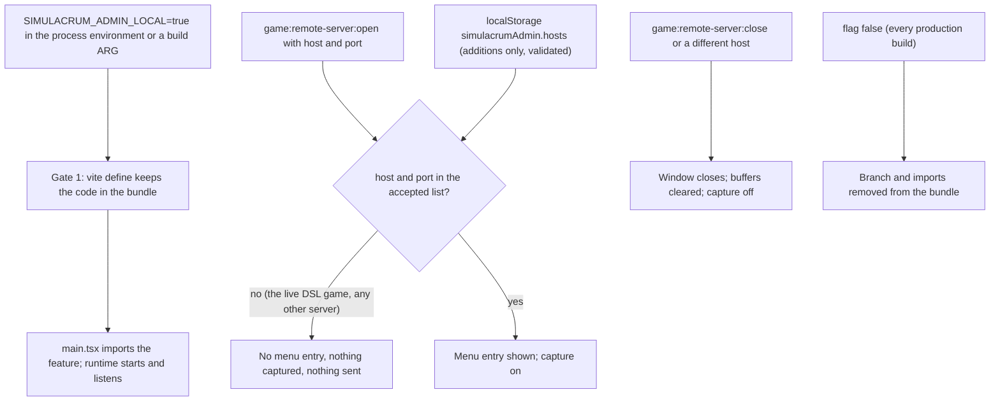
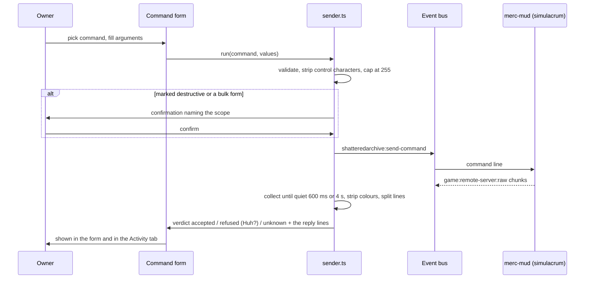
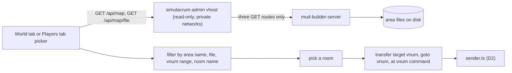

# Tech plan: Simulacrum Admin - a local-only, simulacrum-only admin and debugging panel in the game client

Item: item.md · Scope: scope.md · Planned against: performance/Allocation-hunt @ a565d53 (working tree not clean: the Copilot client files are untracked or modified and were read as they are on disk) · Date: 2026-11-07
Standards: docs/standards/typescript.md, docs/standards/scss.md, docs/standards/javascript.md (guard script and generator) · Data classification: personal at run time (nothing personal is committed)
Edge-case catalog: theming-dark-mode (TH), persisted-settings-and-defaults (SETTINGS), local-only-features (LOCAL), game-data-privacy (PRIVNAME), ansi-color-handling (ANSI), admin-tooling (ADMIN), live-stream-views (LIVESTRM) · Classifiers added (user-approved, 2026-11-07): LOCAL-04, LOCAL-05, ADMIN-01, ADMIN-02, ADMIN-03, LIVESTRM-01

## Goal

A "Simulacrum Admin…" menu entry and floating window that exist only in a game-client build made with the new `SIMULACRUM_ADMIN_LOCAL` switch, and that are available only while the client is connected to a recognised simulacrum host and port. The window has free-navigation tabs: raw GMCP, players, world (area and room picker for teleport), server, all commands, and an activity log of what was sent and what the server answered. It can be moved and resized, and the command input stays usable behind it.

Testable in one sentence per outcome: (1) a production build of the game client contains neither the new marker nor the new vhost name, proved by `pnpm check:local-only` on a real production build and by guard tests; (2) with the switch on but the connection on any other host (the live DSL game), there is no menu entry, nothing is captured and nothing is sent; (3) every privileged command in the simulacrum command table is listed, runnable through a form, and shown with the server's own reply; (4) the owner can pick a destination for a teleport by area and vnum without typing a number.

## Decisions taken by this plan (the scope left them open; veto any in chat before Phase 1)

| # | Decision | Why |
|---|---|---|
| S1 | Build switch `SIMULACRUM_ADMIN_LOCAL` (process environment or build ARG only), constant `__SIMULACRUM_ADMIN_LOCAL__`, marker `sa-simulacrum-admin-local-v1`. The marker is a constant in `features/simulacrumAdmin/marker.ts`; the guard reads it from there. | Scope answer 1 (separate constant). LOCAL-01 and LOCAL-04. No new workspace package, so the marker lives beside its only user. |
| S2 | "Connected to simulacrum" = the connection's host and port both appear in the accepted list. Defaults are the dev hostnames `simulacrum.shatteredarchive.dev` and `simulacrum-server.shatteredarchive.dev` on port `65001`. The owner's LAN address is NOT in source: it is added at run time under the browser storage key `simulacrumAdmin.hosts`, and only a loopback, private-range or `*.shatteredarchive.dev` value is accepted. | Scope answer 2 plus LOCAL-05 (an IP is Personal). Mirrors `features/copilot/config.ts:8-22`. Which hostname and port the client really connects with is Unknown 9 and is confirmed on the live stack in Phase 14. |
| S3 | The accepted ports default to `65001` only and are part of the same storage entry (`{ hosts: string[], ports: number[] }`, additions only). | The proxy allowlist names `:65001` (`deploy/docker-compose.shattered-archive-experimental.yml:199`). |
| S4 | The command list (names, levels, aliases) is generated from `merc-mud/2.4/src/interp.c` by `scripts/generate-simulacrum-admin-commands.mjs` into a committed `commandTable.generated.ts`. Argument shapes are hand-written in `commandSyntax.ts`. A test fails on a row without a syntax entry and the reverse. | ADMIN-01. The sibling repo is not in any Docker build context, so the generated file is committed and the script runs on the owner's machine. |
| S5 | Availability of a command to the connected character comes from the server: an explicit "Refresh available commands" sends `wizhelp` and parses the names. Until then every command shows its table level and none is dimmed. | `do_wizhelp` lists only rows the character's trust can run (`merc-mud/2.4/src/interp.c:774`). No trust value is read from GMCP (the typed GMCP payloads carry no level key). |
| S6 | Every send goes through one module, `sender.ts`, the only code in the feature that dispatches `shatteredarchive:send-command`. | Same rule as `features/copilot/gate.ts`. One place for confirmation, sanitising and the reply wait. |
| S7 | The window's `z-index` is 4800: above the menu bar (3000) and hotbar (3500), below the Copilot window (4900) and every 5000+ modal. Geometry key `simulacrumAdmin.window.v1`. | `styles/MainMenuBar.module.scss:22`, `EquipmentHotbar.module.scss:16`, `components/CopilotWindow.tsx:74`. |
| S8 | The GMCP and activity buffers are memory-only, capped (GMCP 1000 entries, activity 200), cleared when the connection closes or leaves the accepted set, and never written to storage. "Copy" is an explicit user action. | Data is Personal; LIVESTRM-01; scope Unknown 6. |
| S9 | World data is read live from MUD Builder through a new local-only vhost `simulacrum-admin.shatteredarchive.dev` (scope answer 3, option 2). The vhost proxies exactly three read-only GET routes and nothing else. | `apps/mud-builder-server/src/routes/auth.ts:165` lets GET/HEAD/OPTIONS through without a token; the area routes are `/api/areas`, `/api/map`, `/api/map/:file`. |
| S10 | The extra connect origin is added to the existing local-only CSP override `deploy/nginx/edge-copilot-csp.conf` rather than a second override. | One file can be mounted over `security-headers-scripting-dev.conf`; a second mount of the same target is not possible. This edits a file the Copilot work owns (see Risks R1). |
| S11 | The destructive set that needs a confirmation step is proposed in Phase 6 and approved by the owner there. Initial proposal: `shutdown`, `reboot`, `copyover`, `areload`, `purge`, `deny`, `ban`, `permban`, `disconnect`, `freeze`, `force`, `slay`, `advance`, `trust`, `dump`, `wizlock`, `newlock`, `qpoints`, and every `all` form (`transfer all`, `force all`, `restore all`). | Scope answer 4. `copyover` additionally needs its own `confirm` word (`merc-mud/2.4/src/copyover.c`, the prompt "Type 'copyover confirm' to proceed"). |
| S12 | End-user guide: `C:\Projects\DSL\docs\simulacrum-admin\user-guide.md`. Developer doc: `docs/game/simulacrum-admin.md` (service `game`). | Scope-time answer; precedent `P11` of the Copilot plan. |

## Out of scope

- Any production deployment, and any change to a production compose file or shared nginx file other than a guard test that reads it.
- Any edit to merc-mud, to the Copilot window or server, or to the simulacrum relay's access rules.
- A mobile or web-site version of the panel.
- Writing area files: the vhost exposes no write route and the panel has no area editor (MUD Builder remains that tool).
- Sending anything on the live DSL game, capturing its data, or running the panel there.
- Automatic or scheduled command sending: every send is a direct user action.
- Parsing the output of `who`, `sockets` or `mwhere` into an online-player list (the target field is typed or picked from names the owner has used this session).

## Standards applied

- **TypeScript/TSX** (`docs/standards/typescript.md`): modules under `features/simulacrumAdmin/` in camelCase; tests co-located; `Record<string, unknown>` for dynamic payloads, no new `any`; storage reads fail safe with one fixed-message `console.warn` and no values; every subscription returns its unsubscribe and every `fetch` takes an `AbortSignal` that the effect aborts (async and state, decided 2026-11-06); a test proves no work after unmount; local-only client code behind a build constant with a script that checks the built output (security-sensitive code); a local-only server file never logs request bodies.
- **SCSS** (`docs/standards/scss.md`): `styles/SimulacrumAdminWindow.module.scss` (one module for the window and its tab components, as `CopilotWindow` does), palette variables copied from `AutoLevelingWizard.module.scss`, `color-scheme: dark`, a `z-index` comment saying what it sits above and below.
- **JavaScript/MJS** (`docs/standards/javascript.md`): the guard script, the generator and their `node:test` suites.
- **Data classification** (`docs/standards/data-classification.md`): committed fixtures use placeholder names and no address; nothing in this plan, the docs or the tests carries a character name, a LAN address or an access code.

## Workflow diagrams

### D1 — Who may see and use the panel
Used by: Phases 1-3. Lands in: `docs/game/simulacrum-admin.md`.

### D2 — Sending a command and judging the reply
Used by: Phases 7, 8, 9, 12, 13. Lands in: `docs/game/simulacrum-admin.md`.

### D3 — Teleport destination from the world index
Used by: Phases 10-12. Lands in: `docs/game/simulacrum-admin.md`.

## Edit map

All lines are as of a565d53. "New" files have no line.

| File | Line(s) | Anchor | Change | Phase |
|---|---|---|---|---|
| `apps/game-client/vite.config.ts` | 43-45 | `define: { __COPILOT_LOCAL__: ... }` | add `__SIMULACRUM_ADMIN_LOCAL__` from `process.env.SIMULACRUM_ADMIN_LOCAL === 'true'`, with the same comment about `.env*` files | 1 |
| `apps/game-client/src/simulacrum-admin-local.d.ts` | new | `declare const __SIMULACRUM_ADMIN_LOCAL__: boolean;` | declare the constant (beside `copilot-local.d.ts:6`) | 1 |
| `jest.config.cjs` | 101 | `globals: { __COPILOT_LOCAL__: false }` | add `__SIMULACRUM_ADMIN_LOCAL__: false` | 1 |
| `apps/game-client/src/testing/simulacrumAdminFlagOn.ts` | new | sets the global before import | test helper, the pattern of `testing/copilotFlagOn.ts` | 1 |
| `deploy/game-client.Dockerfile` | 49, 57 | `ARG COPILOT_LOCAL`, `ENV COPILOT_LOCAL=$COPILOT_LOCAL` | add `ARG SIMULACRUM_ADMIN_LOCAL` and `ENV SIMULACRUM_ADMIN_LOCAL=$SIMULACRUM_ADMIN_LOCAL` with the LOCAL-01 comment | 1 |
| `deploy/docker-compose.shattered-archive-experimental.yml` | 150 | `COPILOT_LOCAL: "true"` | add `SIMULACRUM_ADMIN_LOCAL: "true"` under the same build args | 1 |
| `scripts/check-local-only.mjs` | 21-37, 39-44, 65-86, 89-114, 136 | `LOCAL_NGINX_FILE`, `ALLOWED_DOCKERFILE_LINES`, `readMarker`, `checkSourceFiles`, `checkDist`, `runChecks` | scan for both features: a second name pattern `/simulacrum[-_ ]?admin/i`, a second allowed-lines set, the nginx allowance extended to `edge-simulacrum-admin*.conf`, a second marker read from `features/simulacrumAdmin/marker.ts`, `checkDist` checks both markers and the vhost name | 1, 10 |
| `scripts/check-local-only.test.mjs` | 33, 43-50, 72-97, 112, 163-176, 180-240 | `writes contracts.ts`, `shared Dockerfiles may carry...`, `L1: ...` tests | cases for the second feature: each trace in a production file or dist fails (LOCAL-04), real vite builds with each flag alone and both | 1, 10 |
| `package.json` | 18 | `"test:guards": "node --test ..."` | add the generator's test file | 6 |
| `apps/game-client/src/main.tsx` | 11-17 | `if (__COPILOT_LOCAL__) { import('./features/copilot') ... }` | a second branch `if (__SIMULACRUM_ADMIN_LOCAL__)` importing `./features/simulacrumAdmin` and starting the runtime | 1, 2 |
| `apps/game-client/src/features/simulacrumAdmin/` | new | - | the feature (see phases) | 1-13 |
| `apps/game-client/src/components/SimulacrumAdminWindow.tsx` and `components/simulacrumAdmin/*.tsx` | new | - | window shell and tab components | 3-13 |
| `apps/game-client/src/styles/SimulacrumAdminWindow.module.scss` | new | - | the window's styles | 3 |
| `apps/game-client/src/hooks/useFloatingPanel.ts` | 81 | `export function useFloatingPanel` | reused unchanged | 3 |
| `apps/game-client/src/components/MainMenuBar.tsx` | 22, 183-194 | `onOpenCopilot?: () => void;`, `{__COPILOT_LOCAL__ && onOpenCopilot && (` | optional `onOpenSimulacrumAdmin`; item `Simulacrum Admin…` rendered only when the constant is true and the handler is given | 3 |
| `apps/game-client/src/pages/MainContainer.tsx` | 48, 187-188, 291, 399-404 | `const CopilotWindow = __COPILOT_LOCAL__ ? React.lazy(...)`, `isCopilotOpen`, `onOpenCopilot={...}`, the `<CopilotWindow` block | lazy host for the admin window, open state, availability state fed by the host, menu prop passed only when available | 3 |
| `apps/game-client/src/hooks/useGameConnection.ts` | 55-62, 76-90, 166 | `emitSocketOpen`, `emitServerRaw`/`emitServerGmcp`, `ListenEvent('shatteredarchive:send-command'` | read only: the events the runtime listens to and the event it dispatches. No change. | - |
| `deploy/nginx/edge-simulacrum-admin.conf` | new | - | the local-only read-only vhost (D3), port 80 and 443 servers, private networks only, CORS for the game-client origins | 10 |
| `deploy/nginx/edge-copilot-csp.conf` | 8-9, 12 | `connect-src 'self' https://auth... https://copilot...` | add `https://simulacrum-admin.shatteredarchive.dev` to `connect-src`; update the header comment | 10 |
| `deploy/docker-compose.shattered-archive-experimental.yml` | 81, 85, 119 | the copilot template mount, the CSP mount, the alias list | mount the new template; add the alias `simulacrum-admin.shatteredarchive.dev`; update the CSP mount comment | 10 |
| `apps/mud-builder-server/src/routes/map.ts`, `routes/areas.ts` | 133, 177; 84-89 | `app.get('/api/map'`, `'/api/map/:file'`, `'/api/areas'` | read only: the three routes the vhost exposes | - |
| `scripts/generate-simulacrum-admin-commands.mjs` and `.test.mjs` | new | - | the generator and its tests | 6 |
| `apps/game-client/src/features/simulacrumAdmin/commandTable.generated.ts` | new | - | generated rows | 6 |
| `C:\Projects\merc-mud\2.4\src\interp.c`, `interp.h`, `merc.h` | 286-360; 34-43; 129-131 | the cmd_table, `#define L1 MAX_LEVEL - 1`, `LEVEL_HERO` | read only: the source of the generated table | 6 |
| `docs/game/simulacrum-admin.md` | new | - | developer doc | 1-14 |
| `C:\Projects\DSL\docs\simulacrum-admin\user-guide.md` | new | - | end-user guide for the owner | 3-14 |
| `docs/standards/edge-cases/` | - | `local-only-features.md`, `admin-tooling.md`, `live-stream-views.md`, `README.md` | the approved classifiers (already written when this plan was created) | - |
| `.ai-context` / `.annotated` | - | `features/simulacrumAdmin`, `components`, `pages`, `src`, `deploy/nginx`, `deploy`, `scripts` | updated in the phase that changes the folder | per phase |

## Edge cases

| Id | Classifier | Condition | Required behaviour | Covered by |
|---|---|---|---|---|
| E1 | - | Host/port matching: upper-case host, trailing dot, whitespace, a scheme, a wildcard in storage, a port as a string, a different port on a good host | exact match after lower-casing and trimming; scheme, path, wildcard or credentials in a stored value are dropped; a wrong port never matches | P2 `connectionGate.test.ts` |
| E2 | - | The connection changes from simulacrum to another host (or closes) while the window is open or the GMCP tab is capturing | the window closes, capture stops, both buffers are cleared, the menu entry disappears | P2 `runtime.test.ts`, P3 `SimulacrumAdminWindow.test.tsx` |
| E3 | PRIVNAME-01 (fixture side), - | Connected to the live DSL game with the switch on | nothing is stored from its GMCP or raw output, no menu entry, `sender.ts` refuses to send | P2 `runtime.test.ts`, P7 `sender.test.ts` |
| E4 | - | An argument contains a newline, carriage return, other control character, or is longer than the field allows; a one-word field contains a space | rejected before sending with a message naming the field; the command line is capped at 255 characters (`MAX_INPUT_LENGTH` 256 in `merc-mud/2.4/src/merc.h:112`) | P7 `commandBuilder.test.ts` |
| E5 | - | A user alias or script trigger would change a command the panel sends | the exact built string reaches the socket's `data` message; the test spies on `sendRaw` through the existing event bridge | P7 `sender.test.ts` (integration with `useGameConnection`) |
| E6 | ADMIN-03 | Unrelated game lines interleave with a reply; no reply arrives; the reply arrives in several chunks | verdict from lines after the send only; chunks are joined; a quiet period of 600 ms ends the wait, 4 s at most; no reply = unknown | P7 `replyCollector.test.ts` |
| E7 | - | The character's trust is below a command's level | the server answers "Huh?"; the verdict is "refused"; after a `wizhelp` refresh the command is dimmed with its level; a `wizhelp` reply of zero commands dims everything | P7, P8 tests |
| E8 | - | World index: the server is unreachable, returns an error body, an area has `parseError`, or an area has no rooms | offline state with a retry; a failed area is listed with its error; none of these throws | P11 `worldApi.test.ts` |
| E9 | - | About 3,200 rooms across 54 areas | filtering is pure and fast; the list renders at most 200 rows with a "N more" line; typing a vnum filters by exact, prefix and `a-b` range | P11 `worldFilter.test.ts`, P12 |
| E10 | - | The picked room was removed after the index was fetched | the server answers "No such location."; the verdict is refused and the message is shown; a refresh button reloads the index and shows its fetch time | P12 tests |
| E11 | LOCAL-02 | The new vhost, its CSP origin or its alias appears in a production file | the guard fails; the production compose, Dockerfiles and the shared nginx files never mention `simulacrum-admin` | P10 guard tests |
| E12 | - | `add_header` inside a `location` drops the headers inherited from the server block | CORS and security headers are set at server level only; checked on a 200, a 404 and a denied response (`always`) | P10 `curl` checks |
| E13 | - | A write or other route is requested through the vhost (POST, PUT, DELETE, `/api/areas/<file>`, `/api/reload`, `/api/state/*`) | answered 403 or 404 by nginx and never proxied | P10 `curl` checks |
| E14 | - | A request from outside the loopback and private ranges | refused by the `allow`/`deny` list, as for the Copilot vhost | P10 guard test (reads the file) |
| E15 | LOCAL-04 | Both switches on, only one on, or both off | each combination builds; the menu shows exactly the entries of the switches that are on; no module imports across the two features | P1, P14 build proofs |
| E16 | LIVESTRM-01 | More than 1000 GMCP messages arrive, or the tab is hidden, or the window is closed | the buffer keeps the newest 1000; capture continues while connected (so opening the tab shows history) but the render is capped; the listener is removed on runtime dispose | P4 `gmcpCapture.test.ts`, P5 |
| E17 | - | Typing in a panel field versus the game's command input | keystrokes in a panel field never reach the command input; clicking the page behind the window focuses the command input and typing reaches it; the window has no `aria-modal`, no backdrop and no focus trap | P3 `SimulacrumAdminWindow.test.tsx`, P3 UI check |
| E18 | LOCAL-05 | The owner's LAN address is needed to recognise the connection | it is read from `simulacrumAdmin.hosts`, validated as a private-range value; a repo scan for private IPv4 literals in the changed files finds none | P2 test, P14 scan |
| E19 | SETTINGS-04 | The stored host list is hand-edited in the console (any shape) | one normaliser reads it for every route; wrong shapes (not an object, wrong types, duplicates, over 20 entries) read as "no additions"; the defaults always apply | P2 `connectionGate.test.ts` |
| E20 | ADMIN-01 | The server's command table changes | the generator is re-run; the test fails until the syntax catalog matches | P6 tests |
| E21 | ADMIN-02 | `all`, an empty target that the server reads as the whole room (`purge` with no argument) or a wildcard in any argument | such a command is confirmed with the scope named, whether picked or typed in a free-text field | P7 `confirmPolicy.test.ts`, P8, P9 |
| E22 | ANSI-01 | Replies contain DSL `{X` codes and ANSI sequences, including a sequence split across chunks | sequences are rejoined across chunks, then stripped for display; the raw reply is kept beside the display text and can be copied | P7 `replyCollector.test.ts` |
| E23 | - | GMCP message that is not `<pkg> <json>`, has invalid JSON, a very long payload, or a package the client router does not know | shown as an entry with a parse-error badge or an "unmapped package" badge; payloads over 64 KB are truncated in the list and complete in the detail copy | P4, P5 tests |
| E24 | - | The same command sent twice quickly, or a second send while a reply is being collected | each send gets its own collector; a send during a collection is queued behind it and shown as waiting; no reply is attributed to two commands | P7 `sender.test.ts` |
| E25 | - | `copyover` and `areload` have their own safety words; `reboot` and `shutdown` must be spelled in full | the form builds `copyover confirm` only after the panel's confirmation; `reboot` and `shutdown` are always full words (the abbreviations `reboo` and `shutdow` are not offered) | P6, P13 tests |

Classifiers applied from the picked files:

- **TH-01** (scrollbar): applies to the GMCP list, command list, activity log and room list; covered by the screenshots of each overflowing list (P5, P8, P12) and by `color-scheme: dark` on the window root.
- **TH-02** (native controls): applies (selects, checkboxes, number and text inputs); screenshot with one of each, including an open select (P3 shell, P8).
- **TH-03** (all states): applies; hover, focus-visible, disabled, error and loading states of tabs, buttons and inputs (P3, P8, P12 screenshots).
- **TH-04** (placeholder, selection, caret): applies to the filter and argument inputs (P8 screenshot).
- **TH-05**: not applicable, the window uses its own fixed dark palette (scss.md) and caches no theme value.
- **SETTINGS-01**: applies to the one stored setting: only the owner's additions are stored, never the defaults (P2 test: saving with no additions stores nothing).
- **SETTINGS-02**: not applicable, no stored value is compared with a default.
- **SETTINGS-03**: not applicable, no running copy is merged with stored settings; the gate re-reads storage on each connection event.
- **SETTINGS-04**: applies as E19.
- **SETTINGS-05**: not applicable, nothing is migrated.
- **LOCAL-01**: applies (P1: flag from the process environment only; a vite build with the flag only in `.env*` has no marker).
- **LOCAL-02**: applies as E11-E13 (P10).
- **LOCAL-03**: not applicable, no workspace project is added.
- **LOCAL-04**: applies as E15 and P1/P10 guard cases.
- **LOCAL-05**: applies as E18.
- **PRIVNAME-01**: applies to fixtures and docs: tests and docs use the placeholders `<character>` and the codename style of the Copilot plan, never a real name; `pnpm check:private-names` runs in P14 on the owner's machine (it needs the private matrix) and its result is recorded.
- **ADMIN-01, ADMIN-02, ADMIN-03**: E20, E21, E6/E7.
- **LIVESTRM-01**: E16.
- **ANSI-01**: applies as E22.

Classifiers not applicable (files not picked): `expo-native-upgrade` (no Expo or native work), `log-tailing` (no jsonl log is followed; the panel reads live events), `auto-approval-policy` (the panel is not an agent and never sends on its own), `world-map-identity` (no map is built from observations; the index is read from area files).

## Verification toolbox

| Purpose | Command (repo root `C:/Projects/ShatteredArchive`) |
|---|---|
| Typecheck | `pnpm typecheck` (`tsc -p apps/game-client/tsconfig.json --noEmit`) |
| Lint | `pnpm lint` (`eslint . --max-warnings=300`) |
| Format a changed package | `pnpm --filter @shatteredarchive/game-client run format` (writes files: review with `git diff`) |
| Game-client tests | `pnpm --filter @shatteredarchive/game-client test` (filter: `... test -- <path>`); output filtered with `2>&1 | grep -E "Tests:|Test Suites:|FAIL|✕"` |
| Coverage of the feature | `pnpm --filter @shatteredarchive/game-client test -- --coverage --collectCoverageFrom="apps/game-client/src/features/simulacrumAdmin/**" --collectCoverageFrom="apps/game-client/src/components/simulacrumAdmin/**"` |
| Guard and generator tests | `pnpm test:guards` (the `node:test` suites, including the generator's after Phase 6) |
| Production-bundle proof | build without the flags (`pnpm --filter @shatteredarchive/game-client build`), then `pnpm check:local-only` |
| Flagged build proof | `SIMULACRUM_ADMIN_LOCAL=true` (PowerShell: `$env:SIMULACRUM_ADMIN_LOCAL='true'`) then the same build, and assert the marker is present in `dist` |
| Manifests | `pnpm check:manifests` (no new workspace project, so it must stay green) |
| Private names | `pnpm check:private-names` (owner's machine, needs the private matrix) |
| Generator | `node scripts/generate-simulacrum-admin-commands.mjs --source C:/Projects/merc-mud/2.4/src/interp.c` |
| vhost checks | `curl` against the owner's running edge: GET `/api/map`, `/api/map/<file>.are`, `/api/areas` (200, CORS header), POST `/api/areas` (not 200), GET `/api/state/live` (not proxied), an `Origin` outside the list (no allow header) |
| Screenshots | Playwright through `C:/Projects/Shattered-AI/tools/browser-test` (`saveShowcase` for the final set) against the owner's running flagged stack, with the game WebSocket mocked by `page.routeWebSocket` so the page "connects" to `simulacrum-server.shatteredarchive.dev:65001` and receives fixture GMCP and raw lines; a real-server run is an owner step in Phase 14 |

The owner rebuilds and restarts the game-client image of the experimental stack (and the nginx container for Phase 10) before a UI or vhost check; the implementer never starts or stops a dev server or a container.

## Phases

### [x] Phase 1 — The local-only boundary for a second feature
Goal:        A second build switch exists, is off in every production artifact, and the guard proves it for both features.
Depends on:  nothing
Changes:
- `apps/game-client/vite.config.ts:43-45` (`define`) — add `__SIMULACRUM_ADMIN_LOCAL__` from `process.env.SIMULACRUM_ADMIN_LOCAL === 'true'`, process environment only (LOCAL-01).
- `apps/game-client/src/simulacrum-admin-local.d.ts` (new) — `declare const __SIMULACRUM_ADMIN_LOCAL__: boolean;`.
- `jest.config.cjs:101` (`globals`) — add `__SIMULACRUM_ADMIN_LOCAL__: false`; `src/testing/simulacrumAdminFlagOn.ts` (new) sets the global true before import.
- `deploy/game-client.Dockerfile:49,57` — `ARG`/`ENV SIMULACRUM_ADMIN_LOCAL` with a comment; `deploy/docker-compose.shattered-archive-experimental.yml:150` — `SIMULACRUM_ADMIN_LOCAL: "true"`.
- `apps/game-client/src/features/simulacrumAdmin/marker.ts` (new) — `SIMULACRUM_ADMIN_BUNDLE_MARKER = 'sa-simulacrum-admin-local-v1'`; `index.ts` (new) — `startSimulacrumAdmin()` returns `undefined` when the constant is false, otherwise `import('./loader')`; `loader.ts` (new) — returns a runtime object holding the marker (and `dispose`).
- `apps/game-client/src/main.tsx:11-17` — second branch `if (__SIMULACRUM_ADMIN_LOCAL__) { import('./features/simulacrumAdmin').then((m) => m.startSimulacrumAdmin()).catch(...) }`.
- `scripts/check-local-only.mjs` — generalise to a list of features (name pattern, marker source, allowed Dockerfile lines, local nginx file pattern): add the `simulacrum[-_ ]?admin` pattern for production compose, Dockerfiles and nginx; allow `ARG|ENV SIMULACRUM_ADMIN_LOCAL` lines; read the second marker from `features/simulacrumAdmin/marker.ts`; `checkDist` fails on either marker. Existing exports keep their names.
- `docs/game/simulacrum-admin.md` (new) — the gate (D1), the switch, the marker, how to enable it locally.
Tests:       `scripts/check-local-only.test.mjs`: the second marker is read from the feature file, a missing constant is an error; a production compose, a shared Dockerfile line, a shared nginx file and a dist each carrying a Simulacrum Admin trace fail (LOCAL-04, E11, E15); the allowed `ARG`/`ENV` lines pass; real `vite build` of a tiny entry: flag in the process environment bundles the marker, flag only in `.env*` does not, no flag does not (LOCAL-01), each flag alone and both (E15). `features/simulacrumAdmin/index.test.ts`: with the constant false `startSimulacrumAdmin()` returns `undefined` and never loads the loader; with it true the loader loads once. `main.simulacrumAdmin.test.tsx`: importing `main` with the constant false never requires the feature (pattern of `main.copilot.test.tsx`).
API check:   none
UI check:    none
Index/docs:  `features/simulacrumAdmin/.ai-context` and `.annotated` (create), `src/.annotated` (update); `docs/game/simulacrum-admin.md` (create); end-user doc: no user-visible effect yet, written in Phase 3.
Exit gate:   build · typecheck · lint · all game-client tests · `pnpm test:guards` · `pnpm check:local-only` on a real production build · documentation.
State on exit: the switch and the guard exist; no window, no menu entry.

### [x] Phase 2 — The connection gate and the runtime  (amended: see A1)
Goal:        The client knows, from the connection events alone, whether it is connected to simulacrum, and clears everything when it leaves.
Depends on:  Phase 1
Changes:
- `features/simulacrumAdmin/connectionGate.ts` (new) — `DEFAULT_HOSTS`, `DEFAULT_PORTS`, `normalizeAdditions(raw: unknown)`, `isAllowedExtraHost(value)` (loopback, private ranges, `*.shatteredarchive.dev`, copied from `features/copilot/config.ts:8-22`, not imported: the two features share nothing), `readAdditions(storage)`, `isSimulacrumConnection(host, port, additions)`.
- `features/simulacrumAdmin/runtime.ts` (new) — an external store (`subscribe`/`getSnapshot` for `useSyncExternalStore`) holding `{ connected, host, port, active }`; listens to `game:remote-server:open` (host and port in its payload, `useGameConnection.ts:55-62`) and `game:remote-server:close`; on a change out of the accepted set it calls the registered clear callbacks; `dispose()` unsubscribes everything.
- `loader.ts` — builds the runtime and wires `dispose` to a `pagehide` listener.
- `docs/game/simulacrum-admin.md` — the storage key, the accepted shapes, the console snippet that adds a LAN address (written with a placeholder), and why the address is not in source (LOCAL-05).
Tests:       `connectionGate.test.ts`: E1 (case, trailing dot, whitespace, scheme, wildcard, string port, wrong port); E18 (a private-range value accepted, a public address refused); E19 (each wrong shape reads as no additions, duplicates collapse, over 20 entries trimmed, defaults always apply); SETTINGS-01 (writing no additions stores nothing). `runtime.test.ts`: open on an accepted pair -> active; open on the live DSL pair -> inactive and nothing is stored (E3); close and host change -> clear callbacks run once (E2); `dispose` removes the listeners (an event after dispose changes nothing).
API check:   none
UI check:    none
Index/docs:  `features/simulacrumAdmin/.ai-context` and `.annotated` (update); `docs/game/simulacrum-admin.md` (update).
Exit gate:   build · typecheck · lint · all game-client tests · documentation.
State on exit: the gate works and is unreachable from the UI.

### [x] Phase 3 — The window shell, menu entry and user guide start
Goal:        "Simulacrum Admin…" opens a movable, resizable window with empty tabs, only when the gate is true, and the page behind stays usable.
Depends on:  Phase 2
Changes:
- `components/SimulacrumAdminWindow.tsx` (new) — `role="dialog"`, no `aria-modal`, no backdrop, no focus trap, `position: fixed`, `zIndex: 4800` (S7), header with title, connection badge, close button; tab buttons (`aria-pressed`, free navigation, every tab panel stays mounted and `hidden` when not shown); tabs `Players`, `World`, `Server`, `Commands`, `GMCP`, `Activity`, each an empty placeholder; geometry from `useFloatingPanel({ storageKey: 'simulacrumAdmin.window.v1', ... })` with limits wide enough for the header; Escape closes. A lazy `SimulacrumAdminHost` default export decides availability from the runtime store and calls `onAvailableChange`.
- `styles/SimulacrumAdminWindow.module.scss` (new) — palette variables copied from `AutoLevelingWizard.module.scss`, `color-scheme: dark`, a comment on the `z-index`.
- `MainMenuBar.tsx:22,183-194` — optional `onOpenSimulacrumAdmin`; the item renders only when `__SIMULACRUM_ADMIN_LOCAL__ && onOpenSimulacrumAdmin`.
- `MainContainer.tsx:48,187-188,291,399-404` — `const SimulacrumAdminHost = __SIMULACRUM_ADMIN_LOCAL__ ? React.lazy(...) : null`, `isSimulacrumAdminOpen`, `simulacrumAdminAvailable` (set by the host's callback, false when the host is absent), the menu prop passed only when available, the lazy render block; when availability turns false the open state resets (E2).
- `C:\Projects\DSL\docs\simulacrum-admin\user-guide.md` (new) — opening the window, moving and resizing it, the tabs by name; sections for later tabs are added by their phases.
Tests:       `SimulacrumAdminWindow.test.tsx`: renders with all six tab buttons; switching tabs keeps every panel mounted (state survives a round trip); no `aria-modal`; Escape closes and calls `onClose`; a click on the page behind focuses the command input and typing reaches it, and typing in a panel field does not reach the command input (E17). `MainMenuBar.simulacrumAdmin.test.tsx`: absent when the constant is false even with a handler, absent without a handler, present and opens when both, and the Copilot and Autopilot items are unchanged with both switches on (E15). `MainContainer.simulacrumAdmin.test.tsx`: no entry before an accepted connection; the entry appears on an accepted open event; a close event removes it and closes an open window; the live DSL pair never shows it (E2, E3). `main.simulacrumAdmin.test.tsx` from Phase 1 still passes.
API check:   none
UI check:    flagged build with the game WebSocket mocked to the simulacrum pair, desktop 1440x900 and 900x600: window open over the game, text typed into the game input while it is open, the window dragged and resized, a tab strip with focus-visible and hover states, an open `select` if any is on the shell (TH-02, TH-03). Screenshots `phase-03_window-open.png`, `phase-03_input-behind.png`, `phase-03_tabs-states.png` (incremental).
Index/docs:  `components/.annotated`, `pages/.annotated`, `src/.annotated` (update); `docs/game/simulacrum-admin.md` (update: window, z-index, menu wiring); DSL `user-guide.md` (created above).
Exit gate:   build · typecheck · lint · all game-client tests · `pnpm check:local-only` on a real production build (no menu item) · screenshots taken · documentation.
State on exit: the window exists with empty tabs behind both gates.

### [x] Phase 4a — GMCP parity in merc-mud  (added by amendment A2)
Goal:        simulacrum sends exactly the seven GMCP packages DSL sends, with DSL's field shapes and vocabularies, on a half-hour game clock.
Depends on:  nothing
Changes:     `C:\Projects\merc-mud\2.4\src`: `merc.h` (`time_info.minute`, `format_game_time`), `db.c` (formatter; boot clock in half-hour units), `update.c` (`weather_update` advances half an hour per tick), `comm.c` (prompt `%t`; `gmcp_send_login_data` at login and on reconnect, before the affects true-up), `act_info.c` (`time` command), `gmcp_compose.c/.h` (`login_data` composer and sender, stance and sector vocabularies, tick uses the formatter), `act_wiz.c` (`admin test gmcp login` uses the real composer), `.annotated`; new `scripts/gmcp-compose-check/` (`run.mjs`, `test_gmcp.c`).
Tests:       `node scripts/gmcp-compose-check/run.mjs` in merc-mud (Docker): 13 assertions on the boot clock, `login_data` keys, order and values (no clan, loner, real clan, JSON-escaped name, never a kingdom), the stance words, `language` unchanged, the 29 `char_data` keys, every sector name, and six half-hour ticks across midnight with one day rollover.
Docs:        `docs/game/gmcp-parity.md` (the DSL package and vocabulary table, what simulacrum does for each, how the corpus was read).
Exit gate:   the real server builds and links; the check passes; documentation. Owner step: rebuild the merc-mud image and restart simulacrum.
State on exit: done 2026-11-07; takes effect when the owner restarts simulacrum.

### [x] Phase 4 — GMCP capture  (amended: see A2)
Goal:        Every GMCP message received while on simulacrum is held in a capped, memory-only buffer.
Depends on:  Phase 2
Changes:
- `features/simulacrumAdmin/gmcpCapture.ts` (new) — `createGmcpCapture({ cap })`: subscribes to `game:remote-server:gmcp` (`GameRemoteServerGmcp`, `types/event-types/game-remote-server-gmcp.ts`), parses `<package> <json>` tolerantly (not `features/gmcp/gmcpRouter.ts`, which drops unknown packages), keeps `{ id, receivedAt, pkg, size, data?, parseError?, mapped }` where `mapped` is true for the six packages the router knows (`gmcpRouter.ts:23-30`); payload over 64 KB is kept truncated in the list entry with the full text in `raw`; ignores messages while the runtime is inactive (E3); `clear()`, `pause()`, `resume()`, `subscribe()`; the runtime registers `clear` as a clear callback.
- `loader.ts` — creates the capture and exposes it on the runtime; `dispose` removes the listener.
Tests:       `gmcpCapture.test.ts`: well-formed message parsed; no space, invalid JSON, non-object JSON and an empty payload each produce an entry with a parse error and never throw (E23); an unknown package is kept with `mapped: false`; 1001 messages leave 1000 with the oldest gone (E16); a 100 KB payload is truncated in the entry and complete in `raw`; inactive runtime stores nothing (E3); pause stops storing and resume continues; connection change clears; after `dispose` an event adds nothing and no listener remains.
API check:   none
UI check:    none
Index/docs:  `features/simulacrumAdmin/.ai-context`/`.annotated` (update); `docs/game/simulacrum-admin.md` (update: buffer, cap, privacy position, mapped vs unmapped).
Exit gate:   build · typecheck · lint · all game-client tests · coverage of `gmcpCapture.ts` reviewed · documentation.
State on exit: capture works and has no UI.

### [x] Phase 5 — The GMCP tab  (amended: see A2)
Goal:        The owner can read, filter, pause and copy raw GMCP without looking at a log.
Depends on:  Phases 3, 4
Changes:
- `components/simulacrumAdmin/GmcpTab.tsx` (new) — list of entries (time, package, size, badges `unmapped` and `parse error`), package filter (checkboxes built from packages seen), text search over the raw payload, pause/resume, clear, "copy entry" and "copy visible" (clipboard, user action only), a detail pane with the pretty-printed JSON; renders at most 200 rows with an "N more, narrow the filter" line; a count of stored vs shown.
- `SimulacrumAdminWindow.tsx` — mount the tab; `styles/SimulacrumAdminWindow.module.scss` — list and detail styles with a dark scrollbar (TH-01).
Tests:       `GmcpTab.test.tsx`: entries appear as messages arrive; the package filter and search narrow the list; pause stops new rows while the buffer keeps being read after resume; clear empties it; a parse-error entry shows its badge and its raw text; "copy visible" writes exactly the visible rows to the clipboard stub; more than 200 stored shows 200 rows and the "more" line (E16, E23); unmounting the tab does not stop capture (the history is there on reopening) but unmounting the window removes the tab's own subscriptions.
API check:   none
UI check:    mocked simulacrum session sending `char_data`, `room_data`, `tick`, `affect_data`, an unmapped package and a malformed line; overflowing list with the scrollbar visible (TH-01), selected row, paused state, empty state, copy confirmation. Screenshots `phase-05_gmcp-list.png`, `phase-05_gmcp-detail.png`, `phase-05_gmcp-overflow.png`.
Index/docs:  `components/.annotated` (update); `docs/game/simulacrum-admin.md` (update); DSL `user-guide.md` (update: GMCP tab).
Exit gate:   build · typecheck · lint · all game-client tests · screenshots · documentation.
State on exit: the GMCP tab is usable; other tabs are still empty.

### [x] Phase 6 — The command catalog (generated table plus syntax)  (amended: see A4)
Goal:        Every privileged command of the simulacrum command table is known to the client, with its level, aliases and argument shape, and a test fails when the two drift.
Depends on:  Phase 1
Changes:
- `scripts/generate-simulacrum-admin-commands.mjs` (new) — reads `interp.c` (path from `--source`, default `../merc-mud/2.4/src/interp.c`), resolves the level symbols from `interp.h:34-43` and `merc.h:129-131` by value (`ML` 60, `L1` 59 ... `L8` 52, `IM` 52; the macros are unparenthesised, so the script uses the symbol, never the expression), keeps the live rows whose level symbol is `IM`, `ML` or `L1`-`L8` (so the numeric-level mortal rows are left out), merges rows that share a handler into one command with aliases (`teleport`/`transfer`, `invis`/`wizinvis`, `immtalk`/`:`), records `show` (rows with `show=0` such as `reboo` and `shutdow` become hidden aliases that are never offered), and writes `commandTable.generated.ts` with a header naming the source file, a content hash and no date. Output is deterministic (sorted).
- `features/simulacrumAdmin/commandTable.generated.ts` (new) — about 72 rows as of this commit (counts in the scope: 72 privileged rows, 18 `IM`, 12 `L4`, 10 `L5`, 10 `L1`, 5 `ML`, 4 each `L6`/`L3`/`L2`, 3 `L8`, 2 `L7`); the two numeric-level rows `shout` and `murder` are excluded.
- `features/simulacrumAdmin/commandSyntax.ts` (new) — one entry per command: `group` (players, world, server, communication, inspection, settings), `summary`, `fields` (typed: `character`, `word`, `text`, `number`, `vnum`, `areaFile`, `choice`, `flags`), `forms` for commands with sub-forms (`stat`, `vnum`, `load`, `set`, `string`, `flag`, `wiznet`, `admin test gmcp`), `successPatterns`, `confirm` (S11) and `bulkForms` (E21). Each entry is written from the handler read in this phase; the ones whose handler was not located by name in the plan research (`ban`, `permban`, `penalty`, `imotd`) are read first. Known shapes already read: `transfer <whom|all> [room-vnum|character|object]` (`act_wiz.c:751`, `find_location` at `:734`), `copyover` then `copyover confirm`, `areload <area-file>`, `advance <char> <level>`, `trust <char> <level>`, `qpoints <char> set|add <amount>`, `pardon <char> <killer|thief>`, `guild <char> <clan>`, `load mob <vnum>` / `load obj <vnum> <level>`, `vnum obj|mob|skill <name>`, `admin test gmcp <login|char|room|tick|affects> [all|<player>]`, `gmcp [on|off|toggle]`.
- `package.json:18` — add the generator test to `test:guards`.
- At the end of the phase the owner approves the destructive set (AskUserQuestion with the S11 proposal; the answer is recorded in `docs/game/simulacrum-admin.md` and in the plan amendments).
Tests:       `scripts/generate-simulacrum-admin-commands.test.mjs`: a fixture table with each level symbol, a commented-out row (ignored), a duplicate handler (merged), a `show=0` row (hidden alias), an unknown symbol (error naming the line); output identical on two runs (ADMIN-01); the real `interp.c` yields the 72 rows (skipped with a clear message when the sibling repo is absent). `commandCatalog.test.ts`: every generated command has a syntax entry and every syntax entry has a generated command (E20); every `confirm` command exists; every bulk form pattern is a valid pattern; `reboot`/`shutdown` forms use the full word and neither hidden alias is offered (E25).
API check:   none
UI check:    none
Index/docs:  `features/simulacrumAdmin/.ai-context`/`.annotated` (update); `scripts/.annotated` if present (update); `docs/game/simulacrum-admin.md` (update: how to regenerate, where syntax lives, the approved destructive set).
Exit gate:   build · typecheck · lint · all game-client tests · `pnpm test:guards` · documentation.
State on exit: the catalog exists as data; nothing renders it yet.

### [x] Phase 7 — The command builder, sender and reply collector
Goal:        One module builds a safe command line, asks for confirmation where required, sends it, and returns the server's own reply with a verdict.
Depends on:  Phases 2, 6
Changes:
- `features/simulacrumAdmin/commandBuilder.ts` (new) — `buildCommand(command, form, values)` validates each field by type, trims, rejects control characters and a space in a one-word field, caps the line at 255 characters (E4), and returns `{ line } | { error: { field, message } }`.
- `features/simulacrumAdmin/confirmPolicy.ts` (new) — `needsConfirmation(command, form, values)` true for the approved destructive set and for any bulk form: `all`, an empty target where the server reads the whole room, a wildcard (E21); returns the scope text shown to the owner.
- `features/simulacrumAdmin/replyCollector.ts` (new) — joins `game:remote-server:raw` chunks, rejoins split escape sequences, strips ANSI and DSL `{X` codes for display while keeping the raw text (E22), splits lines, ends on a 600 ms quiet period or 4 s, classifies: refused when a line is `Huh?`, accepted when a `successPatterns` entry matches, otherwise unknown (E6, E7).
- `features/simulacrumAdmin/sender.ts` (new) — `run(commandId, formId, values, { confirm })`: refuses when the runtime is inactive (E3), builds, asks the confirmation callback, dispatches `shatteredarchive:send-command` (the only dispatcher in the feature; S6), queues a second send behind a running collection (E24), records the result in the activity store and returns it; `wizhelp` helper `refreshAvailable()` sends `wizhelp` and parses the names.
- `features/simulacrumAdmin/activityLog.ts` (new) — capped (200), memory-only store of `{ id, at, line, verdict, replyLines, rawReply }`, cleared on connection change (S8), `subscribe`.
Tests:       `commandBuilder.test.ts`: each field type; newline, carriage return, tab, NUL and escape rejected; a space in a `word` field rejected; a 300-character `text` rejected with the field named; a valid line equals the exact expected string for `transfer <char> <vnum>`, `copyover confirm`, `areload <file>`, `vnum obj <name>` (E4). `confirmPolicy.test.ts`: every command in the approved set asks; `transfer all` typed in a free-text field and picked from a list both ask; `purge` with no argument asks; `stat <char>` does not (E21). `replyCollector.test.ts`: chunks joined; an escape sequence split across two chunks; a refusal reply -> refused; a success reply -> accepted; an unrelated tell between lines is not attributed after the quiet period; no reply -> unknown; 4 s cap (fake timers) (E6, E22). `sender.test.ts`: inactive runtime refuses and dispatches nothing (E3); a declined confirmation dispatches nothing; the dispatched `cmd` equals the built string and reaches the socket's `data` message through `useGameConnection` unchanged (E5); two sends in a row are serialised (E24); `refreshAvailable` parses a six-column `wizhelp` reply and a zero-command reply (E7). `activityLog.test.ts`: cap 200 drops the oldest; connection change clears; no storage write happens.
API check:   none
UI check:    none
Index/docs:  `features/simulacrumAdmin/.ai-context`/`.annotated` (update); `docs/game/simulacrum-admin.md` (update: D2, the verdicts, why the reply is the source of truth).
Exit gate:   build · typecheck · lint · all game-client tests · coverage of the five new modules reviewed (every branch above) · documentation.
State on exit: a command can be run programmatically; no tab uses it yet.

### [x] Phase 8 — The Commands tab and the Activity tab  (amended: see A2)
Goal:        Every catalog command can be found, read, filled in and run from a form, and every reply is visible.
Depends on:  Phases 3, 7
Changes:
- `components/simulacrumAdmin/CommandsTab.tsx` (new) — left list grouped by `group` with a text filter and a level filter, level badge and a "destructive" mark; selecting a command shows its summary, its forms (a radio per sub-form), its fields as typed inputs, the built line as a read-only preview, `Run`, and the verdict with the reply lines; a "Refresh available commands" button (`wizhelp`); commands above the known trust are dimmed with the level shown, still selectable; the confirmation is an inline dialog naming the scope, no `window.confirm`.
- `components/simulacrumAdmin/ActivityTab.tsx` (new) — newest-first list of sent lines with time, verdict badge and the reply lines (display text, with "copy raw"), filter by verdict, clear.
- `SimulacrumAdminWindow.tsx` and the stylesheet — mount both tabs.
Tests:       `CommandsTab.test.tsx`: the list shows every catalog command under its group; the filter narrows by name and by level; selecting `transfer` shows both its forms; the preview line updates as fields change and shows the field error for a bad value; `Run` on a non-destructive command calls the sender once; `Run` on a destructive command and on `transfer all` opens the confirmation first and sends nothing until confirmed (E21); a refused reply shows the "refused (Huh?)" verdict and not "done" (ADMIN-03); dimming follows a `wizhelp` reply. `ActivityTab.test.tsx`: entries appear in order; verdict filter; clear; the list is capped at 200.
API check:   none
UI check:    mocked session, desktop 1440x900 and 900x600: the Commands tab with a selected command, a field error, an open confirmation, accepted/refused/unknown results; the Activity tab overflowing; every state of buttons and inputs, an open select, placeholder and selection colours (TH-01..TH-04). Screenshots `phase-08_commands-form.png`, `phase-08_confirm.png`, `phase-08_verdicts.png`, `phase-08_activity.png`.
Index/docs:  `components/.annotated` (update); `docs/game/simulacrum-admin.md`; DSL `user-guide.md` (update: Commands and Activity tabs, what the verdicts mean).
Exit gate:   build · typecheck · lint · all game-client tests · screenshots · documentation.
State on exit: all privileged commands are runnable through the Commands tab.

### [x] Phase 9 — The Players tab
Goal:        The owner targets a character once and runs any character-directed command with one click.
Depends on:  Phase 8
Changes:
- `components/simulacrumAdmin/PlayersTab.tsx` (new) — a target field (a single word, validated like a `character` field) with recent targets from this session (memory only, cleared with the buffers); below it the commands whose first field is a `character` (derived from the catalog, not listed by hand) as selectable rows, grouped (inspect, restrict, punish, restore, move, advanced); selecting one shows only its remaining fields; `Run` uses the same sender and confirmation as the Commands tab; the verdict and reply appear beside the target; a destination slot is shown for `transfer`/`teleport` and filled by the picker in Phase 12 (until then a typed room vnum or name).
- Stylesheet and window — mount the tab.
Tests:       `PlayersTab.test.tsx`: the target is required and validated (a space or control character is refused); recent targets are offered but never written to storage; the command rows equal the catalog commands whose first field is `character`; running `stat` sends `stat <character>` with the target filled in; `freeze` and `deny` ask for confirmation; `transfer` with the target `all` asks for confirmation (E21); a refusal shows refused; changing the target does not carry the previous reply.
API check:   none
UI check:    mocked session: target entered, command list, a selected command with its optional argument, result shown. Screenshots `phase-09_players.png`, `phase-09_players-result.png`.
Index/docs:  `components/.annotated` (update); `docs/game/simulacrum-admin.md`; DSL `user-guide.md` (update: Players tab).
Exit gate:   build · typecheck · lint · all game-client tests · screenshots · documentation.
State on exit: Players tab works with a typed destination.

### [x] Phase 10 — The local-only read-only vhost for world data  (amended: see A5)
Goal:        The owner's browser can read the area and room list from MUD Builder through a vhost that exists only in the dev stack and exposes nothing else.
Depends on:  Phase 1
Changes:
- `deploy/nginx/edge-simulacrum-admin.conf` (new) — template for `simulacrum-admin.shatteredarchive.dev`, port 80 and 443 `server` blocks in the style of `edge-copilot.conf`: brotli guard, `security-headers-api.conf`, `allow` loopback and private ranges then `deny all` (E14), `map $http_origin` for the game-client origins (`https://game-client.shatteredarchive.dev`, `http://game-client.shatteredarchive.dev`, `http://localhost:30080`) with `add_header Access-Control-Allow-Origin ... always` and `Vary: Origin` at server level (E12), and exactly these locations, all `limit_except GET OPTIONS { deny all; }` and proxying to `mud-builder-server:61000`: `= /api/areas`, `= /api/map`, `~ ^/api/map/[A-Za-z0-9_][A-Za-z0-9_.-]*\.are$` (the file pattern of `area-store.ts:31`); `location /` returns 404 (E13).
- `deploy/nginx/edge-copilot-csp.conf:8-9,12` — add `https://simulacrum-admin.shatteredarchive.dev` to `connect-src`; extend the header comment (S10).
- `deploy/docker-compose.shattered-archive-experimental.yml:81,85,119` — mount `edge-simulacrum-admin.conf` as `/etc/nginx/templates/simulacrum-admin.conf.template:ro`; add the alias; update the CSP comment. `deploy/docker-compose.yml` is not touched.
- `scripts/check-local-only.mjs` — the nginx allowance (`edge-simulacrum-admin*.conf`) and the shared-file scan from Phase 1 are used here; `scripts/check-local-only.test.mjs:227-240` — the CSP test now allows exactly the two local-only origins and nothing else.
- `docs/game/simulacrum-admin.md` — D3, the routes, the CORS rule, how the name resolves on the owner's machine, the owner's rebuild step.
Tests:       `check-local-only.test.mjs` (extended): the vhost proxies the three routes to the valid port 61000 and nothing else; every location denies methods other than GET/OPTIONS; the allow list matches the Copilot vhost's; the production compose, shared `edge-subdomains.conf` and `includes/tls-dev.conf` never mention the vhost (E11); the CSP override equals the shared dev CSP except for the two local-only origins; no `add_header` appears inside a `location` (E12).
API check:   after the owner restarts the nginx container: `curl -i https://simulacrum-admin.shatteredarchive.dev/api/map` -> 200 JSON with `areas` and `links`, `Access-Control-Allow-Origin` equal to the request origin for a listed origin and absent for an unlisted one; `/api/map/<an existing .are file>` -> 200 with `rooms`; `/api/areas` -> 200 `{ areas }`; `curl -X POST .../api/areas` -> 403 or 404 and the MUD Builder audit log shows no request; `GET /api/state/live`, `/api/reload`, `/api/areas/<file>` -> 404; the 404 and a refusal also carry the CORS header (E12, E13).
UI check:    none
Index/docs:  `deploy/nginx/.annotated`, `deploy/.annotated` (update); `docs/game/simulacrum-admin.md`.
Exit gate:   build · typecheck · lint · all game-client tests · `pnpm test:guards` · `pnpm check:local-only` · API check done · documentation.
State on exit: the vhost exists in the dev stack only and serves read-only world data; no client code calls it yet.

### [x] Phase 11 — The world index in the client
Goal:        The client can fetch, hold and filter the area and room list.
Depends on:  Phases 3, 10
Changes:
- `features/simulacrumAdmin/worldConfig.ts` (new) — the base `https://simulacrum-admin.shatteredarchive.dev`, overridable per browser through `simulacrumAdmin.world.base` (a bare origin on localhost, a private range or `*.shatteredarchive.dev`; same validation as the host list).
- `features/simulacrumAdmin/worldApi.ts` (new) — `fetchAreas(signal)` (`GET /api/map` -> areas with name, file, min and max vnum, room count, `parseError`), `fetchRooms(file, signal)` (`GET /api/map/<file>` -> rooms with vnum and name; exits are dropped), hand-written validators for both shapes (unknown fields ignored, wrong types rejected), an offline state instead of an exception (E8).
- `features/simulacrumAdmin/worldFilter.ts` (new) — pure `filterAreas(areas, query)` (name or file substring, vnum inside the range) and `filterRooms(rooms, query)` (vnum exact, prefix, `a-b` range; name substring), stable order, plus `describeFetch(time)`.
- `features/simulacrumAdmin/useWorldIndex.ts` (new) — lazy loading per area with a session cache, refresh, `AbortSignal` aborted on unmount.
Tests:       `worldApi.test.ts`: valid bodies parse; an `error` body, a non-JSON body, a network failure and an aborted request each give the offline or error state without throwing (E8); an area with `parseError` is kept and flagged; a room list with a missing vnum is rejected. `worldFilter.test.ts`: name, file, vnum exact/prefix/range cases, empty query, no match, 3,200 synthetic rooms filtered under a fixed time bound (E9). `useWorldIndex.test.tsx`: after unmount no request is made and none is left pending (typescript.md async rule); refresh refetches; the cache is used on a second read.
API check:   a script call of `fetchAreas` and `fetchRooms` against the owner's running vhost from Phase 10 (a node one-off using the same validators): the first area list and one room list parse without error.
UI check:    none
Index/docs:  `features/simulacrumAdmin/.ai-context`/`.annotated` (update); `docs/game/simulacrum-admin.md` (update).
Exit gate:   build · typecheck · lint · all game-client tests · coverage of the new modules reviewed · API check done · documentation.
State on exit: the world index is available to the UI; no tab shows it yet.

### [x] Phase 12 — The World tab and the teleport picker
Goal:        The owner picks a destination by area and vnum, and uses it from the World tab and from the Players tab.
Depends on:  Phases 9, 11
Changes:
- `components/simulacrumAdmin/RoomPicker.tsx` (new) — an area list with a filter box (name, file, vnum), a room list for the selected area (virtual cap of 200 rows with an "N more" line), a vnum box that accepts an exact vnum, a prefix or `a-b`, and the "global vnum search" across all loaded areas; fetch time and a refresh button; `onPick(vnum, roomName)`. Built on the filter pattern of `components/wizard/FilterableSelect.tsx` where its keyboard behaviour fits (that component is tied to `AutoLevelingWizard.module.scss`, so the picker has its own markup and reuses only its approach).
- `components/simulacrumAdmin/WorldTab.tsx` (new) — the picker plus, for the picked room, the actions `goto <vnum>`, `at <vnum> <command>` (command from a free field), `transfer <target> <vnum>` (target from the Players tab's current target), and `violate <vnum>`; every action goes through `sender.ts` and shows its verdict; the room's name and area are shown with the picked vnum.
- `components/simulacrumAdmin/PlayersTab.tsx` — the destination slot of `transfer`/`teleport` opens the picker and fills the vnum field.
- `SimulacrumAdminWindow.tsx`, stylesheet — mount the tab.
Tests:       `RoomPicker.test.tsx`: area filter by name, file and vnum; rooms load on selecting an area and an offline area shows a retry (E8); the vnum box handles exact, prefix and range; more than 200 matches show the "more" line (E9); picking calls `onPick` with the vnum and name. `WorldTab.test.tsx`: each action sends the exact line (`goto 3001`, `transfer <character> 3001`, `at 3001 look`); `transfer all` asks for confirmation (E21); a "No such location." reply shows refused and a refresh reloads the index (E10); unmounting aborts the pending fetch.
API check:   the picker against the owner's running vhost: the first area loads its rooms; a vnum typed from a real area resolves to that room's name.
UI check:    mocked session with the world endpoints answered by `page.route` fixtures (placeholder area and room names): area filter typed, rooms listed with overflow and visible scrollbar (TH-01), the vnum range box, a picked room with its actions, offline state, the Players tab with the destination filled. Screenshots `phase-12_world-areas.png`, `phase-12_world-rooms.png`, `phase-12_world-offline.png`, `phase-12_players-destination.png`.
Index/docs:  `components/.annotated` (update); `docs/game/simulacrum-admin.md`; DSL `user-guide.md` (update: World tab, teleport from the Players tab, how fresh the data is).
Exit gate:   build · typecheck · lint · all game-client tests · screenshots · API check done · documentation.
State on exit: teleport destinations can be picked; Server tab still empty.

### [x] Phase 13 — The Server tab
Goal:        Server-wide commands are grouped, safe to find and clearly confirmed.
Depends on:  Phases 8, 11
Changes:
- `components/simulacrumAdmin/ServerTab.tsx` (new) — cards for: reload an area (`areload <file>` with the file picked from the world index), `copyover` (the first click opens the confirmation; only after it is the line `copyover confirm` sent; E25), `reboot` and `shutdown` (full words only), `wizlock` and `newlock` (toggles, with the last reply shown), `log`, `memory`, `dump`, `sockets`, `ban`/`permban`/`allow` (site field), `wiznet`, `holylight`, `incognito`, `invis`; each card states its level, whether it is destructive, and shows its verdict and reply. The cards are derived from the catalog `group` so a new server command appears without a code change.
- Stylesheet and window — mount the tab.
Tests:       `ServerTab.test.tsx`: the cards equal the catalog's server group; `copyover` sends nothing before the confirmation and sends exactly `copyover confirm` after it (E25); `areload` offers the area files from the index and sends `areload <file>`; `shutdown` and `reboot` always send the full word; a refused reply is shown as refused; `ban` with an empty site is refused by the builder (E4).
API check:   none
UI check:    mocked session: the cards, an open confirmation for `copyover`, a refused result. Screenshots `phase-13_server.png`, `phase-13_server-confirm.png`.
Index/docs:  `components/.annotated` (update); `docs/game/simulacrum-admin.md`; DSL `user-guide.md` (update: Server tab and what each confirmation protects).
Exit gate:   build · typecheck · lint · all game-client tests · screenshots · documentation.
State on exit: all six tabs work against a mocked session.

### [x] Phase 14 — Final: full checks, documentation, indexes, showcase, owner run  (owner steps open: see test-results.md and A5)
Goal:        Everything is green, documented, proven absent from production, and checked once against the real simulacrum by the owner.
Depends on:  Phases 1-13
Changes:
- Full checks for every touched package and script: typecheck, lint, all game-client tests with coverage of `features/simulacrumAdmin/**` and `components/simulacrumAdmin/**` (every error path of Phases 2, 4, 7, 11 covered), `pnpm test:guards`, `pnpm check:manifests`.
- A real production build with no flags, then `pnpm check:local-only` (neither marker, no vhost name in `dist`); a build with only `SIMULACRUM_ADMIN_LOCAL=true` (marker present, Copilot marker absent) and one with both (E15).
- `pnpm check:private-names` on the owner's machine (PRIVNAME-01); a scan of the diff and new files for private IPv4 literals and for character-name patterns (E18).
- Documentation read-through: `docs/game/simulacrum-admin.md` carries D1, D2, D3 rendered in the IDE preview (the diagrams were written without a renderer); the DSL `user-guide.md` covers all six tabs; `.ai-context` and `.annotated` of every touched folder are current.
- Showcase screenshots with `saveShowcase`: `showcase_01_window-open.png`, `showcase_02_gmcp.png`, `showcase_03_players.png`, `showcase_04_world-picker.png`, `showcase_05_commands.png`, `showcase_06_server-confirm.png`, `showcase_07_activity.png`.
- Owner step (cannot be done by the implementer): rebuild the flagged stack, connect to the real simulacrum with the access code, and confirm (a) the menu entry appears and, when connected to the live DSL game, does not; (b) the accepted hostname and port pair of Unknown 9, then add the LAN address through the documented storage entry and confirm it too; (c) the GMCP tab shows real traffic; (d) one harmless command from each of Players, World and Server returns an accepted or refused verdict that matches what the game says. The results are recorded in `test-results.md`.
Tests:       the above; no new test files beyond gaps found by the coverage review.
API check:   the Phase 10 and 11 calls repeated once on the final stack.
UI check:    the showcase set above.
Index/docs:  all of the above.
Exit gate:   build · typecheck · lint · all tests of every touched package · `pnpm test:guards` · `pnpm check:local-only` on the real production build · coverage reviewed · API checks · showcase taken · documentation · owner step recorded.
State on exit: ready for the owner's sign-off and `/pr-review`.

## Risks and rollback

- **R1. Shared files with the Copilot work.** Phases 1, 3 and 10 edit files that the other window also changes and that are uncommitted there: `scripts/check-local-only.mjs` and its test, `MainMenuBar.tsx`, `MainContainer.tsx`, `main.tsx`, `jest.config.cjs`, `deploy/game-client.Dockerfile`, the experimental compose, and `deploy/nginx/edge-copilot-csp.conf`. Mitigation: each edit is additive and preserves existing exports and test names; re-read each file immediately before editing; run the Copilot tests with every phase's "all game-client tests" gate.
- **R2. The accepted host and port may not be the pair the client really connects with.** The owner named `simulacrum.shatteredarchive.dev` (the web UI vhost, `deploy/docker-compose.yml:103`) while the proxy allowlist names `simulacrum-server.shatteredarchive.dev:65001` (`:173`; local stack `experimental.yml:199`). The defaults list both hostnames on 65001; Phase 14 confirms against the live stack. A wrong guess fails closed (no menu entry), never open.
- **R3. A LAN-address connection is refused by the game server.** The game-server proxy only connects to allowlisted pairs (`GAME_PROXY_ALLOW_ALL: "false"`, `experimental.yml:198`); the owner's LAN pair is not in the list, and adding it means committing an address or setting it in the shell. The plan commits nothing; it documents the shell-variable route and leaves the choice to the owner. Without it, the LAN case in S2 can only be reached through the hostname.
- **R4. Name resolution and certificate for `simulacrum-admin.shatteredarchive.dev`.** The vhost uses the same certificate file as the Copilot vhost (`shatteredarchive.dev.pem`); whether it covers this name, and how the browser machine resolves the name, were not checked (the hosts scripts under `deploy/scripts` do not mention Copilot's name either). Phase 10's `curl` finds out before any client code depends on it.
- **R5. Destructive commands one confirmation away.** Mitigated by S11, E21, E25 and the reply-based verdicts; the owner approves the set in Phase 6.
- **R6. Personal data in the browser.** Buffers are memory-only and capped (S8); copy is explicit; nothing is logged beyond fixed-message warnings. A browser extension or devtools can still read memory; that is the owner's own browser.
- **R7. Sibling-repo drift.** The generated table is as old as its last run; E20's test only sees the committed catalog. Mitigation: the doc says to re-run the generator after any merc-mud command change, and the generated header carries the source hash.
- **Rollback.** Each phase is additive behind the switch: setting `SIMULACRUM_ADMIN_LOCAL` to anything but `true` and rebuilding removes the feature from the bundle; removing the compose mount, alias and CSP origin removes the vhost; the generated table and the new classifiers can stay. No production file is changed except by guard tests that read it (and the shared `game-client.Dockerfile`, which gains two inert lines).

## Plan amendments

### A1 — 2026-11-07 — Event listeners need unique keys (Phase 2, and Phases 4 and 7 which also listen)
Original plan: the runtime, the GMCP capture and the reply collector "listen to" `game:remote-server:open|close|gmcp|raw` with `ListenEvent`.
Found: `features/event-emitter/event-dispatcher.ts:131-144` registers each listener under the key `<event name>::event` unless the caller passes `options.key`, and `registerListener` (`:16-51`) removes whatever is already registered under that key. A second `ListenEvent('game:remote-server:gmcp', ...)` without its own key would silently REPLACE the listener the app already has (for example the user-script runtime), and could be replaced in turn. Wider impact: any feature listener on a shared event name.
Change: every `ListenEvent` in `features/simulacrumAdmin/` passes a unique `key` (`simulacrumAdmin::<purpose>`). New edge case E26 (below, Phase 2 test) proves it; Phases 4 and 7 repeat the proof for their events. Minor (design detail, no behaviour or scope change); logged here.
### A2 — 2026-11-07 — GMCP parity with DSL: a merc-mud phase is added, and Phases 4, 5 and 8 grow (approved by the user, 2026-11-07, in the request and four answers)
Original plan: merc-mud was read-only ("Out of scope: any edit to merc-mud"); the GMCP tab (Phase 5) was a raw viewer; the character's level was not known to the panel (S5 said no trust value in GMCP).
Found: DSL's live traffic (about 1.16 million GMCP lines, 2026-01-01 to 2026-11-07) carries exactly seven packages: `login_data`, `char_data`, `room_data`, `tick`, `add_affect`, `remove_affect`, `affect_data`. merc-mud sent six; `login_data` was missing (only an admin test command sent a fake one, with a calendar date in `time`), and four vocabularies differed (stance words, sector words for water, and the tick cadence and format of the game clock). The client already consumes `login_data` for the level and TNL display, the contribute modals' character identity and the Autopilot wizard, all dead on simulacrum until it is sent.
The owner's decisions: stance reports only Offensive / Defensive / neutral (berserk is an ability, not a stance); `language` keeps merc-mud's lowercase words; **each tick is half a game hour**; build both a parity check in the GMCP tab and the character's level in the window.
Changes:
- **New Phase 4a — GMCP parity in merc-mud (sibling repo, done 2026-11-07).** `login_data` composer and send (first at login and on reconnect, before the `affect_data` true-up); `time_info.minute` and a half-hour clock (boot, `weather_update`, prompt `%t`, the `time` command); stance and sector vocabularies; the `admin test gmcp login` command now uses the real composer. Verified by `merc-mud/scripts/gmcp-compose-check/run.mjs`, which builds the real server in Docker and asserts every composer against the real world data (13 assertions). The owner rebuilds the merc-mud image and restarts simulacrum (a copyover cannot load C changes).
- **Phase 4 (capture)** also builds the characterInfo store from `login_data`: the level and the clan flag, memory-only; the character's name is NOT kept (Personal data).
- **Phase 5 (GMCP tab)** gains a **Parity** panel: `dslGmcpSchema.ts` (the seven DSL packages, their fields, types, and the value sets seen in DSL's traffic) and `gmcpParity.ts` (checks each captured message and reports, per package, seen or not, missing fields, wrong types, extra fields, and values outside the DSL set). The window title bar shows the level.
- **Phase 8 (Commands tab)** uses the level as a hint to dim commands the character's level cannot run (trust can exceed level, so `wizhelp` stays authoritative). S5 is amended accordingly.
Wider impact: the game day on simulacrum is now 48 real minutes (24 before) at the unchanged tick length; the prompt's `%t` and the `time` command show half hours; the `language` words stay as they were. merc-mud changes are uncommitted in `C:\Projects\merc-mud` (the owner commits).

### A3 — 2026-11-07 — GMCP must be ON from the first byte, or `login_data` never arrives (found while redeploying and verifying on the real server)
Original plan (A2): Phase 4a adds `login_data` and the DSL vocabularies; GMCP stays opt-in as it was.
Found: merc-mud started every connection with GMCP **off** (`comm.c` `init_descriptor`, `copyover.c`), enabled only by a client `DO GMCP` or by an immortal typing `gmcp`. The server never offers GMCP (`gmcp_offer` is never called) and the game client's `TelnetClient` never negotiates, so ordinary players got no GMCP and `login_data`, sent once at login, was lost even for immortals. DSL pushes GMCP unconditionally. A mocked check could not have shown this; a real login did.
Change (authorised by the owner's "finish the work"; a player-visible behaviour change, so it is called out in the summary and easy to reverse): both descriptor paths now start with GMCP on; `gmcp off` still switches it off for a session. Also found on the real login and fixed: a brand-new character's `login_data` said `level: 0` because it was sent before the new-character setup raised the level; the two login packages now go out after that setup and before the room look.
Verified: the merc-mud check gained a real loopback accept assertion (and a source check for the copyover path; a mutation to the old default makes it fail) and 15 assertions pass; a real login over loopback on the redeployed server delivered `login_data` (level 1), `affect_data`, `char_data`, `room_data` in DSL's order with no `gmcp` command typed. The throwaway character was deleted.

Edge-case table addition: **E26** (classifier proposed at the end of Phase 2) — Condition: a feature subscribes to a shared event name through the shared dispatcher. Required: it uses a unique key, so the app's own listeners and the feature's both receive every event, and disposing the feature removes only its own. Covered by: P2 `runtime.test.ts`, P4 `gmcpCapture.test.ts`, P7 `replyCollector.test.ts`.
### A4 — 2026-11-07 — The destructive set is wider than proposed; the syntax shape (Phase 6, and Phases 7, 8, 9, 13 which use it; approved by the user, 2026-11-07)
Original plan: S11 proposed 18 commands plus every `all` form; `commandSyntax.ts` entries carry `group`, `summary`, `fields`, `forms`, `successPatterns`, `confirm` and `bulkForms`.
What changed: (1) The owner chose the widest option when asked: every command that writes to a player or the server asks first. The 18 grew to 28 (added `nochannels`, `noemote`, `noshout`, `notell`, `pardon`, `guild`, `flag`, `protect`, `set`, `string`). (2) The syntax shape is: a command has `group`, `summary`, `destructive`, `success` and `forms`; a form has `literal` words, `fields`, `confirm` and `confirmText` (always ask), `bulk` rules (`value` or `wildcard` on a field), a Players-tab `category` and its own `success`. The plan's single `bulkForms` list is split into form-level `confirm` for always-wide forms (`restore all`, `purge` with no target, `copyover` run) and field-level `bulk` rules for value-dependent ones (`transfer all`, `force players`, a `ban` with `*`); the "empty target" rule of E21 is the `purge` room form. (3) A form listed on the Players tab must start with the player target: a `character` field, or the `target` word of the two forms that also accept `all` (`transfer`, `force`), which carry a bulk rule. (4) The generator also yields `hiddenAliases` (the `show = 0` abbreviations) and `listed`; `dump` is the one command the game hides from `wizhelp`. (5) The generator is run from `scripts/` and tested by `node --test` inside `test:guards` as planned; the file header hashes the privileged rows only.
Wider impact: Phase 7's `confirmPolicy.ts` reads `destructive`, `confirm` and `bulk` instead of a hand-kept list, so a new command added to the data is covered by the same rule; its test must cover a destructive command, an always-wide form and a bulk value. Phase 8's dimming and Phase 9's list read the same data. More commands ask first than planned: the Commands tab confirmation must stay quick to answer (Enter confirms, Escape cancels).
Approved by user 2026-11-07 (AskUserQuestion, option "more").

### A5 — 2026-11-13 — The vhost is proven on a throwaway container; the live name waits for two owner steps (Phase 10, repeated in Phase 14)
Original plan: Phase 10's API check runs `curl` against `https://simulacrum-admin.shatteredarchive.dev` "after the owner restarts the nginx container".
What changed: the owner's nginx container was not recreated, and the name is not in the hosts file. The same template was proven in a separate throwaway nginx container on the dev network (real MUD Builder behind it, on a private loopback port, removed afterwards), with every call of the plan's API check. The live check found that MUD Builder's own CORS headers duplicated `Access-Control-Allow-Origin`; the vhost now hides them (`proxy_hide_header`), with a guard test and a mutation check. The room names carry colour codes, so Phase 11 strips them. Phase 14's owner step gains: add `127.0.0.1 simulacrum-admin.shatteredarchive.dev` to the hosts file, `docker compose -f deploy/docker-compose.shattered-archive-experimental.yml up -d --no-deps nginx`, then repeat the Phase 10 and 11 calls on the real name and open the World tab in the real client.
Wider impact: Phases 11 and 12 verify the client against Playwright route fixtures and, where the real name is not yet live, against the throwaway container; the client must show an offline state (it does by plan, E8) until the owner's two steps are done.
No decision needed: the throwaway container is a test, not a deployment.

## Progress log

- 2026-11-07: item moved from proposed/ to active/; implementation started.
- 2026-11-07: Phase 1 done. Second build switch, feature entry and a guard generalised to a FEATURES list. No deviation from the plan; the guard's nginx allowance for `edge-simulacrum-admin*.conf` landed here, and Phase 10 still owns the vhost file and its cases.
- 2026-11-07: Phase 2 done. Connection gate, runtime store and loader built; found that the shared dispatcher keeps one listener per key (amendment A1, edge case E26): every listener in the feature passes a unique key. Classifier EVENTBUS-01 proposed, approved by the user and added (`shared-event-bus.md`). Two small additions beyond the plan text: `saveAdditions` drops any default from the stored additions (SETTINGS-01) and `pagehide` disposes the runtime.
- 2026-11-07: Phase 3 code, tests, docs and indexes done and green; the phase stays open for its UI check, which waits on the owner rebuilding the flagged game-client image. Two small deviations (A2 follows below): the tab list moved to `features/simulacrumAdmin/tabs.ts` (a lint rule wants component files to export only components), and `MainContainer.simulacrumAdminOff.test.tsx` was added for the flag-false path.
- 2026-11-07: GMCP parity work, at the owner's request (amendment A2). Phase 4a (merc-mud) done and verified by the Docker check (13 assertions). Phase 4 done (capture, character info, clearing wired in the loader). Phase 5 built (GMCP tab with Messages and Parity views, the level in the title bar) with 100% coverage; it stays open for its UI check, like Phase 3, until the owner rebuilds the flagged game-client image. Phase 8 will use the level as a hint. Deviations: `gmcpView.ts` and `tabs.ts` hold constants and helpers that a lint rule keeps out of component files; the three corpus scripts were saved under `scripts/gmcp-corpus/`.
- 2026-11-07: Redeployed at the owner's request: merc-mud (3 builds; data kept) and the flagged game-client (2 builds). Phase 3 and Phase 5 UI checks run on the live stack (11/11 and 13/13), screenshots opened and looked at. That turned up a title-bar truncation of the level (fixed) and, on the real server, that GMCP was off for every connection and `login_data` said level 0 for a new character (both fixed, amendment A3). Phases 1-5 and 4a are done; Phases 6-14 are untouched.
- 2026-11-07: Phase 6 done. Generator (72 privileged rows to 65 commands, hidden aliases never offered), hand-written syntax for every command read from its handler, the catalog join, and 26 new tests (guards 53/53, game-client 2092/2092, 100% coverage of the new files). The owner approved the widest confirmation set (amendment A4).
- 2026-11-13: Phase 7 done. Builder, confirmation policy, verdicts, reply collector, sender and activity log, wired into the runtime; 100% coverage and a real-hook test. Small deviations: the verdict rules live in their own module (`verdict.ts`), forms can be marked `safe`, and the sender keeps nothing when the connection ends mid-send (all three found by tests; no change to behaviour the plan promised).
- 2026-11-13: Phase 8 done. Commands tab (catalog list with filters, forms, preview, inline confirmation, verdicts, wizhelp dimming) and Activity tab; 36/36 live UI checks at two sizes with screenshots viewed; guards 102/102, game-client 3120/3120. Deviations: none from the plan; the filter select is named "Filter by level"; the Activity card shows no separate reason line.
- 2026-11-13: Phase 9 done. Players tab (derived rows, target, same confirmation and verdicts), shared components extracted from the Commands tab, prompt lines left out of displayed replies; 30/30 live UI checks at two sizes. No deviation from the plan.
- 2026-11-13: Phase 10 done in the repository: the read-only vhost, the CSP origin, the compose mount and alias, seven guard tests plus eight caught mutations, docs and indexes. Proven live on a throwaway nginx container against the real MUD Builder (found and fixed a duplicate CORS header). The running nginx and the hosts file are the owner's and were not touched (amendment A5).
- 2026-11-13: Phase 11 done. Base address and its override rules, the two calls with every failure as a value, filters, and a lazy cached hook that aborts on unmount; 100% coverage; the real data (53 areas, 22 rooms in the first) parsed through the vhost on a throwaway container. No deviation.
- 2026-11-13: Phase 12 done. Room picker (area and room filters, caps, all-areas search that opens the area holding a typed vnum), World tab (goto, violate, at, transfer with the shared target), the Players tab destination slot, a shared world index in the window; 44/44 live UI checks at two sizes with screenshots viewed. Deviation: the window owns the shared world index and the target (small prop additions to the Players tab) so the two tabs agree.
- 2026-11-13: Phase 13 done. Server tab as cards derived from the catalog groups (with a reusable CommandCard), copyover and its confirm word, areload from the world index; 30/30 live UI checks. Deviations: the settings group is shown on the same tab (the plan lists wiznet, holylight, incognito and invis on it), `areload` moved to the server group, the tab placeholders were removed.
- 2026-11-13: Phase 14 done for everything the implementer can do: full checks green, final showcase set captured and viewed, documentation sweep done. The owner steps (a) nginx recreate and hosts line, (b) a run on the real simulacrum through the relay, (c) committing merc-mud and the allowlist decision are open and written in test-results.md. Plan complete pending the owner's sign-off.
