# Tech plan: Editable pre-loaded autopilot mob targets, personal to the user and synced web and mobile

Item: item.md · Scope: scope.md · Planned against: performance/Allocation-hunt @ a565d53 · Date: 2026-11-13
Standards: docs/standards/typescript.md, docs/standards/csharp.md, docs/standards/scss.md  ·  Data classification: Personal (per-account preferences; no personal values appear in this plan)
Edge-case catalog: persisted-settings-and-defaults.md, theming-dark-mode.md, cloud-synced-user-content.md, served-fallback-data.md, shared-event-bus.md (not applicable on web, tested on mobile)  ·  Classifiers added (user-approved 2026-11-13): CLOUDSYNC-01, CLOUDSYNC-02, CLOUDSYNC-03 (new file cloud-synced-user-content.md), SETTINGS-06 (existing file), FALLBACK-01 (new file served-fallback-data.md). None declined.

## Goal

A player can (1) pick any of the 48 playable classes in the autopilot wizard, with that class's buffs and fight commands pre-filled
from the imported DSL data unless they have their own saved set; (2) correct any pre-loaded mob target (change its room line or kill
keyword, hide it, or reset it to the server default) as a personal override that never alters the server list; and (3) move those edits
between web and mobile with the existing manual Save to cloud / Load from cloud buttons. Proven on web first, then on the mobile app, which
gains the autopilot as a port of the web engine.

*Amended by A9 (2026-11-18) and A11: the goal also covers the twelve autopilot findings of the 2026-11-14 live test (Phases 12-22, done 2026-11-19, plan of record `.ai-plans/active/2026-11-18_autopilot-live-test-findings/tech-plan.md`); the mobile engine port (Phase 9) ports the engine as those phases changed it, see A10.*

## Out of scope

Automatic sync; editing the server's list; more than one kill keyword per target (the engine takes `keywords: [engageName]`, `autoleveling-wizard-config.ts:87`);
the ability-classification admin; production deploys of the C# and web-server changes (owner's call); iOS build verification (no Mac).

## Workflows (before and after)

Each pair shows a workflow this item changes. The **Before** is the behaviour at the planned commit `a565d53` (and, for Phases 12-22, the live-test findings of 2026-11-14), taken from this plan's Edit map and the `docs/game/autopilot.md` history, not re-read line by line when this section was added (A12). The **After** is what is built (Phases 1-6b and 12-22, checked against `docs/game/autopilot.md`) or planned (Phases 7-11). New or changed steps are marked NEW or CHANGED.

### W1 — Pre-loaded targets in the Targets step     changed by: Phases 3, 4

Before (`AutoLevelingWizard.tsx` `onSelectArea`, `TargetsStep.tsx`): the server's targets were shown as they came, and the player could only tick them or add their own.

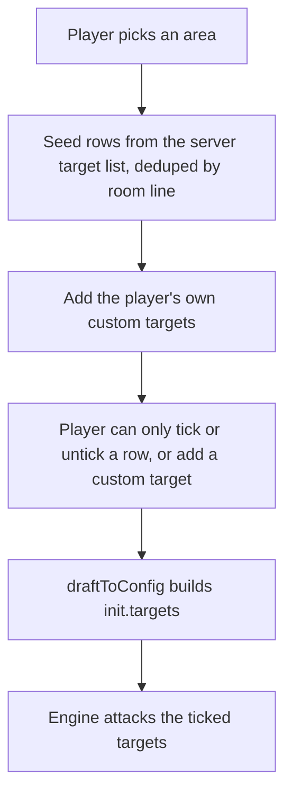

After: an edit is a personal override layered on the server row; the server list is never changed.

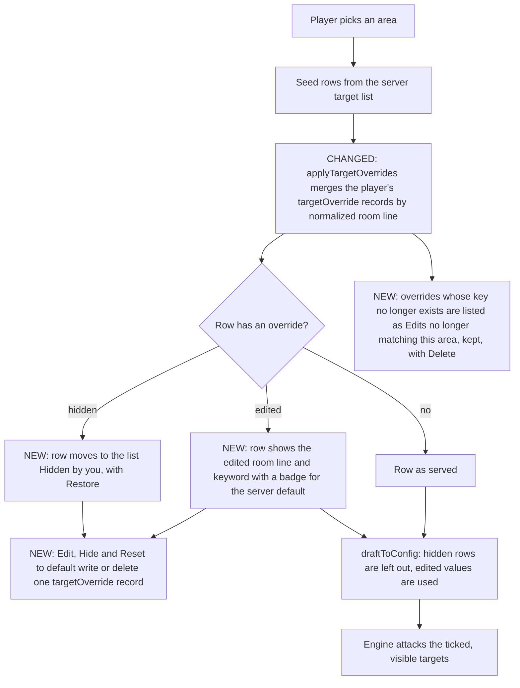

### W2 — Choosing a class and pre-filling its abilities     changed by: Phases 1, 5

Before (`CombatStep.tsx` `baseClasses`, `onChangeClass`; the served and fallback class lists held 31 classes, and a stale fallback was cached 30 days): picking a class filled nothing.

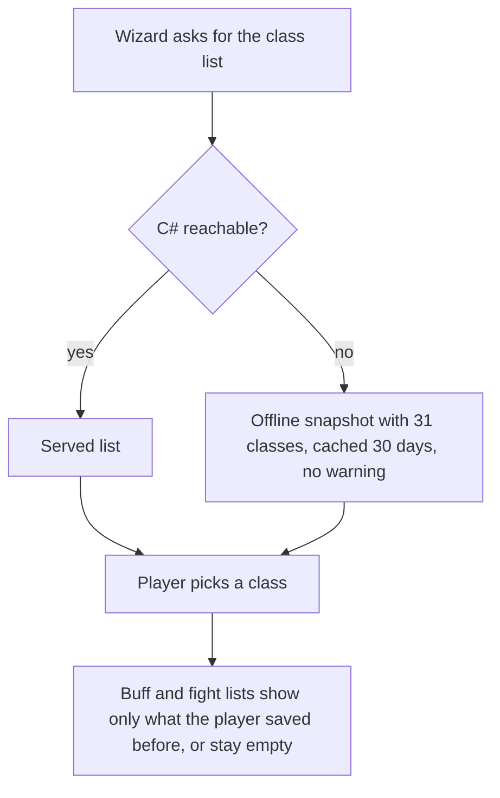

After:

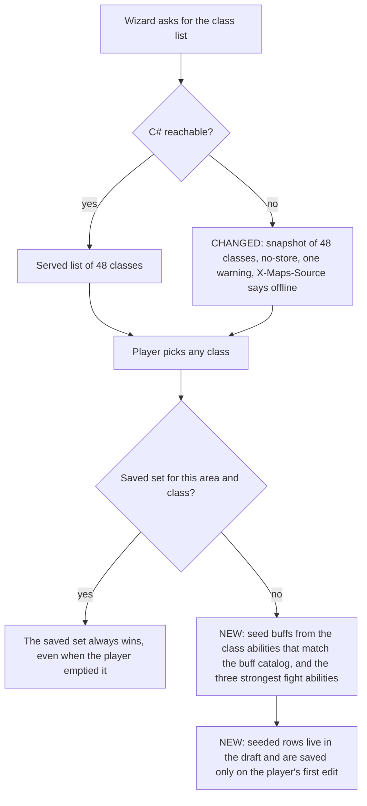

### W3 — Save to cloud and Load from cloud     changed by: Phases 2, 6, 6b

Before (`useAccountModal.ts:154`, `UserContentController.cs` known kinds): Save uploaded this device's records as the whole collection, and the server refused a kind it did not know.

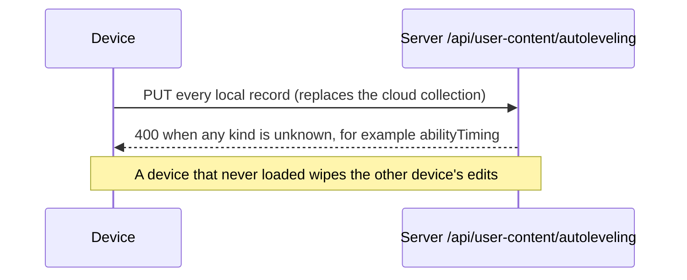

After:

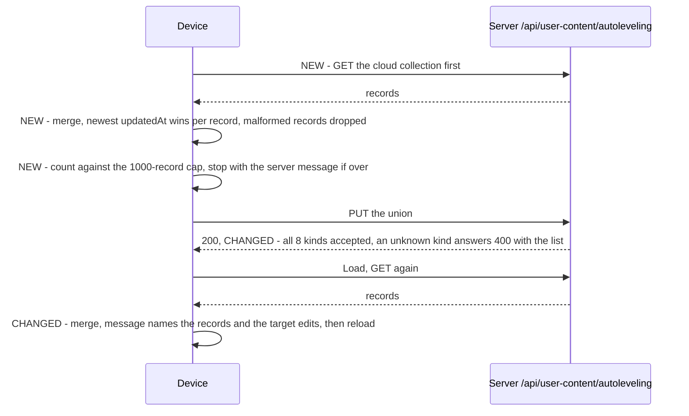

### W4 — A timeout during a run     changed by: Phase 16

Before (`autoleveling-engine.ts`, backstop `idleTimeoutMs` = 1000 ms, shorter than the movement tracker's 1200 ms): any timeout ended the run.

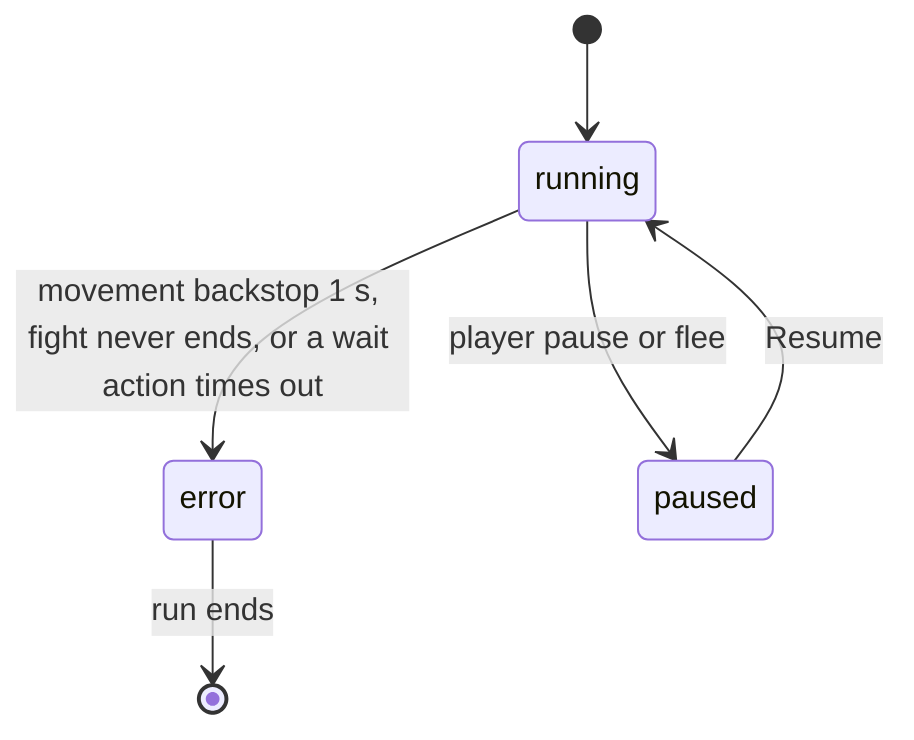

After:

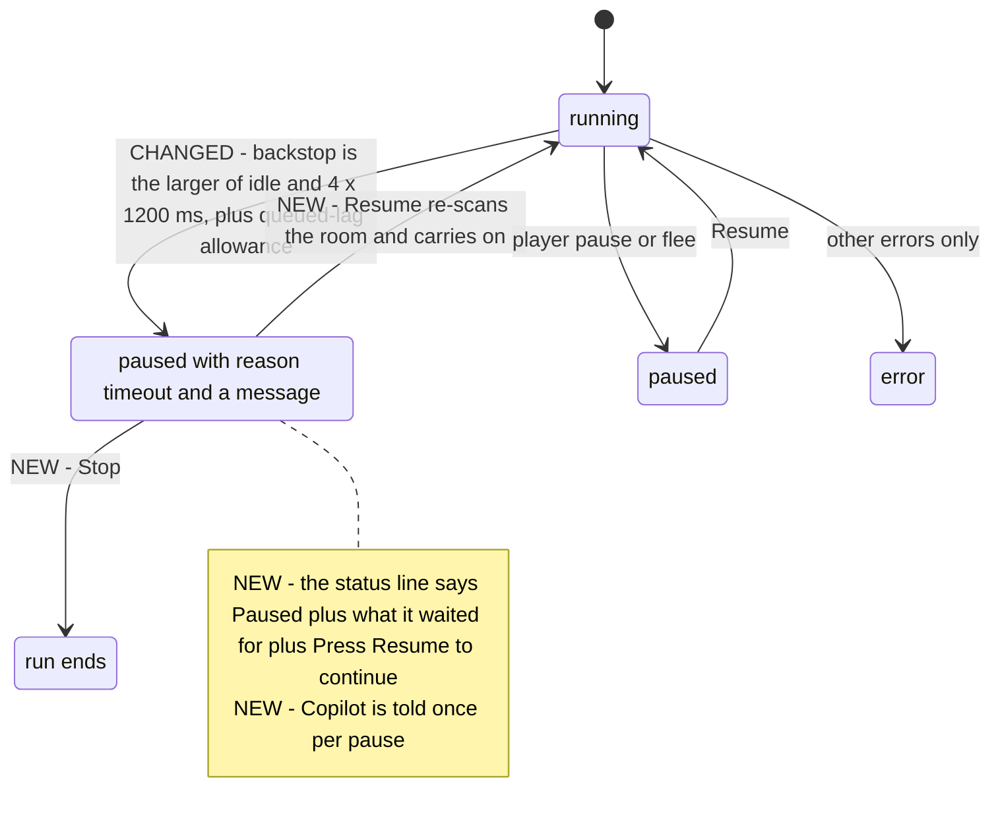

### W5 — Casting a buff or heal and re-arming it     changed by: Phases 12, 14, 15, 18

Before: each dropped affect sent its command at once and independently, `{name}` could go out literally, a failed cast was not tried again, and a quaff was not re-armed.

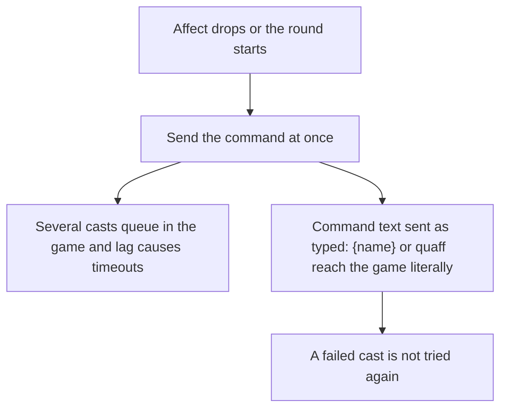

After:

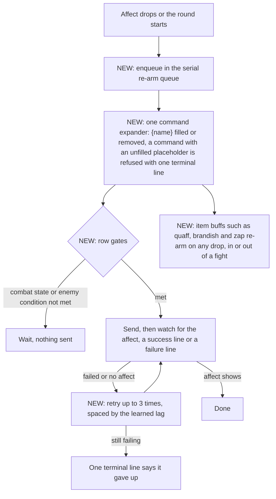

### W6 — The lap loop and what the wizard remembers     changed by: Phase 17

Before: the wizard waited a fixed 3 seconds between laps, and the Rest and Weight steps and the ticked targets were forgotten whenever the wizard closed.

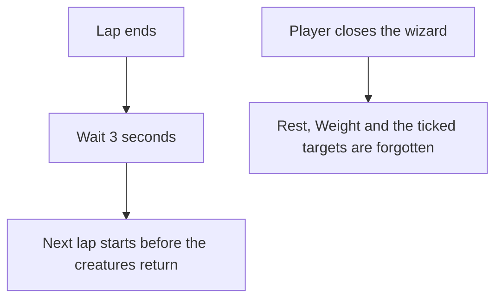

After:

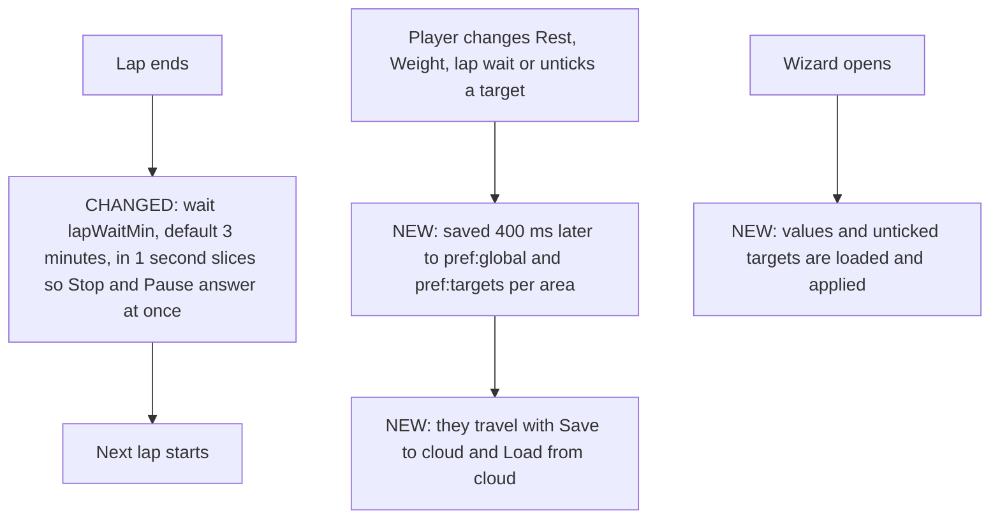

### W7 — Where ability timing comes from     changed by: Phases 19, 20, 21

Before: the class feed carried no durations or lag, new fight rows started at a reuse time of 0 and recast intervals were guesses.

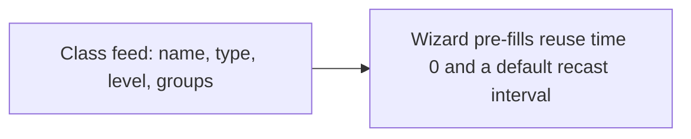

After:

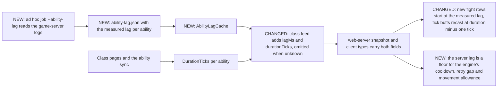

### W8 — Autopilot on the phone     changed by: Phases 7, 8, 9, 10, 11  (moved to 2026-09-12_autoleveling-mobile-port, A13)

Before: the mobile app has no autopilot and does not sync the autopilot records.

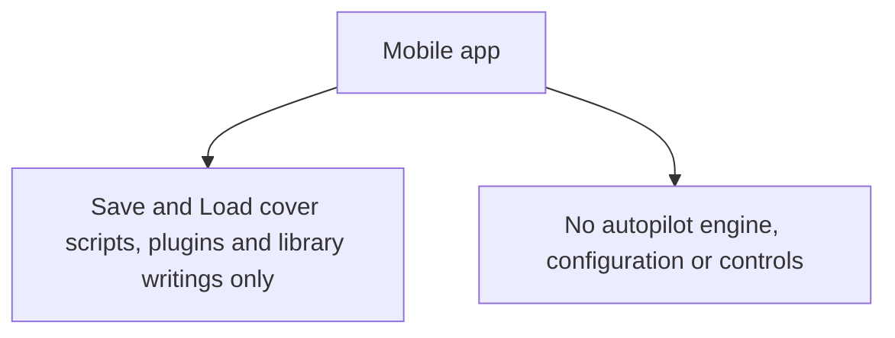

After (planned; not built yet):

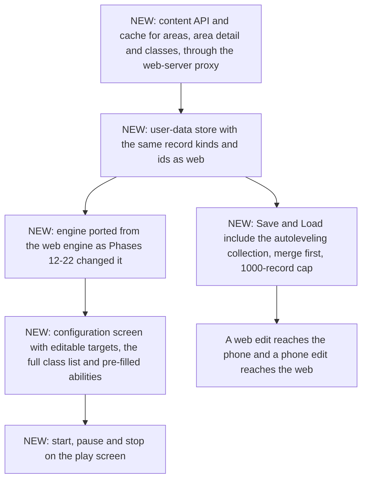

## Standards applied

- TypeScript (`docs/standards/typescript.md`): co-located `*.test.ts(x)`; no new `any` in production code; storage reads and writes fail safe with `try`/`catch` and a fixed `console.warn` that carries no values; unsubscribing effects. Mobile: kebab-case modules in `dsl-client/features/<area>/`, tests in `__tests__/*-test.ts(x)`.
- C# (`docs/standards/csharp.md`): thin controller, logic in a static class under `Server.Dsl/AgentApi/`, `BadRequest(new { error })`, xunit `<Feature>Tests.cs`, `dotnet build -c Release` without new warnings.
- SCSS (`docs/standards/scss.md`): extend `AutoLevelingWizard.module.scss`; palette variables, `color-scheme: dark`; no hard-coded colors.

## Edit map

All lines are as of a565d53 (C# lines: DSL working tree). New files are marked NEW.

| File | Line(s) | Anchor | Change | Phase |
|---|---|---|---|---|
| deploy/docker-compose.shattered-archive-experimental.yml | web-server `environment:` (~l.50-55 of that service block) | `LOG_LEVEL: "debug"` | add `SHATTEREDARCHIVE_BASE: "http://shatteredarchive-csharp:5000"` (compose environment overrides the `env_file` value `localhost`; reachable from the container, verified 200) | 1 |
| apps/web-server/.env | 6 | `SHATTEREDARCHIVE_BASE=http://localhost:5000` | unchanged (right for a host-run dev server); comment added | 1 |
| apps/web-server/src/index.ts | 461-466, 508, 536-552 | `const sendJson` (l.464 sets the 30-day `Cache-Control` for every source), `handleAutoLevelingClasses` | when `source === 'offline'` send `Cache-Control: no-store`; one `console.warn` per process the first time an endpoint falls back; keep `X-Maps-Source` | 1 |
| apps/web-server/src/index.test.ts (or co-located `autoleveling-fallback.test.ts`) | NEW | - | handler tests: upstream failing returns offline + header + no-store + one warn; upstream ok returns `upstream` + long cache | 1 |
| apps/web-server/src/offline/autoleveling/classes.json, areas.json | whole files | `{ "classes": [...] }` | regenerated from the running C# service by the two extract scripts | 1 |
| apps/game-client/src/features/autoleveling/autoleveling-classes.ts | 19 | `CATALOG_KEY = 'autolevelingClasses'` | bump to `'autolevelingClasses.v2'` so the stale 31-class cache is dropped | 1 |
| apps/game-client/src/features/autoleveling/autoleveling-content.ts | 27-28 | `INDEX_KEY = 'autolevelingAreaIndex'`, `DETAIL_KEY` | bump both keys (suffix `.v2`) | 1 |
| Server/Server.Dsl/AgentApi/AutolevelUserRecords.cs (DSL repo) | NEW | - | static `Kinds`, `TryValidate(JObject, out error)`: moved out of the controller and extended (`abilityTiming`, `targetOverride`) | 2 |
| Server/Server.Web.Public/Controllers/UserContentController.cs | 37, 47, 181-215, 795-830 | `MaxAutolevelRecords`, `KnownAutolevelRecordKinds`, `TryValidateAutolevelRecord` | controller calls the static class; same 1000-record cap and messages | 2 |
| Server/Server.Dsl.Tests/AutolevelUserRecordsTests.cs (DSL repo) | NEW | - | every kind accepted; unknown kind, missing id, non-numeric `updatedAt`, missing `data`, malformed `targetOverride` rejected | 2 |
| apps/game-client/src/features/autoleveling/autoleveling-user-data.ts | 21 | `UserRecordKind` | add `'targetOverride'`; export `SYNCED_RECORD_KINDS` | 3 |
| same | 125-140 | `exportAll`, `importRecords` | `importRecords` drops malformed records through one `normalizeRecord` | 3 |
| same | 144-155 | `getCustomTargets`, `addCustomTarget` | add `updateCustomTarget`, `removeCustomTarget` (uses `deleteRecord` l.120, which has no production caller today) | 3 |
| same | 156-200 | `getBuffOverlay`, `getFightOverlay` | add `getBuffOverlayOrNull`, `getFightOverlayOrNull` (absent vs empty) | 3, 5 |
| same | after targets section | NEW functions | `targetOverrideKey`, `getTargetOverrides`, `setTargetOverride`, `resetTargetOverride`, `applyTargetOverrides` (pure) | 3 |
| apps/game-client/src/features/autoleveling/autoleveling-user-data.test.ts | existing | - | cases for each new function; kinds vs `SYNCED_RECORD_KINDS` | 3 |
| apps/game-client/src/components/wizard/useWizardDraft.ts | 12-19, 95-120 | `DraftTarget`, `setArea`, `toggleTarget`, `removeCustomTarget` | `DraftTarget` gains `id?`, `defaultLookName?`, `defaultEngageName?`, `overridden?`; actions `editTarget`, `hideTarget`, `restoreTarget`, `resetTarget`; `removeCustomTarget` persists the delete | 4 |
| apps/game-client/src/components/AutoLevelingWizard.tsx | 221-265, 272-280, 380-382 | `onSelectArea`, `onAddCustomTarget`, `<TargetsStep ... />` | seed through `applyTargetOverrides`; wire edit/hide/reset/unmatched props | 4 |
| apps/game-client/src/components/wizard/TargetsStep.tsx | 10-100 | `Props`, area list, custom list | inline edit, Hide/Restore, Reset to default, "Unmatched edits" list, `HelpInfoButton` | 4 |
| apps/game-client/src/components/wizard/TargetsStep.test.tsx | NEW | - | render and interaction tests | 4 |
| apps/game-client/src/styles/AutoLevelingWizard.module.scss | existing | target rows | edit controls and states, all themed | 4 |
| apps/game-client/src/components/wizard/TargetsHelp.tsx | NEW | - | in-app help (pattern: `MapHelp.tsx`) | 4 |
| apps/game-client/src/features/autoleveling/autoleveling-wizard-config.ts | 143-176 | `draft.targets.filter(...)` | no change expected; a test pins that an edited lookName and keyword reach `init.targets` and a hidden one does not | 4 |
| apps/game-client/src/features/autoleveling/autoleveling-class-defaults.ts | NEW | - | pure `defaultBuffRows`, `defaultFightRows` from a class's abilities + `BUFF_CATALOG` + `COMBAT_SKILL_NAMES` | 5 |
| apps/game-client/src/components/wizard/CombatStep.tsx | 316-335, 363-380, 426-471 | `baseClasses`, `onChangeClass`, `addClassBuff`, `addClassFight` | seed on class or area change only when the overlay is absent; "class list unavailable" notice on fallback; help button | 5 |
| apps/game-client/src/components/wizard/dsl-classes.ts | 12 | `DSL_CLASSES_FALLBACK` | unchanged list, now only reachable when the served catalog and snapshot are both empty | 5 |
| apps/game-client/src/components/wizard/CombatStep.test.tsx | existing | - | seeding, no-overwrite, emptied-stays-empty, fallback notice | 5 |
| apps/game-client/src/components/wizard/CombatHelp.tsx | NEW | - | in-app help | 5 |
| apps/game-client/src/hooks/useAccountModal.ts | 154, 292 | `exportAutolevelUserData()`, `importAutolevelUserData(...)` | Save loads and merges first (CLOUDSYNC-02); Load result summary names overrides | 6 |
| apps/game-client/src/features/auth/cloudSync.ts | 82-91 | `loadAutolevelUserData`, `saveAutolevelUserData` | unchanged contract; tests added | 6 |
| docs/game-client.md, docs/web-server.md | autoleveling sections | - | developer docs | 1, 4, 5, 6 |
| apps/game-client/src/features/autoleveling/.annotated, components/wizard/.annotated, features/auth/.annotated, hooks/.annotated | index entries | - | index updates (context the code does not show) | 3-6 |
| shatteredarchive-mobile/dsl-client/features/autoleveling/* | NEW | - | mobile port, see phases 7-10 | 7-10 |
| shatteredarchive-mobile/dsl-client/features/auth/cloud-sync.ts | 33-34, 195-290 | `saveAllToCloud`, `loadAllFromCloud` | add the autoleveling collection, load-merge-save | 8 |
| shatteredarchive-mobile/dsl-client/components/PlayContainer.tsx, components/AccountSection.tsx | existing | - | control surface; account section already hosts Save/Load | 10 |
| shatteredarchive-mobile/docs/reference/mobile.md, docs/reference/game-client.md, docs/features/autopilot.md (NEW) | - | - | mobile docs | 11 |
| (Phases 12-22: engine, wizard, user data, class feed, C# job and cache, docs) | - | - | amended: see A9 and A11; the Edit map of those phases is in `.ai-plans/active/2026-11-18_autopilot-live-test-findings/tech-plan.md` | 12-22 |

## Edge cases

| Id | Classifier | Condition | Required behaviour | Covered by |
|---|---|---|---|---|
| E1 | - | Override key: two area targets whose room lines differ only by case or spacing | key = lowercase, trimmed, whitespace collapsed (same dedupe the seed already does, `AutoLevelingWizard.tsx:236`); first wins; one override record per key | P3 `targetOverrideKey` tests |
| E2 | - | Edit sets the room line empty, or to the room line of another row | rejected in the editor with a message; nothing saved | P4 TargetsStep tests |
| E3 | - | Room line or keyword contains `;`, a newline or a control character (typed, or arriving from cloud) | rejected on edit and dropped on import; `kill {name}` must never carry a second command | P3 import test, P4 edit test |
| E4 | - | Account near the server's 1000-record cap (`UserContentController.cs:37`), since overrides and learned cooldowns also count | the client counts before upload and shows the server's own message; nothing partial saved | P6 test |
| E5 | - | Cloud record with kind `targetOverride` but missing or wrongly typed fields | dropped by `normalizeRecord`; other records still import | P3 |
| E6 | - | An area target both edited and hidden, then reset | reset removes the whole record: both edit and hidden flag | P3, P4 |
| E7 | - | The extract script cannot reach C# | the existing snapshot is left untouched and the phase fails its own check (48 classes) instead of passing | P1 |
| E8 | - | Old 30-day browser and 7-day IndexedDB caches hold the 31-class list | new cache key; offline-source responses are `no-store` | P1 |
| E9 | - | A class with no abilities, or an unknown class name | pre-fill yields nothing, picker still works, no crash | P5 |
| E10 | - | Character level unknown | no level cap for pre-fill; rows carry their `(Lnn)` tag as today | P5 |
| E11 | - | Class changed twice quickly | newest request wins, as the existing `classReq` guard does | P5 |
| E12 | - | AsyncStorage read or write fails on mobile | falls back to defaults, never throws into the UI | P7-P8 |
| E13 | - | Two devices edit the same target | newest `updatedAt` wins per record; the loser's edit is not merged field by field | P3, P6 |
| E14 | - | Logs or errors name a mob or keyword | never; fixed warning text only | P3-P8 review |
| E15 | SETTINGS-01 | Override store | only fields that differ from the server default are stored; an edit back to the default deletes the record | P3 |
| E16 | SETTINGS-02 | "Same as default" | strict compare after the E1 normalization: no coercion | P3 |
| E17 | SETTINGS-03 | Wizard draft after a reset | the draft row is rebuilt from the server default, not merged | P4 |
| E18 | SETTINGS-04 | Routes that write overrides: editor, cloud load, mobile import | all go through `normalizeRecord` | P3, P6, P8 |
| E19 | SETTINGS-06 | Pre-fill | absent overlay seeds; an overlay the user emptied stays empty; seeded rows are not stored until edited | P5 |
| E20 | CLOUDSYNC-01 | Kinds the client exports vs the server list | `SYNCED_RECORD_KINDS` equals the server list; PUT of one record per kind returns 200 | P2, P3, P6 |
| E21 | CLOUDSYNC-02 | A device saves without having loaded | Save loads, merges (newest wins), then uploads | P6, P8 |
| E22 | CLOUDSYNC-03 | Server renames or drops an area target the user edited | the override is kept, not applied, listed under "Unmatched edits", reapplies if the key returns | P3, P4 |
| E23 | FALLBACK-01 | Web-server cannot reach C# | fallback is visible (`X-Maps-Source`, one warning), and the deployed container reads `upstream` | P1 |
| E24 | TH-01..TH-05 | New edit controls, list, notices | scrollbar, native inputs, hover/focus/disabled/error states, placeholder and caret, live theme switch all themed | P4, P5 screenshots |

Classifiers not applicable: SETTINGS-05 (no stored data is rewritten; the cache key bump only abandons a cache); EVENTBUS-01 (web: no new event subscription; mobile: covered by a test in Phase 9 that the engine's subscription does not displace `vitals-store`'s); the rest of the catalog (ansi, privname, logtail, autoapproval, local-only, expo, pointer, mapid) does not match this work. Note PRIVNAME: nothing here exports game text.

*Amended by A11: the edge-case rows for Phases 12-22 are `L1`-`L41` in `.ai-plans/active/2026-11-18_autopilot-live-test-findings/tech-plan.md`, each proven in its own phase (see that item's `test-results.md`); they add the classifiers CMDTPL-01, RUNLOOP-01/02/03 and SETTINGS-07.*

## Verification toolbox

- Game client tests: `bash -c 'cd /c/Projects/ShatteredArchive/apps/game-client && pnpm exec jest --config ../../jest.config.cjs --runInBand --testPathPatterns <pattern> 2>&1 | grep -E "Tests:|Test Suites:|FAIL|✕"'`; whole package: `pnpm --filter game-client test`.
- Typecheck: `pnpm typecheck` (root, `tsc -p apps/game-client/tsconfig.json --noEmit`). Lint: `pnpm lint`. Build: `pnpm --filter game-client build`.
- Web-server: `pnpm --filter web-server test`, `pnpm --filter web-server build`; redeploy `docker compose -f deploy/docker-compose.shattered-archive-experimental.yml build web-server` then `up -d --no-deps web-server`; check `curl -sk -D - https://game-client.shatteredarchive.dev/api/web/maps/autoleveling/classes -o /dev/null | grep -i x-maps-source` reads `upstream`.
- Snapshot regeneration (C# must be up): `AUTOLEVELING_CLASSES_URL=http://localhost:5000/maps/autoleveling/classes pnpm --filter game-client extract:autoleveling-classes` and `pnpm --filter game-client extract:autoleveling-content`.
- C#: `dotnet test C:/Projects/DSL/Server/Server.Dsl.Tests`, `dotnet build C:/Projects/DSL/Server -c Release`; deploy the local stack with `Server/deploy-local.ps1`, then live-check.
- API: the user-content routes need a signed-in session; call them from the Playwright session (`page.request`) after logging in with the local test account. Unauthenticated calls answer 401.
- UI screenshots: Shattered-AI `tools/browser-test` (`autoleveling.mjs` drives the wizard; `saveShowcase` for final shots), against the running game client (`http://localhost:30080/`). Progress shots `phase-NN_<name>.png` (git-ignored), final `showcase_NN_<name>.png`.
- Mobile (repo `shatteredarchive-mobile`, its own pnpm workspace): `pnpm --dir dsl-client exec jest <pattern>`; typecheck with `pnpm --dir dsl-client exec tsc --noEmit` (it carries a pre-existing baseline of errors; record the count before Phase 7 and require no new ones). Android run needs the emulator: ask the owner before starting it; target `emulator-5554` only.
- Never run a bare `jest`: use the package script or `--runInBand` (a hook denies the rest; rule in `docs/claude/working-posture.md`, added by A11).
- Test accounts: a local test account only; no real account or character names in screenshots.

## Phases

Status is read from the boxes (A12). A phase heading is ticked only when every Work box and its Sign-off box are ticked. A step closed by a later phase says so next to its box.

### [x] Phase 1 — Serve the complete class and area catalog
Goal:        the wizard receives all 48 classes (and current areas) from the live C# service, with a complete offline fallback, and a stale fallback can no longer hide.
Depends on:  nothing
Workflow:    W2

Work
- [x] 1.1 `deploy/docker-compose.shattered-archive-experimental.yml` (web-server `environment:`): add `SHATTEREDARCHIVE_BASE: "http://shatteredarchive-csharp:5000"`.
- [x] 1.2 `apps/web-server/src/index.ts:461-466` (`sendJson`, line 464 `Cache-Control`) and `:536-552` (`handleAutoLevelingClasses`): responses with source `offline` send `Cache-Control: no-store`; a module-level `Set` logs one `console.warn('[web-server] upstream unreachable, serving offline snapshot', { endpoint })` the first time each endpoint falls back (amended: see A1, the policy is a pure module).
- [x] 1.3 `apps/web-server/src/offline/autoleveling/classes.json` and `areas.json`: regenerate with the two extract scripts.
- [x] 1.4 `autoleveling-classes.ts:19` and `autoleveling-content.ts:27-28`: bump the IndexedDB keys.
- [x] 1.5 Tests: web-server handler test (failing upstream returns the snapshot, `X-Maps-Source: offline`, `no-store`, one warning across two requests; succeeding upstream returns `upstream` with the long max-age; E23, FALLBACK-01); snapshot test (48 classes, Avenger and Chaos Weaver present, none with an empty ability list; E7); `autoleveling-classes.test.ts` (a cache stored under the old key is ignored; E8).
- [x] 1.6 API check: against the running local stack after redeploy, `GET /api/web/maps/autoleveling/classes` returns 48 classes with `X-Maps-Source: upstream`; same for `/areas`.
- [x] 1.7 UI check: Combat step lists base classes then 43 reclasses; `phase-01_class-list.png`.
- [x] 1.8 Docs and indexes: `docs/web-server.md` (the upstream setting, fallback visibility, snapshot regeneration). End-user: no user-visible effect beyond a complete list (help text comes in Phase 5).

Sign-off
- [x] 1.S Exit gate verified, recorded in test-results.md "Phase 1" (2026-11-13): build, typecheck, lint, all web-server and game-client tests, API check, screenshot, docs.

State on exit: full catalog served live and in the fallback; no new feature behaviour.

### [x] Phase 2 — The server accepts and validates every record kind
Goal:        a Save to cloud of every kind the client stores succeeds, and the new `targetOverride` kind is accepted and checked.
Depends on:  nothing (independent of Phase 1)
Workflow:    W3

Work
- [x] 2.1 `Server/Server.Dsl/AgentApi/AutolevelUserRecords.cs` (NEW, DSL repo): static `Kinds` and `TryValidate` carrying the existing checks (non-empty `id`, known `kind`, numeric `updatedAt`, `data` present) plus the `targetOverride` rules (`areaSlug`, `data.key` 1-200 chars, optional `lookName` and `engageName` of at most 200 chars with no `;`, newline or control character, optional boolean `hidden`; E3).
- [x] 2.2 `UserContentController.cs:47` and `:795-830`: remove the private list and validator, call the static class; `MaxAutolevelRecords` and the error shapes stay.
- [x] 2.3 Tests: `AutolevelUserRecordsTests.cs` (each kind accepted; unknown kind, missing id, string `updatedAt`, missing `data` rejected with the same message text; `targetOverride` cases; the kind list equals the contract with the client; E3, E5, E20).
- [x] 2.4 API check: a real `PUT /api/user-content/autoleveling` with one record per kind from a signed-in session answers 200, an unknown kind answers 400, `GET` returns what was stored. Run in Phase 6b on 2026-11-19 (amended: see A2, A6); in Phase 2 only the 401 without a session was observed.
- [x] 2.5 Docs and indexes: `docs/game/user-account.md` (autopilot records, the kinds, the contract, the character rules), `Server.Dsl/AgentApi/.annotated` and `.ai-context`. End-user: no user-visible effect on its own.

Sign-off
- [x] 2.S Exit gate verified, recorded in test-results.md "Phase 2" (code and tests 2026-11-13) and closed on 2026-11-19 when 6b ran the authenticated check this phase had deferred.

State on exit: server ready for the new kind; the existing `abilityTiming` upload defect is fixed.

### [x] Phase 3 — Override storage and the sync contract (no UI yet)
Goal:        overrides can be stored, read, applied and exported on the client, and removed custom targets are really deleted.
Depends on:  Phase 2 for the live sync check
Workflow:    W1

Work
- [x] 3.1 `autoleveling-user-data.ts:21`: `UserRecordKind` adds `'targetOverride'`; export `SYNCED_RECORD_KINDS`.
- [x] 3.2 `autoleveling-user-data.ts`: new `normalizeRecord(rec)` (shape, length and character checks of E3 and E5) used by `importRecords` and by the setters (E18).
- [x] 3.3 New functions after the targets section: `targetOverrideKey` (E1), `getTargetOverrides`, `setTargetOverride` (stores only differing fields, deletes the record when equal to the default; E15, E16), `resetTargetOverride` (E6), `applyTargetOverrides` returning `{ rows, unmatched }` (E22), `updateCustomTarget`, `removeCustomTarget` (calls `deleteRecord`). Pure override rules live in `autoleveling-target-overrides.ts` (amended: see A3).
- [x] 3.4 Tests: `autoleveling-user-data.test.ts` (key normalization; only changed fields stored; edit back to default removes the record; reset removes edit and hidden flag; apply with edited, hidden and unmatched rows; export contains the override; malformed import dropped; last writer wins by `updatedAt`; every exported kind is in `SYNCED_RECORD_KINDS`; removing a custom target deletes its record; a throwing store leaves defaults and a fixed warning).
- [x] 3.5 Docs and indexes: `features/autoleveling/.annotated` (override record shape, why only differences are stored, the matching key, the unmatched rule); `docs/game/autopilot.md` (NEW, A3).

Sign-off
- [x] 3.S Exit gate verified, recorded in test-results.md "Phase 3" (2026-11-13): build, typecheck, lint, all game-client tests, coverage, docs.

State on exit: storage layer complete and unused by the UI; behaviour for players unchanged.

### [x] Phase 4 — Edit the pre-loaded targets in the Targets step
Goal:        a player can change a target's room line or keyword, hide it, restore it, and reset it to the server default; edits persist across wizard sessions.
Depends on:  Phase 3
Workflow:    W1

Work
- [x] 4.1 `useWizardDraft.ts:12-19, :95-120`: extend `DraftTarget`; add `editTarget`, `hideTarget`, `restoreTarget`, `resetTarget`; `removeCustomTarget` also calls the persisted delete (rows are identified by `targetRowId`; amended: see A4).
- [x] 4.2 `AutoLevelingWizard.tsx:221-265, :272-280`: seed area rows through `applyTargetOverrides`, keep the custom rows, pass `unmatched`, persist edits through `setTargetOverride` and `updateCustomTarget`.
- [x] 4.3 `TargetsStep.tsx`: per row Edit (inline, validation of E2 and E3), Hide (to a "Hidden by you" list with Restore), Reset to default (only when overridden), a badge showing the server default, an "Edits no longer matching this area" list with Delete (E22), a help button. `TargetsHelp.tsx` (NEW) and `AutoLevelingWizard.module.scss` controls and states.
- [x] 4.4 Tests: `TargetsStep.test.tsx`, `useWizardDraft.test.ts`, `AutoLevelingWizard.targets.test.tsx` (edit saves; empty or duplicate room line refused; `;` refused; hide, restore, reset; unmatched deleted only on click; an unedited target follows a changed server value) and `autoleveling-wizard-config.test.ts` (edited values reach `init.targets`, a hidden target does not; E2, E3, E6, E17, E22).
- [x] 4.5 UI check: Targets step with an edited, a hidden and an unmatched target; dark theme; focus, hover, disabled and error states (TH-01..TH-05); `phase-04_*.png`.
- [x] 4.6 Docs and indexes: `docs/game/autopilot.md` (Targets step), `components/wizard/.annotated`; end-user: the `TargetsHelp` button.

Sign-off
- [x] 4.S Exit gate verified, recorded in test-results.md "Phase 4" (2026-11-13): build, typecheck, lint, all game-client tests, coverage, screenshots, docs and help.

State on exit: web players can edit targets; the Combat step is unchanged.

### [x] Phase 5 — Full class picker and class-driven pre-population
Goal:        choosing a class with no saved set pre-fills its buffs and fight commands from the DSL data; saved sets always win; a missing catalog is announced, not hidden.
Depends on:  Phase 1 (the full catalog), Phase 3 (absent-vs-empty reads)
Workflow:    W2

Work
- [x] 5.1 `autoleveling-user-data.ts:158-200`: `getBuffOverlayOrNull` and `getFightOverlayOrNull` return `null` when no record exists (E19; unreadable storage returns `[]`, A5).
- [x] 5.2 `autoleveling-class-defaults.ts` (NEW): `defaultBuffRows` (class abilities matching a `BUFF_CATALOG` entry, at or below the level) and `defaultFightRows` (the highest-level offensive abilities, `DEFAULT_FIGHT_ROWS = 3`, command shapes as `addClassFight` builds them); no level means no cap (E10). Buffs above the level are listed paused with a warning (amended: see A8).
- [x] 5.3 `CombatStep.tsx:316-335, :363-380`: keep the catalog-driven lists; empty-catalog notice (E9); seed through the defaults only when the overlay is `null`, one decision per area and class (A5); seeded rows are saved only on the first edit (E19); newest pick wins (E11). `CombatHelp.tsx` (NEW).
- [x] 5.4 Tests: class-defaults pure tests and `CombatStep.prefill.test.tsx` (matching buffs, no abilities, level cap, skill vs spell shapes; absent overlay seeds, an emptied overlay stays empty, a saved overlay is never replaced, seeded-but-untouched writes nothing, class flip race, empty-catalog notice; E9, E10, E11, E19).
- [x] 5.5 UI check: a base class and a reclass pre-filled, the empty-catalog notice; `phase-05_*.png`.
- [x] 5.6 Docs and indexes: `docs/game/autopilot.md` (Combat step), `components/wizard/.annotated`, `features/autoleveling/.annotated`; end-user: the `CombatHelp` button.

Sign-off
- [x] 5.S Exit gate verified, recorded in test-results.md "Phase 5" (2026-11-13): build, typecheck, lint, all game-client tests, coverage, screenshots, docs and help.

State on exit: web Combat step pre-fills; behaviour for players with saved sets is unchanged.

### [x] Phase 6 — Web sync round trip, final web verification
Goal:        overrides and the other autopilot records round-trip between two browser profiles through Save to cloud and Load from cloud, without one device wiping the other.
Depends on:  Phases 2-5
Workflow:    W3

Work
- [x] 6.1 `useAccountModal.ts:154`: before exporting, load the cloud collection and import it (newest wins), then export and save (E21); show the server's cap message (E4); `:292` the load summary counts overrides. `cloudSync.ts:82-91` contract unchanged.
- [x] 6.2 Tests: useAccountModal tests (save with a stale local store merges the cloud copy first and the upload holds both devices' records; cap exceeded uploads nothing; a malformed cloud record does not stop the load; `abilityTiming` uploaded; E4, E13, E18, E20, E21) and cloudSync tests (success, 401, 400 text).
- [x] 6.3 API check: two browser contexts on one signed-in test account, edit/hide round trip, `GET` shows the records. Not runnable in Phase 6 (no signed-in account); run in Phase 6b on 2026-11-19 (amended: see A6).
- [x] 6.4 UI check: showcase shots `showcase_01_targets-editor.png` and `showcase_02_class-prefill.png` (done in this phase) and `showcase_03_sync-result.png` (taken in Phase 6b).
- [x] 6.5 Docs and indexes: `docs/game/autopilot.md` (cloud sync: merge-first, cap, load summary), `docs/game/user-account.md`, `hooks/.annotated`, `features/auth/.annotated`; end-user: help text mentions Save and Load to cloud.

Sign-off
- [x] 6.S Exit gate verified, recorded in test-results.md "Phase 6" (code and tests 2026-11-13) and closed on 2026-11-19 when 6b ran the API check and the third showcase shot.

State on exit: the web half of the item is complete and verified. Mobile phases start only after the owner signs off the web half.

### [x] Phase 6b — Authenticated round trip on a signed-in session (deferred from Phase 6)
Goal:        the two things Phase 6 could not prove without a signed-in session are proven for real: a record of every kind survives a Save, and an edit made in one browser profile reaches another and comes back.
Depends on:  Phase 6; a LOCAL dev test account (the owner allowed creating one on dev)
Workflow:    W3

Work
- [x] 6b.1 API check (amended: see A11, eight kinds and the remembered values join): from context A a real Save of one record of every kind answers 200 and a real Load returns all of them, with the same values (E20).
- [x] 6b.2 API check: A edits a target and saves, B loads and sees the edit, B hides another and saves, A loads and sees both (E13, E21).
- [x] 6b.3 API check: a third profile that never loaded saves a different edit; the cloud copy still holds the others' records (CLOUDSYNC-02).
- [x] 6b.4 API check: a record with an unknown kind answers 400 with the server's message and leaves the cloud unchanged.
- [x] 6b.5 UI check: `showcase_03_sync-result.png` (the Account message after a real Load names the records and the target edits); the Rest step in profile B shows the synced values.
- [x] 6b.6 Docs: kind count corrected from seven to eight (`routeOverride`) in `docs/game/autopilot.md` and `docs/game/user-account.md`.

Sign-off
- [x] 6b.S Exit gate verified, recorded in test-results.md "Phase 6b" (2026-11-19): API check with scrubbed shapes, screenshots viewed, nothing else red.

State on exit: the web half is fully verified; the mobile phases may start once the owner signs off.

### [x] Phase 12 — Commands reach the game as real commands, and fog never pre-fills (items 5, 11, 6a)
Goal:        a command with a placeholder is expanded or refused before it is sent, and fog and dispel fog never pre-fill.
Depends on:  Phase 6
Workflow:    W5

Work
- [x] 12.1 All steps of Phase 12 in the plan of record (`.ai-plans/active/2026-11-18_autopilot-live-test-findings/tech-plan.md`, amendment A9), ticked there as work and recorded in that item's `test-results.md` "Phase 12".

Sign-off
- [x] 12.S Exit gate verified (2026-11-18), recorded in that item's `test-results.md`.

### [x] Phase 13 — Row model for the new options, persisted and carried (no behaviour yet)
Goal:        buff and fight rows carry combat state, enemy condition and a retry switch through the draft, the saved records and the cloud.
Depends on:  Phase 12
Workflow:    W5

Work
- [x] 13.1 All steps of Phase 13 in the plan of record (A9); results in that item's `test-results.md` "Phase 13".

Sign-off
- [x] 13.S Exit gate verified (2026-11-18), recorded in that item's `test-results.md`.

### [x] Phase 14 — Engine gates: combat state and enemy condition, and condition-gated rows between fights (items 8, 9, 12)
Goal:        the engine sends a row only when its combat state and enemy condition allow it.
Depends on:  Phase 13
Workflow:    W5

Work
- [x] 14.1 All steps of Phase 14 in the plan of record (A9); results in that item's `test-results.md` "Phase 14".

Sign-off
- [x] 14.S Exit gate verified (2026-11-18), recorded in that item's `test-results.md`.

### [x] Phase 15 — Buff queue: one command at a time, outcome detection, capped retry (items 1, 2, 3 tail, 6b)
Goal:        buffs and heals are re-armed one command at a time, with the outcome detected and a capped retry.
Depends on:  Phase 14
Workflow:    W5

Work
- [x] 15.1 All steps of Phase 15 in the plan of record (A9); results in that item's `test-results.md` "Phase 15".

Sign-off
- [x] 15.S Exit gate verified (2026-11-18), recorded in that item's `test-results.md`.

### [ ] Phase 16 — A timeout pauses the run instead of stopping it, with a backstop that does not undercut the tracker (items 1, 3)
Goal:        a timeout pauses the run with a reason, and Resume carries on.
Depends on:  Phase 15
Workflow:    W4

Work
- [x] 16.1 All steps of Phase 16 but one, in the plan of record (A9); results in that item's `test-results.md` "Phase 16".
- [ ] 16.2 deferred: the screenshot of a real timeout pause (box 16.10 of the plan of record). A genuine stall needs a connected game session and a stopped reply, so it waits on the owner (a live lap, or a staged stall). The pause flow and its header text are proven by tests.

Sign-off
- [ ] 16.S Exit gate verified except 16.2 (recorded in that item's `test-results.md` on 2026-11-18); sign off when 16.2 is done.

### [x] Phase 17 — Rest, weight, lap wait and selected targets are remembered; the lap waits (items 4, 10)
Goal:        the wizard remembers its Rest, Weight, lap-wait and unticked-target values, and a lap waits minutes, not seconds.
Depends on:  Phase 16
Workflow:    W6

Work
- [x] 17.1 All steps of Phase 17 in the plan of record (A9); results in that item's `test-results.md` "Phase 17".

Sign-off
- [x] 17.S Exit gate verified (2026-11-18), recorded in that item's `test-results.md`.

### [x] Phase 18 — Wizard controls for the new row options, the retry marker and Dark Heal (items 2, 8, 9, 12)
Goal:        the wizard exposes the new row options, the retry marker and a Dark Heal entry.
Depends on:  Phase 17
Workflow:    W5

Work
- [x] 18.1 All steps of Phase 18 in the plan of record (A9); results in that item's `test-results.md` "Phase 18".

Sign-off
- [x] 18.S Exit gate verified (2026-11-19), recorded in that item's `test-results.md`.

### [x] Phase 19 — C#: measured skill lag, an ad hoc job and a definition (item 7, part 1)
Goal:        the DSL repo can measure each ability's lag from the game-server logs and hold it as a definition.
Depends on:  Phase 6
Workflow:    W7

Work
- [x] 19.1 All steps of Phase 19 in the plan of record (A9); results in that item's `test-results.md` "Phase 19".

Sign-off
- [x] 19.S Exit gate verified (2026-11-19), recorded in that item's `test-results.md`.

### [x] Phase 20 — The class feed carries duration and lag; the snapshot and client types follow (item 7, part 2)
Goal:        the class feed carries durationTicks and lagMs, omitted when unknown, through the snapshot to the client types.
Depends on:  Phase 19
Workflow:    W7

Work
- [x] 20.1 All steps of Phase 20 in the plan of record (A9); results in that item's `test-results.md` "Phase 20".

Sign-off
- [x] 20.S Exit gate verified (2026-11-19), recorded in that item's `test-results.md`.

### [x] Phase 21 — The client defaults recast intervals and cooldowns from the C# data (item 7, part 3)
Goal:        new rows start at the measured lag and tick buffs recast at their duration, and the server lag is a floor in the engine.
Depends on:  Phases 18, 20
Workflow:    W7

Work
- [x] 21.1 All steps of Phase 21 in the plan of record (A9); results in that item's `test-results.md` "Phase 21".

Sign-off
- [x] 21.S Exit gate verified (2026-11-19), recorded in that item's `test-results.md`.

### [x] Phase 22 — Final verification, documentation sweep, showcase and the mobile contract note
Goal:        all gates are green, the documentation is verified by the doc-impact check, the showcase shots exist and Phase 9 knows what to port.
Depends on:  Phases 12-21
Workflow:    none

Work
- [x] 22.1 All steps of Phase 22 in the plan of record (A9); results in that item's `test-results.md` "Phase 22", "Documentation audit" and the second round.

Sign-off
- [x] 22.S Exit gate verified (2026-11-19), recorded in that item's `test-results.md`. The owner's testing and sign-off of Phases 12-22 is still outstanding and is the last box of "Plan sign-off".

### Phases 7-11 — Mobile (moved to another item, see A13)
These five phases (mobile content API, record store and cloud sync, engine port, configuration page, device verification) were moved on 2026-11-20, at the owner's decision, to `.ai-plans/proposed/2026-09-12_autoleveling-mobile-port/tech-plan.md`, where they are rewritten against the code as it is now (Phases 2 to 8 there). None of them was started. Their boxes no longer count here; the phase numbers 7 to 11 are not reused.

## Risks and rollback

- Overrides are keyed by the normalized original room line; a server rename leaves an unmatched edit (kept, shown, reattaches). Rollback: remove the `targetOverride` handling; stored override records are ignored by older clients and rejected by an older server, so Phase 2 must stay deployed before any client that uploads them.
- The 1000-record cap is shared with learned cooldowns; a heavy user could reach it (E4 gives a clear message; raising the cap is a C# change not planned here).
- Pre-fill uses group data with gaps (1262 of 5036 abilities have no group in the live catalog, including common fighter skills); the fight defaults therefore lean on `COMBAT_SKILL_NAMES`, and a class may get fewer fight rows than expected. Players can always edit.
- Phase 1's compose change affects the local stack only; production's upstream address was not checked.
- Rollback of any web phase is a revert of that phase's files; Phases 1 and 2 are independently revertible.

## Plan amendments

**A1 (2026-11-13, Phase 1, minor):** the plan edited the `sendJson` closure in `apps/web-server/src/index.ts` and planned handler tests there. That file starts the service on import, so no test can load it. The new policy (`Cache-Control` per source, warn-once) is a new pure module `apps/web-server/src/mapsResponsePolicy.ts` with `mapsResponsePolicy.test.ts`; `sendJson` calls it and gained an optional `endpoint` argument passed at its three offline call sites. No existing logic was moved. The deployed container was checked for the wiring. Edit-map rows for `index.ts` and the new test file are `amended: see A1`.

**A2 (2026-11-13, Phase 2, minor):** the authenticated PUT of one record per kind (Phase 2 API check) needs a signed-in test-account session that was not available. It moves to the Phase 6 API check, which already drives a signed-in browser session; Phase 6 must also PUT all seven kinds and read them back. Needs a local test account from the owner before Phase 6. Phase 2 Edit-map rows are otherwise as planned; the only extra file touches are one `[Collection("AbilityCache")]` attribute in each of NewClassesTests.cs and AutoPilotClassCacheTests.cs (test-order race, see test-results.md).
**A3 (2026-11-13, Phase 3, minor):** the pure override rules (key, safe text, diff against default, apply, unmatched) are in a new module `autoleveling-target-overrides.ts` with its own test file, instead of inside `autoleveling-user-data.ts` as the Edit map said, per the TypeScript standard ("a new pure helper gets its own module"). `getBuffOverlayOrNull` / `getFightOverlayOrNull` stay in Phase 5 as planned. A new developer doc `docs/game/autopilot.md` was created now (no autopilot doc existed) and grows in Phases 4-6; the Edit-map row for `docs/game-client.md` is `amended: see A3` (the doc lives at `docs/game/autopilot.md`, the `{service}` folder of the work-item workflow).
**A4 (2026-11-13, Phase 4, minor):** (a) `DraftTarget` rows are identified by a new `targetRowId` (`a:<key>` / `c:<record id>`) and `toggleTarget`, `removeCustomTarget` now take that id instead of the room line, because an edit changes the room line; `useWizardDraft` also gained `editTarget`, `deleteUnmatched` and `unmatchedOverrides` (all in the planned files). (b) The add-your-own box now validates text and duplicates too (E3 applies to typed custom targets, not only edits). (c) New file `AutoLevelingWizard.targets.test.tsx` and `useWizardDraft.test.ts` beyond the planned `TargetsStep.test.tsx`; one SCSS class (`.linkAction`) added so non-destructive link actions do not use the destructive red hover of `.linkButton`, which other steps rely on. (d) The user-facing doc is `docs/game/autopilot.md` (see A3).
**A5 (2026-11-13, Phase 5, minor):** (a) The `OrNull` readers return `[]` (not `null`) when storage is unreadable, so nothing is pre-filled over data that may exist. (b) Pre-fill logic is one decision per area|class (`seededFor`), run from the mount effect for a remembered class and from `onChangeClass` for a new pick, instead of two independent effects, to avoid a race between the two writers; a pending seed is dropped on unmount or when a newer pick moves `seededFor`. (c) New test file `CombatStep.prefill.test.tsx` beside the existing `CombatStep.test.tsx` (whose mocks were updated for the new readers). (d) `buffRowFromCatalog` is shared with the manual catalog add (a small refactor of `addFromCatalog`, behaviour unchanged, guarded by a test). (e) `DEFAULT_REFRESH_TICKS` moved from CombatStep to `autoleveling-class-defaults.ts` and is imported back.
**A6 (2026-11-13, Phase 6, significant but covered by a standing rule):** the Phase 6 API check (two signed-in sessions, 7-kind PUT/GET, 400 on an unknown kind) and `showcase_03_sync-result.png` could not be run: they need a signed-in local test account and none is documented or available to the agent. Following the owner's standing rule that anything closed without being run goes into a deferred plan phase, they moved to a NEW Phase 6b placed before the mobile phases. Phase 6's code, tests and the other two showcase shots are done. Needs from the owner: a local test account (or the owner running the round trip and reporting), before sign-off of the web half.
**A7 (2026-11-13, owner request after Phase 6, minor):** fight commands can be paused (`FightRow.disabled`), in addition to remove; recorded in test-results.md. No server change: the fight record's data is not validated field by field, so the flag syncs as is.
**A8 (2026-11-13, owner requests, minor):** (a) buffs above the character's level are listed paused with a warning instead of omitted (`BuffRow.disabled`; `defaultBuffRows` changed; replaces the Phase 5 rule that omitted them), (b) the room-scan wait became lag-aware (3 s notice, 20 s hard cap, sightless replies count) after a second live-log finding. Both recorded in test-results.md.
**A9 (2026-11-18, owner request, significant, approved by the owner 2026-11-18):** the twelve findings from the 2026-11-14 live test join this plan as **Phases 12-22**, planned in `.ai-plans/active/2026-11-18_autopilot-live-test-findings/tech-plan.md` (the plan of record for those phases; its edge-case rows are `L1`-`L41`, the evidence is in that item's `scope.md`, results go to that item's `test-results.md`). Order: after Phase 6b and before Phase 9 (the mobile engine port, which must port the new engine behaviour); Phases 7-8 are unaffected. Wider impact: the engine, wizard and `pref` record gain fields (no server change; kind `pref` already accepts any data), the DSL repo gains a job, a cache and two feed fields, Copilot receives a need-help signal for a timeout pause. Phase 22 adds a note to Phase 9 listing what to port.

**A10 (2026-11-19, Phase 22 of the live-test findings, minor, affects Phase 9):** the web engine changed after this plan was written (Phases 12-21 of A9). The mobile engine port in Phase 9 must port the NEW behaviour, not the engine as it was: (1) one expander for every command, a placeholder that is still unresolved is refused (`autoleveling-command-text.ts`); (2) per-row combat state, enemy condition gate and retry switch, the enemy condition read from the game's seven condition phrases (`autoleveling-enemy-condition.ts`); (3) the serial re-arm queue with outcome detection and a capped, lag-spaced retry, item buffs re-armed on any drop (`autoleveling-cast-outcome.ts`, the cast section of the engine); (4) timeouts pause instead of stop, the movement backstop derived from the tracker's timeout plus queued lag, Copilot's need-help signal (the mobile app has no Copilot: the signal can stay unhandled); (5) the lap wait, interruptible, default 3 minutes; (6) Rest, Weight, lap wait and unticked targets remembered in the `pref` records (`autoleveling-step-prefs.ts`), which the server already accepts; (7) the class feed's `durationTicks` and `lagMs` as defaults and as a floor (`autoleveling-lag.ts`). Details and tests: `docs/game/autopilot.md` sections "Commands sent to the game" to "Timing defaults from the class feed" and the test files named there; the engine suite to adapt is larger by the files `autoleveling-engine.{gates,rearm,pause,lapwait,lag}.test.ts`.

**A11 (2026-11-19, owner recheck of this plan, minor):** the plan text was brought in line with what is built; no behaviour or scope changed. (a) Phases 12-22 are listed in the phase list as `[x]` stubs that point at their plan of record (A9), so the phase count and state read correctly here; (b) the Goal, the Edit map and the Edge cases carry a pointer to that plan (rows `L1`-`L41`); (c) Phase 6b and Phase 9 carry `Amended:` lines (the new remembered-value records join the Save/Load round trip; the mobile port follows the changed engine, A10); (d) the toolbox gains the rule never to run a bare `jest`; (e) ORDER: A9 said Phases 12-22 follow Phase 6b, but they were built first, because Phase 6b needs a signed-in local test account from the owner and the live-test findings did not depend on it; Phase 6b therefore stays open (a deferred verification) and now also covers the new remembered-value records, and Phases 7-11 wait for it and for the owner's sign-off. Wider impact: none on Phases 7, 8, 10 and 11; the phase-count readout for this item changes from 6/12 to 17/23.

**A12 (2026-11-19, owner request, minor):** the plan was restructured to the new tech-plan shape (`.claude/skills/tech-plan/SKILL.md`, `docs/claude/work-item-workflow.md`); no behaviour or scope changed. (a) Each phase now reads Goal, a numbered Work checklist and a Sign-off box, so the unticked boxes ARE the outstanding work; the old Changes, Tests, API check, UI check, Index/docs and Exit gate fields became boxes with their text kept. (b) The boxes of finished phases were ticked from the progress log and `test-results.md`; four steps that a later phase closed are ticked with a note (2.4, 6.3 and the third showcase shot of 6.4 were run in Phase 6b), and the sign-offs of Phases 2 and 6 are dated 2026-11-19, when 6b closed them. (c) Phases 12-22 are mirrored as one Work box each pointing at their plan of record, which keeps its older format. (d) A `## Workflows (before and after)` section (W1-W8) was added; its Befores were reconstructed from this plan's Edit map and the docs, not re-read from the code at the planned commit. (e) A closing `## Plan sign-off` checklist was added. (f) The Phase 11 capture names `showcase_04` to `showcase_06_mobile-*` collide with web shots 04 and 05 already in this folder, so they became `showcase_06` to `showcase_08_mobile-*`. Wider impact: none; the phase-count readout stays 18 of 23.

**A13 (2026-11-20, owner decision, significant):** the mobile port leaves this plan. Asked while scoping `.ai-plans/proposed/2026-09-12_autoleveling-mobile-port` (which covered the same port and had never been scoped), the owner chose to keep that item as the mobile port and take Phases 7-11 out of this plan. (a) Phases 7, 8, 9, 10 and 11 and their boxes are replaced by a stub; the other item's `tech-plan.md` carries them as its Phases 2-8, rewritten against the current web engine and the mobile code, with three additions found by reading both: the engine's movement tracker, special-line events and raw-line event do not exist on mobile (its Phase 4), and its Phase 1 is an unrelated fix to the mobile script editor. (b) Wherever this plan still mentions Phases 7-11, W8 or "the mobile half" (the Goal, the Edit-map rows for `shatteredarchive-mobile`, edge cases E12 and E18, the toolbox bullet for mobile, A10, Phase 22's goal), read it as moved. (c) The web half is unaffected: Phases 1-6b and 12-22 stand. (d) What this plan loses: the end-to-end proof that a web edit reaches the phone and back (it is box 8.3 of the other item) and the mobile owner sign-off box. Wider impact: `scope.md` and `item.md` of this item still describe mobile as part of it; they are history and were not edited. The "Plan sign-off" below and the phase count readout were updated.

## Progress log

- 2026-11-13: plan written.
- 2026-11-13: implementation started; item moved to active/.
- 2026-11-13: Phase 1 done (compose upstream address fixed, offline answers no-store with a one-time warning, snapshots regenerated: 48 classes and 31 areas, IndexedDB keys bumped to .v2). Verified live: X-Maps-Source upstream, 48 classes, 32 areas. Web-server and game-client containers rebuilt and recreated on the local stack. Deviation: A1.
- 2026-11-13: Phase 2 done (AutolevelUserRecords.cs, controller calls it, 33 new C# tests, site redeployed with deploy-local.ps1). Deviation: A2. Pre-existing DSL test failures recorded in test-results.md.
- 2026-11-13: Phase 3 done (override rules module, store functions, normalizeRecord gate, SYNCED_RECORD_KINDS, custom target update/remove, docs/game/autopilot.md). Deviation: A3.
- 2026-11-13: Phase 4 done (Targets step editor, TargetsHelp, draft identity by targetRowId, wizard wiring, 66 new tests, game client rebuilt and redeployed, browser check). Deviation: A4.
- 2026-11-13: Phase 5 done (class-defaults module, OrNull readers, CombatStep pre-fill and notice, CombatHelp, 50 new tests, game client redeployed, browser check). Deviation: A5.
- 2026-11-13: Phase 6 code and tests done (merge-first Save, cap check, load summary, 18 new tests, docs, indexes, game client redeployed, showcase 01 and 02). The authenticated round trip is deferred to Phase 6b (A6). Web half ready for the owner's own testing; mobile phases (7-11) not started.
- 2026-11-13: Added pause/resume for fight commands on the owner's request (A7); built and redeployed.
- 2026-11-13: Owner requests: paused buffs with warnings for abilities not yet available, and an ability-lag guard on the room scan (A8). Built and redeployed.
- 2026-11-18: The owner's twelve observations from live testing on 2026-11-14 (buff timeouts, retry-for-affect, pause instead of stop, steps that lose their values, `{name}` rendered as a colour code, quaffing, ability timing and C# skill-lag data, out-of-combat-only buffs, thresholds, the wait between cycles, fog never a default buff, dark heal) are recorded as the proposed item `.ai-plans/proposed/2026-11-18_autopilot-live-test-findings` (log evidence for each still to be collected). Nothing here changes; the planner decides whether they extend this plan (item 4 touches its targets step) or get their own.
- 2026-11-18: Phases 12-22 added by amendment A9 (the plan of record is in 2026-11-18_autopilot-live-test-findings).
- 2026-11-19: Phases 12-22 (A9) are done in .ai-plans/active/2026-11-18_autopilot-live-test-findings (11/11 phases; final gates green: game-client 3800/3800 in 222 suites, web-server 11/11, DSL 975/977 with only the two known PlayerBookTests failing). Awaiting that item's owner sign-off. Remaining here: Phase 6b, then the mobile Phases 7-11 (Phase 9 follows A10). A11 brings this plan's text in line with what is built.
- 2026-11-19: Phase 6b done on the owner's go (dev test accounts allowed): a record of every one of the 8 kinds survived a real Save and Load, an edit and a hide moved between two profiles in both directions, a profile that never loaded kept the others' records, an unknown kind answered 400 and left the cloud unchanged; the remembered Rest, Weight and lap-wait values synced too (A11). The kind count in two docs was seven and is eight (routeOverride). The web half is fully verified; Phases 7-11 (mobile) wait for the owner's sign-off.
- 2026-11-19: Plan restructured to the new shape (A12): per-phase Goal, Work checklist and Sign-off, mermaid Before and After workflows W1-W8, and a closing Plan sign-off checklist. Outstanding work is now the unticked boxes: Phases 7-11 and the last three boxes of Plan sign-off.
- 2026-11-19: The live-test-findings plan was restructured the same way (its A1); in doing so Phase 16 was found to have one unrun step (the screenshot of a real timeout pause, recorded earlier as skipped verification) and is mirrored here as OPEN with a deferred box. The After diagrams W1-W7 were copied into docs/game/autopilot.md. Readout: 17 of 23 phases done.
- 2026-11-20: Phases 7-11 (mobile) moved to `.ai-plans/proposed/2026-09-12_autoleveling-mobile-port` at the owner's decision (A13). This plan now ends at the web half: Phase 16 is the only phase with open boxes besides the sign-offs.

## Plan sign-off

- [ ] Every phase above is ticked (work, sign-off and heading boxes). Open: Phase 16 (one deferred live-stall screenshot). Phases 7-11 moved (A13).
- [ ] `node scripts/check-doc-impact.mjs .ai-plans/active/2026-11-13_editable-autopilot-targets-synced` reports 0 unresolved (last run 2026-11-19: 0; run again at close).
- [ ] The After diagrams are in the developer docs and match the built behaviour: W1 to W7 are in `docs/game/autopilot.md`, section "Workflows" (copied 2026-11-19 from the Afters above: they were drawn from the doc's own sections, whose names and identifiers the doc-claim check verified, and W3 was exercised live in Phase 6b; they were not re-run end to end, so the box stays open until the mobile item's Phase 8 (A13) re-checks them); W8 moves into `docs/features/autopilot.md` of the mobile repo after the mobile item's Phase 8 (A13).
- [ ] Owner sign-off of the web half (Phases 1-6b and 12-22): Signed off by the user on <yyyy-mm-dd>.
- Owner sign-off of the mobile half: moved with Phases 7-11 to `.ai-plans/proposed/2026-09-12_autoleveling-mobile-port` (A13); not a box of this plan any more.
