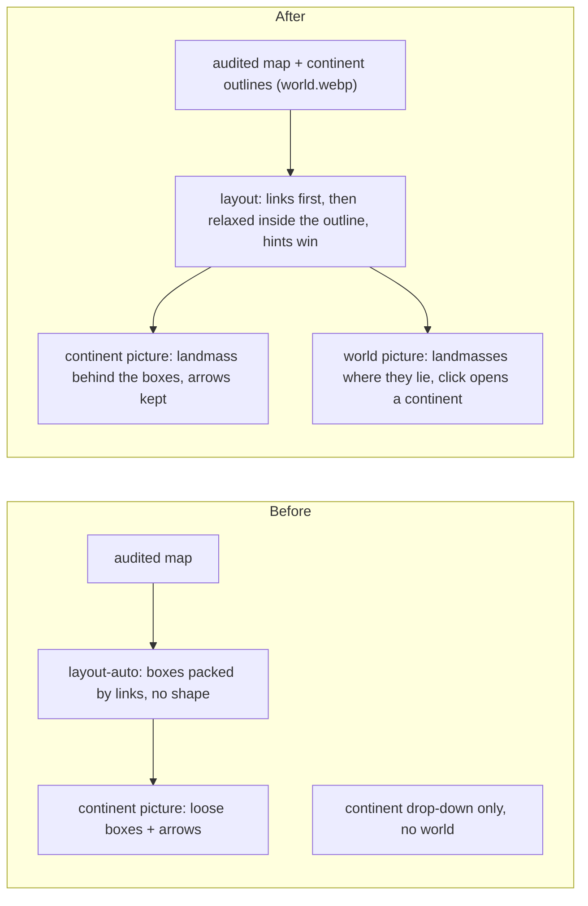

# Tech plan: a world and continent map that feels like the real one

Standards: `docs/standards/typescript.md`. Edge-case classifiers considered: none specific to maps exist; GEOMETRY and LINK-VISIBILITY are proposed at the end.
Screenshots: Playwright through `C:/Users/.../Shattered-AI/tools/browser-test` against the stack the owner runs; progress shots in `screenshots/incremental/phase-NN_*.png`
(git-ignored), final shots in `screenshots/showcase/showcase_NN_*.png`.

## Workflows (before and after)

### [x] Phase 1 — The layout can be given a silhouette and hints

Goal: a layout spec takes `outline` (polygon, any units), `hints` (area to position) and `outlineFill`; boxes land inside the outline, relative directions kept.

1. [x] `layoutContinent` runs the plain layout, stretches it over the outline row by row, packs boxes inside (`layoutInside`), hints first.
2. [x] `autoSpec` carries `outline`, `hints`, `outlineFill` from the owner spec; `layout-continent.mjs` validates them; reports `outsideOutline`.
3. [x] Tests: containment, hint beats relation, source order kept, ignored-input warnings, fallback outside, carry-through, spec validation (core 599 pass, script tests 11 pass).
4. [x] Traced 5 outlines from `world.webp`, ran on the real map into the private folder (0 overlaps, 0 outside).
5. [x] Docs: `docs/shattered-maps/continent-layout.md` ("Shaping a continent"), `src/.ai-context`.

Sign-off: [x] build and tests green  [x] screenshots `phase-01_*` (incremental)  [ ] owner review of the pictures

### [x] Phase 2 — The layout keeps linked areas close, so the arrows stay visible

Goal: after Phase 1 the Arkane picture had 82 of 99 arrows faint (over 150 px) and linked areas far apart. The layout relaxes the stretched positions so linked areas pull together and boxes never overlap or leave the outline.

1. [x] Add a deterministic relaxation step to `layoutInside` (springs along area links weighted by exit count, overlap push, pull back into the outline), run before the final placement.
2. [x] The layout takes the area links (from `areaLinksOf`); `layout-continent.mjs` passes them (`layout-auto.mjs` goes through it).
3. [x] Report the numbers: arrows drawn, arrows faint, arrow length, with the same figures for the layout before the outline (see `test-results.md`).
4. [x] Tests: linked pair ends closer than in the stretched layout; still no overlap and none outside; deterministic; degenerate cases; the fade rule.
5. [x] Screenshots `phase-02_*` of all five continents with the real renderer.

Sign-off: [x] build and tests green (core 601, scripts 11, 100% on the changed files)  [x] faint arrows no worse than before the outline (115 against 117 over the five continents)  [x] screenshots `phase-02_*` (incremental)

### [ ] Phase 3 — The landmass is part of the map data and is drawn behind the boxes

Goal: the continent picture shows the continent's silhouette as land behind the area boxes, arrows on top.

1. [ ] `schema.ts` / `validate.ts` / `docs/shattered-maps/schema.md`: a continent's optional `outline` (cells, same frame as placements).
2. [ ] `layout-continent.mjs` writes the outline in cells; `publish/audited.ts` puts it in the manifest continents; `sliceMap` and the page's own slice carry it.
3. [ ] `continentSvg` draws the landmass (soft land fill and coast stroke) behind the lines and boxes; legend line added.
4. [ ] Tests for validate, slice, publish and render (100% on the new lines); `publish-map-renderer.mjs` regenerates `worldmap2.js` (DSL repo).
5. [ ] Screenshots `phase-03_*`.

Sign-off: [ ] build, type-check, tests, coverage  [ ] screenshots  [ ] renderer republished and `--check` clean

### [ ] Phase 4 — A world picture: continents where they lie on the world

Goal: a world level shows each continent as a landmass in its place on the world picture; a click opens the continent.

1. [ ] Continent world position (outline in world units) in the map data and the manifest.
2. [ ] `renderSvg` draws a world level; the site page gains a World choice and opens a continent on click.
3. [ ] Decide inter-continent exits and continents without a landmass (open questions 2 and 5).
4. [ ] Tests and screenshots `phase-04_*`.

Sign-off: [ ] build and tests green  [ ] screenshots

### [ ] Phase 5 — Documentation, the other viewers and the showcase

1. [ ] User guide and legends (Mapper, C# page, `MapHelp.tsx`) say what the landmass and the world picture are.
2. [ ] `node scripts/check-doc-impact.mjs <this folder>` reports nothing unresolved.
3. [ ] Showcase screenshots with `saveShowcase`, copied to `screenshots/showcase/showcase_NN_*.png`.
4. [ ] Owner publishes (`publish-audited.mjs`) on their word; owner sign-off.

Sign-off: [ ] doc-impact clean  [ ] showcase present  [ ] owner sign-off

## Plan amendments

1. **Outline source (2026-11-19, the owner's screenshots of the legacy sheet map and the ASCII map).** Phase 1 traced the outlines from `world.webp`. The sheet and the ASCII map are the game's own cartography and differ in proportion (Althainia wide and low, about 1.9:1, where world.webp has it tall; Arkania tall and narrow, about 0.6:1; Icewall 1.4:1; Tropica 1.1:1). The outlines were re-traced from the sheet; `world.webp` stays the reference for where continents lie on the world picture (Phase 4). The three sources agree on order and direction (Icewall north, Althainia west, Arkania centre, Tropica south, Shokono east; Verminasia north, Haven west, Balifore south on Arkania).
2. **Design principle (owner, same day).** The sources are interpretive: the goal is to help visualise a text-based world in relation to general directions, sometimes literal, sometimes loose. Outlines and hints are directional guides, not survey data; a layout is judged by whether directions and neighbours read right, not by fidelity to a picture.
3. **Fade rule (open question 3, decided for now).** A line was faint over 150 px. On a 2,000 px continent that faded most arrows once the areas spread over a landmass, so the rule is max(150 px, 15% of the picture). It reaches every viewer when `worldmap2.js` is republished (Phase 3 does that).
4. **Phase 2 mechanism.** A denser silhouette fill made arrows longer, not shorter. What cut the long ones is the link pull (`relax`: spring along links, overlap push, weak anchor to the stretched place); Arkane's 90th-percentile arrow went from 992 px to about 510 px.

5. **Framing reset (owner, 2026-11-19, after Phase 2 pictures).** The silhouette-fit layout (Phases 1-2) agrees with the exit directions only 41% of the time (the layout published before it: 78%) and treats a continent as land to fill. The owner's model is a **route map**: the world is centred on the central ocean (Arsataw Yaa) with the ports of Icewall (north), Arkania (east of the centre), Tropica (south) and Althainia (west); inside a continent the picture is zone-to-zone from the port, each room a fixed amount of ground so long roads stretch and shortcuts or warps shorten ("the perceived movement draws the mental image"). Phases 3-5 below are SUPERSEDED by that framing and must be re-planned with the owner; the silhouette code (outline, hints, link pull) stays in core, unused, until the owner decides to keep or remove it.
6. **Evidence from the owner's logs (Arkania only, first pass).** `evidence/` holds the scripts: `walks.mjs` reads the 2026 game-server logs (626 sessions to dsl-mud.org:4000, 188 touching Arkania, 57,886 room steps), `routes.mjs` lists trips between landmarks, `perceived.mjs` and `routemap.mjs` dead-reckon every walk from the port. Findings: port to Arkane is E x7 (29 identical trips); through Arkane to the Great Forest is E x8, S x4, E x6, S x3; the long eastern walk (Amethyst Falls) is about 45 rooms east; the Great Tree is NE of the port (NE N NE NW N NE E E, then up); Marauders has NO walks in the 2026 logs and Bloodshackle one 3-room hop; the walks to Verminasia go Kender Forest, Balifore, Enchanted Forest, Gahboom Hill (south of the port) and reach the Palace area about 12 rooms south, while Verminasia's west gate shows up about 27-32 east and 19 north: two different Verminasia places. The older text logs (739 files, 2023 to July 2026) have no typed directions and would need a reconstruction from titles and exits.

7. **Placement tool replaces deriving the pictures (owner, 2026-11-19).** After the route atlases (`phase-03_*`) the owner asked for a tool where every place is a labelled token to drag onto the realistic picture, for the **world and the continents** (the area/zone level, including its grids, "has been reasonably good" and stays). Built: `scripts/make-placement-tool.mjs` + `placement-tool.template.html`, six private pages in `world-map/training/` (world, Arkane, Althainia, Icewall, Tropica, Shokono), `docs/shattered-maps/placement-tool.md`. The saved `placements-*.json` is the ground truth. Phases 3-5 are re-planned below.

### [x] Phase 3 (re-planned) — The owner can place the world and the continents

1. [x] Generator and page: tokens, coordinate grid in the owner's units (rooms from the port for Arkane, picture pixels elsewhere), exits shown on selection, drag from the list, autosave, save/download/load.
2. [x] Tests: `placement-tool.test.mjs` (4 tests, 15 script tests in all pass), lint clean; the page driven in a real browser (move, drag in, select, autosave) with `evidence/verify-tool.mjs`.
3. [x] Screenshots `phase-04_placement-tool-*.png` (incremental).
4. [x] Docs: `docs/shattered-maps/placement-tool.md`, folder indexes.

Sign-off: [x] build, tests, lint  [x] browser check  [ ] the owner has used it and the saved file is what they meant

### [ ] Phase 4 (re-planned) — Use the owner's placements

1. [ ] A scorer: compare a layout with the confirmed placements (pairs of places: does the direction between them agree), the number to tune any layout by.
2. [ ] Seed the layouts from the confirmed placements (the `hints` and anchors already in core), so unplaced areas fall in around the owner's.
3. [ ] The world picture and the continent pictures in the viewer take their positions from the placements (data, renderer, page): needs the owner's go on the data model.

### [ ] Phase 5 (re-planned) — Documentation and the showcase

1. [ ] User guide and legends; `node scripts/check-doc-impact.mjs <this folder>` clean; showcase screenshots with `saveShowcase`; the owner signs off and publishes.

## Progress log

- 2026-11-19: Placement tool built for the world and all five continents with a world picture (amendment 7); the owner places, then Phase 4.
- 2026-11-19: Owner rules for reading the logs: only literal typed compass commands (n, s, e, w, ne, nw, se, sw) move the dead-reckoning; portals, gates, teleports and other transports (and shortcuts such as the Gahboom Hill cavern exit) never place a zone. `evidence/entries.mjs` applies that: first-entry position per zone from the port over literal compass steps, with a flag when the path went through inside rooms. Solid anchors (all walks clean): Arkane entered at (7,0), Kender Forest at (2,2), Verminasia Forest at (16,-5) and the Surging Flow of Viscid Muck at (15,-7) (both north-east of the city), Rutted Hill (22,0), Southlands of Arkania (14,11), Balifore (2,9) (east +x, south +y, in rooms from the port). Enchanted Forest (0,7), Gahboom Hill (4,10), Verminasia Palace and the Great Tree are reached only through inside rooms, so they are less certain. The "Verminasia" area entered from Gahboom Hill is not placed by the walk.
- 2026-11-19: Owner on the first route atlas: closer conceptually but "a fair bit away". Confirmed: Verminasia is on the north side of the continent (all Verminasia places), Mount Levinox is northwest, the Great Tree is roughly right, Kender Forest is straight east of the port. Open conflict: the logs' leveling route (Kender Forest, Balifore, Enchanted Forest, Gahboom Hill, "Dusty Trail Leading to Northern Gates") is typed south all the way; dead-reckoning through mazes and caves (Gahboom Hill, Verminasia Forest) is unreliable, so only zone-to-zone crossings and the owner's stated topology can place zones. `evidence/crossings.mjs` lists the crossings.
- 2026-11-19: Owner reset the framing (amendment 5) and asked for Arkania traced from the real logs; first route atlas drawn (`phase-03_arkania-route-atlas-first-cut.png`).
- 2026-11-19: Phase 2 done. After Phase 1 every arrow was still drawn, but 82 of 99 on Arkane were faint; the link pull and the scaled fade rule bring the five continents to 115 faint arrows against 117 before the outline. Outlines re-traced from the owner's sheet (amendment 1). Next: Phase 3 (the landmass in the map data and drawn behind the boxes).
- 2026-11-19: Phase 1 built and verified; the first real render showed the arrows faint, which became Phase 2. Item opened in `active/` at the owner's request.
