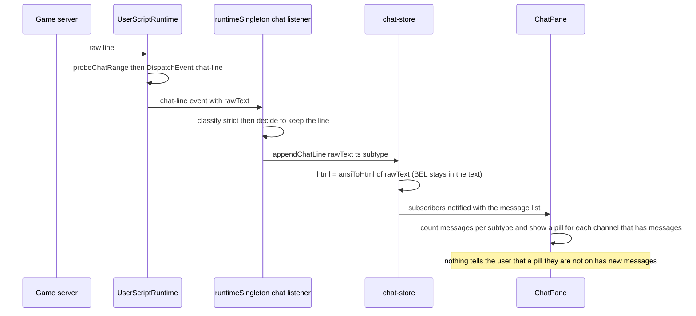
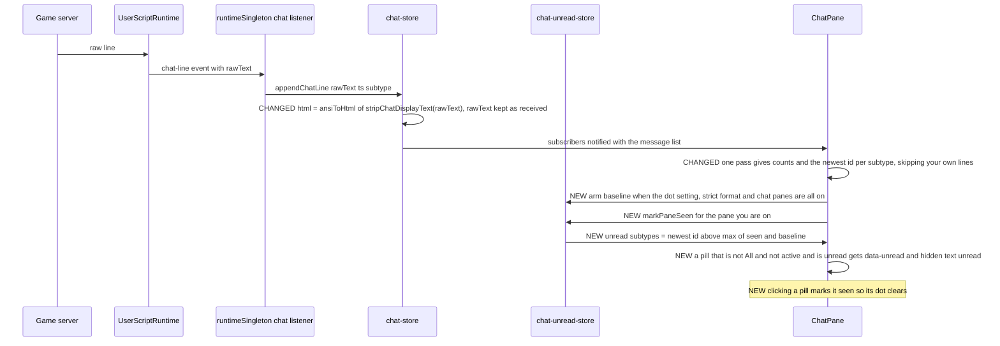
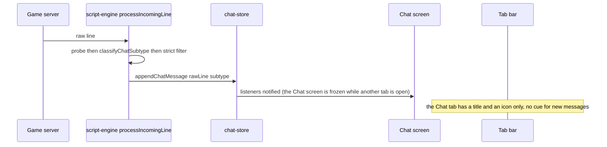
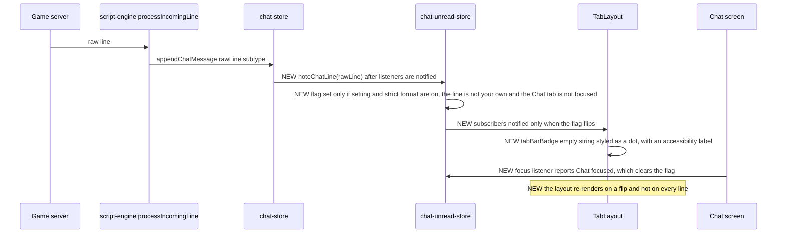
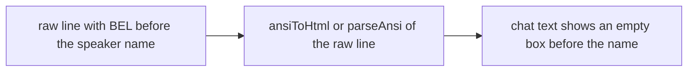
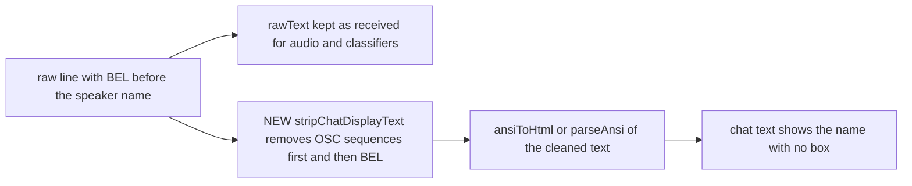

# Tech plan: Chat unread dots and BEL cleanup in the web game client and the mobile app

Item: item.md · Scope: scope.md · Planned against: performance/Allocation-hunt @ 9191edc · Date: 2026-11-20
Standards: docs/standards/typescript.md, docs/standards/scss.md  ·  Data classification: personal (the work reads chat lines; it stores, sends and logs none of them; this plan contains placeholders only)
Edge-case catalog: persisted-settings-and-defaults.md, game-data-privacy.md, ansi-color-handling.md, web-to-app-port.md, theming-dark-mode.md, mobile-screen-insets.md, test-environments.md, unread-indicators.md, shared-event-bus.md and live-stream-views.md (the last two applied as "not applicable" with reasons)  ·  Classifiers added (user-approved): ANSI-02, UNREAD-01, UNREAD-02

## Goal

With a setting turned on under the chat gear, a message that arrives for a named chat pane the user is not looking at puts a dot on that pane's tab (web) or on the Chat bottom tab (mobile), and clicking the tab (web) or opening Chat (mobile) clears it; the "All" tab never gets a dot. With the setting off, or with strict chat format or chat panes off, there are no dots and the setting says why. In both clients, tells no longer show the BEL character as a box in the chat text, while the raw line keeps its BEL for the audio "beep on bell" feature.

## Out of scope

- Word-boundary wrapping of the play-area output (own item: `2026-11-20_play-area-word-boundary-wrapping`).
- Per-channel tabs or chips on mobile; the mobile dot is on the Chat bottom tab only.
- Removing BEL from the raw line, from the audio feature, or from the play-area terminal.
- Changing the chat classification rules, or merging the web and mobile classifier copies.
- Capping the web chat store (it has no cap today; the unread logic adds no buffer, see the LIVESTRM-01 note).
- Persisting unread state across reloads (it is in memory by design).
- Syncing chat settings to the account (they are local to each client today).
- A shipped script or CSS snippet (the decision is built into the client).
- Re-persisting the existing web chat settings fields as overrides only (SETTINGS-01 is applied to the new field; the older fields keep their stored shape, see Risks).

## Workflows (before and after)

### W1 — A chat line reaches the web chat panes        changed by: Phases 1, 2, 3
Before  (entry: `features/userScripts/userScriptRuntime.ts:658` `processRawEvent`; listener `features/userScripts/runtimeSingleton.ts:287`; pane list `components/ChatPane.tsx:90-130`)

After  (every new or changed step marked NEW or CHANGED)

### W2 — A chat line reaches the mobile Chat tab        changed by: Phases 4, 5
Before  (entry: `dsl-client/features/scripts/script-engine.ts:120` `processIncomingLine`; tab bar `dsl-client/app/(tabs)/_layout.tsx:123-129`)

After

### W3 — A chat line is shown as text        changed by: Phase 1 (web), Phase 5 (mobile)
Before  (`features/chat/chat-store.ts:23` and `dsl-client/app/(tabs)/chat.tsx:93`)

After

## Standards applied

- **TypeScript / TSX** (`docs/standards/typescript.md`): formatting and lint by `eslint.config.mjs` and prettier (run `format` only over files changed); no new `any`; storage reads and writes fail safe (`try`/`catch`, fall back, never throw into the UI) and a swallowed failure logs a fixed `console.warn` with no user text; hooks that subscribe return the unsubscribe from the effect and a test proves it; tests are co-located `*.test.ts(x)` on the web and `__tests__/*-test.ts(x)` in mobile and assert concrete behaviour for every added branch and error path. Naming: the chat folder's 9 existing files are kebab-case (`chat-store.ts`, `strict-chat-classifier.ts`), so new chat modules follow the folder (the standard's camelCase example comes from `plugins/`); mobile modules are kebab-case in `dsl-client/features/<area>/`.
- **SCSS** (`docs/standards/scss.md`): the dot lives in the existing `ChatPane.module.scss` (one module per component); the new colour goes in a named variable at the top of the file and not as a literal; no stylelint is added; the edge-case catalog's `theming-dark-mode.md` applies to the new surface.
- **Mobile styling:** React Native `StyleSheet` inside the component file, as `chat.tsx` and `_layout.tsx` do today.
- **Data classification:** nothing that holds line text is stored, sent or logged by the new code; tests, fixtures, docs and screenshots use placeholder names.

## Edit map

All line numbers are as of 9191edc; each has an anchor.

**Web (`apps/game-client/src`)**

| File | Line(s) | Anchor | Change | Phase |
|---|---|---|---|---|
| `eslint.config.mjs` (repo root) | 20-30, 104-110 | `serverGlobs`, SERVER block `rules` | Add `docs/userscripts/**` to the Node script globs; turn `no-control-regex` off in the SERVER block. amended: see A1 | 0 |
| `features/chat/chat-display-text.ts` | new | `stripChatDisplayText`, `isOwnChatLine` | Remove complete OSC sequences, then BEL; recognise your own outgoing lines | 1 |
| `features/chat/chat-display-text.test.ts` | new | | BEL and OSC cases, own-line cases | 1 |
| `features/chat/chat-store.ts` | 23 | `html: ansiToHtml(rawText)` | Convert `stripChatDisplayText(rawText)`; `rawText` (line 22) is stored as received | 1 |
| `features/chat/chat-store.test.ts` | new | | Bubble has no BEL, stored `rawText` keeps it, colour survives, subtype kept | 1 |
| `features/chat/chat-settings-store.ts` | 50-62, 66-78, 116-135, 146-150 | `interface ChatSettings`, `DEFAULT_SETTINGS`, `normalizeSettings`, `setChatSettings` | New boolean `unreadDots` (default false), strict boolean normalisation, stored only when true | 2 |
| `features/chat/chat-settings-store.test.ts` | new | | Defaults, normalisation, storage shape, subscribers | 2 |
| `features/chat/chat-unread.ts` | new | `summarizeMessages`, `unreadSubtypes` | One pass over messages gives counts and newest id per subtype (own lines skipped); pure unread rule | 2 |
| `features/chat/chat-unread.test.ts` | new | | Pure-logic cases | 2 |
| `features/chat/chat-unread-store.ts` | new | `armUnread`, `markPaneSeen`, `disarmUnread`, `subscribeUnread`, `getUnreadState` | Baseline and seen ids held at module level so a remount keeps them | 2 |
| `features/chat/chat-unread-store.test.ts` | new | | Arm, seen, re-arm, subscribe and unsubscribe | 2 |
| `components/ChatPane.tsx` | 6-13 | imports | Import the new helpers and `ChatHelp`, `HelpInfoButton` | 3 |
| `components/ChatPane.tsx` | 90-100 | `countsBySubtype` | Replace the loop with `summarizeMessages` (counts and newest ids in one pass) | 3 |
| `components/ChatPane.tsx` | 132-153 | fall-back effect, `toggleStrict`, `togglePanes` | Add `dotsActive`, arm and disarm effect, seen-on-active-pane effect, `toggleUnreadDots` | 3 |
| `components/ChatPane.tsx` | 285-314 | pill buttons | `onClick` also marks the pane seen; named pills get `data-unread` and a hidden "unread" text when unread; the All pill is untouched | 3 |
| `components/ChatPane.tsx` | 358-376 | menu rows | New checkbox row "Unread dot on pane tabs", disabled with a hint when strict format or chat panes is off; help toggle that shows `ChatHelp` | 3 |
| `components/ChatHelp.tsx` | new | `ChatHelp` | End-user help article, same shape as `MapHelp.tsx` | 3 |
| `components/ChatHelp.test.tsx` | new | | Renders the article, Back calls `onBack` | 3 |
| `components/ChatPane.test.tsx` | 6-41 | jest mocks, `fullSettings` | Make the `useChatLog` mock return a changeable list; add the unread cases | 3 |
| `styles/ChatPane.module.scss` | 80-112, 305-330 | `.chatPill`, `.chatMenuRow`, `.chatMenuSectionTitle` | Palette variable, dot via `[data-unread]` pseudo-element, hidden-text class, `.chatMenuHint`, states | 3 |
| `components/.ai-context`, `components/.annotated` | | index entries | New `ChatHelp.tsx`, changed `ChatPane.tsx` | 3 |
| `features/chat/.ai-context`, `features/chat/.annotated` | | index entries | New modules (one entry per context the code cannot tell) | 1, 2, 3 |
| `styles/.ai-context`, `styles/.annotated` | | index entries | Changed module | 3 |

**Mobile (`shatteredarchive-mobile/dsl-client`)**

| File | Line(s) | Anchor | Change | Phase |
|---|---|---|---|---|
| `features/chat/chat-display-text.ts` | new | `stripChatDisplayText`, `isOwnChatLine` | Mobile copy of the web helper (second copy, like the classifier) | 4 |
| `features/chat/chat-settings-storage.ts` | 11-22, 41-54, 61-67 | `interface ChatSettings`, `DEFAULT_CHAT_SETTINGS`, `loadChatSettings`, `saveChatSettings` | New boolean `unreadDot` (default false), validated on load, stored only when true | 4 |
| `features/chat/chat-unread-store.ts` | new | `noteChatLine`, `setChatTabFocused`, `clearUnread`, `useChatUnread` | Boolean flag store, fed where a message enters the app | 4 |
| `features/chat/chat-store.ts` | 24-43 | `appendChatMessage`, `clearChatMessages` | Call `noteChatLine(rawText)` after `notify()`; clearing the list clears the flag | 4 |
| `features/chat/__tests__/*-test.ts` | new | | Settings, unread store, display text, ingest (see Phase 4) | 4 |
| `app/(tabs)/_layout.tsx` | 84-129 | `TabLayout`, `Tabs.Screen name="chat"` | `useChatUnread()`, `tabBarBadge`, dot style, accessibility label, focus and blur listeners | 5 |
| `components/chat/ChatSettingsSheet.tsx` | new | `ChatSettingsSheet` | Bottom sheet `Modal` with the dot switch and the hint, insets read inside the Modal | 5 |
| `app/(tabs)/chat.tsx` | 92-95, 196-202, 244-267 | `ChatRow` parse, header, styles | Strip BEL before parsing; gear button in the header opens the sheet | 5 |
| `app/(tabs)/explore.tsx` | 43-44 | first `Collapsible` | New "Chat" help section | 5 |
| `components/__tests__/TabLayout-test.tsx` | 8-12, 51 | `ScreenProps`, `screen` | Allow `focus`/`blur` listeners; add badge and listener cases | 5 |
| `components/__tests__/ChatSettingsSheet-test.tsx` | new | | Switch, disabled hint, insets, close | 5 |
| `app/(tabs)/.ai-context`, `.annotated`; `components/.ai-context`, `.annotated`; `features/chat/.ai-context`, `.annotated` | | index entries | Per the mobile repo's index convention | 4, 5 |

**Documentation**

| File | Change | Phase |
|---|---|---|
| `docs/game/chat-panes.md` (new, this repo) | Developer doc for both clients: the chat feed, the unread model, the settings and their dependencies, the BEL display rule, storage keys, producers table (PORT-01), the After diagrams of W1 to W3 | 1 (create), 2, 3, 6 |
| `docs/game/.ai-context` | Add `chat-panes.md` | 1 |
| In-app help, web (`ChatHelp.tsx`) and mobile (Help screen "Chat" section) | End-user help for players (decided: in-app help) | 3, 5 |
| `shatteredarchive-mobile/docs/reference/mobile.md` | New files, the `chat:settings` field, the Chat screen gear and the tab dot | 5 |
| `shatteredarchive-mobile/docs/reference/game-client.md` | Porting status row for the unread dot and BEL cleanup | 5 |
| `docs/architecture/Emitted Events.md:79` (names `ChatPane`) | checked, still accurate: the diagram shows the chat event feeding the chat store, which does not change | 6 |
| `docs/context.md:66` (names `chat-store.ts`) | checked, still accurate: the file's role (chat messages) is unchanged | 6 |
| `docs/superpowers/plans/2026-09-14-custom-hud-layout.md`, `docs/superpowers/specs/2026-09-14-custom-hud-layout-design.md` | checked, historical record of a finished feature, no change | 6 |

Doc-impact command run during planning (`node scripts/check-doc-impact.mjs --files <web edit sites>`): 4 docs and 3 folder indexes (`components/`, `features/chat/`, `styles/`), all owned above. Mobile folder indexes exist in `app/(tabs)`, `components` and `features/chat`.

## Edge cases

| Id | Classifier | Condition | Required behaviour | Covered by |
|---|---|---|---|---|
| E1 | UNREAD-01 | Chat history exists when the setting is turned on, or ChatPane is remounted with nothing new | No dot for history; baseline is the newest id at arm time and lives in the module store, so a remount keeps it; off then on resets it | Phase 2 `chat-unread-store.test.ts` and `chat-unread.test.ts`; Phase 3 ChatPane remount test |
| E2 | - | The first message of a channel arrives while `showHiddenChatPanes` is off, so its pill does not exist yet | The pill appears already marked unread (state is derived from messages, not from the DOM) | Phase 3 ChatPane test: empty list, then a tell, expect `TELL` tab with `data-unread` |
| E3 | - | The All pill, or the pill of the pane you are on | Never dotted; a message arriving for the active pane does not dot; selecting a pane clears its dot | Phase 3 ChatPane tests (All, active pane, click clears) |
| E4 | - | Setting off, strict format off, or chat panes off | No dots; the gear row is disabled and a visible hint names what is missing; the hint disappears when the dependency is met | Phase 3 ChatPane tests; Phase 5 ChatSettingsSheet test |
| E5 | - | A pane is disabled or hidden while it has unread messages, or pills are reordered by drag | Unread is keyed by subtype, never by position: a hidden pill renders nothing, a re-enabled pill shows its true state, a reorder keeps each dot with its pill | Phase 3 ChatPane test (disable then enable, drag reorder) |
| E6 | - | Web hot path: the message list is unbounded and ChatPane recomputes on every message | One pass computes counts and newest ids (the existing counting loop is replaced, not duplicated); no new listener or timer | Phase 2 `summarizeMessages` test (single pass, equal results to the old counts); Phase 3 code check that the old loop is gone |
| E7 | UNREAD-02 | Mobile hot path: a chat line arrives while Chat is not the focused tab | `noteChatLine` is constant-time; subscribers are notified only when the flag flips (50 lines notify once); the layout does not re-render per line | Phase 4 store test (notification count); Phase 5 TabLayout render-count test |
| E8 | - | Mobile: the setting is switched off, or the chat list is cleared, while the flag is set | The flag clears at once | Phase 4 store test and `chat-store` clear test |
| E9 | UNREAD-02 | Mobile: app starts on Home; a tell arrives; Chat is opened; Chat is left again | Flag set, cleared on focus, and not set again until a new line arrives while blurred | Phase 4 store test; Phase 5 TabLayout listener test |
| E10 | ANSI-02, ANSI-01 | BEL mid-line, several BELs, a line that is only BEL, BEL ending an OSC title, colour codes around a BEL | Text has no BEL and no half sequence; colour spans survive; a line with no BEL is returned unchanged | Phase 1 `chat-display-text.test.ts` and `chat-store.test.ts`; Phase 4 mobile copy |
| E11 | - | Accessibility: the dot is visual | Web: a visually hidden "unread" text inside the pill; mobile: `tabBarAccessibilityLabel` reads "Chat, new messages" while the flag is set | Phase 3 ChatPane test (accessible name), Phase 5 TabLayout test, Phase 3 a11y audit run |
| E12 | - | Your own outgoing lines (`You tell ...`) classify into a pane | They never raise a dot (the prototype's rule, now explicit) | Phase 1 `isOwnChatLine` tests; Phase 2 `summarizeMessages` test; Phase 4 ingest test |
| E13 | - | Mobile: Chat settings sheet while a keyboard or system bars are present | Covered by INSET-01 below | Phase 5 |
| E14 | PRIVNAME-01 | Tests, fixtures, docs and screenshots need chat lines | Placeholder names only (`<Name>` style such as `Alice`, `Bob`); screenshots use injected fake lines; no console output of line text; unread helpers return ids and subtype names only | Every phase's tests; Phase 3 and 5 UI checks; Phase 6 `pnpm check:private-names` |
| SETTINGS-01 | SETTINGS-01 | The new field is saved | Stored only when it differs from the default (true); false removes the key; older fields keep their stored shape (see Risks) | Phase 2 and Phase 4 settings tests (save with no edits stores nothing for the field; default change reaches a user who never set it) |
| SETTINGS-02 | SETTINGS-02 | Deciding whether the stored value equals the default | Strict boolean compare; a stored string `"true"` or number `1` is ignored and reads as the default | Phase 2 and Phase 4 tests with string, number, null and missing values |
| SETTINGS-03 | SETTINGS-03 | A running ChatPane or the mobile store keeps its own copy of the setting | The copy is replaced from the store on every change, so turning the setting off clears dots with no reload | Phase 3 ChatPane test; Phase 4 store test |
| SETTINGS-04 | SETTINGS-04 | Routes that write the setting | Web: gear checkbox, older stored JSON; mobile: gear sheet, older stored JSON, the Settings screen's strict toggle patching the same object; each goes through `setChatSettings` / `saveChatSettings`. No cloud or import route exists (no chat settings in `features/auth/cloudSync.ts`). | Phase 2 and Phase 4: a test per route |
| PORT-01 | PORT-01 | The mobile dot listens for chat lines the web produces elsewhere | Producer table (web: `shatteredarchive:chat-line` listener at `runtimeSingleton.ts:287` calling `appendChatLine`; mobile: `processIncomingLine` at `script-engine.ts:120` calling `appendChatMessage`); the mobile dot is fed from `appendChatMessage` itself, the one producer, with a test from a real sample line | Phase 4 `chat-ingest-unread-test.ts` (sample tell through `processIncomingLine`); doc table in `chat-panes.md` |
| TH-01 | TH-01 | The help article in the gear menu can be taller than the menu | It scrolls inside `.chatMenu`, which already has themed scrollbar rules (`ChatPane.module.scss:288-303`) | Phase 3 screenshot of the help open with the scrollbar visible |
| TH-02 | TH-02 | A new checkbox (web) and a switch (mobile) | Follow the theme and look right in the disabled state | Phase 3 and 5 screenshots with the control enabled and disabled |
| TH-03 | TH-03 | A pill gains an unread state | Hover, focus-visible, selected and unread combine without losing contrast; the dot is visible on hover and absent on the selected pill; the disabled row and hint keep contrast | Phase 3 screenshots per state |
| TH-05 | TH-05 | The theme can change with the chat pane mounted | A dot present before a theme switch is still visible and correctly coloured after it, with no reload | Phase 3 Playwright step: switch theme with a dot showing and capture before and after |
| INSET-01 | INSET-01 | The mobile settings sheet is a `Modal` with a footer and close control | Insets are read inside the Modal's own tree (as `MoreSheet` does at `_layout.tsx:56-78`), the Close control is not in a corner the system UI covers, and the sheet works above the keyboard and in both orientations | Phase 5 component test with tall insets mocked; emulator capture |
| TESTENV-01 | TESTENV-01 | The emulator check drives the app | Use `session.mjs` only: dev origins printed and checked before any sign-in, the one reusable test account, no new account, `emulator-5554` only; Metro only inside this planned phase and only if the owner has not started it | Phase 5 emulator step |

Classifiers not applicable:

- **SETTINGS-05** (data-rewriting migration): nothing is rewritten; older stored objects simply lack the field and read as the default.
- **SETTINGS-06** (never set vs emptied): no seeded lists or overlays.
- **SETTINGS-07** (row rebuilt from named fields): no stored row is rebuilt.
- **EVENTBUS-01**: no new `ListenEvent` subscription is added. The web dot reads the chat store through the existing `useChatLog`; mobile has no shared dispatcher in this path.
- **LIVESTRM-01**: the unread store keeps one number per pane and a baseline, not messages, and adds no listener. The web chat store has no cap today (`chat-store.ts:14`, `globalMessages`); that pre-existing growth is recorded under Risks and not changed here.
- **TH-04**: the work adds no text input; placeholder, caret and autofill do not apply.
- **CLOUDSYNC-***: chat settings are local-only on both clients (no chat setting in `features/auth/cloudSync.ts`), and no sync record kind is added.
- **LOCAL-***: this is a production feature, not a local-only one.
- **POINTER-***: nothing pans, zooms or drags; the existing pill drag-reorder is only checked for regressions under E5.
- **WORKITEM-***: this plan does not move or rename plan folders; the skills do.

## Verification toolbox

Web (`apps/game-client`, root `package.json`):

- Type-check: `pnpm typecheck` (`tsc -p apps/game-client/tsconfig.json --noEmit`).
- Lint: `pnpm lint` (`eslint . --max-warnings=300`).
- Tests: `pnpm --filter game-client test` (jest with `--runInBand`, project config `jest.config.cjs`); filter the output: `pnpm --filter game-client test 2>&1 | grep -E "Tests:|Test Suites:|FAIL|✕"`. Never run jest by hand without `--runInBand`; after an interrupted run check for leftover `jest-worker` processes.
- Coverage of new code: `pnpm --filter game-client test -- --coverage --collectCoverageFrom='apps/game-client/src/features/chat/**' --collectCoverageFrom='apps/game-client/src/components/Chat*.tsx'`; Phase 1 confirms the flags pass through the package script, and otherwise records `pnpm test:coverage` (root, runs every project) with the output filtered to the touched files.
- Format (writes files, review with `git diff`): `pnpm --filter game-client run format` over changed files only.
- Privacy and local-only guards: `pnpm check:private-names`, `pnpm check:local-only`.
- Doc impact: `node scripts/check-doc-impact.mjs C:/Projects/ShatteredArchive/.ai-plans/active/2026-11-20_chat-unread-dots-word-wrap-and-bell-cleanup` (the folder's location once `/implement-plan` has moved it).
- UI: a Playwright script `chat-unread-dot-showcase.mjs` in `C:/Projects/Shattered-AI/tools/browser-test/` (same shape as `autopilot-live-findings-showcase.mjs`: `withPage`, `saveShowcase` from `./lib/browser.mjs`) against the stack the owner already runs. It turns the settings on through the gear menu and injects fake lines with `window.dispatchEvent(new CustomEvent('shatteredarchive:raw-data', { detail: { rawText: "<Name> tells you 'hello'\r\n" } }))` (placeholder names only). Progress shots go to `screenshots/incremental/phase-NN_<name>.png`; the last phase adds `showcase_NN_<name>.png`. Accessibility: the same folder's `a11y-audit.mjs` against its baseline. Never start or stop a dev server.

Mobile (`shatteredarchive-mobile/dsl-client`, own pnpm repo):

- Tests: `pnpm --dir C:/Projects/shatteredarchive-mobile/dsl-client test` (jest-expo); there is no `typecheck` script, so type-check with `pnpm --dir C:/Projects/shatteredarchive-mobile/dsl-client exec tsc --noEmit` (a `tsconfig.json` exists at `dsl-client/tsconfig.json`); lint with `pnpm --dir C:/Projects/shatteredarchive-mobile/dsl-client lint` (`expo lint`).
- Emulator: `docs/claude/emulator-testing.md` rules; `node C:/Projects/Shattered-AI/tools/mobile-test/session.mjs up --planned-phase`, then `signin`, then `down --reset`. Captures go in the item's `screenshots/`.

## Phases

### [x] Phase 0 — Repo-wide web lint is green (added by amendment A1)
Goal:        `pnpm lint` exits 0, so every later phase can gate on the whole repo and not only on its own files; no behaviour change.
Depends on:  nothing
Workflow:    none

Work
- [x] 0.1 `eslint.config.mjs:20-30` (`serverGlobs`): add `'docs/userscripts/**/*.{js,cjs,mjs}'` with a comment saying these are Node replay and evaluation harnesses that live beside their docs. This is what turns `no-undef` and `no-unused-vars` off for them, as the SERVER block (:98-111) already does for the other Node script globs.
- [x] 0.2 `eslint.config.mjs:104-110` (SERVER block `rules`): add `'no-control-regex': 'off'` with the rationale already given at :66-67 (scripts that strip ANSI and control codes).
- [x] 0.3 Verification (no unit test: configuration only, read by ESLint and nothing else): `pnpm lint` before and after; errors 46 to 0, warnings unchanged (297, under the cap of 300), and the warning total outside the 7 files identical; `pnpm exec eslint` over this plan's target files still clean.
- [x] 0.4 Docs and indexes: none needed for a lint-config change; run `node scripts/check-doc-impact.mjs --files eslint.config.mjs` and record the result (tooling files are covered by the doc-impact rule).

Sign-off
- [x] 0.S Exit gate verified and recorded in test-results.md (2026-11-20): typecheck · `pnpm lint` exits 0 · no source or test file changed, so the suites are not re-run (recorded as a trivial-consequence skip: the file is read only by ESLint) · the doc-impact check lists nothing unresolved for `eslint.config.mjs`

State on exit: repo-wide web lint is green; nothing else changed.

### [x] Phase 1 — The BEL character no longer shows in web chat text
Goal:        a tell that starts with a BEL is shown in the chat pane with no empty box, and the stored raw line still contains the BEL.
Depends on:  nothing
Workflow:    W1 (the CHANGED html step), W3 (web half)

Work
- [x] 1.1 `features/chat/chat-display-text.ts` (new): `stripChatDisplayText(raw)` removes complete OSC sequences (`ESC ] ... BEL` or `ESC ] ... ESC \`) first and then every remaining BEL, and returns the input unchanged when there is none; `isOwnChatLine(raw)` is true for a line that starts with `You` as a whole word after BEL and colour codes are removed. No logging.
- [x] 1.2 `features/chat/chat-store.ts:23` (`html: ansiToHtml(rawText)`): convert `stripChatDisplayText(rawText)`; `rawText` on line 22 stays as received.
- [x] 1.3 Tests: `chat-display-text.test.ts`: BEL before a name, several BELs, BEL-only line, `ESC]0;Title BEL Hello` gives `Hello`, an OSC ended by `ESC \`, SGR colour codes around a BEL are untouched, empty string, a line with no BEL returns the same string, `isOwnChatLine` for `You tell ...`, `You say ...`, ` Youtube tells you ...` (false) and a line with a BEL before `You`. `chat-store.test.ts`: `appendChatLine` html has no BEL and keeps the colour span, `rawText` still contains the BEL, subtype is kept. Covers E10, E12, ANSI-01, ANSI-02, PRIVNAME-01 (placeholder names). The package script's flag passthrough for coverage is confirmed here.
- [x] 1.4 Docs and indexes: create `docs/game/chat-panes.md` (the chat feed, the BEL display rule and why the raw line keeps it, referencing `features/audio/audio-beep.ts:162`); add it to `docs/game/.ai-context`; `features/chat/.ai-context` and `.annotated` entries for `chat-display-text.ts` (only what the code cannot tell: raw is kept for audio and classifiers). No end-user doc yet: no user-visible setting exists in this phase; the visible effect is documented in Phase 3's help.

Sign-off
- [x] 1.S Exit gate verified and recorded in test-results.md (2026-11-20; build deferred to Phase 6, see the record): build · typecheck · lint · all tests of `game-client` (a failing test is fixed now even if this phase did not write it) · coverage of the new files · the doc-impact check lists nothing unresolved for the files this phase touched · the After diagram of W1 and W3 matches the behaviour as built

State on exit: web chat text no longer shows the BEL box; no setting, no dot, nothing else changed.

### [x] Phase 2 — The web setting and the unread logic exist, with no UI
Goal:        `unreadDots` is a persisted setting (default off, stored only when on) and the unread rule and store are proven by tests, while nothing in the UI reads them yet.
Depends on:  Phase 1 (`isOwnChatLine`)
Workflow:    W1 (the setting, one-pass summary, store)

Work
- [x] 2.1 `features/chat/chat-settings-store.ts:50-62, 66-78`: add `unreadDots: boolean` to `ChatSettings` and `false` to `DEFAULT_SETTINGS`.
- [x] 2.2 `features/chat/chat-settings-store.ts:116-135`: normalise `unreadDots` with a strict `typeof === 'boolean'` check (as the other booleans at :120-122); `features/chat/chat-settings-store.ts:146-150`: `setChatSettings` stores the object without `unreadDots` when it is false and with `unreadDots: true` when it is on (SETTINGS-01 for the new field only).
- [x] 2.3 `features/chat/chat-unread.ts` (new): `summarizeMessages(messages)` returns `{ counts, lastIds }` in one pass, converting each numeric string id, skipping lines for which `isOwnChatLine(message.rawText)` is true when computing `lastIds` (counts keep every line so existing pill visibility is unchanged); `unreadSubtypes({ lastIds, seen, baseline })` returns the subtypes whose newest id is above `Math.max(seen[s] ?? 0, baseline)`.
- [x] 2.4 `features/chat/chat-unread-store.ts` (new): module state `{ armed, baseline, seen }`; `armUnread(latestId)` sets the baseline once while armed (a second call while armed does nothing), `disarmUnread()` clears armed state and seen ids, `markPaneSeen(subtype, id)`, `getUnreadState()`, `subscribeUnread(fn)` returning the unsubscribe; notifies only when the state changed.
- [x] 2.5 Tests: `chat-settings-store.test.ts`: defaults; `unreadDots` absent reads false; a stored `"true"` string, `1`, `null` all read false (SETTINGS-02); saving with the field false stores no `unreadDots` key and with it true stores it (SETTINGS-01); changing the default is picked up by a user whose stored JSON lacks the key; older stored JSON with the other fields loads; corrupt JSON gives defaults; `updateChatSettings` notifies subscribers with a replaced (not merged) object (SETTINGS-03, SETTINGS-04). `chat-unread.test.ts`: `summarizeMessages` equals the old inline counts on a mixed list, and `lastIds` ignores your own lines (E6, E12); `unreadSubtypes` for history at the baseline, a newer message, an equal id, and a seen id above the newest. `chat-unread-store.test.ts`: arm, mark seen, the state survives a simulated remount (module state, E1), disarm then arm resets the baseline, subscribers fire once per change and not after unsubscribe.
- [x] 2.6 Docs and indexes: extend `docs/game/chat-panes.md` (the setting, its storage key `shatteredArchive.chatSettings.v1` and shape, the unread model with baseline and seen); `features/chat/.ai-context` and `.annotated` entries for the three new modules (baseline lives outside the view so remounts do not light history).

Sign-off
- [x] 2.S Exit gate verified and recorded in test-results.md (2026-11-20; build deferred to Phase 6, see the record): build · typecheck · lint · all tests of `game-client` · coverage of the new modules · the doc-impact check lists nothing unresolved for the files this phase touched · the After diagram of W1 matches the behaviour as built (logic only)

State on exit: the setting and the logic exist and are tested; no UI uses them, so behaviour is unchanged.

### [x] Phase 3 — Web: dots on the named tabs, the gear setting, the hint and the help
Goal:        with the setting on, an unread message puts a dot on its named tab, clicking the tab clears it, the All tab never gets one, and the gear menu explains why the setting is blocked when it is.
Depends on:  Phase 2
Workflow:    W1

Work
- [x] 3.1 `components/ChatPane.tsx:90-100` (`countsBySubtype`): replace the inline loop with `summarizeMessages(allMessages)` memoised on `allMessages`; `countsBySubtype` becomes its `counts` so pill visibility is unchanged.
- [x] 3.2 `components/ChatPane.tsx:132-153` amended: see A5: compute `dotsActive = settings.unreadDots && settings.strictChatFormat && settings.enableChatPanes`; an effect arms the unread store with the newest message id when `dotsActive` turns on and disarms it when it turns off; an effect marks the active pane seen (`markPaneSeen(activePane, lastIds[activePane])`) whenever the active pane or its newest id changes; subscribe to the unread store in an effect that returns the unsubscribe; derive `unread = unreadSubtypes(...)` with `useMemo`; add `toggleUnreadDots` next to `toggleStrict`.
- [x] 3.3 `components/ChatPane.tsx:285-314` amended: see A5: named pills `onClick` also calls `markPaneSeen`; a named pill that is unread (and `dotsActive`) renders `data-unread="true"` and a visually hidden " unread messages" text; the All pill is unchanged.
- [x] 3.4 `components/ChatPane.tsx:358-376`: new checkbox row "Unread dot on pane tabs" bound to `settings.unreadDots`, `disabled` when strict format or chat panes is off, with a visible `chatMenuHint` line "Needs Strict Chat Format and Enable Chat Panes." naming whichever is off; a `HelpInfoButton topic="chat panes"` row that toggles the help article in the menu body.
- [x] 3.5 `components/ChatHelp.tsx` (new, shape of `MapHelp.tsx`, styles from `HelpInfo.module.scss`): what the dot is, how to turn it on and what it needs, that it clears when you click the tab, that All never has one, that your own lines do not raise it; a Back button.
- [x] 3.6 `styles/ChatPane.module.scss:80-112, 305-330`: a named colour variable at the top of the file; `.chatPill` gets `position: relative`; `.chatPill[data-unread]::after` draws the dot (about 7px, top-right inside the pill so the scrolling pill strip does not clip it); `.srOnly`; `.chatMenuHint`; every state of E3/TH-03 styled (hover, focus-visible, selected, unread, disabled row); the dot animation is off under `prefers-reduced-motion`.
- [x] 3.7 Tests: `ChatPane.test.tsx` (the `useChatLog` mock returns a list the test can change): no dots when the setting is off, when strict is off, when panes are off (E4); history present at turn-on gives no dot (E1); a new tell gives `TELL` a `data-unread` and an accessible "unread" name while `All` has none (E3, E11); the first message of a channel with `showHiddenChatPanes` off creates its pill already unread (E2); a message for the active pane gives no dot and selecting a pill clears its dot (E3); a remount with nothing new has no dot (E1); disabling then re-enabling a pane keeps the true state, and a drag reorder keeps each dot with its pill (E5); turning the setting off clears dots without a reload (SETTINGS-03); the gear row is disabled with the hint naming what is off and the hint goes away when it is met (E4, E12 of the gear); the toggle writes through `updateChatSettings` (SETTINGS-04); the effects unsubscribe on unmount (typescript.md async rule). `ChatHelp.test.tsx`: the article renders, Back calls `onBack`, the region has an accessible name.
- [x] 3.8 (done after A6, see it for how it differed) UI check: Playwright script `chat-unread-dot-showcase.mjs`: enable chat panes, strict format and the dot through the gear; inject placeholder-name lines for tell, clan and gossip; shots `phase-03_dot-on-tabs.png`, `phase-03_dot-cleared-after-click.png`, `phase-03_gear-hint-disabled.png`, `phase-03_gear-enabled.png`, `phase-03_chat-help.png` (with its scrollbar visible, TH-01), `phase-03_bell-removed.png` (a tell sent with a BEL, shown with no box), `phase-03_theme-switch-before.png` and `-after.png` (TH-05); open each shot and say what is on it; run `a11y-audit.mjs` against the baseline.
- [x] 3.9 Docs and indexes: `docs/game/chat-panes.md` gets the web section and the final After diagram of W1; end-user text is `ChatHelp.tsx`; `.ai-context` / `.annotated` entries for `components/`, `features/chat/`, `styles/` changed files.

Sign-off
- [x] 3.S Exit gate verified and recorded in test-results.md (2026-11-20; build deferred to Phase 6, see the record): build · typecheck · lint · all tests of `game-client` · coverage of new and changed code · API checks: none (no endpoint) · UI checks done · the doc-impact check lists nothing unresolved · the After diagram of W1 matches the behaviour as built

State on exit: the web client has the feature end to end, behind a setting that is off by default.

### [x] Phase 4 — Mobile: the setting, the unread store and the display helper, with no UI
Goal:        the mobile app records "a chat line arrived while Chat is not focused" in a single-purpose store, behind a persisted setting (default off), fed from the one place chat lines enter, and has the BEL display helper.
Depends on:  nothing in the web phases (the mobile repo is separate), but the doc table in `chat-panes.md` is shared
Workflow:    W2 (store and feed), W3 (mobile helper)

Work
- [x] 4.1 `dsl-client/features/chat/chat-display-text.ts` (new): the mobile copy of `stripChatDisplayText` and `isOwnChatLine` (same rules and a comment pointing at the web file; two copies are the existing pattern for the classifier).
- [x] 4.2 `dsl-client/features/chat/chat-settings-storage.ts:11-22`: add `unreadDot: boolean` to `ChatSettings` and `false` to `DEFAULT_CHAT_SETTINGS`; `:41-54` (`loadChatSettings`): accept only a strict boolean for `unreadDot` (the existing spread of the parsed JSON would otherwise take a string); `:61-67` (`saveChatSettings`): persist `unreadDot` only when true.
- [x] 4.3 `dsl-client/features/chat/chat-unread-store.ts` (new): `noteChatLine(rawText)` sets the flag only when `unreadDot` and `strictChatFormat` are on, the line is not your own and Chat is not focused, and does nothing when the flag is already set; `setChatTabFocused(focused)` (focus clears the flag); `clearUnread()`; `getUnread()`; `subscribeUnread(fn)`; `useChatUnread()` built on `useSyncExternalStore` so a component re-renders only when the boolean flips; a module-level subscription to the chat settings clears the flag when the setting or strict format turns off.
- [x] 4.4 `dsl-client/features/chat/chat-store.ts:24-38` (`appendChatMessage`): call `noteChatLine(rawText)` after `notify()`; `:40-43` (`clearChatMessages`): call `clearUnread()`.
- [x] 4.5 Tests (`features/chat/__tests__/`): `chat-display-text-test.ts` (the web cases, E10, E12); `chat-settings-storage-test.ts` (default false, a stored string or number reads false, saving false stores no key and true stores it, older stored JSON loads, `AsyncStorage` throwing leaves the app running with defaults, subscribers notified; SETTINGS-01 to 04); `chat-unread-store-test.ts` (flag set for a tell while blurred and setting on; not set when the setting or strict is off, for your own line, or while focused; focus clears it; blur then a new line sets it again (E9); turning the setting off clears it and `clearChatMessages` clears it (E8); 50 lines while blurred notify subscribers exactly once (E7, UNREAD-02)); `chat-ingest-unread-test.ts` (PORT-01): a sample tell line goes through `processIncomingLine` (constructed as the existing script-engine tests construct it) and the flag flips, a non-chat line does not, and with strict format off a line that matches no rule does not.
- [x] 4.6 Docs and indexes: `docs/game/chat-panes.md` gets the mobile section (store, feed point, settings key `chat:settings`, the producers table for PORT-01); `dsl-client/features/chat/.ai-context` and `.annotated` entries (why the flag is a store and not screen state: the Chat screen is frozen while blurred).

Sign-off
- [x] 4.S Exit gate verified and recorded in test-results.md (2026-11-20): build (Metro bundle or `tsc --noEmit`) · typecheck (`tsc --noEmit`, no script exists) · lint · all tests of `dsl-client` · coverage of the new modules · the doc-impact check lists nothing unresolved for this repo · the After diagram of W2 matches the behaviour as built (store only)

State on exit: the mobile store and setting exist and are tested; nothing renders the flag, so the app looks the same.

### [ ] Phase 5 — Mobile: the dot on the Chat tab, the chat gear, the BEL fix and the help entry
Goal:        on mobile, a tell that arrives while another tab is open puts a dot on the Chat tab, opening Chat clears it, the setting is under a new gear on the Chat screen, and chat text shows no BEL box.
Depends on:  Phase 4
Workflow:    W2, W3

Work
- [x] 5.1 `dsl-client/app/(tabs)/_layout.tsx:84-129`: in `TabLayout` call `useChatUnread()`; on `Tabs.Screen name="chat"` set `tabBarBadge: unread ? '' : undefined`, a `tabBarBadgeStyle` that shrinks the library's 18px circle to a dot (explicit `minWidth`, `height`, `borderRadius`, no horizontal padding; the style is applied last in `Badge.js:108-142`, verified), `tabBarAccessibilityLabel: unread ? 'Chat, new messages' : 'Chat'`, and `listeners={{ focus: () => setChatTabFocused(true), blur: () => setChatTabFocused(false) }}` (the existing `more` tab shows the `listeners` prop shape at :152-157).
- [x] 5.2 `dsl-client/components/chat/ChatSettingsSheet.tsx` (new, and so is the `components/chat/` folder, as `components/scripts/` is a subfolder today): a bottom-sheet `Modal` in the shape of `MoreSheet` (`_layout.tsx:56-78`: backdrop, sheet, `useSafeAreaInsets` read inside the Modal, `onRequestClose`): a `Switch` "Unread dot on the Chat tab" bound to `unreadDot`, disabled when strict format is off with a visible hint "Needs Strict Chat Format (Settings, then Chat)", and a Close control inside the safe area.
- [x] 5.3 `dsl-client/app/(tabs)/chat.tsx:196-202`: add a gear `TouchableOpacity` (accessibility label "Chat settings") to the header next to Clear, opening the sheet; `:92-95` (`ChatRow`): parse `stripChatDisplayText(item.rawText)`; styles at `:244-267`.
- [x] 5.4 `dsl-client/app/(tabs)/explore.tsx:43-44`: a `Collapsible title="Chat"` section in the Help screen: what the dot is, where the setting is, what it needs, when it clears, that your own lines do not raise it.
- [x] 5.5 Tests: `components/__tests__/TabLayout-test.tsx` (extend `ScreenProps` for `focus`/`blur`): with the flag false the chat screen has no `tabBarBadge`; with it true `tabBarBadge === ''`, the badge style sets an explicit `minWidth`, `height` and `borderRadius`, and the accessibility label changes; the `focus` listener reports Chat focused and the `blur` listener reports blurred (E9, UNREAD-02); the layout renders once, not 50 times, for 50 lines while blurred (E7). `components/__tests__/ChatSettingsSheet-test.tsx`: the switch calls `saveChatSettings({ unreadDot })`, it is disabled with the hint visible when strict format is off (E4), the safe-area insets from a mocked tall top, cutout and bottom inset are applied and Close is not in the header row (INSET-01), closing works. A `ChatScreen` render test with the same mocks as `TabLayout-test.tsx` asserting the gear opens the sheet and a BEL in a message is not rendered; if the screen cannot be rendered with those mocks, record the reason in test-results.md and cover the BEL path through `chat-display-text-test.ts` plus the emulator capture.
- [ ] 5.6 UI check: emulator run following `docs/claude/emulator-testing.md` with `session.mjs up --planned-phase` (dev origins printed and checked before any sign-in, the one reusable test account, `emulator-5554` only), then a tell to the throwaway local character: dot on the Chat tab while on Home, gone after opening Chat, the gear sheet with the switch enabled and with strict format off (hint), the Help screen's Chat section; shots `phase-05_tab-dot.png`, `phase-05_dot-cleared.png`, `phase-05_gear-sheet.png`, `phase-05_gear-hint.png`, `phase-05_help-chat.png`, with the keyboard closed and open and in both orientations for the sheet (INSET-01); `session.mjs down --reset`. deferred: if the throwaway character on the local simulacrum is not available, this step waits on the owner's word (rule 5 of the emulator doc) and Phase 6 owns it.
- [x] 5.7 Docs and indexes: mobile `docs/reference/mobile.md` (new files, the `chat:settings` field, the Chat gear, the tab dot) and `docs/reference/game-client.md` (porting status); `dsl-client/app/(tabs)/.ai-context` / `.annotated`, `components/.ai-context` / `.annotated` / `.flows` if a flow changed, `features/chat/.ai-context` / `.annotated`; `docs/game/chat-panes.md` mobile section final.

Sign-off
- [ ] 5.S Exit gate verified and recorded in test-results.md (date): build · typecheck (`tsc --noEmit`) · lint · all tests of `dsl-client` · coverage of new and changed code · UI checks done (or the deferral recorded with its owner) · the doc-impact check lists nothing unresolved · the After diagram of W2 and W3 matches the behaviour as built

State on exit: the mobile app has the feature end to end, behind a setting that is off by default.

### [ ] Phase 6 — Full checks, documentation, indexes and showcase
Goal:        both repos are green, every document and index is current, the final showcase screenshots exist, and the owner can sign off.
Depends on:  Phases 1 to 5
Workflow:    W1, W2, W3 (After diagrams move into the developer doc)

Work
- [ ] 6.1 Full checks, web: `pnpm typecheck`, `pnpm lint`, `pnpm --filter game-client test` (filtered output), the coverage run for the touched files, `pnpm check:private-names`, `pnpm check:local-only`; record counts in test-results.md.
- [ ] 6.2 Full checks, mobile: `tsc --noEmit`, `pnpm lint`, `pnpm test` in `dsl-client`; record counts.
- [ ] 6.3 Showcase screenshots (final state, tracked): web `showcase_01_dot-on-tabs.png`, `showcase_02_gear-setting-and-hint.png`, `showcase_03_chat-help.png`; mobile `showcase_04_tab-dot.png`, `showcase_05_chat-gear-sheet.png`; open each and say what is on it; placeholder names only.
- [ ] 6.4 Documentation: `docs/game/chat-panes.md` final (the After diagrams of W1 to W3, the producers table, the settings and their dependencies, the BEL rule, how to test); the mobile repo's reference docs final; the four docs named in the Edit map are each updated or recorded `checked, still accurate: <reason>` in test-results.md by path.
- [ ] 6.5 `node scripts/check-doc-impact.mjs <item folder>` reports 0 unresolved (findings updated or recorded in test-results.md).
- [ ] 6.6 Any step marked `deferred:` earlier (the emulator live tell, a real-game check of the dot with real chat) is listed with its owner and the owner's word it waits for.

Sign-off
- [ ] 6.S Exit gate verified and recorded in test-results.md (date): build · typecheck · lint · all tests of both repos · coverage · UI checks done · the doc-impact check lists 0 unresolved · the After diagrams in the developer doc match the behaviour as built

State on exit: the feature is complete in both clients, off by default, documented, and waiting for the owner's sign-off.

## Risks and rollback

- **Default off.** Both clients ship the setting off, so a regression in the dot cannot affect players who have not turned it on. Rollback is a code revert; a stored `unreadDots` / `unreadDot` key is ignored by older builds (the web store normalises known fields only, and the mobile store keeps unknown keys without reading them).
- **BEL display change affects everyone.** The BEL strip applies whether or not the setting is on. It touches only the displayed HTML and parsed text; the stored `rawText` is unchanged, so the audio beep (`features/audio/audio-beep.ts:162`) and the classifiers keep working. The OSC-first order (ANSI-02) is the guard against swallowing text.
- **Existing web settings persistence still stores the whole object.** `setChatSettings` writes every field today, so older fields are frozen at their saved value (the SETTINGS-01 pattern). This plan applies the classifier to the new field only and leaves the older fields as they are; changing them is outside this item and would need its own decision.
- **Web chat store has no cap** (`chat-store.ts:14`); each message re-runs the pane summary over the whole list. The plan keeps that to one pass (E6) and does not add to it; a cap is a separate item.
- **Classifier copies.** The web and mobile classifiers and the display helpers are separate copies; this plan adds two more helper copies and records them in the developer doc so a change to one is made in both.
- **Mobile badge relies on library behaviour verified in vendored source** (`expo-router/build/react-navigation/bottom-tabs/views/TabBarIcon.js:86-95` shows the badge when `tabBarBadge != null`, and `elements/Badge.js:77-146` applies the badge style last), because the docs lookup found no docs for the package. An Expo SDK upgrade re-checks it; the TabLayout test asserts the option values, not the rendering.
- **Mobile emulator check depends on a local throwaway character** (emulator doc rule 5); if it is unavailable the dot's live check is deferred to the owner and recorded.
- **Real chat lines were not available to test against.** The web UI check injects placeholder lines through the same `shatteredarchive:raw-data` pipeline real lines use; a check with the real game is the owner's.

## Plan amendments

(Empty at creation. `/implement-plan` adds dated entries A1, A2, ... when the code has moved since this plan.)

### A1 — 2026-11-20 — Phase 0 added: make repo-wide web lint green (approved by user 2026-11-20)
- **Phase:** a new Phase 0 before Phase 1. The original plan had no Phase 0.
- **What the baseline showed:** web tests 222 suites / 3800 tests pass, web and mobile type-check clean, mobile lint 0 errors; but `pnpm lint` (root, `eslint . --max-warnings=300`) fails with 46 errors, all in 7 files unrelated to this item: `.ai-plans/active/2026-11-19_realistic-world-and-continent-maps/evidence/walks.mjs` and `docs/userscripts/{hidden-room-content/replay,room-hints/build-import,room-hints/evaluate,room-hints/hint.test,room-hints/replay,room-hints/scan-hidden}.mjs`. Causes: `no-undef` for Node globals (`docs/userscripts/**` is not in `serverGlobs`), `no-control-regex` (4 scripts match `\x1b` or `\x01` to strip terminal codes; the rule is off for ts/tsx only), and 2 `no-unused-vars` in `evaluate.mjs`.
- **Decision:** the owner chose to fix them first as a Phase 0 (over gating on changed files only, or stopping).
- **Approach:** two configuration additions in `eslint.config.mjs`, no edit to the 7 scripts. Files outside the original Edit map: `eslint.config.mjs` (repo root).
- **Wider impact:** adding `docs/userscripts/**` to `serverGlobs` applies the SERVER block's rules to those scripts (`no-undef` off, `no-unused-vars` off, `no-require-imports` off, `no-unused-expressions` off). Turning `no-control-regex` off in the SERVER block applies to every file `serverGlobs` already matches (Node scripts, servers, `.ai-plans/**`), not to ts/tsx app code (already off there) and not to the client globs. Verified by comparing warning totals before and after: the first run after the change showed 298 (one more), because `scripts/gmcp-corpus/report-values.mjs:52` carried an `eslint-disable-next-line no-control-regex` that became redundant; removing that one directive line (a second file outside the original Edit map, still within the owner's approval to get lint green) restored 297.
- **Edit map:** new row for `eslint.config.mjs` under Phase 0.

### A6 — 2026-11-20 — Phase 3 UI check: how it differed from step 3.8 (minor, logged; the owner's instruction recorded)
- **Dev stack:** the plan assumed the owner's running stack. Nothing answered on `http://localhost:30080/`, so I asked, and the owner told me to start the web dev service myself and capture (using the Simulacrum only if a real game were needed). I started `pnpm --filter game-client dev`, used it for the capture, then stopped the vite process by port (my recorded note: stopping the background task alone leaves vite holding the port) and confirmed 30080 was free. No game was needed.
- **Lines were injected, not played:** placeholder-name lines go through the app's own `shatteredarchive:raw-data` event, the same pipeline a real line takes, so no connection, account or character was involved.
- **The menu closes by pressing the dark area:** while the gear menu is open a full-screen overlay covers the page, so the script closes it that way (as a player does); the gear is only a toggle for the unit tests.
- **Accessibility:** `a11y-audit.mjs` audits the C# site through its sitemap and cannot reach the game client, so axe (`@axe-core/playwright`) ran directly over the chat panel: 0 wcag2a/2aa violations.
- **Extra checks added:** the dot pulses by default and stops under reduced motion; the help in a short window overflows its menu (measured, the scrollbar itself is not drawn by headless Chromium); a live theme switch with dots showing.
- **Showcase images:** the script also saved the three final-state images with `saveShowcase` (the completion gate needs them); Phase 6 re-shoots the final set and copies it into this item.
- **Later web captures (Phase 6):** the same instruction is what I will rely on to start and stop the web dev service again, and I will say so when I do.

### A5 — 2026-11-20 — Phase 3 deviations (minor, logged)
- **3.3 `onClick` does not call `markPaneSeen`.** The plan had both the click and an effect mark the pane seen. The effect (3.2) already marks the active pane the moment it becomes active, which covers a click, so there is one writer instead of two.
- **3.2 the latest-id ref is written in an effect, not during render.** `react-hooks/refs` (an error in this repo's lint config) forbids writing a ref in render. A no-dependency effect declared before the arm effect keeps it current.
- **3.4 the settings rows are hidden, not unmounted, while the help shows** (`
`), so no checkbox state is reset.
- **Extra `ChatPane` tests for existing branches.** The completion gate judges whole changed functions and `ChatPane` is one large function, so tests were added for existing behaviour: message bubbles, the per-channel checkboxes, the menu opening above and to the right and below and to the left, closing by pressing the dark area, the drag guards, Jump to live, falling back to All when panes or the current channel is switched off, opening a channel with no messages, and the browser visual-viewport path. Four guards stay unreachable and are reported as overrides: an empty `paneOrder` (lines about 113 and 211: `normalizeOrder` always fills it), the reorder index guard in `persistReorder` (src and dst are always in the order), the missing gear ref in `computeMenuPos`, and a null `menuPos` when the menu is open.
- **`ChatPane.test.tsx` mocks:** `useChatLog` and `useChatPane` mocks now return variables a test can change (messages, `showJump`).
- **3.8 (UI check):** when this amendment was first written the dev stack the browser tool drives was not running and the step was pending the owner's decision. It was then done in the same phase after the owner told me to start the web dev service; see A6.

### A4 — 2026-11-20 — Existing bug fixed: channel toggles did not update the tab strip (approved by user 2026-11-20)
- **Phase:** 3 (found while proving E5 in the ChatPane tests); the file is `features/chat/chat-settings-store.ts`, already in the Edit map from Phase 2. Supersedes the "finding, not fixed" bullet of A3.
- **Original plan:** none; A3 recorded it as pre-existing and left it.
- **What the test showed:** after `updateChatSettings({ enabledPanes: { tell: false } })` the TELL tab stayed on screen. `normalizeSettings` shallow-copied `DEFAULT_SETTINGS`, so `enabledPanes` was the shared defaults object; stored flags were written into it in place, so `settings.enabledPanes` kept the same reference and `ChatPane`'s `useMemo` on it never recomputed. In the real app that means switching a channel on or off in the gear menu left the tab strip unchanged until something else changed it.
- **Decision:** the owner chose to fix it here (over leaving it and filing tech debt).
- **Change:** `normalizeSettings` copies `enabledPanes` (one line plus a comment). Two regression tests in `chat-settings-store.test.ts` (every update gives a new `enabledPanes` object and leaves the old one unchanged; a stored flag does not change the defaults later settings start from) and the existing `ChatPane` switch-off-and-on test; with the fix removed, all three fail (checked).
- **Wider impact:** every reader of `getChatSettings().enabledPanes` now gets a new object per change, which is what `ChatPane` (the only consumer found by `grep`) needs. Stored settings load identically. The visible behaviour change for players is that channel toggles now take effect at once. The docs' gotcha note was replaced.

### A3 — 2026-11-20 — Phase 2 deviations (minor, logged)
- **`components/ChatPane.test.tsx` touched in Phase 2, not Phase 3:** the new required field `unreadDots` made the test's `fullSettings` helper stop compiling, so `unreadDots: false` was added there to keep the phase type-clean. Phase 3 still owns the rest of that file's changes.
- **`setChatSettings` write wrapped in `try`/`catch`** with a fixed `console.warn` and no values (typescript.md "Errors": storage writes fail safe). The plan listed only the `toStored` change for that function. Covered by a test that makes `setItem` throw; the in-memory settings and subscribers still update.
- **Extra tests for `normalizeSettings`, `normalizeOrder` and `updateChatSettings` paths** (per-pane flags, pane order, a non-boolean flag): these are the other write routes of SETTINGS-04 and must survive the new storage shaping; they also closed the branch gaps the completion gate looks for in changed functions.
- **`unreadSubtypes` iterates `Object.entries`** instead of looking each key up again; same behaviour, one unreachable `?? 0` fallback gone.
- **Finding, not fixed (pre-existing, outside this item):** `normalizeSettings` shallow-copies `DEFAULT_SETTINGS`, so a stored per-pane flag overwrites the shared defaults' `enabledPanes` for the rest of the page's life. Documented as a gotcha in `docs/game/chat-panes.md` and the folder's `.annotated`; every settings test loads a fresh module for this reason. Reported to the owner at the end of the work; a fix would be its own item.

### A2 — 2026-11-20 — Verification toolbox: do not put `--` before extra arguments (minor, logged)
- **Phase:** all (the toolbox and the coverage steps).
- **Original plan:** the toolbox wrote `pnpm --filter game-client test -- --coverage ...` and `pnpm --dir <mobile> test -- ...`.
- **What changed:** pnpm forwards the `--` to the script literally, so jest receives it and treats the next argument as a test path pattern. Measured on the mobile baseline (`jest -- --maxWorkers=2` found no tests and exited 0). Extra arguments go straight after the script name: `pnpm -C C:/Projects/ShatteredArchive --filter game-client test --coverage --collectCoverageFrom=...` and `pnpm --dir C:/Projects/shatteredarchive-mobile/dsl-client test --maxWorkers=2`. Phase 1 still confirms the web coverage flags pass through.
- **Wider impact:** none beyond the command text; an apparently green run with zero tests is the failure to watch for, so every recorded test count must be a non-zero suite count.

## Progress log

- 2026-11-20 Phase 4 done: mobile `unreadDot` setting (default off, stored only when on, strict reads), `chat-unread-store.ts` (a boolean store fed from `appendChatMessage`, cleared on Chat focus, a cleared list or the setting going off), `chat-display-text.ts` (second copy of the web helper); nothing in the UI reads them yet. Mobile suite 91 suites / 1259 tests green (baseline 86 / 1192), the four modules 100% of statements, functions and lines (one unreachable old fallback branch), `tsc --noEmit` and lint unchanged. Deviations (minor): a `chat-store-test.ts` was added because the 500-message cap and the `useChatMessages` hook in the changed file had no test; the settings-storage test uses `jest.requireMock`/`requireActual` because the mobile Babel runner does not support dynamic `import()`; `loadChatSettings` now reads both fields strictly (a stored string or number reads as the default), a small tightening of the old spread of the parsed JSON.
- 2026-11-20 Phase 3 done: `ChatPane` shows the unread dot (`data-unread` plus hidden "unread messages" text on a named, non-active tab, never on All), arms and marks seen through `chat-unread-store`, replaces its counting loop with `summarizeMessages`, and has the **Unread dot on pane tabs** gear row (disabled with a hint naming what is missing) and the blue (i) help (`ChatHelp.tsx`); `ChatPane.module.scss` draws the dot. Web suite 228 suites / 3907 tests green, all changed modules 100% of lines and functions (five unreachable guard branches in `ChatPane.tsx` declared as overrides), typecheck and repo-wide lint green (296 warnings, one fewer than the baseline). Playwright against the dev client: 24 of 24 checks, 10 incremental shots and 3 showcase images, every one looked at. Amendments: A4 (an existing bug fixed with the owner's approval: channel toggles in the gear menu did not update the tab strip), A5 (small deviations), A6 (how the UI check differed; the owner told me to start the web dev service, which I stopped by port afterwards). The `vite build` is deferred to Phase 6 as before.
- 2026-11-20 Phase 2 done: `unreadDots` setting (default off, stored only when on, strict reads, fail-safe write), `chat-unread.ts` (one-pass summary and the unread rule), `chat-unread-store.ts` (baseline and seen, module-level); nothing in the UI reads them yet. Web suite 227 suites / 3873 tests green, all five chat modules 100% covered, typecheck and repo-wide lint green. Deviations (minor, A3): `ChatPane.test.tsx` helper touched a phase early, a `try`/`catch` around the settings write, extra tests for the other write routes. A pre-existing shared-defaults mutation in `normalizeSettings` was found and documented, not changed.
- 2026-11-20 Phase 1 done: `features/chat/chat-display-text.ts` (new: `stripChatDisplayText`, `isOwnChatLine`), `chat-store.ts` cleans only the displayed html and keeps `rawText`, `docs/game/chat-panes.md` created, chat folder indexes updated. Web suite 224 suites / 3829 tests green, both new files 100% covered, typecheck and repo-wide lint green. Deviations from the plan text (minor): two extra `chat-store` tests (current time when no timestamp is given, `appendChatRaw`) after the completion gate found the no-timestamp branch unexecuted; the `vite build` is deferred to Phase 6 because it writes `dist/` beside the owner's running stack; the coverage command is now confirmed to pass flags straight through (A2). The item-folder doc-impact mode reads the whole working tree (59 docs from the owner's other uncommitted work), so Phase 6 records the unrelated ones as `unrelated change`.
- 2026-11-20 Phase 0 done (added by A1, approved by the owner): baseline recorded (web 222 suites / 3800 tests, mobile 86 suites / 1192 tests, both type-checks clean); repo-wide web lint fixed with two additions in `eslint.config.mjs` (46 errors to 0, warnings 297 unchanged) plus removal of one now-redundant `eslint-disable` line in `scripts/gmcp-corpus/report-values.mjs`. Deviation from the plan text: 0.3 expected the warning total to stay at 297 without further edits; it rose to 298 until that directive was removed (recorded in A1 and test-results.md). A2 logged: `--` before extra pnpm arguments runs zero tests.
- 2026-11-20 implementation started: item moved from .ai-plans/proposed/ to .ai-plans/active/ (state: active). Working tree had 173 uncommitted entries from the owner's other work before any edit; none overlap this plan's code files (docs/game/.ai-context, mobile docs/reference/mobile.md and components/.annotated already carry owner edits and get additive entries only).
- 2026-11-20 plan written against performance/Allocation-hunt @ 9191edc. Edge-case classifiers added with the owner's approval: ANSI-02 (ansi-color-handling.md), UNREAD-01 and UNREAD-02 (new unread-indicators.md, indexed in the catalog README).

## Plan sign-off

- [ ] Every phase above is ticked (work, sign-off and heading boxes)
- [ ] `node scripts/check-doc-impact.mjs <item folder>` reports 0 unresolved
- [ ] The After diagrams are in the developer doc(s) (docs/game/chat-panes.md) and match the built behaviour
- [ ] Owner sign-off recorded: Signed off by the user on <yyyy-mm-dd>
