# Tech plan: Mobile crafting, screen layout and edge docks, and timers across a dropped connection

Item: item.md · Scope: scope.md · Planned against: performance/Allocation-hunt @ f02e9f9 (ShatteredArchive), optimization/Performance-and-Diagnostics @ f86ba6c (shatteredarchive-mobile) · Date: 2026-11-26
Standards: docs/standards/typescript.md (the ShatteredArchive sections for Phases 1-2; section "shatteredarchive-mobile", async rule added with this plan, for Phases 3-12), docs/standards/data-classification.md (DRAFT) · Data classification: Personal
Edge-case catalog: web-to-app-port.md, automation-run-loops.md, persisted-settings-and-defaults.md, mobile-screen-insets.md, pointer-interaction.md, command-templates.md, cloud-synced-user-content.md, game-data-privacy.md, test-environments.md, theming-dark-mode.md, shared-event-bus.md, ansi-color-handling.md, connection-lifecycle.md · Classifiers added (user-approved 2026-11-26): PORT-02, PORT-03, RUNLOOP-04, INSET-02, RUNLOOP-05, CONNLIFE-01, CONNLIFE-02; during Phase 1: CONNLIFE-03

## Goal

On the mobile client the Crafting Helper trains skills and fills orders as the web one does; autopilot, crafting and equipment can each be
shown docked, floating, minimal or hidden; optional left and right icon docks hold every show/hide control; and a run started while
connected keeps running whatever screen the player is on, and across leaving the app when "Stay connected in the background" is on.
In both the web and mobile clients nothing keeps firing into a dropped connection. On mobile the compass can be docked or floated, the
input bar sits at the top or bottom or is hidden, and one setting restores the screen layout.

## Decisions that bind this plan (the user, 2026-11-26)

| # | Decision |
|---|---|
| D1 | It is a port: the web Crafting Helper stays unchanged |
| D2 | "Minimal" means the minimum information needed to convey the meaning: buttons where they fit, text where information must be shown |
| D3 | Two docks, left and right, holding every show/hide control: autopilot, crafting, equipment, vitals, affects, compass, input bar, connection |
| D4 | Using the docks is a setting, **off** until the player turns it on |
| D5 | Dock icon: tap shows or hides, press and hold folds out its options |
| D6 | Runs and timers keep going regardless of the screen while the game is loaded and connected. Leaving the app: they keep going when "Stay connected in the background" is on; with it off, runs pause and the player is told when one starts |
| D7 | Timers are skipped or paused when the connection drops, in the web and the mobile client |
| D8 | After a drop, repeating timers start again once the character is logged in again, each with a full interval. If the earlier session never sent login data, they start on reconnect |
| D9 | One-off delayed commands waiting at a drop are cancelled, with one line saying how many |
| D10 | The compass docks at the top or bottom in portrait and left or right in landscape; floating or hidden in both |
| D11 | The input bar can be at the top, at the bottom, or hidden |
| D12 | Input hidden with docks off: a small floating button stays. In the user's words: "tap expands/shows, hold toggles selector to show/hide". Once the button is hidden, Settings brings visibility back |
| D13 | A setting restores the screen layout to its defaults. Font size, scripts, plugins and connections are not touched |
| D14 | Auto Respell forgets which spells were up at a drop: nothing is recast just because it wore off while disconnected (web and mobile; added during Phase 2, see A5) |

## Choices made by this plan, for the review

| # | Choice | Why |
|---|---|---|
| P1 | Mobile adds `crafthelper pause` and `crafthelper resume`, which the web lacks | D6 needs a way to resume a run paused by leaving the app. A paused run stays paused until the player resumes it, as autopilot does |
| P2 | Autopilot keeps its stored values (`bar`, `hud`, `minimal`, `off`); only labels change to Docked, Floating, Minimal, Hidden | No stored-data migration |
| P3 | The floating autopilot becomes draggable, like the other floating panels | One floating behaviour for all |
| P4 | With docks on, the status bar's heart, disconnect and connection buttons and the compass toggle are not drawn; the status text still opens the connection dialog | The docks replace them (D3) |
| P5 | The connection dock icon is not a show/hide: tap opens the connection dialog, hold offers Disconnect | There is no connection panel to hide |
| P6 | Every dock icon starts on the left; the player moves icons to the right | A side with no icons takes no space |
| P7 | The mobile plugin keeps the web's plugin id, config keys and default tables; only `hudSlot` is replaced by the shared display setting | Plugin settings sync between web and mobile by id |
| P8 | The existing vitals overlay and speech stop button are not rewritten onto the new floating component | They work and have tests; moving them is not asked for |
| P9 | A web autopilot run **stops** on a drop and says so (it is not paused) | Mobile already does this, because a reconnect is a fresh login and a run that restarted itself would walk a character nobody watches |
| P10 | The web and mobile quest bot stops on a drop as `pq stop` does; web auto-group forgets lookups in flight | Neither knows where the character is after a reconnect |
| P11 | On the first connection after the page or app starts, timers start on connect | Nothing is known about login data yet |
| P12 | "Logged in again" means the first login, character or room data of the new session | A reconnect may not repeat the login packet; Phase 1 checks this against recorded traffic |
| P13 | Delayed commands made while connected but not yet logged in still run | Login scripts depend on it |
| P14 | With no open socket the web no longer echoes a program's command into the terminal | The command is not sent, so the echo is false |
| P15 | Timers no longer run before the first connection | Today they run and send into nothing |
| P16 | A tap on the input button expands the bar temporarily, with a control to collapse it; the hold selector changes the setting (show at top, show at bottom, hide this button) | Reading of D12; **please confirm** |
| P17 | The input bar has one placement for both orientations; the compass keeps one per orientation | The compass already stores two |
| P18 | The floating compass is moved by a handle; the portrait size (normal, reduced) applies when docked | A drag must never start on a direction button |
| P19 | Reset asks for confirmation, then puts docks off and every panel, floating position and the navigation-bar hiding back to default | One action gets a lost player out |

## Out of scope

- Web changes other than the disconnect fix of Phases 1 and 2: the web Crafting Helper, layout, compass and input stay as they are.
- Display countdowns that send nothing (the tick clock already stops on a disconnect).
- Pausing browser timers that a web user script starts itself with `setTimeout` or `setInterval` (see Risks).
- Syncing order queues, order history or tracked skill levels between devices (plugin **settings** do sync, through the existing plugin-config sync).
- Starting a training run from a button (it needs a craft type); `crafthelper improve <craftType> start` stays the way.
- Preventing autopilot and crafting from running at the same time (the web does not either; see Risks).
- iOS verification.

## Workflows (before and after)

### W1 — A game session starting and ending, as plugins see it        changed by: Phase 4

Before (`dsl-client/features/scripts/script-engine.ts:213` `processGmcpEvent`, `features/connection/connection-manager.ts:264` `case 'close'`)

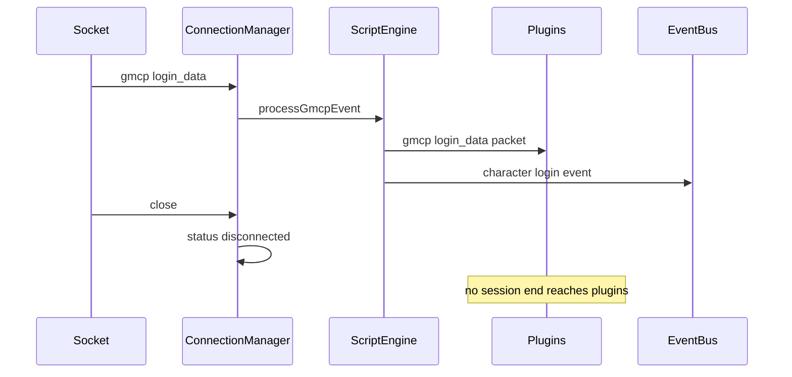

After

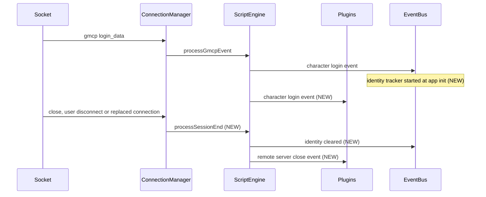

### W2 — A crafting run on mobile        changed by: Phases 5, 6, 7

Before: no mobile workflow (`features/scripts/plugin-registry.ts:23` `registerAllPlugins` has no crafting plugin). The engine ported from the web
(`apps/game-client/src/features/plugins/core-plugins/crafting-helper.plugin.ts:1807` `onEnable`) is the reference.

After

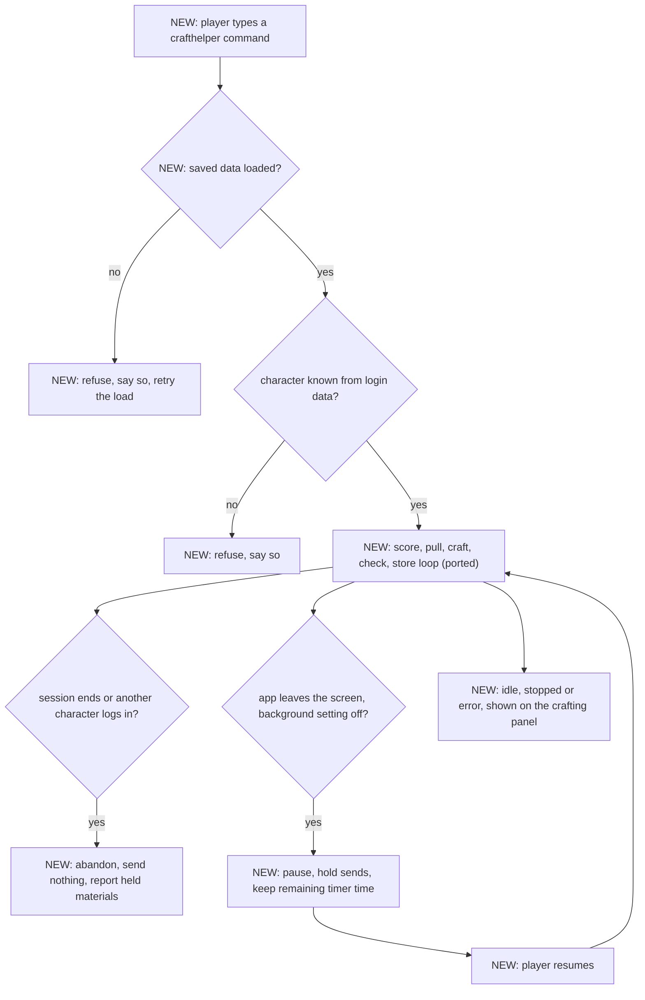

### W3 — Leaving the app with a run active        changed by: Phase 7

Before (`features/connection/connection-manager.ts:109` AppState listener: only reconnects on return)

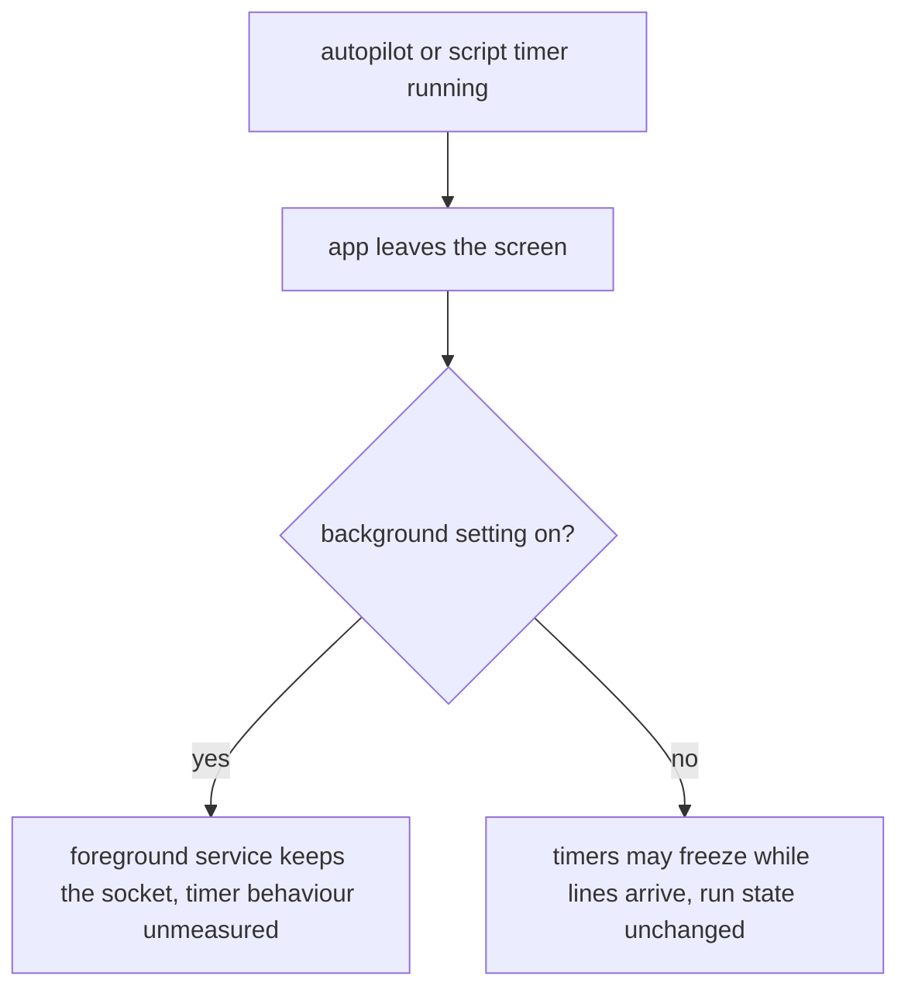

After

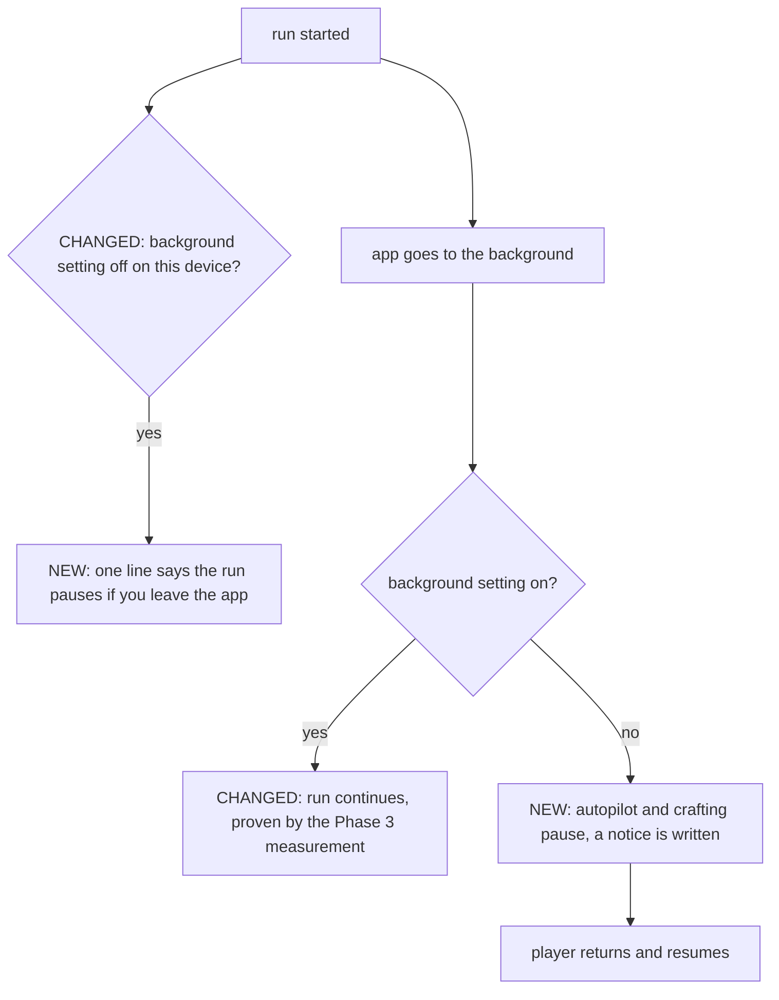

### W4 — Showing, hiding and placing a panel        changed by: Phases 8, 9, 10, 11

Before (`components/PlayContainer.tsx:231` heart button, `:268` `hudPanel`, `components/autoleveling/AutopilotPlayControl.tsx:33`)

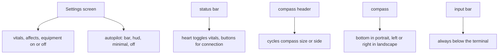

After

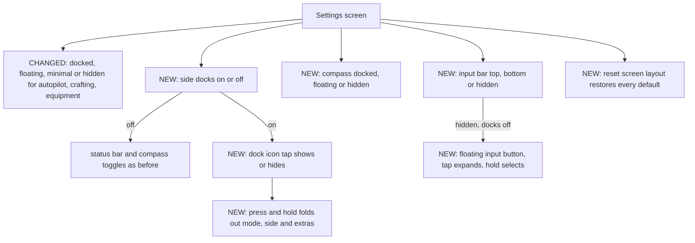

### W5 — A dropped connection in the web client        changed by: Phases 1, 2

Before (`apps/game-client/src/hooks/useGameConnection.ts:193` `onClose`, `features/userScripts/runtimeSingleton.ts:383` the 250 ms tick)

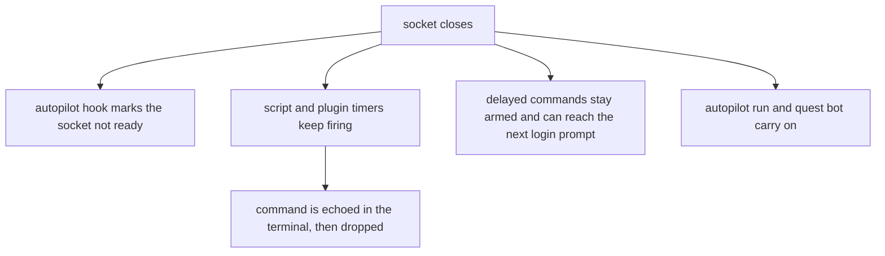

After

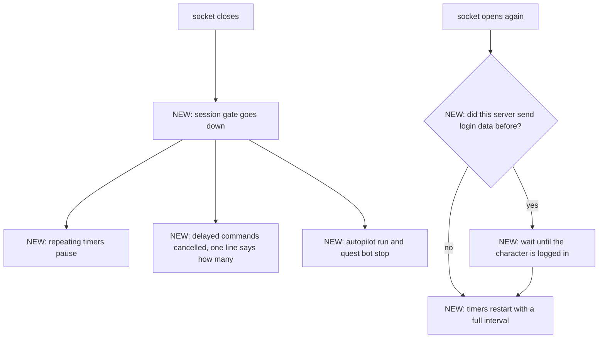

### W6 — A dropped connection in the mobile client        changed by: Phase 7

Before (`dsl-client/features/connection/connection-manager.ts:264` `case 'close'`, `features/scripts/script-runtime.ts:366` `restartTimers`)

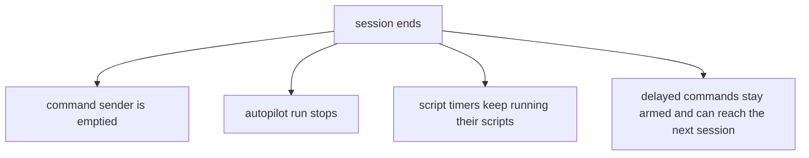

After

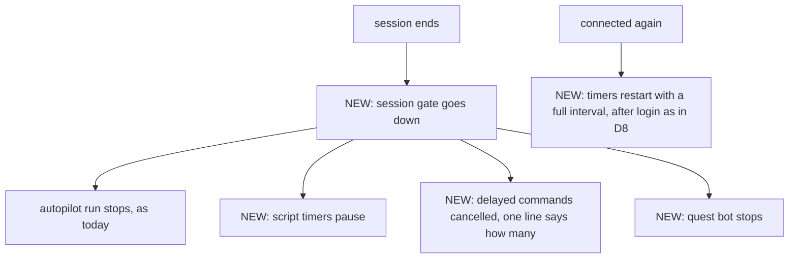

## Standards applied

TypeScript (`docs/standards/typescript.md`, mobile section): kebab-case modules under `dsl-client/features/<area>/`; tests in
`__tests__/*-test.ts(x)`; stored payloads are `unknown` narrowed, no new `any` in production code; storage fails safe with one
`console.warn` carrying no values; subscriptions are returned from effects; run state lives in app-lifetime objects, never in a screen;
lint is `expo lint`.

ShatteredArchive (Phases 1-2): camelCase modules under `features/<area>/`, tests co-located; no new `any` in production code; a swallowed
failure logs one `console.warn` without values; every subscription returns its unsubscribe and a test proves no tick happens after teardown;
lint is `pnpm lint`.

## Edit map

Paths are under `shatteredarchive-mobile/` (app code under `dsl-client/`), except rows that start with `apps/` or are marked
ShatteredArchive. Line numbers are as of the commits above.

| File | Line(s) | Anchor | Change | Phase |
|---|---|---|---|---|
| `.ai-plans/.../tools/fake-mud.mjs` (item folder, ShatteredArchive) | new | | a local TCP stand-in game for live checks | 3 |
| `dsl-client/features/scripts/script-engine.ts` | 213-230 | `processGmcpEvent`, `'login_data'` | route `game:character-login` to plugins after the bus; add `processSessionEnd()` | 4 |
| `dsl-client/features/connection/connection-manager.ts` | 90, 220, 264, 285 | `init()`, `this.socket?.close();`, `case 'close':`, `disconnect()` | start the identity tracker at init; call `processSessionEnd()` on the three session ends | 4 |
| `dsl-client/features/autoleveling/character-login.ts` | 20 | `trackCharacterLogin` | add `clearCharacterLogin()` | 4 |
| `dsl-client/features/scripts/crafting-helper-storage.ts` | new | | port of the web storage on AsyncStorage with a load gate | 5 |
| `dsl-client/features/scripts/script-engine.ts` | 60 | `await Promise.all([` | hydrate crafting storage before plugins are enabled | 5 |
| `dsl-client/features/scripts/script-types.ts` | 163 | `export interface PluginRuntimeApi` | add `setPanel(content)` and the `PluginPanelContent` type | 6 |
| `dsl-client/features/scripts/plugin-host.ts` | 114, 178 | `const api: PluginRuntimeApi`, `disable(id` | implement `setPanel`; clear a plugin's panel on disable | 6 |
| `dsl-client/features/hud/plugin-panel-store.ts` | new | | what each plugin currently shows; notifies only on change | 6 |
| `dsl-client/features/scripts/plugins/crafting-helper.plugin.ts` | new | | port of the web plugin | 6 |
| `dsl-client/features/scripts/plugin-registry.ts` | 23 | `registerAllPlugins` | register it | 6 |
| `dsl-client/features/scripts/__helpers__/crafting-harness.ts` | new | | port of the web test harness | 6 |
| `dsl-client/features/connection/run-hold.ts` | new | | on leaving the app with the setting off: hold runs, write the notice | 7 |
| `dsl-client/features/connection/connection-manager.ts` | 90-123 | `init()` | start the run-hold watcher | 7 |
| `dsl-client/features/autoleveling/autoleveling-controller.ts` | 168 | `pause()` | the start notice; pause is used as is | 7 |
| `dsl-client/features/scripts/plugins/crafting-helper.plugin.ts` | `send`, `schedule` | the two choke points | suspend / resume, `pause` and `resume` commands and actions | 7 |
| `dsl-client/features/hud/panel-layout-settings.ts` | new | | modes, dock side, docks on or off; one AsyncStorage key | 8 |
| `dsl-client/components/hud/FloatingPanel.tsx` | new | | draggable card, position stored as a fraction (`floating-stop-geometry.ts`) | 8 |
| `dsl-client/features/hud/floating-panel-storage.ts` | new | | per-panel positions | 8 |
| `dsl-client/components/hud/EquipmentHotbar.tsx` | 29 | `EquipmentHotbar` | docked stays; add floating and minimal forms | 8 |
| `dsl-client/components/PlayContainer.tsx` | 268-281 | `hudPanel`, `<AutopilotPlayControl />` | place docked, floating and minimal forms | 8, 9 |
| `dsl-client/components/autoleveling/AutopilotPlayControl.tsx` | 44, 52 | `mode === 'minimal'`, `mode === 'hud'` | informative text in minimal; floating uses `FloatingPanel` | 9 |
| `dsl-client/components/hud/CraftingPanel.tsx` | new | | docked, floating and minimal forms of the crafting panel | 9 |
| `dsl-client/components/autoleveling/AutopilotSettingsCard.tsx` | 11 | `DISPLAY_CHOICES` | new labels and descriptions | 9 |
| `dsl-client/components/hud/EdgeDock.tsx`, `DockFlyout.tsx` | new | | the rails and their fold-out options | 11 |
| `dsl-client/features/hud/dock-items.ts` | new | | the seven items: icon, label, state, toggle, options; pure | 11 |
| `dsl-client/components/PlayContainer.tsx` | 175-258, 314-330 | `positionToggle`, `statusBar`, root `<View` | rails beside the root; hide replaced buttons when docks are on | 11 |
| `dsl-client/app/(tabs)/settings.tsx` | 300, 389, 461 | `Vitals Bar`, `Equipment Hotbar`, `Autopilot` sections | "Play screen layout": docks toggle, mode choices, compass, input bar, reset | 8, 9, 10, 11 |
| `Server/Server.Web.Public/Views/Library/Scripting.cshtml` (DSL repo; added A4) | 159-163 | `id="timers"` | timers across a dropped connection | 7 |
| `docs/features/crafting-helper.md` | new | | developer and player doc for the port | 6, 7, 9 |
| `docs/features/play-layout.md` | new | | display modes, compass and input placement, reset, docks | 8, 9, 10, 11 |
| `docs/features/scripts-plugins.md` | | | session events, `setPanel`, the new plugin | 4, 6 |
| `docs/features/play-connection.md` | 22-74 | `## Layout` | session end, layout, docks | 4, 11 |
| `docs/features/background-connection.md` | | | what keeps running, run pause, the measurement | 3, 7 |
| `docs/features/autopilot.md` | 131 | `## Screens` | display forms, pause on leaving | 7, 9 |
| `docs/reference/mobile.md` | 126 | "its mode is `autopilot-display-settings.ts`" | the shared panel settings and docks; checked for `plugin-host` and `script-engine` wording | 11 |
| `docs/reference/game-client.md` | 121 | "Equipment hotbar" | correct the stale paths while describing the new forms | 8 |
| `.ai-context` / `.annotated` in `features/scripts`, `features/scripts/plugins`, `features/hud`, `features/connection`, `features/autoleveling`, `components`, `components/hud`, `components/autoleveling`, `app/(tabs)` | | | entries only where there is context the code cannot tell | with the phase that changes the folder |
| `apps/game-client/src/features/connection/sessionGate.ts` | new | | session state (down, awaiting login, live) and droppable one-off timers | 1 |
| `apps/game-client/src/hooks/useGameConnection.ts` | 165-182, 186-250 | `'shatteredarchive:send-command'`, `bindSocketHandlers` | no echo without an open socket; ignore events of a replaced socket | 1 |
| `apps/game-client/src/features/userScripts/runtimeSingleton.ts` | 259-285, 380-390 | `lastAfkState`, `__SA_USERSCRIPTS_TIMER_TICK__` | tick only while live, full interval on resume, reset AFK at session end, notices | 1 |
| `apps/game-client/src/features/userScripts/userScriptRuntime.ts` | 494-511 | `scheduleDoAfter` | delayed commands go through the gate | 1 |
| `apps/game-client/src/features/plugins/pluginScriptRunner.ts` | 94-113 | `window.setInterval` | bundled plugin timers pause and restart | 1 |
| `apps/game-client/src/components/ScriptingHelpModal.tsx` | 376-389, 602-647 | the `doAfter` section, `>Timers</h3>` | player help: what a drop does | 1 |
| `docs/game-client.md`, `docs/scripting/scripting-summary.md` (ShatteredArchive) | 170-172, 28 | `## Timers`, `### Timer` | timers across a drop; the W5 diagrams | 1, 12 |
| `apps/game-client/src/features/autoleveling/autoleveling-engine.ts` | 1099 | `bind()` | stop the run on a close | 2 |
| `apps/game-client/src/hooks/useAutoLeveling.ts` | 122-153 | `'useUserScriptSandbox::socket::open'` | listener keys of its own | 2 |
| `apps/game-client/src/features/plugins/core-plugins/respell.plugin.ts` | 181 | `window.setTimeout(` | droppable | 2 |
| `apps/game-client/src/features/plugins/core-plugins/questbot.plugin.ts` | 1797 | `if (cmd === 'pq stop')` | the same stop on a close | 2 |
| `apps/game-client/src/features/plugins/core-plugins/auto-group.plugin.ts` | 80-82, 259-264 | `pendingWhois`, `pendingChecks` | clear on a close | 2 |
| `docs/scripting/plugins.md` (ShatteredArchive) | 683-690 | `pq stop` | quest bot, respell and auto-group on a drop | 2 |
| `docs/architecture/Emitted Events.md`, `docs/game-client.md` (ShatteredArchive) | 89-92, 276-295, 388-391 | `EV_SEND`, the `game:remote-server:close` section | echo only with an open socket; the new listeners of a close | 1 |
| `docs/game/autopilot.md` (ShatteredArchive) | | | a dropped connection stops the run | 2 |
| indexes in `apps/game-client/src/features/connection`, `userScripts`, `plugins`, `plugins/core-plugins`, `autoleveling`, `hooks`, `components` | | | entries only where there is context the code cannot tell | 1, 2 |
| `dsl-client/features/connection/session-gate.ts` | new | | mobile twin of the web gate | 7 |
| `dsl-client/features/connection/connection-manager.ts` | 237-252 | `case 'connect':` | tell the gate a session opened | 7 |
| `dsl-client/features/scripts/script-engine.ts` | 213-230 | `processGmcpEvent` | tell the gate about login, character and room data | 7 |
| `dsl-client/features/scripts/script-runtime.ts` | 179-184, 366-377 | `doAfter:`, `restartTimers` | pause, restart and drop | 7 |
| `dsl-client/features/scripts/plugins/respell.plugin.ts` | 101 | `setTimeout(` | droppable | 7 |
| `dsl-client/features/scripts/plugins/questbot.plugin.ts` | 444, 554 | `navRetryTimerId =`, `combatResumeTimerId =` | stop on a session end | 7 |
| `dsl-client/features/hud/hud-types.ts`, `hud-settings-storage.ts` | 42-98, 16-23 | `CompassLandscapePosition`, `normalize` | `floating` for landscape, new portrait placement field | 10 |
| `dsl-client/components/PlayContainer.tsx` | 34-49, 262-264, 303-321 | `NEXT_LANDSCAPE`, `compassPanel` | compass placements, input placement, input button | 10 |
| `dsl-client/components/Compass.tsx` | 57-68 | `const [exits, setExits]` | exits survive a move, cleared at session end | 10 |
| `dsl-client/components/AnsiViewer.tsx` | 305-334, 392 | `styles.inputArea`, `React.memo(AnsiViewer` | input top, bottom, hidden or expanded; new props in the memo comparison | 10 |
| `dsl-client/components/hud/InputRestoreButton.tsx` | new | | the floating input button and its selector | 10 |
| `dsl-client/features/hud/layout-reset.ts` | new | | restore layout settings and floating positions (`floating-vitals-storage.ts`, `floating-stop-storage.ts`) | 10 |

End-user documentation: the app's own text is the surface (`crafthelper help`, the plugin's description on the Scripts screen, Settings row
descriptions, the dock flyout labels). No separate mobile user guide was found.

Doc-impact check (`check-doc-impact.mjs --files`, 2026-11-26): the ShatteredArchive documents it lists match mobile files only by file name
(`settings.tsx`, `plugin-host.ts`, `character-login.ts` and the like) and describe web or other services: checked, no change.
Web files of Phases 1 and 2: `docs/context.md`, `docs/copilot/client.md`, `docs/game/chat-panes.md` and `docs/game/simulacrum-admin.md` describe
behaviour that does not change (events and commands as before); older review, plan and spec records are history and stay as they are. Each is
recorded in test-results.md with that reason; `docs/superpowers/` and `.ai-code-review/` hits likewise.

## Edge cases

| Id | Classifier | Condition | Required behaviour | Covered by |
|---|---|---|---|---|
| R1 | PORT-01 | the engine listens for raw lines, login and close | each has a mobile producer and a test from a real sample (table in `docs/features/crafting-helper.md`) | P4 tests, P6 doc |
| R2 | PORT-02 | command before saved data loads, or the load fails | refused with a notice; stored value unchanged; load retried; writes per key in order | P5 tests |
| R3 | PORT-03 | disconnect, reconnect without login data | identity cleared on all three session ends; order commands refuse | P4, P6 tests |
| R4 | RUNLOOP-02 | stop, disable or session end during a long craft wait | no timer fires afterwards, within one second of fake time | P6 tests |
| R5 | RUNLOOP-03 | copyover recraft and repeated failures | one recraft per attempt, failure and attempt caps as on the web | P6 ported tests |
| R6 | RUNLOOP-04 | app leaves the screen mid-wait, lines still arrive | nothing sent while held; remaining time kept; resume continues | P3 measurement, P7 tests and emulator run |
| R7 | SETTINGS-01 | new layout settings | only keys the player changed are stored | P8 test |
| R8 | SETTINGS-03 | a mode or side changes while the Play screen is mounted | live state equals `{...defaults, ...stored}` | P8 test |
| R9 | SETTINGS-04 | plugin config arrives by editor, cloud load or file import | all pass `toOverrides`; legacy default tables still upgrade | P6 tests |
| R10 | SETTINGS-07 | changing one panel's mode or side | every other field survives (spread, not rebuild) | P8 test |
| R11 | INSET-01 | docks, flyout, floating panels at screen edges | inside safe-area insets, above the keyboard, both orientations | P11 test and emulator captures |
| R12 | INSET-02 | eight icons in landscape with the keyboard up | rail scrolls; opens by tap and hold with an accessibility action; no edge swipe | P11 test and capture |
| R13 | POINTER-01 | a floating panel holds buttons and is draggable | the drag starts only past a slop; a plain press reaches the button | P8 test |
| R14 | POINTER-02 | drag by a known distance | the resulting position is exactly that offset, clamped | P8 test |
| R15 | CMDTPL-01 | commands built from tables and container names | no `{...}` or `<...>` in any command from the shipped defaults | P6 test |
| R16 | CLOUDSYNC-02 | the cloud save replaces all plugin configs | the crafting record is exported as overrides under the web's id; a Load that would change it is listed in the preview | P6 tests; the replace-on-save behaviour itself is unchanged and recorded in the doc |
| R17 | PRIVNAME-01 | fixtures, stand-in game, captures, docs | placeholder character names only | P3, P6, P12 scan |
| R18 | TESTENV-01 | emulator runs | the app connects only to loopback; origins printed by the session tool; no sign-in is needed | P3, P7, P12 |
| R19 | TH-03 | dock icons, chips, panel buttons | pressed, selected and disabled states are distinguishable | P11 capture |
| R20 | RUNLOOP-05 | user timers, plugin timers, delayed commands and respell across a drop, in both clients | paused or cancelled as D8 and D9 say; a delayed command made while awaiting login still runs | P1, P2, P7 tests; P1 live check |
| R21 | CONNLIFE-01 | web: the replaced socket's close arrives after the new one opened; mobile already checks the current socket | ignored; the session stays live | P1 test; P4 test |
| R22 | CONNLIFE-02 | the web AFK flag, Auto Respell's affect list, the quest bot's fighting flag, auto-group's lookups and the mobile compass exits are learned from a session | reset when the session ends | P1, P2 tests, P7, P10 test |
| R23 | EVENTBUS-01 | web: the gate, the engine and the autopilot hook listen to connection events (the mobile bus keeps a set of listeners) | each key is its own; another listener on the default key still receives | P1, P2 tests |
| E1 | - | mobile hands plugins one line per event, with `\r`, or a prompt as a final partial | matchers still match whole system lines; speech containing the same text does not | P6 test |
| E2 | - | a phone keyboard turns `'` into a curly quote | `order add 1 ‘item’ 99+` is accepted | P6 test |
| E3 | - | replies slower than on desktop (decided: A13) | with default timeouts and replies delayed 800 ms the run continues; a vault-failure line arriving after the pull timeout is pinned by a test, and if it lets a craft run without its parts, stop and ask | P6 test |
| E4 | - | explicit disconnect also produces a socket close | session end reaches plugins exactly once | P4 test |
| E5 | - | iOS or the notification shade reports `inactive` | does not pause runs; only `background` does | P7 test |
| E6 | - | docks off | the play screen renders as before this work | P11 test (existing `PlayContainer-test` unchanged and green) |
| E7 | - | all icons on one side, split, or none | an empty side takes no width; the terminal re-wraps when a rail appears | P11 test, capture |
| E8 | - | several floating panels at once, then rotation | distinct default positions; every panel stays on screen | P8 test |
| E9 | - | heavy output | an idle plugin returns before parsing; the panel store notifies only on a real change | P6 test |
| E10 | - | recipe tables drift between web and mobile | a test pins the fingerprints of the ported default tables and names the web file to change with them | P6 test |
| E11 | - | the user leaves the Play screen during a run | the run and its timers continue after the screen unmounts | P7 test, P12 emulator run |
| E12 | - | no "logged in" data arrives after a reconnect | timers stay paused and a line says they wait for the login | P1 recorded-traffic check and test |
| E13 | - | existing web tests tick timers with no connection | each is updated to open a session and listed in test-results.md | P1 tests |
| E14 | - | a script's own browser timer sends while the socket is down | not sent and not echoed | P1 test |
| E15 | - | input at the top with the keyboard open, both orientations | the input and the newest line stay visible | P10 test and captures |
| E16 | - | `AnsiViewer` compares only listed props | changing only the input placement re-renders it | P10 test |
| E17 | - | the input button is dragged, tapped or held | a drag only moves it; tap expands; hold opens the selector; the hold has an accessibility action | P10 test |
| E18 | - | input, input button, compass and panels all hidden, docks off | Settings through the More tab restores them, one by one or by reset | P10 test and capture |
| E19 | - | reset while floating panels are on screen | they move to their default places at once | P10 test |
| E20 | - | the compass moves between placements or the phone rotates | the exit highlights stay those of the current room | P10 test |
| E22 | PORT-01 | mobile plugins subscribe to game data events that were never routed to them (added A10) | every such event reaches plugins once, under the web name | P4 tests |
| E21 | CONNLIFE-03 | custom server: the loaded scripts change just after a connection event (added A3) | the pause, waiting and resumed lines answer for the session that dropped | P1 test |

Classifiers not applicable:
- SETTINGS-02: the new store keeps the keys the player set and never compares values with defaults.
- SETTINGS-05: no stored data is rewritten.
- SETTINGS-06: no defaults are seeded into a stored list.
- RUNLOOP-01: crafting has no outer timer layered over an inner one; slow replies are E3.
- CLOUDSYNC-01: no new record kind. CLOUDSYNC-03: no edit keyed to a server-owned id.
- ANSI-01, ANSI-02: no colour conversion, storage of coloured text, or BEL removal is added.
- TESTENV-02: no certificate or capture becomes a fixture.
- TH-01, TH-02, TH-04: web browser surfaces. TH-05: the app has no theme switch.

## Verification toolbox

`M` = `C:/Projects/shatteredarchive-mobile/dsl-client`.

| Purpose | Command |
|---|---|
| Tests (pattern or whole app) | `pnpm --dir M test -- --runInBand [pattern]`, output filtered to `Tests:|Test Suites:|FAIL|✕` (amended: see A1) |
| Coverage of new code | `pnpm --dir M test -- --runInBand --coverage --collectCoverageFrom="features/hud/**" --collectCoverageFrom="features/scripts/crafting-helper-storage.ts" --collectCoverageFrom="features/scripts/plugins/crafting-helper.plugin.ts" --collectCoverageFrom="features/connection/run-hold.ts" --collectCoverageFrom="components/hud/**"` |
| Typecheck | `pnpm --dir M exec tsc --noEmit`; Phase 3 records the existing error count, every later phase must not raise it and must add none in touched files |
| Lint | `pnpm --dir M lint` |
| Bundle | `pnpm --dir M exec expo export --platform android --output-dir <folder outside the repo>` |
| Emulator | open `docs/claude/emulator-testing.md` first; `node C:/Projects/Shattered-AI/tools/mobile-test/session.mjs up --planned-phase`, `... down --reset`; `emulator-5554` only |
| Stand-in game | `node <item folder>/tools/fake-mud.mjs --port 4501`, then `adb -s emulator-5554 reverse tcp:4501 tcp:4501`; the app connects to `localhost:4501` |
| API checks | none: no endpoint changes |
| Doc impact | `node scripts/check-doc-impact.mjs <item folder>` in ShatteredArchive; mobile docs are covered by the Edit-map rows |
| Web tests | `pnpm --filter @shatteredarchive/game-client test` (already `--runInBand`) |
| Web typecheck, lint, build | `pnpm typecheck` · `pnpm lint` · `pnpm --filter @shatteredarchive/game-client build` |
| Web coverage | `pnpm test:coverage`, read for the touched files |
| Web live check | a Playwright script in `<item folder>/tools/` that stands in for the game proxy with `page.routeWebSocket('**/ws/game', ...)`, against the local game client serving this build; rebuilding that container is asked first |

Every phase's **Exit gate** is: bundle builds · typecheck count not raised · lint clean on touched files · `pnpm --dir M test -- --runInBand`
green · new code's branches covered · listed emulator checks done · doc-impact 0 unresolved · matching After diagrams still true.
For the web phases (1, 2 and the web part of 12) it is: web build · typecheck · lint · all game-client tests green · new branches covered ·
live check done · doc-impact 0 unresolved.

## Phases

### [x] Phase 1 — Web: user and plugin timers stop at a dropped connection
Goal:        In the web client no timer, delayed command or program send does anything while the connection is down, and timers restart as D8 says.
Depends on:  nothing
Workflow:    W5

Work
- [x] 1.1 Before building, from the game server's recorded traffic (copy no names anywhere): which GMCP packets arrive at the name and password prompt, which after a fresh login, and which after reconnecting to a character left in the game. **If a login-marking packet arrives before login, or none arrives after such a reconnect, stop and ask.**
- [x] 1.2 `features/connection/sessionGate.ts` (new): `down`, `awaiting-login`, `live`, starting `down`; fed by the open, close, character-login, character-data and room-data events under its own listener keys; remembers per host and port that login data was seen; `subscribe()`; `scheduleDroppable(fn, ms)`, cancelled and counted on `down`, nothing scheduled while `down`.
- [x] 1.3 `useGameConnection.ts:186`: each socket handler returns unless its socket is the current one. `:165`: no echo and no send without an open socket.
- [x] 1.4 `runtimeSingleton.ts:380`: tick only while live; on becoming live call `rebuildTimers()`. `:259`: reset the AFK state at session end. One terminal line when timers pause (with the number of delayed commands dropped), one while waiting for the login and one on resume, only when there are enabled timers or something was dropped.
- [x] 1.5 `userScriptRuntime.ts:494`: `scheduleDoAfter` uses the gate; the `~` cancel still works.
- [x] 1.6 `pluginScriptRunner.ts:94`: bundled plugin timers exist only while live; `stop()` unsubscribes.
- [x] 1.7 Tests: `sessionGate.test.ts` (every transition, repeated close, login memory per server, droppable), `useGameConnection.test.ts` (replaced socket, nothing echoed while closed), cases in `runtimeSingleton.test.ts`, `pluginScriptRunner.test.ts` and for `doAfter`; existing cases that tick with no connection updated and listed (R20, R21, R22, R23, E12, E13, E14).
- [x] 1.8 Live check: with a short timer and a `doAfter`, drop the connection and show nothing is sent or echoed; reconnect and show nothing until the login data; shots `phase-01_timers-paused.png`, `phase-01_timers-resumed.png`, `phase-01_help.png`.
- [x] 1.9 Docs and indexes: `docs/game-client.md`, `Emitted Events.md`, `scripting-summary.md`, the in-app scripting help, the folder indexes.

Sign-off
- [x] 1.S Exit gate verified and recorded in test-results.md (2026-11-26)

State on exit: user and plugin-script timers behave; the autopilot and the built-in bots do not yet.

### [x] Phase 2 — Web: the autopilot and the built-in bots stop at a dropped connection
Goal:        No web run or bot continues, or fires a queued command, after the connection drops.
Depends on:  1
Workflow:    W5

Work
- [x] 2.1 `autoleveling-engine.ts:1099` (`bind`): subscribe to the close under its own key; a run that is going or paused writes the connection-lost line and stops, as `dsl-client/features/autoleveling/autoleveling-engine.ts:1236` (`onDisconnected`) does.
- [x] 2.2 `useAutoLeveling.ts:122`: listener keys of its own (today they are the sandbox hook's, so one silently replaces the other).
- [x] 2.3 `respell.plugin.ts:181`: the delayed recast uses `scheduleDroppable`.
- [x] 2.4 `questbot.plugin.ts:1797`: on a close do what `pq stop` does and say so. `auto-group.plugin.ts`: clear pending lookups and their timers.
- [x] 2.5 Tests: engine close while running, paused, idle and mid-wait with the clock advanced afterwards; the two hooks both receive each event; respell, quest bot and auto-group cases (R20, R23).
- [x] 2.6 Live check: drop the connection during an autopilot run; shot `phase-02_autopilot-stopped.png`.
- [x] 2.7 Docs and indexes: `docs/scripting/plugins.md`, `docs/game/autopilot.md`, the folder indexes.

Sign-off
- [x] 2.S Exit gate verified and recorded in test-results.md (2026-11-26)

State on exit: the web fix is complete and can be deployed on its own.

### [x] Phase 3 — Measure what keeps running in the background
Goal:        We know, from the emulator, whether JavaScript timers fire while the app is in the background, with the setting on and off.
Depends on:  nothing
Workflow:    W3 (the Before)

Work
- [x] 3.1 `<item folder>/tools/fake-mud.mjs`: a loopback TCP server that negotiates GMCP, sends `login_data` for a placeholder character, answers `score`, `get`, `craft`, `lore` and `put` with the system lines the plugin matches, takes a reply delay option, and logs each received command with a timestamp.
- [x] 3.2 Tests: None - verification tool only; its replies are exercised by the live checks of Phases 6 to 12.
- [x] 3.3 (amended: see A8) Emulator measurement: a user timer script sending a harmless command every 10 s; background the app and lock the screen for 3 minutes each, setting on and then off; the stand-in's timestamps are the evidence. Also record the typecheck baseline.
- [x] 3.4 Docs: `docs/features/background-connection.md` gets the measured result and date.

Sign-off
- [x] 3.S (2026-11-26: timers fire with the setting on) Exit gate verified and recorded in test-results.md. **If timers do not fire with the setting on, stop here and ask the user before Phase 7: D6 then needs another mechanism.**

State on exit: nothing in the app has changed; the background behaviour is known.

### [x] Phase 4 — Plugins learn when a character logs in and when the session ends
Goal:        A mobile plugin receives `game:character-login` and `game:remote-server:close`, and the cached identity never outlives a session.
Depends on:  nothing
Workflow:    W1

Work
- [x] 4.1 `script-engine.ts:213` (`processGmcpEvent`): after the bus dispatch of `login_data`, route `game:character-login` to plugins; add `processSessionEnd()` which clears the identity and routes `game:remote-server:close`.
- [x] 4.2 `connection-manager.ts:90,220,264,285`: start `trackCharacterLogin()` in `init()`; call `processSessionEnd()` from the current socket's close, from `disconnect()`, and from `connect()` when it replaces a socket.
- [x] 4.3 `character-login.ts:20`: `clearCharacterLogin()` resets to unknown and notifies listeners (the Autopilot page's level becomes unknown after a disconnect).
- [x] 4.4 Tests: `features/scripts/__tests__/script-engine-session-events-test.ts` (a login packet reaches a plugin after the identity is set; session end reaches it); `features/connection/__tests__/connection-manager-session-end-test.ts` (each of the three ends fires exactly once, a stale socket's close fires nothing) (R1, R3, E4).
- [x] 4.5 Docs and indexes: `scripts-plugins.md` (the two events), `play-connection.md` (session end), indexes of `features/scripts`, `features/connection`, `features/autoleveling`.
- [x] 4.6 (added A10) `script-engine.ts` (`processGmcpEvent`): the game data events are routed to plugins after the bus and user scripts.
- [x] 4.7 (added A10) Tests: `features/scripts/__tests__/script-engine-plugin-gmcp-test.ts` (each packet reaches a plugin once under its name; Affect Echo, Auto Respell, the Quest Bot's combat break and the spoken tick alert act) (E22).
- [x] 4.8 (added A11) The 3 lint errors from ead69f9, with tests for the chat clear case and the hardware-keyboard focus.

Sign-off
- [x] 4.S Exit gate verified and recorded in test-results.md (2026-11-26)

State on exit: events arrive; no plugin uses the close event yet.

### [x] Phase 5 — Crafting data can be saved and read on the device
Goal:        A storage module with the web's API keeps skill levels, orders and history in AsyncStorage without ever overwriting unloaded data.
Depends on:  nothing
Workflow:    W2

Work
- [x] 5.1 `features/scripts/crafting-helper-storage.ts` (new): port of web `crafting-helper-storage.ts:9-425` with the same keys, caps and validators; `hydrateCraftingStorage()` reads every key under the plugin's prefix once; reads stay synchronous; writes are chained per key; a failed load leaves the store not ready; the debounced skill write flushes when the app goes to the background; write failures reach `onStorageWriteError`.
- [x] 5.2 `script-engine.ts:60`: hydrate before plugins are enabled.
- [x] 5.3 Tests: `features/scripts/__tests__/crafting-helper-storage-test.ts`, the web's 19 cases ported, plus delayed load, failing read then successful retry, write refused before ready, two writes with a slow first one, background flush (R2).
- [x] 5.4 Docs and indexes: `features/scripts` indexes.

Sign-off
- [x] 5.S Exit gate verified and recorded in test-results.md (2026-11-26)

State on exit: the module is tested and unused.

### [x] Phase 6 — The Crafting Helper works from the command line on mobile
Goal:        With the plugin enabled, training and orders run on mobile and stop safely, reporting through the terminal.
Depends on:  3 (the stand-in game), 4, 5
Workflow:    W2

Work
- [x] 6.1 `script-types.ts:163`, `plugin-host.ts:114,178`, `features/hud/plugin-panel-store.ts` (new): `setPanel(content | null)` with title, status, text, short text and action keys; cleared on disable; subscribers notified only on change.
- [x] 6.2 `features/scripts/plugins/crafting-helper.plugin.ts` (new): port of the web plugin with the same id, version, recipes, matchers, commands, limits and legacy-table upgrade. Changes only: identity from `getCharacterLogin()`; storage-ready gate on every command that reads or writes saved data; `publishHud` publishes the panel (no `hudSlot` field); curly quotes accepted in `order add`; messages say "this device" instead of "browser storage". The file header names the web file it mirrors.
- [x] 6.3 `plugin-registry.ts:23`: register it.
- [x] 6.4 Tests: `__helpers__/crafting-harness.ts`; the web suites ported to `__tests__/crafting-helper-test.ts`, `crafting-helper-hardening-test.ts`, `crafting-helper-hardening-units-test.ts` (each dropped or changed case listed in test-results.md with its reason); new cases for R3, R4, R5, R9, R15, R16, E1, E2, E3, E9, E10; `plugin-host-test.ts` cases for `setPanel`.
- [x] 6.5 Emulator check: stand-in game, enable the plugin, train, add and finish an order, disconnect mid-run and see "run abandoned"; shots `phase-06_crafting-terminal.png`, `phase-06_abandoned.png`.
- [x] 6.6 Docs and indexes: `docs/features/crafting-helper.md` (wiring, event and import table, storage keys, cloud behaviour, player commands), `scripts-plugins.md`, indexes of `features/scripts`, `features/scripts/plugins`, `features/hud`.

Sign-off
- [x] 6.S Exit gate verified and recorded in test-results.md (2026-11-26)

State on exit: crafting is usable through commands; it has no on-screen panel; leaving the app is not yet handled.

### [x] Phase 7 — Runs survive other screens, and stop at a dropped connection
Goal:        D6 holds while connected, and D7 to D9 hold on mobile when the connection drops.
Depends on:  1, 3, 6
Workflow:    W2, W3, W6

Work
- [x] 7.1 `features/connection/run-hold.ts` (new), started from `connection-manager.ts` `init()`: on AppState `background` while connected and the background setting off, pause a running autopilot (`autoleveling-controller.ts:168`) and tell plugins to hold; write one notice.
- [x] 7.2 Crafting `send` and `schedule`: `suspend()` keeps each timer's remaining time and holds sends; `resume()` re-arms and flushes; `crafthelper pause` / `resume` and the `pause` / `resume` actions; stop, disable and session end discard held sends.
- [x] 7.3 When a run starts with the setting off, autopilot and crafting each write one line saying it pauses if the app is left.
- [x] 7.4 `features/connection/session-gate.ts` (new): the rules of the web `sessionGate.ts` (named in the file header), fed from `connection-manager.ts:237` (`case 'connect'`), `script-engine.ts:213` (game data) and `processSessionEnd()`.
- [x] 7.5 `script-runtime.ts:366`: timer scripts run only while live and restart with a full interval; `:179` `doAfter` uses the droppable timer. One line when timers pause, wait and resume, as on the web.
- [x] 7.6 (amended: see A5) `respell.plugin.ts:101` droppable and its affect list forgotten at a session end (D14); `questbot.plugin.ts` stops on the session end as `pq stop` does. The autopilot already stops (`autoleveling-engine.ts:1236`); a test pins it.
- [x] 7.7 Tests: `run-hold-test.ts` (setting on, off, `inactive`, nothing running); crafting suspend and resume cases; controller start notice; a test that unmounts the Play screen and shows a running crafting timer, a script timer and the autopilot still advance; `session-gate-test.ts`, script timer and `doAfter` drop cases, respell and quest bot cases (R6, R20, E5, E11).
- [x] 7.8 Emulator check with the stand-in: a run with the setting on keeps sending in the background; with it off it pauses and resumes; stopping the stand-in pauses a script timer and reconnecting resumes it after login; shots `phase-07_paused.png`, `phase-07_dropped.png`.
- [x] 7.9 Docs and indexes: `background-connection.md`, `autopilot.md`, `crafting-helper.md`, `scripts-plugins.md`, `features/connection` indexes.
- [x] 7.10 (added A4) The public Scripting page, DSL repo `Server/Server.Web.Public/Views/Library/Scripting.cshtml` (section `timers`): timers and delayed commands across a dropped connection, web and mobile; deploy locally with `Server/deploy-local.ps1` and check the page (production is the owner's).

Sign-off
- [x] 7.S Exit gate verified and recorded in test-results.md (2026-11-26)

State on exit: run and connection behaviour is complete.

### [x] Phase 8 — Floating panels and equipment's display modes
Goal:        Equipment can be shown docked, floating, minimal or hidden, on components the other features reuse.
Depends on:  nothing
Workflow:    W4

Work
- [x] 8.1 `features/hud/panel-layout-settings.ts` (new): `docksEnabled` (false), per-panel mode and side, last shown mode; load / get / save / subscribe; stores only changed keys. Equipment's shown or hidden state stays `HudSettings.equipment`.
- [x] 8.2 `components/hud/FloatingPanel.tsx`, `features/hud/floating-panel-storage.ts` (new): drag past a slop, fraction position per panel, clamped on layout changes, distinct defaults.
- [x] 8.3 `EquipmentHotbar.tsx:29`: docked unchanged; floating card with one line per slot; minimal one text line of filled slots only, or "No equipment seen".
- [x] 8.4 `PlayContainer.tsx:268` and `settings.tsx:389`: place the chosen form; mode chips under Equipment.
- [x] 8.5 Tests: `panel-layout-settings-test.ts` (R7, R8, R10), `floating-panel-storage-test.ts`, `FloatingPanel-test.tsx` (R13, R14, E8), `EquipmentHotbar-test.tsx` (each mode, empty slots).
- [x] 8.6 Emulator check: the three forms in portrait and landscape; shots `phase-08_equipment-*.png`.
- [x] 8.7 Docs and indexes: `docs/features/play-layout.md`, indexes of `features/hud`, `components/hud`.

Sign-off
- [x] 8.S Exit gate verified and recorded in test-results.md (2026-11-26)

State on exit: equipment has all forms; docks do not exist.

### [x] Phase 9 — Autopilot and crafting share the display modes
Goal:        Autopilot and crafting can each be docked, floating, minimal or hidden.
Depends on:  6, 7, 8
Workflow:    W2, W4

Work
- [x] 9.1 `AutopilotPlayControl.tsx:44`: minimal shows the buttons plus a text line only when there is something to say (paused, resting, error, not connected, not set up).
- [x] 9.2 `AutopilotPlayControl.tsx:52`: floating uses `FloatingPanel` (handle that expands, position saved).
- [x] 9.3 `components/hud/CraftingPanel.tsx` (new), placed from `PlayContainer.tsx`: docked row (status dot, activity, level, item, Pause or Resume, Stop, and Start orders when idle with a queue); floating card with the same; minimal one line with the item and level or the stop reason, and the one button that applies. Drawn only while the plugin is enabled and has content.
- [x] 9.4 `AutopilotSettingsCard.tsx:11` and `settings.tsx`: shared labels Docked, Floating, Minimal, Hidden; crafting mode chips.
- [x] 9.5 Tests: `play-control-test.tsx` and `settings-card-test.tsx` updated and extended; `CraftingPanel-test.tsx` (each mode and status, each button calls its action).
- [x] 9.6 Emulator check: both features in all forms with a stand-in run; shots `phase-09_*.png`.
- [x] 9.7 Docs and indexes: `play-layout.md`, `autopilot.md`, `crafting-helper.md`, indexes of `components/hud`, `components/autoleveling`.

Sign-off
- [x] 9.S Exit gate verified and recorded in test-results.md (2026-11-26)

State on exit: display modes are complete.

### [x] Phase 10 — Compass and input bar placement, and resetting the layout
Goal:        The compass can be docked or floated, the input bar placed at the top or bottom or hidden, and one setting restores the screen layout.
Depends on:  8, 9
Workflow:    W4

Work
- [x] 10.1 `hud-types.ts:42`: a portrait placement field (`bottom` default, `top`, `floating`); landscape gains `floating`; unknown stored values fall back to the default; the header button's cycle takes `floating` to `hidden`.
- [x] 10.2 `PlayContainer.tsx:303`: compass top or bottom in portrait, left or right in landscape, floating on `FloatingPanel` with a drag handle, hidden as today.
- [x] 10.3 `Compass.tsx:57`: the last room's exits are held outside the component and cleared at session end.
- [x] 10.4 `panel-layout-settings.ts`: input placement (`bottom`), last shown placement, input button hidden. `AnsiViewer.tsx:305`: input above or below the output, or not drawn; typed text survives; `:392` compares the new props.
- [x] 10.5 `components/hud/InputRestoreButton.tsx` (new): drawn while connected with the input hidden, docks off and the button not hidden; draggable; tap expands the bar with a collapse control; press and hold opens a selector (show at top, show at bottom, hide this button), also as an accessibility action.
- [x] 10.6 `features/hud/layout-reset.ts` (new) and Settings: compass placement, input placement, "Show the input button", and "Reset screen layout" with a confirmation. Reset restores vitals and its bars, tick timer, floating vitals, affects, equipment, compass fields, navigation-bar hiding, autopilot display, the panel layout store and every floating position; floating panels on screen move at once.
- [x] 10.7 Tests: `hud-settings-defaults-test.ts` cases, `PlayContainer-test.tsx` (each compass placement), `AnsiViewer-test.tsx` (each input placement, comparator, text kept), `InputRestoreButton-test.tsx`, `layout-reset-test.ts` (every key restored, unrelated settings untouched) (R7, R8, R10, R22, E15-E20).
- [x] 10.8 Emulator check: compass and input placements in both orientations with the keyboard open, everything hidden then reset; shots `phase-10_*.png`.
- [x] 10.9 Docs and indexes: `play-layout.md`, indexes of `components`, `components/hud`, `features/hud`, `app/(tabs)`.

Sign-off
- [x] 10.S Exit gate verified and recorded in test-results.md (2026-11-26)

State on exit: every element can be placed and the layout can be recovered; docks do not exist.

### [x] Phase 11 — Left and right icon docks
Goal:        With docks on, every show/hide control is an icon on a left or right rail; with docks off the screen is unchanged.
Depends on:  9, 10
Workflow:    W4

Work
- [x] 11.1 `features/hud/dock-items.ts` (new): the eight items with icon, label, shown state, toggle and options; writes go to the setting that already owns each state. Compass options: placement for this orientation, and size in portrait. Input options: top or bottom (the floating input button is not drawn while docks are on). Crafting appears only while its plugin is enabled.
- [x] 11.2 `components/hud/EdgeDock.tsx`, `DockFlyout.tsx` (new): scrolling rail, targets at least 44 dp, tap toggles, hold opens options, accessibility action for the hold, flyout closes on outside press and the back button.
- [x] 11.3 `PlayContainer.tsx:314`: rails beside the root, inside the safe area; a rail with no items is not rendered. `:175-258`: with docks on, omit the heart, disconnect and connection buttons and the compass toggles.
- [x] 11.4 `settings.tsx`: "Play screen layout" section with the docks toggle and a line saying how tap and hold work.
- [x] 11.5 Tests: `dock-items-test.ts` (each item's toggle and restore, side moves), `EdgeDock-test.tsx` (tap, hold, accessibility action, short height, insets), `PlayContainer-test.tsx` new cases for docks on; the existing cases stay unchanged and green (R11, R12, E6, E7).
- [x] 11.6 Emulator check: portrait and landscape, keyboard open, gesture navigation, both sides, last icon tapped; shots `phase-11_*.png` (R19).
- [x] 11.7 Docs and indexes: `play-layout.md`, `play-connection.md`, indexes of `components`, `components/hud`, `app/(tabs)`.

Sign-off
- [x] 11.S Exit gate verified and recorded in test-results.md (2026-11-26)

State on exit: the feature set is complete.

### [x] Phase 12 — Whole-feature verification and showcase
Goal:        Everything is proven together and documented.
Depends on:  1-11
Workflow:    W1-W6

Work
- [x] 12.1 Full app tests with coverage; typecheck, lint, bundle.
- [x] 12.2 Emulator end to end: docks on, a crafting order and an autopilot setup, switch tabs and leave the app during a run; showcase shots `showcase_01_crafting-docked.png`, `showcase_02_floating-panels.png`, `showcase_03_minimal.png`, `showcase_04_docks-landscape.png`, `showcase_05_dock-flyout.png`.
- [x] 12.3 Scan fixtures, docs and captures for names or addresses (R17, R18).
- [x] 12.4 Web: all game-client tests with coverage, typecheck, lint, build, and the live drop script again; showcase `showcase_06_web-timers-paused.png`. Mobile showcase also `showcase_07_compass-floating-input-top.png`.
- [x] 12.5 Docs: move the After diagrams into `crafting-helper.md`, `play-layout.md`, `background-connection.md`, `scripts-plugins.md`.

Sign-off
- [x] 12.S Exit gate verified and recorded in test-results.md (2026-11-26)

State on exit: ready for the user's own device test.

## Risks and rollback

- **Background timers (Phase 3)** may not fire even with the foreground service. The plan stops there and asks.
- **Knowing the character is back (Phase 1)** relies on game data. If login data is switched off after a session that had it, timers stay paused until the page or app is restarted; the terminal says they are waiting.
- **A web script's own browser timers** are not paused. Their sends are dropped while the socket is down but can fire after a reconnect.
- **Behaviour players may notice:** timers no longer run before connecting, and an autopilot run ends at a drop.
- **Autopilot and crafting together** both react to the same lines and both send commands; nothing prevents running both, as on the web.
- **Recipes live in two places.** The fingerprint test catches an edit on mobile, not one made only on the web.
- **Real game text** is only proven against the stand-in; a run on the real game is the user's to do.
- **Cloud save** replaces all plugin configs with this device's, which now includes a crafting record (existing behaviour for every plugin).
- **Rollback:** the plugin is off until enabled and the docks are off until enabled. Phases 1 and 2 (web) and Phases 4 and 7 (mobile) change shared connection code and can be reverted on their own. No stored data is rewritten. Web deployment is the owner's.

## Plan amendments

- **A1** (2026-11-26, baseline; minor). Planned: the mobile test and coverage commands of the Verification toolbox and the exit-gate paragraph use `pnpm --dir M test -- --runInBand`. Found: pnpm passes the `--` on to Jest, which then reads `--runInBand` as a file pattern, runs no test and exits 0. Change: every mobile test command is `pnpm --dir M test --runInBand [pattern]` (coverage flags likewise without the `--`), and a result counts only when it shows a test total. No wider impact.
- **A2** (2026-11-26, Phase 1, 1.8; minor). Planned: the web live check runs against the local game client serving this build, the container rebuild asked first. Change: the script serves the built `dist` to the browser by request interception on the loopback origin and stands in for `/ws/game`, so nothing is rebuilt or restarted. The same bundle is exercised; the container still serves the old build.
- **A3** (2026-11-26, Phase 1, 1.4; minor). Found by the live check: a custom server has its own script set, swapped in or out just after the connection events, so the "waiting" line read the other set. Change: all three lines follow the timers of the session that dropped (new row E21).
- **A4** (2026-11-26, after Phase 1; significant, approved by the user 2026-11-26). Found: the public Scripting page in the DSL repo has a Timers section, web and mobile, outside the Edit map. Change: it is updated in Phase 7 (new box 7.10), once both clients behave this way. Wider impact: one page in a third repository; CONNLIFE-03 was also approved and added.
- **A5** (2026-11-26, Phase 2, 2.3; significant, approved by the user 2026-11-26). Planned: only the waiting recast is cancelled. Found: the plugin's memory of which affects were up survives a drop, so the next session's first list recasts whatever is missing, even on another character. Change: the memory and the recast spacing are forgotten at a close (D14). Wider impact: the same applies to the mobile plugin in box 7.6.
- **A6** (2026-11-26, Phase 2, 2.2; significant, approved by the user 2026-11-26). Found: `useAutoLeveling.ts` reads `import.meta` in its debug check, so Jest cannot load it and the key fix could not be tested. Change: that function moved unchanged to `features/autoleveling/autoleveling-debug.ts`, which tests replace. New file outside the Edit map; no behaviour change.
- **A7** (2026-11-26, Phase 2; minor). The engine test that counts listeners now expects 13. The two web live checks share `tools/standin.mjs`; the autopilot one starts the run with the app's `shatteredarchive:autoleveling-start` event, because the wizard's Start needs an area from the site.
- **A8** (2026-11-26, Phase 3, 3.3; approved by the user 2026-11-26). Planned: background and lock for 3 minutes each. Change: 60 s each, plus a forced deep-idle window, on a battery-powered emulator: about the same evidence in less time and a harsher case. A first setting-off run with the 3-minute windows was stopped early; its result agrees.
- **A9** (2026-11-26, Phase 4; noted). Found: the mobile branch was fast-forwarded during the work, f86ba6c to ead69f9 (pull requests #8-#10: chat scroll, keyboard and fullscreen, a new native module `modules/system-ui`). Phase 4-7 files are unchanged. Edit-map files changed for Phases 8-11 (`AnsiViewer.tsx`, `PlayContainer.tsx`, `settings.tsx`, `hud-types.ts`, `NavigationBarController.tsx`): re-confirm their anchors when those phases start. New mobile baseline at ead69f9 before further edits: 3 lint errors from those pull requests (A11).
- **A10** (2026-11-26, Phase 4; significant, approved by the user 2026-11-26). Found: `processGmcpEvent` sends the `game:*` data events to the event bus and user scripts but not to plugins, so Affect Echo, Auto Respell, the Quest Bot's combat break and the spoken affect, tick and health alerts never ran on mobile (predates this work). Change: those events are routed to plugins too (boxes 4.6, 4.7; row E22). Wider impact: those four plugins start acting for players who have them on; Auto Respell's drop handling in 7.6 now has something to act on.
- **A11** (2026-11-26, Phase 4; significant, approved by the user 2026-11-26). The 3 lint errors of ead69f9 (`chat.tsx` twice, `AnsiViewer.tsx` once) are fixed here (box 4.8), outside the Edit map for `chat.tsx`.
- **A12** (2026-11-26; approved by the user 2026-11-26). The emulator's development client predates the new native module: it is rebuilt and reinstalled on `emulator-5554` before the first on-screen check.
- **A13** (2026-11-26, Phase 6; significant, decided by the user 2026-11-26 under E3). Found: with replies slower than 200 ms the `craft` command goes out before a "not in the vault" arrives (web behaviour too). Change, mobile only: the next step follows the `You get` reply; silence counts as success only after `pullConfirmTimeoutMs`, whose mobile default is 2000. Web unchanged (D1).
- **A14** (2026-11-26, Phase 6; decided by the user 2026-11-26). Found: the phone hides the terminal while disconnected and clears it on reconnect, so lines written at a drop are never seen. Decision: leave it. Consequences: 6.5 proves the abandoned run by the stand-in's log and the status after reconnecting; the Phase 7 drop notices (D8, D9) are written on mobile but will not be seen there.
- **A15** (2026-11-26, Phase 8; minor). New file outside the Edit map: `components/hud/PanelModeChips.tsx`, so the chips are testable and shared with Phase 9. The paths in `docs/reference/game-client.md` row 292 were checked and are correct; only the phone note was added.
- **A16** (2026-11-26, Phase 9; minor, found on the emulator). An opened floating card lay under another one with no way to reach it. Change: the floating panel touched last is drawn on top, and `FloatingEquipment` moved from the Play screen root into the game panel so all floating panels share one parent. Equipment therefore stays beside a docked compass, not over it.
- **A17** (2026-11-26, Phase 10).
  - Decided by the user 2026-11-26: "Reset screen layout" also turns Fullscreen off and restores "Hide navigation bar too" (the setting arrived
    with the pulled code, after planning).
  - New files outside the Edit map (minor): `features/hud/exits-store.ts`, `components/hud/ScreenLayoutSettings.tsx`; the speech Stop button's
    storage and component gained a reset notification, so a reset moves it at once.
  - Found on the emulator and fixed (minor): the input button stays mounted while its options are open (candidate classifier: replacing a view
    that is being pressed swallows the next touch); floating panels keep above the keyboard with `useKeyboardOverlap` (candidate classifier: an
    edge-to-edge overlay must account for the keyboard itself).
  - Decided by the user 2026-11-26: the keyboard check was run by switching the Pixel8 AVD's `hw.keyboard` off. That alone was not enough, so the
    emulator's keyboard device node was removed for that boot; the config file was restored and the emulator restarted afterwards.
- **A18** (2026-11-26, Phase 11; minor). New files outside the Edit map: `components/hud/PlayDocks.tsx` (holds the docks so `PlayContainer.tsx` only wraps its root). `plugin-config-storage.ts` gained a listener so the crafting icon appears and goes with its plugin. The layout store gained what a compass hidden from the dock comes back as. The keyboard-up dock check used the AVD change again (decided by the user 2026-11-26); config restored afterwards.
- **A19** (2026-11-26, Phase 12; minor, a defect of Phase 7). Found: the run hold paused only a 'running' autopilot, so one waiting between laps
  or resting carried on by itself after the app was left, against D6. Change: `autoleveling-controller.ts` pauses any going run
  (`isRunGoing`) and Resume shows the interrupted state again; the page's Pause button is unchanged. W3's After diagram in the developer doc
  says so. Also: an extra web showcase shot (`showcase_08`) of the scripting help.

## Progress log

- 2026-11-26: plan written. Nothing implemented.
- 2026-11-26: before implementation the user added the dropped-connection fix (new Phases 1 and 2, Phase 7 extended), then compass and input bar placement with a layout reset (new Phase 10). Earlier phases were renumbered.
- 2026-11-26: the user ran /implement-plan. Item moved to active, baselines taken.
- 2026-11-26: Phase 1 done. Recorded traffic confirmed P12. Web script and plugin timers, doAfter and the program-command echo now follow a session gate; late events of a replaced socket are ignored. Amendments A1-A3. 4115 web tests green, live check 13/13.
- 2026-11-26: proposed and approved: CONNLIFE-03 (added to the catalog) and the public Scripting page update in Phase 7 (A4). Declined: none.
- 2026-11-26: Phase 2 done. The web autopilot and quest bot stop at a drop, respell and auto-group forget what belonged to the session, and the two hooks have their own listener keys. Amendments A5-A7. 4136 web tests green; live checks 4/4 and 13/13. The web fix can be deployed on its own.
- 2026-11-26: Phase 3 done. On the emulator, timers keep their pace with "Stay connected in the background" on (including forced deep idle) and stop with it off. No app code changed.
- 2026-11-26: the mobile branch moved to ead69f9 (A9). Phase 4 done: plugins get character login, session end and, newly, the game data events (A10); the identity is forgotten at every session end; the 3 pulled lint errors fixed (A11). 2266 mobile tests green. The emulator app rebuild is approved (A12).
- 2026-11-26: Phase 5 done. Crafting storage ported with a load gate and ordered writes; loaded before plugins are enabled. 2306 mobile tests green.
- 2026-11-26: Phase 6 done. The Crafting Helper trains and fills orders on the emulator against the stand-in. Pulls wait for the vault on mobile (A13); drop notices stay unseen on the phone (A14). Emulator app rebuilt. 2676 mobile tests green.
- 2026-11-26: Phase 7 done. Runs are held when the app is left without background mode and carry on with it on; crafting has pause and resume; a drop pauses script timers and cancels waiting delayed commands on mobile; the public Scripting page says so (deployed locally). 2728 mobile tests green.
- 2026-11-26: Phase 8 done. Equipment can be docked, floating or minimal; the layout store and the movable panel exist for the later phases. 2764 mobile tests green.
- 2026-11-26: Phase 9 done. Autopilot and crafting can be docked, floating, minimal or hidden; the touched floating card comes to the front. 2792 mobile tests green.
- 2026-11-26: Phase 10 done. The compass and the input bar can be placed or hidden, a hidden input has a button, and one setting resets the layout. 2836 mobile tests green.
- 2026-11-26: Phase 11 done. With the docks setting on, every show / hide control is an icon on a left or right rail. 2881 mobile tests green.
- 2026-11-26: Phase 12 done. Whole feature verified on mobile (2886 tests, emulator end to end, showcase shots) and web (4136 tests, live drop checks); one run-hold gap found and fixed (A19). Waiting for the owner's sign-off.

## Plan sign-off
- [x] Every phase above is ticked (work, sign-off and heading boxes)
- [x] `node scripts/check-doc-impact.mjs <item folder>` reports 0 unresolved
- [x] The After diagrams are in the developer docs (shatteredarchive-mobile/docs/features/, and docs/game-client.md for W5) and match the built behaviour
- [ ] Owner sign-off recorded: Signed off by the user on <yyyy-mm-dd>
