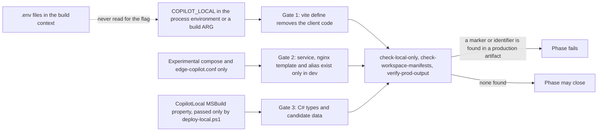

# Copilot (Developer Notes)

Copilot is a **local-only** AI training companion that sits beside Autopilot in the game client. While the owner plays,
a local thin processor reads the game-server logs, local models suggest commands, and the owner approves, corrects (with a
short "why") or rejects them. Corrections and anything the local agent cannot understand become records that a Claude Code
teaching session turns into written artifacts (expert fixes, persona proposals, map corrections). The value of Copilot is
the data and artifacts it produces; the Copilot code itself never ships.

This page is the entry point. It describes what exists now; each later phase adds its own page next to this one.

## The one rule: nothing Copilot reaches production

Copilot exists only in the dev docker stack (`deploy/docker-compose.shattered-archive-experimental.yml`, reachable on the LAN).
No Copilot code, route, vhost, fixture or data may appear in a production image, compose file or bundle. Three independent
gates enforce it, and two guard scripts prove it:

Status: gates 1 and 2 and the guard scripts exist (gate 2: the `copilot-server` service, its nginx template, CSP override and alias,
see [server-api.md](server-api.md)). Gate 3 and `Server/scripts/verify-prod-output.mjs` arrive with the C# map phases.

### Gate 1: the client build constant

- `apps/game-client/vite.config.ts` defines `__COPILOT_LOCAL__` from `process.env.COPILOT_LOCAL === 'true'`. It is read from the
  **process environment only**, never through `loadEnv`, because `apps/game-client/.env*` files are inside the Docker build
  context: a flag set there would silently ship in a production image.
- The constant is declared in `apps/game-client/src/copilot-local.d.ts`. Vite replaces it with a literal, so with it `false` the
  Copilot branch and everything imported only from it are dropped from the bundle. Every Copilot import in the client must sit behind
  `if (__COPILOT_LOCAL__)` (a dynamic `import()` inside it).
- `deploy/game-client.Dockerfile` has `ARG COPILOT_LOCAL` and `ENV COPILOT_LOCAL=$COPILOT_LOCAL` (empty unless passed). Only the
  experimental compose passes `COPILOT_LOCAL: "true"`; `deploy/docker-compose.yml` must not mention Copilot.
- `services/copilot-core` exports `COPILOT_BUNDLE_MARKER` (`sa-copilot-local-v1`). It is the string the guard looks for in a
  production `dist`, so it must exist only in that package.

### Guard scripts

| Command (from the repo root) | What it checks |
|---|---|
| `pnpm check:local-only` | the production compose files, production Dockerfiles and nginx files (`deploy/nginx` and `deploy/nginx/includes`, except the `edge-copilot*.conf` files) contain no `copilot` (apart from the allowed manifest lines and the two build switches); a built `apps/game-client/dist` (or each `--dist <dir>`) does not contain the bundle marker |
| `pnpm check:private-names` | no private test-character name appears in any file of this repository (needs the private matrix in the DSL repo, so it runs on the owner's machine) |
| `pnpm check:manifests` | every `deploy/*.Dockerfile` stage that runs a frozen `pnpm install` has the `package.json` of every workspace project in its build context before the install, or copies an ancestor folder in full |
| `pnpm test:guards` | the `node:test` suites of both scripts, including a real `vite build` of a tiny entry with the real `vite.config.ts` that proves a flag set only in `.env*` files does not enable Copilot |

Run `pnpm check:local-only` after a production build of the game client (`pnpm --filter @shatteredarchive/game-client build`
without `COPILOT_LOCAL`) to prove the dist is clean.

### Adding a workspace project

Adding or removing a workspace project means updating the `package.json` COPY lines in every `deploy/*.Dockerfile` stage that runs
`pnpm install`, or the next image build fails. A stage that copies `services` (or `apps`) in full already covers projects under it.
`pnpm check:manifests` lists exactly which stage lacks which line.

## Package map

| Path | Role | Status |
|---|---|---|
| `services/copilot-core` | pure logic shared by the client and the server: contracts now, then colour conversion, log parsing, policy, ledger, privacy scrubbing | contracts only |
| `apps/copilot-server` | the local server (dev compose only, port 65100): health, decisions, tickets, the log tailer, `GET /state`, the character registry, and the model adapters, suggestion producer and correction path (local models only, see [models.md](models.md)), and the teaching side: audit bundles, findings, the owner's acceptance and the training counts ([teacher-loop.md](teacher-loop.md), persona proposals in [persona-feedback.md](persona-feedback.md)) | skeleton, ledger routes, log tailer, character registry, suggestions (fakes only) |
| `apps/game-client/src/features/copilot` | the flag-gated client side: API client, settings, command gate, Autopilot link ([client.md](client.md)); the window comes next | plumbing, no UI |
| `C:/Projects/Shattered-AI/tools/archive-mcp` (sibling repo) | the experts Copilot asks: the sphere map (`experts/spheres.json`, every expert in one of the four spheres, enforced by the lint) and the `interaction` expert (`archive_interaction`: what to try in a room, from the local `/api/agent/room-hints`); see `doc/copilot-spheres.md` there | sphere map and interaction expert exist |
| `apps/copilot-server/src/world` | the world memory: room views from the log become a candidate map layer (rooms, exits with evidence, what rooms usually hold) and the confidence of a movement suggestion ([world-memory.md](world-memory.md)) | built (Phase 20), nothing publishes it |
| `apps/copilot-server/src/hints`, `suggest/hintFacts.ts`, `docs/userscripts/room-hints` | hints for what to try in a room from the fastest tier that knows: what the owner or Claude taught, the word list, the local model (off unless allowed), then a ticket for Claude; Copilot asks them for every situation ([hints.md](hints.md)) | built (Phase 42), live runs in Phase 39 |
| `services/copilot-core/src/fight`, `apps/copilot-server/src/fight` | fight safety: never start a fight before the monster is looked up in the archive (else `consider`d), and follow a fight in progress by code, with the flee made without a model ([fight-safety.md](fight-safety.md)) | built (Phase 33) |
| `services/shattered-maps-core` | the neutral world-map model: schema, identity and link evidence, room baseline, slices, export, SVG renderer, strict validator ([docs/shattered-maps/schema.md](../shattered-maps/schema.md)) | built (Phase 19), no producer and no UI yet |
| `apps/shattered-maps-client` | the map app | planned |

### `copilot-core` contracts

`services/copilot-core/src/contracts.ts` is the shared vocabulary:

- `SPHERES`: `world`, `fighting`, `interaction`, `things` (the knowledge spheres the training is organised by).
- `MODES`: `battle`, `exploration`, `questing`, `leveling`.
- `ACTION_KINDS`: what a command does as far as approval goes. `FLOOR_KINDS` (`spend-or-lose`, `speak`, `irreversible`, `pk`) is the
  hard floor: those are never run without the owner. `unknown` is what anything unrecognised becomes, and it always means "ask".
- `Suggestion`, `Decision`, `Lesson`, `EscalationTicket`: the records of the training loop. Characters appear only as codenames.
- `Confidence` is a finite number in [0, 1] or `null` ("no usable rating", treated as ask).

The package is pure: no file system, network, timer or clock (its `tsconfig.json` sets `types: []`), so the same code runs in the
browser and in Node.

## Tests

- `pnpm --filter @shatteredarchive/copilot-core test` (contracts: the marker value, the sphere/mode/floor lists, the guards).
- `pnpm test:guards` for the two guard scripts.
