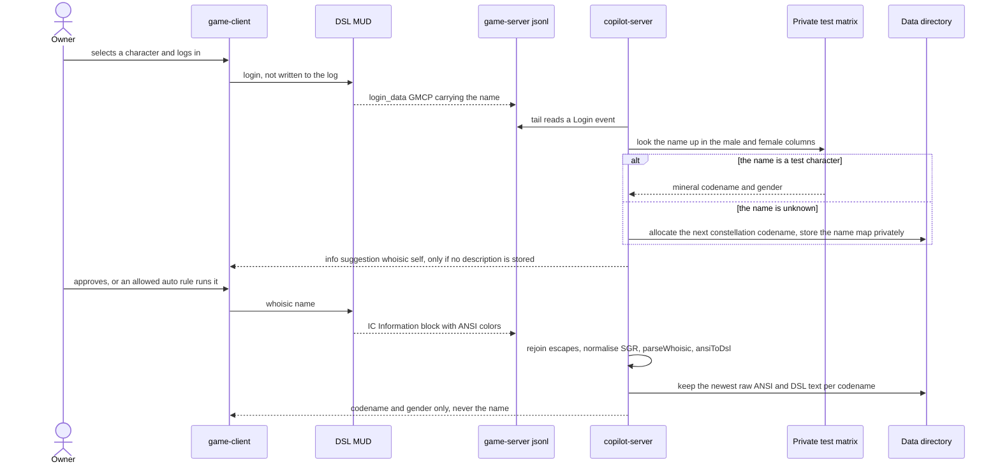
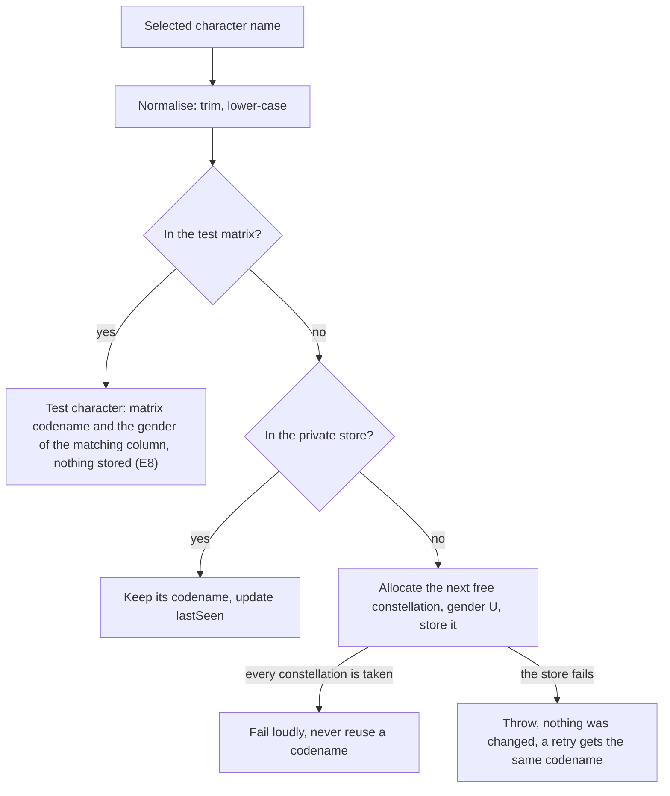
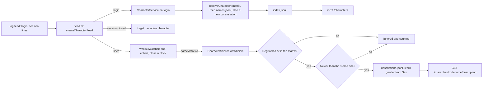

# Copilot characters and `whoisic` descriptions (Developer Notes)

Copilot plays as real characters and as test characters. Every character is known to Copilot by a **codename**; the real name
exists only in the Copilot data directory and is never written to a committed file, a model prompt, a bundle or a log
(`docs/standards/data-classification.md`, edge case PRIVNAME-01). This page covers the description of a character, which is read
from the game's `whoisic` command, and (as the flow is built) how a character gets its codename.

Status: all of it exists. The colour conversion, the `whoisic` parser, the codename registry core, the test-matrix loader and the privacy
scrubber are in `services/copilot-core`; the store, the login handling, the `whoisic` capture and the routes are in
`apps/copilot-server/src/characters/` and run inside the server (see "The server side" below).

## The flow



A character has **no predefined persona**; a persona can be built later from logs (see the persona feedback page when it exists).

## Codenames

Documents, bundles, API responses and committed files refer to a character only by **codename plus gender**: `Agate-F`, `C017-M`,
`Orion-U`. The part before the dash is the *base codename* (stable); the gender is an attribute.

| Kind | Base codename | Gender | Where it comes from |
|---|---|---|---|
| test | the matrix row's codename: a mineral for the first 31 rows (`Agate`), `C###` for the rest | `M` or `F`, from the matrix column the name was found in | the private matrix `docs/copilot/test-character-matrix.json` in the DSL repo, read by `loadMatrix` |
| real | the next free entry of `CONSTELLATIONS` (`Antlia`, `Apus`, ...), in list order | `U` until `whoisic` shows `Sex`, then `M` or `F` (`setGender`) | allocated at the first login and kept in the private store |

`formatCodename(codename, gender)` builds the `Base-G` form. Because the gender of a new real character is not known at login, the
base codename is what is stable; `Orion-U` becomes `Orion-M` once the description has been read.

How a selected name is resolved (`resolveCharacter` in `services/copilot-core/src/characters/registry.ts`):



Rules that hold in the code and the tests:

- A name that is in the matrix is always a test character, even if the store also has it; it is never written to the store.
- Two different names never share a base codename, and a base codename is never reused.
- The store (`CharacterStore`: `get`, `put`, `codenames`) is supplied by the server. The real name exists only as the store's key and
  the record never contains it. `put` must be atomic, and one writer at a time is assumed (serialise the calls).
- `loadMatrix` validates the rows: a bad codename, a bad name, a codename used twice or a name used twice rejects that row (reported
  by position, never with the name) and keeps the others.
- `CONSTELLATIONS` leaves out any word that is also a name in the private matrix, so a codename can never be mistaken for a name.

## The server side (`apps/copilot-server/src/characters/`)



- **Login.** `CharacterService.onLogin(name)` accepts only a name-shaped value (`^[A-Za-z][A-Za-z'-]{1,29}$`; anything else is refused and
  counted), runs `resolveCharacter` and writes an index record. Calls are serialised (the core registry assumes one writer). If the
  matrix file could not be read the service **registers nobody** (fail closed): a test character must never be filed as a real one.
- **Block capture.** `WhoisicWatcher` starts at an `IC Information for X.` line and ends at the first of: the game prompt line
  (`<1645/1645hp ...`), a feed event that is not text, a second header, 200 lines, or 3 s of silence (`settle`, called at the end of
  every tailer pass). The open block survives between polls, because a poll can cut a block in two.
- **Newest wins.** A block is stored under the character's codename when the name is a test name or a registered real name; the block
  with the later log time replaces the earlier one, equal times take the later-read one, an older one is ignored, an identical one
  writes nothing. A block for a name that is not registered (another player) is ignored. A block with no description is kept as
  `hasDescription: false` (E7), and the `whoisic` offer stops.
- **Gender.** A real character's `Sex: Male|Female` turns `Orion-U` into `Orion-M` or `Orion-F` in the name registry and the index.
- **The offer.** While connected, a character with no stored description gets one suggestion from `GET /suggestions`: `whoisic <name>`,
  kind `info`, sphere `interaction`, **confidence null**, so the policy always asks and it never runs without the owner. The command
  carries the real name, in memory only, for the owner's own browser; the ledger keeps it only in the private data directory and
  teaching bundles pass through `scrub`.

Files in `<COPILOT_DATA_DIR>/characters/` (all private; each is an append-only `JsonlStore`, so a failed write changes nothing):

| File | Holds | Contains a real name |
|---|---|---|
| `names.jsonl` | the CharacterStore of copilot-core: normalised name to codename, gender, first and last seen | yes, as the id, and nowhere else |
| `index.jsonl` | one record per character that has played, test or real: codename, kind, gender, a short hash of the name | no |
| `descriptions.jsonl` | the newest `whoisic` result per character: fields, raw ANSI, DSL, plain text, unmapped codes, log time | only if the description text itself names the character (stored verbatim) |

The index is rebuilt from `names.jsonl` at start-up if a crash lost a write. The test matrix is read once at start from
`COPILOT_MATRIX_PATH` (the DSL repo's `docs/copilot` folder mounted read-only at `/matrix` in the dev compose).

**API.** `GET /characters` returns `{ characters: [{ codename, kind, gender, hasDescription }] }`, newest player first.
`GET /characters/<Base-G>/description` returns the stored description (`fields`, `rawAnsi`, `dsl`, `text`, `unmapped`, `at`); every
registered real name and every test-character name in it is replaced by its codename in the response (the stored copy stays verbatim).
A real character is found by its base codename whatever gender letter the caller holds. A malformed codename is 400, an unknown one or
one with nothing stored is 404.

**How Claude later builds a persona.** A teaching bundle (a later phase) takes the codename and the stored description through
`scrub`, so a persona proposal is written from the `dsl` text and fields and never from a name.

## Never write a name outside the data directory

A real character name (including a test character's name) may live only in the private matrix file, the Copilot data directory and
the player's own game. It is never written to a committed file, a fixture, a document, a prompt or a bundle, and fixtures use
invented placeholders.

- `scrub(text, entries)` in `services/copilot-core/src/privacy/scrub.ts` replaces every registered name with its codename: case-insensitive,
  inside longer words (over-scrubbing is deliberate), longest name first, names shorter than 3 characters only as whole words. It is
  idempotent, including for a character whose name equals its own codename base. By default it also replaces name-shaped words in the
  positions where the game prints a player name (the speaker of a tell, `You tell X`, the `whoisic` header) with `<name>`, even when
  that name is not registered. Everything that leaves the data directory for a teaching bundle goes through it.
- `node scripts/check-private-names.mjs` (`pnpm check:private-names`) scans every tracked and untracked-but-not-ignored text file of
  this repository for any name in the private matrix (and any `--names <file>` you give it), whole words, case-insensitively, and
  prints file and line only. It needs the private data, so it runs on the owner's machine and not in CI. Run it before closing any
  phase that touches characters, and at the end of the work.

## The `whoisic` block

`whoisic <name>` answers with a block like this (values here are invented):

```
IC Information for <Name>.
----------------------------------------------------------------------------
Eyes: hazel                           Hair: jet-black
Skin: tan                             Hair Length: Long
Build: Large                          Hair Texture: Wavy
Face: Rugged                          Facial Hair: Clean-shaven
Feature: A pale mark across the brow
----------------------------------------------------------------------------
Profession: Scribe       Age: 38                       Sex: Male
----------------------------------------------------------------------------
(free text, hard-wrapped, with colour)
```

The server sends each line as its own `game:remote-server:raw` record with `\r\n` and colour as ANSI. The description runs until the
next prompt or GMCP record (the caller decides where the block ends); blank lines between its paragraphs belong to it, and
leading and trailing blank lines are dropped. `parseWhoisic(lines, at?)` in `services/copilot-core/src/characters/whoisic.ts` reads the
lines of one block (it finds the header, so the echoed command may come first):

| Field of the result | Meaning |
|---|---|
| `name` | the header name. **A real name**: use it once to find the codename and drop it |
| `fields` | label to colourless value (`Eyes`, `Hair Length`, `Facial Hair`, `Feature`, `Profession`, `Age`, `Sex`); a label starts a line or follows two or more spaces |
| `rawAnsi` | the description exactly as sent, with ANSI, after rejoining escape sequences a line break cut in two |
| `dsl` | the same text with ANSI converted to DSL colour codes |
| `text` | the same text with all colour removed |
| `unmapped` | ANSI sequences with no DSL code, flagged and never guessed |
| `hasDescription` | `false` when the block has no description text (E7); the three text values are then empty |
| `at` | epoch ms of the header in the log, when the caller passes it |

The newest description wins: `pickNewestWhoisic(a, b)` keeps the later `at`; on equal times the second argument (read later)
wins, and a record with a time beats one without. The stored description is verbatim: line breaks, double spaces and trailing
spaces are kept.

## Colour: ANSI to DSL

`ansiToDsl(text)` in `services/copilot-core/src/color/ansiToDsl.ts` returns `{ dsl, unmapped }`. Rules (edge case ANSI-01):

- Both styles the game sends are understood: `ESC[31m` / `ESC[91m` and `ESC[0;37m` / `ESC[1;31m`. Bold persists across sequences until a
  reset, as in a terminal.
- Bold black (`1;30`) and bright black (`90`) are both `{D`, the only black the DSL has; `0;37` is `{w` (grey) and `1;37` is `{W`.
- 256-colour numbers the DSL has a code for map to `{o` orange (208), `{n` brown (130), `{p` pink (213) and `{u` purple (141);
  numbers 0-15 map to the base and bright colours. Any other number is **flagged in `unmapped` and clears to `{x`**: the DSL text
  never shows a wrong colour, and the original ANSI is kept in `rawAnsi`.
- A colour code is written only when the effective colour changes, so repeated resets collapse.
- A literal `{` is written `{{` and `~` is written `{-`, as the client's `dslToAnsi` reads them. Background colours, underline and
  non-colour sequences are flagged in `unmapped` and dropped.
- A sequence cut by a line break (`ESC[1;31` CRLF `m`) is rejoined before anything else (`rejoinSequences`).

The colour table in `color/dslColors.ts` mirrors `DSL_ANSI_COLORS` in `apps/game-client/src/features/chat/dsl-to-ansi.ts`. If you
add or change a colour, change both: `apps/game-client/src/features/chat/dsl-to-ansi.roundtrip.test.ts` fails when they differ.

## Fixtures for descriptions

Tests use a scrubbed block with an invented character and an invented description (`whoisic.test.ts`). A real description is
Personal data: it is never copied into a fixture or a doc. When a real block is needed to find a parsing problem, read it in the
log, write a minimal invented block with the same layout and colour codes, and test that.

## Tests

- `pnpm --filter @shatteredarchive/copilot-core test`: `color/ansi.test.ts`, `color/ansiToDsl.test.ts`, `characters/whoisic.test.ts`,
  `characters/matrix.test.ts`, `characters/registry.test.ts`, `privacy/scrub.test.ts`.
- `pnpm test:guards` includes `scripts/check-private-names.test.mjs`.
- `apps/game-client/src/features/chat/dsl-to-ansi.roundtrip.test.ts` (run with the game-client suite): every client colour key comes
  back from `ansiToDsl`, and the mirrored SGR parameters equal the client's escapes.
