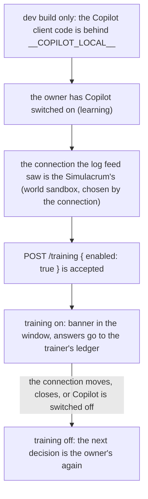

# Claude training mode (Developer Notes)

A setting that lets the AI trainer (Claude Code) stand in for the owner and answer Copilot's suggestions, against the **Simulacrum only**. Claude
drives the real game client through a **visible** Playwright window, makes the same approvals and corrections a person would, and uses the literal
merc-mud source as the only authority. The procedure Claude follows is the `copilot-train` skill (`.claude/skills/copilot-train/SKILL.md`).

## The gates

It is on only while every one of these holds, and turns itself off the first time one stops holding (it never resumes by itself):

- **Server** (`apps/copilot-server/src/training.ts`): an in-memory flag, so a restart is off. `GET /training` says `{ enabled, world, canEnable, refusal }`;
  `POST /training` answers 409 with the reason (`not-simulacrum`, `copilot-off`) when it cannot be turned on. Turning it off is always allowed.
- **Client** (`CopilotWindow`, `CopilotSettings`, `features/copilot/useTraining.ts`): the switch is in the settings tab and is shown only while the
  server says the connection is the Simulacrum's; a banner ("Claude is training Copilot") is always visible in the window while it is on.
  Production never sees any of it: the Copilot client is a dynamic import behind `__COPILOT_LOCAL__`.

## Whose answers are whose

| | owner's | trainer's (while training is on) |
|---|---|---|
| decision stored in | `ledger/decisions.jsonl` | `training/decisions.jsonl`, stamped `trainer: claude` |
| counts toward earned confidence (`/stats/buckets`) | yes | no |
| scenario occurrence for the teacher | yes | no |
| a correction that was understood becomes | a **proposed** DSL lesson (a teaching session accepts it) | an **accepted** Simulacrum lesson (`trainer: claude`), at once |
| a correction that was not understood | ticket in the owner's store | ticket in the trainer's own store |
| where a lesson applies | its own world | the Simulacrum only |

The router keeps every lesson to its own world: a Simulacrum lesson never steers the DSL and a DSL lesson never steers the Simulacrum, and a
connection of unknown world is treated as the DSL. A lesson that says `trainer: claude` for the DSL world is refused by the validator. The owner can
read or delete `training/` at any time; promoting a trainer lesson into the owner's ledger is the owner's decision.

## The pilot

`.claude/skills/copilot-train/scripts/pilot.mjs`: a headed Chromium window (never hidden or off screen; `lib/headed.mjs` refuses a hidden one) that signs
in to the Simulacrum site with the test account, plays a throwaway character, opens the Copilot window, switches Copilot and training on, and then
exchanges two files with Claude (`pending.json` and `answer.json`). An answer is checked first (`lib/answers.mjs`): a correction or rejection must carry
a `why` that names a merc-mud source file, so every lesson is traceable to the code. Every answered suggestion is appended to a session log in the
private data folder, tagged with one of the seven focus areas (navigating, interacting, fighting, inventory, buffs, healing, stats).

The pilot starts nothing else: the Copilot server, the Simulacrum and the local model (the GPU) are the owner's to run, and a session begins only with
the owner's go.

## Tests

`apps/copilot-server/src/training.test.ts`, `app.training.test.ts`, `suggest/trainer.test.ts` and the end-to-end case in `bootstrap.test.ts` (real log
records, the DSL refuses, the Simulacrum accepts, ledgers apart, the connection moving turns it off); `services/copilot-core/src/ledger/trainer.test.ts`;
the client's `useTraining.test.tsx`, `CopilotSettings.training.test.tsx`, `CopilotWindow.training.test.tsx`; the pilot's pure parts in
`.claude/skills/copilot-train/scripts/train.test.mjs` (visible-only launch, answer validation, the log).
