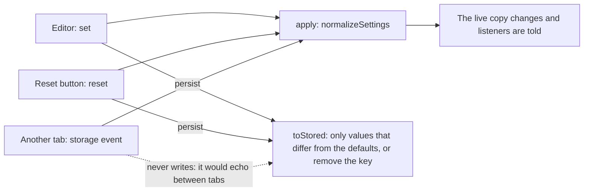
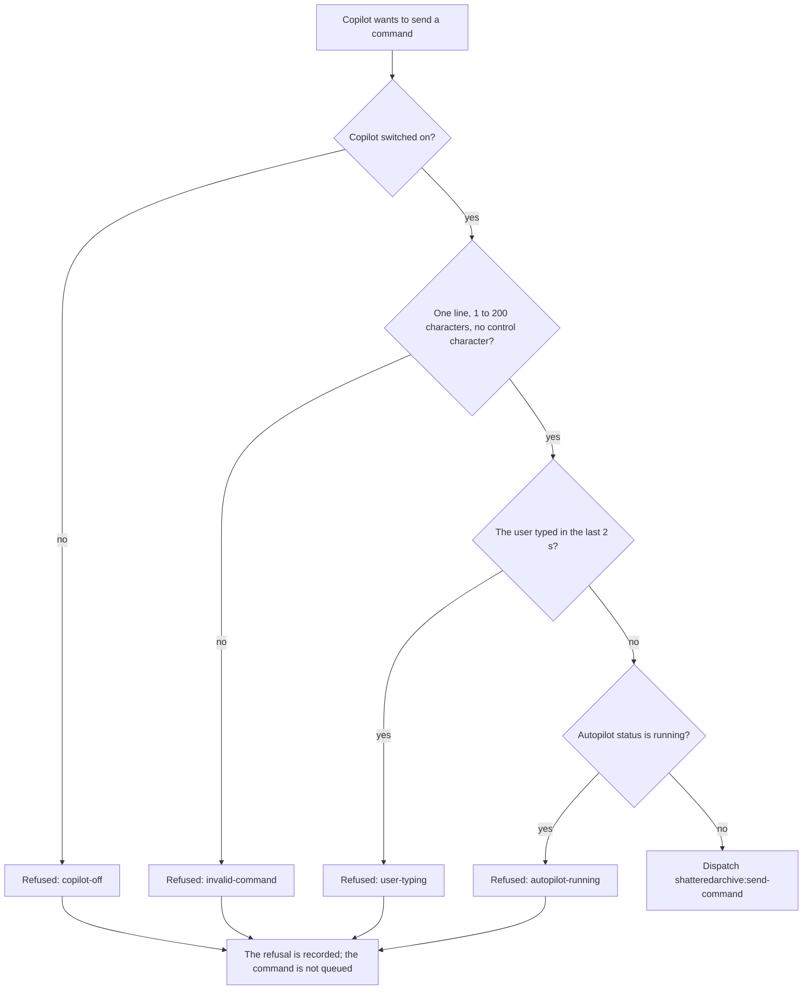
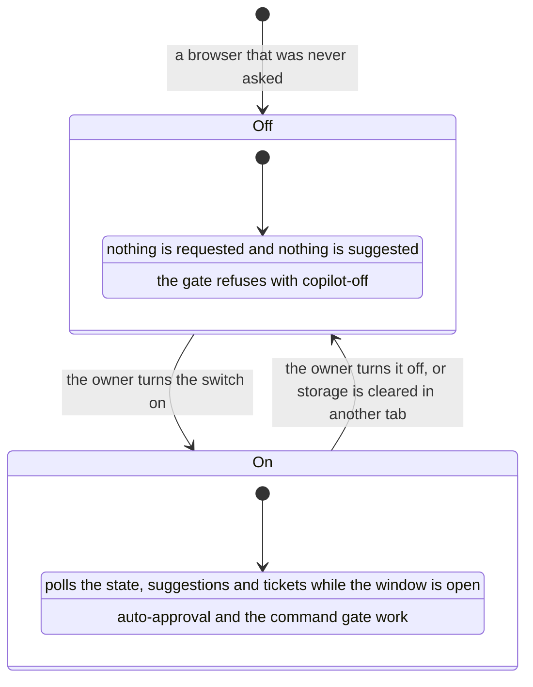
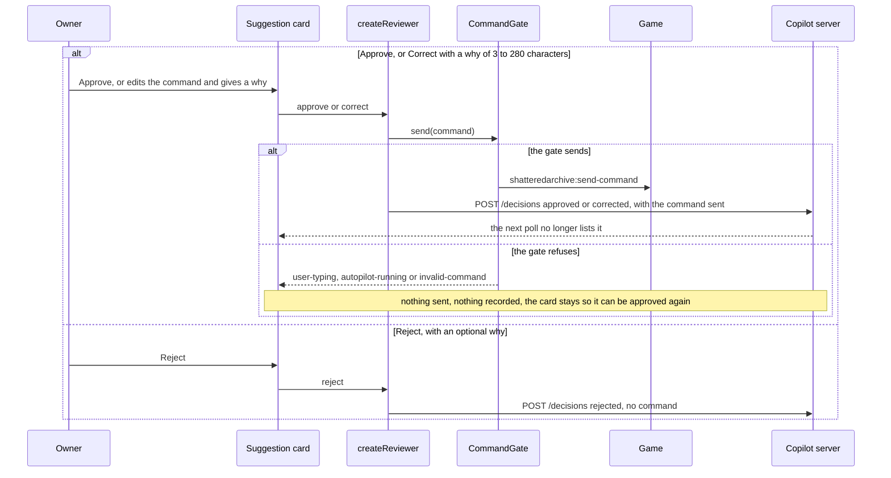

# Copilot in the game client (Developer Notes)

The client side of Copilot lives in `apps/game-client/src/features/copilot/` and exists only in a flagged (dev) build. This page covers
the plumbing that exists now: how the flag keeps it out of production, the API client, the settings store, the command gate and the
link to Autopilot. The window shell and its menu entry are described under "The window" below; it shows no suggestions yet.

## How the flag works

`main.tsx` starts Copilot with a dynamic import inside `if (__COPILOT_LOCAL__)`. Vite replaces that constant with a literal from
`process.env.COPILOT_LOCAL` (never from a `.env` file), so in a production build the branch, the import and the whole Copilot chunk are
removed. A flagged build keeps the code in lazy chunks (`index` and `loader`); only `loader` holds `COPILOT_BUNDLE_MARKER`.

| Build | `__COPILOT_LOCAL__` | Result |
|---|---|---|
| production (`pnpm build`, the production compose) | `false` | no Copilot code; `pnpm check:local-only` passes |
| dev stack (the experimental compose sets `COPILOT_LOCAL: "true"`) | `true` | Copilot chunks present; the same guard fails on that dist, by design |
| jest | `false` (`jest.config.cjs` globals) | a test that needs it sets `globalThis.__COPILOT_LOCAL__` and puts it back |

Proof in this phase: a real production build of the client was checked with `pnpm check:local-only` (clean), and a build with
`COPILOT_LOCAL=true` was checked the same way and failed on `assets/loader-*.js` (the marker), which shows both directions work.

## Where the server is

The shared game-client Dockerfile may carry only the `COPILOT_LOCAL` switch (edge case LOCAL-02), so there is **no `VITE_COPILOT_API`**.
`config.ts` fixes the address to the dev vhost, `https://copilot.shatteredarchive.dev`. For one browser it can be overridden with
`localStorage['copilot.api.base']`, which is used only if it is a bare origin on this machine, a private network or `*.shatteredarchive.dev`.

## The API client (`api.ts`)

Seven calls (`getState`, `getSuggestions`, `getCharacters`, `getOpenTickets`, `postDecision`, `getBucketStats`, `postTicket`), each taking an `AbortSignal` (the window aborts on unmount)
and answering `{ ok: true, value }` or `{ ok: false, reason }`. It never throws.

| Reason | Meaning |
|---|---|
| `offline` | the server could not be reached, or took longer than 10 s: the window shows "offline", suggests nothing, and nothing is queued (E1) |
| `aborted` | the caller cancelled |
| `http` | the server answered with an error status (`status` is set) |
| `invalid` | the answer had the wrong shape, or the decision to send failed `validateDecision` (nothing is sent) |

Suggestions are validated again with `validateSuggestion`; one that fails is dropped.

## Settings (`settings.ts`)

The trust settings of copilot-core in `localStorage['copilot.settings.v1']`. Every route writes through one function:



A blocked storage, or a stored value that is not JSON, gives the defaults. Each raises one warning that carries no stored value.
Settings are compared strictly (`"0.9"` is not `0.9`) and a rule for a never-auto kind is dropped by the normalizer.

## The command gate (diagram D9)



The gate (`gate.ts`) is the only place Copilot dispatches `shatteredarchive:send-command`. The order is user, then Autopilot, then Copilot
(E2); both busy is reported as `user-typing`. It asks `isEnabled` first (the switch, below), so a command is refused as `copilot-off` before anything else is looked at. Its inputs arrive over the event bus:

```mermaid
sequenceDiagram
  participant U as User typing
  participant GC as useGameCommand
  participant AL as useAutoLeveling
  participant Sig as useAutopilotSignals
  participant Bus as Event bus
  participant Link as autopilotLink
  participant Gate as CommandGate
  participant Co as Copilot
  U->>GC: types in the command box
  GC->>Bus: shatteredarchive:user-typing with a time
  Bus->>Gate: note the time
  AL->>Sig: run state changes
  Sig->>Bus: shatteredarchive:autopilot-status with the status
  Bus->>Link: remember the status
  Gate->>Link: status? on every send
  alt run state becomes error, or paused after a timeout
    Sig->>Bus: shatteredarchive:autopilot-need-help with reason and message, once
    Bus->>Co: the window may offer to look
  end
  Co->>Gate: send(command)
  Gate-->>Co: ok, or the refusal
```

## The link to Autopilot (`autopilotLink.ts`)

- Copilot to Autopilot: `start`, `pause`, `resume` and `stop` dispatch the existing `shatteredarchive:autoleveling-*` events, so Autopilot
  treats Copilot as a button press.
- Autopilot to Copilot: `shatteredarchive:autopilot-status` `{ status }` on every status change, and `shatteredarchive:autopilot-need-help`
  `{ reason, message }` when the run state **becomes** `error` (`reason: 'error'`), or **becomes** `paused` because the engine paused itself after a timeout it
  could not resolve (`reason: 'timeout'`, `message` says what it waited for: a movement reply, the end of a fight, a wait action). A pause by the player or a flee
  pause is not a call for help. A repeat error while it is still in `error` does not emit again; leaving `error` and entering it later does; a timeout pause
  emits once per pause. The detector is `features/autoleveling/autopilot-signals.ts` (the same change as before, see `docs/game/autopilot.md`, "Pause and stop"). The detector is `features/autoleveling/autopilot-signals.ts`, called by `hooks/useAutopilotSignals.ts`.
- The two new events are emitted in production builds too (the hooks are shared) and nothing listens there.

## The window

**Game > Copilot…** (flagged builds only) opens `components/CopilotWindow.tsx`: a movable, resizable window over the game.

- **Does not get in the way.** `role="dialog"` without `aria-modal`, no backdrop, no focus trap, and it does not take focus when it opens, so the command input behind it keeps working. Only the window itself takes pointer events. `z-index` 4900, under the Autopilot wizard (5000). Escape inside it, or the close button, closes it.
- **Header:** the title (drag it to move the window), the on/off switch (below), a mode picker (Battle, Exploration, Questing, Leveling; saved in `copilot.mode.v1`), a status (Online, Online but the game is quiet, Offline, from `GET /state` every 3 s, aborted on close) and a close button. At 360 px wide the header still fits; the status text shortens before anything is clipped.
- **The switch** (Phase 24a, an owner request). Copilot is **off by default**, and the owner turns it on and off from the window header. The choice is kept per browser in `copilot.enabled.v1` (`features/copilot/enabled.ts`: only the exact text `true` is on, so a missing, damaged or blocked value is off). While it is off the window mounts nothing but the header and a short explanation, so `useServerStatus`, `useSuggestions`, the tickets count and auto-approval do not run and no request leaves the page, and the gate refuses with `copilot-off`. Turning it off aborts the poll in flight and drops the suggestion cards. Other tabs follow through the `storage` event (`loader.ts`), and the menu entry reads `Copilot… (off)` while it is off (`MainContainer` reads the shared runtime lazily, behind the build flag). The switch is a native `button` with `role="switch"` and `aria-checked`. Copilot's page still works only while the window is open (closing it pauses the page, as before).

  **The switch also controls the server's learning** (Phase 24b). The Copilot server starts with learning **off** after every start and reads the game logs only while the switch is on ([log-pipeline.md](log-pipeline.md), [server-api.md](server-api.md) `POST /control`). The page tells it: when the owner flips the switch in the window (`CopilotWindow`), once when a page loads with the switch on (`loader.ts`), and whenever an open window with the switch on sees `learning: false` in `GET /state` (a restarted server). A page that loads with the switch off asks nothing. Learning stays on while the window is closed; only turning the switch off stops it, and what is written while it is off is never learned. One gap: if the browser's storage is cleared while the server is learning, the page shows off while the server still learns; turning the switch on and off once sends the off.

  ```mermaid
  sequenceDiagram
    actor Owner
    participant Win as CopilotWindow
    participant Load as loader.ts
    participant Srv as copilot-server /control
    participant Tail as Tailer
    Note over Srv,Tail: every start: learning off, tailer paused
    Owner->>Win: switch on
    Win->>Srv: POST /control enabled true
    Srv->>Tail: resume: move every file to its end
    Tail-->>Srv: reads only what is written from now on
    Owner->>Win: switch off
    Win->>Srv: POST /control enabled false
    Srv->>Tail: pause: no pass, nothing read
    Note over Load,Srv: a page that loads with the switch on tells the server once; off asks nothing
    Note over Win,Srv: an open window with the switch on re-sends on when GET /state says learning false



- **Geometry** (`hooks/useFloatingPanel.ts`): drag by the header, resize by the corner, never outside the viewport and never below 360 by 220, saved on release in `copilot.window.v1`, restored (clamped) on the next open, pulled back inside when the browser window shrinks. Resizing stops at the screen edge instead of moving the window.
- **Flag:** the menu item and the lazy import are both behind `__COPILOT_LOCAL__`; a production build has neither (`MainMenuBar.copilot.test.tsx`, the production-build guard).

Checked in a real browser (Playwright, the dev stack, 1440x900 and 900x600): open from the menu, the status reaches the Copilot server through nginx, drag, drag past every edge, resize, minimum size, mode change, the menu behind it still opens, geometry and mode survive a reload, Escape and the close button.

## Reviewing suggestions (diagram D4, the decision half)

The window body is `components/CopilotReview.tsx`. `features/copilot/useSuggestions.ts` polls `GET /suggestions` and
`GET /tickets?status=open` every 3 s (a poll is scheduled only after the last one answered; all are aborted on close). The list is oldest
first, one entry per id. Each suggestion is a card: sphere, kind, the confidence with its source (`model`, or `map evidence` for movement,
or "not rated"), the exact command, the rationale and a folded "Situation" line (the `situationKey`; the server sends no further evidence).



- **A refusal is not a decision.** The server retires a suggestion on any decision, and a recorded `approved` would claim a command that never ran, so a refused answer posts nothing. The card shows why and the session log notes it.
- **Sent but not recorded.** If the gate sent the command and the server then cannot be reached, the card goes and the log line says "not recorded: server unreachable". A rejection that cannot be recorded keeps its card.
- **Offline.** The last list stays on screen, marked, with all three buttons disabled: an answer needs the ledger.
- **Session log:** the last 50 answers of this window, newest first (kept in memory only). **Open tickets** is the server's count of tickets still open.
- The window takes the page's single `CommandGate` from `loader.getCopilotRuntime()` (so the gate that listens to the user's typing is the one used) but builds its API client on open, so a changed `copilot.api.base` applies without a reload.
- The `why` rules live in `features/copilot/review.ts` (`checkWhy`, 3 to 280 characters, trimmed). The server accepts up to 500.
- Every answer carries the suggestion's `sphere` and `kind` (`bucketOf` in `review.ts`), which is what the server counts the owner's history from.

## Settings tab and automatic answers (Phase 14)

The window body has two sections, **Suggestions** and **Settings** (`aria-pressed` buttons). The list stays mounted behind the settings,
so a half-written correction survives a visit to the settings and auto-approval keeps running while a rule is adjusted. The settings
store is the page's one (`getCopilotRuntime().settings`), like the gate.

- `components/CopilotSettings.tsx`: the rules, the quiet limit, the always-ask list and reset. Read it together with
  [trust-and-approval.md](trust-and-approval.md), which owns the policy, the bucket counts and the diagrams.
- `features/copilot/autoApprove.ts`: `createAutoApprover` looks at each new suggestion once and applies `decide`. It is created by
  `CopilotReview` when the list mounts and its signal is aborted when the list unmounts.
- `features/copilot/useBucketStats.ts`: polls `GET /stats/buckets` every 10 s while the Settings tab is shown, keeping the last good table
  when a poll fails.

## The focus: Training or AI agent

A row above the tabs (`components/CopilotFocus.tsx`, shown while Copilot is on) says what Copilot is for. The choice is per browser,
under `copilot.focus.v1` (`features/copilot/focus.ts`, shared through `getCopilotRuntime().focus` and followed across tabs like the on/off
switch). It is **Training** until the owner picks the AI agent; only the exact stored text `agent` counts, so a missing or damaged value is
Training.

| Focus | What happens to a suggestion |
|-------|------------------------------|
| **Training** | It always waits for the owner to approve, correct or reject it. Nothing runs by itself, whatever the trust rules say. The answers are what Copilot learns from. A suggestion the policy would have escalated still files its ticket for the teacher. |
| **AI agent** | `decide` (copilot-core) applies as it always has: a rule enabled for the suggestion's sphere and kind, at least 20 of the owner's earlier answers in that bucket, and effective confidence over the threshold let it run by itself. Everything else waits. |

The hard floor holds in both: spending or losing items, speaking to players, anything irreversible and player-kill never run by themselves,
and neither does any command the classifier cannot place (group, follow, order, emotes at players, settings): those ask and file a ticket.
`autoApprove.test.ts` runs a table of such commands with every rule on, every bucket earned and full confidence, and asserts none runs.

Switching to the AI agent asks first ("Let Copilot run commands by itself?"), once per browser session (`sessionStorage`
`copilot.focus.confirmed.v1`); Escape answers that question only. Switching back to Training never asks and takes effect at once:
`createAutoApprover` reads the focus just before it would send, so a command that was about to run is stopped.

## Tests

`pnpm --filter @shatteredarchive/game-client test`. For this feature: `components/CopilotReview.test.tsx` (cards, approve, correct,
reject, cancel, a refused gate, offline, unrecorded answers, the 50-line log, and the automatic runs), `components/CopilotSettings.test.tsx`,
`features/copilot/review.test.ts`, `autoApprove.test.ts`, `useBucketStats.test.tsx` and `useSuggestions.test.tsx`; `features/copilot/enabled.test.ts` and `components/CopilotWindow.switch.test.tsx` (the switch), `features/copilot/*.test.ts` (api: offline, abort, http, invalid;
settings: the editor, reset and storage-event routes, corrupt JSON, blocked storage; gate: refused while Autopilot runs, refused after
typing, allowed otherwise, refusals recorded, bad commands; link; loader; index), `features/autoleveling/autopilot-signals.test.ts`,
`hooks/useAutopilotSignals.test.tsx`, `hooks/useGameCommand.userTyping.test.tsx`, and `main.copilot.test.tsx`, which imports the real
`main.tsx` and proves the Copilot module is never required when the flag is false.

## The help (the blue i)

`components/HelpInfoButton.tsx` is the blue round indicator (aria-pressed, named "Help: <topic>", it stops a pointer press so it never starts a window drag) and `components/CopilotHelp.tsx` is the article. The window keeps one
`helpOpen` flag: while it is on the article replaces the body and what was there is only `hidden` (never unmounted, so the suggestion list keeps running and automatic approval goes on working); Escape closes the help first. The
help is plain text for a person who has just turned Copilot on; keep it in step with `docs/copilot/user-guide.md` of the DSL repository when behaviour changes. The map window carries the same indicator with `MapHelp.tsx`.
Tests: `CopilotWindow.help.test.tsx`, `HelpInfoButton.test.tsx`, `MapHelp.test.tsx`; browser check `playwright/help-ui.mjs` in the Copilot plan folder.
