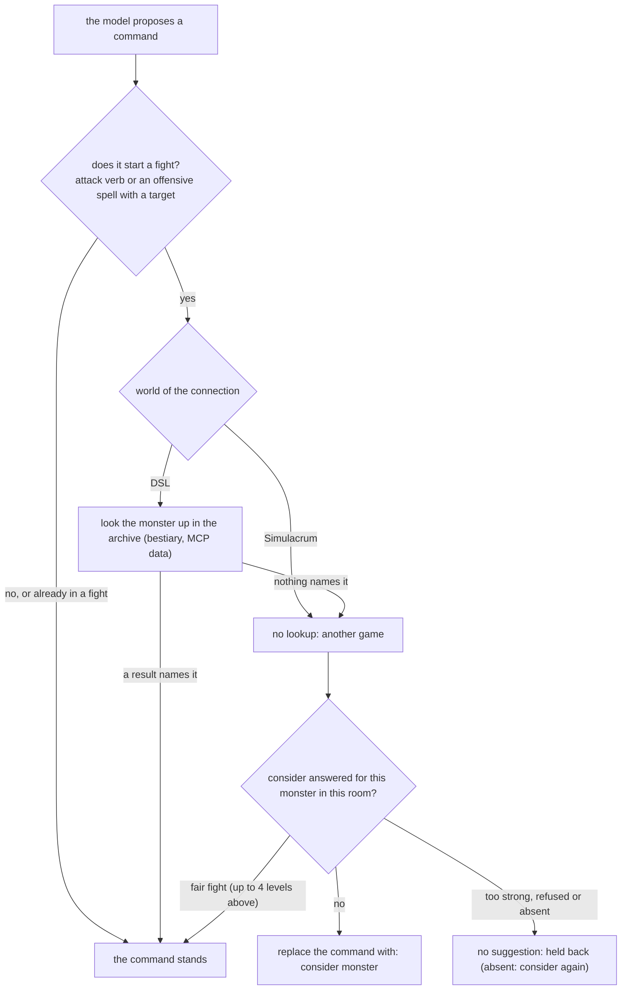
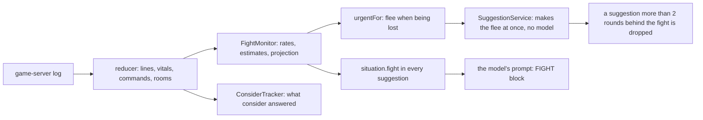

# Fight safety: look before fighting, follow the fight (Developer Notes)

Copilot's model is seconds behind a game that moves every three seconds, and a fight against the wrong monster can end a character. Two things keep
that safe, and neither needs the model:

1. **A fight is never started on a monster that has not been identified.** First a lookup in the archive through the MCP; when the archive cannot
   name the monster, `consider` (the game's `con`) and read the answer.
2. **A fight in progress is followed by code** (the fight monitor), which says where it is going and, when it is being lost, makes the `flee`
   suggestion itself without waiting for a model.

The rules and the words they read come from the game's own source (`merc-mud/2.4/src`), and they were checked against the DSL's real logs: the
messages of the original ROM game are still what the customised game prints.

## The rule before a fight

- **What starts a fight** (`copilot-core/src/fight/gate.ts`): an attack verb (`kill hit bash trip kick backstab circle dirt disarm gouge headbutt strike
  murder`) with a target, or `cast` of an **offensive** spell with a target (the spells whose target is `TAR_CHAR_OFFENSIVE`, a generated list from
  the game's skill table: `scripts/gen-offensive-spells.mjs`). `rescue` and `assist` name an ally, not a monster, so they are not gated.
- **Short forms.** The game reads a short form by the order of its own command table (`c` is `cast`, `ki` is `kill`). This package does not know that
  order, so a word that could be the start of an attack verb is read as one unless it is exactly the name of another command (`tell`). That can ask for a
  lookup that was not needed; it can never let a fight start unlooked.
- **Identified means named.** `httpMonsterLookup` asks `/api/agent/bestiary?q=` and counts a monster as identified only when a result names the typed
  word in its own name or keywords. A stranger in the list, an empty list, an error or a late answer is "not identified".
- **The Simulacrum is another game.** Its monsters are never asked in the DSL's archive (a shared name would give the wrong level); in that world the
  first step is `consider`.
- **`consider` is read exactly** (`consider.ts`, from `do_consider` in `act_info.c`): the monster's level minus the character's gives one of seven
  sentences (naked and weaponless 10 or more below, no match 5 to 9 below, easy kill 2 to 4 below, the perfect match -1 to 1, "do you feel lucky" 2 to 4
  above, laughs mercilessly 5 to 9 above, "Death will thank you" 10 or more above), plus "Don't even think about it." (the game will not allow it) and
  "They're not here.". Copilot starts a fight only up to the lucky band (`MAX_FIGHT_LEVEL_DIFF` = 4).
- **Knowledge is kept per room and per keyword** (`knowledge.ts`), for 15 minutes, 200 entries at most. `ConsiderTracker` reads the answer to a
  `consider` from the feed whether Copilot or the player typed it, and forgets it when another command, a move or a close comes first.

## Following a fight

`FightMonitor` (`copilot-core/src/fight/monitor.ts`) reads the same text a player reads and keeps the numbers a player keeps in their head.

| Reads | From the game's source | Gives |
|---|---|---|
| blows ("You scratch the goblin.", "Your bash hits the goblin.", "The goblin mauls you!") | `dam_message` in `fight.c`: a verb per damage range, from a miss (0) to "does UNSPEAKABLE things to" (151 and up) | damage per round, each side, as the middle of each verb's range |
| the opponent's condition | `comm.c` battle prompt and `act_info.c`: eight sentences by percent of hit points | how hurt it is, as a range; with what was dealt, an estimate of its hit points and of the rounds left |
| the character's own hit points | the `vitals` of the feed (exact) | rounds until the character dies, hit point percent |
| `You flee from combat!`, `PANIC!`, `is DEAD!!`, `You receive N experience points.`, `You have been KILLED` | `fight.c` | how the fight ended, with the experience |

A round is **3 seconds** (`PULSE_VIOLENCE` is 3 times `PULSE_PER_SECOND`, four pulses a second, in `merc.h`). `snapshot(now)` also **projects** the
fight to the time of the question (a few rounds, never past the point where silence ends a fight), so a consumer that is behind is told where the fight
probably is now.

- **Advice** is `continue`, `finish` (the opponent is within two rounds and the data is trusted) or `flee`: hit points under 25%, or within two rounds
  of death while the opponent is not about to die first, or a fight being lost that is six rounds or fewer from death.
- **`reliable`** is true only with two rounds of data and an opponent condition; below that the snapshot says so and the prompt says "too little data".
- **The flee is the code's.** `producer.urgent` builds the `flee` suggestion from the monitor with no model call; `SuggestionService.poke` installs it
  at once, even while a model is still thinking, and drops a model answer that arrives after the fight turned bad. Its confidence is `null` (no model
  rating), so the policy asks.
- **Stale answers go.** A suggestion made for a fight is dropped when the fight is more than two rounds past the round it was made in (`maxRoundsBehind`).

## Files

| Where | What |
|---|---|
| `services/copilot-core/src/fight/` | `consider.ts`, `condition.ts`, `damage.ts` (the game's words), `monitor.ts`, `knowledge.ts`, `gate.ts`, `considerTracker.ts`, `offensiveSpells.ts` (generated) |
| `apps/copilot-server/src/fight/` | `watch.ts` (fed by the pipeline), `monsterLookup.ts` (the archive), `gate.ts` (the rule in practice), `urgent.ts` |
| `apps/copilot-server/src/suggest/` | `producer.ts` (gate and urgent), `service.ts` (rounds behind, urgent first), `prompt.ts` (the FIGHT block and the rule), `wiring.ts` |
| `services/copilot-core/scripts/gen-offensive-spells.mjs` | regenerates the spell list from merc-area's stock table (a test fails when it is stale) |

## Checked against real play

The parsers were run over 40 of the owner's real DSL game-server logs (read only, counts only): 2,546 blows of the character, 848 at the character,
2,516 condition lines, 287 deaths, 21 flees and 229 experience lines were recognised, and the fight-looking lines that were not recognised were not
blows (level-ups, equipment, "You are surrounded"). The ROM wording is still what the customised game prints. The DSL has its own spell and skill
text; only the lines in the table above are read.

## Limits

- Estimates, not numbers: a verb is a range of damage and a condition a range of percent, so the monitor's rates are the middle of those ranges.
- The archive lookup identifies a monster; it does not yet compare its level with the character's (the game state has no level), so only the
  `consider` path judges "too strong". For a monster the archive knows, the model and the owner still judge the level.
- A monster that is identified by a keyword shared with a stronger one in the same room is a risk of the game's own targeting too; `consider` again
  when the room changes.
