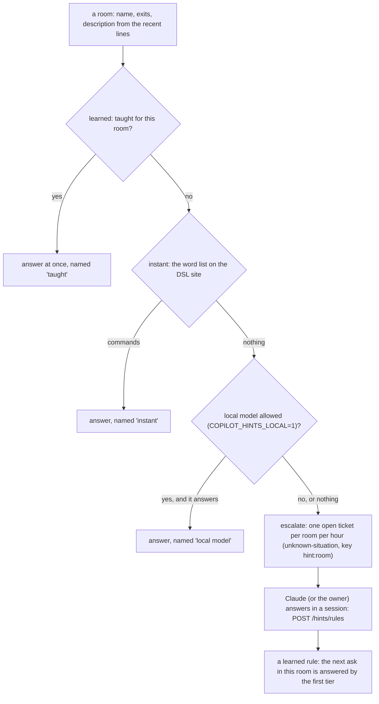

# Copilot hints: fast, then local, then frontier (Developer Notes)

"What is worth trying in this room?" is answered by the **fastest tier that knows**, and every answer the slower tiers give becomes something the faster tiers
know next time. The code is `apps/copilot-server/src/hints/` (the tiers) and `apps/copilot-server/src/suggest/hintFacts.ts` (how Copilot uses them); the user
scripts are in `docs/userscripts/room-hints/`.

## What was found first (Phase 42)

- The `hint` user script and its C# provider (`/api/agent/room-hints`) are a **word list**: the nouns of the room text turned into commands, minus what the owner's
  logs show the game rejecting. `docs/userscripts/room-hints/evaluate.mjs` measured it against the owner's logs (2026-11-12, 2,036 rooms with a description, 4,053
  variants): **coverage 78.0%** of rooms get at least one suggestion, but **recall only 32.3%** of the things the game recognised in the logs (50.4% of the recognised
  words are not in the room text at all: an unlisted or hidden object no word list can name; 13.7% are lexicon gaps; by verb `open` 80%, `look in` 35%, `enter` 23%,
  `read` 1%).
- **Copilot never used it.** The producer's archive lookup had no endpoint for the interaction sphere (`ENDPOINT.interaction` was undefined), so hints reached
  Copilot only if the model happened to call `archive_interaction` itself.

## The tiers

| Tier | Where | Cost | Notes |
|---|---|---|---|
| `learned` | a ledger, `rules.jsonl` in the Copilot data folder (`hints/`) | an in-memory lookup | what the owner (`source: owner`) or Claude (`source: claude`) taught; an owner rule beats a Claude rule, the newest wins within a source; a rule is a fact shown to the model, never a command that runs |
| `instant` | `GET /api/agent/room-hints` on the DSL site (needs `COPILOT_ARCHIVE_URL`) | a local HTTP call, 3 s limit | worked commands first, then the suggestions, the struck-off ones removed, at most 6 |
| `local` | `POST /api/agent/room-hints/ai` (the owner's Ollama, `hint:ai`) | seconds to minutes, **GPU** | off unless `COPILOT_HINTS_LOCAL=1`: a model is never started silently |
| `escalated` | an `EscalationTicket` for the active character | none | reason `unknown-situation`, sphere `interaction`, situation key `hint:<room>`; with nobody playing there is nothing to file it under, so it is tried again next time |

A tier that throws, times out or answers nothing is "cannot answer" and the next one is asked; no tier's failure is ever a failed suggestion.

## How Copilot uses it

`routeSituation` takes an optional `hints` function and asks it for **every** situation outside a fight (not only when the model is in the interaction sphere);
`createHintFacts` finds the room in the situation (name, exits and sector from the game state, the description from the lines between the room name and the
`[Exits:` line) and gives the prompt a block: `HINTS FOR THIS ROOM (what is worth trying here; the fastest source that knew is named; check before acting)`.
A hint is never a command: whatever Copilot suggests from it still goes through the policy gate and the owner.

## Routes (Copilot server)

| Route | Answer |
|---|---|
| `GET /hints?title=&description=&exits=N,S` | `{ tier, commands, notes, tried, ms }`; 400 for no title, a title over 200 characters, a description over 4,000 or bad exits; 503 without the tiers |
| `GET /hints/rules` | `{ rules }` |
| `POST /hints/rules` | body `{ title, commands: [1-8 lines], source: "owner" \| "claude", note? }`; 201 `{ rule }`; 400 with the reason; the same room, source and day replaces the earlier answer |

## The refinement loop (owner, Copilot, Claude)

1. **Owner, in the game:** `hint` asks Copilot first (what was taught, instantly), then shows the word list. `hint:teach enter orb | look in gate` tells Copilot what works in the room
   you stand in (several commands separated by `|`, because the client splits on `;`). Nothing is sent to the game.
2. **Copilot:** every suggestion asks the tiers about the room; a room nobody knows opens one ticket for it.
3. **Claude, in a teaching or training session:** the open `hint:` tickets are the third tier (see the `copilot-teach` skill): answer from evidence, never by playing, and post the rule.
4. **Measure:** re-run `docs/userscripts/room-hints/evaluate.mjs` after the word list changes (the C# `Lexicon`); the numbers above are the baseline.

## Files and tests

| File | Holds |
|---|---|
| `hints/types.ts`, `engine.ts` | the answer shape and the tier selection (stop at the first, escalate once per room per hour) |
| `hints/rules.ts` | the learned rule, its validator, `learnedTier` |
| `hints/instant.ts` | the two clients of the DSL site's routes and what they keep of the answers |
| `hints/wiring.ts` | builds the tiers from the config, the character and the ticket ledger |
| `suggest/hintFacts.ts` | the room of a situation and the facts for the prompt |
| `app.ts` | the three routes; `bootstrap.ts` opens the rules ledger |

Tests sit beside each file (`*.test.ts`, 100% on the new files), the routes in `app.hints.test.ts`, the whole path in `bootstrap.test.ts`; the user scripts in
`docs/userscripts/room-hints/hint.test.mjs` (in `pnpm test:guards`).
