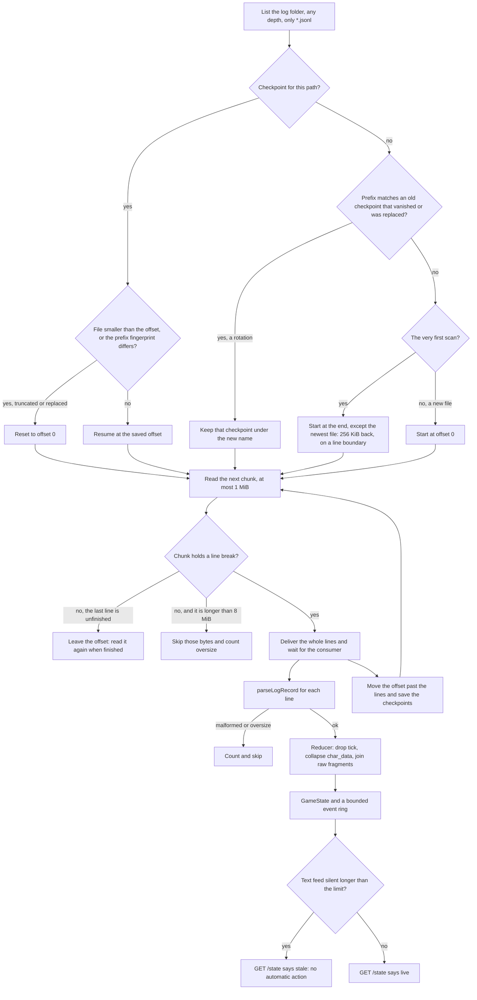

# Copilot log pipeline (Developer Notes)

Copilot learns what is happening in the game by reading the game-server's jsonl logs, never the live socket. The pipeline is a
tailer (reads new bytes), a parser (one line becomes a typed event) and a reducer (a compact, ordered feed plus the current game
state). The parser and reducer are pure functions in `services/copilot-core/src/log/`; the tailer is part of `apps/copilot-server`.

Status: all of it exists. The parser, reducer and staleness check are in copilot-core; the tailer, the pipeline and `GET /state` are in
`apps/copilot-server` (`src/tail/`, `src/routes/state.ts`) and run inside the server.

## The flow



## The log

`C:/Projects/DSL/GameLogs/ShatteredArchive/Docker/game-server/<yyyy>/<mm>/<dd>/server.log-<yyyy-mm-dd>.jsonl` (the folder date and the
file date can differ: the file for one date may sit in the previous day's folder, so files are found by listing, never by building a
name from the date). **Only `*.jsonl` files are read.** The same folders also hold a plain-text copy, `server-<yyyy-mm-dd>.log`, with
lines like `[2026-11-06T12:38:10.970Z] debug: game:remote-server:raw ...`; those are not JSON, and reading them makes most lines
"malformed" (found while checking the parser against real logs). Each line is one JSON record `{ type, subtype, level, timestamp, payload }`. The records Copilot uses:

| `type` | `payload` | Becomes |
|---|---|---|
| `game:remote-server:raw` | `{ type: 'raw', data }`: text from the MUD with ANSI, **not line-aligned** | `raw` |
| `game:remote-server:gmcp` | `{ type: 'gmcp', data }` where data is `<package> { json }` | `room` (`room_data`), `char` (`char_data`), `login` (`login_data`), `tick`; other packages (`affect_data`, ...) are ignored |
| `game:client:input` | a JSON **string** `{"type":"data","data":"<command>"}` (an object is accepted too); `{"type":"connect",...}` is ignored | `input` |
| `game:remote-server:connect` | `{ host, port }` | `connect` |
| `game:server:connection:client-closed` | `{ code, reason }` | `closed` |

`parseLogRecord(line)` never throws. It answers `{ ok: true, event }` or `{ ok: false, reason }` where the reason is `malformed`
(not JSON, no type, a bad timestamp, a used package with an unusable body), `oversize` (more than `MAX_LOG_LINE_CHARS` = 1,000,000
characters: skipped without parsing) or `ignored` (a well-formed record Copilot does not use, such as the server's start-up
records). The tailer counts the first two. `parseLogLine(line)` is the same without the reason.

GMCP fields used: `char_data` needs all six of `hp`, `max_hp`, `mana`, `max_mana`, `move`, `max_move` (finite numbers), and reads
`is_fighting`, `gold`, `silver` and `tnl` when present; `room_data` needs `room` and reads `sector` and `exits`; `login_data` needs
`name` (a **real character name**, consumed at once by the character registry and never logged) and reads `level`.

## The reducer

`reduceEvents(state, events)` folds a batch into a new state and returns the feed (`FeedEvent`):

| Feed event | When |
|---|---|
| `lines` | whole lines completed in this batch, ANSI still in them; blank lines are kept because they separate paragraphs |
| `room` | the room name, sector or exits changed (the game sends `room_data` before **every** prompt, so identical ones are collapsed; a `connect` or a close forgets the last room, so a new session announces its room even when it is the same one) |
| `vitals` | the vitals or the fight flag changed (identical `char_data` is collapsed: 1,000 of them make one event) |
| `command` | a command echo from `game:client:input`, without its line end |
| `login` | a `login_data` record |
| `session` | `connected` or `closed` (a connect or close also drops an unfinished line from the previous session) |

`tick` is dropped. The batch is put in timestamp order first (stable, so records with the same millisecond keep file order). The
unfinished last line of the raw text is carried in `ReducerState.partial` and completed by the next batch; an endless line is
flushed at `MAX_PARTIAL_CHARS` instead of growing. The function does not modify the state it is given.

## Staleness and the SOH note

`GameState` records `lastEventAt` (any event) and `lastTextAt` (a raw line, a command echo or a connect). `isStale(state, now, limitMs)`
is true when the **text** feed has been silent longer than the limit, or has never produced anything. This matters because the
game-server stops logging a connection after it receives a SOH control character on it (`LOG_RESPECT_SOH=true`, see
`docs/game-server.md`) until the next SOH or 5 minutes, whichever comes first, so a log can hold a silent stretch for a connection
that was still playing. (An older server wrongly kept that switch for the whole process and could stay off for days; fixed 2026-11-08.) A stale state never leads to an automatic action (edge case LOGTAIL-02); the trust policy turns it into
"ask". A clock that is behind the last event is treated as live.

## The tailer (`apps/copilot-server/src/tail/tailer.ts`)

- **Discovery.** `list` walks the folder to a depth of 12 and returns the `*.jsonl` files, newest modification time first. Nothing is built
  from a date, so the next day's file inside the previous day's folder is found like any other. Symbolic links are not followed.
  A full scan runs every `scanMs` (10 s); between scans only the newest `hotFiles` (4) are checked, every `pollMs` (1 s). A hot file
  that disappears makes the next pass a full scan.
- **Checkpoints.** `<COPILOT_DATA_DIR>/tail/checkpoints.json` holds, per file, `path` (relative, forward slashes, never absolute or
  containing `..`), `offset` (always the end of a complete line), `size`, and a fingerprint (sha1 of the first up to 256 consumed bytes).
  It is written after a pass that moved something, through a temporary file and a rename. A crash between delivering a batch and saving
  can repeat at most the last batch; the reducer collapses repeated state. A file that cannot be written is retried on the next pass.
- **Rotation.** The fingerprint tells a renamed file (same prefix, new name) from a recreated one (same name, different prefix), so
  `server.jsonl` renamed to `server.1.jsonl` plus a fresh `server.jsonl` neither repeats the old lines nor skips the new ones.
  A file smaller than its offset is read again from the start.
- **The first scan** of a new installation does not replay history: every existing file starts at its end, except the newest, which
  starts up to 256 KiB before its end (on a line boundary) so the room and vitals are known. A file created later starts at byte 0.
  A checkpoint file that cannot be read counts as a new installation.
- **Order.** Files with new data are read oldest first, so the newest file has the last word on the current room.
- **Back-pressure and size.** One chunk (1 MiB) is in memory at a time, and the next read waits for the consumer. A line longer than
  a chunk is read whole up to 8 MiB; a longer one is skipped and counted (`oversize`).
- **Errors.** A failing listing, read or checkpoint write is counted (`ioErrors`) and the loop carries on; a consumer that throws costs
  that batch (`consumerErrors`), which is not retried, so one bad batch cannot stall the feed.
- **Pause and resume (the Copilot switch).** The server starts **paused**: `setPaused(true)` makes every pass return at once (no listing, no read,
  no delivery, no checkpoint write), and a pause in the middle of a pass stops it between batches. Resuming does not catch up: the next pass lists
  the folder and moves **every file to its current end** (`skipToEnd`, the same `baseline` the first scan uses, without its backfill), so no game text
  or command written while paused, and none written before the first resume after a start, is ever learned. `bootstrap.ts` pauses the tailer at the
  start and `POST /control` (see [server-api.md](server-api.md)) resumes and pauses it.
- **The session is primed on a resume.** One thing is learned from before the switch: the *session*. Switching Copilot on in the middle of a game
  connection would otherwise skip the `connect` record and the `login_data` GMCP, so `connected` would stay false and no character would be
  registered until the next reconnect: the window says "online" and never suggests anything. So `primeSession` (with `SessionScan`, `tail/primer.ts`)
  scans backwards from the end of the newest file, through older ones, until the newest connect or close record, a game-server start-up record (a
  restart ends every connection), or `primeBytes` (8 MiB). It delivers only that record and, after a connect, the latest `login_data`, `room_data`
  and `char_data`. A close is delivered alone. No raw text and no command is ever delivered.

  ```mermaid
  stateDiagram-v2
    [*] --> Paused: every server start
    Paused --> Resumed: POST /control enabled true
    Resumed --> Running: the next pass lists the folder and moves every file to its end
    Running --> Paused: POST /control enabled false (the pass in hand stops between batches)
    Paused: Paused (the default)
    Paused: no pass, no read, nothing delivered
    Running: reads only what is written from now on
  ```

- **Stopping.** `run(signal)` ends when the signal aborts: no listing, read or wait starts after it, the wait itself ends at once, and
  the checkpoints of what was delivered are written.

## The pipeline and `GET /state`

`Pipeline.ingest(lines)` parses each line, folds the events with `reduceEvents`, keeps the `GameState`, counts what it could not use
(`malformed`, `oversize`, `ignored`) and keeps a ring of the latest feed events: at most 500 events and about 2 million characters (the
newest event is always kept; one `lines` event keeps only its last 500 lines). The ring holds a login **without the real name**: the
name goes once to the `onFeed` callback (the character registry, a later phase) and nowhere else.

`GET /state` returns `{ connected, stale, staleAfterSeconds, lastEventAgeSeconds, inFight, learning, room, vitals, feed, tail }` (`learning` is the server's switch, off at every start): the room title,
sector and exits, the six vitals, the counters, and nothing else. It copies those fields one by one, so raw text, a command or a
character name cannot reach the response. `stale` uses `COPILOT_STALE_SECONDS` (default 60, range 5 to 3600). The answer is 503 while
the feed is not running.

## Fixtures

Tests build records with a small helper in the same shape as the log, with placeholder names (`Agate`) and invented text. A real log
line contains Personal data (character names, tells, descriptions) and is never copied into a fixture; reproduce a problem with an
invented line of the same shape.

## Tests

`pnpm --filter @shatteredarchive/copilot-core test` runs `log/events.test.ts` (every event type, malformed JSON, missing payload, a
5 MB line rejected as oversize), `log/reducer.test.ts` (fragments, collapsing, ordering, commands, session) and the staleness cases.

`pnpm --filter @shatteredarchive/copilot-server test` runs, for this feature: `tail/tailer.test.ts` (on a temporary folder: only
`.jsonl`, the next date's file in the previous day's folder, the first scan, a half-written line, restart from the checkpoint, rename
plus recreate, truncation, order, a 20,000-line file in bounded chunks, long and oversize lines, back-pressure, injected I/O failures,
the stop signal with no read or timer afterwards), `tail/checkpoints.test.ts`, `tail/pipeline.test.ts` (events flow, the ring bounds, the
text-silent-but-GMCP-alive staleness case, a folder holding both the jsonl and its text twin gives zero malformed lines),
`routes/state.test.ts` (no game text, command or name in the response) and `bootstrap.test.ts` (the whole path over HTTP).

## The connection's target

A `game:remote-server:connect` record names where the game-server connected (`payload.host`, `payload.port`). The parser keeps it as one `host:port`
string on the `connect` event, and the reducer repeats it on the `session` (`connected`) feed event; a record with no usable host and port is still a
connect, with no target. Nothing reads it for the game state: it exists so the world feed can tell which game the following room views are from
(see [world-memory.md](world-memory.md), "One memory per world").
