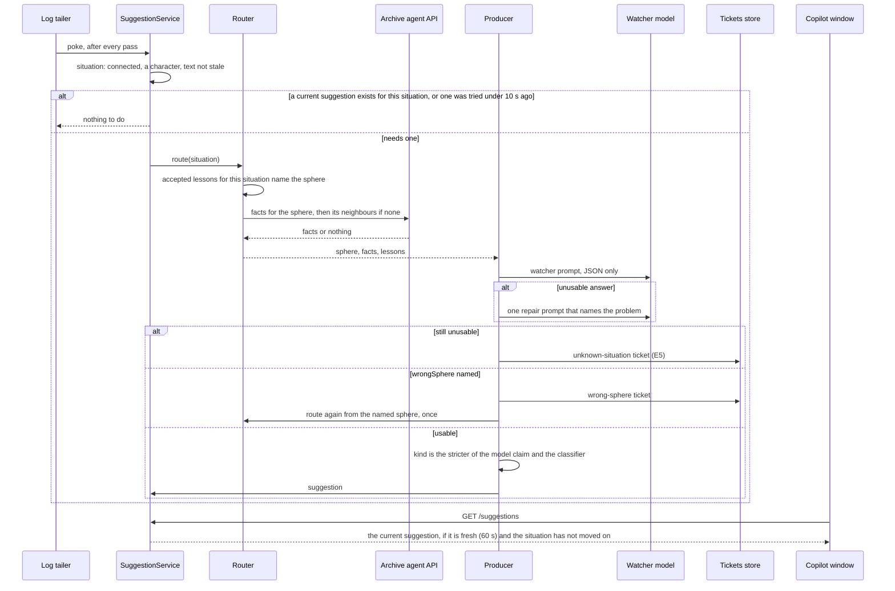
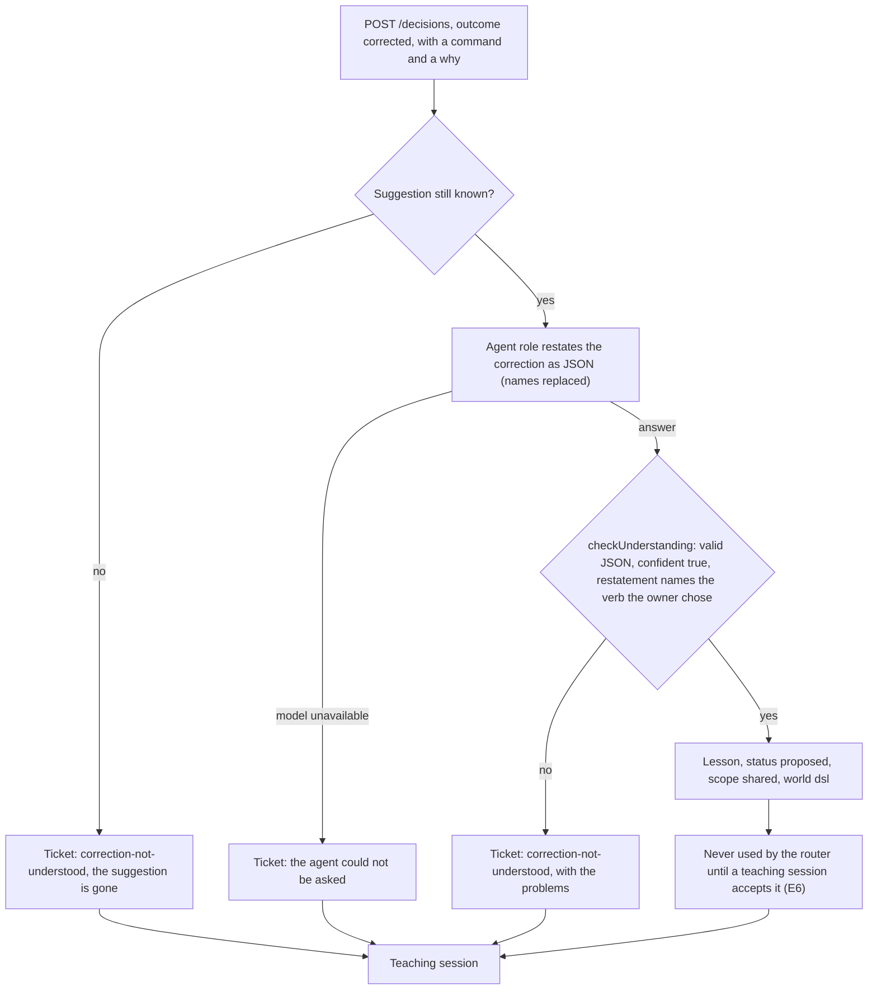

# Copilot models and suggestions (Developer Notes)

Copilot's server asks a **local** model what to do next, files what it cannot decide as tickets, and turns the owner's corrections into
proposed lessons. This page covers the model adapters, the suggestion producer, the router and the correction path. The trust rules
that decide whether a suggestion may run by itself are in [trust-and-approval.md](trust-and-approval.md); the teaching session that
accepts lessons is in [teacher-loop.md](teacher-loop.md).

Status: all of it exists and is tested with a fake model. **The real model has not been tried**: see "Owner step" below.

## The local-only rule

Models run on this machine or this network, never on a hosted API (edge case E4):

- `createOllamaClient` refuses, at construction, a base URL that is not localhost, loopback, a private range, `host.docker.internal` or a
  one-label Docker service name, and a model name that ends in `:cloud` or `-cloud`. The server config refuses the same at start-up.
- `COPILOT_MODEL_BACKEND` is `none` (default: no model, only the registry's `whoisic` offer), `fake` (the deterministic stand-in) or
  `ollama`. A 16 GB card holds one model at a time, so the Ollama client sends one request at a time (a second call waits).
- Everything shown to a model goes through `CharacterService.redact`: registered names become codenames, and name-shaped words where
  the game prints a player name become `<name>`. The model sees at most the last 12 lines of game text, each cut to 300 characters.

| Variable | Default | Meaning |
|---|---|---|
| `COPILOT_MODEL_BACKEND` | `none` | `none`, `fake` or `ollama` |
| `COPILOT_OLLAMA_URL` | none | the local Ollama server, for example `http://host.docker.internal:11434` (required for `ollama`) |
| `COPILOT_WATCHER_MODEL`, `COPILOT_AGENT_MODEL` | none | one model name per role (required for `ollama`; neither may be a `cloud` model) |
| `COPILOT_MODEL_TIMEOUT_MS` | `60000` | per request, 1000 to 600000 |
| `COPILOT_ARCHIVE_URL` | none | the archive's base URL for sphere lookups (`/api/agent/areas`, `/api/agent/bestiary`); none means no lookups |
| `COPILOT_SPHERES_PATH` | `/spheres/spheres.json` in the dev compose (the Shattered-AI experts folder mounted read-only) | the Shattered-AI `spheres.json` ([copilot-spheres.md](../../../Shattered-AI/doc/copilot-spheres.md)); absent or invalid keeps the built-in table (the same neighbours, no misroute hints) |

The dev compose passes these through from the shell that runs `docker compose`, with `none` as the default.

## Suggestion production (diagram D4)

- **Situation** (`suggest/situation.ts`): the character's codename, the mode (`battle` in a fight, otherwise `exploration`), the game
  state and a key (`battle:fight` or `<mode>:<room as dashes>`) by which lessons and tickets are grouped.
- **Router** (`suggest/router.ts`): accepted lessons for the exact situation first (a **proposed** lesson is never used, E6); the mode's
  sphere (`battle` and `leveling` to fighting, `exploration` to world, `questing` to interaction) is asked; when it finds nothing its
  neighbours in `spheres.json` are asked in order and the first that finds something becomes the sphere. The archive being down is
  "no facts", never a failed suggestion. The sphere map (spheres, two-sided neighbours, a hint for each wrong turn, the experts of each
  sphere) is Shattered-AI's `tools/archive-mcp/experts/spheres.json`; the dev compose mounts that folder read-only and the lint there keeps the
  map and the experts in agreement (`doc/copilot-spheres.md` in Shattered-AI, diagram D10).
- **A misroute leaves a hint.** When the watcher says a situation is not in its sphere, the `wrong-sphere` ticket's summary carries the
  map's hint for that turn (`misrouteHint(from, to)`), cut to the 500-character ticket cap; a pair with no hint gets the plain summary.
- **Producer** (`suggest/producer.ts`): the watcher answers `{command, kind, sphere, rationale, confidence}` or `{wrongSphere}`. The
  command must be one line without control characters and at most 200 characters. The kind is the **stricter** of the model's claim and
  `classifyCommand`, so a model cannot call `drop` safe. Movement takes its confidence from the map evidence, never from the model; the
  map does not exist yet, so the stub gives null and every movement asks. A model rating outside 0 to 1 becomes null (ask).
- **Service** (`suggest/service.ts`): one production at a time, never the same situation again within 10 s, a suggestion is current for
  60 s and only while the log still shows the situation it was made for; the owner's answer removes it. `GET /suggestions` never waits
  for a model.

## Corrections (diagram D6)

The request is answered at once (201); the model call runs in the background. A model never judges a model: `checkUnderstanding` in
copilot-core is a mechanical check. `GET /lessons?status=&limit=` lists lessons, `GET /tickets` the tickets.

## Fakes

`createFakeModel(script)` answers from a script in order (the last repeats) and records its calls; with no script the watcher proposes
`look` (confidence 0.9) in the sphere named in its prompt and the agent restates the owner's command, so the whole loop runs offline.
`COPILOT_MODEL_BACKEND=fake` uses it. `createOllamaClient` takes an injected `fetch`.

## The live model run, and what the dev compose file does by default

The dev stack (`deploy/docker-compose.shattered-archive-experimental.yml`, profile `copilot`) defaults to the real model, so a plain
`docker compose --profile copilot up -d copilot-server` needs no shell variables:

| Variable | Compose default | Why |
|----------|-----------------|-----|
| `COPILOT_MODEL_BACKEND` | `ollama` | the local Ollama of the Shattered-AI stack |
| `COPILOT_OLLAMA_URL` | `http://host.docker.internal:41434` | `ollama-code`, published on the host at 41434 |
| `COPILOT_WATCHER_MODEL`, `COPILOT_AGENT_MODEL` | `gemma4:26b` | one model for both roles (two cannot share 16 GB) |
| `COPILOT_MODEL_TIMEOUT_MS` | `180000` | a cold load of an 18 GB model on a 16 GB card passes the 60 s default |
| `COPILOT_ARCHIVE_URL` | `http://host.docker.internal:5000` | the C# server `Server/deploy-local.ps1` publishes on the host; `localhost` would be the container itself |

Override in the shell before `up` (`COPILOT_MODEL_BACKEND=fake` for no GPU, `COPILOT_ARCHIVE_URL=` for no lookups).

**The model is loaded when the server starts, and again at every switch-on.** `warm` on the Ollama client lists what the model server has
(`/api/tags`), then sends an empty prompt for each distinct configured model, which loads it into GPU memory; it sends no option that changes
how a model is loaded (the context size), so the real calls find it loaded instead of loading it a second time. The log names the outcome:
`model gemma4:26b: loaded`, `not installed on the model server (ollama pull it)`, `unreachable` or `failed`. At start an unreachable model
server (a separate compose project may still be starting) is tried up to six times, ten seconds apart; a switch-on tries once, which also
reloads a model Ollama unloaded while idle. Loading the model does not switch Copilot on. How long Ollama keeps the model loaded is the model
server's own setting (`OLLAMA_KEEP_ALIVE`).

**Switching Copilot off or on starts the suggestions over** (`SuggestionService.reset()`): a model call in progress is aborted and its answer
thrown away, the current suggestion is forgotten, and `GET /suggestions` is empty while Copilot is off. A log pass that was already running when
Copilot was switched off ends without starting a model call.

## Tests

`models/ollama.test.ts` (timeout, a body that is not JSON, HTTP 500, an oversized body, a network failure, abort, one request at a time,
a non-local URL and a cloud model refused), `models/fake.test.ts`, `suggest/router.test.ts` (lessons first, accepted only, neighbour hint),
`suggest/producer.test.ts` (each mode, the stricter kind, movement confidence, a retry, unusable twice gives a ticket, wrong-sphere, model
failure), `suggest/corrections.test.ts` (understood gives a proposed lesson, each way of not understanding gives a ticket),
`suggest/service.test.ts`, `suggest/prompt.test.ts`, `suggest/lookup.test.ts`, `suggest/spheres.test.ts`, `suggest/wiring.test.ts`, and
`bootstrap.test.ts` (the whole loop over HTTP with the fake: a suggestion from the live log, a correction becomes a proposed lesson that
survives a restart).
