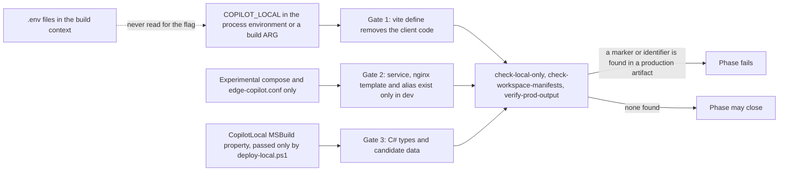
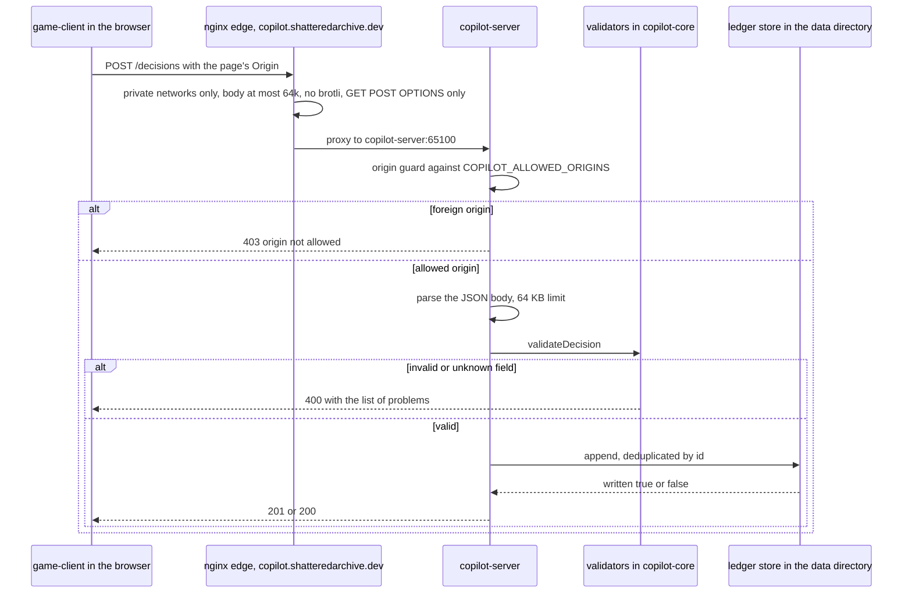

# Copilot server and API (Developer Notes)

`apps/copilot-server` is the local Express service behind Copilot. It runs only in the dev docker stack (vhost
`copilot.shatteredarchive.dev`, LAN-reachable), records what the owner decides, and later produces suggestions. This page covers what
exists now: the skeleton, the routes that store and list records, every guard in front of them, and how the dev stack runs it.

Status: the server skeleton, the origin guard, the validators, the decision and ticket stores, the dev-only deployment and the log tailer
(`GET /state`, see [log-pipeline.md](log-pipeline.md)) exist. The character registry (`/characters`, [characters.md](characters.md)) and the model-backed suggestion producer, correction handler and `/lessons` ([models.md](models.md)) exist. So does the teaching side: audit bundles, findings, the owner's acceptance and `/metrics/training` ([teacher-loop.md](teacher-loop.md)).

## Where it is allowed to run

It exists in exactly one place, and the three gates in [README.md](README.md) keep it out of everything else:



This phase delivers **gate 2**:

| Piece | File | Notes |
|---|---|---|
| the service | `deploy/docker-compose.shattered-archive-experimental.yml`, service `copilot-server` | profile `copilot` (a plain `up` does not start it), `expose` only (no published port), `read_only` root, `cap_drop: ALL`, `no-new-privileges` |
| its image | `deploy/copilot-server.Dockerfile` | not referenced by `deploy/docker-compose.yml` |
| the vhost | `deploy/nginx/edge-copilot.conf`, mounted as `/etc/nginx/templates/copilot.conf.template` | a **separate** template; the shared `edge-subdomains.conf` is untouched. Allows loopback and private networks only, 64 KB bodies, GET/POST/OPTIONS only, proxies to `copilot-server:65100` through a resolver variable so nginx starts without the service |
| the CSP | `deploy/nginx/edge-copilot-csp.conf`, mounted **over** `includes/security-headers-scripting-dev.conf` | the same dev CSP plus `https://copilot.shatteredarchive.dev` in `connect-src`, so the game-client page may call the API. A test compares it with the shared file: they may differ in that one origin only |
| the alias | the nginx service's `aliases` in the experimental compose | `copilot.shatteredarchive.dev` |
| the data | host folder `C:/Projects/DSL/GameLogs/ShatteredArchive/Docker/copilot-server`, mounted at `/data` | holds the ledger (and later the registry and world memory). The DSL repo git-ignores that folder (it does not ignore `GameLogs/` as a whole: the game-server logs beside it are tracked) |
| the logs | `C:/Projects/DSL/GameLogs/ShatteredArchive/Docker/game-server`, mounted at `/logs:ro` | read-only |

The port is **65100**: the plan's 66000 is above the last TCP port (65535), and 65100 follows simulacrum's 65000/65001.

## Bring it up (owner's step)

```
docker compose -f deploy/docker-compose.shattered-archive-experimental.yml --profile copilot up -d --build copilot-server
```

and recreate the nginx service once so it picks up the new template and the CSP override
(`docker compose -f deploy/docker-compose.shattered-archive-experimental.yml up -d nginx`). The game-client image must be rebuilt with
`COPILOT_LOCAL=true` (already set for it in the same compose file) before the Copilot window exists in the client.

## Environment

| Variable | Default | Meaning |
|---|---|---|
| `COPILOT_ENABLED` | none | **must be exactly `true`**, or the server refuses to start. Production never sets it |
| `COPILOT_PORT` | `65100` | 1 to 65535 |
| `COPILOT_LISTEN_HOST` | `0.0.0.0` | loopback, a private range, or `0.0.0.0` (inside the container, with no published port). A public address is refused |
| `COPILOT_DATA_DIR` | `/data` | absolute path; the ledger is `<dir>/ledger/` (`decisions`, `tickets`, `lessons`, `findings`, `occurrences`, each `.jsonl`) and audit bundles are written to `<dir>/bundles/<id>/` |
| `COPILOT_LOG_DIR` | `/logs` | absolute path to the game-server logs (read-only); followed from start-up, only `*.jsonl` files. The tailer's checkpoints are `<COPILOT_DATA_DIR>/tail/checkpoints.json` |
| `COPILOT_MATRIX_PATH` | `/matrix/test-character-matrix.json` | absolute path to the private test-character matrix (the DSL repo's `docs/copilot` folder, mounted read-only). Without it nobody is registered |
| `COPILOT_STALE_SECONDS` | `60` | whole seconds, 5 to 3600: how long the game text may be silent before `GET /state` reports `stale: true` |
| `COPILOT_WORLD_MIN_VISITS`, `COPILOT_WORLD_MIN_DAYS`, `COPILOT_WORLD_MIN_RATIO`, `COPILOT_WORLD_DEMOTE_AFTER` | `5`, `3`, `0.8`, `3` | the fixture rule of the world memory ([world-memory.md](world-memory.md)); an unusable value stops the server at start. The layer is `<COPILOT_DATA_DIR>/world/memory.json`; `COPILOT_ARCHIVE_URL` is also where it reads creature and item names from |
| `COPILOT_ALLOWED_ORIGINS` | the game-client dev origins | comma list; only `localhost`, private addresses and `*.shatteredarchive.dev`, as bare origins. `*` and anything public are refused |

## Routes

All bodies are JSON, at most 64 KB. Errors are `{ "error": "..." }`, with `details` listing the problems for a 400.

| Route | Answer |
|---|---|
| `GET /health` | 200 `{ ok, version, startedAt }` |
| `GET /state` | 200 `{ connected, stale, staleAfterSeconds, lastEventAgeSeconds, lastTextAgeSeconds, inFight, learning, room, vitals, feed, tail }` (`lastTextAgeSeconds` is the age of the last TEXT line, the one staleness is measured on, or `null`): the room title, vitals and counters, never game text, a command or a character name; 503 `log feed not running` when the feed is off |
| `GET /control` | 200 `{ enabled }`: whether the server is **learning** (reading the game logs). 503 if the server was built without the switch |
| `POST /control` | body exactly `{ "enabled": true }` or `{ "enabled": false }` (unknown fields and non-booleans are a 400); 200 `{ enabled }` with the state it now has. This is the server half of the owner's Copilot switch in the game client ([client.md](client.md)). **Learning is OFF at every start**, held in memory only, so a restart never learns by itself. POST, not PUT, so the CORS allow-list stays GET and POST |
| `GET /suggestions` | 200 `{ suggestions }`: the `whoisic` offer for a character with no stored description ([characters.md](characters.md)), then the current model suggestion for the situation the log shows ([models.md](models.md)); never waits for a model |
| `GET /characters` | 200 `{ characters: [{ codename, kind, gender, hasDescription }] }`, codenames only, newest player first |
| `GET /characters/<Base-G>/description` | 200 the stored `whoisic` description (`fields`, `rawAnsi`, `dsl`, `text`, `unmapped`, `at`) with registered names replaced by codenames; 400 for a malformed codename; 404 when nothing is stored |
| `POST /decisions` | validated by `validateDecision` (optional `sphere` and `kind` name the bucket the answer counts in; one that is not a real sphere or kind is a 400); 201 `{ ok, id, written: true }`, or 200 `written: false` for an identical retry; 400 invalid; 413 too large; 500 could not save. A new decision answers the suggestion it names, except a `refused` one (the command gate would not send it, so nothing was answered and the suggestion stays); a `corrected` one with a command starts the correction path in the background ([models.md](models.md)) |
| `GET /stats/buckets` | 200 `{ buckets: { "<sphere>:<kind>": { approved, total } } }`, counted from the ledger: the owner's approved, corrected and rejected answers per bucket. `auto` and `refused` records and lines without a bucket do not count. Counts only, no text ([trust-and-approval.md](trust-and-approval.md)) |
| `GET /lessons?status=&limit=` | 200 `{ lessons }`, newest first; `status` is `proposed`, `accepted`, `rejected` or `superseded`; `limit` 1 to 500 (default 100); a bad value is 400 |
| `GET /tickets?status=&limit=` | 200 `{ tickets }`, newest first; `status` is `open`, `resolved` or `declined`; `limit` 1 to 500 (default 100); a bad value is 400 |
| `POST /tickets` | validated by `validateTicket`; same answers as decisions. A `persona-feedback` ticket's summary must read `Persona feedback for <codename>; field: <field>; why: <text>` and name the ticket's own character ([persona-feedback.md](persona-feedback.md)) |
| `POST /bundles` | body `{}` or `{ ticketIds: [...] }` (at most 50 ids); writes `<data dir>/bundles/<id>/bundle.json` and `summary.md` of the open tickets (oldest first, at most 50) or the named ones, every text with names replaced and cut to 300 characters; 201 `{ written: true, id, folder, tickets, truncated, bundle, summary }` (`folder` is relative, never the server's own path); 200 `{ written: false, tickets: 0 }` for an empty queue (nothing is written); 400 bad ids or too many; 404 unknown ticket; 500 could not write ([teacher-loop.md](teacher-loop.md)) |
| `POST /findings` | a teaching session's finding, validated by `validateFinding`; it must arrive with `acceptedBy: null` and name an open ticket, which becomes `resolved`; 201 `{ ok, id, written: true }`, 200 `written: false` for a repeat; 400 invalid (with `details`); 404 unknown ticket; 409 the ticket is not open or the finding id belongs to another ticket; 500 |
| `GET /findings?limit=` | 200 `{ findings }`, newest first; `limit` 1 to 500 (default 100) |
| `POST /tickets/<id>/accept` | the owner's acceptance of the ticket's finding; the body must be exactly `{"acceptedBy":"owner"}` (400 otherwise); 200 `{ ok, written, lessonsChanged }` (`written: false` when it was already accepted); 404 unknown ticket; 409 no finding yet; 500. The only way a scenario can graduate |
| `GET /metrics/training` | 200 `{ generatedAt, graduationNeeds, totals, scenarios }`: counted from the ledger on each request (tickets by status, findings, accepted, graduated, Claude-needed, and per scenario its clean count and what remains to graduate) |
| `GET /world/rooms/<id>` | 200 a walked room: `{ id, title, visits, days, exits, fixtures, transient, was, ... }`; 400 for a malformed id, 404 for an unknown room ([world-memory.md](world-memory.md)) |
| `GET /world/candidates` | 200 the candidate layer as a Shattered-Maps `MapFile` |
| `GET /world/near?title=&exits=&world=` | 200 `{ rooms }`: walked rooms with that title (case and spacing ignored) in one map world's memory (`world` is `dsl` by default, or `sandbox`), best first (same exit set, then most visited), each a room report plus `sameExits`; the map window's add-room flow uses it for the rooms each exit led to. 400 for no title, a title over 200 characters, or `exits` that are not 1-2 letter compass codes (at most 12); 404 for an unknown world |
| `GET /world/stats` | 200 the layer's counts: views by how much of the text could be read, rooms made and matched, traversals, refusals and write failures |
| anything else | 404 `{ error: "not found" }` |

## The path of a request



## Guards and what is never logged

- **Origin guard.** A request with an `Origin` header that is not in the allow list gets 403 before anything else runs, including the
  preflight. An allowed origin gets `Access-Control-Allow-Origin` and `Vary: Origin`; the preflight answers 204 with the allowed methods
  and `Content-Type`. A request with no `Origin` (curl, a health check) is admitted: it can only come from the network the nginx edge
  already restricts.
- **Strict validation.** Unknown fields, oversize text, bad ids and a real-name-shaped character are rejected by the hand-written
  validators; the answer lists the problems and never repeats the offending value.
- **No body or text is logged.** The only log line about a request is `<METHOD> <route pattern> <status>`, and the route pattern is the
  matched route (`/decisions`) or `unmatched` / `origin-guard`, never the URL typed. An unexpected error is a fixed 500 `internal error`
  with no stack or cause. A test posts a secret in the body, the query and the path and asserts it appears in no log entry.
- **A failed save is a 500 `could not save ...`**, never a partial record: the store appends one whole line or nothing, and a torn tail is
  skipped on the next load.

## Tests

`pnpm --filter @shatteredarchive/copilot-server test`: `config.test.ts` (refuses without the flag, a public listen address, a bad port, a
relative path, a public origin), `validate.test.ts`, `fs.test.ts` (the real file adapter on a temp folder), `app.test.ts` (every route,
the origin guard, preflight, oversize, malformed JSON, character set and encoding errors, no logging of bodies, unexpected failures),
`bootstrap.test.ts` (starts, serves, persists across a restart, follows a log folder and stops with the server, refuses to start, a taken
port), plus the `tail/` and `routes/` tests described in [log-pipeline.md](log-pipeline.md). `scripts/check-local-only.test.mjs` also
reads the compose files, the nginx templates and the CSP override. `src/index.ts` is a three-line stub around `bootstrap.ts` and is
exercised by running the image.
