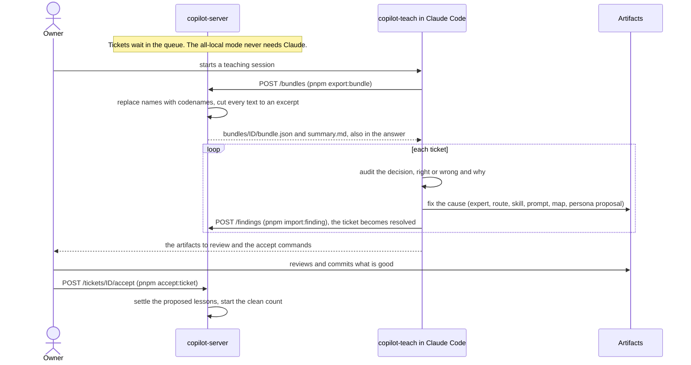
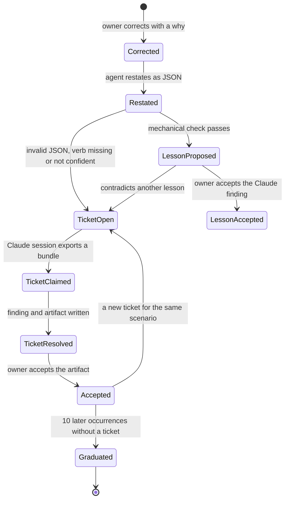

# Copilot teacher loop: records and states (Developer Notes)

Everything the owner corrects, and everything the local agent cannot understand, becomes a record. A Claude Code teaching session
later turns those records into written artifacts (an expert or MCP fix, a persona proposal, a map correction, a skill or prompt change),
and the owner accepts or declines each artifact. A scenario "graduates" when the agent has handled it without Claude since the owner
accepted the fix. This page describes the records and their states, and the teaching session that turns tickets into findings: audit
bundles, findings, the owner's acceptance, the training counts and the `/copilot-teach` skill.

Status: all of it exists and is tested. The records, validators, understanding check, append-only store and graduation rule are in
`services/copilot-core/src/ledger/`; the server side (`apps/copilot-server/src/teacher/`, routes in [server-api.md](server-api.md))
writes bundles, stores findings, records the owner's acceptance and computes the counts; the skill is `.claude/skills/copilot-teach/`.
Claude is needed only for this loop. With no Claude session, tickets simply wait and everything else works (the all-local mode).

## The teaching session (diagram D7)

## Audit bundles (`teacher/bundle.ts`)

`exportBundle` writes `<data dir>/bundles/<id>/bundle.json` and `summary.md` (the data folder is the private, git-ignored one on the host,
so a session can read the files; the HTTP answer carries the same content). It selects the **open** tickets, oldest first, at most **50**
(`truncated: true` says more are waiting), or the tickets it is told to (any status, at most 50). An empty queue writes **nothing**.

Per ticket the bundle holds: the ticket fields, the decision it came from (command and the owner's why) when it has one, and the lessons
the agent proposed for the same sphere and situation. **Every text goes through the character registry's replacement** (registered
names become codenames, name-shaped words where the game prints a player name become `<name>`) and is cut to **300 characters after**
the replacement, so a name at the cut cannot be left half visible. A bundle id is never reused (an existing folder is not overwritten).
The tests scan the whole bundle folder for every registered name, in any case (PRIVNAME-01).

A ticket's "claimed" state in the state diagram below is not stored: the ticket stays `open` until a finding resolves it, and an export is
repeatable.

## Findings and the owner's acceptance (`teacher/findings.ts`)

A **finding** (`Finding` in the contracts) is one ticket's answer: a `verdict` (`local-correct`, `local-wrong`, `data-gap`,
`routing-gap`, `persona`), a `why` (at most 1000 characters), up to 10 `artifacts` (a plain path and a kind: `expert`, `mcp`,
`sphere-link`, `skill`, `prompt`, `persona-proposal`, `map-correction`, `doc`) and `acceptedBy: null`. It is stored in
`ledger/findings.jsonl`.

- **Import** (`POST /findings`): the finding must be valid, must **arrive unaccepted**, and its ticket must exist and be open. Its `why`
  has names replaced before it is stored, and the ticket becomes `resolved` with `resolution: "Finding <id>: <verdict>"`. Importing the
  same finding again changes nothing (and finishes a resolution that failed halfway); a later copy never replaces an accepted finding.
- **Acceptance** (`POST /tickets/<id>/accept`, body exactly `{"acceptedBy":"owner"}`): records `acceptedBy: owner` and the time. It is
  the **only** way a scenario can graduate. A local service cannot tell the owner from a script, so the body has to say it in so many
  words and the skill is forbidden to call it; the owner runs `pnpm --filter @shatteredarchive/copilot-server accept:ticket -- <id>`.
- **Lessons.** Accepting settles the lessons the agent proposed for the same sphere and situation: `accepted` when the verdict says the
  owner's correction was right (`local-wrong`, `data-gap`, `routing-gap`), `rejected` for `local-correct`, untouched for `persona`. The
  router reads only accepted lessons, so a proposed lesson steers nothing before this. Lessons are settled first and the acceptance last,
  so a retry after a failure finishes the job.

## Training counts (`teacher/metrics.ts`, `GET /metrics/training`)

Computed from the ledger on each request, nothing stored. A teaching **scenario** is a situation that has had a ticket, named by sphere
and situation; its state comes from `computeScenarioStates` over three kinds of event: a ticket (from the ticket's creation time), an
acceptance (the finding's `acceptedAt`) and an **occurrence**. An occurrence is recorded (`ledger/occurrences.jsonl`) when the owner takes
the agent's suggestion unchanged (`approved`, or a rule ran it: `auto`) and the server still knows the suggestion, which is what gives
the decision its situation. Corrections, rejections and refusals are not occurrences. Occurrences of a situation that never had a ticket
are not listed.

The answer has `totals` (tickets by status, findings, findings accepted, scenarios, accepted, graduated, Claude-needed) and a list of
scenarios (most Claude visits first, at most 200) with `claudeNeeded`, `openTickets`, `accepted`, `cleanSinceAcceptance`,
`remainingToGraduate` and `graduated`. The kind shown is the newest ticket's: a ticket for an answer the model could not use has the kind
`unknown`, while the suggestion that later handles the same situation has a real kind, so the situation, not the kind, ties them together.

## The skill and the commands

`.claude/skills/copilot-teach/SKILL.md` is the procedure a Claude Code session follows: check the server, export, audit each ticket,
fix the cause as an artifact, write a finding, hand the owner the review list. It never accepts, never commits, never writes a real
name, and stops if the server is down. The scripts are thin clients of the server (it is the only writer of its ledger):

| Command (`pnpm --filter @shatteredarchive/copilot-server ...`) | Does |
|---|---|
| `export:bundle [-- --ticket <id> ...]` | `POST /bundles`, prints the bundle id and summary |
| `import:finding -- <file>` | `POST /findings` with the file |
| `accept:ticket -- <id>` | the owner's acceptance |
| `persona:feedback -- <codename> <field> <why...>` | files a `persona-feedback` ticket ([persona-feedback.md](persona-feedback.md)) |
| `training:metrics` | the totals of `GET /metrics/training` |

The server is `COPILOT_API` (default `https://copilot.shatteredarchive.dev`); the scripts refuse anything that is not this machine, a
private network or `*.shatteredarchive.dev`.

## The states

## The records

All are defined in `services/copilot-core/src/contracts.ts` and validated by `ledger/records.ts`. Characters appear only as codename
references (`Agate-F`); no record has a field for a real name.

| Record | Holds | Notes |
|---|---|---|
| `Decision` | what the owner (or a rule) did with a suggestion: `approved`, `corrected`, `rejected`, `auto` or `refused`, the command actually sent, an optional short `why`, and for `auto` the rule that allowed it | `command` is required for approved, corrected and auto; `rule` for auto and refused (the gate's reason) |
| `Lesson` | one rule learned from a correction: sphere, the `situationKey`, a `scope` (`shared`, `class`, `race`, `ability-set`, `character-public`) with a `scopeKey` where needed, a `world` (`dsl` or `sandbox`), the rule text, the decision it came from, and a `status` (`proposed`, `accepted`, `rejected`, `superseded`) | a lesson is never applied as shared until Claude's finding is accepted |
| `EscalationTicket` | a case the agent could not handle: a `reason` (`low-confidence`, `correction-not-understood`, `danger`, `wrong-sphere`, `persona-feedback`, `unknown-situation`), the sphere, kind and `situationKey` (together the **scenario**), a scrubbed one-line `summary`, a `status` (`open`, `resolved`, `declined`) and the eventual `resolution` | the summary is scrubbed text, never raw log lines |
| `Suggestion` | what the server proposes; the client validates it with `validateSuggestion` | confidence is `null` or a number in [0, 1] |

The validators are strict and hand-written: unknown fields are rejected, every text field has a length cap (command 200, why 500, rule
500, summary 500), ids must match `[A-Za-z0-9][A-Za-z0-9_-]{0,63}` before they are used in a path or a key, and a codename reference
must look like `Base-M|F|U`. The result lists every problem and never echoes the offending value, which may be game text.

## Did the agent understand a correction?

When the owner corrects a suggestion, the agent role is asked to restate the correction as JSON:
`{ "rule": "...", "restatement": "...", "confident": true }`. `checkUnderstanding(suggestion, correction, modelJson)` decides mechanically
whether that is good enough, so a model never judges a model. The answer passes only if all of these hold:

1. it is valid JSON (or already an object) with the right shape;
2. `rule` and `restatement` are non-empty and within their length caps;
3. `confident` is exactly `true`;
4. the restatement contains the verb of the corrected command, either as typed or in full (`dro` is satisfied by "drop"); the say,
   gossip and emote shortcuts have no verb word to look for.

Anything else (and a correction that is empty or identical to the suggestion) returns `correction-not-understood` with the list of
problems, and the correction becomes an escalation ticket. In the all-local mode the user is the only teacher; tickets simply wait.

## Storing the records

`JsonlStore` (`ledger/store.ts`) is an append-only file of lines `{"v":1,"r":<record>}` over an injected `LedgerFs`, so the server supplies
real files and the tests supply an in-memory fake.

- **Dedupe by id.** Appending a record whose id exists with identical content writes nothing (a safe retry). Appending changed content
  adds a new version; queries return the latest version of each id, in the order the ids first appeared.
- **Torn last line.** A crash in the middle of an append leaves a partial line. On load it is skipped and counted, and the next append
  starts on its own line so it is not glued to the fragment.
- **A failed write** returns `{ ok: false, error }` and changes nothing in memory; a retry works.
- **Rotation.** When the active file has reached `maxBytes` it is renamed to `<path>.<n>` before the next append; every file is read on load.
- Calls are serialised; one store instance per file, one writer.

## Graduation

A scenario is `(sphere, kind, situationKey)`. `computeScenarioStates(events)` folds `ticket`, `accepted` and `occurrence` events in
time order:

- a **ticket** counts one more "Claude needed" and clears any acceptance and graduation: the fix did not hold;
- an **acceptance** by the owner (the only way to graduate) starts a clean count at zero;
- an **occurrence** without a ticket counts only after an acceptance, and the scenario is `graduated` at 10 of them
  (`GRADUATION_CLEAN_OCCURRENCES`). Ten clean occurrences without an acceptance never graduate.

## Contradicting lessons

Two sessions, or two characters, can teach opposite things. `detectLessonConflicts(lessons)` reports lessons that give different rules for
the same sphere, situation, **world and scope**. Lessons whose world (`dsl` or `sandbox`) or scope (shared, a class, a race, ...) differ are
not conflicts: both are kept with their tags and which applies depends on the world the agent is in and on who it is (E6). Rejected and
superseded lessons are ignored. Conflicts are only reported; a teaching session resolves them, and a store never overwrites a lesson with
a different id.

## Tests

`pnpm --filter @shatteredarchive/copilot-core test` runs `ledger/records.test.ts`, `understanding.test.ts`, `store.test.ts` (in-memory file
system with injected write and rename failures, torn lines, rotation) and `graduation.test.ts`. The finding and occurrence validators are
in `records.test.ts`.

`pnpm --filter @shatteredarchive/copilot-server test` runs `teacher/bundle.test.ts` (names in tells, room lines, decisions and lessons
exported with none of them, in any case; an unregistered name becomes `<name>`; the cut never leaks a name; bounded size and count; an
empty queue writes nothing; failures and an existing bundle), `findings.test.ts` (an invalid verdict, an already accepted finding,
an unknown or not-open ticket; an unaccepted finding is only a finding; lessons settled per verdict; every half-failed write finished by a
retry), `metrics.test.ts` (numbers match the ledger; acceptance plus 10 clean occurrences graduates, 9 does not, 10 without an acceptance
never does; a new ticket takes the acceptance back), `service.test.ts` (occurrences, the whole loop), `routes.test.ts` (every status
mapping, the owner-only acceptance body, the loop over HTTP) and `cli.test.ts` (the scripts, and the refusal of a non-local server);
`bootstrap.test.ts` runs the loop on real files and across a restart. The entry file `teacher/main.ts` (five lines) has no test of its own:
it was exercised live.
