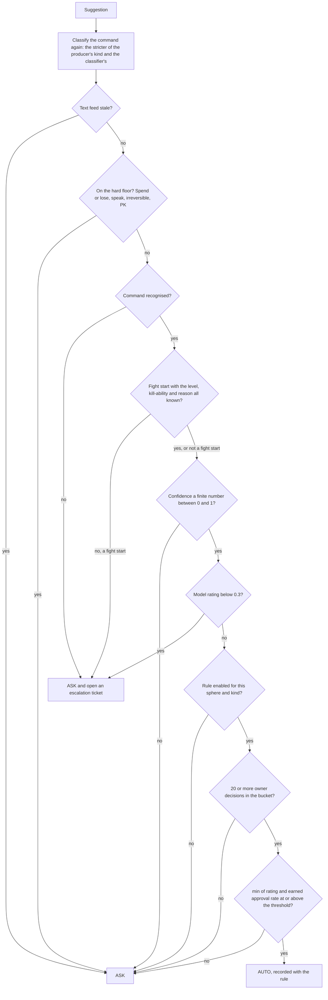
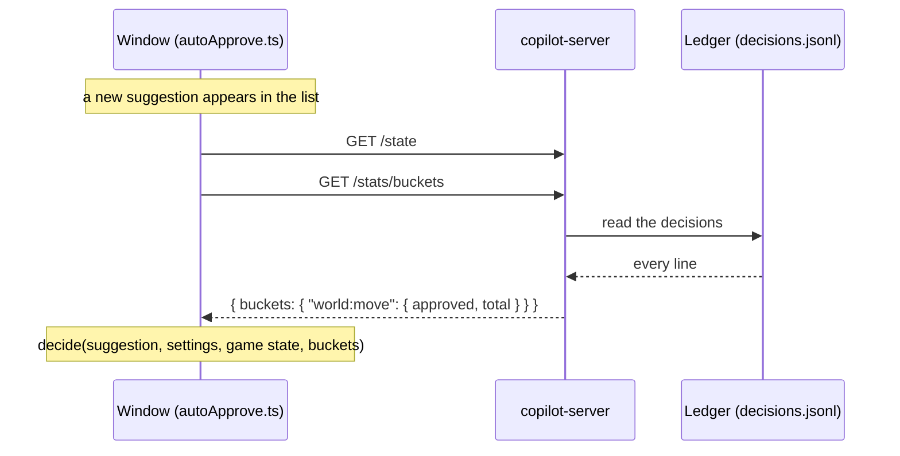
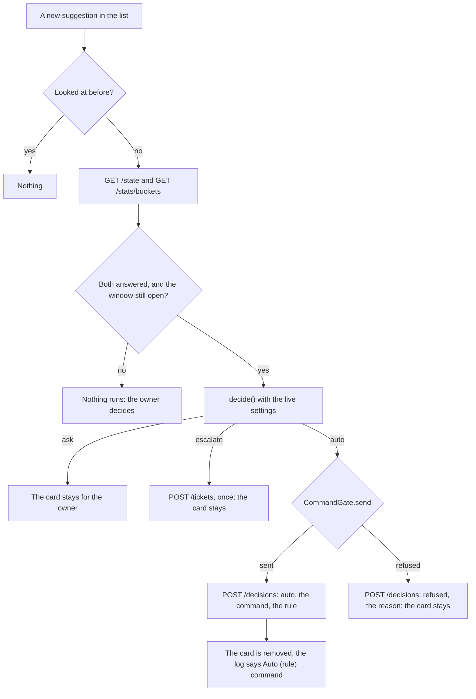

# Copilot trust and auto-approval (Developer Notes)

Copilot only suggests commands. A suggestion reaches the MUD in exactly two ways: the owner approves or corrects it, or a rule the owner
switched on allows it to run by itself. This page is about the second way and about the limits that no setting can lift. The code is
`services/copilot-core/src/policy/` and it is the **only** place that decides whether something may run automatically.

Status: the policy functions, the command gate, the settings panel, the statistics endpoint and the client piece that applies the
policy to each new suggestion (`autoApprove.ts`) all exist and are tested. Every rule is off until the owner switches one on, so out of
the box nothing runs by itself.

## What the owner decided

- **Everything defaults to ask.** Every rule is off until the owner turns it on, per sphere and action kind, with a confidence threshold.
- **The hard floor is never automatic**, whatever is stored or configured: losing or spending items or gold, speaking to other players,
  anything irreversible or character-ending, and player-kill. Copilot never starts player-kill on its own.
- **Starting a fight is allowed only with full knowledge of the target.** A fight against a known mob can run once the agent knows the
  mob's level, that the character can kill it, and why it is attacking. If any of those is unknown, or the target is unknown, the owner
  is prompted.
- **Confidence is earned.** A model's own rating is not trusted by itself: it is capped by how often the owner has approved this kind of
  suggestion, and nothing runs by itself on fewer than 20 of the owner's past decisions.

## The order of the checks

`decide(suggestion, settings, state, now)` runs these checks in order and stops at the first that applies:

| Outcome | Meaning |
|---|---|
| `auto` | the command may be sent without asking; the decision is recorded with the rule that allowed it (`<sphere>:<kind>`) |
| `ask` | show the suggestion and wait for the owner |
| `escalate` | ask the owner **and** file an escalation ticket, because the agent did not understand the situation |

Each answer carries a stable reason code: `stale`, `floor`, `unknown-class`, `unknown-target`, `no-confidence`, `very-low-confidence`,
`no-rule`, `insufficient-samples`, `below-threshold`, `rule-allows`. Staleness is checked first, so a floor command on a stale feed
reports `stale`; both ask.

The command is **classified again inside `decide`**. The kind the producer attached can only make the result stricter, never looser: a
`drop all` labelled `move` is still `spend-or-lose`, and a `north` labelled `speak` is treated as `speak`. A rule for a kind that is
never automatic is ignored even if a hand-built settings object contains it.

## Classifying a command

`classifyCommand(command, { inFight, target })` returns an action kind and never throws. Anything it cannot place is `unknown`, which
always means ask and file a ticket.

- **A verb may be abbreviated**, as the MUD allows, and an ambiguous abbreviation resolves to the **most restrictive** match. `dro`, `giv`,
  `gos`, `qui`, `mur`, `ste` are floor kinds; `wh` is `speak` (whisper) rather than the safe `who`; `lo` is `loot` rather than `look`.
  Every command the MUD could match must be in the table, even as `unknown`, so a missing verb cannot make an abbreviation look safe.
- **A line that could hide a second command is `unknown`**: it contains `;`, a line break or any control character, or `|`. So are an empty
  line, one over 200 characters, a speedwalk such as `3n2e`, and `!` (repeat last command).
- `'`, `"`, `.`, `,` and `:` at the start are say, gossip and emote: `speak`.
- **Consuming an item is losing it**: `quaff`, `eat`, `drink`, `recite`, `zap`, `brandish` and `apply` are `spend-or-lose`.
- **Fights.** In a fight a fight verb is `fight-continue`. Outside one, `fight-start-known` needs a mob target whose level, kill-ability
  and reason are all known; a player target or `murder` is `pk`; everything else is `fight-start-unknown`. `cast <spell>` with no target
  or at self is an `ability`; at a target outside a fight it follows the fight rules. `flee` is part of a fight in a fight and a move
  otherwise.
- The kinds that can be switched on are `move`, `info`, `interact`, `loot`, `ability`, `fight-continue` and `fight-start-known`
  (`NEVER_AUTO_KINDS` lists the rest). The owner is expected to enable movement along confirmed map edges first.

## Confidence is earned

`effectiveConfidence(model, bucketStats, edgeEvidence?)` returns the smaller of the rating and the **Wilson lower bound (95%)** of the
owner's approval rate in the bucket `(sphere, kind)`:

| Owner decisions in the bucket | Lower bound |
|---|---|
| 1 of 1 | about 0.21 |
| 10 of 20 | about 0.30 |
| 20 of 20 | about 0.84 |
| 100 of 100 | about 0.96 |

- Fewer than **20** decisions in the bucket (`MIN_BUCKET_SAMPLES`, not a setting) means the history does not count: the policy asks.
- The rating is the model's own, or for map movement the **evidence of the confirmed map edge**, which replaces the model's rating
  (`confidenceSource: 'map-evidence'`).
- A rating or a statistic that is missing, `NaN`, negative, above 1, not a number, or impossible (more approvals than decisions) gives no
  value, and the policy asks.
- An approval is a suggestion the owner accepted as it was. Corrections and rejections count as decisions that were not approvals.

## Settings

`TrustSettings` is `{ schemaVersion: 1, staleAfterSeconds, rules }`. `rules` is a **map** keyed `<sphere>:<kind>` to
`{ enabled, threshold }` (threshold from 0.50 to 0.99, default 0.90), so the order rules were added never matters. Defaults: no rules,
stale after 60 seconds (5 to 3600 allowed).

- `normalizeSettings(anything)` is the **one function every write route goes through** (the editor, the reset button, the cross-tab
  `storage` event, an older client). It never throws, falls back to the default for any field it cannot read, and drops a rule for a
  never-auto kind, an unknown sphere or kind, or an unreadable value (a string threshold `"0.9"`, `NaN`, out of range, no `enabled`).
- `toStored(settings)` returns only what differs from the defaults, or `null` when nothing does (remove the stored key). A rule equal to
  the default rule (off, 0.9) is not stored, so a later change to the defaults still reaches the owner.
- `settingsEqual(a, b)` is strict and structural: no coercion (`0.9` is not `"0.9"`, `null` is not missing), arrays by order, objects by
  key regardless of order.

## The owner's history per bucket (`GET /stats/buckets`)

The server counts the owner's answers from the ledger, so the history survives a restart of the server (it keeps no list of past
suggestions). That needs every answer to name its bucket, so a `Decision` carries optional `sphere` and `kind`: the suggestion's own
sphere and action kind, whatever the answer was (a correction counts against the bucket the wrong suggestion came from). A line without
them (written before this existed) is valid and simply not counted.

`countBuckets(decisions)` in `copilot-core/src/policy/buckets.ts` is the one counting function:

- `approved` counts answers accepted as they were; `total` adds corrections and rejections.
- `auto` (the agent's own run) and `refused` (the gate would not send) are **not** the owner's judgement and never count.
- A repeated decision id counts once.

Two numbers to keep in mind: at 20 of 20 approvals the earned value is about 0.84, so a rule with the default threshold 0.90 stays
quiet until about 35 approvals in a row, and every correction or rejection pushes it back. That is the intent: confidence is earned
slowly. The settings panel shows the earned value beside each threshold.

## Running it in the window (`features/copilot/autoApprove.ts`, diagram D4, the automatic half)

While the Copilot window is open, every suggestion that appears is looked at **once** by `createAutoApprover(...).consider()`:

- **The settings are read at the moment of the decision**, after the answers arrive, so a rule the owner switched off while the state
  was being fetched does not run.
- **The text feed's age** comes from `GET /state` (`lastTextAgeSeconds`) and is dated from the moment the answer arrived. A server that
  calls the feed stale, or does not report the age, makes it stale here too. The limit is the owner's `staleAfterSeconds`, which can be
  longer or shorter than the server's.
- **A refusal is looked at once.** The gate refuses while the owner is typing or Autopilot is running; the suggestion is then recorded as
  `refused` (with the gate's reason as the rule) and left on the card for the owner. It is never tried again, so there is no loop. The
  server does **not** retire a suggestion on a `refused` record (`SuggestionService.answered`), because nothing was answered.
- **An escalation files a ticket** with a fixed text (no game text and no command in it) and an id made from the suggestion's, so the
  same suggestion listed again files nothing new. Escalation does not depend on any rule being on.
- **No fight target is known to the client yet**, so a fight start is always `fight-start-unknown`: it asks and files a ticket. The
  settings panel says so on the `fight-start-known` rows.
- **Closing the window stops it.** Its signal is aborted, and anything not yet sent is not sent. Auto-approval does not run with the
  window closed; the owner can see everything that runs.
- A command run by a rule leaves the list at once (the card is dismissed), so it cannot be approved a second time by hand.

## The settings panel (`components/CopilotSettings.tsx`)

The window's **Settings** tab. The suggestion list stays mounted behind it, so auto-approval keeps working while a rule is adjusted.

- One row per sphere and per kind a rule can enable (4 x 7): a checkbox, a threshold slider from 0.50 to 0.99 (only while the rule is on)
  and the history beside it: "No answers yet", "n of 20 answers", or "Earned 0.84 (20 of 20 approved)". World is open; a sphere that
  already has a rule on is open; the rest are folded.
- **Always asks you** lists the hard floor (with `FLOOR_REASONS`) and the two kinds that cannot be vouched for (`unknown`,
  `fight-start-unknown`). It holds no control at all; a stored blob that tries to switch one on is dropped by `normalizeSettings`.
- **Treat the game as quiet after (seconds)**, whole numbers from 5 to 3600. A value that is not valid is not stored and is shown again as
  the stored one when the field loses focus.
- **Reset to defaults** asks first, then replaces the live copy with the defaults at once (no reload) and removes the stored key.
- Every change goes through `settings.set`, which normalises and stores only what differs from the defaults (SETTINGS-01 to 04); the page's
  one store also follows the `storage` event of other tabs.

## Tests

`pnpm --filter @shatteredarchive/copilot-core test` runs `policy/classify.test.ts` (over 120 cases: every floor verb and its
abbreviations, directions, fights with and without each readiness fact, hidden second commands), `confidence.test.ts` (known Wilson
values, every invalid input, 19 versus 20 decisions), `settings.test.ts` and `decide.test.ts` (every check in the order above, the floor
with every rule enabled in every sphere, forged settings, and an unreadable blob). The checks were also proved by mutation: removing the
floor check, or the stale check, fails the suite. `policy/buckets.test.ts` covers the counting (and the 19-versus-20 boundary through
`effectiveConfidence`).

The client half: `pnpm --filter @shatteredarchive/game-client test` runs `features/copilot/autoApprove.test.ts` (an enabled rule at its
threshold runs once; a stale or unreported feed, a floor kind, 19 answers, a missing rating, a rule switched off mid-fetch all ask; a
refusing gate is recorded once and not retried; the server being unreachable or the window closing means nothing runs; escalations file
one ticket each), `components/CopilotSettings.test.tsx` (S1 to S4, the floor has no control, the stale field, the earned text),
`components/CopilotReview.test.tsx` (the automatic run in the list) and `components/CopilotWindow.test.tsx` (a rule switched on in the
Settings tab runs the next suggestion). The server half: `apps/copilot-server` tests for `GET /stats/buckets` and the `refused` rule.
