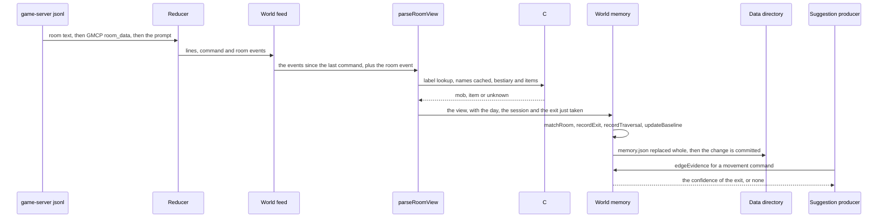
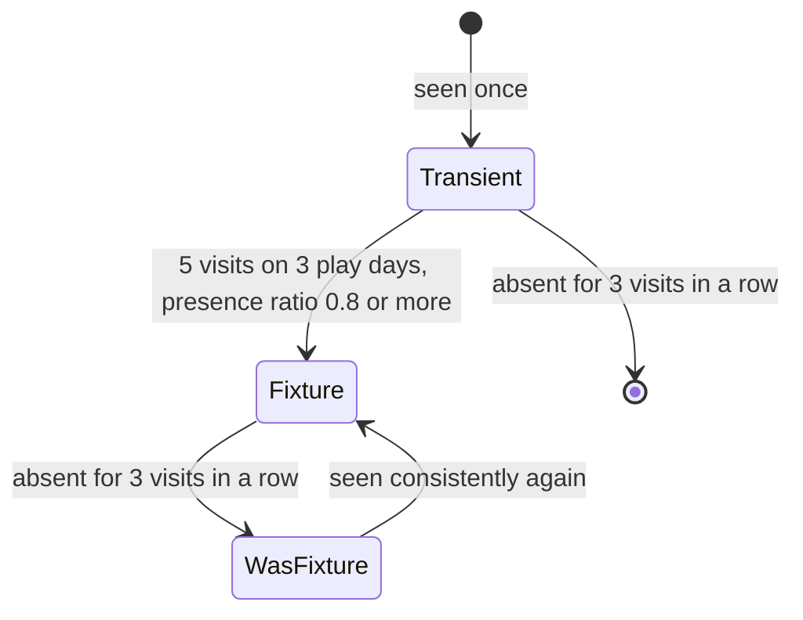
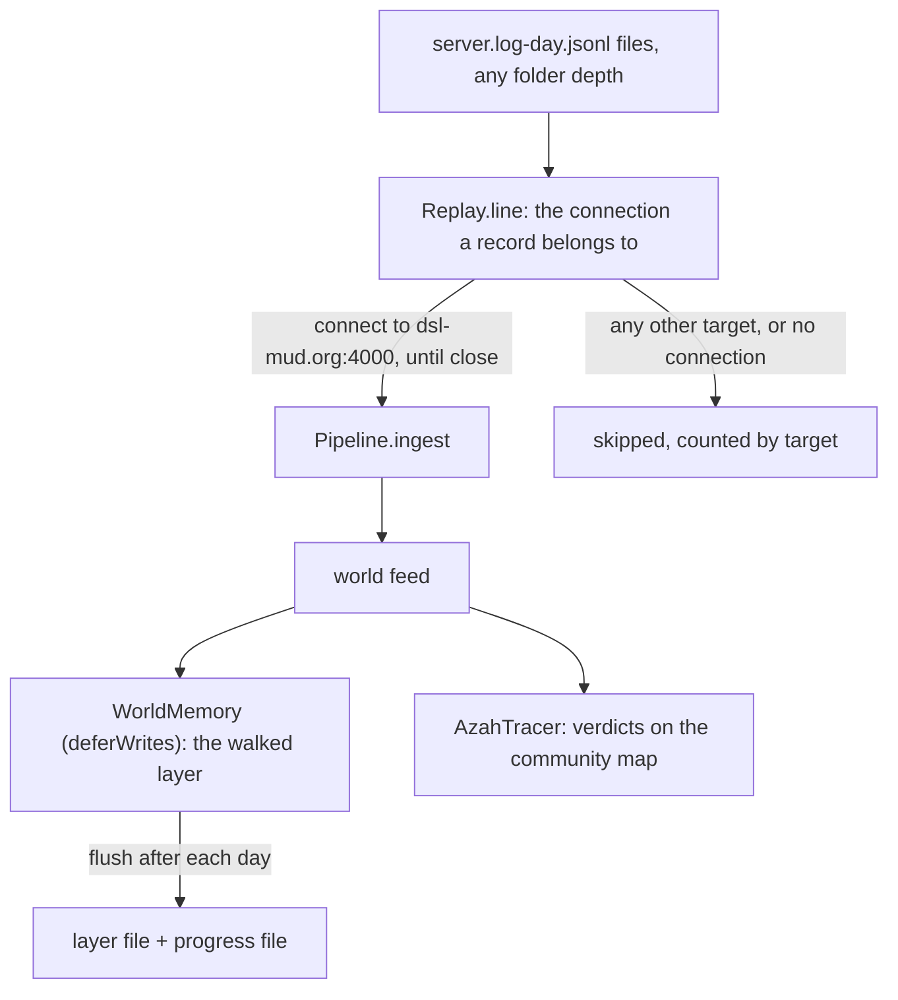
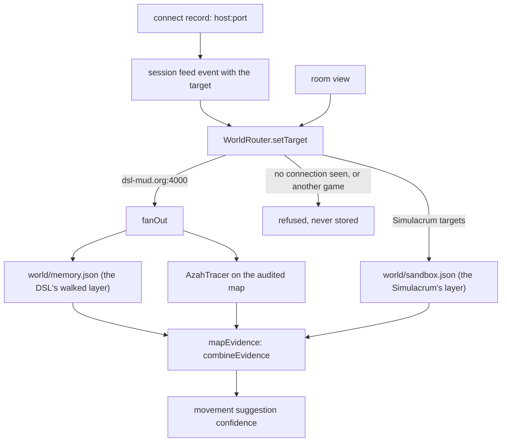

# Copilot world memory (Developer Notes)

Copilot remembers the rooms the character walks through: what each room is called, which exits it has, which of them have been
walked and how sure we are where they lead, and what the room usually holds. The memory is a **candidate layer** in the neutral map
format of [Shattered-Maps](../shattered-maps/schema.md): evidence from this machine's own play, kept in the private data directory,
never published. Its first use is that a movement suggestion along an exit that has been walked carries the exit's confidence.

Local-only like the rest of Copilot (see the [README](README.md)); the pure rules live in `services/shattered-maps-core` and are
documented there. This page is the server side: `apps/copilot-server/src/world/`.

| File | Holds |
|---|---|
| `direction.ts` | `commandDirection`: the exit a bare movement command takes (`n`, `north`, ...) |
| `parseRoom.ts` | `parseRoomView(events, labeler)`: the feed around a `room` event becomes title, sector, exits, description and contents |
| `lookup.ts` | `createNameLabeler`: says mob or item by matching a line against the Archive's creature and item names |
| `memory.ts` | `WorldMemory`: identity, evidence, baseline, the file, and the read side (`room`, `candidates`, `edgeEvidence`) |
| `feed.ts` | `createWorldFeed`: turns the pipeline's feed batches into views and gives them to a `ViewSink` (the memory, or in a replay the Azah tracer) |
| `replay.ts`, `replayCli.ts`, `replayMain.ts` | `Replay`: game-server jsonl through the same path as live play, one target only; `pnpm replay:world` writes a walked layer from years of logs |
| `traceCli.ts`, `traceMain.ts` | `pnpm replay:trace`: walks the community map (Azah) with the logs and writes a verdict per room and link |

## How a view gets in (diagram D14)

The game sends the room **text first** and the GMCP `room_data` just before the prompt, so a view is the text lines that came before the
`room` event, after the previous prompt and the last command. The text of a room is: a title line, the description (indented two
spaces), a blank line, ` [Exits: north south  ]`, then the things in it: unindented lines for creatures and people, lines indented by
five spaces for objects, and an indented blank line for an object the game does not name (`unlisted`).

### What is trusted

The GMCP part (name, sector, exits) is exact and is the identity key. The text is trusted only when it can be tied to it: a line equal to
the GMCP name (case and spacing ignored), then an exits line. Each view reports one of

| `text` | Meaning | What is stored |
|---|---|---|
| `ok` | title and exits line found | description (first one wins), contents into the baseline |
| `absent` | no text before the event (brief mode, or a repeat the feed collapsed) | the room and exits, no baseline visit |
| `dark` | no exits line and the text says it is too dark | the room and exits, no baseline visit |
| `disagrees` | text with no title equal to the GMCP name, or no exits line | the room and exits, no baseline visit; the text is ignored, never guessed |

A visit with no readable contents never counts as "the room was empty": it is left out of the baseline altogether.

### Labels

Contents are labelled `mob` or `item` only when the line matches a name from the Archive, read from the local C# web server
(`COPILOT_ARCHIVE_URL`): creature names from `/api/agent/bestiary` for an unindented line, item names from `/data/items.json` for an
indented one. A name must be 5 or more characters and match as whole words. Everything else is `unknown`. The names are loaded once, in
the background, and refreshed after 6 hours; after a failed fetch nothing changes but the next try (5 minutes). With no
`COPILOT_ARCHIVE_URL` every label stays `unknown`.

People never enter the memory: a line with a flag only a person carries (`WANTED`, `KILLER`, `THIEF`, `AFK`), or a name-shaped line
("Name Surname is here") that is not a known creature, is `player` and is dropped. The heuristic can miss a person; such a line is kept as an
`unknown` label until it has been absent for three visits (it expires), in the private data directory only, and is never exported.

## Identity and evidence

All walked rooms are in one unplaced area, `walked` (continent `walked`, subzone `walked-main`): the log does not say which area a room is
in, so none is guessed. Identity then follows the rules of [schema.md](../shattered-maps/schema.md#identity), with three additions for
walking:

- **An arrival is followed only when exactly one movement command was typed since the previous view, and it was the last command.**
  Several mean a move failed or the character passed through rooms that look identical (the game sends the same `room_data`, and the
  feed collapses repeats); a failed move followed by `recall` is not an arrival by that exit. No link is recorded in those cases.
- **A title match must agree with the way back.** The room matched by title must not be the room the character just left, and its exit
  back must not already lead somewhere else. If several rooms fit, the one whose way back already leads to where the character came from
  is the room; if that is not unique, a new room is made (and counted as `ambiguous`).
- **A reconnect is a new view.** The reducer forgets the last room on a connect or a close, so the first view of a session in the same
  room as the last session is not dropped as a repeat.

The evidence for an exit is the link state of diagram D12: `candidate` 0.6 after one walk, `confirmed` 0.95 after the way back, `conflict`
0 when a walk arrived somewhere else. `edgeEvidence(roomTitle, command)` returns that number for a plain movement command out of the
room the memory is in, and `null` when there is none (not a movement, the memory is in another room, or the exit was never walked). The
producer uses it as the confidence of a `move` suggestion (`confidenceSource: 'map-evidence'`); `null` means the suggestion always asks
(`createSuggestionParts({ mapEvidence })`).

## What a room usually holds (diagram D13)

`updateBaseline` of shattered-maps-core, once per room view with readable text. A **session** is the play day (the UTC date of the log
time) plus the registered codename; every room view is one visit, so two characters in the same room on the same day are two visits and
one play day. Nothing is stored without a registered character.

The four numbers are the P5 defaults and can be changed in the environment (all whole numbers except the ratio):

| Variable | Default | Meaning |
|---|---|---|
| `COPILOT_WORLD_MIN_VISITS` | `5` (1 to 1000) | visits a thing must be seen on before it can be a fixture |
| `COPILOT_WORLD_MIN_DAYS` | `3` (1 to 365) | distinct play days those sightings must span |
| `COPILOT_WORLD_MIN_RATIO` | `0.8` (above 0, at most 1) | seen visits divided by visits since it was first seen |
| `COPILOT_WORLD_DEMOTE_AFTER` | `3` (1 to 1000) | consecutive visits without it before a fixture is demoted (a transient expires) |

An unusable value stops the server at start with a message naming the variable. A changed threshold applies from the next visit on; it
does not re-judge what is stored. A demoted fixture is kept under `was` with its counts, so a wrong demotion is visible and a thing that
comes back is a fixture again with its `returns` count raised.

## The file

`<COPILOT_DATA_DIR>/world/memory.json` is `{ "v": 1, "map": <MapFile> }`, replaced whole after each visit (a temporary file, then a
rename). Views are served one at a time. **The memory changes only after the write succeeds**: a visit whose write fails (or that would
make the file larger than 60,000,000 characters, or add a room past the schema's cap) leaves the memory exactly as it was and is counted
(`writeFailures`, `refused`). A file that is not a valid version-1 map at start is copied to `memory.json.unreadable` (best effort) and the
layer starts empty; the server logs `world memory: unreadable`. Where the character is is not remembered across a restart.

## Routes

Read-only; `503` while the memory is not running. Ids are checked against the map id pattern before anything is looked up.

| Route | Answer |
|---|---|
| `GET /world/rooms/<id>` | 200 `{ id, title, sector?, vnum?, description?, visits, days, exits: [{ dir, state, confidence, to, toTitle?, traversals }], fixtures, transient, was }`; each content `{ label, kind, seen, observed, count, days, firstSeen, lastSeen, returns }`. 400 for a malformed id, 404 for an unknown room |
| `GET /world/near?title=&exits=&world=` | 200 `{ rooms }`: the walked rooms with that title, best first, each with `sameExits` (see [server-api.md](server-api.md)); the map window's "add this room from my history" reads it (`WorldMemory.near`) |
| `GET /world/candidates` | 200 the whole candidate layer as a Shattered-Maps `MapFile` (validate it with `validateMapFile`) |
| `GET /world/stats` | 200 counts: `views`, `textOk` / `textAbsent` / `textDark` / `textDisagrees`, `newRooms`, `matched`, `ambiguous`, `traversals`, `refused`, `writeFailures`, `rooms`, `links` |

## Replaying the logs

The live path reads the log as it grows; the same path can read the whole archive of `server.log-<day>.jsonl` files, oldest day first.

- **Only one world per replay.** A record is used only while the current connection is the chosen target (default `dsl-mud.org:4000`); the
  logs also hold the Simulacrum, a second DSL port and a docker host, and none of their rooms may reach the DSL layer. A connect record
  that cannot be read counts as `unknown` and is never the target.
- **`replay:world --logs <folder> --out <layer file> [--from] [--to] [--target] [--max-chars] [--restart]`** keeps the layer in memory and
  writes it once per day (`WorldMemory` option `deferWrites`, then `flush()`: serializing the whole layer for each of hundreds of
  thousands of views would take hours). A progress file beside the layer lets a stopped run continue; a layer without its progress file is
  replaced, because replaying a day twice would count every view twice. The character is a fixed placeholder: no name is read or stored.
- **`replay:trace --world dsl --logs <folder> --azah <candidates folder> --out <report file>`** does not build a layer: it follows the walk on
  Azah's graph and writes the verdicts (see [verification](../shattered-maps/verification.md)). `--world dsl` is required.
- A session is one play day plus the codename, so a move that crosses midnight records no link (the rooms on both sides are still seen).

## Limits to know

- Identical consecutive rooms (the same name, sector and exits) send identical GMCP, which the feed collapses, so a walk through a
  corridor of look-alike rooms shows as one room and loses the steps in between. The evidence is weaker, not wrong: no link is recorded
  for a move whose arrival is not certain.
- One area for everything walked. Placing rooms in the area they belong to, and merging a room the walker kept apart, is the owner's work
  (and Phase 21's import); `mergeRooms`, `undoMerge` and `splitRoom` of shattered-maps-core exist for it.
- The candidate layer is evidence, not truth. A production build never serves it.

## Tests

`world/replay.test.ts`, `world/replayCli.test.ts` and `world/traceCli.test.ts` cover the replay (a session to another target adds nothing, a
connection that spans two files, resuming, a layer that is too big, bad arguments), and `world/memory.test.ts` the deferred writes.

`pnpm --filter @shatteredarchive/copilot-server test`: `world/parseRoom.test.ts` (a plain room, unknown contents, a dark room, text that
disagrees with GMCP, boundaries, people), `world/lookup.test.ts` (paging, ttl, failures, caps), `world/memory.test.ts` (the fixture
rule over five visits on three days, a person never stored, demotion with `was` kept, two characters both counted, a restart, a failing
write, identity and evidence, the limits), `world/feed.test.ts` (which arrivals are followed), `suggest/producer.world.test.ts`
(confirmed edge is a high-confidence move, a walked-once edge a low one, an unwalked one asks), the `/world` routes in `app.test.ts`, and
`bootstrap.test.ts` ("world memory over the log"): the real server on a scratch log, a short walk replayed over three days, read back
over HTTP, kept across a restart, replayed again. Test fixtures use invented rooms and creatures only.

## One memory per world, and the audited map as evidence (Phase 29f)

The live feed no longer writes every view into one layer. `connect` log records carry their target (`host:port`; copilot-core `LogEvent`
`connect` and the `session` feed event), the world feed tells a `WorldRouter` (`world/router.ts`) when a connection opens or closes, and the
router sends each view to the memory of the world that connection belongs to (`world/worlds.ts`):

- A view whose world is not known is **refused**: a server started in the middle of a session, a connection to another game or to another port of the
  DSL host adds nothing to any layer. (The cost: a session that was already open when the server started is not remembered.)
- `world/memory.json` is the DSL's layer (the one `/world/*` serves); the Simulacrum's is `world/sandbox.json`. Neither is ever continued with the
  other's views.
- If the private folder holds an audited map (`world-map/audited`, built by `build-audited.mjs`), the server loads it at start and follows the DSL walk
  on it with an `AzahTracer` (`world/audited.ts`). Once the walk has pinned the player to one room, a movement command takes the map's confidence for that
  exit: 0.95 walked both ways, 0.6 walked once, 0.4 in the community map and not walked, 0 where the walk contradicted it. `combineEvidence` merges the
  walked memory, the Simulacrum's memory and the audited map for one exit: a contradiction (0) from any source wins, otherwise the surest; null only when
  none can say. Without an audited folder the server starts as before (`audited map: none` in its log).
- These are the lessons of [verification.md](../shattered-maps/verification.md) as behaviour: trust a link by its verdict, never by the title of a room,
  and never mix worlds.
