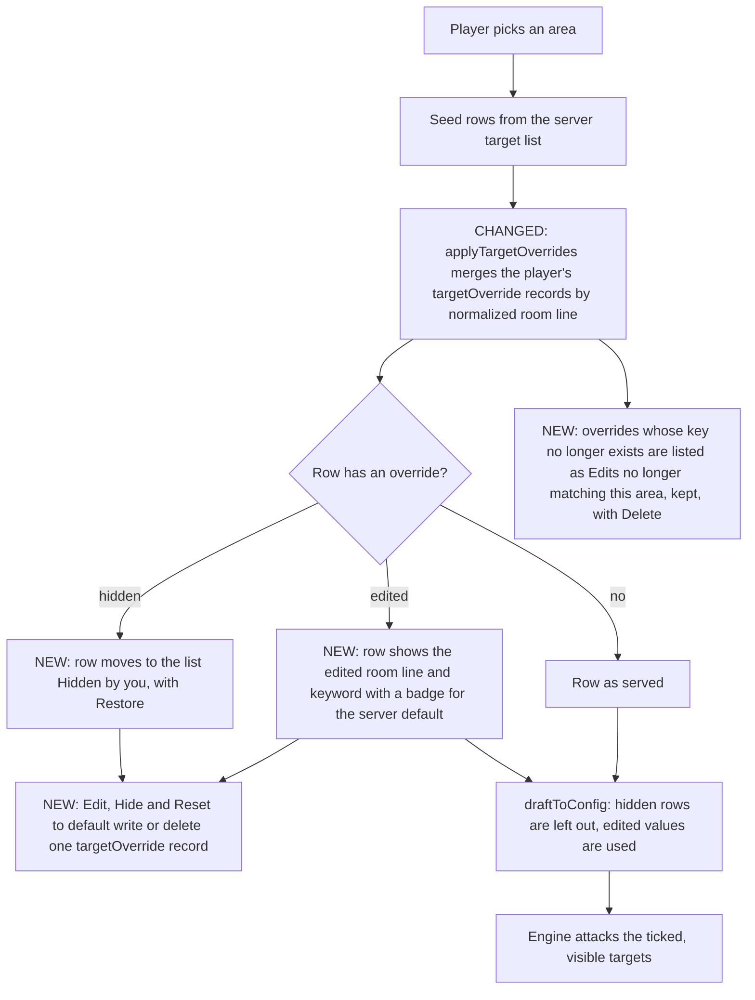
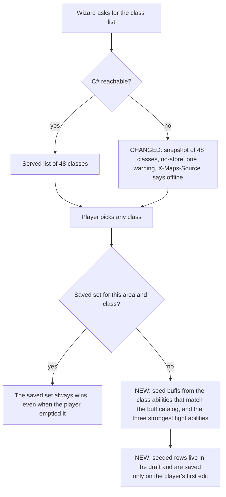
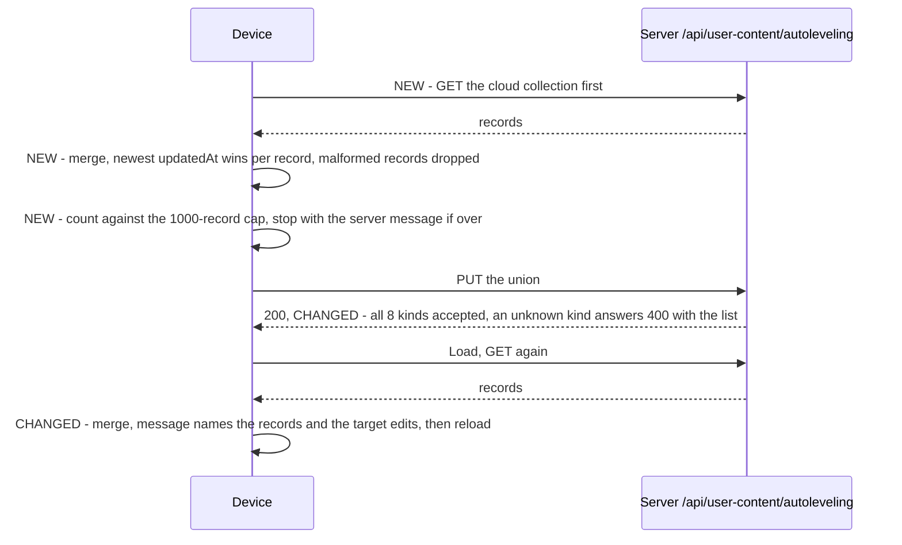
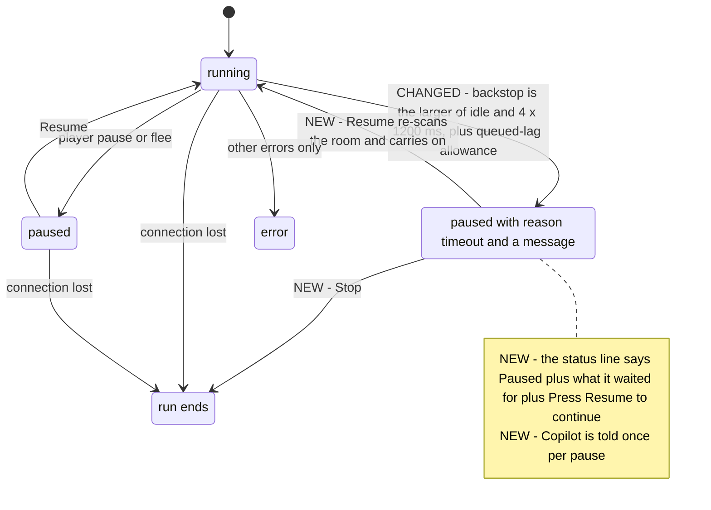
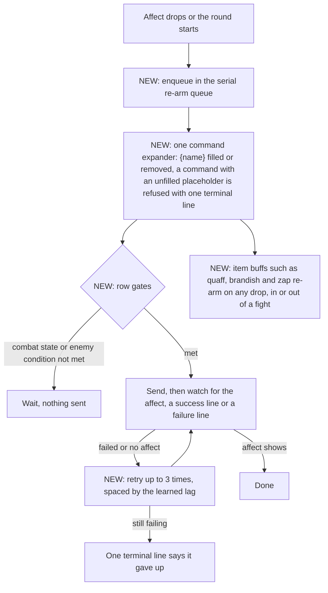
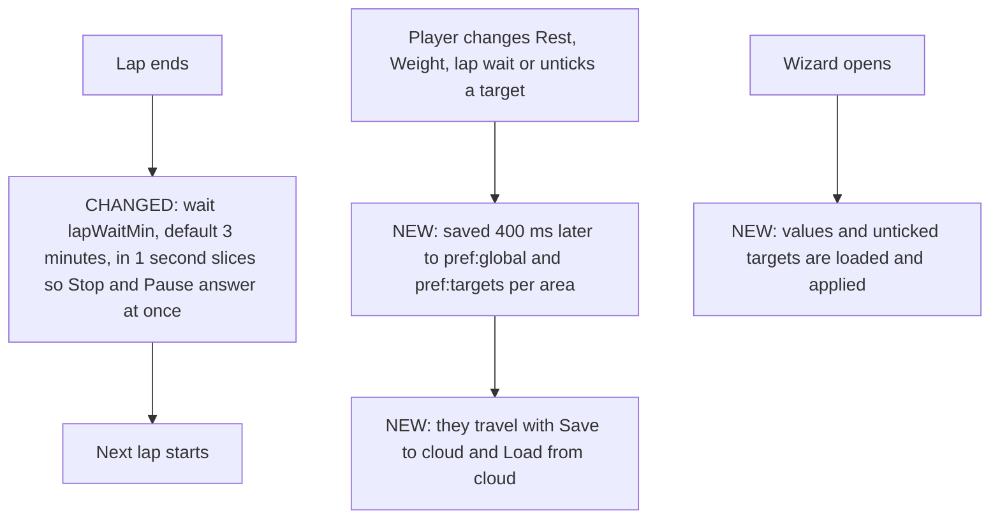
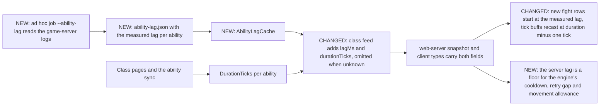
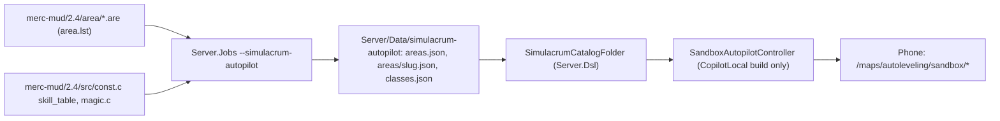

# Autopilot (auto-leveling): data, engine behavior and cloud sync

Developer notes for the autopilot wizard and engine in `apps/game-client/src/features/autoleveling/`. The first half covers what a player
can change and where it is stored (targets, overrides, cloud sync). From "Commands sent to the game" on, it covers how the engine sends,
gates, re-arms, pauses and waits, and where the class feed's timing comes from. The per-file context is also in the folder index
(`.annotated`). The page grows with the work items `2026-11-13_editable-autopilot-targets-synced` and
`2026-11-18_autopilot-live-test-findings`; sections for phases not yet built are marked.

## Where the data comes from

| Data | Source | Cached in |
|---|---|---|
| Areas (route, level range, `recommendedTargets`) | `GET /api/web/maps/autoleveling/areas[/slug]` (web-server proxy of the C# service) | IndexedDB `shatteredarchive-maps`, keys `autolevelingAreaIndex.v2`, `autolevelingArea.v2:<slug>`, 7-day soft TTL |
| Classes and their abilities (all 48 playable classes) | `GET /api/web/maps/autoleveling/classes` | IndexedDB key `autolevelingClasses.v2` |
| The player's own additions and edits | the browser only, plus the account cloud when saved | IndexedDB `shatteredarchive-autoleveling` / `userData` |

The web-server answers from the C# service and falls back to a bundled snapshot only when that call fails. The
fallback is never cached by browsers (`Cache-Control: no-store`), is announced once per process in the log, and is
visible in the `X-Maps-Source` header (`upstream` is the healthy value). Details: `docs/web-server.md`.

## Records the player owns

One `UserRecord` per item (`autoleveling-user-data.ts`): `id`, `kind`, optional `areaSlug` / `className`, `data`,
`updatedAt` (last writer wins). Eight kinds, listed in `SYNCED_RECORD_KINDS`:

| Kind | Holds |
|---|---|
| `target` | a custom kill target the player added for an area (`lookName`, `engageName`) |
| `targetOverride` | the player's personal edit of a PRE-LOADED area target (below) |
| `buff`, `fight` | the buff checklist per area, the fight commands per area and class |
| `path`, `pref`, `abilityTiming` | custom paths, remembered values (class, alignment, Rest, Weight, lap wait, unticked targets), learned per-ability cooldowns |
| `routeOverride` | the player's own route for an area, replacing its `dirs`: `{ dirs: [step, ...] }`; every step is validated like override text because it is sent to the game (the route editor; documented here only as far as the sync contract needs) |

`SYNCED_RECORD_KINDS` is a contract with the server's validator (`Server.Dsl/AgentApi/AutolevelUserRecords.cs`,
DSL repo): a kind the server does not list makes the whole Save to cloud fail with a 400. Add a kind in both.

## Overriding a pre-loaded target

The server's list is never modified. A player's correction is a `targetOverride` record:

- id `targetOverride:<areaSlug>:<key>`, so two devices editing the same target write the same record;
- `data` = `{ key, lookName?, engageName?, hidden? }` holding ONLY what differs from the server value;
- `key` is the normalized ORIGINAL room line (lowercase, whitespace collapsed): the match survives a re-ordered list but
  not a renamed room line.

Rules (all in the pure module `autoleveling-target-overrides.ts`, tested in its `.test.ts`):

- An edit that equals the server value is not stored; editing every field back to the default deletes the record
  (`setTargetOverride`). A server fix therefore still reaches every field the player left alone.
- An override whose key is no longer in the area's served list is kept, not applied, and reported as `unmatched`
  by `applyTargetOverrides`; it re-attaches if the key returns. Only the player deletes it
  (`deleteTargetOverride`).
- Reset to default (`resetTargetOverride`) removes the whole record: edit and hidden flag.
- Room line and keyword must be 1-200 characters with no `;`, line break or control character, because they end up in
  `kill {name}` and in the encounter match. `normalizeRecord` enforces this for records arriving from the cloud, the
  server enforces it for `targetOverride`, and the setters enforce it for the editor.

Custom targets: `updateCustomTarget` edits in place (same id); `removeCustomTarget` deletes the record. Before
2026-11-13 the wizard only dropped a removed custom target from its draft, so it reappeared the next time the area was
opened.

### The Targets step (editor)

`components/wizard/TargetsStep.tsx`, driven by `AutoLevelingWizard.tsx` and the draft in `useWizardDraft.ts`.

- On area selection the wizard fetches the served targets, the player's custom targets and the player's overrides, and
  seeds the draft with `applyTargetOverrides` (edited values, `overridden`, `hidden`, the server values kept as
  `defaultLookName` / `defaultEngageName`, `unmatchedOverrides`).
- A row is identified by `targetRowId`: `a:<key>` for a pre-loaded target, `c:<record id>` for the player's own. The room
  line is not an identity because an edit changes it.
- **Edit** (pre-loaded or own): inline room line and kill keyword. The step refuses empty text, over 200 characters,
  `;` or line breaks, and a room line another row (or a hidden row's original line) already uses, before asking the wizard
  to save. The wizard stores an override (`setTargetOverride`) or updates the custom record (`updateCustomTarget`) and
  returns a message if that fails; the editor stays open with it.
- **Hide / Restore** (pre-loaded only): persisted (`hidden: true` in the override). A hidden row is listed under "Hidden by
  you", is never enabled for the engine, and keeps any edit it had.
- **Reset to default**: `resetTargetOverride`, then the row is rebuilt from the server values (not merged).
- The checkbox is the per-run on/off and is not stored. `draftToConfig` hands the engine only enabled rows, with their
  current (possibly edited) room line and keyword (`autoleveling-wizard-config.ts`).
- **Edits that no longer match this area** lists `unmatchedOverrides`; the player deletes them (`deleteTargetOverride`).
- The blue (i) opens `TargetsHelp.tsx`, the end-user text for all of the above.

Tests: `TargetsStep.test.tsx` (the step alone), `useWizardDraft.test.ts`, `AutoLevelingWizard.targets.test.tsx` (the real
wizard on in-memory storage: edit/hide/reset/unmatched/re-attach/own targets/storage failure, closing and reopening), and
the override rules in `autoleveling-target-overrides.test.ts`.

## The Combat step: class list and pre-fill

`components/wizard/CombatStep.tsx`.

- The class picker lists every class in the served catalog (48 playable classes: 5 base, 43 reclasses, base first). If the
  catalog cannot be loaded the step says so and offers only the five-name `DSL_CLASSES_FALLBACK`; it never shows five
  classes silently.
- **Pre-fill** (`autoleveling-class-defaults.ts`): choosing a class fills the buffs and fight commands from the DSL data
  when the player has no saved set. Buffs are the `DEFAULT_BUFF_LABELS` entries (protection and damage: Sanctuary, Armor,
  Shield, Stone Skin, Bless, Frenzy, Haste, Giant Strength, Berserk) that the class has at the character's level, built from
  the log-verified `BUFF_CATALOG` so the command and the GMCP affect are exact. Fight commands are up to three offensive
  abilities at or below the level: the strongest spells and songs first (two, so a hybrid keeps room), then known combat
  skills in `COMBAT_SKILL_NAMES` order; a cooldown the engine already learned for that command is used, else 0. No known level
  means no cap.
- **A saved set always wins.** Buffs are saved per area, fight commands per area and class. The `*OrNull` readers
  (`getBuffOverlayOrNull`, `getFightOverlayOrNull`) tell "never saved" (`null`) from "saved empty" (`[]`); only `null` is
  pre-filled, so a list the player emptied stays empty. Rows already in the draft are never replaced. Pre-filled rows live
  in the draft and are written only when the player first edits one.
- One decision per area and class (`seededFor` ref): on mount for the remembered class, and in `onChangeClass` for a new
  pick (the newest pick wins; buffs follow the new class while none are saved). Unmounting or a newer pick discards a seed
  that is still loading.
- Known limit: about a quarter of the catalog's abilities carry no semantic group, so fighter skill picks lean on the
  known-skill list. The pre-fill is a starting point the player edits.
- **Buffs the class only gets later** are listed too, PAUSED (`BuffRow.disabled`) and with a warning in the buff card: the
  player can apply them another way (a potion, wand or staff) by changing the command and resuming. A buff the class never
  gets is not listed. The warning (`buffAbilityNote` in `CombatStep.tsx`) is computed at render from the catalog and the
  character's level, and only while the row's command is still the verified `cast` command; an unknown level or a command the
  player changed shows none. Paused buffs reach neither `steps.start.pre` nor `criticalBuffs` (`draftToConfig`).
- **Pause a fight command** (`FightRow.disabled`): the row stays in the list and in storage with its cooldown, gates and
  order, but `draftToConfig` leaves it out of `steps.fight.exec`, so the engine never sends it. Resume deletes the key, so a
  resumed row is stored exactly like one never paused. The flag lives in the `fight` record, so it syncs with Save to cloud
  (the server does not look inside a fight record's data). The Review step shows it as paused. Buffs have no pause yet.
- The blue (i) opens `CombatHelp.tsx`, the end-user text.

Tests: `autoleveling-class-defaults.test.ts` (rules), `CombatStep.prefill.test.tsx` (seeding, saved-wins, class pick and
race, list, notice, help), `autoleveling-user-data.test.ts` (the `OrNull` readers).

## Cloud sync

Manual, through the account modal's Save to cloud / Load from cloud (`useAccountModal.ts`, `cloudSync.ts`,
`/api/user-content/autoleveling`, whole-collection PUT, 1000 records at most). See `docs/game/user-account.md`.

- **Save** first reads the cloud copy and merges it into this device with `importRecords` (newest `updatedAt` per
  record wins), then uploads the union (`exportAll`). The server replaces the whole collection, so without that merge a
  device that never loaded (the phone, say) would wipe what another device saved (CLOUDSYNC-02). The merge adds and
  updates records; it never deletes: removing a record on one device does not remove it from the cloud.
- A failed or unauthenticated look-ahead stops the save, uploading nothing.
- If the union is over `AUTOLEVEL_MAX_RECORDS` (1000, the server's cap; learned cooldowns, buff and fight lists, custom
  targets and target edits all count) the save stops before any upload, saying so.
- **Load** merges the cloud records into this device the same way and reports how many were target edits.
- `importRecords` skips malformed records (`normalizeRecord`), so one bad record never blocks a load.
- Two devices editing the same target write the same record id; the newer edit wins as a whole record (not field by field).

## Commands sent to the game

Added 2026-11-18 for the live-test findings (`2026-11-18_autopilot-live-test-findings`, Phase 12).

Every command the engine sends goes through `outgoingText` in `autoleveling-engine.ts`, which calls `expandCommand` and `findUnresolvedPlaceholder`
(`autoleveling-command-text.ts`). Before this, only the initiation command was expanded, so a fight row such as `cast 'fog' {name}` reached the game
literally (30 times on 2026-11-14), and the seeded `quaff <potion>` reached it 23 times.

- `{name}`, `{target}` and `{keyword}` are filled with the keyword of the creature being engaged or fought (`engagedKeyword`, set when an engage
  attempt starts and cleared when the fight ends). With no target the placeholder and the space before it are removed (`cast 'dark heal' {name}` is
  sent as `cast 'dark heal'`). The keyword is inserted verbatim.
- A command that still holds `{word}` or `<words>` after that is **not sent**. The terminal shows one line per command per run
  (`not sent: "quaff <potion>" still has <potion> to fill in`) and the run continues. A DSL colour code such as `{R` has no closing brace and is
  never mistaken for a placeholder.
- The buff catalog no longer seeds `quaff <potion>` as the in-combat command; the box shows a hint and stays empty until the player types a real item.
- Never pre-filled for any class: `fog` and `dispel fog`. The buff pre-fill and the fight pre-fill each enforce their own list
  (`NEVER_DEFAULT_BUFFS`, `NEVER_DEFAULT_FIGHTS` in `autoleveling-class-defaults.ts`); the manual ability picker still offers them.

Tests: `autoleveling-command-text.test.ts`, the `commands reach the game as real commands` block in `autoleveling-engine.test.ts`,
`autoleveling-class-defaults.test.ts`.

## Row options: combat state, enemy condition, retry

Added 2026-11-18 (Phase 13 of the live-test findings; the engine and the controls follow in Phases 14-18). A buff row or a fight row can carry:

| Field | Values | Meaning |
|---|---|---|
| `combatState` | `in`, `out`, absent | send only while fighting, only while not fighting, or either (the engine decides from GMCP `is_fighting`, whatever the game would answer) |
| `enemyGate` | `{ op: 'above' | 'below', band }`, band one of 0, 15, 30, 50, 75, 90, 100 | the enemy's condition phrase compared by the floor of its band; never blocks while no condition line has been seen |
| `retryUntilSet` (buffs) | `false` or absent | only `false` is stored; absent means "retry until the affect shows" for an affect-gated row |

They are stored inside the existing `buff` and `fight` records, so no server change and no new record kind. A value that is not one of the known
ones is dropped from the row on import (`normalizeRowOptions`); the row and its other fields stay. Switching a buff's recast mode keeps all of
them (`buffRowForGate`). Tests: `autoleveling-row-options.test.ts`, `CombatStep.gates.test.tsx`.

## Gates: combat state and enemy condition

Added 2026-11-18 (Phase 14). The controls follow in Phase 18; until then only the catalog's Dark Heal carries them.

- **Combat state** (`combatState`): `out` sends only while GMCP `is_fighting` is false, `in` only while it is true. It is decided at the moment the
  command is about to be sent (`execAction`), not when it was queued, so a fight that starts while a buff waits out its settle drops an out-of-combat
  command. The engine enforces it whatever the game would answer (owner decision D3): the 2026-11-14 and 2026-11-18 logs hold no refusal line for a
  heal in combat. `send_every_ticks` still never fires in combat.
- **Enemy condition** (`enemyGate`): GMCP carries no enemy health, so the engine reads the condition phrase the game prints each round
  (`autoleveling-enemy-condition.ts`: "has quite a few wounds", "looks pretty hurt", ...). The band of the last line is kept for the creature being
  fought only (its name must start the room line the encounter matched, so a pet's line is ignored), cleared when the fight ends and when the next
  starts. `below band` holds while the enemy's band floor is lower than the chosen one, `above` while it is higher. **No condition seen yet this
  fight never blocks**, as for the own-vitals gate.
- The seven bands are the stock base's (100, 90, 75, 50, 30, 15, 0 percent; "bleeding to death" shares the lowest). **DSL's own edges are not
  verified**, so the UI will say "about N%".
- **Two thresholds on one row** (owner decision): own HP/MP/Stamina (`vitalsGate`) AND the enemy gate must both hold.
- **Between fights**: the post-fight recheck (`recheckBuffs`) now also runs plain `send` rows that carry a vitals, combat-state or enemy gate, so a
  heal below some HP is asked again after every fight. An ungated every-round buff still waits for the next lap.
- **Catalog**: Dark Heal (`cast 'dark heal'`, out of combat, hp below 70% to start with, success line "a dark healing fills your body") is in
  `BUFF_CATALOG` but not in `DEFAULT_BUFF_LABELS`: the player adds it from the catalog.

Tests: `autoleveling-engine.gates.test.ts`, `autoleveling-enemy-condition.test.ts`, `autoleveling-class-defaults.test.ts`.

## Re-arming buffs and heals

Added 2026-11-18 (Phase 15). Live findings of 2026-11-14: a buff that failed was only tried again after the next kill, many affects dropping in one
tick (3 or more in 81 distinct seconds that day, 102 on 2026-11-18, up to 13 and 18 at once) sent their commands together behind the game's lag, and an
item buff (a potion) was only used when a row had a separate in-combat command.

- **One cast in flight** (`withCastLock` in `autoleveling-engine.ts`). The start-of-round and post-fight `if_affect_missing` actions, the reaction to a
  dropped affect (`onCriticalBuffDropped` to `enqueueRearm`) and a gated heal all go through `castUntilSet`. Drops wait in `rearmQueue`, different
  commands at least `SEND_GAP_MS` (1.5 s) apart; the same affect is queued once, and the recheck skips an affect whose re-arm is already pending.
- **How the engine learns the result** (`autoleveling-cast-outcome.ts`, only lines seen in the logs): the GMCP `add_affect` for the row's affect, or the
  ability's own success line (catalog `successLine`, Dark Heal: "A dark healing fills your body."), or a failure line: "You lost your concentration."
  (retry), "You can't concentrate enough." (no mana: not retried, one notice), "You aren't fighting anyone." (not retried), "You do not have that potion."
  (the item is gone: not retried, noted once, not used again this run). A failure line only counts inside the 3 s window after the engine's own send.
- **Retry** (`retryUntilSet` on the row, absent = on for an affect row; `retry: false` on the action = send once and go on, no waiting): up to
  `MAX_CAST_ATTEMPTS` = 3, `RETRY_GAP_MS` = 3 s apart (longer when the ability's learned cooldown is longer), silence counts as a failure only for a spell
  that has an affect or a success line to wait for, then one line "gave up on X after 3 tries". Before every attempt the cast is checked again: affect
  already back (a true-up), a gate no longer holding or the wrong combat state ends it quietly.
- **Item buffs** (`quaff`, `brandish`, `zap`, `recite`, `eat`, `drink`) are re-armed whenever the affect drops: in a fight with the row's in-combat command
  or the buff's own item command, out of a fight (only while a run is going) with the item command. A spell is not recast mid-fight and waits for the
  post-fight recheck as before. Silence is not a failure for an item (potions do not fizzle).
- **Heals** with a known success line (`BUFF_CATALOG`: Dark Heal) are confirmed and retried the same way, and cast again (at most `MAX_HEAL_REPEATS` = 5)
  while their HP gate still says the character is hurt.
- **Pause and stop**: a pause freezes the queue and the gaps (`sleepSliced`: paused time never counts); on resume each entry is checked again before it is
  sent. Stop clears the queue and ends any wait within a slice.
- The numbers (3 s window, 3 s gap, 1.5 s between commands, 3 tries, 5 heal casts) are constants at the top of the engine file, chosen from the logs:
  casts to a failure line are 68 of the casts on 2026-11-14 and 32 on 2026-11-18, the game's fight loop is 2.5 s.

Tests: `autoleveling-engine.rearm.test.ts` (fake timers), `autoleveling-cast-outcome.test.ts`.

## Slow route steps, the player's own commands, and a buff that is already up

Added 2026-11-25 after a review of the game-server logs of 2026-11-19..25.

- **Slow route steps** (`autoleveling-step-waits.ts`). A non-move step used to wait a fixed `lookSettleMs` (0.5 s). `heel` is answered 0.1-10.9 s
  later ("An unholy steed comes running in." / "gallops in.") and `ride st` 0.05-12.4 s later ("You mount an unholy steed."), so 16 of 99 mounts had a move
  sent first and the character walked on without its steed (a route that does `pull flinger`, `heel`, `ride st` after the flinger throws the rider off).
  Those two steps now wait for their own answer, up to 20 s. A `ride` that fails ("They're not here.", "You can't ride that.", "You can not ride anything
  while flying.") or is never answered **pauses the run** (Resume continues; the player fixes the mount first). A `heel` that fails ("No way! You are
  still fighting!") or is never answered is noted in the terminal and the route goes on; the `ride` after it has its own check. "Your already riding a
  mount!" and "You are already riding your pet..." count as done. Any other step keeps the fixed settle.
- **The player's own commands.** Every command that reaches the wire raises `shatteredarchive:command-sent`; the engine remembers what it sent itself and
  treats the rest as the player typing. A cast typed by hand (`c ...`, `cast ...`) holds the engine's next route step and its next buff check for about
  4 s (what casts cost in the logs), a typed `heel` or `ride` until the game answers; at most 20 s, one terminal line "waiting for your spell to finish"
  per 30 s. Looks, `who`, chat, kills never hold it. Fights are not held: the player may cast mid-fight. The wait runs before the buff's affect check, so a
  buff the player just cast by hand is seen as up and not cast again.
- **A buff that is already up.** After a fight the engine asks again about rows that carry a condition. A plain `cast 'shield'` row (no affect gate) with a
  condition was cast after every fight while the shield had 54 ticks left (61 times on 2026-11-24/25; every other buff 0 times, the logs show the cast
  was not waited for, so the row had no affect to check). The post-fight check now skips a plain send of a catalog buff while its GMCP affect shows, and
  says so once per run. A row gated on ticks is left alone (refreshing before the affect runs out is its purpose), and so is a heal.

Tests: `autoleveling-step-waits.test.ts`, `autoleveling-engine.steps.test.ts`.

## Pause and stop

Added 2026-11-18 (Phase 16). Before this, a movement that got no reply within the backstop, a fight that did not end, or a wait action that timed out set
the run state to `error` and ended the run ("timeouts during levelling are annoying", especially after several buffs in a row).

- **The movement backstop** was `idleTimeoutMs`, 1000 ms in the default config the wizard runs with, which is SHORTER than the movement tracker's own
  head-of-queue timeout (`HEAD_TIMEOUT_MS` = 1200 ms, `movement/movementTracker.ts`). A reply held up by the casts queued just before it ended the run.
  It is now `max(idleTimeoutMs, 4 x HEAD_TIMEOUT_MS)` plus `lagAllowanceMs` (`autoleveling-lag.ts`): the engine remembers every non-move, non-look command
  it sent (`recentSends`, with the learned cooldown or a 1 s default as its lag) and models them queued one behind the other, capped at 20 s. The tracker still
  reports an ordinary slow hop as a non-fatal failure at 1.2 s; this timer only fires when the tracker never answered at all. `idleTimeoutMs` itself is
  unchanged (it also sets the engage-attempt wait).
- **What pauses instead of stopping** (`pauseForTimeout`): that backstop, the fight-end backstop (10 minutes; after Resume the engine waits again while the
  fight is still on), and a `wait_text` / `wait_regex` / `wait_fighting` action that timed out (the action is skipped on Resume). The state is
  `paused` with `reason: 'timeout'` and a `message`; the terminal prints `paused: <what>. Press Resume when you are ready; Stop ends the run.`; the wizard
  header shows "Paused: <what>. Press Resume to continue." (`toRunStateText` in `AutoLevelingWizard.tsx`; the Combat help has a section "When autopilot
  pauses itself" for the player). Resume re-scans the room and carries on; a failed hop is treated as non-fatal.
- **Still ends the run**: Stop, a disabled mode, a missing route, a dropped connection, and any other error. A player who is already paused (or a flee pause) gets no second pause or line.
- **A dropped connection stops the run** (`onDisconnected`, on `game:remote-server:close`), running or paused: the terminal prints `connection lost: the run was stopped. Start it again once you are back in the game.` It is never resumed by itself, because a reconnect is a fresh login. The mobile engine behaves the same. Test: `autoleveling-engine.disconnect.test.ts`.
- **Copilot** receives `shatteredarchive:autopilot-need-help` `{ reason: 'timeout', message }` once per timeout pause (`autopilot-signals.ts`), as it does for
  `error`; a user pause or a flee pause is not a call for help. It still cannot send commands while the run is `running`.
- `pause(reason)` is `'user'` (the button) or `'flee'`; the paused state no longer claims a round, step or action index it did not have.

Tests: `autoleveling-engine.pause.test.ts`, `autoleveling-lag.test.ts`, `autopilot-signals.test.ts`, `autopilotLink.test.ts`, `AutoLevelingWizard.status.test.ts`, `components/wizard/CombatHelp.test.tsx`.

## Remembered values and the wait between laps

Added 2026-11-18 (Phase 17). Live findings of 2026-11-14: the Rest step, the Weight step and which targets were ticked were forgotten every time the
wizard was closed, and the wait between laps was a fixed 3 SECONDS in the wizard, so the next lap started before the
creatures had returned.

- **Rest, Weight, lap wait: one set for the character** (owner decision). They live in the existing global `pref:global` record next to the remembered class
  and alignment (`AutoLevelPrefs`: `rest { startOfRound, endOfRound, duringRound }`, `weight { atOrAbovePct, commands }`, `lapWaitMin`), so they follow the
  player through Save to cloud / Load from cloud with no server change (kind `pref` is accepted with any data). Only what differs from the default is stored
  (`autoleveling-step-prefs.ts`): defaults are an empty rest, 90 percent and no weight commands, 3 minutes. A draft that is all defaults stores nothing, and a
  value put back to its default is removed from the record.
- **Checked on the way in** (`normalizeStepPrefs`, used by `getPrefs` and `normalizeRecord`): a text over 500 characters, a non-string, a percent outside 1-100,
  a lap wait that is not a whole number of minutes from 1 to 60 and more than 20 rest rules are dropped to the default; the rest of the record stays.
- **When it is read and written**: `AutoLevelingWizard` loads the values when it opens (unless a run is on) and writes them 400 ms after the last change, and at
  once when the wizard closes or unmounts. Nothing is written for values that are as they were loaded. Unreadable storage gives the defaults and one fixed console warning.
- **Targets are remembered per area as the ones that were UNTICKED** (record `pref:targets:<areaSlug>`, kind `pref`, `data.deselected` = `targetRowId`s).
  Everything else is ticked, so a target the server adds later starts ticked; ticking the last one again deletes the record. An id that matches no row (the server renamed
  or removed the target) is kept in the record, not applied, and written back with the others (CLOUDSYNC-03). Hidden targets stay in their override record.
- **The wait between laps** is set in the Rest step in whole minutes (1-60, default 3) and becomes `roundLoopTimeMs` in every mode but sightsee (`lapWaitMs` in
  `autoleveling-wizard-config.ts`). The engine waits in one-second slices (`waitBetweenLaps` / `sleepSliced`): **Stop ends it within a second**, a pause freezes what is
  left and Resume carries on, and the terminal says "waiting 3:00 before the next lap, so the creatures can return". Configured `reset.wait` actions still replace it.
- Two devices that change `pref:global` independently (the class on one, the rest commands on the other): the newer `updatedAt` wins as a WHOLE record, as for
  every record kind; Save to cloud merges first, so the loser's edit is not merged field by field.

Tests: `autoleveling-step-prefs.test.ts`, `AutoLevelingWizard.remembered.test.tsx`, `autoleveling-engine.lapwait.test.ts`, `autoleveling-wizard-config.test.ts`.

## The controls for the row options (Combat step)

Added 2026-11-18 (Phase 18). On every buff card and every fight row, next to the vitals gate and the fire limit (`components/wizard/CombatStep.tsx`):

- **send**: *any time* / *only in combat* / *only out of combat* (`CombatStateControl`, field `combatState`; "any time" removes the field).
- **only when the enemy is below / above** a condition phrase (`EnemyGateControl`, field `enemyGate`): the seven phrases of `CONDITION_BANDS`, each shown with its
  percent after it as "about N%" (`bandLabel`). Starts as below "has quite a few wounds". Together with the own-vitals gate both must hold.
- **retry until the affect shows** (affect-gated buffs only; `retryUntilSet`): on by default, stored only as `false`. This is the "retry for affect" prompt the owner asked
  for; its wording is the owner's to review.
- A command that still has a `<placeholder>` or `{word}` to fill in (other than `{name}`) is flagged under its row ("autopilot will not send it until you replace
  that part"); the engine refuses to send it (see "Commands sent to the game").
- `updateBuff` / `updateFight` drop keys whose value is undefined, so a cleared option is absent from the stored row.
- The Review step lists the options in words (`describeRowOptions` in `autoleveling-row-text.ts`): "only out of combat", "only when the enemy is above \"...(about 30%)\"", "no retry".
- End-user text: `CombatHelp.tsx` ("Only in or out of combat, and the enemy's condition", "If a cast fails").

Tests: `CombatStep.options.test.tsx`, `autoleveling-row-text.test.ts`, `CombatStep.gates.test.tsx`.

## Duration and lag in the class feed

Added 2026-11-19 (Phase 20). `GET /maps/autoleveling/classes` (C#: `AutoPilotAbility`, `AutoPilotClassCache`) now carries two optional numbers on every ability:

| Field | Meaning | Source |
|---|---|---|
| `durationTicks` | how long the affect lasts, in ticks (about 41 s each; 0 = under a tick) | `IAbility.DurationTicks`, the highest value ever seen in play (mined by `tools/archive-mcp/scripts/affect-durations.mjs`); 1,284 of 5,036 abilities |
| `lagMs` | how long the ability keeps the game busy with the next command (0 = no lag worth measuring) | `AbilityLagCache`, from the `--ability-lag` job (DSL repo, `docs/autopilot/ability-lag.md`); 468 of 5,036 on 2026-11-19 |

Both are **omitted when unknown** (C# `int?` with `NullValueHandling.Ignore`): the client never turns a missing field into 0 (`normalizeAbility`, `autoleveling-content-types.ts`). An older client
ignores them; a newer client against an older server sees none and keeps today's defaults. The class catalog cache key is now `autolevelingClasses.v3`, so a list cached before the fields existed is not
served. The web-server's bundled fallback (`apps/web-server/src/offline/autoleveling/classes.json`) is regenerated from the running C# service with
`AUTOLEVELING_CLASSES_URL=http://localhost:5000/maps/autoleveling/classes pnpm --filter game-client extract:autoleveling-classes` and carries the same fields (`mapsResponsePolicy.test.ts` fails if it does not).
Known limit: the web-server answers the upstream list with a 30-day `Cache-Control`, so a browser that already holds the list keeps it until that expires or the player reloads hard.

Tests: `autoleveling-ability-timing.test.ts`, `autoleveling-classes.test.ts` (the v3 key), `mapsResponsePolicy.test.ts` (snapshot); DSL `AutoPilotClassCacheTests` (fields present, omitted, 0 kept).

## Timing defaults from the class feed

Added 2026-11-19 (Phase 21). The two numbers of the class feed (see "Duration and lag in the class feed") feed the autopilot's timing:

- **A fight row starts with the ability's measured lag as its reuse time** (`cooldownSecFromLag`, seconds to a tenth; `defaultFightRows` and "add ability" in the Combat step). A cooldown the engine already learned for that command still wins
  over it (as before); an ability with no measurement starts at 0.
- **A tick-gated buff starts recasting one tick before its duration ends** (`refreshTicksFromDuration`: duration minus 1, never less than every tick; 0 = under a tick = every tick), when the class feed knows the duration; else
  today's `DEFAULT_REFRESH_TICKS` (6). Affect-gated buffs have no tick count and are unaffected.
- **Rows that are already saved are never rewritten** by any of this (it only applies to rows created from now on, and the pre-fill still only runs where nothing was ever saved).
- **In the engine the server lag is a floor** (`effectiveLagMs`: the largest of the configured, the learned and the server value): the reuse time of a `send_cooldown` command, the gap before a failed cast is tried again
  (at least 3 s, or the lag when that is longer) and the lag a send is remembered with, which makes the movement backstop wait behind it (see "Pause and stop"). The engine gets the value through `deps.getServerLagMs`;
  `useAbilityTimingIndex` reads the class catalog cached on this device (so it is unknown until the catalog is loaded, and when it cannot be read).
- Lag is looked up **by ability name** (`abilityNameFromCommand`: `cast 'frenzy' elf`, `c frenzy`, a bare `kick`); an abbreviation the player typed is simply unknown.

Tests: `autoleveling-lag.test.ts`, `autoleveling-timing-defaults.test.ts`, `autoleveling-engine.lag.test.ts`, `useAbilityTimingIndex.test.tsx`.

## Workflows

How each workflow behaves now (the "After" of the work items `2026-11-13_editable-autopilot-targets-synced` and `2026-11-18_autopilot-live-test-findings`; their plans keep the matching "Before"). A new or changed step in a later change starts from these diagrams. Labels marked NEW or CHANGED show what those two items introduced.

### Pre-loaded targets in the Targets step

### Choosing a class and pre-filling its abilities

### Save to cloud and Load from cloud

### A timeout during a run

### Casting a buff or heal and re-arming it

### The lap loop and what the wizard remembers

### Where ability timing comes from

## Worlds: the DSL and the Simulacrum

The catalog (areas, one area's route and targets, classes) exists for two worlds, and a client is pointed at one of them when it is built, never at run time.

- **The DSL world** is what this page described above: `GET /maps/autoleveling/areas`, `/areas/{slug}` and `/classes`, projected from the DSL's own area data. It is unchanged.
- **The Simulacrum** (the owner's own experimental MUD, merc-mud) has a catalog of its own under `/maps/autoleveling/sandbox/areas`, `.../areas/{slug}` and `.../classes`, with the same shapes. It is **local only**: the controller is `Server.Web.Public/Controllers/Copilot/SandboxAutopilotController.cs`, which the csproj leaves out of every build except `CopilotLocal=true` (the local deploy), and the production verifier fails a build or compose that holds its name, its folder variable `SANDBOX_AUTOPILOT_DIR` or its route. With the variable unset or the folder missing, the three answers are an empty list and 404, never an error.

**The generated catalog.** `dotnet run --project Server/Server.Jobs -- --simulacrum-autopilot` (`--dry-run` prints, `--check` exits 1 when the committed folder differs from a fresh run) reads the game's real area files and writes, per area that qualifies: a slug, the level range of its credits line, the start room, a closed route (every room that holds a target is visited and the walk comes back, closed doors opened once, locked doors never used, one-way regions handled by walking the region with the most targets), and the targets (the room line a `look` shows, the shortest kill keyword no other target in that room shares, the level). An area it cannot make a deterministic route or an unambiguous keyword list for is left out and the run says which mobile and room. Today 28 areas qualify, covering levels 1 to 51. A room an ordinary character cannot walk into (water that needs a boat, air, another class's guild, a private or reserved room) is never part of a route, and the walk was proved against the live game (see "Test characters on the Simulacrum"). The four classes (mage, cleric, thief, warrior) carry what the game's own skill table teaches at each level; an attack spell is one whose function really calls `damage(`, a buff is a spell that helps the caster or an ally, and an ability's lag is the game's beats at four pulses to the second.

**Classes differ per world** (4 here, 48 on the DSL), so a client's class picker follows the catalog it was given and assumes no list. The phone reads the world and the server it is bundled for from `EXPO_PUBLIC_AUTOPILOT_WORLD` and `EXPO_PUBLIC_AUTOPILOT_API` (see `docs/features/autopilot.md` in the mobile repo).

## Test characters on the Simulacrum

A real run of the phone's autopilot against the Simulacrum needs characters of the four classes at more than one level. `merc-mud/scripts/simulacrum-test-characters.mjs` makes eight throwaway ones (two per class, one near level 8 and one near 35; placeholder names beginning `Zzap`), each standing in the start room of a generated training area:

| Class | Level 8 | Level 35 |
|-------|---------|----------|
| mage | haon-dor | nirvana |
| cleric | haon-dor | nirvana |
| thief | smurfville | mega-city-one |
| warrior | smurfville | mega-city-one |

Each is created through the game's own prompts on the loopback connection, then raised by editing its own player file while it is logged out (level, hit points, mana, movement, armour, the skills and spells its class has at that level from the generated catalog, and the room it wakes up in). The script never uses an immortal's password, writes only the player directory and the git-ignored `scripts/private` file that holds the random passwords, and never touches a player file it holds no password for. Running it again does not duplicate; `--verify-only` logs each character in and checks its level, class, vitals, abilities and room; `--remove --yes` deletes them and their passwords (only with the owner's word).

`merc-mud/scripts/simulacrum-walk-routes.mjs` is the check that the generated routes agree with the live game: it walks each area's route with one of those characters and reports, per area, whether every step moved (a room message and no refusal), whether the walk ended where it began and how many of the area's targets were met on the way.
