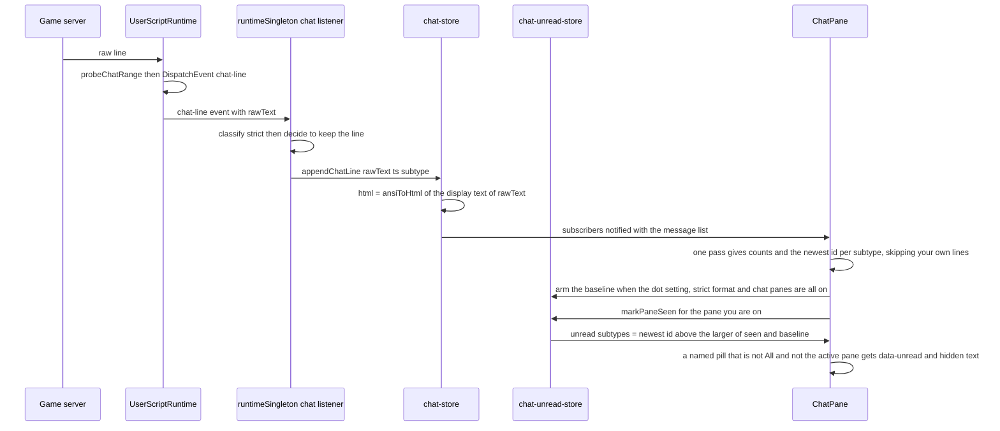

# Chat panes (Developer Notes)

For whoever next touches `features/chat/`, `components/ChatPane.tsx`, `hooks/useChatPane.ts` or the chat feed in
`features/userScripts/`. Players see this as the Chat panel with an **All** tab and one tab per channel (tell, gossip, clan, ...); this
document is about how a line gets there and how it is shown.

---

## How a chat line reaches the panes

1. `UserScriptRuntime.processRawEvent` (`features/userScripts/userScriptRuntime.ts`) probes each non-omitted raw line with `probeChatRange`
   and, for a chat-shaped line, dispatches `shatteredarchive:chat-line` with `rawText`.
2. The always-on listener in `features/userScripts/runtimeSingleton.ts` classifies the line with `classifyStrictChatSubtype`
   (`features/chat/strict-chat-classifier.ts`) **only when the Strict Chat Format setting is on**. With it on, a line that matches no
   channel rule is dropped. With it off (the default), every probe match is kept and has no subtype.
3. `appendChatLine` (`features/chat/chat-store.ts`) stores one `ChatMessage` per line: `rawText` as received, the `html` shown in the
   bubble, a timestamp, a numeric-string `id` that increases, and the `subtype` if there is one. The list is module state with no cap.
4. `ChatPane` renders the **All** pane from every message and one pane per subtype from the messages with that subtype. A subtype tab
   exists only when chat panes are enabled and that channel is enabled; it appears once the channel has a message, unless Show Hidden
   Chat Panes is on.
5. With the unread dot on, `ChatPane` also marks a tab that has a message newer than the user has seen (see "The unread dot").

## What is shown is not what is stored

`rawText` is kept exactly as the game sent it. Only the **display text** is cleaned, by `stripChatDisplayText`
(`features/chat/chat-display-text.ts`), before the HTML conversion:

- Tells arrive with a BEL character (`\u0007`) in front of the speaker. Left in, the bubble shows an empty box before the name.
- BEL is also the terminator of an OSC sequence (`ESC ] ... BEL`, for example a window-title change). Those sequences are removed
  whole first, then any remaining BEL. Removing BEL alone would leave a half sequence that the converter prints as garbage.
- Colour (SGR) sequences are untouched, so the bubble is still coloured.
- An OSC sequence with no terminator is left alone, because there is nothing to say where it ends.

The raw line keeps its BEL on purpose: the audio "beep on bell" setting (`features/audio/audio-beep.ts`) and the chat classifiers read it.
Do not strip it at the source.

`isOwnChatLine` (same file) is true for a line you said yourself (`You tell ...`, `You gossip ...`). The classifier files these into the same
channel as incoming lines, so anything that counts new messages should skip them.

## Settings

Chat settings are one object in `localStorage` under `shatteredArchive.chatSettings.v1` (`features/chat/chat-settings-store.ts`), read through
`getChatSettings` and written through `setChatSettings` / `updateChatSettings`, which notify subscribers. Fields today: `strictChatFormat`,
`enableChatPanes`, `showHiddenChatPanes`, `unreadDots`, `enabledPanes` (a flag per subtype) and `paneOrder`. They are local to the browser and
are not synced to the account. The gear menu in `ChatPane.tsx` is where players change them.

- **`unreadDots` is stored only when it is on.** `toStored` leaves the key out while it is off, so someone who never turned it on follows the
  current default instead of a copy frozen at their first save (the other fields are still written in full, as before).
- **Reads are strict.** A stored value that is not a boolean (`"true"`, `1`, `null`) reads as the default.
- **A failed write is not an error.** `setChatSettings` keeps the in-memory settings and notifies subscribers even when `localStorage` throws.
- **Every update gives `enabledPanes` a new object.** `normalizeSettings` copies it from the defaults instead of sharing the defaults object,
  because `ChatPane` memoises its channel list on that object's identity. Before this was fixed, switching a channel on or off in the gear menu
  left the tab strip unchanged until something else changed it. Tests still load a fresh copy of the module per case, because the store caches.

## The unread dot

The rule is pure (`features/chat/chat-unread.ts`), and what the user has seen is a small store (`features/chat/chat-unread-store.ts`).

- `summarizeMessages(messages)` returns the per-subtype counts, the newest id per subtype and the newest id overall in **one pass**; the list is
  unbounded and the pane recomputes on every message, so this is the pane's counting loop and not a second loop. Your own lines (`isOwnChatLine`)
  count towards pane visibility but never towards "newest", so what you say never lights a dot.
- `unreadSubtypes({ lastIds, seen, baseline })` is the set of panes whose newest message is newer than both the **baseline** and what was **seen**
  on that pane. Ids are the numeric strings `chat-store` hands out and are compared as numbers.
- The **baseline** is the newest message id at the moment the feature is armed (`armUnread`), so history that was already there is never unread.
  It is taken once: arming again while armed changes nothing. `disarmUnread` forgets the baseline and what was seen, so turning the feature off and
  on again starts from the history of that moment.
- `markPaneSeen(subtype, id)` records the newest id the user has seen on a pane. The state is module-level like the chat store, so a `ChatPane` that
  unmounts and mounts again keeps it and does not light up what it already showed. Nothing is recorded while the feature is disarmed.
- The dot needs `unreadDots`, `strictChatFormat` and `enableChatPanes` all on: without strict format lines carry no subtype, so there is nothing to dot.

### How `ChatPane` uses it

- `dotsActive` is the three settings together. When it turns on, an effect arms the store with the newest message id (held in a ref that a
  separate effect keeps current, because `react-hooks/refs` forbids writing a ref during render); when it turns off, the store is disarmed.
  The effects are declared in an order that matters: the store subscription first, then the ref, then arm, then mark-seen.
- Another effect marks the pane you are on as seen, so a message that arrives while you read it never leaves a dot.
- Until the store is armed (the first render, before that effect) nothing is treated as unread, so history never flashes a dot.
- A named tab that is unread and not the active one gets `data-unread="true"` and a visually hidden "unread messages" text (its accessible
  name becomes e.g. "TELL unread messages"). The **All** tab is never marked. The dot itself is drawn in `styles/ChatPane.module.scss` by
  `.chatPill[data-unread='true']::after`, inside the tab so the scrolling tab strip cannot clip it, and its pulse stops under
  `prefers-reduced-motion`.
- The gear menu has the **Unread dot on pane tabs** row. It is disabled while strict format or chat panes is off, with a note under it that
  names what is missing. A blue (i) next to the menu title swaps the rows for `ChatHelp` (the player-facing explanation); the rows stay
  mounted and are only hidden, and closing the menu resets the help.
- The tab strip is keyed by channel, not by position, so dragging tabs into a new order keeps each dot with its tab. Switching a channel
  off and on again shows its true state.

## The mobile app (`shatteredarchive-mobile`, `dsl-client`)

The mobile Chat screen is one list with a channel badge on each row, not a set of tabs, so the unread dot goes on the **Chat tab of the bottom
bar** instead. It keeps its own copies of the pieces above (as it does for the classifier): `features/chat/chat-store.ts`,
`chat-classifier.ts`, `chat-settings-storage.ts`, `chat-display-text.ts` and a new `chat-unread-store.ts`.

| Step | Web | Mobile |
|---|---|---|
| Where a chat line enters | `shatteredarchive:chat-line` listener in `features/userScripts/runtimeSingleton.ts`, calling `appendChatLine` | `ScriptEngine.processIncomingLine` (`features/scripts/script-engine.ts`), calling `appendChatMessage` |
| Strict chat format | applied in that listener | applied in `processIncomingLine` (a line with no channel is dropped when it is on) |
| Display text | `stripChatDisplayText` builds the bubble html | `stripChatDisplayText` for the row (the raw line is kept) |
| "Unread" state | derived in `ChatPane` from the message list, with a baseline and seen ids | a boolean store, set from `appendChatMessage` |
| Setting | `unreadDots` in `shatteredArchive.chatSettings.v1` (localStorage), under the chat gear menu | `unreadDot` in `chat:settings` (AsyncStorage), under a chat gear on the Chat screen |

- **The flag is a store, not screen state.** The tab navigator freezes a blurred tab (`freezeOnBlur`), so the Chat screen does not update while
  the player is on another tab, which is exactly when the dot has to light. `appendChatMessage` calls `noteChatLine(rawText)` after it has
  notified its listeners; `useChatUnread()` gives a component the boolean through `useSyncExternalStore`, so it re-renders when the dot appears or
  goes and not on every line (fifty lines are one notification).
- **When it lights:** the dot setting and strict chat format are both on, the Chat tab is not the open one, and the line is not your own
  (`isOwnChatLine`). **When it clears:** the Chat tab is focused (`setChatTabFocused(true)`), the chat list is cleared, or the setting or strict
  format is switched off (a subscription to the settings clears a dot that is showing).
- **Settings:** `unreadDot` is read strictly (a stored string or number reads as off), and is written only when it is on, like the web setting.
  Strict chat format is still always written.
- **The dot on the tab:** `app/(tabs)/_layout.tsx` calls `useChatUnread()` and gives the Chat screen `tabBarBadge: ''` while it is true. The tab bar
  hides a badge only when it is `null`, so an empty string shows one, drawn as an 18px circle; `tabBarBadgeStyle` (applied after the library's own style)
  turns it into a small red dot. `tabBarAccessibilityLabel` reads "Chat, new messages" while it shows. The Chat screen's `focus` and `blur` listeners
  call `setChatTabFocused`. (Checked in the vendored `expo-router` tab bar source: `TabBarIcon.js` shows the badge when it is not `null`, and `Badge.js`
  applies the style last.)
- **The setting:** the gear in the Chat screen's header opens `components/chat/ChatSettingsSheet.tsx`, a bottom-sheet `Modal` in the shape of the More sheet.
  A `Modal` does not inherit the screen's insets, so the sheet reads them inside its own tree and pads every side by them. The switch is greyed out with a
  hint ("Needs Strict Chat Format (Settings, then Chat)") while strict format is off; strict format itself is still switched on the Settings screen.
- **The BEL:** `ChatRow` in `app/(tabs)/chat.tsx` parses `stripChatDisplayText(rawText)`, so the BEL before a tell is not drawn; the stored line keeps it.
- **For players:** the Help screen (`app/(tabs)/explore.tsx`) has a "Chat" section explaining the dot and where its setting is.
- **Two copies to keep in step:** `chat-display-text.ts` here and in `apps/game-client/src/features/chat/`, the same way the two classifiers are.

## Where the tests are

- `features/chat/chat-display-text.test.ts`: the BEL and OSC rules and `isOwnChatLine`.
- `features/chat/chat-store.test.ts`: `appendChatLine` shows no BEL, keeps `rawText`, keeps colour, and notifies subscribers.
- `features/chat/chat-settings-store.test.ts`: defaults, strict reads, what is written to storage (including `unreadDots` only when on), subscribers, a failed write.
- `features/chat/chat-unread.test.ts`, `features/chat/chat-unread-store.test.ts`: the one-pass summary, the unread rule, the baseline and seen state.
- `features/chat/strict-chat-classifier.test.ts`, `features/chat/chat-probe.test.ts`: which channel a line belongs to.
- `components/ChatPane.test.tsx`: the tab strip and gear button, the unread dot (history, new message, All and the active pane, own lines,
  remount, switching a channel off and on, drag reorder, setting off, strict off, unsubscribe on unmount), the gear row and its hint, the help,
  and the menu's positioning and drag guards.
- `components/ChatHelp.test.tsx`: the help article and its Back button.
- Mobile, in `dsl-client/features/chat/__tests__/`: `chat-display-text-test.ts`, `chat-settings-storage-test.ts`, `chat-store-test.ts` (list, 500 cap,
  hook), `chat-unread-store-test.ts` (when it lights and clears, one notification for fifty lines, one render per flip) and
  `chat-ingest-unread-test.ts` (real sample lines through `processIncomingLine`). The screens: `dsl-client/components/__tests__/TabLayout-test.tsx`
  (the badge, its label and style, the focus and blur listeners, one re-render for fifty lines), `ChatSettingsSheet-test.tsx` (the switch, the hint, the
  insets, closing) and `ChatScreen-test.tsx` (no BEL drawn, the gear opens the sheet, Clear). Tests are under `components/__tests__/` and not under `app/`,
  because Expo Router treats any file under `app/` as a route.
