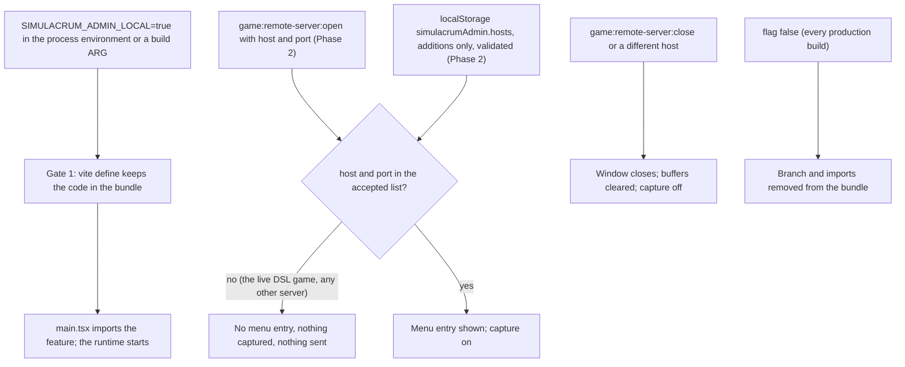
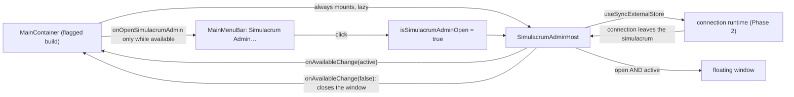
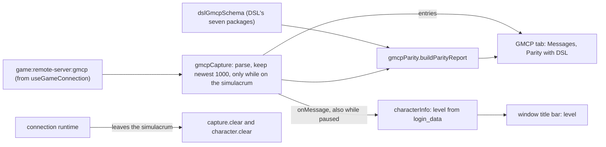
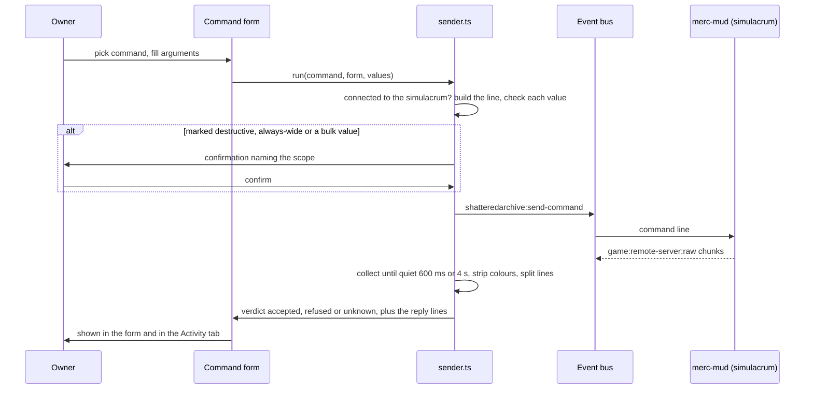
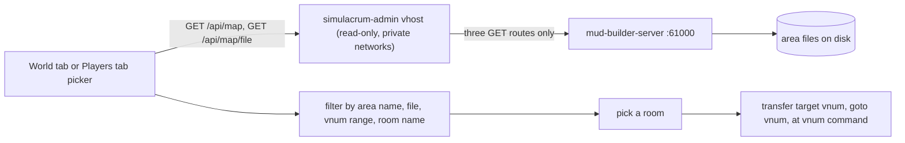

# Simulacrum Admin (Developer Notes)

Simulacrum Admin is a **local-only** admin and debugging panel in the game client for the simulacrum (merc-mud) instance. It is built
in phases from `.ai-plans/active/2026-11-07_simulacrum-admin-panel/`; this page describes what exists.

Status: everything in the plan is built in code: the build switch and the guard, the connection gate, the window with its menu entry, the
GMCP capture and tab with the parity check (merc-mud's GMCP parity is done, [gmcp-parity.md](gmcp-parity.md)), the command catalog, the
sender with its verdicts, and the six tabs (Players, World, Server, Commands, GMCP, Activity) with the read-only world vhost behind the
World tab. What still needs the owner is in "What the owner does once" under World data, and the run on the real simulacrum.

## The one rule: it never reaches production

Simulacrum Admin exists only in a game-client build made with the `SIMULACRUM_ADMIN_LOCAL` switch, and that switch is on only in the dev
docker stack (`deploy/docker-compose.shattered-archive-experimental.yml`). It is a **second** local-only feature next to
[Copilot](../copilot/README.md) and has its own switch, constant, marker and guard cases (edge case LOCAL-04), so either can be on without
the other.



### Gate 1: the build constant

- `apps/game-client/vite.config.ts` defines `__SIMULACRUM_ADMIN_LOCAL__` from `process.env.SIMULACRUM_ADMIN_LOCAL === 'true'`. It is read
  from the **process environment only**, never through `loadEnv`, because `apps/game-client/.env*` files are inside the Docker build
  context: a flag set there would silently ship in a production image (LOCAL-01).
- The constant is declared in `apps/game-client/src/simulacrum-admin-local.d.ts`. Vite replaces it with a literal, so with it `false` the
  branch in `main.tsx` and everything imported only from it are dropped from the bundle.
- `deploy/game-client.Dockerfile` has `ARG SIMULACRUM_ADMIN_LOCAL` and `ENV SIMULACRUM_ADMIN_LOCAL=$SIMULACRUM_ADMIN_LOCAL` (empty unless
  passed). Only the experimental compose passes `SIMULACRUM_ADMIN_LOCAL: "true"`; `deploy/docker-compose.yml` must not mention it.
- `apps/game-client/src/features/simulacrumAdmin/marker.ts` exports `SIMULACRUM_ADMIN_BUNDLE_MARKER` (`sa-simulacrum-admin-local-v1`).
  It is the string the guard looks for in a production `dist`, so it must be referenced only from modules reached through
  `features/simulacrumAdmin/index.ts`.
- Jest defines the constant as `false` (`jest.config.cjs`, `globals`). A test that needs the flagged build sets
  `globalThis.__SIMULACRUM_ADMIN_LOCAL__ = true` itself (or imports `src/testing/simulacrumAdminFlagOn.ts` first) and restores `false`.

### Enabling it locally

Pass the switch to the game-client image build of the experimental stack. The experimental compose already sets
`SIMULACRUM_ADMIN_LOCAL: "true"` under the game-client build args, so rebuilding that image (`docker compose -f
deploy/docker-compose.shattered-archive-experimental.yml build game-client`) produces a flagged build. For a plain Vite build,
set the variable in the shell, not in a file: `$env:SIMULACRUM_ADMIN_LOCAL='true'` (PowerShell).

### Guard

`pnpm check:local-only` (script `scripts/check-local-only.mjs`) covers both local-only features through its `FEATURES` list. For each
feature it checks that:

- no production compose file, production Dockerfile or shared nginx file names the feature (the Dockerfile may carry only the lines the
  feature lists: for Simulacrum Admin the one `ARG`/`ENV SIMULACRUM_ADMIN_LOCAL` pair and comments);
- a built `apps/game-client/dist` (or each `--dist <dir>`) holds neither the feature's marker nor, for Simulacrum Admin, the dev vhost
  name `simulacrum-admin.shatteredarchive.dev`.

The feature's own nginx files (`deploy/nginx/edge-simulacrum-admin*.conf`) are the only nginx files allowed to
name it. `pnpm test:guards` runs the suites, including real `vite build`s of a tiny entry with the real `vite.config.ts` that prove: the
switch in the process environment bundles only its own marker, a switch set only in `.env*` files bundles nothing, and both switches
together bundle both.

## The connection gate: "connected to the simulacrum"

Files: `apps/game-client/src/features/simulacrumAdmin/connectionGate.ts` (pure rules), `runtime.ts` (follows the socket events),
`loader.ts` (builds the page's one runtime).

The runtime listens to `game:remote-server:open` and `game:remote-server:close`, which `hooks/useGameConnection.ts` dispatches with the
host and port of the socket. The state it keeps is `{ connected, host?, port?, active }`. **`active` is true only when the socket is
open and both the host and the port are accepted.** Nothing is captured and nothing is sent unless `active` is true, so the live DSL
game (`dsl-mud.org:4000`) never activates it.

What is accepted:

- **Hosts:** `simulacrum.shatteredarchive.dev` (the web UI vhost) and `simulacrum-server.shatteredarchive.dev` (the game relay's name in
  the proxy allowlist), plus the owner's additions.
- **Ports:** `65001` (the relay port), plus the owner's additions.
- A host is compared after trimming, lower-casing and removing one trailing dot. A scheme, path, port, wildcard, credentials or a
  doubled dot makes it "not a host", so it never matches. A port must be an integer number from 1 to 65535: a string such as `"65001"`
  never matches.
- This is a convenience for a local tool, not a security boundary (any saved connection can be given any name). The boundaries are the
  build constant and the server's own trust check on every command.

### Adding the owner's LAN address (never in source)

An address that belongs to the owner's own network is Personal data, so it is **not** written in the code, tests, config or docs
(edge case LOCAL-05). It is added at run time, in the browser that is used, through one storage entry:

```js
// in the browser console of the flagged game client; replace the placeholder with your own address
localStorage.setItem('simulacrumAdmin.hosts', JSON.stringify({ hosts: ['<your-lan-address>'], ports: [] }));
```

- The key is `simulacrumAdmin.hosts`; the value is `{ "hosts": string[], "ports": number[] }`. It holds **additions only**: a host or port
  that is already a default is dropped when read, so a later change to the defaults reaches this browser (SETTINGS-01).
- Only `localhost`, a private-range address (`10.*`, `172.16-31.*`, `192.168.*`, `127.*`) or a `*.shatteredarchive.dev` name is accepted
  as an addition; anything else is ignored. At most 20 hosts and 20 ports are kept.
- Every route that writes the entry (the console, a hand edit, later an editor) is read through the same function,
  `normalizeAdditions`. A wrong shape, corrupt JSON or blocked storage reads as "no additions" (corrupt JSON and blocked storage log one
  fixed warning with no stored text).
- The entry is re-read on every `open` event, so an edit applies to the next connection without a reload.
- The game server only connects to hosts on its proxy allowlist (`GAME_PROXY_ALLOWLIST` in the compose files). Recognising an address
  here does not make the proxy allow it: adding the pair to the allowlist is a separate change on the owner's machine.

### What happens when the connection leaves the simulacrum

When a socket that was `active` closes, or a new connection opens on a host that is not accepted, the runtime runs its *deactivate*
callbacks. Later phases register the clearing of the GMCP buffer and the activity log there, and the window closes itself, so nothing
captured from the simulacrum survives the connection (E2).

## The window and the menu entry

Files: `apps/game-client/src/components/SimulacrumAdminWindow.tsx` (default export: the host), `styles/SimulacrumAdminWindow.module.scss`,
`components/MainMenuBar.tsx` (the item), `pages/MainContainer.tsx` (the wiring).



- **Mounting.** In a flagged build `MainContainer` always renders the lazy host (inside `<Suspense>`), because the host is what knows
  whether the client is on the simulacrum; with the flag false the lazy import and the element are removed from the bundle.
- **The menu entry** (`Simulacrum Admin…` in the Game menu, after Copilot…) is passed to `MainMenuBar` only while the host reports
  "available", and `MainMenuBar` renders it only when `__SIMULACRUM_ADMIN_LOCAL__` is also true.
- **The window** is `role="dialog"` without `aria-modal`, has no backdrop and no focus trap, and only the window takes pointer events, so
  the game's command input stays usable behind it. Escape (with the window focused) and the × close it. Its geometry (drag by the title
  bar, resize by the corner handle, clamped to the viewport) comes from `hooks/useFloatingPanel.ts` and is saved under
  `simulacrumAdmin.window.v1`. It opens at the left (x 24, y 96) so it does not cover the Copilot window, which opens at the top right.
- **z-index 4800:** above the menu bar (3000) and the equipment hotbar (3500), below the Copilot window (4900) and every 5000+ modal.
- **Tabs:** Players, World, Server, Commands, GMCP, Activity. They are free navigation (any tab at any time). All six panels stay
  mounted and are only `hidden`, so input and scroll position survive a tab switch. All six panels are built (Players, World, Server, Commands, GMCP, Activity).
- **Closing on disconnect:** the host renders nothing unless it is open and the runtime is active, so a close or a move to another host
  removes the window at once; `MainContainer` also resets its open state when the host reports "not available", so the window does not
  reappear by itself on reconnect.

## GMCP: capture, the tab, the parity check, the character's level

Files: `features/simulacrumAdmin/gmcpCapture.ts` (the buffer), `gmcpView.ts` (display limits), `dslGmcpSchema.ts` and `gmcpParity.ts` (the
parity check), `characterInfo.ts` (the level), `components/simulacrumAdmin/GmcpTab.tsx` (the tab).



- **Capture.** `gmcpCapture.ts` listens to `game:remote-server:gmcp` (key `simulacrumAdmin::gmcp`, see the event-bus gotcha below), parses the
  wire form `<package> <json>` and keeps `{ id, receivedAt, pkg, size, raw, data?, parseError? }`. It does not use `features/gmcp/gmcpRouter.ts`,
  which drops every package it does not map. A message it cannot read is kept with a fixed `parseError` (`empty message`, `no payload`,
  `invalid JSON`), never an exception. The buffer holds the newest 1000 entries (`DEFAULT_CAP`), in memory only, and stores nothing unless the
  connection is the simulacrum. It is cleared when the connection leaves the simulacrum.
- **The tab.** *Messages*: newest first, at most 200 rows drawn (`MAX_ROWS`), a package filter, a text search over the raw text, Pause / Resume,
  Clear, *Copy shown*, and a detail pane (indented JSON, cut at 64 KB for display; *Copy message* copies all of it). *Parity with DSL*: see below.
  While another tab is showing, the GMCP tab renders nothing and does no work but keeps its filter and selection, so a stream of messages does not
  redraw hidden rows. Pause stops keeping new messages; the character's level is still read.
- **Parity with DSL.** `dslGmcpSchema.ts` is DSL's seven packages with each field's type, whether it is optional, and (for enum-like fields) the
  values DSL sends, read from its live traffic ([gmcp-parity.md](gmcp-parity.md)). `buildParityReport` checks every captured message and gives, per
  DSL package: *Not seen yet* / *Matches DSL* / *Matches DSL, with noted differences* / *Differs from DSL*, how many were seen, and every distinct
  difference with its count:

  | Severity | Meaning |
  |---|---|
  | Error | a field DSL always sends is missing, or a field has the wrong type, or the payload is not a JSON object |
  | Difference | a value outside a set DSL is known to use (for example `water swim` for `sector`), a game clock not in the `H:00pm` / `H:30am` form, or a package DSL does not send |
  | Note | an extra field, a value DSL has not been seen to send (the engine's affect locations), or a difference the owner decided on (`language` keeps `elven`, `dwarven`, `giant`) |

  A finding repeats a value only for enum-like fields; it never repeats free text such as names. `login_data` is sent once per login, so it
  reads *Not seen yet* until a login happens in the session.
- **The character's level.** `characterInfo.ts` reads `login_data` and keeps the **level** and whether the character is in a clan, in memory.
  The character's **name is not kept** (Personal data, and the panel has no use for it); the title bar shows `Connected to host:port` and, in a separate element that never shrinks, `Level N`.
  The level is a hint for the Commands tab: trust can be higher than level (the `trust` command), so `wizhelp` stays the authority
  on which commands the character can run.

### Gotcha: the shared event bus keeps one listener per key

`ListenEvent` (`features/event-emitter/event-dispatcher.ts`) registers a listener under the key `<event name>::event` unless the caller
gives `options.key`, and registering a key that already exists **removes the earlier listener**. A feature that subscribes to a shared
event such as `game:remote-server:gmcp` without its own key silently replaces the listener the app already has. Every listener in this
feature passes a key of the form `simulacrumAdmin::<purpose>` (plan amendment A1, E26), and its tests register an app listener with the
default key to prove both keep receiving events.

## The command catalog

Two sources, one join, and a test that fails when they disagree (edge case ADMIN-01).

| Part | File | Written by |
|---|---|---|
| names, levels, aliases, handler, whether the game lists it in `wizhelp` | `features/simulacrumAdmin/commandTable.generated.ts` | `scripts/generate-simulacrum-admin-commands.mjs`, never by hand |
| argument shapes, forms, success lines, confirmation and bulk rules | `features/simulacrumAdmin/commandSyntax.ts` (types in `commandSyntaxTypes.ts`) | by hand, from each handler in `merc-mud/2.4/src` |
| the join, lookups, groups | `features/simulacrumAdmin/commandCatalog.ts` | by hand |

**Regenerating.** After any change to the immortal rows of merc-mud's `interp.c`, run

```text
node scripts/generate-simulacrum-admin-commands.mjs            # writes the file (source defaults to ../merc-mud/2.4/src/interp.c)
node scripts/generate-simulacrum-admin-commands.mjs --check    # exits 1 when the committed file is stale
```

then fix the entries `commandCatalog.test.ts` names (a new command has no syntax entry yet, a removed one leaves an orphan). The sibling
repo is not part of any Docker build, so the generated file is committed and the script runs on the owner's machine. The header carries a
hash of the privileged rows only (not the rest of `interp.c`), so an unrelated edit to the game does not make the file stale. The
generator test skips the "committed file matches the real table" case with a message when the sibling repo is absent.

**How rows become commands.** The level symbols (`ML`, `L1`-`L8`, `IM`) are resolved by value and never evaluated, because the game
defines them without parentheses. Rows with a plain number or `HE` are mortal commands and are left out (72 privileged rows today, 65
commands). Rows that share a handler are one command (`teleport` is an alias of `transfer`). A row the game hides from `wizhelp` and that
abbreviates a listed command (`reboo`, `shutdow`, `sla`, `prefi`, `:`, `invis`) is a *hidden alias*: it is never offered, so the panel
cannot send `reboo`. `dump` stays a command, marked unlisted.

**The shape of an entry.** A command has a `group` (players, world, server, communication, inspection, settings), a summary naming the
handler, and one or more *forms* (for example `load mob <vnum>` and `load obj <vnum> <level>`). A form has literal words, typed fields
(`character`, `word`, `text`, `number`, `vnum`, `areaFile`, `choice`, `flags`), reply lines that mean success, and optionally a player
`category` (the Players tab lists every form that has one), `confirm` and `bulk` rules.

### Which commands ask first (decision S11, approved 2026-11-07)

The owner chose the widest option: **every command that writes to a player or to the server asks for a confirmation that names its
scope.** Marked `destructive` on the command (28):

- server and world: `shutdown`, `reboot`, `copyover`, `areload`, `purge`, `ban`, `permban`, `dump`, `wizlock`, `newlock`
- players: `deny`, `disconnect`, `freeze`, `force`, `slay`, `advance`, `trust`, `qpoints`, `nochannels`, `noemote`, `noshout`, `notell`,
  `pardon`, `guild`, `flag`, `protect`, `set`, `string`

On top of that the following always ask, whatever command they are in (edge case ADMIN-02): any `all` / `players` / `gods` target
(`transfer all`, `force all`, `log all`), `restore all`, `purge` with no target (it clears the room), a `ban` or `permban` with a `*`
wildcard, `gecho` (a line to every player), and the `copyover` run form. `reboot` and `shutdown` are sent only as the whole word.
`copyover` has two forms: *What copyover does* sends the bare word, which makes the game only explain, and *Copyover now* sends
`copyover confirm` and only after the panel's own confirmation. Read-only and single-target commands (`stat`, `transfer <name>`,
`goto`, `restore <name>`) do not ask.

## Sending a command and judging the reply

Every command the panel sends goes through one module, `features/simulacrumAdmin/sender.ts`, the only code in the feature that dispatches
`shatteredarchive:send-command` (decision S6). The connection hook (`hooks/useGameConnection.ts`) writes that event to the socket as a
`data` message, unchanged (`senderToSocket.test.ts` proves it with the real hook).



| Module | Does |
|---|---|
| `commandBuilder.ts` | Builds the exact line: the full command name, the form's literal words, then the fields in order. Trims; checks each value by type; rejects control characters (a newline would send a second command, an escape could drive the terminal), a space in a one-word field, an empty required field, and a line over 255 characters, always naming the field. |
| `confirmPolicy.ts` | Says whether to ask and what is at stake: a `destructive` command, a form marked `confirm`, a bulk value (`all`, `players`, `gods`) or `*` wildcard (typed or picked, the same value), and an inner command (`at ... purge`, `force ... shutdown`, also abbreviated) that is itself destructive. A form marked `safe` (`ban` list, `copyover` explanation) never asks. |
| `replyCollector.ts` | Collects `game:remote-server:raw` text from the moment of sending. Chunks are joined before escapes are removed, so a sequence split across two network reads goes away whole; the raw text is kept for "copy raw". It ends 600 ms after the last chunk, or 4 s after the send when nothing arrives; text after that belongs to nobody. |
| `verdict.ts` | Judges the reply (below). |
| `sender.ts` | Checks the connection, builds, asks, sends, waits, judges, records. Sends run one at a time: a second `run` waits for the first reply. A send whose turn comes after a disconnect, or whose connection ended while waiting, sends or records nothing. |
| `activityLog.ts` | The last 200 sends with their verdict and reply, memory only, cleared when the connection leaves the simulacrum. |

**The verdict comes from the game's own words, never from the fact that a command was sent** (edge case ADMIN-03). `refused` when any
line is `Huh?` (the account may not use the command) or the first deciding line is one of the game's refusals (`They aren't here.`,
`No such location.`, `You failed.`, `Syntax: ...`, ...; the list is in `verdict.ts`, each anchored at the start of a line and taken from the
handlers' own messages). `accepted` when a line matches the form's `success` patterns. Anything else is `unknown` and is shown as
unknown: a missing reply is never shown as done. On each line the refusal check runs first, so a catch-all success pattern cannot accept
a refusal.

**What is available to this character.** `sender.refreshAvailable()` sends `wizhelp` and keeps the command names in the reply
(decision S5). A character below the immortal levels gets `Huh?` and the list is empty. Until a reply has been read, nothing is dimmed.
The list is forgotten when the connection ends.

## The Commands and Activity tabs

Files: `components/simulacrumAdmin/CommandsTab.tsx`, `components/simulacrumAdmin/ActivityTab.tsx` (default exports), styled in
`styles/SimulacrumAdminWindow.module.scss`. The window passes `runtime.sender` and `runtime.activity`; both tabs take a `visible` prop
and draw nothing while another tab shows, but stay mounted, so a selection, typed values and a filter survive a tab switch.

**Commands.** The left list is the catalog (`COMMAND_CATALOG`) grouped by `group`, filtered by a text box (name, alias or a word in the
summary) and by "level or lower". Each row shows the command, an "asks first" mark when it is in the destructive set, and its level.
Selecting a command shows its summary and level, a radio per form when it has more than one, a typed input per field (a select for a
`choice`), the exact line it will send (the preview, from `buildCommand`), a field error as soon as a value is typed (a missing required
value is reported after the first Run), and **Run**. Typed values are kept per command and form.

Run calls `sender.run` once. When the policy asks, the inline confirmation (`role="alertdialog"`, no `window.confirm`) names what is at
stake and the exact line; nothing is sent until **Send it**; **Cancel** and Escape (which does not reach the window's own Escape) send nothing; the
confirm button has focus so Enter confirms. The result next to the form says, in the game's words: *Done: the game answered as expected*,
*Refused by the game (<line>)*, or *No recognised answer from the game (unknown)*, with the reply lines under it; `Not sent: ...` for an
invalid value, and a note when the connection is gone. A refusal is never shown as done (ADMIN-03). The result shows only beside the
form it belongs to.

**Refresh available commands** sends `wizhelp`. Commands the reply does not list are dimmed (still selectable, with a note), an alias
counts as its command, `Huh?` dims everything, silence changes nothing. Until a reply is read nothing is dimmed (S5). The character's
level is only a hint in the title bar; `wizhelp` is the authority.

**Activity.** Newest first, one card per send: time, a Done / Refused / Unknown badge, the exact line, the reply lines (the display text:
escapes and colour codes removed) and **Copy raw** (the reply exactly as received). A verdict filter and Clear. The cap is 200 and the
list is memory only; it is emptied when the connection leaves the simulacrum.

## The Players tab

File: `components/simulacrumAdmin/PlayersTab.tsx`. The owner types a **target** once and runs any character-directed command with one click.

- **The rows are derived, not hand-listed.** Every form in the catalog that has a `category` is a row, grouped Inspect, Restrict, Punish,
  Restore, Move, Advanced. A command with more than one such form shows its form name (`flag: Flags on a mobile`). A new command in the
  data appears without a code change; the catalog test guarantees a categorized form starts with the player target.
- **The target** is the first field of the selected form (a `character`, or the `target` word of `transfer` and `force`, which also
  accept `all`). It is validated by the same builder as every other field: a space or a control character is refused in words, and an empty
  target is reported after the first Run. The selected row shows only the remaining fields (the amount of `qpoints`, the destination of
  `transfer`, ...), the exact line to send, and Run.
- **Same sender, same confirmation.** Run calls `sender.run`, so a destructive command, `transfer all` and the other bulk values ask first
  exactly as on the Commands tab (shared pieces: `ConfirmDialog`, `FieldInput`, `OutcomeView`, `useConfirmation` and
  `features/simulacrumAdmin/outcomeText.ts`, which turns an outcome into the words shown).
- **A reply belongs to one command and one target.** Changing the target or the command hides the previous reply.
- **Recent targets** (the last 8 that a send was made to, newest first) are component state: not written to storage, and gone when the
  window closes, which it does when the connection leaves the simulacrum.
- **The destination of `transfer`/`teleport`** is a typed room vnum or name, or filled from the world picker (see The World tab and the room picker).

## World data: the local-only read-only vhost

The World tab and the teleport picker (Phases 11 and 12) need the list of areas and rooms. They read it live from MUD Builder, which
already parses the area files, through one extra vhost that exists only in the dev stack.



Files: `deploy/nginx/edge-simulacrum-admin.conf` (the template), `deploy/nginx/edge-copilot-csp.conf` (the CSP override, shared with
Copilot), `deploy/docker-compose.shattered-archive-experimental.yml` (the mount and the network alias).

- **Routes.** `GET /api/areas`, `GET /api/map` and `GET /api/map/<file>.are` (the file pattern is the area store's own), proxied to
  `mud-builder-server:61000`. Every other path is a `404`, every other method a `403`; a preflight (`OPTIONS`) is answered by nginx and never reaches MUD Builder.
  Nothing reaches a write route, the audit log, `/api/state/live`, a reload, or an area download or preview. The inbound
  `Authorization` and `Cookie` headers are not forwarded (MUD Builder lets GET through without a token).
- **Who may call it.** Loopback and the private ranges, then `deny all` (the same list as the Copilot vhost), so a forwarded port
  still answers nobody on the internet.
- **CORS.** The game client is another origin. The vhost echoes only `https://game-client.shatteredarchive.dev`,
  `http://game-client.shatteredarchive.dev` and `http://localhost:30080`, never `*`. The CORS headers are set at *server* level with
  `always`, never inside a location (an `add_header` in a location would switch off every inherited header), so a 404 or 403 also
  carries them and the browser shows the real status. MUD Builder sets its own CORS headers; they are hidden
  (`proxy_hide_header`), because two `Access-Control-Allow-Origin` values make the browser refuse the answer. The live check of this phase
  found exactly that, and the test now fails without the hide lines.
- **The CSP.** The dev CSP (`security-headers-scripting-dev.conf`) would stop the page calling a new origin, so
  `edge-copilot-csp.conf` (mounted over that one file by the experimental compose only) lists `https://simulacrum-admin.shatteredarchive.dev`
  in `connect-src` next to Copilot's origin. A second file cannot be mounted over the same target, so the two features share it; a guard
  test requires it to equal the shared dev CSP except for those two origins, and the shared file names neither.
- **Not in production.** The vhost is a separate template (`/etc/nginx/templates/simulacrum-admin.conf.template`), mounted only by the
  experimental compose; `edge-subdomains.conf`, `includes/tls-dev.conf`, the production compose and the shared CSP never mention it
  (`scripts/check-local-only.test.mjs`, edge case E11).
- **Room names carry colour codes** (`{RAshen Trailhead{x`); the client strips them for display (Phase 11).

**What the owner does once (the implementer cannot, and does not):**

1. Add the name to the hosts file (needs an administrator prompt): `pnpm setup:hosts:win` (or `setup:hosts:nix`) lists it, or add the line
   `127.0.0.1 simulacrum-admin.shatteredarchive.dev` between the `BEGIN`/`END ShatteredArchive` markers by hand. Those scripts
   REWRITE the whole block from their own lists, so a name that is only in the file by hand is dropped when they run. The
   certificate already covers it (`*.shatteredarchive.dev`).
2. Recreate the nginx container so it loads the new template and CSP:
   `docker compose -f deploy/docker-compose.shattered-archive-experimental.yml up -d --no-deps nginx`.
3. Check: `curl -i -H "Origin: https://game-client.shatteredarchive.dev" https://simulacrum-admin.shatteredarchive.dev/api/map` answers `200`
   with the matching `Access-Control-Allow-Origin`.

Until then the client shows the world index as offline and every other part of the window works.

## The world index in the client

Files in `features/simulacrumAdmin/`: `worldConfig.ts`, `worldApi.ts`, `worldFilter.ts`, `useWorldIndex.ts`. The World tab and the teleport
picker (Phase 12) read the vhost above through these; nothing else in the client calls it.

- **Base address.** `https://simulacrum-admin.shatteredarchive.dev`, or the owner's override in the browser storage key
  `simulacrumAdmin.world.base`. The override must be a bare origin (no path, query, fragment or credentials) on localhost, a private
  network address or `*.shatteredarchive.dev`, the same rule as the host additions (a public address is refused with one fixed warning that
  does not repeat the value, and the default is used).
- **Two calls.** `fetchAreas` (`GET /api/map`: file, name, vnum range, room count, `parseError`) and `fetchRooms` (`GET /api/map/<file>`: only
  the vnum and name of each room; exits and the rest are dropped). The file name is checked against the area store's own pattern
  **before** it goes into a URL. Requests carry no credentials or cookies and are not cached.
- **Failures are values.** A network failure is `offline`, a non-JSON body, an error status (with the server's own `error` text) or a body of an
  unknown shape is `error`, a cancelled request is `aborted`. The validators are hand-written: unknown fields are ignored, a wrong type
  rejects the whole answer (a room without a vnum, an area file name that is not an area file). Nothing throws (E8).
- **Colour codes** in area and room names (`{RAshen Trailhead{x`) are removed for display.
- **Filtering** (`worldFilter.ts`, pure): areas by part of the name or file, a vnum inside the range, or a range `a-b` by overlap; rooms by an
  exact vnum or vnum prefix, an inclusive range `a-b`, or part of the name. The order is the input's. 3,200 rooms filter well inside a fixed bound.
- **The hook** `useWorldIndex({ base, active })` reads the area list once, when something shows it (`active`), then each area's rooms on demand
  and keeps them for the life of the window; a failed area is asked again on the next read or `reloadRooms`; `refresh()` forgets everything,
  cancels what is running and reads again. Every request takes an `AbortSignal`; unmounting aborts the pending ones and no state is set after it.

## The World tab and the room picker

Files: `components/simulacrumAdmin/RoomPicker.tsx`, `WorldTab.tsx`, the destination slot in `PlayersTab.tsx`, and the window, which owns the one
shared world index (`useWorldIndex`) and the target typed on the Players tab.

- **The picker.** An area list with a filter (name, file or vnum), then the rooms of the area you open, then a **Find a room** box that takes an
  exact vnum, a vnum prefix, a range `3000-3099` or part of a name, in **This area** or **All opened areas**. In the all-areas scope a vnum typed in
  full opens the area whose range holds it, so "go to 3001" needs no click first; only areas opened so far are searched, and the screen says so. At
  most 200 rows are drawn and the rest is one "N more" line (E9). It shows when the data was loaded and has **Refresh**. Colour codes are already
  gone from the names.
- **Offline is a state, not a failure (E8).** If the vhost cannot be reached (the owner's two steps are not done, or nginx is down) the picker
  says so with **Try again**; an area whose rooms failed has its own **Try again**. Everything else in the window keeps working.
- **When the world is read.** Only when the World tab is first opened, or when a room picker is first opened from the Players tab. A window that
  never needs it makes no request. The index and the shared target live in the window, so closing the window forgets both.
- **The World tab.** Picking a room shows its number, name and area, and four actions, all through the same sender, verdicts and confirmation as
  every other command: `goto <vnum>`, `violate <vnum>`, `at <vnum> <command>` (the command is typed; a destructive inner command asks first), and
  `transfer <target> <vnum>` where the target is the one typed on the Players tab (disabled until there is one; `all` asks first, E21).
- **A room the game does not know (E10).** If the game answers "No such location." the result is shown as refused and the tab offers **Refresh the
  room list** (an area may have been changed and reloaded since the list was read).
- **The Players tab.** A form with a `where` field (`transfer`) gets **Pick from the world…**: the picker opens in place, picking a room fills the
  destination with its vnum and names it (`Destination: 3001 The Great Hall (Alpha Keep)`), and typing the destination by hand clears that name.
  The stored address override is `simulacrumAdmin.world.base` (see the world index section); a blocked browser storage uses the default.

## The Server tab

Files: `components/simulacrumAdmin/ServerTab.tsx` (the tab) and `CommandCard.tsx` (one command as a card). The cards are **derived from the catalog
group**, never hand-listed: every command of the `server` group (`allow`, `areload`, `ban`, `copyover`, `dump`, `log`, `memory`, `newlock`, `permban`,
`reboot`, `shutdown`, `wizlock`) under **Server**, and every command of the `settings` group (`gmcp`, `holylight`, `incognito`, `poofin`, `poofout`, `prefix`,
`wiznet`, `wizinvis`) under **My immortal settings**; a new command in either group appears without a code change. `areload`, `copyover`, `reboot`,
`shutdown`, `wizlock` and `newlock` sit first, the rest by name.

- **A card** is collapsed until opened. Its header shows the name, **asks first** when the command is in the approved set, and its level. Opened it shows the
  summary, a radio per form, a typed input per field, the exact line to send, **Run**, the confirmation and the game's answer, the same pieces and the same
  sender as the other tabs. Open state, typed values and answers survive a tab switch (the tab is hidden, not removed).
- **`copyover` (E25).** Two forms: *What copyover does* sends the bare word and never asks; *Copyover now* previews `copyover confirm` and sends it only after the
  panel's own confirmation, which says every connected player sees a pause.
- **`reboot` and `shutdown`** are the full words only (the game refuses the abbreviations, and the catalog never offers them) and always ask first.
- **`areload`** takes its file from the world index: a select of the readable area files (an area the server could not parse is left out). Until the list
  is loaded the card has a typed field (checked against the area file pattern) and **Load the area list**, which starts reading the world.
- **`ban` and `permban`** refuse an empty site in words (E4) and ask first for a `*` wildcard; the ban list form never asks.
- **A refusal is never shown as done**: a toggle the game answers with `Huh?` shows *Refused by the game (Huh?)*.

## Tests

| What | Where |
|---|---|
| the generator: level symbols, comments, merging, hidden aliases, errors by line, determinism, the real table | `scripts/generate-simulacrum-admin-commands.test.mjs` (in `pnpm test:guards`) |
| the vhost: three routes per server block, read-only methods, port, file pattern, allow list, CORS and hidden upstream headers, identical http and https blocks, absent from production files, the CSP differs by two origins only | `scripts/check-local-only.test.mjs` |
| the base address and its override rules | `features/simulacrumAdmin/worldConfig.test.ts` |
| the two calls, every failure as a value, the shape checks, the file-name check | `features/simulacrumAdmin/worldApi.test.ts` |
| filtering areas and rooms, ranges, 3,200 rooms | `features/simulacrumAdmin/worldFilter.test.ts` |
| lazy loading, the cache, retry, refresh, abort on unmount | `features/simulacrumAdmin/useWorldIndex.test.tsx` |
| the room picker: states, area and room filters, the 200-row cap, picking, searching every opened area, opening the area that holds a typed vnum | `components/simulacrumAdmin/RoomPicker.test.tsx` |
| the World tab: the four actions and their exact lines, `transfer all` asks, a refused room offers a refresh, hidden and removed | `components/simulacrumAdmin/WorldTab.test.tsx` |
| the window reads the world only when needed and shares the target between Players and World | `components/SimulacrumAdminWindow.test.tsx` |
| the Server tab: cards from the catalog and their order, copyover and its confirm word, reboot and shutdown as full words, areload files from the index, ban, refusals, hidden and removed | `components/simulacrumAdmin/ServerTab.test.tsx` |
| the Players tab: rows from the catalog, the target, confirmations, replies per target, recent targets, no storage | `components/simulacrumAdmin/PlayersTab.test.tsx` |
| the Commands tab: list, filters, forms, field errors, running, confirmation, verdicts, wizhelp dimming, hidden state | `components/simulacrumAdmin/CommandsTab.test.tsx` |
| the Activity tab: order, verdict filter, clear, cap, copy raw, hidden state | `components/simulacrumAdmin/ActivityTab.test.tsx` |
| building the line: exact strings, trimming, control characters, one-word fields, the 255 limit, each field type | `features/simulacrumAdmin/commandBuilder.test.ts` |
| when to ask: the destructive set, bulk values, wildcards, inner commands, safe forms | `features/simulacrumAdmin/confirmPolicy.test.ts` |
| the verdict: refused, accepted, unknown, and the game lines the success patterns came from | `features/simulacrumAdmin/verdict.test.ts` |
| collecting the reply: chunks, split escapes, quiet period, 4 s cap, cancel | `features/simulacrumAdmin/replyCollector.test.ts` |
| sending: not connected, declined, confirmed, one at a time, `wizhelp`, a failing socket | `features/simulacrumAdmin/sender.test.ts` |
| the line reaches the socket as a `data` message through the real connection hook, and its reply is judged | `features/simulacrumAdmin/senderToSocket.test.ts` |
| the activity log: cap 200, clear, no storage | `features/simulacrumAdmin/activityLog.test.ts` |
| the catalog: syntax for every command and the reverse, well-formed entries, the approved destructive set, copyover, reboot and shutdown | `apps/game-client/src/features/simulacrumAdmin/commandCatalog.test.ts` |
| host and port matching, additions, storage reads and writes | `apps/game-client/src/features/simulacrumAdmin/connectionGate.test.ts` |
| the connection state, deactivate callbacks, sharing the event bus | `apps/game-client/src/features/simulacrumAdmin/runtime.test.ts` |
| the runtime built at page load, `pagehide` | `apps/game-client/src/features/simulacrumAdmin/loader.test.ts` |
| the host, the window shell, tabs, closing, page stays usable | `apps/game-client/src/components/SimulacrumAdminWindow.test.tsx` |
| the GMCP buffer, parsing, caps, pause, listeners | `apps/game-client/src/features/simulacrumAdmin/gmcpCapture.test.ts` |
| DSL's schema applied to messages; the per-package report | `apps/game-client/src/features/simulacrumAdmin/gmcpParity.test.ts` |
| the level from login_data | `apps/game-client/src/features/simulacrumAdmin/characterInfo.test.ts` |
| the GMCP tab: list, filters, detail, copy, parity view, hidden state | `apps/game-client/src/components/simulacrumAdmin/GmcpTab.test.tsx` |
| clearing on disconnect, nothing from the DSL game | `apps/game-client/src/features/simulacrumAdmin/loader.test.ts` |
| merc-mud's composers and half-hour clock, against the real world | `merc-mud/scripts/gmcp-compose-check/run.mjs` (Docker) |
| the menu item with every flag combination | `apps/game-client/src/components/MainMenuBar.simulacrumAdmin.test.tsx` |
| the page wiring, flag on and flag off | `apps/game-client/src/pages/MainContainer.simulacrumAdmin.test.tsx`, `MainContainer.simulacrumAdminOff.test.tsx` |
| the entry never loads the runtime unless the flag is true; independent of the Copilot flag | `apps/game-client/src/features/simulacrumAdmin/index.test.ts` |
| importing the app entry with each flag combination | `apps/game-client/src/main.simulacrumAdmin.test.tsx` |
| the guard for both features, and the real builds | `scripts/check-local-only.test.mjs` |
