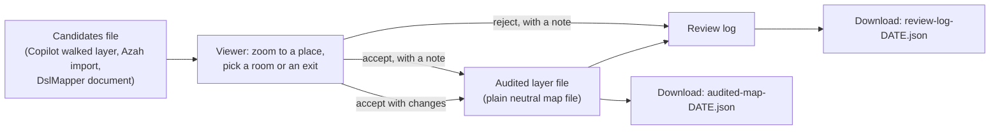
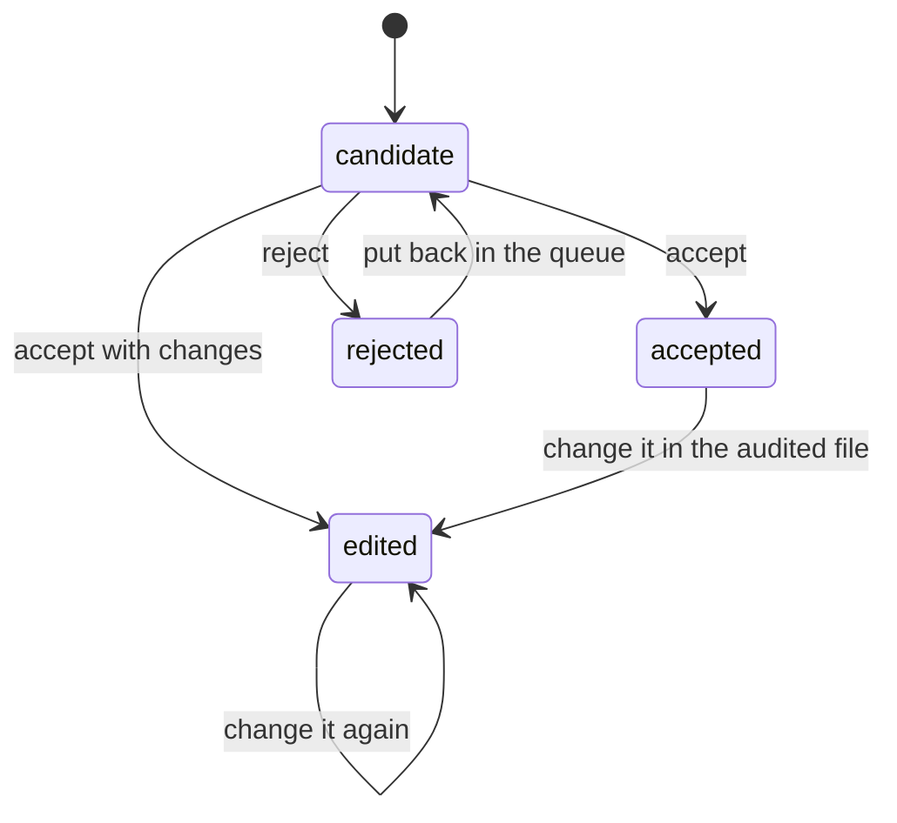

# Shattered-Maps client (the Mapper)

`apps/shattered-maps-client` is the map editor and renderer that began as the **DslMapper** (`C:\Projects\DslMapper\game-mapping`, MIT, same
author; copied from its commit `ee8ce9e`). Phase 22 of the Copilot plan moved it here **without changing what it does** (that editor is now the
*classic editor*, `#/legacy`); Phase 23 added the viewer and curation tool on the neutral map model as the home page (`#/`, [below](#the-neutral-viewer-phase-23-the-home-page)).
The DslMapper repository is untouched.

## Run it

It is a service of the dev stack like the other clients: a container that serves the built single-page app with nginx, behind the edge.

```
docker compose -f deploy/docker-compose.shattered-archive-experimental.yml up -d --build shattered-maps-client
```

- **Through the edge:** https://maps.shatteredarchive.dev/ . The edge vhost is `deploy/nginx/edge-maps.conf`, mounted as its own nginx template by the
  experimental compose (the shared `edge-subdomains.conf`, which the production compose also mounts, does not mention it), limited to loopback and
  private networks. It needs the hosts entry (`deploy/scripts/add-hosts.ps1`, run as administrator, now lists `maps.shatteredarchive.dev`). The
  nginx container mounts the template from the compose file, so it only has to be recreated once when the vhost is first added
  (`docker compose -f deploy/docker-compose.shattered-archive-experimental.yml up -d --no-deps nginx`; done on 2026-11-07).
- **Directly, on this machine only:** http://127.0.0.1:22081/ (the container's port, published on loopback only; see [docs/ports.md](../ports.md)).
- **For development, with hot reload:** `pnpm --filter @shatteredarchive/shattered-maps-client dev` serves the same app on http://localhost:22080 (strict port).

Other scripts: `build` (to `dist/`, git-ignored), `typecheck`, `lint` (root ESLint config, at most 5 warnings, see below), `test`.

There is no server and no data volume: the editor keeps its work in the browser. Nothing of it is in `deploy/docker-compose.yml` (production): publishing the map
editor there is a separate decision. The seed document, `seed_data/mapdoc.json` (176 rooms in 8 continents and 469 areas), is loaded in the classic editor (`#/legacy`) through the app's
file import (the "Import" file control of the persistence bar), which starts from what it autosaved in the browser (`localStorage` key
`dslmapper.autosave`) or from an empty document; the neutral viewer opens the same file as candidates ("Open candidates…").

The app imports `@shatteredarchive/shattered-maps-core`, whose package main is its built `dist/`: for `dev` and `typecheck` run
`pnpm --filter @shatteredarchive/shattered-maps-core build` once (the image build and `pnpm --filter @shatteredarchive/shattered-maps-client... build` do it in order; jest reads the core's sources).

## What changed in the move

Only the build around the code and a few type-level fixes. The behaviour, the components and the styles are as they were.

| Area | Was (DslMapper) | Is now |
|---|---|---|
| Package | `@dslmapper/game-mapping`, npm workspace | `@shatteredarchive/shattered-maps-client`, pnpm workspace project |
| Toolchain | Vite 7, `@vitejs/plugin-react`, TypeScript 5.8, `sass` | the monorepo's: Vite 8, `@vitejs/plugin-react-swc`, TypeScript 5.9, `sass-embedded` |
| New dependency | | `react-router-dom` ^7.8.2 (the Mapper's router; the only package the repo did not have) |
| Where it runs | `vite` on port 8085 | a container of the dev stack (Dockerfile, nginx, edge vhost `maps.shatteredarchive.dev`, loopback port 22081); `vite` on 22080 for development |
| Build | `tsc -b && vite build` to `../dist/game-mapping` | `vite build` to `dist/` (the type-check is its own script) |
| Lint | the app's own flat config | the monorepo's config, 0 errors; 5 advisory warnings kept as they are (below) |
| Tests | none | jest + jsdom, local `jest.config.cjs` (the repo-wide run lists this app's folder in its local-config lists) |

### Type-only fixes the stricter compile needed

- `Coords` now lists the legacy fields the code already read (`cz`, `q`, `r`, `z`, `level`) as optional; the `@ts-ignore` in `getVz` went with it.
- `CatalogCont.worldId` and `CatalogArea.worldId` / `continentId` are optional, because the editor deletes them to "unassign" a continent or
  an area (the old compile let that through).
- `cubeToAxial`'s unused third argument is named `_cz`, an unused import in `App.tsx` and one in `PersistenceBar.tsx` are gone, `width` in the
  SVG export is a `const`, and two empty `catch {}` blocks say why they are empty.
- **`RoomForm` hooks.** The form called `useState` and `useEffect` *after* `if (!room) return null`, which breaks the rules of hooks when the room
  appears or disappears (React reports a change in the order of hooks). `RoomForm` now only decides whether the room exists and renders
  `RoomFormFor`, which holds the hooks. Same rendered result; a test goes from "no room" to a room and back and fails if the order of hooks changes.

Eleven files carry one line, `eslint-disable @typescript-eslint/no-explicit-any`, because they are full of `any` (68 uses); they are typed with
the neutral model in the rework phase, not in a move.

### Warnings left as they are (5, and the lint script allows exactly 5)

`react-hooks/set-state-in-effect` in `PersistenceBar` and `RoomForm`; `react-refresh/only-export-components` twice and
`react-hooks/exhaustive-deps` once in `state/mapStore.tsx`. Each is advice about a pattern in the original code; changing them changes how the
app renders, so they wait for the rework.

## Known quirks, kept (found while writing the tests)

- In `renderAreaSVG`, a legend corner of `tr`, `bl` and `br` all produce the same picture; only `tl` (the default) differs.
- Its text escaping covers `&` and `<` only, not `>` or quotes. The renderer in `services/shattered-maps-core` (derived from this code)
  escapes all five and rounds its numbers to one decimal, so the two do not produce identical text; for that reason nothing was shared
  between them in this phase. Which of the two survives is a question for the rework.
- `axialToCube` returns `-0` for the cube z at the origin.
## The hexagon pages (fixed after the move)

The two hexagon routes (`#/map/<continent>/<area>` and `#/map/room/<vnum>`) were a pile of overlapping labels with the seed, for three reasons,
each now fixed and tested (`pages/hexPages.test.tsx`, `render/geometry.test.ts`):

- **They drew every room of the floor.** Every area has its own origin, and the area filter looked for a top-level `room.areaId` (the seed keeps it under
  `category`), with a "permissive for now" fallback that let any room without one through. The area page now keeps only the rooms of its area
  (`category.areaId`, the legacy `areaId` still honoured); the room page draws the focused room's own area, on the room's own floor unless
  `?level=` says otherwise, or just that one room when it belongs to no area.
- **Every room sat at the origin.** `deriveAxial` treated coordinates as a cube only when `cz` was present, and the saved documents store only
  `cx` and `cy` (`cz` is `-cx - cy`). A cube now needs just `cx` and `cy`.
- **The compass grid was sheared and the names ran into each other.** Rooms placed by `cx`/`cy` sit on the same grid the octagon view uses (east-west
  neighbours 4 units apart, north-south 2), and axial hex maths turns that into a slant. `placeRoom` lays them on a plain grid whose pitch makes
  neighbouring flat-top tiles touch, never overlap; rooms with only the legacy axial `q`/`r` keep the hex lattice. Tile size is 34, a label is cut to
  what fits across the tile with an ellipsis (`fitLabel`), and the full name is the tile's tooltip.

The octagon renderer (`#/renderer/<world>/<continent>/<area>`) is unchanged.

## The tests of the classic editor (the Mapper had none)

`src/render/geometry.test.ts` (direction maths, coordinate conversion with the legacy fields, hex and octagon geometry), `ascii.test.ts` (exact
output for a four-room area, floors, labels, diagonals, empty and negative cases), `svgExport.test.ts` (the empty picture, a floor, floors
stacked, escaping, options, doors and one-way exits), `seed.test.ts` (every one of the 176 seed rooms is drawn; the largest area's SVG, ASCII
and stacked SVG are pinned by hash), `src/state/persist.test.ts` (autosave round trip, corrupt storage, file export and import),
`src/components/RoomForm.test.tsx` (the hook-order fix, in the real provider) and `src/pages/hexPages.test.tsx` (the two hexagon pages in the real
provider and a router: one area on one floor, the room's own floor, label cut). Fixtures are in `src/testing/fixtures.ts`. `jest.setup.cjs` gives jsdom
the `TextEncoder` that react-router needs.

## The neutral viewer (Phase 23, the home page)

`#/` is a viewer and curation tool on the neutral map file ([schema.md](schema.md)). The classic editor is not replaced: it stays at `#/legacy`
(approved by the owner on 2026-11-08, amendment A29) with its own store and styles, and the hexagon and octagon views are unchanged.
Everything of the new viewer is in `src/neutral/` (index: `src/neutral/.annotated`).

### What it shows

| Level | Picture | Notes |
|---|---|---|
| Continent | the areas as boxes by their written `placement`, areas with rooms listed as buttons, empty ones behind a fold | with no placed area nothing is drawn (an empty sheet helps nobody) |
| Area | its subzone, or a chooser when it has several | each subzone has its own grid, so they are never drawn on top of each other |
| Subzone | one floor at a time (the busiest first), the floors as buttons | |
| Room | the room and the rooms its exits reach, the room outlined | neighbour positions are derived from the exits, and the core says so |

The picture is `renderSvg` from `shattered-maps-core`, injected as markup (every text in it is escaped; no script, style sheet or external reference),
so the exporter and the viewer draw the same thing: confirmed links solid, candidates dashed, conflicts red and dotted, an exit with an unknown target a
stub ending in `?` (a gap), a link that leaves the page a stub ending in an arrow. Under it: the legend, the counts of gaps, conflicts and
off-page links, the rooms of the floor as buttons (the drawing itself cannot be tabbed through), and a list of the gaps and conflicts.
The zoom control is a toolbar: one tab stop, the arrow keys, Home and End between the levels that exist.

The room panel shows the title, number, terrain, position, description, the exits with state, confidence, walks and where each leads, the **baseline**
(what is always there, what was only seen, what used to be there, with the visit counts), and where every part of the record came from
(source, author credit, date, and the review history).

### Files it opens and writes

| File | Opened with | Notes |
|---|---|---|
| Candidates | "Open candidates…" | a neutral map file (plain or gzip, which is how the Azah area files are stored) or a DslMapper document; validated strictly, the reasons shown when refused |
| Audited | "Open audited…" | a neutral map file; replaces the audited file after a yes |
| Audited, written | "Download audited file" | a plain neutral map file (`audited-map-<date>.json`), the layer the rest of the pipeline reads |
| Review log, written | "Download review log" | every decision with its note and date (`review-log-<date>.json`) |

The audited file and the log are kept in the browser (`localStorage` keys `shatteredmaps.audited`, `shatteredmaps.review`); the candidates are not, they
are opened again from their file. If the browser refuses the write, an alert says to download the file now.

A DslMapper document is read by `neutral/adapter.ts`: continent > area > one subzone "Main" > rooms, exits to links (`confirmed` keeps 0.95, every other
status is a `candidate` at 0.6, an exit with no or a missing target is an `unknown-target`), the catalog kept. Nothing is dropped silently: a report is shown
with what has no field (world, doors, one-way flags, room flags, objects, interactions, area primary room), the rooms whose area the catalog does not list
(kept under their continent in a placeholder area), and the grid change: the seed steps 4 across and 2 down, so the adapter divides it to one unit per
step and moves a room to the nearest free cell where rounding would stack two (9 of 176 in the seed). 176 rooms in, 176 out; the result passes the strict validator.

### Candidate review





The rules are in `neutral/review.ts`, pure functions that never change their inputs:

- **Accepting a room** copies it with its continent, area and subzone (names, placement, kind), its baseline and sources. It brings only the exits whose links
  are already accepted. A room number (`vnum`) that another accepted room has is refused.
- **Accepting a link** accepts its starting room first when needed and sets the room's exit slot. A link to a room that has not been accepted is marked
  `offPage`, which the strict validator allows, so the audited file is valid after every single step.
- **Every record keeps its own sources** and gains one (`manual`, ref `review`, the date); a room also gets a history line with the curator's note, a link
  gets the source only. The decisions with notes are the review log, a second file, because the audited file is a plain map file other tools read.
- **Accept all in this view** uses one working copy for all of them (a copy per item would be quadratic on a thousand rooms); items that cannot go are skipped with their reason.
- **Changes** to an accepted room (title, terrain, description) or link (where it goes, candidate or confirmed) are recorded as `edited` with the names of the fields.

## Export to the Builder (Phase 24)

With the audited map shown and an area or subzone in focus, `components/ExportPanel.tsx` makes a Merc `.are` file with the core's `exportMerc` and shows
its report; `builderExport.ts` holds the pure parts (file name default, the number range, the request body, the remembered range in
`shatteredmaps.export`). The page only produces the file and a `{ file, text }` request body: the Builder's preview is a bearer-guarded `POST`, the Mapper's
page rules allow no other origin, and the commit must stay the owner's act in the Builder, so the Mapper never calls it. Mapping, room number rule and the report:
[builder-export.md](builder-export.md). Tests: `neutral/builderExport.test.ts`, `neutral/components/ExportPanel.test.tsx`; the container check is `mapper-export.mjs` of the plan folder.

## The tests (Phase 23)

`neutral/adapter.test.ts` (the seed in and out, ids, vnum rules, the grid pitch and cell nudging, the report), `zoom.test.ts`, `review.test.ts` (every rule above,
every refusal, the valid-after-each-step property), `store.test.ts`, `fileio.test.ts` (including a real gzip), `persist.test.ts`, and the components:
`ZoomControl.test.tsx` (keyboard), `SliceView.test.tsx` (a gap, a conflict and an off-page arrow as their own elements, the levels, the cap on listed
rooms, escaping), `RoomPanel.test.tsx` (the baseline sections, MAPID-01), `NeutralApp.test.tsx` (the whole flow). Fixtures: `src/testing/neutralFixtures.ts`.
`mapper-neutral.mjs` of the plan folder drives the container end to end (31 checks, including the 1,000-room slice, the downloaded file against the
strict validator and the dark-theme classifiers).

## Known limits

- The review panel accepts and rejects; it does not write to a server. The audited file leaves the browser by download. The owner turns it into the
  slices the C# site serves with `publish-audited.mjs` (see [world-map-api.md](world-map-api.md)), then commits the folder. The Azah candidates stay
  out of `wwwroot`: the local site reads them from Copilot's private folder (a read-only mount).
- An area with several subzones is chosen from a list; the continent-level picture needs `placement` values, which only the Azah import writes today.
- The classic editor and the neutral viewer share nothing: a DslMapper document is opened in the new viewer as candidates, not edited in place.
