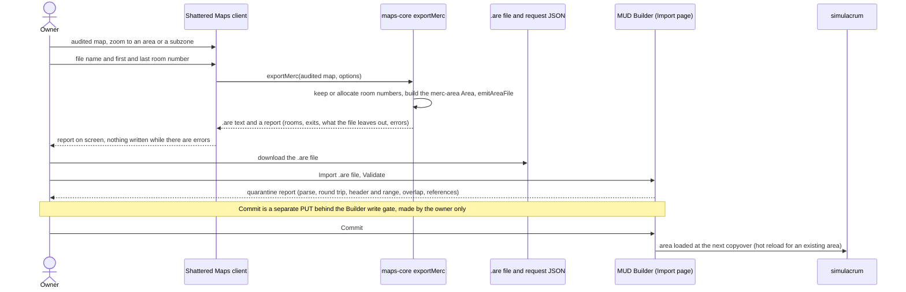
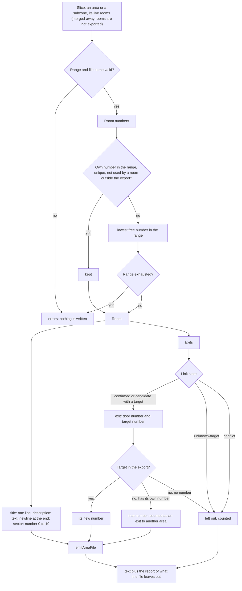

# Shattered Maps: export to the Builder

An area or a subzone of the **audited** map becomes the text of a Merc `.are` file that MUD Builder's import takes. This is how a map that
Copilot walked, and a curator accepted, reaches the simulacrum sandbox. The code is `exportMerc` in
`services/shattered-maps-core/src/export/merc.ts`; the panel is `apps/shattered-maps-client/src/neutral/components/ExportPanel.tsx`.

Nothing here writes to the game. The export makes a file; the Builder checks it again and shows its own report; **committing it is a separate
step the owner takes in the Builder** (its Import page, behind the Builder's own sign-in and write gate). `merc-mud` itself is not touched, and
the Builder writes only the area files under the sandbox it already manages.

## The flow

**Why the page does not call the Builder.** The Builder's import preview is a `POST` and needs a builder-tier bearer token, the Builder sends
no cross-origin permission, and the Mapper's page rules (`connect-src 'self'` and the auth hub) allow no other origin. Making the call from the
page would need all three loosened, one of them in a header shared with production. So the Mapper produces the file (and, for tooling, the
request body `{ "file", "text" }` that `POST /api/import/area/preview` and `PUT /api/import/area` take) and the Builder's own page does the
checking. The page makes no request to the Builder at all; the browser check asserts it.

## What is written

| Neutral map | Merc file |
|---|---|
| room title | room name, folded to one line |
| room description | room description (text, then a newline); an empty one is written empty and counted |
| room sector | sector number 0 to 10 (below); anything else is written as inside and counted |
| exit direction N E S W U D NE NW SE SW | door 0 1 2 3 4 5 6 7 8 9 (`MERC_DOOR`) |
| link to a room | exit with the target's room number; no door, key or description (all 0 or empty) |
| room `vnum` | the room number when it fits the range and nothing else uses it |
| area or subzone | the `#AREA` header: your file name, the area's name, credits "Shattered Maps", the range you gave |

Sector names read (case and spacing ignored): inside 0, city 1, field 2, forest 3, hills 4, mountain 5, water (swim) 6, noswim 7, air 9, desert 10;
the plain numbers 0 to 10 except 8 (unused in Merc) are read as themselves.

## Room numbers

- You give the first and last number. The file's `#AREA` header declares that range, which the Builder requires to cover every number in the file
  and not to overlap any other area in `area.lst`.
- A room keeps its own `vnum` when it is inside the range, no other room in the export has it, and no room **outside** the export (anywhere in the
  map) uses it. Every other room takes the lowest free number in the range, in the order of the map file, so the same map always gives the same file.
- If the range is too small, nothing is written and the message says how many numbers are missing.
- The default offered is 30000 upward (at least 100 numbers, twice the rooms for a large area). It is only a suggestion: look at the Builder's area
  list and pick a free range; the Builder reports an overlap when you import.

## What the file leaves out (the report)

Everything is counted; a clean export says "Nothing". The report lists, with counts:

| Left out | Why |
|---|---|
| rooms' positions on the map grid | a Merc file has no coordinates |
| records of where a room came from (sources, history) | no place for them |
| what a room usually holds (the baseline: mobs, items) | the file only lists them as resets, which this export does not write |
| exits whose target is not known (a gap) | an exit must lead somewhere |
| exits whose sightings disagree (a conflict) | the map has not decided where it goes |
| exits to a room outside the export that has no number | the file cannot name it |
| exits to a room the map does not hold | a broken link |
| a `~` or control character in a title, description or name | `~` ends a string in the file; it is written as `-`, control characters are removed |
| a missing description or sector | written empty, or as inside |

Also reported but written: how many exits were only seen once or taken from an imported map (candidate exits, written as ordinary exits), how many
lead to a room in another area (written with that room's own number), and how many rooms were given a new number.

Exits are written one way, as the map holds them. The map keeps each direction as its own link (see [schema.md](schema.md)), so a path walked both ways
has two links and gives two exits.

## Errors that stop the export

A missing area or subzone, a file name the Builder would not take (`^[A-Za-z0-9_][A-Za-z0-9_.-]*\.are$`), a range that is not whole numbers inside
1 to 32767, a range with too few numbers, and an area with no rooms. The panel shows them and offers no download.

## Tests and checks

- `services/shattered-maps-core/src/export/merc.test.ts`: the text parses back with `parseAreaFile` and re-emits unchanged; door and sector mapping; kept,
  replaced and exhausted room numbers; numbers used outside the export; a room with no exits, description or sector; `~`, line breaks and control
  characters; every line of the report.
- `apps/shattered-maps-client/src/neutral/builderExport.test.ts` and `components/ExportPanel.test.tsx`: the form, the report and errors on screen, the two downloads.
- `.ai-plans/active/2026-11-05_copilot-ai-training-sibling-to-autopilot/api-check/phase-24_builder-preview.check.test.ts`: a 12-room export sent to the
  Builder's real `POST /api/import/area/preview` route (a real HTTP request to the Builder's own Express app on an empty temporary area directory):
  status 200, `errors: []`, `summary: { rooms: 12 }`, and the Builder's canonical text equal to the exported text. The `PUT` is never called.
- `playwright/mapper-export.mjs` in the same folder: the panel in the container, the downloads parsed with the Builder's parser, and no request to
  the Builder from the page.
