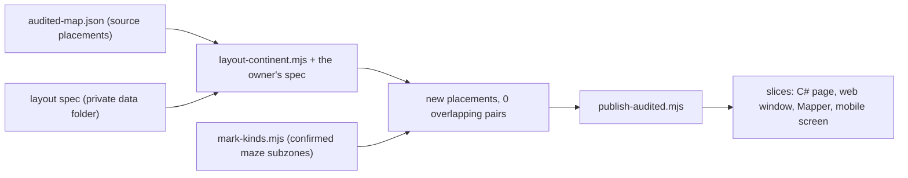

# Continent layout, mazes and tangled links (Phases 45 and 46)

Two problems made the real DSL map hard to read, and both are fixed in the data pipeline and in the shared renderer (so the C# page, the web game-client window, the Mapper and the mobile screen all get the fix).

## 1. The continent picture: no overlapping area boxes

An area's `placement` on its continent is the extent its zone has in the source map, written by the author. On Arkane 642 of 3,828 pairs of area boxes overlapped, so the continent picture was a pile.
`layoutContinent` (core `src/continentLayout.ts`) lays the boxes out again; `scripts/layout-continent.mjs` applies it to an audited map.



How a layout is made:

1. Every area is a box. `sizeBy: "extent"` keeps the extent the area has in the source; `sizeBy: "rooms"` gives each box an area proportional to its room count (1.6 cells per room, aspect kept, never under 2 cells a side).
2. The `center` area keeps its place. Each relation then puts one area in a compass direction from an area that is already placed, searching along that bearing and a little to either side (the cheapest place: each cell further out costs 1, each degree off the bearing 0.6) so "south-south-east of the tree" stays south-south-east when the nearest spot is taken.
3. Every other area moves with the pinned area nearest to it in the source (the same shift), then goes to the nearest free place; larger areas first. A gap of one cell (`gap`) is kept between boxes.

The **spec** is the owner's geography and lives with the owner's data, never in this repository (it names areas): `world-map/layout/<continent>.json`:

```json
{ "continent": "<continent id>", "center": "<area id>", "gap": 1, "sizeBy": "rooms",
  "relations": [ { "area": "<area id>", "of": "<area id>", "dir": "NNE" } ] }
```

Relations are applied in order and `of` must already be placed (a relation that cannot be done is skipped with a warning in the report, never an error). Only the `placement` of that continent's areas changes. The report prints the overlapping pairs before and after.

**Arkane (the owner's geography, 2026-11-12):** Arkane city in the centre; Verminasia to the north and north-east of Bloodshackle Fortress; Bloodshackle south-south-east of The Great Tree; The Great Tree north-north-east of the port (taken to be Arkane Coast: to be confirmed), which is west of the city; the Arkania Roadway east with the Great Forest, Glassrose Mansion, Centaur Village, Mystic Crystal Fields and Amethyst Falls along it; the Marauders areas south. Each relation is written from the city outward, so some are the reverse of the owner's wording. Result: 0 overlapping pairs, every stated bearing within one compass step.

**Size by room count or by extent?** Both give 0 overlap. `rooms` is more compact (112 x 117 cells against 143 x 143 for `extent`) and makes sizes comparable (an area with twice the rooms has about twice the area, no 52 x 6 slivers); `extent` keeps each area's real shape. Room-count sizing does not make a mess of the map, and it is the one published locally.

## 2. Tangled links, mazes and teleports

`classifyLink(dir, from, to, occupied)` (core `src/render.ts`) says whether a link makes a clean join: the target lies the way the exit points (within one cell sideways) and no other room stands in the way. The renderer draws a **clean** link as the full line it always was. Any other link on the drawn floor is a **chip** on its room, and a line only when its room is traced:

| Look | Meaning | Attributes |
|---|---|---|
| small round purple **chip** on the edge of the room, on the exit's side | a twist: the room it reaches is not next to this one | `data-tangled="twist"`, `data-tangled-from`, `data-tangled-to`, `data-jump-to` |
| small square orange **chip** | a teleport: it lands four or more cells away | `data-tangled="teleport"` |
| line from the chip to the landing room, which is ringed: it leaves square to the edge the exit is out from (as the original DSL map drew it) and swoops to the room, leaning round the tile when the room lies behind the exit; `routeCurve` tries longer and sideways-shifted handles when the plain swoop crosses another tile or name; arrowheads at the end and half way along (`data-trace-mid`) | the trace of a chosen room (`RenderView.trace`): purple, or dashed orange for a teleport | `data-layer="trace"`, `data-trace-to`, `data-trace-exit`, root `data-trace` |
| green **▲** left of the middle, orange **▼** right of it | a way up / a way down; hover names the room, a click goes there | `data-stairs="up"` or `"down"`, `data-stairs-to` |
| pills **IN**, **OUT**, **END**, **1-WAY** under a maze room's name | a way in from outside, an exit to another area, a dead end, a landing with no way back | `data-pill` |
| **amber octagon** | a room of a maze subzone (`kind: "maze"`) | `data-kind="maze"` |
| blue octagon / smaller purple octagon | a loop / a teleport subzone | `data-kind="loop"`, `"teleport"` |
| **purple octagon** | a room with a twisting or teleporting exit, in an ordinary subzone | `data-kind="tangled"` |

The root element carries `data-tangles` (how many stubs the floor has). Up and down exits are never judged by the grid. The Mapper's legend and the C# page's legend explain the symbols (the Mapper only when the picture has them).

**Marking mazes.** A subzone's `kind` is data. `scripts/mark-kinds.mjs --propose` lists subzones where at least 30 same-subzone exits exist and at least 30% of them do not lead straight on (worst first; the detector never changes a map); the owner confirms a kinds file (`{ "<subzone id>": "maze" }`) and `mark-kinds.mjs --kinds ... --out ...` writes it. On the DSL map it proposed 8 subzones (Great Library of the History of Algoron 67%, Sanctuary of the Light 59%, Machine Dreams 46%, Demon Spawning Pits 45%, Mountain Pass 40%, Realm of the Endless 39%, Death Garden 32%, Dreamscapes 31%); all 8 are marked for now (owner's answer), kept in `world-map/layout/kinds-proposed.json`.
The Siege's Mist is only part of its area, so it is not a maze subzone but its exits still draw as purple octagons with chips.

## Running it

```
pnpm --filter @shatteredarchive/shattered-maps-core build
node services/shattered-maps-core/scripts/layout-continent.mjs --in audited-map.json --spec layout/arkane.json --out audited-map.laid-out.json
node services/shattered-maps-core/scripts/mark-kinds.mjs --in audited-map.laid-out.json --kinds layout/kinds-proposed.json --out audited-map.final.json
node services/shattered-maps-core/scripts/publish-audited.mjs --in audited-map.final.json --out <the folder the site serves>
node scripts/publish-map-renderer.mjs        # when render.ts changed: regenerates worldmap2.js for the site and the phone
```

Tests: core `continentLayout.test.ts`, `render.tangle.test.ts` (100%), the two script tests in `test:guards`; browser checks `playwright/maps-v2-zoom-levels.mjs`, `maps-v2-maze.mjs`, `mapper-zoom-levels.mjs` in the plan folder.

## Gotchas

- The phone drew an old renderer once after a deploy: the site serves `worldmap2.js` with a one-day cache lifetime. The app now asks for `worldmap2.js?v=<ten-minute bucket>`.
- The published slices are the owner's: replacing the folder the local site serves is the owner's call (a backup copy `audited-before-layout/` was kept for this change).
- Layout only moves boxes; it never changes a room's coordinates or a link.

## Areas laid out by their exits, and the lines between them (A56 follow-up)

- **Extending an owner spec.** `autoSpec(map, continentId, { base })` keeps the relations of an owner spec exactly as written and relates every area the spec leaves out by the exits between areas, walking outward from the areas the owner placed. `layout-auto.mjs --extend <folder of owner specs>` does this for each continent that has a spec (`--specs` keeps such a continent untouched instead; give one of the two). Before this, an owner spec with a few relations left the other areas packed with no link to their neighbours (Arkane: 14 relations for 88 areas, 21 of 196 area pairs in the direction their exits point; after: 107).
- **Smaller boxes.** `LayoutSpec.cellsPerRoom` (default 1.6, `--cells-per-room`) is the area of a box in cells per room: a smaller number shrinks every box and keeps the sizes in proportion. `--gap` sets the empty cells between boxes; the lines between areas need room to show, so the served Arkane layout uses a gap of 3 and 0.7 cells per room.
- **Lines between areas.** `areaLinksOf(map)` counts the followed exits that leave an area, per area pair and direction (`{from,to,dir,count}`). `sliceMap(map,'continent',id).areaLinks` carries them, and `publishAudited` writes them into `manifest.json` (`areaLinks`), so the site's index answer has them without loading every area. The continent picture draws one line per pair, edge to edge, with an arrowhead at each end an exit goes in at (`<g data-area-link data-from data-to>`); hover says which way and how many exits. Boxes that touch, or leave less than 14 px, get no line; a line longer than 150 px, or than 15% of the picture on a big one, is drawn faint.
- **Opening whole.** The site page fits a continent to the card's height as well as its width and centres it.

## Shaping a continent like the real one: `outline` and `hints`

The boxes of a continent used to float as a loose diamond whatever the real landmass looks like. A spec can now carry the continent's silhouette:

```json
{ "continent": "az-c411", "center": "<area id>", "relations": [],
  "outline": [[262,185],[300,160],[335,145], ...],
  "hints": { "<area id>": [320, 150] },
  "outlineFill": 0.5 }
```

- `outline` is a polygon in any units, x east and y south: read the corners off a picture (the outlines used were traced from the legacy sheet map, the game's own cartography; `shatteredarchive.com/img/world.webp` is the artistic version and its proportions differ). Only the proportions matter; the size in cells comes from the boxes (`outlineFill`, default 0.5, is the share of the silhouette they fill; lower is roomier). These pictures are interpretive, giving the general directions of a text world, sometimes literally and sometimes loosely: the outline is a guide, not survey data.
- `links` (area pairs with an exit count, built from `areaLinksOf` by `layout-continent.mjs`) pull linked areas together while the layout is relaxed inside the outline, so the arrows between areas stay short; without the pull a continent spread over its landmass is mostly faint lines. The arrow fades when longer than 150 px or than 15% of the picture, whichever is more.
- `hints` (needs an `outline`) say where an area really is, in the same units. A hinted area goes there before any other, and its hint beats a relation written for it.
- How it works: the ordinary layout (centre, compass relations, links) runs first and decides which area is west, north or south of which. That picture is then stretched over the silhouette, each row across the width the outline has at that height, and every box goes to the nearest free place wholly inside it, larger areas first. The relative directions survive; the shape is the continent's. An area that cannot fit inside is placed just outside and counted (`outsideOutline`, plus a warning); lower `outlineFill`.
- `layout-auto.mjs --extend <folder>` carries `outline`, `hints` and `outlineFill` of an owner spec through `autoSpec`, so a spec of just `{ continent, center: "", relations: [], outline }` shapes a continent whose areas are related by their exits (a `center` that is not on the continent means the biggest connected area is the centre).
- Without an `outline` nothing changed.

Done 2026-11-19 for Althainia, Icewall, Arkane, Tropica and Shokono (traced from the legacy sheet map, rough on purpose) in `world-map/layout-shaped/`; the result is `audited-build/audited-map.shaped.json` (gap 3, 0.7 cells per room, 0 overlapping pairs, 0 areas outside). Extent proportions now follow the picture (Althainia wide and low, Arkane tall and narrow, Shokono long north to south). Limbo and Oceans have no landmass on the picture and stay as they were. The served layout is unchanged until the owner publishes it. Not done yet: drawing the silhouette itself behind the boxes and a world picture (work item `.ai-plans/active/2026-11-19_realistic-world-and-continent-maps`), and `hints` for individual areas (the port and place letters on the sheet map could become hints).
