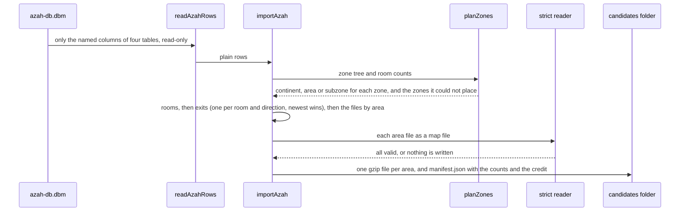
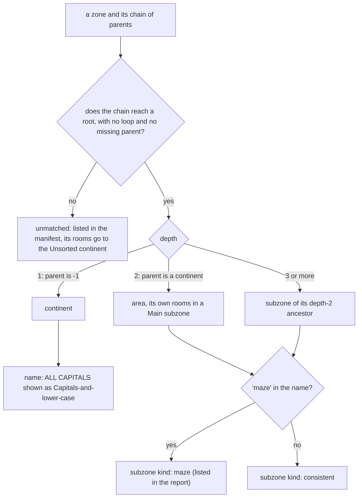

# Importing the community map (Azah's map)

The community map of the game, kept by Azah as a CMud database (`azah-db.dbm`, SQLite), becomes **dated, credited, low-confidence
candidates** in the neutral map format ([schema.md](schema.md)). Nothing in the import is walked evidence, and none of it is served to
anyone yet. The code is in `services/shattered-maps-core/src/import/` and `scripts/import-azah.mjs`.

**Credit.** Every room, exit and area written by the import carries a source `{ kind: "azah", ref, credit: "Azah", date? }`, and the
manifest carries the credit text: "Map data by Azah, from the community CMud map of the game. Imported as unverified candidates, each
dated by its last edit in that map." Surfaces that show the data (later phases) show the same credit.

| File | Holds |
|---|---|
| `src/import/azah.ts` | `readAzahRows(db)` (the columns that are read), `importAzah(rows, options)` (rows in, area files out), `buildManifest` |
| `src/import/zones.ts` | `planZones`: the zone rules (continent, area, subzone, unmatched) |
| `src/import/merge.ts` | the "newest wins" rule for two records of the same room or exit (E9) |
| `scripts/import-azah.mjs` | opens the database read-only, validates, writes the gzip files and the manifest |

## How it runs (diagram D15)



```
pnpm --filter @shatteredarchive/shattered-maps-core build
node services/shattered-maps-core/scripts/import-azah.mjs            # writes the default folder
node services/shattered-maps-core/scripts/import-azah.mjs --dry-run  # counts only
```

Options: `--db <file>` (default `C:/Projects/DslScripts/data/db/azah-db.dbm`), `--out <folder>`, `--date YYYY-MM-DD` (the import day written
into the files; default today), `--dry-run`. The script prints the counts below, checks every area file with the strict reader first, writes
nothing if one fails, and removes area files of earlier runs that no longer exist. The same database gives the same files: ids come from
the source's own keys (room `az<ObjId>`, exit `azl<ExitId>`, area `az-a<zone>`, subzone `az-s<zone>`) and never from a title.

### Where the output goes, and why not under `wwwroot`

The default folder is `C:/Projects/DSL/GameLogs/ShatteredArchive/Docker/copilot-server/world-map/candidates/`: Copilot's private data folder,
which the DSL repository does not track. The plan named `DSL/Server/Server.Web.Public/wwwroot/data/world-map/candidates/`, but everything
under `wwwroot` ships with the C# web server's build, and the web server has no switch yet that keeps a local-only folder out of a production
build; writing 24,000 community rooms there now could publish them on the next production deploy. The script refuses an output folder under
`wwwroot` unless told `--allow-wwwroot`. Serving the files (and keeping them out of production builds) is the job of the phase that adds the
web server's world-map API.

## What is read, and what is dropped

Only these columns are selected (`readAzahRows`), so the rest never reaches the importer:

| Table | Read |
|---|---|
| `ObjectTbl` (rooms) | `ObjId`, `Name`, `IDName` (a fallback title), `Desc`, `KindID`, `RefNum`, `X`, `Y`, `Z`, `Deleted`, `Modified`, `ZoneID` |
| `ExitTbl` | `ExitId`, `FromID`, `ToID`, `ExitKindID`, `DirType`, `DirToType`, `Tested`, `Modified` |
| `ZoneTbl` | `ZoneId`, `Name`, `Parent`, `X`, `Y`, `Modified` |
| `PortalTbl` | `PortalId`, `ToID`, `Cost`, `ZoneID`, `Name`, `Enable`, `Modified` |

Dropped by not being read: `UserID` (who edited, in every table), `ServerID`, `DateAdded`, the scripts and free-form content, hints, colours,
icons, styles, the drawing geometry of exits, and the zone drawing settings. The database keeps no edit history beyond the last `Modified`
time and `UserID`, so there is nothing else to drop. A test puts a user id and a server id into a fixture database and checks that they are in
no file; the real output was checked the same way (no `UserID`/`ServerID` text in any of the 391 files).

| Source | Becomes |
|---|---|
| room `Name` (else `IDName`, else "Unnamed room") | `title` (control characters replaced, at most 200 characters) |
| room `Desc` | `description` (none when blank) |
| room `X`, `Y` | `coords.x`, `coords.y`: the source units divided by 240 (one step on its grid) and rounded; `Z` is the floor |
| room `RefNum` (else `ObjId`) | `sources[].ref` |
| `Modified` | `sources[].date` as `YYYY-MM-DD`; a missing time or the format's zero date (`1899-12-30`) is **no date** |
| `Deleted` | a deleted row is skipped (the database stores it as `Y`/`N` text) |
| `KindID` other than 0 | not a room: skipped |

No `vnum` is set: this database does not say the game's own room number (`RefNum` equals the object id in all but 39 rows), and a vnum is never
used as identity anyway. No sector is set (the database has none).

## Exits

| `DirType` | Meaning here |
|---|---|
| 0 to 9 | north, northeast, east, southeast, south, southwest, west, northwest, up, down |
| 10 | an exit by a typed command ("enter portal"): the schema has no slot for it, so it is counted and left out |
| 11 or anything else | the direction was not recorded: counted and left out |

An exit whose `DirToType` is 11 ("destination unknown"), or with no destination, or into a room that is not in the table, is an
**`unknown-target`** link (confidence 0): the exit is real, where it goes is not known. Any other exit is a **`candidate`** link, confidence
**0.3**, or **0.4** when the author marked it tested. Both are below the 0.6 that one walk earns (diagram D12), and an exit is never
`confirmed` by an import. A link whose target is in another area is `offPage`, and the area file names a room that lives in another file; the
strict reader allows that exactly when the link is marked off-page. An exit out of a room that is not imported is skipped. Where two exits share
a room and a direction (52 in the real data) the **newer** record is kept (E9, below).

Portals (5 rows: "recall" and similar) are not exits from a room: they are listed in the manifest with the room they lead to.

## The zone rules

The database keeps zones in a tree (`Parent`; -1 is a root). In the real data there are 7 roots (the continents: Althainia, Icewall, Arkane,
Tropica, Limbo, Oceans, Shokono), which hold no rooms, and 389 zones under them, which hold every room except 41. Nothing is deeper, but the
rules are written for any depth, and tested on trees that are:



- **Names are only for display.** An all-capitals name is shown in capitals and lower case; the word "maze" in a name types the subzone `maze`
  (two zones in the real data: "Hedgemaze" and "Bamboo Temple Maze", listed in the report so they can be checked). Nothing is regrouped by name.
- **Room counts** decide what is empty: a zone with no rooms and no children is listed as empty (none in the real data), and an area with no
  rooms gets no file.
- **Not guessed.** A zone whose parent is missing, in a loop, or below a broken zone is listed with its reason, and so is a duplicate zone id.
  Its rooms, and the 41 rooms whose zone number is not in the table (zones 0 and 1), are kept in the **Unsorted** continent, one area each,
  so no room is lost and none is placed on a guess.
- **Placement.** An area's `placement` is the zone's own position on its continent (the author's `X`, `Y` in the same 240 units), and its size
  the extent of its rooms. It is written by the source, not derived from how many rooms there are. These positions have not been checked
  against the game.

## Newest wins (E9)

`merge.ts` decides which of two records of the same room or exit to believe (for walked evidence against this import): the **later dated**
record wins; any date beats none; two undated records, or the same day, leave the base as it is. Dates compare by day. A newer record that lacks
a description or a sector does not erase an older one's; an exit with no known target never beats one that has a target. Which room of one layer
is the same as which of another is not decided by these functions (they take two records already known to be the same). The importer applies
the same rule to two exits at the same room and direction.

## The real run (2026-11-07)

`node scripts/import-azah.mjs --date 2026-11-07` against the database in `DslScripts`:

| | Count |
|---|---|
| Rooms read / imported | **24,358 / 24,358** (none deleted, none not a room, no duplicate ids) |
| Rooms without a name (title "Unnamed room") / undated / without a description | 179 / 37 / 325 |
| Rooms in zones 0 and 1, which are not in the zone table | 41 |
| Exits read | 77,747 |
| Exits imported | 77,288, of which 563 have no known target (1 into a room that does not exist), 612 loop back into their own room, 3,692 lead into another area, 68,317 are marked tested |
| Exits not imported | 392 by typed command, 10 with no recorded direction, 5 out of a room that is not there, 52 duplicate slots (the older record) |
| Zones read | 396, giving 8 continents (the 7 and Unsorted), 391 areas (389 and 2 unzoned), 391 subzones; none unmatched, none empty |
| Portals | 5 |
| Output | 391 area files (3.21 MiB gzip, largest 352 rooms) and `manifest.json` |

Read back independently: every file passes the strict reader; the rooms add up to the database's 24,358; the 77,288 exits and 3,692 off-page
links all end at a room that exists in some file; 101,646 sources, all credited to Azah; no user or server id anywhere.

## Limits to know

- Two rooms can land in one grid cell where the author drew them closer than a step, and a few areas' positions may look odd until someone
  checks them against the game.
- 392 typed-command exits and 10 exits with no recorded direction are not in the map (counted in the manifest).
- The author's "tested" flag is a claim by the author. It raises the confidence by 0.1 and nothing more.
- Names and descriptions are the author's text and can differ from the game's current wording; the date says when the author last edited it.

## Tests

`pnpm --filter @shatteredarchive/shattered-maps-core test`: `import/azah.test.ts` (a SQLite fixture built in the test with `node:sqlite`: row
mapping, columns that are not read, the credit on every source, deleted and non-room rows, a room with no description, a zone chain three deep,
typed-command and bad-direction exits, duplicate slots, unknown targets, unzoned and unmatched zones, off-page links with valid files, the
manifest, rows that are not rows), `import/zones.test.ts` (trees with a loop and an orphan parent), `import/merge.test.ts` (E9).
