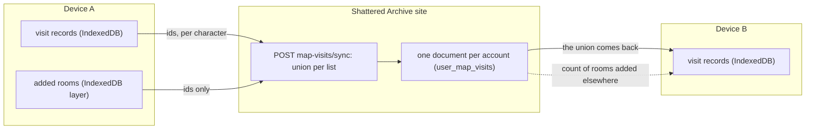

# Map cloud backup (Phase 44)

The player's own cloud backup of **which rooms they explored** and **which rooms they added**, kept on the Shattered Archive site under their account so a second browser or device can bring
them in. It is a lean list of ids and nothing else. It runs only when the player presses **Sync now** in the map window's gear (never in the background, never on a timer).

End-user description: [user-guide.md](user-guide.md) ("Cloud backup"). Where it sits in the window: [surfaces.md](surfaces.md).

## What is stored, and who can read it

- **Per account** (the sign-in token's account; the client never names an account), one document, **private to that account**: the routes need the site's bearer token (`[AuthorizeApi]`, 401 for anyone else).
- **Ids only.** `visited` (room ids per character name) and `added` (ids of the rooms the player added by hand). No titles, descriptions, times or counts. A character name is the key of a list, so the
  document is Personal data in the sense of `docs/standards/data-classification.md`: it is the player's own cloud backup, readable only by them, and erasable by them (`DELETE`).
- **Added rooms keep their details in the browser that added them.** Another device learns only that such a room exists (its id) and shows how many are elsewhere. Moving the rooms' content is a
  larger design (it would store titles and exits on the site) and is not part of this phase.
- **Worlds are generic.** The site knows no world by name (a name is `[a-z][a-z0-9-]{0,23}`, at most four); the client sends the world it is showing. Production code names no second world.

## Routes (`UserContentController`, `api/user-content/map-visits`)

| Route | What it does |
|---|---|
| `GET map-visits` | The stored document (the empty document when nothing is saved). |
| `POST map-visits/sync` | Unions the posted document into the stored one, saves it, answers the merged document. 400 for a body outside the shape, 413 over a cap, 401 without sign-in. A refused request changes nothing. |
| `DELETE map-visits` | Saves the empty document (204). |

Shape: `{ "version": 1, "worlds": { "<world>": { "visited": { "<character>": ["room-id"] }, "added": ["room-id"] } } }`. A character key may be empty (rooms seen before the game named the character).
Caps (all in `MapVisitSync`): 4 worlds, 50 characters per world, 60,000 ids per list, 64 characters per id (the map schema's id alphabet), 60 per character name, 4,000,000 characters of body.
The largest real world (about 24,400 rooms) fits well under the cap (tested). A union is a set union per list, written sorted, so the stored text is deterministic and a device that is behind never removes anything.

## Where the code is

| Part | File |
|---|---|
| Pure shape, caps and union (no web host), tested at 100% | DSL `Server/Server.Dsl/Maps/MapVisitSync.cs`, `Server.Dsl.Tests/MapVisitSyncTests.cs` |
| Table and model | DSL `Server.Core/Constants.cs` (`TABLE_USER_MAP_VISITS`), `Server.Datastore/Models/UserMapVisitsModel.cs`, registered in `AppManager.cs` |
| Routes | DSL `Server.Web.Public/Controllers/UserContentController.cs` (next to saved directions) |
| Client calls | `apps/game-client/src/features/auth/cloudSync.ts` (`syncMapVisitsCloud`, `deleteMapVisitsCloud`) |
| Client logic: the document, the sync, the words of the result | `apps/game-client/src/features/worldmap/sync/backup.ts` |
| Visit store export and import (`byCharacter`, `addMany`) | `apps/game-client/src/features/worldmap/fog/visits.ts` |
| The gear section | `apps/game-client/src/components/MapBackupSection.tsx` |
| Browser and API check | `.ai-plans/.../playwright/world-map-backup.mjs` (two browser contexts on one throwaway account) |

## Gotchas

- The browser's own account key for fog of war is `local` when the sign-in token is opaque (the site's tokens are), so the **user level** of fog is "everything this browser has seen". The backup does not
  change that: what comes back from the site is added under the current browser's key, per character.
- Restoring writes one IndexedDB record per room in groups of 500 (`addMany`); a very large backup (tens of thousands of rooms) is untested on a slow disk (Phase 39).
- The Android app's map screen has no sync command yet (the web client is finished first).
