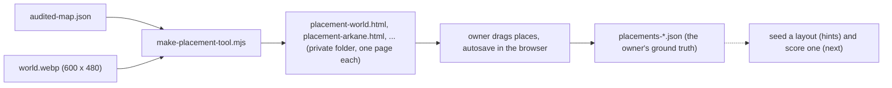

# The placement tool: the owner places the world and the continents (Developer and user notes)

The world and continent pictures of the Maps viewer are meant to feel like the real geography, and the owner knows where things lie. Instead of deriving that from exits
(which a first attempt did badly: see `continent-layout.md`), the owner **drags every place to where it belongs** on the realistic world picture, and the result is the
ground truth for those two levels. Areas, subzones and rooms stay grids; only the world and the continents are placed this way. How to start and use it: [placement-tool-how-to.md](placement-tool-how-to.md).



## Making the pages

```
pnpm --filter @shatteredarchive/shattered-maps-core build
node services/shattered-maps-core/scripts/make-placement-tool.mjs --in <audited-map.json> --image <world.webp> --all <private training folder>
node services/shattered-maps-core/scripts/make-placement-tool.mjs --in <audited-map.json> --image <world.webp> --level continent --continent az-c411 --out <file.html>
```

Each page is one self-contained file (the picture is embedded), so it opens from a folder with no server. The output may not be under a `wwwroot` folder: it names areas and
is the owner's working file. `FRAMES` in the script says where each continent lies on the world picture and how it is measured; `GUESSES` holds the starting positions.

| Level | Tokens | Units | Grid |
|---|---|---|---|
| World | the continents (not Unsorted) and the named seas (the areas of the Oceans continent) | pixels of the world picture | every 20, heavier every 100 |
| Arkane | its areas | **rooms east (x) and south (y) of the port** (the owner's way of speaking about it) | every 5, heavier every 10 |
| Althainia, Icewall, Tropica, Shokono | their areas | pixels of the world picture | every 10, heavier every 50 |

## Using a page

- A token with a **dashed outline** is a starting guess (from the owner's descriptions and the literal-compass walks); it turns solid, and counts as **confirmed**, once the owner moves it or presses *Confirm all*.
- Drag a place from the list onto the map; drag a placed one to move it; double-click a placed one to send it back to the list. The status line shows the coordinates under the pointer.
- **Click a token** to draw the exits between it and its neighbours (the direction typed and how many exits) and to list them; *all exits* draws every pair.
- Autosave is in the browser (`localStorage`, one key per level). *Save to file...* writes a JSON file where the owner chooses (Chrome and Edge); *Download* works everywhere; *Load...* reads one back.

## The saved file

```json
{ "version": 1, "kind": "owner-placement", "level": "continent", "scope": { "id": "az-c411", "name": "Arkane" },
  "frame": { "image": "world.webp", "units": "rooms", "origin": { "px": [262, 200], "label": "The Arkania Port", "areaId": "az-a159" }, "xEast": true, "ySouth": true, "pxPerUnit": [4, 3.9] },
  "placements": [ { "areaId": "az-a159", "name": "Arkane Coast", "kind": "area", "at": [1, 0], "px": [266, 200], "confirmed": true } ],
  "unplaced": ["az-a1"] }
```

`at` is in the frame's units; `px` is the same point on the world picture, so every level can be compared in one frame. `confirmed: false` is an untouched guess: a consumer that trains on the owner's word
uses only the confirmed ones. The private folder keeps the files (`world-map/training/`); they are not committed.

## Tests

`scripts/placement-tool.test.mjs` (the data: tokens, exits per pair, frames, guesses, the embedding) is part of the script tests. The page itself was driven in a real browser (move, drag in from the list, select, autosave):
`.ai-plans/active/2026-11-19_realistic-world-and-continent-maps/evidence/verify-tool.mjs`.

## Gotchas

- The exits are the ones the audited map follows (Azah's links), counted per area pair by direction; a world token merges all the exits of its areas. They show what is connected, not where it lies.
- The world picture has places the data does not (Fjord, Lutsa Rusul as an island): the picture is the backdrop, the tokens are the data.
- Limbo has no place on the picture; it is a token to drop wherever the owner wants it.
