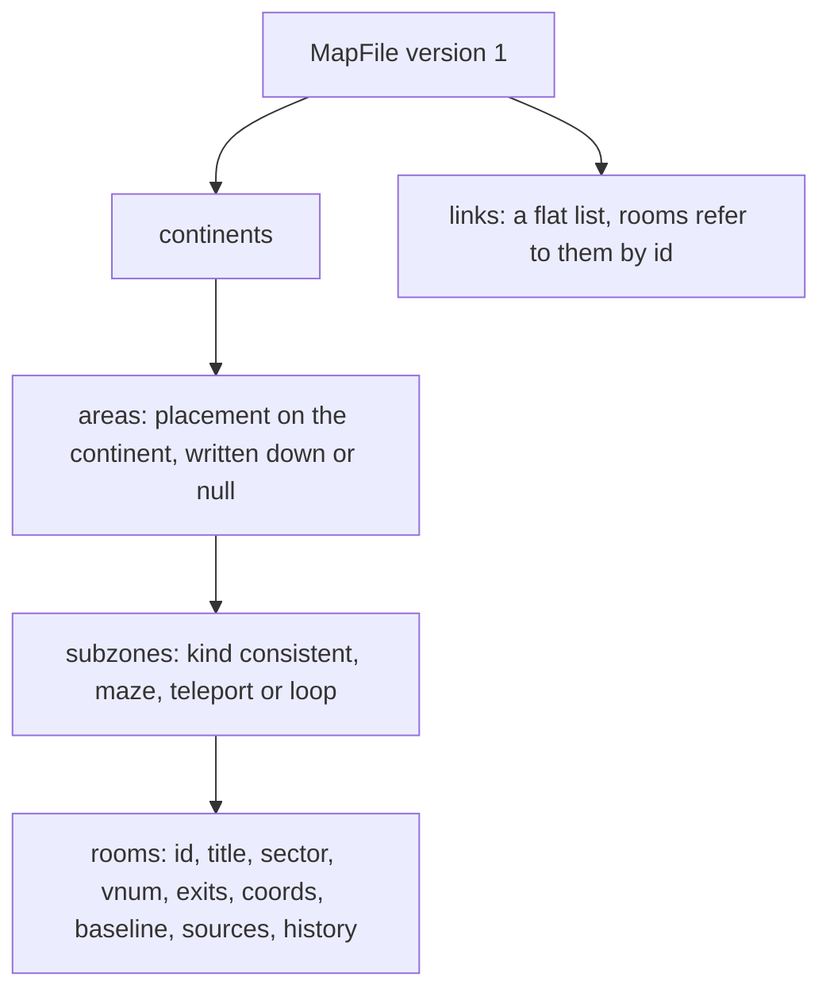
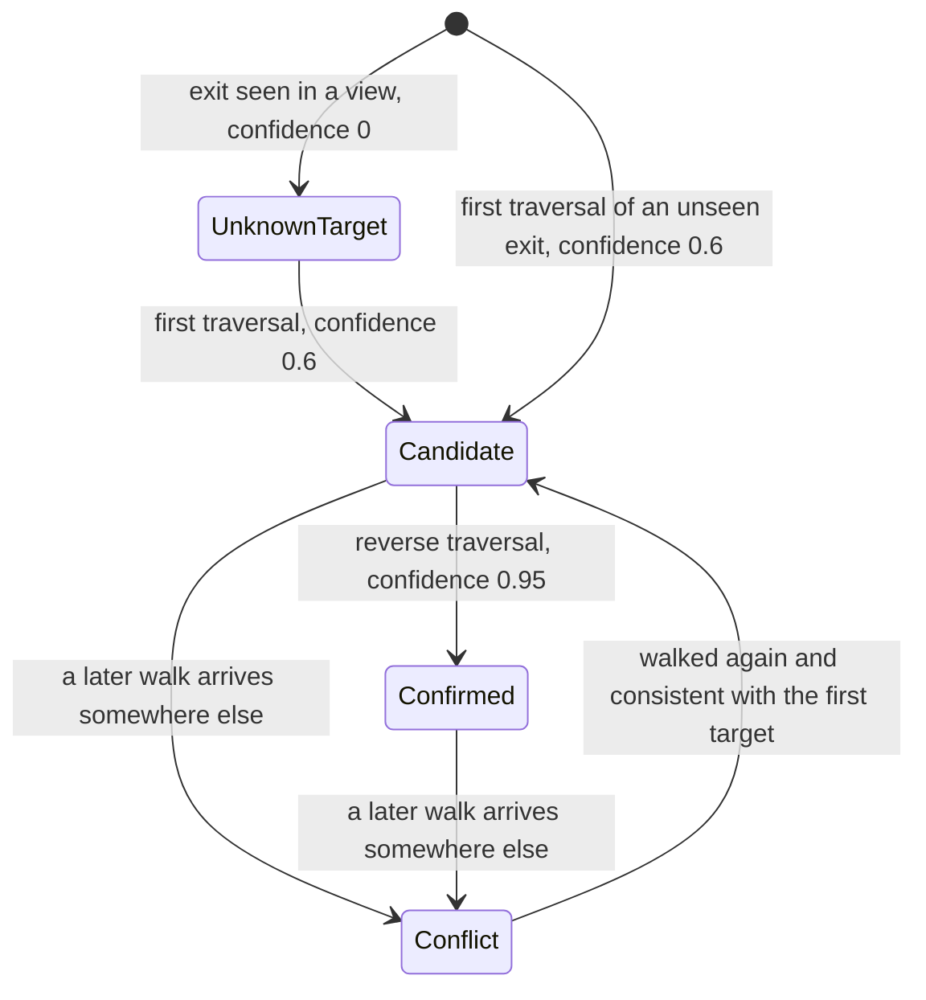
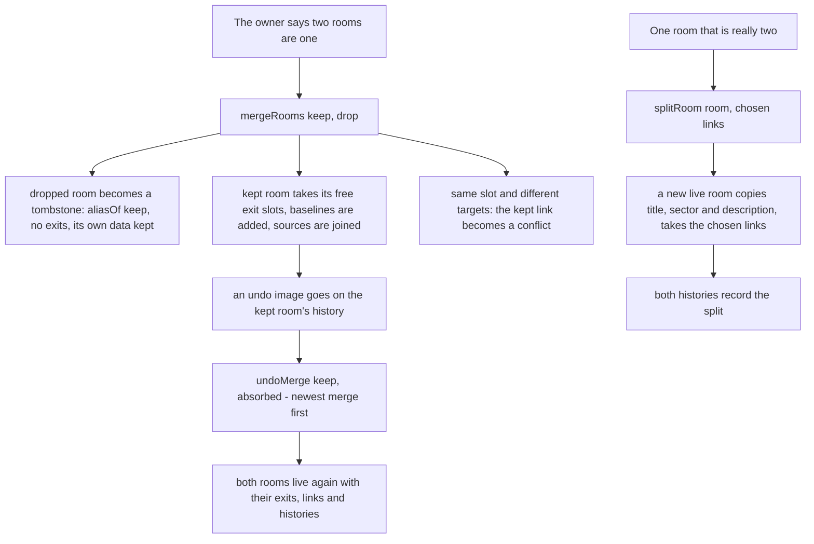
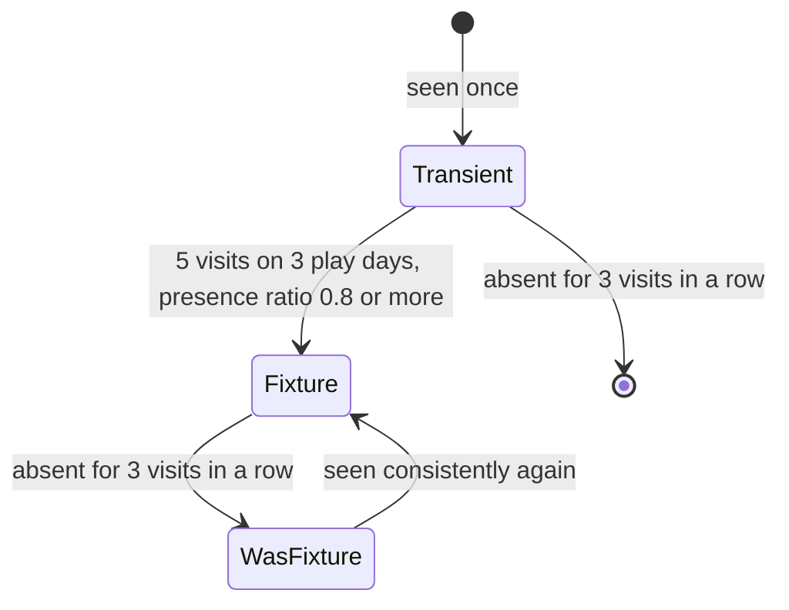

# Shattered-Maps: the neutral map file

The map model every Shattered-Maps surface shares: the walked-evidence layer that Copilot builds, the community import, the Builder
export and the viewer all read and write one JSON shape. The code is `services/shattered-maps-core` (package
`@shatteredarchive/shattered-maps-core`). It is pure: no clock, no file system, no network, no DOM (`tsconfig` sets `types: []`), so
the Node server and the browser import it unchanged. Ids come from a caller-supplied random source and dates are plain strings.

Unlike Copilot, this package is **not** local-only: it is the part of the map work that production surfaces will use, so it carries
no Copilot marker and `check:local-only` does not look at it. What is local-only is the data that Copilot walks into it.

| File | Holds |
|---|---|
| `src/schema.ts` | `MapFile` v1 types, the limits, the id and date patterns, `emptyMap`, `cloneJson` |
| `src/identity.ts` | id minting, matching a view to a room, link evidence, merge, undo-merge, split |
| `src/baseline.ts` | what a room usually holds: the fixture rule, `updateBaseline`, `mergeBaselines` |
| `src/hierarchy.ts` | an index over a map, alias resolution, slices (`sliceMap`), `updateRoom` (one room replaced, the rest shared) |
| `src/export.ts` | the neutral grid/hex JSON of a slice |
| `src/render.ts` | `renderSvg(slice, view)`: one floor as an SVG string, every text escaped |
| `src/validate.ts` | the strict reader (`validateMapFile`, `parseMapFile`) |
| `src/import/` | the community-map import (`azah.ts`), its zone rules (`zones.ts`) and the newest-wins rule (`merge.ts`): [import-azah.md](import-azah.md) |

## Levels

- **Placement is explicit.** An area's `placement` (`x`, `y`, optional `w`, `h` on its continent's grid) is written by whoever lays
  the continent out. It is never computed from a room count; `null` means nobody has placed the area, and the viewer says so
  ("Not placed yet: ...") instead of guessing.
- **Room coordinates** (`coords: {x, y, z?}`, whole numbers) are on the room's subzone grid; `y` grows southward, `z` upward. A room
  without coordinates is listed as `unplaced` in a slice. Nothing invents a position, except the room-level slice, which lays a
  focus room's neighbours out by the direction of the exit that reaches them and says so (`derivedCoords`).
- **Subzone kinds.** `consistent`: rooms keep their places. `maze`: exits shuffle between visits. `teleport`: exits land elsewhere.
  `loop`: exits circle back. The kind tells a viewer not to trust a grid; the evidence rules below are the same for all four.
- **Gaps** are first-class. An exit the walker saw but never followed is a link with `to: null` and state `unknown-target`; it is
  drawn as a stub with a `?`. A room with no description simply has no `description`.
- **Off-page links.** A link's `offPage` is true when its target lies outside the area the exit starts in. A slice recomputes it
  against the slice itself (a link is off the page when its target room is not in the slice), so the same link can be on the page in
  an area view and off the page in a room view. It is drawn as a stub ending in an arrow.
- **The vnum rule.** `vnum` is the game's room number. It is optional, a whole number from 0 to 2147483647, and unique among *live*
  rooms of one file. It is never an identity: two imports can disagree about a vnum, and a room can exist before anyone knows it.
  A merged-away room keeps its vnum (so the merge can be undone) and is exempt from the uniqueness check.
- **Aliases.** A merged-away room has `aliasOf` (the room that absorbed it) and no exits. `resolveAlias` follows a chain of merges
  to the live room and gives up (null) on a loop or a chain longer than 16.

## Identity

A room's identity is its `id`: `mintId('r', taken, random)` makes `r` plus ten characters from a 32-letter alphabet. **The id is never
built from the title** (it has no title input) because titles repeat across the world, and never from the vnum.

`matchRoom(index, observation)` decides whether a view of a room is a room we already know:

1. If the walker arrived by an exit whose link has a target (not in conflict) and that room's title matches, it is that room
   (`reason: 'link'`; an alias is followed to the live room).
2. Otherwise the area must be known; with none, nothing is matched by title (`new`).
3. Candidates are the live rooms of the **same area** with the same title (case and spacing ignored) whose known exit set and the
   observed exit set are nested, one inside the other. Nested, not equal, so **a hidden exit appearing does not make a second room**.
4. One candidate: that room (`reason: 'title'`). None: `new`. Several: `ambiguous`, with the sorted ids, and the caller keeps them apart.

So one title in two areas stays two rooms. The rule prefers two rooms that should be one (the owner merges them) over one room that
should be two (it shows up as a link conflict and is separated).

## Link evidence (diagram D12)

- `applyTraversal(links, {from, dir, to, at}, newId)` is the whole rule. A first walk is a `candidate` at **0.6**. When the reverse
  exit (from `to`, the opposite direction, ending at `from`) already exists and is not in conflict, both links become `confirmed`
  at **0.95** with `reverse: true`, whichever direction was walked first.
- A walk of a described exit that arrives at a different room makes the link a `conflict` (confidence 0). The link keeps its first
  target in `to` and lists the others in `conflictTo` (at most 8). Walking it again to the first target makes it a `candidate`
  again.
- **Not seeing an exit again is not evidence.** Doors and hidden exits come and go (that is what the hidden-exit rule above is
  for), so only a walk can contradict a link. A one-way exit (the reverse leads somewhere else) is not a contradiction either.
- `recordExit` and `recordTraversal` apply this to a whole map and keep each room's exit slots in step with the link list.

## Merge and split, with the history kept

- A merge never loses a link silently: a link dropped because the kept room already had that exit slot is stored whole in the undo
  image, and so is the kept link it changed.
- `undoMerge` restores the structure. The kept room's baseline returns to what it was at merge time, so visits recorded after
  the merge are not re-applied. It refuses (returns `null`) when the merge was already undone, there is none, or a newer merge into
  the same room still stands: undo those first.
- `splitRoom` cannot tell which contents belong to which half, so the original keeps its baseline and the new room starts empty.
- Every operation returns a changed copy and `null` when it cannot be done; the map passed in is never modified.

## What a room usually holds: the baseline rule (diagram D13)

Every visit lists what was seen in the room. `updateBaseline(prev, visit, config)` keeps, per thing: how many visits it was seen on
(`seen`), how many visits there were since it was first seen (`observed`), the distinct play days, first and last seen, and the run
of visits without it (`missed`).

- **The defaults are the P5 numbers**: `minVisits` 5, `minDays` 3, `minRatio` 0.8, `demoteAfterMisses` 3
  (`DEFAULT_BASELINE_CONFIG`). All four are config; `normalizeBaselineConfig` turns anything unusable into the default.
- A **fixture** that is absent for `demoteAfterMisses` visits in a row leaves `contents` and its record goes to `was`
  (with `demotedOn`), so a wrong demotion is reversible and nothing is forgotten. A **transient** absent that long expires.
- A thing in `was` that is seen consistently again becomes a fixture again, leaves `was`, and its `returns` count goes up.
- Case and spacing do not tell two labels apart. Entries of kind `player` never enter a baseline; a visit with a malformed day is
  ignored whole (the baseline fails safe). A visit counts once per session: the caller passes one visit per session per room.
- Caps: 64 contents per room, 32 `was`, 32 remembered play days (the oldest are dropped). Over the cap, transients with the least
  evidence go first, fixtures last.

## The strict reader

`validateMapFile(value)` / `parseMapFile(text, maxChars = 40,000,000)` never throw. They report up to 20 problems, each with the path
of the value. Unknown fields are errors; every string and list has a cap (`LIMITS` in `schema.ts`: 16 continents, 4,000 areas,
20,000 subzones, 60,000 rooms, 240,000 links, 200-character names, 8,000-character descriptions, 16 sources, 64 history entries);
ids match `^[a-z0-9][a-z0-9._:-]{0,63}$`; numbers are whole and bounded. The references must hold: every link starts and ends at a
live room (a link marked `offPage` may end at a room on another page, that is in another file, as in the per-area candidate files of the
[import](import-azah.md)), every exit slot names a link that starts there in that direction (and the other way round), an unknown-target link has
no target and every other link has one, vnums are unique among live rooms, aliases end at a live room. A map that passes is the
same object handed back, typed.

## Output

- `sliceMap(map, level, id)` with level `continent` (areas as boxes), `area`, `subzone` or `room` (the room and the rooms its exits
  reach; neighbours in another subzone or area carry `context: true`).
- `exportNeutral(slice, 'grid' | 'hex')` is a flat JSON for other tools. Cells sort by floor, row, column, id; exits follow the
  direction order; the text is stable. In `hex`, `x`/`y` are read as axial `q`/`r` (flat-top, N straight up), and east and west
  exits, which that layout cannot show, are listed in `unsupportedExits`. History, sources and undo images are not exported.
- `renderSvg(slice, {layout, tile?, z?, labels?})` draws one floor. Octagons for the grid, hexagons for the hex layout, derived from
  the DSL Mapper's `octMath.ts`, `hexMath.ts` and `svgExport.ts` (MIT, same author). Unlike the Mapper's export every text is
  escaped (`& < > " '`) in content and in attributes, and the output contains no script, style, link or event handler.
  Link look: confirmed solid, candidate dashed, conflict red with short dashes, unknown target a stub ending `?`, off-page a stub
  ending in an arrow, up/down a mark on the tile. A floor with more than 5,000 rooms is not drawn (a message instead).

## Tests

All beside the code: `identity.test.ts` (repeated title in two areas, hidden exit, merge then undo, split, conflicts),
`baseline.test.ts` (the fixture rule and its edges), `schema.test.ts` (round trip, version, size), `validate.test.ts` (each
rejection), `hierarchy.test.ts`, `export.test.ts` (stable output), `render.test.ts` (a six-room slice, escaping, empty slice,
caps). Shared builders are in `src/testing/fixtures.ts` (excluded from the build). Run them with
`pnpm --filter @shatteredarchive/shattered-maps-core test`.

## Not here yet

No UI. Copilot's world memory ([docs/copilot/world-memory.md](../copilot/world-memory.md)) feeds this model from the live game, as a local candidate layer; the community import (Phase 21) fills
the candidate layer; the viewer (Phase 24 onward) reads it.
