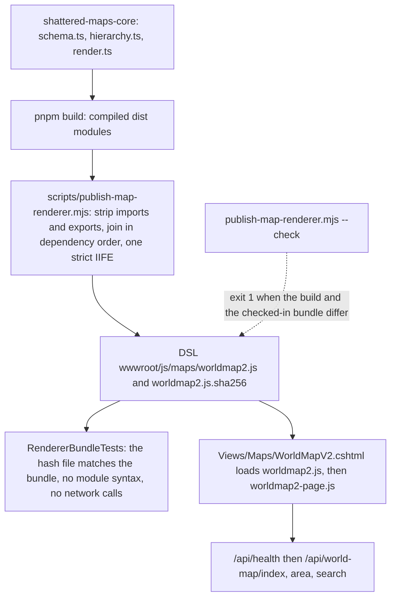
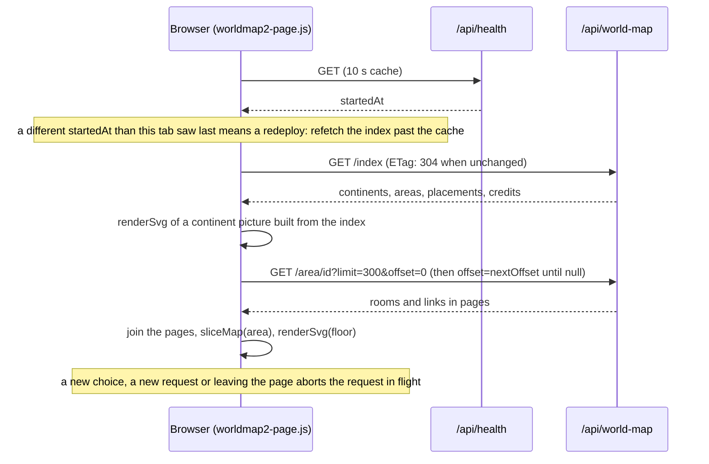
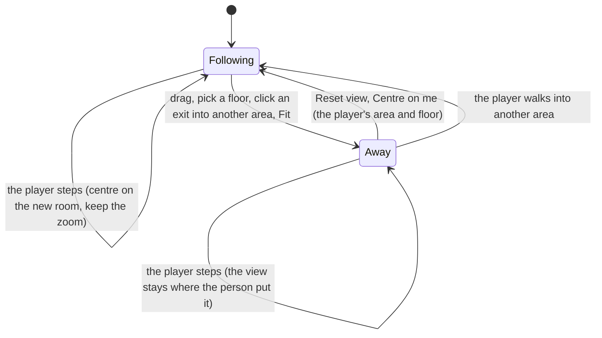
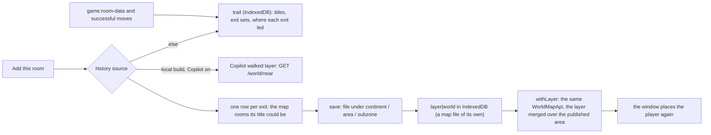
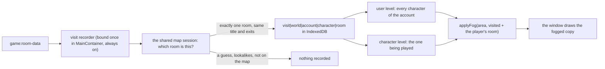

# Map surfaces: where the one renderer runs

One picture-drawing code, three places that show the world map. This page is the developer view: which surface exists, how the renderer reaches it,
and how a change in the shared code gets to the C# site. The data they all read is described in [world-map-api.md](world-map-api.md); the model is
in [schema.md](schema.md); what a person sees is in [user-guide.md](user-guide.md).

| Surface | Host | Status | Reads |
|---------|------|--------|-------|
| Mapper (curation) | `apps/shattered-maps-client`, a Vite app (Docker, `maps.shatteredarchive.dev`) | done (Phase 22-24) | the audited file, candidate files |
| World map page | the C# site, `GET /maps/world-v2`, linked under Tools; it replaced the beta map (Phase 30, 2026-11-14) | done (Phases 27, 30) | `/api/world-map/*` |
| Web game-client map window | `apps/game-client`, a floating window opened from Game > Map… | done (Phase 28, reworked as a window) | `/api/world-map/*` |
| Mobile screen | `shatteredarchive-mobile`: More > World map, a list (each continent with a Map button) plus a WebView page that inlines the generated renderer; same marks and interaction as the website page, by touch (A56) | done (Phase 29, A56) | `/api/world-map/*`, `/js/maps/worldmap2.js` |

The renderer (`renderSvg`) and the slicer (`sliceMap`) live in `services/shattered-maps-core` and are pure. The Vite apps import them as a package. The C# site
cannot, so the core is published to it as one generated browser script.

## Publishing the renderer to the C# site



- **No bundler, no new dependency.** The three compiled files the renderer needs (`schema.js`, `hierarchy.js`, `render.js`) are joined in that order; the script
  refuses any other import, a name declared twice, and a missing public name. The output exposes only `window.ShatteredMapsCore = { renderSvg, sliceMap, escapeXml, MAX_RENDER_ROOMS, DIRECTIONS }` (frozen).
- **Repeatable bytes.** CRLF is normalized, so the same build gives the same file on every machine; the hash file is the sha256 of the text. The C# test compares the two after
  normalizing line endings (git may check the file out with CRLF).
- **After a change in shattered-maps-core**: `pnpm --filter @shatteredarchive/shattered-maps-core build`, then `node scripts/publish-map-renderer.mjs` (writes into the DSL repo) and
  commit both repos. `--check` tells you whether they are out of step.

## The C# page (`/maps/world-v2`)

It is the one world map of the site: the beta grid (a 7 MB server-rendered view behind `/directions?is_beta=true`, its view model and script) was deleted on 2026-11-14 and `/maps/world-map` answers a **301** to this page. The page is in the sitemap and linked as **World Map** under **Tools** in `_nav.cshtml`; the user-map routes of `MapsController` are untouched. Files in the DSL repo:

| File | Role |
|------|------|
| `Server.Web.Public/Controllers/MapsController.cs` (actions `WorldMapV2`, and `WorldMap` which redirects) | the routes |
| `Views/Maps/WorldMapV2.cshtml` | the markup: controls, status line, credit line, map card, room panel, legend |
| `wwwroot/js/maps/worldmap2-page.js` | the page logic (hand-written): loading, paging, drawing, drag / wheel / key pan and zoom, the Up / Down floor buttons, the selected room (ringed, and its tangled exits traced), links in the picture (stairs, chips, exits that leave the area), room details, aborting |
| `wwwroot/js/maps/worldmap2.js` (+ `.sha256`) | the generated renderer: never edit by hand |
| `wwwroot/css/worldmap2.css` | dark page, deliberately **light** map card (the renderer draws light tiles and dark labels) |



- **Aborting**: one `AbortController` at a time; every `go()` starts a new one and aborts the last, and `pagehide` aborts too, so a slow answer for an earlier choice cannot draw over a
  newer one (checked in a real browser with a delayed route).
- **Safe text**: names and descriptions from the data are written with `textContent`; the only `innerHTML` is the renderer's SVG, which escapes everything it writes. A test counts it.
- **Deep link**: `#c=<continent id>&a=<area id>`; an unknown id falls back to the first continent.
- **States**: nothing published, a failing index, and a damaged area each give a sentence in the status line, and the controls stay hidden until there is a map.
- **Credit**: the line under the title is built from the manifest's `credits` ("Map data by Azah ..."), so the credit travels with the data.

## The web game-client map window

A **production** feature with no flag: a floating window (no backdrop, movable, resizable, geometry remembered like the Copilot window) that shows the published
map of the area the player is in, with their room outlined. It reads only the audited layer from the C# site; Copilot is not involved and `features/worldmap`
must not import from `features/copilot`. It opens beside the terminal (just left of the right sidebar, near the top), from **Game > Map…**, and is mounted only
while open, so nothing is asked of the map API until the player opens it.

| File (apps/game-client/src) | Role |
|------|------|
| `features/worldmap/api.ts` | the client of `/api/world-map/*` and `/api/health`: abortable, typed failures, whole areas and room-to-area answers kept in memory |
| `features/worldmap/session.ts` | places the player: a room of the map with the same title and the same exit set |
| `features/worldmap/useWorldMap.ts` | follows `game:room-data`, one request chain at a time; exposes the shared client |
| `features/worldmap/viewport.ts` | the pan/zoom geometry (pure): zoom around a point, fit a rectangle, centre, where to put the view after a redraw |
| `features/worldmap/settings.ts` | what the window remembers: other floors shown, labels, fog (an old saved tile choice is ignored: every room is an octagon) |
| `components/WorldMapWindow.tsx`, `styles/WorldMapWindow.module.scss` | the window; opened from `MainMenuBar.tsx`, mounted lazily by `MainContainer.tsx` |

```mermaid
sequenceDiagram
  participant G as game:room-data (title, exits)
  participant H as useWorldMap
  participant S as session
  participant A as api (memory)
  participant C as C# site
  G->>H: a room
  H->>S: observe(title, exits) with a new AbortSignal (the older one is aborted)
  S->>S: match in the area the player was last in
  alt matched
    S-->>H: located, no request
  else no match there
    S->>A: checkFresh (health at most every 5 minutes)
    A->>C: GET /api/health (startedAt: a restart drops the memory)
    S->>C: GET /api/world-map/index (is a map published?)
    S->>C: GET /api/world-map/search?q=title
    S->>C: GET /api/world-map/area/id (300-room pages, once per area)
    S-->>H: located, unmapped, ambiguous or unavailable
  end
  H-->>H: the window follows: centre on the room and floor; the last picture stays up while the next room is looked up
```

### Following, panning and zooming



- The picture lives in a CSS-transformed stage (`translate` and `scale`), so panning and zooming never redraw the SVG. The pose is plain numbers; the geometry is in
  `viewport.ts` and unit-tested without a DOM. The wheel zooms around the pointer (a non-passive listener: React's `onWheel` is passive and cannot stop the page scrolling), the buttons
  and `+`/`-` zoom about the middle, **Fit** shows the rooms of the drawn floor (the renderer's `data-bounds`), arrows pan, PageUp/PageDown change floor, Home resets.
- **A press only becomes a drag past 4 pixels, and the pointer is captured only then.** Capturing on the press retargets the click that ends it to the viewport, so a click on a room,
  an exit or a ghost floor would never find its element (found in the real browser; jsdom has no pointer capture). The drag delta is taken before the state updater runs
  (the updater runs later, after the last position has moved on).

### Floors (verticality)

The renderer draws one floor, but with `align: 'slice'` the picture is framed around every placed room of the area, so a room is at the **same place on every floor** and
the picture does not jump when the floor changes. With `ghosts: n` it also draws the floors up to *n* above and below, **behind** the chosen one:

- each ghost floor is a group (`data-layer="ghost"`, `data-floor`, `data-distance`) shifted a few pixels per floor of distance (up and right for floors above, down and left for
  floors below) so a floor stacked exactly over another can still be seen;
- its opacity falls with the distance: 0.5, 0.3, 0.18, 0.108 ... never below 0.06 (`ghostOpacity`);
- ghost rooms are `data-ghost-room` / `data-ghost-floor` (never `data-room`) and have no labels; clicking one goes to that floor;
- more than 6,000 ghost rooms in all and the ghosts are left out (`data-ghosts="skipped"`).

The window shows a slim **floor strip** at the left edge (top floor first, `G` for the ground, the current floor highlighted) and the gear sets **Other floors**: *This floor only*,
*Nearby floors (2 up and down)* (the default) or *All floors* (up to 8 away).

### Neighbouring areas

An exit that leaves the area (its target room is outside the area's slice) is drawn as an arrow with a larger click target (`data-offpage-to="<room id>"`). Clicking it asks
`GET /api/world-map/room/{id}` for the area that room is in, loads that area (cached) and shows it **at that room and on its floor**, with the header chip
"Looking at *Area* · Reset view". **Reset view** returns to the player's area, floor and room. If the player walks into another area while looking at one, the window follows again.
An exit whose room is not on the map says so in the status line and changes nothing; an exit into the area already shown (a plain link) is not an arrow.

### Cloud backup (Phase 44)

The gear's last section, **Cloud backup**, keeps the ids of the rooms the player explored and added on their account (`components/MapBackupSection.tsx`, `features/worldmap/sync/backup.ts`):
**Sync now** sends this browser's lists for the world being shown and takes the site's union back into the visit record; **Erase my backup…** removes the account's copy. Nothing is sent
until the button is pressed. The routes, the document and the caps are in [map-backup.md](map-backup.md).

### Your own rooms (Phase 40)

A room the published map does not have (the status line says "… is not on the map yet") can be added by the player. The status bar then offers **Add this room…**, and the gear has
**Add a room by hand…**. The panel lies over the picture inside the window (no extra dialog); `components/AddRoomPanel.tsx` is the form, `features/worldmap/mine/` the logic.



- **Where it is kept.** One map file per world in IndexedDB (database `shatteredarchive-worldmap-mine`, store `kv`, key `layer|<world>`), read once and held in memory. The published map is
  never changed; `mergeLayer` (core, `src/mine/layer.ts`) lays the player's rooms over the area being shown, joining a continent, area or subzone by id and adding the ones that are new, and
  `layoutUnplaced` gives each room a place next to the rooms its exits lead to. A stored file that fails the strict reader is treated as empty.
- **Worlds never mix.** Every call names its world (the layer, the trail and the history query); the panel shows the world as text, it is not a choice. A production bundle has one world.
- **From game history.** The panel asks `findHistory` for the room: the first source that knows it answers. A local build registers the Copilot server's walked layer
  (`features/copilot/mapHistory.ts`, only while the Copilot switch is on; `GET /world/near?title=&exits=&world=`), the page always has this browser's own trail
  (`mine/trail.ts`, recorded by `mine/trailRecorder.ts` from `game:room-data` and `movement-succeeded`: titles, exits and the title each exit led to, nothing else). History fills the title, the
  sector and, for each exit, the rooms of the map (published or the player's own) whose title is the one history says it led to; one match is preselected, several are a choice.
- **Filing.** Continent, area and subzone are each an existing one or "New…" with a name (new ids are made from the name). The area the player was last found in is the default.
- **Sync.** A lean list of ids to the C# service for backup/sync is a later phase (Phase 44); nothing leaves the browser yet.

### Fog of war (Phase 37)

A game setting, **off by default**, in the gear's popover ("Fog of war": off, the rooms my account has visited, the rooms this character has visited). While it is on, a small eye sits in the
header (it opens the same popover) so the window never looks mysteriously empty.



- **Recording** happens whether or not the window is open and whether or not fog is on (so turning it on shows what was already explored), and only when the position is certain. A record is a key
  and nothing else (`fog/visits.ts`): no titles, no times. It is written the first time a room is entered and read once per (world, account). Worlds never mix.
- **Who.** The account is the account id the sign-in token carries when it carries one (`fog/identity.ts`); the site's device tokens are opaque, so today the account level is everything this browser has
  seen (a real account id from the site is needed for the id-list sync, Phase 44). The character is the name the game last gave (`window.__SA_IDENTITY__`); a visit made before it is named counts for the
  account level only.
- **Drawing.** `applyFog` (core `src/fog.ts`) keeps only the visible rooms (the visited ones plus the room the player is in), turns an exit towards an unseen room into the renderer's `?` stub (it names
  nothing and cannot be clicked), and keeps an exit into another area only when its room has been visited. The floors strip and the ghost floors follow the fogged map. Off changes nothing.
- The window has no room search or "go to", so there is nothing else to hide.

### Settings and chrome

- The gear opens a small popover (other floors, room names); the choices are kept in `localStorage` (`shatteredarchive:worldmap:settings:v1`). Everything else on
  the picture is a few small translucent overlays: the floor strip, the zoom buttons (+, -, fit, centre on me, and the red-dot button that shows or hides the "you are here" dot) and the Reset view chip. The status line at the bottom says where the
  player is, shows a clicked room's name and exits, and carries the credit line.
- The map card is light on purpose (the renderer draws light tiles with dark labels); the window chrome follows the HUD theme tokens (`--sa-panel-bg`, `--sa-panel-border`,
  `--sa-accent`), so a live theme switch needs no code.
- The picture is the renderer's SVG in `dangerouslySetInnerHTML`, on purpose (`renderSvg` escapes everything it writes), and the `{__html}` object is memoized: React 19 assigns
  `innerHTML` again for every new object, which would redraw the picture and reset the view on every step. Names and credits are React text.
- Window position and size: `localStorage` `shatteredarchive:worldmap:window:v1`, by `hooks/useFloatingPanel`.
- **Tests** that render anything reaching `features/auth/siteApi.ts` must mock it (`import.meta.env` is not supported by the jest transform).
- **Browser check**: `playwright/world-map-window.mjs` (27 checks, both themes) with the page's API calls answered from a scratch site (`maps-v2-scratch-run.mjs`).

## Checking it

`node .ai-plans/.../playwright/maps-v2-scratch-run.mjs <slices folder> maps-v2.mjs <screenshots folder>` builds the production shape into a temp folder, runs it on a scratch port with
`WORLD_MAP_DIR` on a folder of published slices, drives the page in a real browser (28 checks) and stops the process. Slices for a trial come from
`publish-audited.mjs --out <temp folder>` (see [world-map-api.md](world-map-api.md)); never put them in the DSL repo's `wwwroot`.

## Gotchas

- A generated bundle checked in beside a hash is only as fresh as the last run of the script: run `--check` before committing a change in the core.
- `HEAD /maps/world-v2` answers 405, like every MVC page of the site; use GET.
- The site layout itself overflows a few pixels horizontally on narrow screens (Bootstrap rows); the map card adds none (the browser check compares against another page).

## Worlds

Every surface above shows the DSL's map and, in production, only that. A second world, the Simulacrum's, exists only on the owner's own machine: in
a local development build the web game client's map window shows it while the client is connected to the Simulacrum (the title then reads
`Map · Simulacrum`), served by a controller that only the `CopilotLocal` C# build contains. There is no world picker and no world parameter in any
production surface. The rule, the code and the checks are in [worlds.md](worlds.md).
