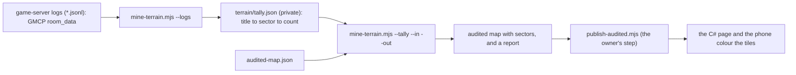

# Terrain on the map (the room's sector)

A room can carry a **terrain** (the `sector` of the map schema: `inside`, `city`, `forest` …). The renderer colours the tile by it; the map's key lists the terrains on the drawn floor.
The published DSL map came from a source that recorded no terrain at all, so it is **mined from the game's own room messages**.



## What the game sends

Before every prompt the DSL sends a GMCP `room_data` message: `room_data {"room": "<title>", "sector": "<word>", "exits": ["N", "S"]}`. In the 2026 logs (377 files, 543,474 messages) the
words are: `inside`, `forest`, `field`, `city`, `air`, `desert`, `underwater`, `underground`, `mountain`, `tundra`, `hills`, `ice`, `ocean`, `swim`, `noswim`, and once `unknown`
(no colour). The Simulacrum's Merc sectors (`water`, `deepwater`) fold into `swim` and `noswim`.

## The pieces (all in `services/shattered-maps-core`)

| File | What it does |
|---|---|
| `src/terrainPalette.ts` | the palette (`TERRAIN`: word, key label, colour; the owner's original DslMapper colours), `canonicalSector`, `terrainFill`. This is the only terrain code the browser bundle carries. |
| `src/terrain.ts` | pure mining: `parseRoomData` (a log record or a bare line), `tallyRoomData`, `mergeTallies`, `decideTerrain`, `applyTerrain`. |
| `scripts/mine-terrain.mjs` | the command: streams the logs (gigabytes, one file at a time), writes the tally, and/or gives a map its terrain and prints the report. |

```text
node services/shattered-maps-core/scripts/mine-terrain.mjs --logs <game-server log folder> --tally <tally.json>
node services/shattered-maps-core/scripts/mine-terrain.mjs --tally <tally.json> --in <audited-map.json> --out <audited-map.json> [--min-share 0.9] [--min-count 1]
```

Nothing is guessed. A title that one sector clearly dominates (90% of its messages by default) gives that sector to every room of the map with that title; a title several sectors share
(`darkness`, `A Darkened Hallway`, `On a road`) is listed and left grey; a room that already has a sector keeps it. The input map is never changed, and the output may not be under a `wwwroot` folder.

## What it did on the first run (2026-11-14)

24,358 rooms: terrain given to 8,055 (33.1%), 646 rooms with a title several sectors share, 15,657 with a title the logs never showed (rooms nobody with logged play has stood in). More walking
fills more of it: run the same two commands again with the new logs. A room's title is not unique in the game, so a few rooms can take the terrain of a same-named room elsewhere; the
ambiguous titles (52 in the first run) are in the report, and a wrong colour is fixed by correcting the room in the Mapper (a room's own sector wins).

## Where it is shown

The key above the legend lists the terrains drawn on the floor (plus **Not known yet** for grey tiles); the Mapper's legend has a line for it; tiles carry `data-sector` and the picture's root `data-sectors`.
Tangled and maze rooms keep their own tile colours (amber, purple), so their terrain is not shown.

## Tests

`src/terrainPalette`/`terrain.test.ts` (parsing, the tally, the decision, applying), `scripts/mine-terrain.test.mjs` (arguments, folder listing, a real run over a temporary log folder), `render.test.ts`
(the colours and `data-sectors`). Coverage of `terrain.ts`, `terrainPalette.ts` and `render.ts` is 100%.
