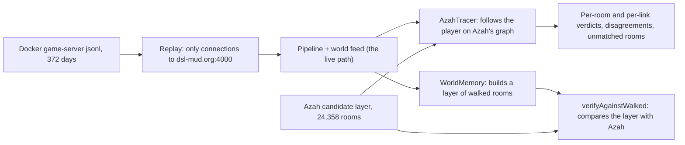

# Verifying the community map against play (Developer Notes)

Azah's community map is imported as **candidates** (`import-azah.md`). This page describes how those candidates are checked against the
owner's own game logs, what the check found, and the lessons that follow for Copilot's first use. The code is in
`services/shattered-maps-core/src/verify/` (pure) and `apps/copilot-server/src/world/` (the log replay).

Azah mapped the **DSL** and nothing else. Every command here takes `--world dsl` and refuses any other world: a walk of the Simulacrum
(or of any other game) is never compared with Azah's data and never enters the DSL layer (see `worlds.md`, Phase 29a).

## Two ways to check, one is better



- **The tracer** (`replay:trace`, the one the build uses) keeps the set of Azah rooms the player could be in. A view narrows it by title,
  description and exits; a move must lead to a room that fits the next view. A step through a link whose origin is known exactly is
  evidence for that link (agree or disagree). Rooms that print the same text (a desert, a maze) are localized by the steps around them.
- **The layer comparison** (`verify-azah.mjs`, `verifyAgainstWalked`) ties each walked room of the world memory to Azah rooms. It is weaker:
  the world memory mints a new room whenever a view fits several known rooms, so a layer of about 10,000 walked rooms tied uniquely to only
  about 1,100 Azah rooms in the first look. Use the tracer to judge Azah, and the layer for what Copilot itself remembers.

Rooms are **never identified by title alone**: 3,273 of the first 4,350 walked rooms shared their title with several Azah rooms. The text
match is title and description (exact, then the first 100 characters, then title only when the view has no description), narrowed by the
exit set (same exits, else Azah has more).

## Commands

```text
pnpm --filter @shatteredarchive/shattered-maps-core build
pnpm --filter @shatteredarchive/copilot-server run replay:trace --world dsl --logs <game-server log folder> --azah <candidates folder> --out <report file>
pnpm --filter @shatteredarchive/copilot-server run replay:world --logs <log folder> --out <walked layer file>
node services/shattered-maps-core/scripts/verify-azah.mjs --world dsl --azah <candidates> --walked <walked layer> --out <report folder>
```

`replay:trace` reads only; the report file holds every verdict and stays in the private folder next to the candidates (never in the repo).
`replay:world` writes the walked layer; it can be stopped and run again (a progress file beside the layer says which days are done).
A replay takes only connections to `dsl-mud.org:4000` (`--target` changes it); a connection to anything else adds nothing.

## What the logs hold (counted 2026-11-11)

| Connections in the 2026 logs | Sessions |
|---|---|
| `dsl-mud.org:4000` (the production game) | 647 |
| `dsl-mud.org:8000` (another DSL port) | 11 |
| `simulacrum-server.shatteredarchive.dev:65001` | 6 |
| `host.docker.internal:4000` | 3 |
| `simulacrum.shatteredarchive.dev:4000` | 2 |
| `localhost:4000` | 2 |

Only the first row builds the DSL world. 531,158 GMCP `room_data` records collapse to 47,240 room views once repeats of the same room are
folded (the game sends the room again with every prompt).

## What the check found

Tracer over all 372 days, against all 24,358 Azah rooms and 77,288 links:

| | Count |
|---|---|
| Room views | 47,240 |
| Dark views (position lost) | 573 |
| Views no Azah room fits | 8,800 (19%) |
| Views placed on exactly one Azah room | 34,268 |
| Views that fit several Azah rooms | 3,599 |
| Steps followed (one move command between two views) | 12,337 |
| Steps that agree with Azah | 11,881 (96.3%) |
| Steps that disagree (the exit leads elsewhere) | 309 |
| Steps through an exit Azah does not have | 147 |

| Azah rooms | Verified | Verified, differs | Ambiguous | Not walked |
|---|---|---|---|---|
| 24,358 | 2,783 | 383 | 992 | 20,200 |

3,166 rooms (13%) have been walked and fit. Of the verified rooms, 3,032 matched on the full description, 36 on its first 100 characters
and 98 on the title only (the view had no description). Where a verified room differs, 308 differ in exits and 102 in description.
Azah links: 3,205 agree, 49 disagree, 74,034 not walked. Coverage by continent (verified, or verified with a difference): Althainia 15%, Icewall 15%,
Arkane 17%, Tropica 15%, Limbo 12%, Shokono 7%, Oceans 3%.

Agreement does not fall with the age of the record: links dated 2015-2019 agree 98.5-99% of the time, 2022 and 2023 records 95% on about 80 steps each. The date in Azah's database is when a record was last edited, not when it was last true.

The disagreements cluster. Of 434 disagreeing or missing exits, 125 start in **The Southern Arena Stands** and 54 in the walls of the
coliseum (arena rooms whose exits are not fixed), 38 in **A Darkened Hallway** and 22 in the Library of Storm Keep (rooms that look alike
and are linked in loops), and 31 in **A Surging Flow of Viscid Muck** (a current that carries the player). Most of the rest are trails and
forests where several rooms print the same text.

The rooms Azah does not have are mostly places added since the community map: the most frequent unmatched titles are The Bloodbath Arena
(1,380 views), Chamber of Repose (1,015), Eclipse Tower (922), Eclipse Tower Gateway (549) and A Central Hallway (371).

### What Copilot's own memory built from the same logs

`replay:world` over the same 372 days (47,244 room views, the same DSL sessions) built a walked layer of **32,226 rooms and 99,012 links**
(49.5 MB, against a 60 MB cap), more rooms than Azah's whole map (24,358). 29,019 views (61%) fitted several rooms already known, and the
memory makes a new room for such a view, so look-alike rooms are minted again and again; 15,018 views matched an existing room and 16,618
steps were followed into links. That is why the walked layer is a poor judge of Azah (see the first comparison above) and why the tracer
exists. It also means the number of walked rooms is not the number of rooms the owner has seen.

## Lessons for Copilot's first use

1. **A world is chosen by the connection, never by the player.** Build the DSL layer only from connections to `dsl-mud.org:4000`; the logs
   also hold the Simulacrum, a second DSL port and a docker host, and their rooms must not reach the DSL layer.
2. **A room is never its title.** Identify by title, description and exits, and place the player by following exits; ambiguous views stay
   ambiguous and prove nothing.
3. **Where Azah has been walked it is right.** Treat a link that the owner's play has agreed as confirmed (high confidence) and an Azah link
   nobody has walked as a candidate (low confidence), not as untrusted: 98.5% of walked links agree.
4. **Most of Azah is not walked.** 87% of the rooms and 96% of the links have no evidence from the owner's play, so a movement suggestion
   along an unwalked Azah link is a candidate and carries the low confidence of one.
5. **Do not trust exits in arenas, mazes and loops.** The rooms with the most disagreements are arena rooms, looped corridors and a
   current. A suggestion through them needs a fresh look at the room, not the map's word.
6. **A view that no room fits is information, not an error.** About one view in five is a room Azah does not have; keep it (it is how the
   map grows) and do not guess its place.
7. **A dark room loses the position.** A view the player cannot see in is not a room; after it, do not follow a step until a normal view
   places the player again.
8. **A walk across midnight does not carry a link.** The world memory's session is one play day plus the codename, so the move that crosses
   midnight is not recorded as a link (the rooms on both sides still are).
9. **The world memory's room count is inflated.** A view that fits several known rooms becomes a new room, so 47,244 views made 32,226 rooms
   (more than Azah's 24,358). Do not read the memory's room count as a count of places; merge or place its rooms (`mergeRooms`) before
   trusting it for anything but the exits it recorded, and prefer a placement on the community map (the tracer's method) where one exists.
10. **Description text drifts.** About 4% of verified rooms matched only on the start of the description or on the title: compare the first
   100 normalized characters before calling a room changed.

## Not done in this check

- Rooms the owner has walked that Azah does not have are counted (by title) but not added to the map: the walk gives no coordinates, so
  a layout step would have to place them.
- The older plain-text client logs (738 files from 2023) hold no commands or GMCP and are not read.
- Azah rooms nobody has walked stay candidates; nothing here confirms them. The DSL has not been walked live for this check.
