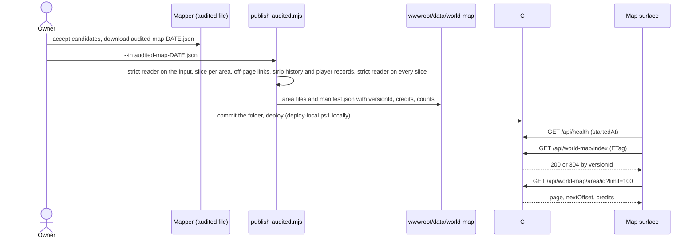
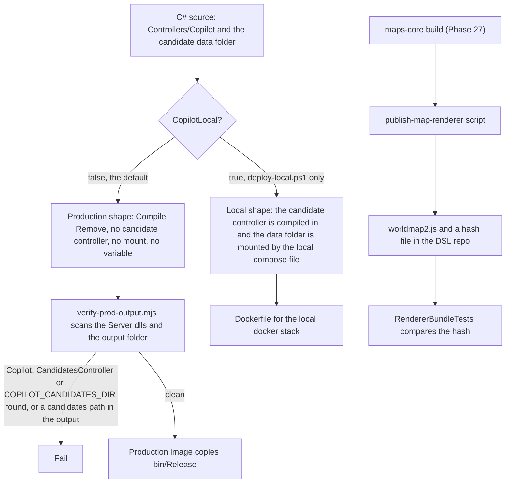
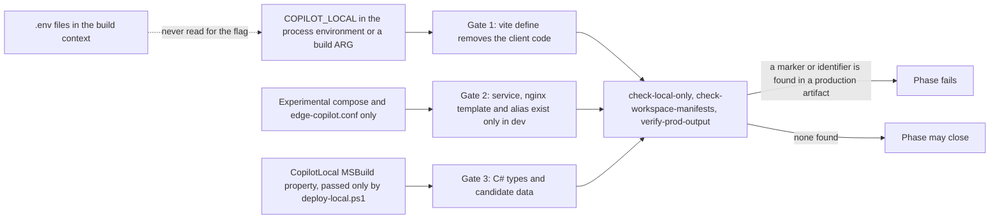

# World-map API (C# site)

The DSL site (`C:\Projects\DSL\Server`, port 5000) serves the world map as JSON. This page is the developer view: the routes, the two layers, the
build gate that keeps the local-only layer out of production, and how to build and check each shape. The map model is in
[schema.md](schema.md); the community-map import that produces the candidate layer is in [import-azah.md](import-azah.md).

Status: **Phase 25** (the gate, `GET /api/health`, the candidate routes) and **Phase 26** (the audited-layer routes, and the publisher that makes
their slices). No client renders the map yet (Phases 27 to 29).

## Routes

| Route | Shape | Where it exists | Cache |
|-------|-------|-----------------|-------|
| `GET /api/health` | `{ "ok": true, "startedAt": "2026-11-08T05:00:00Z", "version": "1.0.0.0" }` | both shapes | `public, max-age=10` |
| `GET /api/world-map/index` | the published manifest (available, versionId, publishedAt, credits, counts, continents, areas); an empty index (available false, versionId "none") when nothing is published | both shapes | `public, max-age=300` + ETag |
| `GET /api/world-map/area/{id}?limit=&offset=` | `{ versionId, area: { id, name, continentId, placement, subzones: [{ id, name, kind, rooms }] }, links, offset, shown, total, nextOffset, baseline: { roomsWithBaseline, fixtures }, credits }`: limit 1 to 300 (default 100), rooms in subzone order, only the links that start in the page's rooms | both shapes | same |
| `GET /api/world-map/neighbours/{id}` | `{ versionId, areaId, neighbours: [{ areaId, name, exits }] }`: the areas this area's off-page exits reach, most exits first | both shapes | same |
| `GET /api/world-map/room/{id}` | `{ versionId, roomId, areaId, areaName }`: which area a room is in (how a viewer follows an exit that leaves its area); the id is the map's own (letters, digits and `. _ : -`, at most 64); 404 when no room has it | both shapes | same |
| `GET /api/world-map/search?q=&limit=&offset=` | `{ versionId, q, offset, shown, total, nextOffset, results: [{ roomId, title, areaId, areaName, subzoneId }] }`: titles containing q (2 to 100 characters, any case), by title then id; limit 1 to 100 (default 25) | both shapes | same, `VaryByQuery` |
| `GET /api/world-map/candidates/index` | the candidate layer's `manifest.json` (credit, counts, continents) | local shape only | `no-cache` + `ETag` |
| `GET /api/world-map/candidates/area/{id}` | one area file, gzip as stored (`Content-Encoding: gzip`) | local shape only | `no-cache` + `ETag` |

- `startedAt` is the **process start** (UTC, to the second), so it is identical on every call and changes exactly when the site restarts or is
  redeployed. A client that cached a map answer compares it to decide whether to refetch (E11). `version` is the assembly's informational version
  without any `+commit` suffix. Nothing else is in the answer: no paths, no configuration, no user data.
- `{id}` must be a plain slug: lower-case letters and digits in groups joined by single hyphens, at most 64 characters (`az-a100`,
  `az-unzoned-0`). Anything else is `400 { "error" }` and never reaches the file system. An unknown area is `404`, a file over 8 MiB is `500`.
- `If-None-Match` with the current `ETag` answers `304`. The `ETag` is the file's length and last-write time, so a re-import changes it.
- Errors are `{ "error": "..." }`, as in the agent API.
- **The audited routes** (Phase 26) carry an ETag of `"<versionId>:<route key>"`, where the version id is written by the publisher: a new publish
  changes every validator at once, and `If-None-Match` answers 304. `/area` and `/search` call `VaryByQuery()` (the site's response cache keys on
  the path only). `max-age=300` is longer than health's 10 s on purpose: the client asks `/api/health` for `startedAt` to learn that the site was
  redeployed, and only then refetches.
- A missing layer is an empty index, not an error. A **damaged** slice or manifest is `500 { "error" }`, never a partial map; a folder whose
  manifest does not say `"status": "audited"` is refused, so the candidate layer cannot be served through the public routes by pointing
  `WORLD_MAP_DIR` at it. An area missing from the manifest is 404 even if a file of that name exists.
- Each answer reads the manifest file (tens of KB) and re-parses it only when its validator (length and time) changed. `/area` reads its slice per
  request; the room index behind `/neighbours` and `/search` reads every slice once per published version and is cached.

## The two layers

| Layer | What it holds | Where the files are | Public? |
|-------|---------------|---------------------|---------|
| Audited | rooms and links the owner confirmed in the Mapper (Phase 23), published as slices by `publish-audited.mjs` | `wwwroot/data/world-map/` in the DSL repo (or the folder named by `WORLD_MAP_DIR`) | yes, in production |
| Candidates | the community map (Azah) imported as dated, credited, low-confidence candidates, plus what Copilot walked | **not under `wwwroot`**: Copilot's private data folder `GameLogs/ShatteredArchive/Docker/copilot-server/world-map/candidates/` (git-ignored) | **never**: local shape only |

The candidate files are deliberately kept out of `wwwroot` (amendment A26): everything under `wwwroot` ships with the production build. The
local compose file mounts the private folder **read-only** at `/app/copilot-candidates` and sets `COPILOT_CANDIDATES_DIR` to it
(amendment A35); `docker-compose-prod.yml` has neither. So there are three independent reasons a production site cannot serve them: the controller
type is not in the assembly, the variable is unset, and the files are not mounted.

### The proposed audited map, on the local site

The local compose file also mounts a second private folder, `.../copilot-server/world-map/audited/`, read-only at `/app/world-map-audited` and sets
`WORLD_MAP_DIR` to it, so the local site serves the **proposed** audited map of the DSL: Azah's map with what the owner's own play showed written
on it. It is built in three steps, none of which touches the repo or `wwwroot`:

```text
pnpm --filter @shatteredarchive/copilot-server run replay:trace --world dsl --logs <log folder> --azah <candidates folder> --out <trace report>
node services/shattered-maps-core/scripts/build-audited.mjs --world dsl --azah <candidates folder> --trace <trace report> --out <audited-map.json>
node services/shattered-maps-core/scripts/publish-audited.mjs --in <audited-map.json> --out <the audited folder> --date YYYY-MM-DD
```

A link the walk agreed with is a walked exit (`candidate` 0.6), or `confirmed` (0.95) when the way back agreed too; a link the walk contradicted is
a `conflict`; the rest keeps the imported candidate confidence. Nothing is added or removed (the method and the numbers are in
[verification.md](verification.md)). `build-audited.mjs` refuses an output under a `wwwroot` folder, and `docker-compose-prod.yml` may not name
`WORLD_MAP_DIR` or the folder (`verify-prod-output.mjs` fails if it does). **Publishing the map for production** (running `publish-audited.mjs`
into the DSL repo's `Server/Server.Web.Public/wwwroot/data/world-map`, committing and deploying) is the owner's step.

#### How production gets the map (2026-11-18)

Production reads the map from one place only: `wwwroot/data/world-map` of its own build output. The production compose file mounts nothing for it and sets no
`WORLD_MAP_DIR`, and the production image is a copy of the prebuilt `net8.0` folder (`Dockerfile-Prod`), so **the published slices must be in the repo's
`wwwroot/data/world-map` when the output is built**. A production deploy made before that folder existed showed no map (the index answers `available: false`).
The same command that fills the local folder fills this one; running it with the same input and `--date` gives the same `versionId`:

```text
node services/shattered-maps-core/scripts/publish-audited.mjs --in <audited-map.json> --out C:/Projects/DSL/Server/Server.Web.Public/wwwroot/data/world-map --date YYYY-MM-DD
```

A republish rewrites the slice files and `manifest.json` (the old files named by the previous manifest are removed). `Server/scripts/verify-prod-output.mjs` now **fails** when the
production-shaped output has no audited `manifest.json` or lacks an area file it names (`scanPublishedMap`), so a deploy without the map is caught before it ships; the check
also still fails on anything of the candidate layer or the Simulacrum's map. The local site is not affected: `WORLD_MAP_DIR` points it at the private folder, which wins over `wwwroot`.

## The publisher: audited file to slices

The Mapper downloads one audited map file. `services/shattered-maps-core/scripts/publish-audited.mjs` (`pnpm --filter @shatteredarchive/shattered-maps-core publish:audited -- --in <file> [--out <folder>] [--date YYYY-MM-DD] [--dry-run]`) turns it into what the site serves, using
`publishAudited` in `src/publish/audited.ts` (pure; the script gzips, hashes and writes):



- **One file per area, valid on its own**: each slice holds its continent, its area, its subzones and rooms, and the links that start in them. A
  link whose target is in another area (or in none) is marked `offPage`; the strict reader checks every slice before anything is written, so a bad
  one stops the publish and nothing reaches the site (for example a merged room whose surviving room is in another area).
- **Left out on purpose**: room history (the merge before-images) and every `player` record in a room's baseline and `was` list. The report says how many.
- **File names are slugs.** An area id with a dot, colon or underscore is valid in the map but cannot be a file name, so the publish refuses it and
  names the area.
- **`manifest.json`**: `status: "audited"`, `publishedAt`, `versionId` (sha256-16 of the manifest and every slice), the distinct `credits` of the
  published records (the Azah credit travels here), counts, continents, areas (with `file`, `bytes`, `placement`). The same input and day give the
  same `versionId`.
- **Safety**: the script refuses an `--out` with a `candidates` segment and a folder whose manifest is not an audited one; it removes only the files
  the previous manifest listed.

## The build gate

`Server.Web.Public.csproj` has an MSBuild property `CopilotLocal`, **false unless given `-p:CopilotLocal=true`**. When it is not `true`:

- `Compile Remove="Controllers\Copilot\**"` drops the local-only controllers from the assembly;
- `Content`/`None` `Remove` and a `CopyItems Remove` for `wwwroot\data\world-map\candidates\**` keep any candidate file that someone drops under
  `wwwroot` out of the output (a guard: the layer is not meant to be there at all).

Only `Server/deploy-local.ps1` passes the property, and `Server.Web.Public/Dockerfile` only copies `bin/Release/net8.0`, so a production image built
from a plain `dotnet build -c Release` is the production shape. The `CopyWwwroot` target writes to `$(OutDir)wwwroot`, which equals
`bin\Release\net8.0\wwwroot` by default and lets the verify script build into a scratch folder.



The renderer half (the bottom three lines) belongs to Phase 27 and is described in `surfaces.md` then.

The same property is one of the three local-only gates of the Copilot program:



## Code map (ShatteredArchive, publisher)

| File | Role |
|------|------|
| `services/shattered-maps-core/src/publish/audited.ts` (+ `.test.ts`) | `publishAudited`: slices, `offPage`, credits, what is left out, the refusals |
| `services/shattered-maps-core/scripts/publish-audited.mjs` | the CLI: gzip, `versionId`, safe write, stale-file removal |

## Code map (DSL repo)

| File | Role |
|------|------|
| `Server.Web.Public/Controllers/HealthController.cs` | `GET /api/health` |
| `Server.Dsl/AgentApi/HealthInfo.cs` | the payload: process start, version (unit-tested in `Server.Dsl.Tests/HealthInfoTests.cs`) |
| `Server.Web.Public/Controllers/Copilot/CandidatesController.cs` | the two candidate routes; reads `COPILOT_CANDIDATES_DIR`; **excluded from the production build** |
| `Server.Web.Public/Controllers/WorldMapController.cs` | the five audited routes; headers, 304, `VaryByQuery`; the folder is `WORLD_MAP_DIR` or `wwwroot/data/world-map` |
| `Server.Dsl/AgentApi/WorldMapApi.cs` | the logic: index, paged area, neighbours, search, the failure rules (unit-tested in `WorldMapApiTests.cs`) |
| `Server.Dsl/AgentApi/MapLayerFiles.cs` | the reader every map route uses: slug rule, folder boundary, 8 MiB cap, `ETag` (unit-tested in `MapLayerFilesTests.cs`). It carries no Copilot marker, so it ships in production and Phase 26 reuses it for the audited layer |
| `Server/scripts/verify-prod-output.mjs` (+ `.test.mjs`) | builds both shapes into scratch folders and fails on a leak |
| `Server/deploy-local.ps1`, `Server/docker-compose.yml` | the only places that turn the local shape on |

## Build and check each shape

```powershell
# Local shape, deployed to the local docker stack (the site on http://localhost:5000):
.\Server\deploy-local.ps1

# Production shape, plain build:
dotnet build C:\Projects\DSL\Server\Server.Web.Public -c Release

# Prove the production shape is clean and the local shape has the controller (builds both into scratch folders, about two minutes):
node C:\Projects\DSL\Server\scripts\verify-prod-output.mjs
node --test C:\Projects\DSL\Server\scripts\verify-prod-output.test.mjs     # the script's own tests
dotnet test C:\Projects\DSL\Server\Server.Dsl.Tests
```

`verify-prod-output.mjs` looks only at this repo's assemblies (`Server.*.dll`): they must not contain `Copilot`, `CandidatesController` or
`COPILOT_CANDIDATES_DIR` (UTF-8 and UTF-16 are both searched), no path in the output may have a `candidates` segment, and
`docker-compose-prod.yml` must not mention the folder or the mount. The local shape must contain the controller, and both shapes must contain
`HealthController`, so the scan cannot pass on the wrong build.

## Gotchas

- Publishing is a file step: after `publish-audited.mjs` writes into the DSL repo's `wwwroot/data/world-map`, the site shows it at the next deploy
  (`Server/deploy-local.ps1` locally). Do not leave test slices there; use `--out` with a temp folder for trials.
- Do not put candidate files under `wwwroot` to "make it work": the `Exclude` is a guard, not the design, and any other publishing path that copies
  `wwwroot` (a publish profile, a Docker `COPY`) would not honour it.
- `HealthController` is the only new route in the production shape. Its short cache is on purpose; do not raise it, or a redeploy takes longer to show.
- A new local-only C# type goes under `Controllers/Copilot/` (or another folder the csproj removes), and a new local-only string must be added to
  `FORBIDDEN_IN_PROD` in `verify-prod-output.mjs` if it is not already covered by the word `Copilot`.

## The Simulacrum's routes (local shape only)

`GET /api/world-map/sandbox/index|area/{id}|room/{id}|neighbours/{id}|search` answer exactly like the DSL's routes, from the folder named by
`SANDBOX_WORLD_MAP_DIR` (mounted by the local compose file only). They are served by `SandboxWorldMapController` in `Controllers/Copilot`, so a
production build has no such route: they answer 404 there, even when the variable is set (`playwright/prod-no-sandbox.mjs`, run through the
scratch-site harness, checks this on a real production build). The DSL's `/api/world-map/area/walked`, `/search` and the rest never see a
Simulacrum room. Details: [worlds.md](worlds.md).
