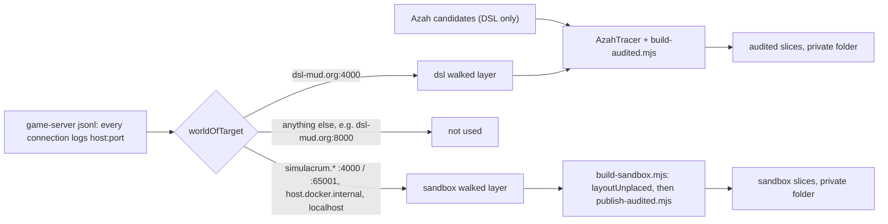
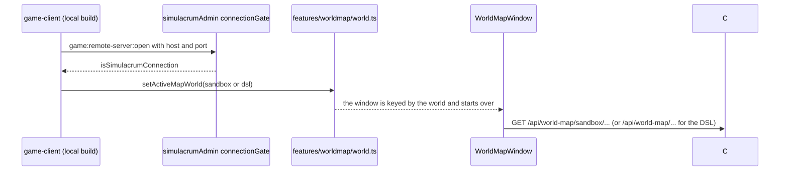
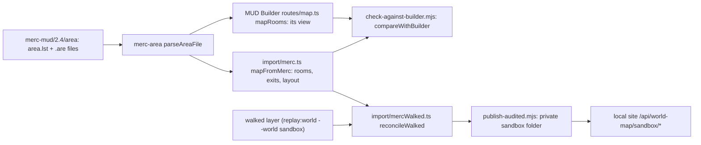

# Map worlds: the DSL and the Simulacrum (Developer Notes)

A map belongs to one **world**. There are two, and they never mix:

| World | id | What it is | Where it exists |
|---|---|---|---|
| The DSL | `dsl` | The production game. Azah's community map, checked against the owner's play ([verification.md](verification.md)). | Production and the owner's machine |
| The Simulacrum | `sandbox` | The owner's own experimental MUD. An unrelated game: no room of it is a room of the DSL, and Azah's map says nothing about it. | **Only the owner's own machine** (local docker). Never in a production deployment. |

The ids are the ones `copilot-core` already uses for lessons (`LESSON_WORLDS`). Azah mapped the DSL and nothing else.

## Rules

1. **Production knows one world.** There is no world parameter, no picker, and no mention of a second world in a production artifact: the public
   routes (`/api/world-map/index|area|room|neighbours|search`), the C# map page, the web game client and the mobile screen are unchanged and
   carry nothing that names another.
2. **A layer belongs to exactly one world.** A walked layer's progress file records its world; a replay refuses to continue it with another
   world's logs, and `build-sandbox.mjs` refuses a layer that is not the sandbox's. Azah's candidate layer is the DSL's: the verifier, the
   tracer and `build-audited.mjs` take only `--world dsl`.
3. **The world is chosen by the connection, never by the player.** In a development build the game client shows the Simulacrum's map exactly
   while it is connected to the Simulacrum, and the DSL's map otherwise (a closed socket is the DSL: it has no world of its own).
4. **Sessions are sorted by where they connected.** The game-server logs record every connection's `host:port`; the replay uses only the targets
   of one world (`apps/copilot-server/src/world/worlds.ts`). The DSL is only `dsl-mud.org:4000`: another port of the same host is not the production game.



## How a client picks its map



- `features/worldmap/world.ts` holds the registry: the DSL is always there; `registerMapWorld` adds another; `setActiveMapWorld(id)` switches (an
  unknown id is the DSL). It names no second world itself.
- `features/worldmap/localWorld.ts` is the **only** place that names the Simulacrum's world and its route. It is imported only inside
  `if (__SIMULACRUM_ADMIN_LOCAL__)` in `main.tsx` (a branch and import of its own), and it reuses the gate of Simulacrum Admin
  (`isSimulacrumConnection`, with the owner's stored addresses). A production bundle contains neither the module nor the route string:
  `scripts/check-local-only.mjs` fails a production `dist` that holds `api/world-map/sandbox`.
- The window and the shared API clients are per world, so an area read for one world is never shown for the other; `WorldMapWindow` is keyed
  by the world and starts over when it changes. The title says `Map · Simulacrum` for any world but the DSL.

### Picking the world by hand (a local build with two worlds)

The window follows the connection by itself. A build that knows more than one world also shows a small **Map** choice at the top of the gear
(`components/MapWorldPicker.tsx`): **Automatic (the world the connection chose)** or any registered world by hand, for example the DSL map while connected to
the Simulacrum, to debug a map rebuilt from the DSL. A pick wins over the connection until **Automatic** is chosen again; the connection keeps being
followed underneath, so "Automatic" always means what the connection says now. The pick lives for the page only (a reload is automatic again) and is not stored.

- `world.ts`: `pickMapWorld(id | null)`, `pickedMapWorldId()`, `automaticMapWorld()`, `listMapWorlds()`, `mapWorldName(world)` and the hook `useMapWorldChoice()`. None names a world.
- **Production draws nothing**: with a single world (every production build) `MapWorldPicker` returns null, so there is no control and no text; the guard
  `check-local-only` still finds no second-world string in a production dist. Tests: `world.test.ts`, `MapWorldPicker.test.tsx` and the choosing tests of `WorldMapWindow.test.tsx`.
- Fog, the player's own rooms and the cloud backup are per world already, so they follow the shown world.

## The server side

`WorldMapControllerBase` (production code) holds the five routes and their caching. `WorldMapController` (`/api/world-map`) serves the DSL from
`wwwroot/data/world-map` or `WORLD_MAP_DIR`. `SandboxWorldMapController` (`/api/world-map/sandbox`) lives in `Controllers/Copilot`, which the csproj
removes from the build unless `CopilotLocal=true`, and reads `SANDBOX_WORLD_MAP_DIR` (mounted by the **local** compose file only). Without the
variable it answers an empty map. `Server/scripts/verify-prod-output.mjs` fails a production build that holds `SandboxWorldMapController`,
`SANDBOX_WORLD_MAP_DIR` or the route text, and a production compose file that names the variable or the folder.

## The Simulacrum's full map: the game's own area files

The Simulacrum is built from files, so its map comes from the files: every room, exit and cross-area link of the `area.lst` list of
`merc-mud/2.4/area`, read with the parser the MUD Builder uses (`@shatteredarchive/merc-area`). What the files say is `confirmed` (confidence 1);
what players walked is evidence laid on top, never the other way round.



```text
pnpm --filter @shatteredarchive/shattered-maps-core build && pnpm --filter @shatteredarchive/mud-builder-server build
node services/shattered-maps-core/scripts/import-merc.mjs --area-dir <merc-mud/2.4/area> --walked <walked layer> --out <audited-map.json> --report <report.json>
node services/shattered-maps-core/scripts/check-against-builder.mjs --area-dir <merc-mud/2.4/area>
node services/shattered-maps-core/scripts/publish-audited.mjs --in <audited-map.json> --out <the sandbox folder> --date YYYY-MM-DD
```

What the importer does with what the game does (each rule is from the game's source):

- **Colour.** Titles and descriptions hold sigils (`{RAshen Trailhead{x`); `comm.c` `colour_translate` makes colour of 15 of them, `{{` is one
  brace and any other `{X` is printed as it stands. The map keeps the text a player reads (`playerText`), which is also what a walked room
  is matched on. The Builder shows the raw text, and the agreement check compares player text.
- **Dead exits.** An exit to room 0, -1 or a number no listed file defines gets no room in `db.c` `fix_exits`; `do_exits` never lists it and a move
  through it fails. It is no link. It is counted and listed in the report (25 in the files today).
- **Not in the schema.** Locked doors (649 live exits) and room-script `warp` lines (none today) have no place in the map file; they are counted.
- **Layout.** The files hold no coordinates. Each area is laid out on a grid of its own by `layoutUnplaced` (N up, E right, U/D floors), then the
  areas are placed side by side. Areas whose exits do not make a grid (mazes, loops) look tangled; the links are right.

Today: 49 areas, 3,142 rooms, 7,335 exits, 134 across areas. Four listed files hold no rooms (`help`, `rom`, `group`, `social`). The Builder
agrees on every room, title, exit and cross-file flag and counts the same 25 dead exits (`check-against-builder.mjs`).

**Walked evidence.** `--walked` lays the replay of the owner's own Simulacrum play over the map: matched rooms add traversals to links the files
hold. It reports what disagrees, because a disagreement means the files and the running game drifted apart or the replay matched wrongly. With the
current 102 walked rooms, 46 match one file room, 52 share a title with several (never guessed), 4 are unknown; of 15 walked links 12 agree and 3
do not (the walked layer itself is thin and has a wrong direction for some; they are listed for a look, not fixed by hand).

## Building the Simulacrum's map from walks only (the first version)

```text
pnpm --filter @shatteredarchive/copilot-server run replay:world --world sandbox --logs <log folder> --out <walked layer for the sandbox>
node services/shattered-maps-core/scripts/build-sandbox.mjs --world sandbox --walked <that layer> --out <audited-map.json>
node services/shattered-maps-core/scripts/publish-audited.mjs --in <audited-map.json> --out <the sandbox folder>
```

A walk records where an exit leads, never where a room is, so `layoutUnplaced` (core `src/layout.ts`) gives the rooms a place on the renderer's
grid by following exits (north is up, east is right, `U`/`D` change the floor; groups no exit connects are laid out side by side). From the
2026 logs the Simulacrum has 13 rooms and 40 links (27 views in 13 sessions); live walking grows it. The sandbox folder is a private folder
beside the DSL's, never under `wwwroot` and never in the DSL repo.

## Tests

`copilot-server/src/world/worlds.test.ts`, `replayCli.test.ts` (one world per layer), `shattered-maps-core/src/layout.test.ts`,
`scripts/build-sandbox.test.mjs`, and in the game client `features/worldmap/world.test.ts`, `localWorld.test.ts`, `useWorldMap.test.tsx`,
`api.test.ts` (the route prefix), `components/WorldMapWindow.test.tsx` (worlds) and `main.mapWorld.test.tsx` (the flag at the entry point).

## Live play (Phase 29f)

Copilot's live memory follows the same rule: one layer per world, chosen by the connection (`world/router.ts`), a view of an unknown world refused, and the DSL's views also followed on the audited map for movement evidence. Details and a diagram: [docs/copilot/world-memory.md](../copilot/world-memory.md).

## Walking the Simulacrum

The Simulacrum's map grows from its logs, so something has to walk it. `playwright/simulacrum-walk.mjs` (in the Copilot plan folder) signs in to the local
Simulacrum site with the test account, connects the game client to the Simulacrum's relay (the only host it ever dials), answers the ROM login or
creation prompts for a **throwaway character** (`Zzmapwalker`; its password is made on the first run and kept in the git-ignored
`simulacrum-walker.local.json`), turns the exits line on and takes a random walk (never an immediate step back when there is another exit; it sleeps
when its movement points run out). The game-server logs every view, and `replay:world --world sandbox` then `build-sandbox.mjs` and
`publish-audited.mjs` turn the log into the published map. Nothing is read from or written to the DSL: the walker has no DSL address in it.

Limits seen on the first runs (about 440 steps, 100 distinct rooms): the feed collapses identical consecutive room data, so many steps in look-alike
corridors do not become links, and a map made only of followed links has many separate groups; the layout puts each group side by side. A walk is
Copilot's own evidence, not the Simulacrum's complete map (its area files are the source of truth for that).
